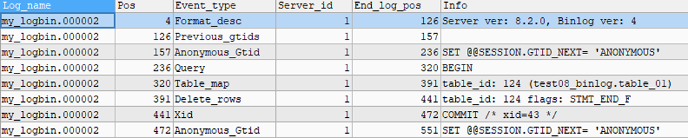

# MySQL

# SQL概述

SQL：Structure Query Language（结构化查询语言） 

> 所有关系型数据库都支持**标准SQL**语句
> 
> 但是也会有特定的**方言SQL**语句
> 
> 


## SQL分类

1. 创建和修改盛放数据的容器（数据定义DDL）

2. 表中添加、修改、删除数据（数据操纵DML）

3. 表中数据多条件查询（数据查询DQL）

4. 事务启动、提交和回滚（事务控制TCL）

5. 账号创建、权限控制（数据控制DCL）

**其中DDL、DML、DQL为基础和重点。**


## SQL基本语句

连接、退出、版本查询、注释

### 连接MySQL（本地运行）

cmd执行`登录用户名>mysql -uroot -p`

回车后输入密码即可\.

密码为123456

### 退出连接

`mysql> exit;`

> 注：只有退出时后面的分号可省略\.
> 
> 

### 查看版本

`mysql> select version();`

> 注：必须要有英文分号，否则不执行\.
> 
> 

### SQL注释

- 单行注释：\# 注释内容

- 单行注释：\-\- 注释内容    其中\-\-后面的空格必须有

- 多行注释：/\* 注释内容 \*/


## SQL命名规定和规范

### 标识符命名规定

1. 数据库名、表名不得超过30个字符，变量名限制为29个

2. 必须只能包含 A–Z, a–z, 0–9, \_共63个字符，而且不能数字开头

3. 数据库名、表名、字段名等对象名中间不能包含空格

4. 同一个MySQL软件中，数据库不能同名；同一个库中，表不能重名；同一个表中，字段不能重名[https://dev\.mysql\.com/doc/refman/8\.0/en/keywords\.html](https://dev.mysql.com/doc/refman/8.0/en/keywords.html)

5. 必须保证你的字段没有和保留字、数据库系统或常用方法冲突。如果坚持使用，请在SQL语句中使用\` \`（着重号）引起来

### 标识符命名规范

基于阿里巴巴规范手册。

1. 注释应该清晰、简洁地解释 SQL 语句的意图、功能和影响。

2. 库、表、列名应该使用小写字母，并使用下划线\(\_\)或驼峰命名法。

3. 库、表、字段名应该简洁明了，具有描述性，反映其所存储数据的含义。

4. 库名应与对应的程序名一致。例如：程序名为 EcommercePlatform 数据库名命名为 ecommerce\_platform

5. 表命名最好是遵循“业务名称\_表”的作用 例如：alipay\_task、 force\_project、trade\_config 

6. 列名应遵循“表实体\_属性”的作用 例如：product\_name

---

# DDL

数据定义语言（Data Definition Language）

- DDL 用于定义和管理数据库的结构，包括**库**、**表**、索引、视图等数据库对象的创建、修改和删除。

- DDL 不涉及对数据的操作，而是关注数据库的结构和元数据（容器）。

- DDL关键字

    - **CREATE**：用于**创建**数据库、表、索引、视图等。

    - **ALTER**：用于**修改**数据库对象的结构，如修改表结构、添加列、删除列等。

    - **DROP**：用于**删除**数据库对象，如删除表、删除索引等。


## 库管理

### 创建库

创建库，我们必须指定**库名，**可能指定**字符集**或者**排序方式**！

1. 创建数据库，使用默认的字符集和排序方式

`CREATE DATABASE 数据库名；`

2. 判断并创建默认字符集库（推荐）

`CREATE DATABASE IF NOT EXISTS 数据库名；`

3. 创建数据库指定字符集或者排序方式

`CREATE DATABASE 数据库名 CHARACTER SET 字符集；`

`CREATE DATABASE 数据库名 COLLATE  排序规则；`

4. 创建指定字符集和排序规则库

`CREATE DATABASE 数据库名 CHARACTER SET 字符集 COLLATE 排序规则；`

**方式3和方式4也可以加上****`if not exists`**

> **字符集和排序规则：**
> 
> 字符集就是我们常说的编码格式，决定了数据如何编码存储！
> 
> 排序规则决定了如何比较和排序存储在数据库中的文本数据。
> 
> 

> **常见字符集（Character Set）：**
> 
> 1. **utf8**：早期版本的字符集，最多3字节存储一个字符，3字节无法覆盖全部 unicode 编码，有显示乱码可能。
> 
> 2. **utf8mb4（MySQL8\+默认）**：解决utf8的存储限制，使用4字节进行字符存储，可以覆盖更广 Unicode 编码，包括表情符号等等。
> 
> 

> **常见排序规则（Collate）：**
> 
> 1. **utf8mb4\_0900\_ai\_ci（MySQL8\+默认）**：UTF\-8 的**不区分大小写**的排序规则。
> 
> 2. **utf8mb4\_0900\_as\_cs**：UTF\-8 的 Unicode 排序规则，区分大小写。
> 
> 

```SQL
# 查看默认字符集和排序方式命令
SHOW VARIABLES LIKE 'character_set_database';
SHOW VARIABLES LIKE 'collation_database';
```

### 查看和使用库

1. 查看当前所有库

`SHOW DATABASE``S``;`

2. 查看当前使用库

`SELECT DATABASE();`

3. 查看指定库下所有表

`SHOW TABLES FROM 数据库名;`

4. 查看创建库的信息和语句    

`SHOW CREATE DATABASE 数据库名;`

5. 切换库/选中库

`USE 数据库名;`

> 注：要操作表格和数据之前必须先说明是对哪个数据库进行操作，即先use库。
> 
> SQLyog 在点击库时会自动执行use命令。
> 
> 

### 修改库

```SQL
ALTER DATABASE 数据库名 CHARACTER SET 字符集； # 修改字符集gbk utf8
ALTER DATABASE 数据库名 COLLATE 排序方式;  # 修改排序方式
ALTER DATABASE 数据库名 CHARACTER SET 字符集 COLLATE 排序方式;  # 修改字符集和排序方式
```

> 注：DATABASE 不能改名。一些可视化工具可以改名，它是建新库，把所有表复制到新库，再删旧库完成的。
> 
> 

### 删除库

删除数据库前要三思。

1. 直接删除库

`DROP DATABASE 数据库名;`

2. 判断并删除库（推荐）

`DROP DATABASE IF EXISTS 数据库名;`


## 表管理

### 查看表

```SQL
# 查看表的列信息/表结构（字段名、数据类型、是否运行为空、索引标记、默认值、额外属性）
# 三种方式完全等价
DESC 表名;   
DESCRIBE 表名;
SHOW COLUMNS FROM 表名;

# 查看完整建表语句
SHOW CREATE TABLE 表名;

# 查看数据库里有哪些表
SHOW TABLES;   -- 提前USE 库名
SHOW TABLES FROM 库名;
```

查看表的列信息后得到的各个字段的含义分别解释如下：

- Field：表示字段名称。

- Type：表示字段数据类型。

- Null：表示该列是否可以存储 NULL 值。

- Key：表示该列是否已编制索引。

    - PRI 表示该列是表主键的一部分；

    - UNI 表示该列是 UNIQUE 索引的一部分；

    - MUL 表示在列中某个给定值允许出现多次；

    - 空白 表示该列没有建立索引。

- Default：表示该列是否有默认值（NULL表示没有设置默认值），如果有，那么值是多少。

- Extra：表示可以获取的与给定列有关的附加信息，例如 AUTO\_INCREMENT\(自增\) 等

### 创建表

```SQL
CREATE TABLE IF NOT EXISTS posts (
    post_id INT AUTO_INCREMENT PRIMARY KEY,
    title VARCHAR(255) NOT NULL COMMENT 'The title of the blog post',
    content TEXT NOT NULL COMMENT 'The content of the blog post',
    author_id INT NOT NULL COMMENT 'The ID of the author of the post',
    created_at TIMESTAMP DEFAULT CURRENT_TIMESTAMP COMMENT 'The timestamp when the post was created',
    CONSTRAINT fk_author FOREIGN KEY (author_id) REFERENCES authors(author_id)
) ENGINE = InnoDB DEFAULT CHARSET = utf8mb4 COMMENT 'Table storing blog posts';
```

```SQL
CREATE TABLE [IF NOT EXISTS] 表名 (
    列名 类型 [列可选约束], 
    列名 类型 [列可选约束] [COMMENT '列可选注释'],
    列名 类型 [列可选约束] [COMMENT '列可选注释'],
    列名 类型 [列可选约束] [COMMENT '列可选注释'],
    列名 类型 [列可选约束] [COMMENT '列可选注释'],
    [列可选约束]  -- 最后一行不能加逗号
) [表可选约束] [COMMENT '表可选注释'];
```

- **指定表名、指定列名、指定列类型为核心要素**，指定列约束、指定表配置、指定表和列的注释为可选要素（中括号表示可选的意思）

- 推荐使用`if not exists`，直接创建存在报错

- 注释不是必须的，但是是很有必要的

- 列之间使用`,`分割

#### 例题

假设你正在设计一个简单的在线图书管理系统。需要创建一个名为 book\_libs 的数据库，你决定使用 utf8mb4 字符集，排序方式选用大小写敏感的 utf8mb4\_0900\_as\_cs。

创建一个图书表 books，判断不存在再创建，并且手动设置 books 表字符集为 utf8mb4，添加表注释内容 。

同时图书表 books 中应该以下列：

图书名称 book\_name 列，类型为 varchar\(20\)，添加注释。

图书价格 book\_price 列，类型为 double\(4,1\)，添加注释。

图书数量 book\_num 列，类型为 int，添加注释。

按以上要求完成图书表的创建！

```SQL
CREATE DATABASE IF NOT EXISTS book_libs CHARACTER SET utf8mb4 COLLATE utf8mb4_0900_as_cs;

USE book_libs;  -- 必须先use

CREATE TABLE IF NOT EXISTS books (
    # 列的信息
    book_name VARcHAR(20) COMMENT '图书名',
    book_price DOUBLE(4,1) COMMENT '图书价格',
    book_num INT COMMENT '图书数量'
) CHARSET = utf8mb4 COMMENT '图书表';

SHOW TABLES FROM book_libs;
```

### 修改表

#### 修改表中列（字段）

在数据表定义中称为**列**；在 SELECT 查询返回的结果集中，对应的列称为**字段**；**行对应记录**。

```SQL
# 修改表，添加一列[可以指定X字段前或者后]
ALTER TABLE 表名 ADD 字段名 字段类型 [FIRST /AFTER 字段名];
# 修改表，修改列名[用来指定修改后的这一列在表中的位置]
ALTER TABLE 表名 CHANGE 原字段名 新字段名 新字段类型 [FIRST /AFTER 字段名]; 
# 修改表，修改列类型
ALTER TABLE 表名 MODIFY 字段名 新字段类型 [FIRST /AFTER 字段名];
# 修改表，删除一列
ALTER TABLE 表名 DROP 字段名;
```

- change 通常指外在的修改，modify 通常指内在的修改。

- CHANGE 必须写**新字段类型**，哪怕类型不变也要原样写一遍！

- FIRST 后不跟列名表示放在表的第一列。

- 若只需要移动列位置，则可借助修改列类型，让类型不变即可。

#### 修改表名

```SQL
# 修改表名
ALTER TABLE 表名 RENAME [TO] 新表名;
```

### 删除表与清空表

```SQL
# 删除表
DROP TABLE [IF EXISTS] 数据表1[, 数据表2, …, 数据表n];

# 清空表数据，包括表的关联记录
TRUNCATE TABLE 表名;
```

- 删除表和清空表数据命令都是**无法回滚**的！动作可不可以，执行之前需三思！


## 数据类型

[https://dev\.mysql\.com/doc/refman/8\.0/en/data\-types\.html](https://dev.mysql.com/doc/refman/8.0/en/data-types.html)

- 确定数据值范围，选择符合范围且存储空间占有最小类型；

- 不确定数据值范围，选择范围较大类型，避免值超范围异常（这是第一原则，第二原则才是节省存储空间）。

### 整数类型

MySQL支持多种数据类型，包括**整数、浮点数、定点数、字符串、日期时间**等。

MySQL支持**SQL标准整数类型** INTEGER（或 INT ）和 SMALLINT 作为标准的扩展。MySQL 还支持其他整数类型TINYINT、MEDIUMINT 和 BIGINT。下表显示了每种整数类型所需的存储和范围。

|类型|存储（字节）|最小值有符号|最大值有符号|最小值无符号|最大值无符号|
|---|---|---|---|---|---|
|TINYINT|1|$-2^7<br>$|$2^7 - 1$|$0$|$2^8 - 1$|
|SMALLINT|2|$-2^{15}$|$2^{15} - 1$|$0$|$2^{16}-1$|
|MEDIUMINT|3|$-2^{23}$|$2^{23} -1$|$0$|$2^{24}-1$|
|INT|4|$-2^{31}$|$2^{31}-1$|$0$|$<br>2^{32}-1$|
|BIGINT|8|$-2^{63}$|$2^{63} - 1$|$0$|$2^{64}-1$|

- 一个字节最多存储8位二进制数。

- 无符号==无负号，整数类型都可以添加 **unsigned** 修饰符，添加以后对应列数据变成无负号类型，值从0开始。

- 选择标准：选合适范围的，范围合适先选占用空间最小的！

```SQL
t1_age TINYINT UNSIGNED COMMENT '年龄字段，tinyint类型，无符号范围为0-255'，
t1_number BIGINT UNSIGNED COMMENT '学号，不确定具体范围选最大的且没有负号'
```

### 浮点数类型

FLOAT 和 DOUBLE 类型表示近似的数值数据值（**多位会四舍五入**）。MySQL 使用 4 个字节表示单精度值，使用 8 个字节表示双精度值。下表显示了每种类型所需的存储和范围。

|类型|存储（字节）|M（整数\+小数位数）|D（小数位数）|
|---|---|---|---|
|FLOAT\(M,D\)|4|M最大为24|D最大为8|
|DOUBLE\(M,D\)|8|M最大为53|D最大为30|

- 从 MySQL 8\.0\.17 开始，不推荐使用**非标准SQL语法** `FLOAT(M,D)` 和 `DOUBLE(M,D)`，未来版本中可能删除对它的支持。

- 支持 **unsigned **修饰，**添加以后只保留正值范围，负值不会迁移到正值！**

```SQL
stu_height FLOAT(4,1) UNSIGNED COMMENT '身高，保留一位小数，多位会四舍五入',
```

### 定点数类型

DECIMAL 类型存储精确的数值数据值。当需要**保持精确精度**时，例如货币数据，商品价格等等！

|类型|存储（字节）|M（整数\+小数位数）|D（小数位数）|
|---|---|---|---|
|DECIML\(M,D\)|动态计算|M最大为65|D最大为30|

- DECIMAL 类型的存储空间是可变的，它的存储大小受 DECIMAL 数据类型定义时指定的精度和规模影响。

- 如果D小数位数为 0，DECIMAL 则值不包含小数点或小数部分。

- **多位会四舍五入**。

```SQL
emp_salary DECIMAL(8,1) COMMENT '工资，保留一位小数，多位会四舍五入',
```

#### 浮点数与定点数的具体区别

- 浮点数是**二进制近似存储**，运算快，存在精度丢失；定点数是**十进制精确存储**，开销更大，适合财务金额等要求精确的场景。

    - eg：0\.1、0\.2 无法用“有限位”二进制精确表达。`0.1 + 0.2 != 0.3`

- MySQL 中`FLOAT(M,D)`/`DOUBLE(M,D)`是非标准语法，8\.0\.17 起弃用，`DECIMAL(M,D)` 为标准SQL语法不受影响。

### 字符串类型

CHAR 和 VARCHAR 类型都可以存储比较短的字符串。

|字符串（文本）|特点|长度|长度范围（字符）|存储空间|
|---|---|---|---|---|
|CHAR\(M\)|**固定长度**|M|0 \<= M \<= 255|M\*4个字节（utf8mb4）|
|VARCHAR\(M\)|**可变长度**|最大M|MySQL一行数据最多65535字节|最大\(M\*4 \+ 1\)个字节（utf8mb4）|

- `CHAR(M)`类型一般需要预先定义字符串长度。如果不指定\(M\)，则表示长度默认是1个字符。

    - **CHAR 类型永远不为空；VARCHAR 类型可能为空，多出来的1个字节是用来记录是否为空的。**

- 保存数据的实际长度比 CHAR 类型声明的长度小，则会**在右侧填充空格以达到指定的长度**。

- 当 MySQL **读取** CHAR 类型的数据时**，CHAR 类型的字段会自动去除尾部的空格**。

- CHAR 类型较 VARCHAR 类型性能较好。


- `VARCHAR(M)` 定义时，**必须指定长度M**，否则报错。VARCHAR 会自动进行伸缩。

    - MySQL4\.0 版本以下，`varchar(20)`：指的是20字节，如果存放UTF8汉字时，只能存6个（每个汉字3字节）；

    - MySQL5\.0 版本以上，`varchar(20)`：指的是20字符。

- VARCHAR 类型是识别空格的，在**读取** VARCHAR 类型的字段数据时，**若有会保留数据尾部的空格。**


通过显示将各种字符串值存储到 `CHAR(4)` 和 `VARCHAR(4)`列的结果（假设使用**单字节字符集**，如 latin1 ）说明 CHAR 和 VARCHAR 之间的差异。

- 单字节字符集：一个字符，固定占用 1 个字节（8 bit）。

- latin1：1 个字符占 1 字节。只能存西欧文字，没有中文汉字编码。

|插入值|CHAR\(4\)|所需存储|VARCHAR\(4\)|所需存储|
|---|---|---|---|---|
|''|'    '|4 bytes|''|1 byte|
|'ab'|'ab  '|4 bytes|'ab'|3 bytes|
|'abcd'|'abcd'|4 bytes|'abcd'|5 bytes|

#### 讨论 VARCHAR 类型的 M

```SQL
CREATE TABLE 表名 (  
    post_name  VARCHAR(16000) NOT NULL, 
    post_name2  VARCHAR(384) NOT NULL  
) ENGINE=INNODB CHARSET=utf8mb4;

错误代码： 1118
Row size too large. The maximum row size for the used table type, not counting BLOBs, is 
65535. This includes storage overhead, check the manual. You have to change some columns to 
TEXT or BLOBs
```

- 在 MySQL 的设定中，单行数据最大能存储65535字节数据（注意：是 **一行** **非额外存储** **所有列总和** 且 **单位是字节**）。

- 字符集为 utf8mb4，每个字符占4个字节。字符串列需要1个额外字节空间记录是否为空。

- \(65535 \- 1\) // 4 = 16383, 所以**单列** utf8mb4 字符集类型最大字符限制16383字符。如果有多列，则总和不能超过16383。

在 MySQL 的设定中，单行数据最大能存储65535字节数据，但是 **TEXT 和 BLOB**** **类型不计算，**他们属于额外存储，不占用一行的最大空间限制！**这种场景可以使用 TEXT 进行某列类型替换即可！

#### 文本类型

在 MySQL 中，TEXT 用来保存文本类型的字符串，总共包含4种类型，分别为TINYTEXT、TEXT、MEDIUMTEXT 和 LONGTEXT 类型。

在向 TEXT 类型的字段保存和查询数据时，系统自动按照实际长度存储，不需要预先定义长度。这一点和 VARCHAR 类型相同。

|文本字符串类型|特点|长度\(字符\)|存储范围\(字节\)|占用的存储空间|
|---|---|---|---|---|
|TINYTEXT|小文本、可变长度|L|0 \<= x \<= 255|L \+ 2个字节|
|TEXT|文本、可变长度|L|0 \<= x \<= 65535|L \+ 2个字节|
|MEDIUMTEXT|中等文本、可变长度|L|0 \<= x \<= 16777215|L \+ 3个字节|
|LONGTEXT|大文本、可变长度|L|0 \<= x \<= 4294967295|L \+ 4个字节\(最大4g\)|

##### 开发经验

- 短文本，固定长度使用 char          例如：性别，手机号

- 短文本，非固定长度使用 varchar   例如：姓名，地址

- 大文本，建议存储到文本文件，使用 varchar 记录文件地址，**不使用 TEXT 直接存储大文本，他性能非常较差！**

#### 其他

- ENUM（枚举）

MySQL 特有，非标准 SQL。

**单选**，建表时预先定义全部可选值，字段只能取其中一个。

```SQL
`gender` ENMU('男','女')
```

- SET（集合）

MySQL 特有，非标准 SQL。

**多选**，可同时选 0 /1 / 多个预设值，多个值使用逗号分隔。

```SQL
`work_place` SET('北京','深圳','上海','武汉')
# 填充表时若选多个预设值需要逗号分隔，如'北京,深圳,武汉'
```

**在 SET 集合中查找目标字符串****`FIND_IN_SET(str, strlist)`**

`str`：要查找的目标字符串；`strlist`：英文逗号`,`分隔的字符串（不能带空格）

找到：返回位置，**从 1 开始计数，且找到第一个就终止**；找不到 / strlist 为空串：返回 0；任意参数为 NULL：返回 NULL。

```SQL
SELECT * FROM 表名 WHERE FIND_IN_SET('上海', work_place) > 0;
```

```SQL
SELECT * FROM 表名 WHERE work_place LIKE '%上海%';
```

有些条件下`LIKE`可能会误匹配，比如`1`匹配到`11`。

### 日期和时间类型

用于表示时态值的日期和时间数据类型为 DATE 、TIME、DATETIME、TIMESTAMP 和 YEAR 。每种类型都有一个有效值范围，换一种思路，可以理解为**时间类型就是特殊格式的字符串**。

|类型|名称|字节|日期格式|最小值|最大值|
|---|---|---|---|---|---|
|YEAR|年|1|YYYY或YY|1901|2155|
|TIME|时间|3|HH:MM:SS|\-838:59:59|838:59:59|
|DATE|日期|3|YYYY\-MM\-DD|1000\-01\-01|9999\-12\-03|
|DATETIME|日期时间|8|YYYY\-MM\-DD<br>HH:MM:SS|1000\-01\-01 00:00:00|9999\-12\-31 23:59:59|
|TIMESTAMP|日期时间|4|YYYY\-MM\-DD<br>HH:MM:SS|1970\-01\-01 00:00:00|2038\-01\-19 03:14:07|

- YEAR 类型有两位或者四位的表达形式。两位时可赋值00\-99对应年限，其中\[00\-69\]对应\[2000\-2069\]，\[70\-99\]对应\[1970\-1999\]，**建议直接使用四位年值表达**！

- 时间类型就是一个特殊格式的字符串，**插入数据的时候要使用****`''`**。

- 时间类型若需要自动赋值，需要手动添加相关设置。DATETIME 和 TIMESTAMP 类型的自动初始化和更新方式如下。

```SQL
# 方式1：插入时默认当前时间且修改数据时也自动更新维护为当前时间
ts TIMESTAMP DEFAULT CURRENT_TIMESTAMP ON UPDATE CURRENT_TIMESTAMP, 
dt DATETIME DEFAULT CURRENT_TIMESTAMP ON UPDATE CURRENT_TIMESTAMP

# 方式2：插入时默认当前时间，后续修改数据时间不变
ts TIMESTAMP DEFAULT CURRENT_TIMESTAMP, 
dt DATETIME DEFAULT CURRENT_TIMESTAMP
```

### 例题

假设你正在设计一个简单的在线图书管理系统。需要创建一个名为 book\_libs 的数据库,你决定使用 utf8mb4 字符集，排序方式选用大小写敏感的 utf8mb4\_0900\_as\_cs。

创建一个学生表（student）来存储借书的学员信息，其中应包含学生姓名、年龄、身高、生日以及注册时间和更新时间等属性。

```SQL
CREATE DATABASE IF NOT EXISTS book_libs CHARACTER SET utf8mb4 COLLATE utf8mba_0900_as_cs;

USE book_libs;

CREATE TABLE IF NOT EXISTS student (
    stu_name VARCHAR(10) COMMENT '学生的姓名',
    stu_sex CHAR(1) COMMENT'学生的性别',
    stu_age TINYINT UNSIGNED COMMENT '年龄 0-255',
    stu_height DOUBLE(4,1) COMMENT '身高',
    stu_birthday DATE COMMENT '生日',
    stu_register TIMESTAMP DEFAULT CURRENT_TIMESTAMP COMMENT '注册日期，插入的时候自动维护',
    st_uptime TIMESTAMP DEFAULT CURRENT_TIMESTAMP ON UPDATE CURRENT_TIMESTAMP COMMENT '更新日期，插入和更新白动维护时间'        
)
```

---

# DML

数据操作语言（Data Manipulation Language）

- DML 用于数据库数据插入、删除、更新三种操作。

    - 即“增删改查”中的**“增删改”**。

- DML 不影响库表结构，但是**会真正影响数据库数据**。

- DML 关键字

    - **INSERT**：用于数据**插入**。

    - **UPDATE**：用于数据**修改**。

    - **DELETE**：用于数据**删除**。

- 数据操作最基本单位是 **行**，按行进行增删改！


## 插入

1. 为表的一行**所有**字段（列）插入数据

```SQL
INSERT INTO 表名 VALUES(值1,值2,值3);
```

值的顺序必须和表中所有列顺序完全一致，不能少，不能乱。

2. 为表的一行**指定**字段（列）插入数据（推荐）

```SQL
INSERT INTO 表名(列1,列2,...) VALUES(值1,值2,...);
```

列和值**一一对应**，顺序可自定义，可省略有默认值 / 自增的列。

若需要插入空值且默认值不为空，则插入`NULL`即可。

3. 同时插入多条记录

上述两种语法都可以转为一次插入多条数据，只需在 values 后面写多个\(值1,值2,\.\.\.\)即可，\(\)代表一行。

```SQL
INSERT INTO 表名 VALUES(值1,值2,...),....,(值1,值2,...);
INSERT INTO 表名(列1,列2,...) VALUES(值1,值2,...),...,(值1,值2,...);

# 可调整格式为
INSERT INTO 表名(列1,列2,...) 
VALUES
(值1,值2,...),
...,
(值1,值2,...);
```

- VALUES 也可以写成 VALUE，但是 VALUES 是标准写法。

- **字符串和日期型数据应包含在单引号中**。


## 修改

1. 修改表中所有行数据（全表修改）

```SQL
UPDATE 表名 SET 列1=值1, 列2=值2, ..., 列n=值n;
```

更新表中所有行的指定列数据。

2. 修改表中符合条件的行数据（条件修改）

```SQL
UPDATE 表名
SET 列1=值1, 列2=值2, ..., 列n=值n
[WHERE 条件];
```

条件修改只是在后面添加where，where后面指定相关的条件即可。

WHERE 筛选需要更新的行，**省略 WHERE 会更新全表。**

**WHERE 多个条件用 AND（且）、OR（或）、NOT（非）连接**；优先级 NOT \> AND \> OR；复杂条件用小括号改变顺序；**判断 NULL 必须 IS NULL**，不能 = NULL。（更多内容见 DQL 的运算符部分）

- 字符串、日期加单引号，数字不用

- 可以使用原列的值计算，包括`+、-、*、/、DIV、%/MOD`，不可使用`+=`等这种方法（更多详细内容见 DQL 的运算符部分）

```SQL
# id小于20的年龄+1
UPDATE student SET age = age + 1 WHERE id < 20;
```


## 删除

1. 删除表中所有行数据（全表删除）

```SQL
DELETE FROM 表名;
# 这里的表名可以是一个表也可以是多个表
```

和 DDL 的 TRUNCATE 不同之处在于不会删除表的关联记录。

2. 删除表中符合条件的行数据（条件删除）

```SQL
DELETE FROM 表名 WHERE 条件;
# 这里的表名可以是一个表也可以是多个表，这种写法表示删除所有表中符合条件的行
```

与修改操作相同，**WHERE 多个条件用 AND（且）、OR（或）、NOT（非）连接**；优先级 NOT \> AND \> OR；复杂条件用小括号改变顺序；**判断 NULL 必须 IS NULL**，不能 = NULL。（更多内容见 DQL 的运算符部分）

3. 删除**指定表**中符合条件的行数据（条件删除）

```SQL
DELETE 表1 FROM 表1,表2 WHERE 条件;
```

- DELETE 操作可回滚。

### 多表删除

[DELETE官方文档](https://dev.mysql.com/doc/refman/8.0/en/delete.html)

多表删除和 SELETE 查询是很**类似**的，但也**有值得注意的区别**。

```SQL
# 内连接写法1
DELETE t1, t2 
FROM t1 INNER JOIN t2 INNER JOIN t3
WHERE t1.id=t2.id AND t2.id=t3.id;

# 内连接写法2
DELETE FROM t1, t2 
USING t1 INNER JOIN t2 INNER JOIN t3
WHERE t1.id=t2.id AND t2.id=t3.id;

# 外连接
DELETE t1 
FROM t1 LEFT JOIN t2 ON t1.id=t2.id 
WHERE t2.id IS NULL;
```

上面的语句是官方文档中的语句，有很多值得注意的地方：

1. **DELETE 后面紧跟表名**指定要删除这些表中符合条件的行数据，具体删除哪些取决于 WHERE 条件。**DELETE 后省略表名**表示要删除所有 FROM 表中符合条件的行数据。

    - 这是和 SELECT 查询语句的一大**区别**。SELECT 需要指定具体的列，选择全部的列也要用 \* 表示；DELETE 只需要指定表即可，若想在 DELETE 后省略表名则需要移到 FROM 后指出，若有其他参与匹配但不需删除的表则在 USING 后指出（这里的 USING 和自然连接里面的 USING 是不同的，详见下文）。

2. 注意上面语句中的内连接写法并不是正常的写法，他省略了 ON，把过滤条件全都放在了 WHERE 里面。并不推荐这种写法，还是写上 ON 比较好。

```SQL
# 内连接标准写法1（最推荐写法）
DELETE t1, t2 
FROM t1 
JOIN t2 ON t1.id=t2.id
JOIN t3 ON t2.id=t3.id;

# 内连接标准写法2
DELETE FROM t1, t2
USING t1
JOIN t2 ON t1.id = t2.id
JOIN t3 ON t2.id = t3.id;

-- 整个文档所有的inner和正常的一样都可以省略
```

3. 再注意 DELETE 中关键字`USING`的用法，显然他和 SELETE 中自然连接的`USING`用法大不相同。具体来说，**这里的 USING 用法更像是一种类似于 FROM 的用法**，他的意思仅仅是表示用 t1 表与后面的 t2 t3 表相连，之所以这么使用，是因为 FROM 被用于指定要删除的表了，但并不是所有参与匹配的表都需要删除，所以就需要一个新的关键词来代替原先 FROM 的用法。

    - DELETE 中 USING 的用法其实就直接相当于：

    ```SQL
    DELETE 
    FROM t1, t2 
    USING t1, t2, t3 
    WHERE t1.id=t2.id AND t2.id=t3.id;
    # 不推荐这种写法，只是为了便于理解using
    ```

    - DELETE 的 `USING` 后面，其实还可以再出现自然连接的 `USING`:

    ```SQL
    DELETE FROM t1, t2
    USING t1
    INNER JOIN t2 USING (id)
    INNER JOIN t3 USING (id);
    # 不推荐这种写法，很容易看晕，还是推荐显示ON
    ```

4. 多表删除也可以使用自连接，用法和 SELETE 的是一致的。

[leetcode196\.删除重复的电子邮箱](https://leetcode.cn/problems/delete-duplicate-emails/description/?envType=problem-list-v2&envId=gOA6oasd)

```SQL
DELETE t1
FROM table_name t1, table_name t2
WHERE t1.email = t2.email AND t1.id > t2.id;
# 自连接，内连接非标准语法
```

---

# DQL

- 数据查询语句（Data Query Language）

- DQL 用于**查询**数据库数据操作。

- DQL 不影响库表结构，也**不会影响原表的数据**。

- DQL 会基于**原表数据**查询出一个**虚拟表**。

- DQL 关键字

    - **SELECT**：用于**查询**数据。

**单表查询：**

select 语法、where 条件、运算符、单行多行函数、分组和排序等等\.\.\.

**多表查询：**

相比于单表查询多了 多表数据合并语法。

即先用合并语法将多张真实表合并成一张中间虚拟表，再单表查询即可。


## SELECT 语法

1. 非表查询

```SQL
SELECT 1;
SELECT 9/2;
SELECT VERSION();  -- 查询当前 MySQL 的版本号
```

类似控制台输出，直接输出结果。

2. 指定表

```SQL
SELECT 列1,列2,列3,... FROM 表名;
SELECT 表名.列名 FROM 表名;  # 常用于多表查询，因为多表的列名可能重复
SELECT 表名.* FROM 表名;  # 表示全部列
SELECT * FROM 表名;  # 单表查询表示单表所有列，多表查询表示多表所有列
```

指定表，查询表中的全部或者某些列（**全表查询**，即查询所有的行）。

列和列之间使用`,`分割，如果是全部列可以使用通配符`*`替代。

3. 查询列起别名

```SQL
SELECT 列1 AS 别名1,列2,列3 AS 别名3,... FROM 表名;
SELECT 列1 别名1,列2,列3 别名3,... FROM 表名;
```

查询列可以起别名，`AS`可以省略。省略`AS`时原列名与别名之间要有一个空格。

起别名的意义主要是简化列名或者与后期数据属性对应（如命名规则不一样时统一命名规则）等。

如果别名想要区分大小写，可以添加反引号  例如：\`Name\`。

4. 去重重复行

```SQL
SELECT DISTINCT 列1[,列2,列3,...] FROM 表名;
```

综合指定列去重复行，可以指定单列或者多列，但是 DISTINCT 关键字只写一次且在指定列前面。

DISTINCT 只保证返回不重复的值，没有保留第一次出现行的语义，即**只消除重复行，不关心先后**，所以 **DISTINCT 一般单独使用**。

5. 查询常数

```SQL
SELECT '北师大' AS school, 列1, 列2, ... FROM 表名;  -- as同样可省略；可同时人为添加多列
/*
新增一列别名为school，每一行结果school列的值固定都是北师大，'北师大'为字符串常量。
另外此虚拟表还包括从真实表中选中的列1, 列2, ...
形如：
school|列1|列2|...
北师大|...|...|...
北师大|...|...|...
......
*/

# 若需选择所有列，可直接用通配符`*`代替，但通配符`*`必须放在第一位
# 使用 `表名.*` 可以放在后面
SELECT *, '北师大' AS school FROM 表名;
```

SELECT 查询还可以对常数进行查询，就是在 SELECT 查询结果中**增加固定的常数列**。这列的取值是我们指定的，而不是从数据表中动态取出的。

6. 条件查询（过滤数据）

```SQL
SELECT 字段1,字段2,... FROM 表名 WHERE 过滤条件;
```

where添加以后，就不是全表查询，先过滤条件，符合，再返回指定列。

7. 没有数据时返回 NULL

[leetcode 619\. 只出现一次的最大数字](https://leetcode.cn/problems/biggest-single-number/description/?envType=problem-list-v2&envId=gOA6oasd) 

[leetcode 176\. 第二高的薪水【需处理去重（DISTINCT的执行顺序、DENSE\_RANK\(\)）、数据不足】](https://leetcode.cn/problems/second-highest-salary/description/?envType=problem-list-v2&envId=gOA6oasd)

1. **使用聚合函数对空值进行处理时，SUM/AVG/MAX/MIN都会返回null值。**

2. **直接在select语句中写入空值（写在select中而非from中），直接运行select语句，我们将会得到null值。**

3. select 子查询找不到数据会返回 NULL，依据这个原理可使用 ifnull 函数处理，即`ifnull(标量子查询, NULL)`，当标量子查询没有数据时，这么处理能得到 NULL 值。

    1. 同理也可以使用自定义函数。[leetcode 177\. 第N高的薪水【自定义函数】](https://leetcode.cn/problems/nth-highest-salary/description/?envType=problem-list-v2&envId=gOA6oasd)

- 当数据库中无法匹配当前条件时，输出的数据行是为空而非 null 的。

- limit 语句不会输出新 null 值（除非表格中本身存在 null 值），因为 limit 语句对表格只是进行截取。

- where 语句所带来的限制条件不会输出新的 null 值（除非表格中本身存在 null 值），同理 having 也是一样。

## 运算符

### 算术运算符

算术运算符主要用于数学运算，其可以连接运算符前后的两个数值或表达式，对数值或表达式进行加（\+）、减（\-）、乘（\*）、浮点除法（/）、整数除法（DIV）和取模（%/MOD）运算。

> **运算表达式可以应用在select列位置或者where条件后！**
> 
> 

```SQL
SELECT 100, 100 + 0, 100 - 0, 100 + 50, 100 + 50 -30, 100 + 35.5, 100 - 35.5 ,
       3*5, 3*5.0, 3/5 , 100/0, 5 DIV 2, -5 DIV 2, 100 /(1-1), 
       5 % 2, 5 MOD 2, -5 % 2, -5 MOD 2;
       
# 结果 -> 100, 100, 100, 150, 120, 135.5 ,64.5, 15, 15.0, 0.6, null, 2, -2, null,
          1, 1, -1, -1 
```

- 运算符优先级与正常的一致，提高优先级可以使用`()`。

- `*` 如果有浮点，会保留浮点类型，参数都是整数结果整数。

- `/`和`DIV`的区别：`/` 浮点除法，`DIV`整除除法。

- 如果出现除以零的情况，通常会返回 `NULL`，而不是抛出错误。

- 两种取模结果是等效的。`% `和`MOD`都是关系型数据库的标准用法，所以喜欢哪个用哪个。

    - 判断奇偶可看取模后是否为0\.

- **NULL 与任何值运算结果都为 NULL。**

    - 可使用`IFNULL(expr1,expr2)`，`expr1` 不为 `NULL` 返回 `expr1`，为 `NULL` 返回 `expr2`；仅判空值 `NULL`，空字符串不处理。MySQL 特有，非标准 SQL，属于流程函数。

### 比较运算符

|比较运算符|描述|比较运算符|描述|
|---|---|---|---|
|\>|大于运算符|IS NULL|NULL 值测试|
|\>=|大于或等于运算符|IS NOT NULL|NOT NULL 值测试|
|\<|小于运算符|BETWEEN \.\.\. AND \.\.\.|值是否在范围内|
|\<=|小于或等于运算符|NOT BETWEEN \.\.\. AND \.\.\.|值是否不在范围内|
|\<\>|不相等运算符|IN \(\)|值是否在一组值中|
|\!=|不相等运算符（非标准）|NOT IN \(\)|值是否不在一组值中|
|=|相等运算符|LIKE|简单的模式匹配（模糊等于）|
|\<=\>|NULL 安全等于运算符（非标准）|NOT LIKE|否定简单的模式匹配|

- 比较运算符的结果为 **1、0 、NULL **, 其中 1 代表 true，0 和 NULL 代表 false。

> `A <= expr <= B` 是错误写法，会被按照 `(A <= expr) <= B` 解析，因为 `A <= expr` 的结果是 `0` 或 `1`，所以整体变成 `0 <= B` 或 `1 <= B`，这通常和 `expr` 是否在 `[A, B]` 区间内无关，起不到区间筛选作用。
> 
> 

- 操作适用于数字和字符串。根据需要，字符串会自动转换为数字，数字会自动转换为字符串，**不需要考虑类型****`'1' = 1`**，其结果是 true。

1. 等于对比

```SQL
SELECT 1 = 0;                                    -> 0 
SELECT '0' = 0;                                  -> 1 
SELECT '0.0' = 0;                                -> 1 
SELECT '.01' = 0.01;                             -> 1
SELECT (3,4) = (3,4);                            -> 1
SELECT 1 <=> 1, NULL <=> NULL, 1 <=> NULL;       -> 1, 1, 0 
SELECT 1 <=> 1, NULL IS NULL, 1 IS NULL;         -> 1, 1, 0 
SELECT 1 = 1, NULL = NULL, 1 = NULL;             -> 1, NULL, NULL
```

`<=>`与`=`相比，`<=>`可以做 NULL 判断，但是他是“方言”，NULL 判断推荐使用`IS NULL`或者`IS NOT NULL`。

2. 不等于运算使用

```SQL
SELECT '.01' <> '0.01';        -> 1 
SELECT .01 <> '0.01';          -> 0 
SELECT 'zapp' <> 'zappp';      -> 1
```

**如果双方都是字符串，就按照字符串比较，不会转成数字比较。**

3. 区间运算使用

```SQL
SELECT 2 BETWEEN 1 AND 3, 2 BETWEEN 3 and 1;      -> 1, 0 
SELECT 1 BETWEEN 2 AND 3;                         -> 0 
SELECT 'b' BETWEEN 'a' AND 'c';                   -> 1 
SELECT 2 BETWEEN 2 AND '3';                       -> 1
```

表达式 `expr BETWEEN A AND B` 等效于表达式 `(A <= expr AND expr <= B)`，左闭右闭。

固定第一个是下限，第二个是上限，不会自动交换。

字符串就是按照 ASCII 编码排序。

有字符串和数字，会自动值转化。

4. 组范围对比

```SQL
manager_id not in (select employee_id from employees)     -> 1/0
SELECT 2 IN (0,3,5,7);                                    -> 0 
SELECT 'wefwf' IN ('wee','wefwf','weg');                  -> 1
SELECT (3,4) IN ((1,2), (3,4));                           -> 1 
SELECT (3,4) IN ((1,2), (3,5));                           -> 0
SELECT 'a' NOT IN ('a','b','c'), 1 NOT IN (2,3);          -> 0, 1
# 整体对比
SELECT (3,'男') IN (3,'男');          -> **报错，相当于拿(3,'男')与3比较**
SELECT (3,'男') IN ((4,'男'));        -> 0
SELECT (3,'男') = (3,'男');           -> 1
```

`NOT IN`用法和`IN`一样，他只是表示是否不在范围内。

5. 简单匹配模式

```SQL
SELECT 'aaa' LIKE '%', 'aaa' LIKE '_', 'aaa' LIKE '___';          -> 1, 0, 1  
SELECT 'abc' LIKE '_a%', 'abc' LIKE 'a__', 'abc' LIKE '%c';       -> 0, 1, 1 
-- '___'是三个'_'拼接得到的，不是一整个下划线
```

LIKE 运算符主要用来**匹配字符串**，通常用于**模糊匹配**，如果满足条件则返回 1，否则返回 0。如果给定的值或者匹配条件为 NULL，则返回结果为 NULL。

LIKE运算符通常使用如下**通配符**：

- `%`：匹配0个或多个字符。

- `_`：只能匹配一个字符。

6. 特殊情况扩展

**多列一次对比**

`(a, b) = (x, y)` 等同于 `(a = x) AND (b = y)`

`(a, b) <=> (x, y)` 等同于 `(a <=> x) AND (b <=> y)`

`(a, b) <> (x, y)` 等同于 `(a <> x) OR (b <> y)`

#### REGEXP\_LIKE\(\)

`REGEXP_LIKE`是 SQL 中用于正则表达式匹配的函数，判断一个字符串是否匹配指定的正则模式。它比`LIKE`强大得多，但不同数据库的支持情况差异较大（MySQL 8\.0\.4 引入，比传统的`REGEXP`操作符更灵活）。

`EGEXP_LIKE`是强大的正则匹配函数，**可用于****`WHERE`****或****`CASE`****中，也可以在****`SELECT`****列表中返回匹配结果 等**。

> regexp 是 regular expression \(正则表达式\) 的缩写。
> 
> 

```SQL
REGEXP_LIKE(source_string, pattern [, match_type])
/*
参数解释：
source_string：要搜索的字符串，可以是列、常量或表达式。
pattern：正则表达式模式。
match_type：可选，控制匹配行为，如大小写、多行模式等；可组合使用。
*/

source_string REGEXP pattern    # 区别在于 REGEXP_LIKE 支持传入 match_type

# 筛选不匹配的用法
source_string NOT REGEXP pattern
REGEXP_LIKE(source_string, pattern) = 0
```

> **由于 ****`REGEXP_LIKE()`**** 返回 ****`1`**** 或 ****`0`****或 ****`NULL`****，用 ****`= 0`**** 表达“不匹配”，等价于 ****`NOT REGEXP`****。**
> 
> 两种方法都没有考虑 NULL 的情况（都是遇 NULL 返回 NULL），若想处理 NULL 需要使用 IS NULL 或者 COALESCE 单独处理。[leetcode 3451\. 查找无效的 IP 地址](https://leetcode.cn/problems/find-invalid-ip-addresses/description/?envType=problem-list-v2&envId=gOA6oasd)
> 
> 

- 作用：检查`source_string`是否匹配 `pattern` 正则表达式，

- 返回值：匹配成功返回`1`，匹配失败返回`0`，任一参数为 NULL 返回`NULL`。

- 典型用途：在`WHERE`子句中做复杂条件过滤，例如验证邮箱、手机号、提取特定格式的文本。

- `match_type`可选值：

|字符|含义|
|---|---|
|c|区分大小写|
|i|不区分大小写|
|m|多行模式，^ 和 $ 匹配每行的开头/结尾|
|n|点号 \. 可以匹配换行符|
|u|Unix 行结尾（仅影响 ^、$ 和 \.）|

> **可以组合使用**，例如`im`。
> 
> 默认行为：对于非二进制字符串，大小写敏感性取决于列的排序规则（collation），不确定使用`c`或`i`显式控制即可；对于二进制字符串，默认区分大小写。
> 
> 

- MySQL 8\.0 使用 ICU 正则库，支持 Unicode。常用元字符：

|元字符|含义|元字符|含义|
|---|---|---|---|
|^|匹配整个字符串开头|\[abc\]|字符集，匹配 a、b 或 c 中的任意一个字符|
|$|匹配整个字符串结尾|\[^abc\]|否定字符集，匹配除 a、b、c 以外的任意字符|
|\.|匹配任意单个字符（默认不匹配换行符`\n`）|\[a\-z\]|字符范围，匹配 a 到 z 之间的任意字符|
|\*|前一个字符或子表达式重复 0 次或多次|\||或，匹配 `|` 左右两边的任意一个表达式|
|\+|前一个字符或子表达式重复 1 次或多次|\(\)|分组，将括号内的内容作为一个整体|
|?|前一个字符或子表达式重复 0 次或 1 次|\\d|数字，等价于 \[0\-9\]|
|\{n\}|前一个字符或子表达式恰好重复 n 次|\\w|单词字符，等价于 \[A\-Za\-z0\-9\_\]|
|\{n,\}|前一个字符或子表达式至少重复 n 次|\\s|空白字符，空格、制表符、换行等|
|\{n,m\}|前一个字符或子表达式重复 n 到 m 次|\\b|单词边界，要求两边一边是单词字符一边不是|

> **MySQL 字符串中反斜杠是转义字符（即只会读取第一个反斜杠后面的内容）**，因此正则中的 `\d` 要写成 `'\\d'`等。默认模式下，正则里要一个反斜杠，SQL 字符串里就写两个。只要这个反斜杠是正则表达式语法的一部分（用于转义或构成元字符），就需要双写。
> 
> 若在匹配中要匹配的就是`.`（如验证邮箱名是否有效），则需要写成`\\.`，否则会被`.`会被解读成匹配任意字符。
> 
> 尽量还是别用`\d`、`\w`代替，用`[0-9]`、`[A-Za-z0-9]`更保险。
> 
> `\b`与`([^A-Za-z0-9_]|^|$)`的**区别**在于`\b`是不消耗字符的，要求两边一边是单词字符一边不是；而`([^A-Za-z0-9_]|^|$)`会消耗非单词字符，不要求另一边是单词字符。
> 
> 单词字符是指`[A-Za-z0-9_]`，除此之外都是非单词字符，包括`-`。
> 
> 

```SQL
# 在 WHERE 中使用
*## 查找以A开头的名字，强制区分大小写*
SELECT * FROM users WHERE REGEXP_LIKE(name, '^A', 'c');
*## 查找以A开头的名字，不区分大小写*
SELECT * FROM users WHERE REGEXP_LIKE(name, '^a', 'i');

# 在 SELECT 列表中返回匹配结果
SELECT 
    name,       
    REGEXP_LIKE(email, '@example\\.com$') AS is_example    -- 正则中的 . 需要转义为 \\.
FROM users;
-- 只要email字符串中有 @example.com 就返回 1.

# 结合 CASE 使用
SELECT 
    name,       
    CASE 
        WHEN REGEXP_LIKE(phone, '^1[3-9][0-9]{9}$') THEN '有效'            
        ELSE '无效' 
    END AS phone_statusFROM users;
    
# 多行模式
SELECT REGEXP_LIKE('abc\ndef', '^def$', 'm');  *-- 返回 1*
-- \n 是换行符，在多行模式 m 下 ^ 和 $ 会匹配每一行的行首/行尾
```

[leetcode 1517\. 查找拥有有效邮箱的用户](https://leetcode.cn/problems/find-users-with-valid-e-mails/?envType=problem-list-v2&envId=gOA6oasd)

```SQL
SELECT * 
FROM users
WHERE REGEXP_LIKE(email, '^[a-zA-Z][a-zA-Z0-9_.-]*@leetcode\\.com$', 'c');
-- **前缀**名称是一个字符串，可以包含字母（大写或小写），数字，下划线 '_' ，点 '.' 和（或）破折号 '-' 。前缀名称**必须**以字母开头。**域**必须是小写的 '@leetcode.com'。
```

[leetcode 1527\. 患某种疾病的患者](https://leetcode.cn/problems/patients-with-a-condition/description/?envType=problem-list-v2&envId=gOA6oasd)

```SQL
# 方法一
SELECT *
FROM patients
WHERE conditions LIKE 'DIAB1%' OR conditions LIKE '% DIAB1%';    # 细节空格

# 方法二
SELECT *
FROM patients
WHERE REGEXP_LIKE(conditions, '^DIAB1|\\sDIAB1');    # `|`前后一定不要写空格，不美观也不行
```

### 逻辑运算符 

逻辑运算符主要用来判断表达式的真假，在 MySQL 中，逻辑运算符的返回结果为 **1、0 或者 NULL**。

逻辑运算符主要做多条件结果运算。

|逻辑运算符|描述|
|---|---|
|AND, \&\&|逻辑且|
|NOT, \!|否定|
|OR, \|\||逻辑或|
|XOR|逻辑异或|

MySQL 将任何非零、非 NULL 值计算为 TRUE。

TRUE 在数据库中用 1 表示， FALSE 在数据库中用 0 表示。

```SQL
SELECT NOT 10;              -> 0 
SELECT NOT 0;               -> 1
SELECT NOT 1;               -> 0
SELECT 1 AND 1;             -> 1 
SELECT 1 AND 0;             -> 0
SELECT 1 OR 1;              -> 1 
SELECT 1 OR 0;              -> 1 
SELECT 0 OR 0;              -> 0
SELECT 1 XOR 1;             -> 0 
SELECT 1 XOR 0;             -> 1
SELECT 1 XOR 1 XOR 1;       -> 1
```

异或运算：相同为 0，不同为 1。

### 运算符优先级

运算符优先级显示在以下列表中，编号越大优先级越高。优先级高先运算。

|优先级|运算符|优先级|运算符|
|---|---|---|---|
|1|=（赋值）|8|\&|
|2|\|\|, OR, XOR|9|\<\<, \>\>|
|3|\&\&, AND|10|\+, \-|
|4|NOT|11|\*, /, DIV, %, MOD|
|5|BETWEEN, CASE, WHEN, THEN, ELSE|12|^|
|6|=（比较运算符）, \<==\>, \>=, \>, \<=, \<, \<\>, \!=, IS, LIKE, REGEXP, IN|13|\-（负号）, \~（按位取反）|
|7|\||14|！|

> 注：这是一般情况下的运算符优先级。在实际使用中，如果不确定优先级，可以使用括号来明确运算的顺序，\(\)内优先级最高。
> 
> 


## 单行和多行函数

SQL 函数包含内置函数和自定义函数。

内置函数可分为单行函数和多行函数。

- 单行函数：对一行中的某列操作函数，返回结果是单一值。

    - 数值函数、字符串函数、日期函数、时间函数、流程函数、信息函数、

- 多行函数：对多行中的某列操作函数，返回结果是单一值。

    - 聚合函数

**单行函数之间以及单行函数与多行函数之间语法上可以互相嵌套，嵌套合法前提是内层返回的数据类型符合外层函数的参数要求。但聚合函数不能嵌套聚合函数。**

### 单行函数

#### 数值函数

|函数|用法|
|---|---|
|ABS\(x\)|返回 x 的绝对值|
|SIGN\(x\)|返回 x 的符号。正数返回 1，负数返回 \-1，0 返回 0|
|PI\(\)|返回圆周率的值|
|CEIL\(x\), CEILING\(x\)|返回大于或等于 x 的最小整数|
|FLOOR\(x\)|返回小于或等于 x 的最大整数|
|LEAST\(e1,e2,e3…\)|返回列表中的最小值|
|GREATEST\(e1,e2,e3…\)|返回列表中的最大值|
|MOD\(x,y\)|返回 x 除以 y 后的余数|
|RAND\(\)|返回 0\~1 的随机值|
|RAND\(x\)|返回 0\~1 的随机值，其中 x 的值用作种子值，相同的 x 值会产生相同的随机数|
|ROUND\(x\)|返回一个对 x 的值进行四舍五入后，最接近于 x 的整数|
|ROUND\(x,y\)|返回一个对 x 的值进行四舍五入后最接近 x 的值，并保留到小数点后面 y 位|
|TRUNCATE\(x,y\)|返回数字 x 截断为 y 位小数的结果|
|SQRT\(x\)|返回 x 的平方根。当 x 的值为负数时，返回 NULL|

```SQL
SELECT ABS(-123), ABS(32), SIGN(-23), SIGN(43), PI(), CEIL(32.32), CEILING(-43.23),
       FLOOR(32.32), FLOOR(-43.23), MOD(12,5), TRUNCATE(RAND(2),2);
       
# 结果-> 123, 32, -1, 1, 3.141593, 33, -43, 32, -44, 2, 0.4, 0.65
```

#### 字符串函数

|函数|用法|
|---|---|
|CHAR\_LENGTH\(s\)|返回字符串 s 的字符数，会统计空格。作用与 CHARACTER\_LENGTH\(s\) 相同|
|LENGTH\(s\)|返回字符串 s 的字节数，和字符集有关|
|CONCAT\(s1,s2,\.\.\.,sn\)|连接 s1,s2,\.\.\.,sn 为一个字符串。s1,s2,\.\.\.,sn 不要求必须为字符串|
|INSERT\(str, idx, len, replacestr\)|将字符串 str 从第 idx 位置开始，len 个字符长的子串替换为字符串 replacestr|
|REPLACE\(str, a, b\)|用字符串 b 替换字符串 str 中所有出现的字符串 a（可用于去除空格）|
|UPPER\(s\) 或 UCASE\(s\)|将字符串 s 的所有字母转成大写字母|
|LOWER\(s\) 或 LCASE\(s\)|将字符串 s 的所有字母转成小写字母|
|LEFT\(str, n\)|返回字符串 str 最左边的 n 个字符|
|RIGHT\(str, n\)|返回字符串 str 最右边的 n 个字符|
|TRIM\(s\)|去掉字符串 s 开始与结尾的空格|
|SUBSTR\(s, index, len\)|返回从字符串 s 的 index 位置取 len 个字符。len 可以省略，省略后就是从 index 到结尾。<br>作用与 SUBSTRING\(s, n, len\)、MID\(s, n, len\) 相同|
|SUBSTRING\_INDEX\(str, delim, count\)|按指定分隔符 delim 截取字符串：count 为正表示从左数第几个分隔符前截取，为负表示从右数第几个分隔符后截取|
|FIND\_IN\_SET\(s1, s2\)|返回字符串 s1 在字符串 s2 中出现的位置。其中，字符串 s2 是一个以英文逗号分隔的字符串。找到时返回从 1 开始的位置序号且找到第一个就终止；找不到返回 0；任意一个参数为 NULL 返回 NULL|
|REVERSE\(s\)|返回 s 反转后的字符串|
|NULLIF\(expr1, expr2\)|比较两个字符串（其实支持比较任意可比较的标量表达式），如果 expr1 与 expr2 相等，则返回 NULL，否则返回 expr1|
|LPAD\(str, len, padstr\)|左填充函数，把原字符串 str 从左边用 padstr 补到指定长度 len。如果原字符串比目标长度还长，会截断，从左往右保留前 len 个字符。str 和 padstr 不要求必须为字符串|
|RPAD\(str, len, padstr\)|右填充函数，把原字符串 str 从右边用 padstr 补到指定长度 len。如果原字符串比目标长度还长，会截断，同样从左往右保留前 len 个字符。str 和 padstr 不要求必须为字符串|

```SQL
SELECT FIND_IN_SET('mm','hello,mm,amma,mm');       -> 2
SELECT CONCAT('%','hello','%')                     -> '%hello%'
SELECT SUBSTR('abcdef',1,2)                        -> 'ab'
```

**MySQL 中，字符串的位置是从1开始的。**

#### 日期函数与时间函数

|查看日期 / 时间||
|---|---|
|函数|用法|
|CURDATE\(\), CURRENT\_DATE\(\)|返回当前日期，只包含年、月、日|
|CURTIME\(\), CURRENT\_TIME\(\)|返回当前时间，只包含时、分、秒|
|NOW\(\), SYSDATE\(\)|返回当前系统日期和时间|
|UTC\_DATE\(\)|返回 UTC（世界标准时间）日期|
|UTC\_TIME\(\)|返回 UTC（世界标准时间）时间|
|YEAR\(date\) / MONTH\(date\) / DAY\(date\)|返回具体的日期值|
|HOUR\(time\) / MINUTE\(time\) / SECOND\(time\)|返回具体的时间值|
|MONTHNAME\(date\)|返回月份：January, \.\.\.|
|DAYNAME\(date\)|返回星期几：MONDAY, TUESDAY, \.\.\., SUNDAY|
|WEEKDAY\(date\)|返回周几。注意：周一是 0，周二是 1，\.\.\.，周日是 6|
|QUARTER\(date\)|返回日期对应的季度，范围为 1 \~ 4|
|WEEK\(date\), WEEKOFYEAR\(date\)|返回日期是一年中的第几周|
|DAYOFYEAR\(date\)|返回日期是一年中的第几天|
|DAYOFMONTH\(date\)|返回日期位于所在月份的第几天|
|DAYOFWEEK\(date\)|返回周几。注意：周日是 1，周一是 2，\.\.\.，周六是7|

```SQL
SELECT CURDATE(),CURTIME(),NOW(),UTC_DATE(),UTC_TIME(),
       YEAR(NOW()),MONTH(NOW()),DAY(NOW());
       
# 结果 -> 2026-09-18, 14:20:39, 2026-09-18 14:20:39, 2026-09-18, 06:20:39, 2026, 9, 18
```

> UTC 即不考虑时区的日期，eg：北京时间 = UTC \+ 8h
> 
> 

|日期 / 时间的加减运算与间隔运算||
|---|---|
|函数|用法|
|DATE\_ADD\(datetime, INTERVAL expr Type\), ADDDATE\(datetime, INTERVAL expr Type\)|返回给定日期时间加上 INTERVAL 时间间隔的日期时间，expr 也可以为负数|
|DATE\_SUB\(datetime, INTERVAL expr Type\), SUBDATE\(datetime, INTERVAL expr Type\)|返回给定日期时间减去 INTERVAL 时间间隔的日期时间，expr 也可以为负数|
|ADDTIME\(time1, time2\)|返回 time1 加上 time2 的时间。<br>当 time2 为一个数字时，代表的是秒，可以为负数|
|SUBTIME\(time1, time2\)|返回 time1 减去 time2 后的时间。<br>当 time2 为一个数字时，代表的是秒，可以为负数|
|DATEDIFF\(date1, date2\)|返回 date1 \- date2 的日期间隔天数|
|TIMEDIFF\(time1, time2\)|返回 time1 \- time2 的时间间隔|
|FROM\_DAYS\(N\)|返回从 0000 年 1 月 1 日起，N 天以后的日期|
|TO\_DAYS\(date\)|返回日期 date 距离 0000年 1 月 1 日的天数|
|LAST\_DAY\(date\)|返回 date 所在月份的最后一天的日期|
|MAKEDATE\(year, n\)|针对给定年份与所在年份中的第 n 天返回一个日期|
|MAKETIME\(hour, minute, second\)|将给定的小时、分钟和秒组合成时间并返回|

```SQL
# 日期/时间加减运算
SELECT DATE_SUB('2021-01-21',INTERVAL 31 DAY) AS col1,                    
       SUBDATE('2021-01-21',INTERVAL 31 DAY) AS col2,
       DATE_SUB('2021-01-21 02:01:01',INTERVAL '1 1' DAY_HOUR) AS col3;
/* 输出结果：
col1 | col2 | col3
2020-12-21 | 2020-12-21 | 2021-01-20 01:01:01
*/

# 日期/时间间隔计算
SELECT NOW(), ADDTIME(NOW(),20), SUBTIME(NOW(),30), SUBTIME(NOW(),'1:1:3'), 
       DATEDIFF(NOW(),'2021-10-01'), TIMEDIFF(NOW(),'2021-10-25 22:10:10'),
       FROM_DAYS(366), TO_DAYS('0000-12-25'), LAST_DAY(NOW()), MAKEDATE(YEAR(NOW()),12),
       MAKETIME(10,21,23);
/* 输出结果：
2026-09-15 22:59:23, 2026-09-15 22:59:43, 2026-09-15 22:58:53, 2026-09-15 21:58:20
1810, 838:59:59        
0001-01-01, 359, 2026-09-30, 2026-01-12        
10:21:23
*/
```

|函数|用法|
|---|---|
|DATE\_FORMAT\(datetime, fmt\)|按照字符串 fmt 格式化日期/时间 datetime 值|
|TIME\_FORMAT\(time, fmt\)|按照字符串 fmt 格式化时间 time 值|
|STR\_TO\_DATE\(str, fmt\)|按照字符串 fmt 对 str 进行解析，解析为一个日期|

|格式符|说明|格式符|说明|
|---|---|---|---|
|%Y|4 位数字表示年份|%y|表示两位数字表示年份|
|%M|月名表示月份（January,\.\.\.）|%m|两位数字表示月份（01,02,03,\.\.\.）|
|%b|缩写的月名（Jan\., Feb\., \.\.\.）|%c|数字表示月份（1,2,3,\.\.\.）|
|%D|英文后缀表示月中的天数（1st,2nd,3rd,\.\.\.）|%d|两位数字表示月中的天数（01,02,\.\.\.）|
|%e|数字形式表示月中的天数（1,2,3,4,5,\.\.\.）|||
|%H|两位数字表示小时，24小时制（01,02,\.\.\.）|%h和%l|两位数字表示小时，12 小时制（01,02,\.\.\.）|
|%k|数字形式表示小时，24小时制\(1,2,3,\.\.\.\)|%l|数字形式表示小时，12 小时制（1,2,3,\.\.\.）|
|%i|两位数字表示分钟（00,01,02,\.\.\.）|%S和%s|两位数字表示秒\(00,01,02,\.\.\.\)|
|%W|一周中的星期名称（Sunday,\.\.\.）|%a|一周中的星期缩写（Sun\., Mon\., Tues\., \.\.\.）|
|%w|以数字表示周中的天（0=Sunday,1=Monday,\.\.\.）|%j|以 3 位数字表示年中的天数\(001,002,\.\.\.\)|
|%U|以数字表示年中的第几周（1,2,3,\.\.\.），其中 Sunday 为周中第一天|%u|以数字表示年中的第几周（1,2,3,\.\.\.），其中 Monday 为周中第一天|
|%T|24 小时制|%r|12 小时制|
|%p|AM 或 PM|%%|表示 %|

```Java
# 输出**指定格式**日期/时间
SELECT DATE_FORMAT(NOW(),'%H:%i:%s');                                -> 23:08:43
SELECT DATE_FORMAT(NOW(),'%Y年%m月%d日');                             -> 2026年9月18日
SELECT DATE_FORMAT(NOW(),'%m月%d日,%H:%i');                           -> 9月18日,14:48
# 输出**标准格式**日期/时间
SELECT STR_TO_DATE('09/01/2009','%m/%d/%Y');                         -> 2009-09-01
SELECT STR_TO_DATE('2020-01-01 00:00:00','%Y-%m-%d');                -> 2020-01-01
SELECT STR_TO_DATE('2020-01-01,00:00:00','%Y-%m-%d,%H:%i:%s');       -> 2020-01-01 00:00:00
SELECT STR_TO_DATE('00,00,00','%H,%i,%s');                           -> 00:00:00
SELECT STR_TO_DATE('2026年9月18日','%Y年%m月%d日');                   -> 2026-09-18
```

#### 流程函数

流程处理函数可以根据不同的条件，执行不同的处理流程，可以在 SQL 语句中实现不同的条件选择。MySQL 中的流程处理函数主要包括`IF()`、`IFNULL()`和`CASE`。

1. **IF 函数**

IF 函数是一种条件函数，用于在 SQL 查询中执行基本的条件判断。它的语法如下：

```SQL
IF(condition, true_value, false_value)
```

当 condition 成立时，返回 true\_value，否则返回 false\_value。

2. **IFNULL 函数**

IFNULL 函数是 MySQL 中的一个函数，用于处理 NULL 值。它的语法如下:

```SQL
IFNULL(column, null_value)
```

当指定列 column 值为 null, 取 null\_value 的值作为结果。

3. **CASE 表达式**

CASE 表达式用于实现多条件判断，并根据条件的结果返回不同的值。它的基本语法如下：

```SQL
# 格式1
CASE
    WHEN condition1 THEN result1
    WHEN condition2 THEN result2
    ...
    [ELSE default_result]    # 默认的default_result为NULL
END [AS alias_name]  -- alias_name即别名，查询时可能需要，修改时使用一般不需要
```

这种形式中，WHEN 子句后面跟着一个条件，而不是一个具体的值。

```SQL
# 格式2
CASE expr
    WHEN value1 THEN result1
    WHEN value2 THEN result2
    ...
    [ELSE default_result]    # 默认的default_result为NULL
END [AS alias_name]
```

这种形式中，expr 是要比较的表达式或列名，然后逐个与 WHEN 子句中的值进行比较。

4. **COALESCE 函数**

`COALESCE` 是 SQL 标准函数，用于返回参数列表中第一个非 NULL 的值。它的基本语法是：

```SQL
COALESCE(表达式1, 表达式2, ..., 表达式N)
# 这里的表达式可以是常量/字面量、列、变量、运算表达式、其他函数如聚合函数、CASE 表达式、标量子查询等等。
# 简单来说，只要数据库允许并且返回标量值都可以。
```

从左到右依次判断：遇到第一个不是 NULL 的表达式，就返回它；如果所有表达式都是 NULL，则返回 `NULL`。

等价于：

```SQL
CASE
  WHEN 表达式1 IS NOT NULL THEN 表达式1
  WHEN 表达式2 IS NOT NULL THEN 表达式2
  ...
  ELSE NULL
END
```

### 多行函数

#### 聚合函数

聚合函数作用于**全部或者分组数据**进行统计和计算，最终返回一条结果。例如：统计员工数量、员工平均工资、每个部门的人数等。

|函数|用法|
|---|---|
|AVG\(列名\)|计算某一列的平均值（数值类型）|
|SUM\(列名\)|计算某一列的和（数值类型）|
|MIN\(列名\)|计算某一列的最小值（任意类型）|
|MAX\(列名\)|计算某一列的最大值（任意类型）|
|COUNT\(列名/\*/1\)|计算某一列不为空或者所有列不全为空的行数（任意类型）|

- `COUNT(``DISTINCT`` 列名)`/`COUNT(DISTINCT(列名)`计算某一列不为空且排除重复的行数。

    - 推荐前者。

    - 列名处可以写多个列名，用逗号隔开即可，表示“多列组合去重”。

- 遇到空格（即查询不到数据）时`AVG、SUM、MIN、MAX`都会返回 NULL，`COUNT`会返回 0。当然如果是 GROUP BY 之后没有数据，那么聚合函数也什么都不返回，因为没有数据何来查询一说。

> 注：聚合函数不能嵌套调用。比如不能出现类似`AVG(SUM(字段名称))`形式的调用。
> 
> 聚合函数碰到 NULL 是冷漠的，不计数/不处理/不关注。
> 
> 

```SQL
# AVG 和 SUM 函数
# 求平均工资，最小和最大工资以及总工资            
SELECT AVG(salary), MIN(salary), MAX(salary), SUM(salary) FROM t_employee;
```

```SQL
# MIN 和 MAX 函数
# 求最大年龄和最小年龄的员工生日            
SELECT MIN(birthday), MAX(birthday), MIN(ename) FROM t_employee;
```

对于日期/时间类型，它会考虑日期/时间的顺序；对于字符串类型，MySQL 默认使用的字符集是 utf8mb4，字符编码是 Unicode。在 Unicode 中，字符按照其对应的 Unicode 编码值进行排序。

```SQL
# COUNT 函数
# 求总员工数和有奖金的员工数            
SELECT COUNT(*), COUNT(1), COUNT(commission_pct) FROM t_employee;
```

`count(*)`和`count(1)`都是一行中任意列有数据就会统计，`count(列名)`统计指定列出现的次数，为 NULL 的不统计。


#### 其他聚合函数：GROUP\_CONCAT\(\)

`GROUP_CONCAT`是一个聚合函数，它把同一个分组内的多行值连接成一个字符串。[leetcode 1484\. 按日期分组销售产品](https://leetcode.cn/problems/group-sold-products-by-the-date/description/?envType=problem-list-v2&envId=gOA6oasd)

```SQL
GROUP_CONCAT([DISTINCT] expr [, expr ...]
             [ORDER BY {unsigned_integer/col_name/expr}
                 [ASC/DESC] [, col_name ...]]    # 多列排序：用逗号分隔，每列单独指定ASC或DESC
             [SEPARATOR str_val])    # 默认使用`,`作为分隔符
# 中括号表示可选，大括号表示必须从里面选择一个
# unsigned_integer：一个无符号整数，表示在GROUP_CONCAT的expr列表中的位置。如：
GROUP_CONCAT(name, age ORDER BY 2)    # 表示按第二个表达式age排序。
```

聚合函数 GROUP\_CONCAT\(\) 与字符串函数 CONCAT\(s1,s2,\.\.\.,sn\) 的区别：

- CONCAT\(\)遇到 NULL 直接返回 NULL ；GROUP\_CONCAT\(\) 和聚合函数一样遇到 NULL 会自动忽略。

- CONCAT\(\)不可指定分隔符，直接连接；GROUP\_CONCAT\(\) 可用 SEPARATOR 指定分隔符，默认`,`。

- CONCAT\(\)逐行拼接，GROUP\_CONCAT\(\) 按组拼接多行。

- 两者可以配合使用，GROUP\_CONCAT\(\) 里面可以嵌套 CONCAT\(\)，先对每行做拼接，再把多行结果聚合起来。

```SQL
SELECT dept,
       GROUP_CONCAT(CONCAT(name, '(', id, ')') ORDER BY name SEPARATOR ';') AS details
FROM emp
GROUP BY dept;
+------+---------------------+
|dept   |details              |
+------+----------------- ---+
|技术  |zhangsan(1);lisi(2)  |
|销售  |wangwu(3)            |
+------+---------------------+
```

## 高级查询

### 分组查询

先将数据行按照某一或者多特性列进行分组，最后查询每组的特性，**分组查询的结果只能是分组特性列或者聚合函数（即 SELECT 后选择的列必须在GROUP BY后使用，详见下文）。**

```SQL
SELECT 分组列, 分组列 AS 别名, 聚合函数
FROM table
[WHERE condition]
[GROUP BY 分组列,分组列,... HAVING 分组后条件]

# 查询每种性别的员工数量以及性别平均工资
SELECT gender, COUNT(*), AVG(salary) FROM t_employee GROUP BY gender;
# 在工资高于 5000 的员工中，查询平均工资高于 11000 的性别和性别人数
SELECT gender, COUNT(*), AVG(salary) AS av 
FROM t_employee 
WHERE slary > 5000
GROUP BY gender HAVING av > 11000;
```

**HAVING 与 WHERE：**

- HAVING 是分组后条件，WHERE 是分组前条件。

- HAVING 不能单独使用，必须要跟 GROUP BY 一起使用且只能紧跟在 GROUP BY 后面出现；WHERE 随时可以出现。

- **HAVING 比较一般（99\.99%）都是使用聚合函数**；WHERE 可以是任何参数的比较。

    - **HAVING 在聚合函数后执行，WHERE 在聚合函数之前执行**，所以若需要 COUNT\(\*\) 计数一定要注意。[leetcode 1581\. 进店却未进行过交易的顾客](https://leetcode.cn/problems/customer-who-visited-but-did-not-make-any-transactions/description/?envType=problem-list-v2&envId=gOA6oasd)

- HAVING 可以使用 SELECT 后面查询到的列的名称；**WHERE 不能复用 SELECT 列**。

    - 详细解释见后文 “SELECT 语句查询过程” 。

- 满足 WHERE 条件的将参与分组；满足 HAVING 子句中条件的分组将被显示。

**GROUP BY（结合“select 中的嵌套子查询”的练习）：**

1. 核心规则（SQL标准） 

**使用聚合查询时，**SELECT、HAVING、ORDER BY 中出现的**非聚合字段**，都必须写在 GROUP BY 中（因为他们的执行顺序都是在 GROUP BY 之后，GROUP BY 里面没有的他们都不能用；没有 LIMIT 是因为他作用于最终结果集，不涉及使用字段）。

> **只要使用了聚合函数就是聚合查询，这时就算不使用 GROUP BY 关键字，非聚合字段也不能出现在SELECT、HAVING、ORDER BY 中**，因为这个限制的主要原因正是聚合函数导致的，GROUP BY 只是因为其保证分组列的取值唯一性得以幸免，主键和非空唯一键也是同样的道理。
> 
> 

2. MySQL 的特殊点（ONLY\_FULL\_GROUP\_BY，**MySQL5\.7\+默认开启**）

    MySQL 支持**函数依赖识别**：如果 GROUP BY 包含**主键/非空唯一键**，数据库能判定该分组字段可以唯一确定其他字段（因为有主键/非空唯一键是分组列的时候每组只有一行），则其他非聚合字段可以不放到 GROUP BY，不报错。

    - 例：did 是部门表主键，`GROUP BY did`，SELECT 可以直接查 dname。

    - 限制：仅 MySQL 支持；Oracle、PostgreSQL 不识别，会报错。

3. 两种场景区分

- ✅ did为主键：`GROUP BY did` 在 MySQL（开ONLY\_FULL\_GROUP\_BY）可正常执行

- ❌ did不是主键、无唯一约束：`GROUP BY did` 直接报错，必须写成 `GROUP BY did, dname`

4. 笔试/工程稳妥写法 

    不依赖 MySQL 独有的函数依赖特性，**SELECT、HAVING、ORDER BY 里所有非聚合字段全部放入GROUP BY**，跨数据库通用，不容易扣分。

5. 口诀 

开了ONLY\_FULL\_GROUP\_BY，非聚合列要在 GROUP BY；MySQL 认主键依赖，标准 SQL 不认。

> **SELECT 查询时仅使用 GROUP BY， 查询结果是每组仅有一行。参与 GROUP BY 分组的列（不考虑包含主键/非空唯一键的情况）返回值是确定，不参与的列返回结果是随机的。**
> 
> 具体解释见参考 “数据库实战练习” 中的 “问\&答”的引用部分。
> 
> 

### 排序查询

按照某一列或者多特性列进行数据排序，不会影响结果条数，只是改变结果排序。例如：商品按照价格排序等等。

```SQL
SELECT 列名, 列名 AS 别名, 表达式, 函数
FROM table
[WHERE condition]
[ORDER BY 排序列 ASC/DESC, 排序列 ASC/DESC, ...];
```

ASC 为正序（默认值，可以不写），从小到大；DESC 为倒序，从大到小。

多列排序时，只有第一列相同，第二列才会生效，以此类推……

### 分页查询

将结果进行分页切割，按照指定的区域一段一段的进行展示。例如：商品**分页展示**、查询工资前三的员工等。

分页查询也即数据切割、**切割查询**。

```SQL
SELECT 列, 列, 函数
FROM table
[WHERE  condition]
[LIMIT [位置偏移量,] 行数];
```

位置偏移量：可选参数。不写默认为0，代表不偏移；

行数：指示返回的记录条数，过大时只会返回 min\(行数，数据库条数 \- 偏移量）。

- **LINIT 的参数必须是常量或变量，不支持运算表达式。**如`LIMIT n - 1, 1`会直接报错。

**LIMIT 关键字会真的影响数据，必须放在整个 SELECT 语句的最后。**

```SQL
# 查询工资最高的员工信息
SELECT * FROM t_employee ORDER BY salary DESC LIMIT 0, 1;
# 查询工资第二高的员工信息 [leetcode 176. 第二高的薪水【需处理去重（DISTINCT的执行顺序、DENSE_RANK()）、数据不足】](https://leetcode.cn/problems/second-highest-salary/description/?envType=problem-list-v2&envId=gOA6oasd)
SELECT * FROM t_employee ORDER BY salary DESC LIMIT 1, 1;
# 查询工资最高的女性员工信息
SELECT * FROM t_employee WHERE gemder = '女' ORDER BY salary DESC LIMIT 1;
```

**分页展示**

已知参数 page 和 size，代表第 page 页展示 size 条，则第 page 页的语句为`LIMIT (page-1)*size, size`。当然这要求除最后一页外每页展示的条数都一样。

### SELECT 语句查询过程

```SQL
SELECT ...,...,...
FROM ...,...,...
WHERE 多表的连接条件
AND 不包含组函数的过滤条件
GROUP BY ...,...
HAVING 包含组函数的过滤条件
ORDER BY ... ASC/DESC
LIMIT ...,...
```

**关键字的顺序是不能颠倒的：**

`SELECT ... FROM ... WHERE ... GROUP BY ... HAVING ... ORDER BY ... LIMIT...`

**SELECT 语句的执行顺序:**

`FROM -> WHERE -> GROUP BY -> HAVING -> SELECT 的字段 -> ORDER BY -> LIMIT`

```SQL
SELECT gender,YEAR(birthday) AS br, COUNT(*) 
FROM t_employee 
WHERE br > 2000;  -- 正确写法：WHERE YEAR(birthday) > 2000;
```

**标准 SQL 不允许在 WHERE 子句中引用列别名**。这个限制是由于在评估 WHERE 子句时，列的值可能尚未确定（因为SQL 执行顺序为`FROM → WHERE → SELECT`，**WHERE 执行时别名还未生成**）。

```SQL
SELECT gender,YEAR(birthday) AS br, COUNT(*) ct 
FROM t_employee
GROUP BY gender,br 
HAVING ct > 1;
```

别名可以在查询的选择列表中为列指定不同的名称，可以在 GROUP BY、ORDER BY 或 HAVING 子句中使用别名来引用列。

> **SQL 不允许引用同层的别名。所以不能在同一个 SELECT 列表中引用别名。**
> 
> 

https://dev\.mysql\.com/doc/refman/8\.0/en/problems\-with\-alias\.html
**问：为什么 WHERE 、GROUP BY 和 HAVING 的执行顺序都在 SELECT 之前，但 GROUP BY 和 HAVING 可以使用别名，而 WHERE 不可以呢？**

**答**：GROUP BY 和 HAVING 能使用别名，**是 MySQL 单独提供的语法糖/扩展，不是 SQL 标准规定的**。 按 SQL 标准 GROUP BY 和 HAVING 不能引用 SELECT 里的别名；但 MySQL 在解析 SQL 语句的时候做了一层语法预处理，即在解析阶段（编译期），MySQL 会先扫描 SELECT 子句，把别名记录下来，等到处理 GROUP BY 和 HAVING 的时候，直接把别名替换成原始表达式。**WHERE 依旧不能用别名，是因为 WHERE 在更靠前的阶段，MySQL 不会对 WHERE 做别名替换。**所以并不是 SQL 逻辑执行顺序变成了先 SELECT 再 GROUP BY 和 HAVING。

---

# 单表综合练习

```SQL
# 1、创建数据库test01_library
CREATE DATABASE IF NOT EXISTS test01_library CHARACTER SET utf8;

# 指定使用哪个数据库
USE test01_library;

# 2、创建表 books
CREATE TABLE books(
   id INT,
   `name` VARCHAR(50),
   `authors` VARCHAR(100) ,
   price FLOAT,
   pubdate YEAR ,
   note VARCHAR(100),
   num INT
);

# 3、向books表中插入记录
# 1）不指定字段名称，插入第一条记录
INSERT INTO books 
VALUES(1,'Tal of AAA','Dickes',23,1995,'novel',11);
# 2）指定所有字段名称，插入第二记录
INSERT INTO books (id,`name`,`authors`,price,pubdate,note,num)
VALUES(2,'EmmaT','Jane lura',35,1993,'Joke',22);
# 3）同时插入多条记录（剩下的所有记录）
INSERT INTO books (id,`name`,`authors`,price,pubdate,note,num) VALUES
(3,'Story of Jane','Jane Tim',40,2001,'novel',0),
(4,'Lovey Day','George Byron',20,2005,'novel',30),
(5,'Old land','Honore Blade',30,2010,'Law',0),
(6,'The Battle','Upton Sara',30,1999,'medicine',40),
(7,'Rose Hood','Richard haggard',28,2008,'cartoon',28);

# 4、将小说类型(novel)的书的价格都增加5。[update]
# update 表名 set 列名 = 值 , 列名 = 值 , 列名 = 列名 运算 数值 where
UPDATE books SET price = price + 5 WHERE note = 'novel';

# 5、将名称为EmmaT的书的价格改为40，并将说明改为drama
UPDATE books SET price = 40 , note = 'drama' WHERE `name` = 'EmmaT';

# 6、删除库存为0的记录
# delete from 表名 | where 
DELETE FROM books WHERE num = 0;

# 7、统计书名中包含a字母的书 'name不知道全部的名称一部分,模糊查看 like'
SELECT * FROM books WHERE `name` LIKE '%a%';

# 8、统计书名中包含a字母的书的数量和库存总量 [多行函数 | 聚合函数 count sum]
SELECT COUNT(*),SUM(num) FROM books WHERE `name` LIKE '%a%';

# 9、找出“novel”类型的书，按照价格降序排列
# order by | where 
# 书写的时候: select 列名 from where group by having order by asc/desc limit 
SELECT * FROM books WHERE note = 'novel' ORDER BY price DESC;

# 10、查询图书信息，按照库存量降序排列，如果库存量相同的按照note升序排列
SELECT * FROM books ORDER BY num DESC , note;

# 11、按照note分类统计书的种类数 [分组问题]
# 分组 select 分组字段,聚合函数
SELECT note,COUNT(*) FROM books GROUP BY note;

# 12、按照note分类统计书的库存量，显示库存量超过30本的 [分组,统计每一组的num的和 和>30 having]
SELECT note,SUM(num) AS nm FROM books GROUP BY note HAVING nm > 30;

# 13、查询所有图书，每页显示4本，显示第二页 分页查询
# limit offset , number; 分页: page = 2 | size = 4 ==> limit (page-1)*size , size; => limit 4,4;
SELECT * FROM books LIMIT 4,4;  -- 一共7条数据，删了2条，还剩5条，所以第2页只会显示1条

# 14、按照note分类统计书的库存量，显示库存量最多的  [nm库存和排序,倒序+limit 1]
SELECT note,SUM(num) AS nm FROM books GROUP BY note ORDER BY nm DESC LIMIT 1;

# 15、查询书名达到5个字符的书，不包括里面的空格 (函数 | string的函数 char_length(column|字符串) | replace(字符串,'目标','替换的值') )
SELECT * FROM books WHERE CHAR_LENGTH(REPLACE(`name`,' ','')) >= 5;

# 16、查询书名和类型
/*
 其中note值为 novel显示小说，law显示法律，medicine显示医药，cartoon显示卡通，joke显示笑话 不在这个内,成为其他类型
*/
# case 流程控制 | 两个结果 if()
# 用法1: case when 运算表达式 then 值  when 运算表达式 then 值  else 默认值 end as 别名
# 用法2: case 列名 | 表达式 when 值 then 结果  when 值 then 结果  else 结果 end as 别名
SELECT `name`,note,
    CASE 
        WHEN note = 'novel' THEN '小说'
        WHEN note = 'law' THEN '法律'
        WHEN note = 'medicine' THEN '医药'
        WHEN note = 'cartoon' THEN '卡通'
        WHEN note = 'joke' THEN '笑话'
        ELSE '其他'
    END AS `type` FROM books;    

SELECT `name`,note,
    CASE note 
        WHEN 'novel' THEN '小说'
        WHEN 'law' THEN '法律'
        WHEN 'medicine' THEN '医药'
        WHEN 'cartoon' THEN '卡通'
        WHEN 'joke' THEN '笑话'
        ELSE '其他'
    END AS `type` FROM books;             

# 17、查询书名、库存状态，其中num值超过30本的，显示滞销，10-30代表正常, 大于0并低于10的，显示畅销，为0的显示需要无货
SELECT `name`,num , 
    CASE 
        WHEN num > 30 THEN '滞销'
        WHEN num >= 10 AND num <= 30 THEN '正常'
        WHEN num > 0 AND num < 10 THEN  '畅销'
        ELSE '无库存'
    END AS 库存状态
FROM books;   

# 18、统计每一种note的库存量，[并合计总量](分组)
# with rollup：sql查询的子句,用于生成数据汇总行!
SELECT IFNULL(note, '总量'),SUM(num) FROM books GROUP BY note WITH ROLLUP;

# 19、统计note的种类数，并合计总量
SELECT IFNULL(note, '总量'),COUNT(*) FROM books GROUP BY note WITH ROLLUP;

# 20、统计库存量前三名的图书 [排序 倒序, limit 0 3 | limit 3]
SELECT * FROM books ORDER BY num DESC LIMIT 3;

# 21、找出最早出版的一本书
SELECT * FROM books ORDER BY pubdate ASC LIMIT 1;

# 22、找出novel中价格最高的一本书 [where order limit ]
SELECT * FROM books WHERE note = 'novel' ORDER BY price DESC LIMIT 1;

# 23、找出书名中字数最多的一本书，不含空格     
SELECT * FROM books ORDER BY CHAR_LENGTH(REPLACE(`name`,' ','')) DESC LIMIT 1;
```

T18\.

`WITH ROLLUP`：SQL 查询的子句，用于**生成数据汇总行**。

---

# 数据库约束

## 约束概述和分类

- 约束学习主要三个方面：作用、添加、删除。

- 约束概念：表级别的规定，数据的限制语法

- 约束作用：确保表数据的准确性、可靠性、正确性

- 添加时机：

    - 创建表时直接添加（CREATE TABLE）

    - 创建表之后，通过 ALTER TABLE 语句添加

- 约束分类：

    1. 域（列）级约束

        此类约束，只对**当前列值**有效果。例如：某列不能为 NULL 等。

        - 非空约束：NOT NULL，列非空约束。

        - 默认值约束：DEFAULT，某列默认值。

        - 检查约束：CHECK，检查约束。

    2. 实体（行）级约束

    此类约束，**需要对比同一表中其他行数据**，才有效果。例如：某列值必须唯一等。

    - 主键约束：PRIMARY KEY , 主键唯一且不为空约束。

    - 唯一约束：UNIQUE,  限制某一列值表中唯一（可以为空）。

    - 自增长约束：AUTO\_INCREMENT，数字类型字段插入数据自增长约束。

    3. 引用（多表）级约束

        此类约束，**需要对比其他表的列**才有效果。例如：分数表中引用学生表学号等。

        - 参照（外键）约束：FOREIGN KEY，限定表中某一列正确引用其他表的数据值。


## **查看表中所有约束**

`DESC 表名;`并不能查看表中约束。使用以下语句查看表中的约束：

```SQL
SELECT *
FROM INFORMATION_SCHEMA.TABLE_CONSTRAINTS
WHERE [TABLE_SCHEMA = 'your_database_name'
AND] TABLE_NAME = 'your_table_name';
```

返回结果中的常用字段：

- `CONSTRAINT_SCHEMA`：约束所属数据库

- `CONSTRAINT_NAME`：约束名，没有自己写约束名的会自动给一个约束名

- `TABLE_SCHEMA`：表所属数据库

- `TABLE_NAME`：表名

- `CONSTRAINT_TYPE`：约束类型

`TABLE_CONSTRAINTS` 主要返回这些约束类型：

- `PRIMARY KEY`：主键

- `UNIQUE`：唯一约束

- `FOREIGN KEY`：外键

- `CHECK`：检查约束（MySQL 8\.0\.16\+ 才真正支持）


## 域（列）级约束

### 非空约束

- 作用：限定某个字段/列的值不允许为空。

- 关键字：NOT NULL

- 特点：

    - 默认：所有类型列默认都可以为 NULL，包括数字类型。

    - 列上添加：非空约束只能添加到列上。

    - 多次使用：一个表中可以有很多列进行非空限定。

    - 空值判定：空字符串不是 NULL，0 也不是 NULL。

- 添加

    - 建表时添加

    ```SQL
    CREATE TABLE 表名称(
        字段名 数据类型,
        字段名 数据类型 NOT NULL,  
        字段名 数据类型 NOT NULL
    );
    ```

    ```SQL
    CREATE TABLE emp1(
        id INT(10) NOT NULL,
        NAME VARCHAR(20) NOT NULL,
        sex CHAR(1)  -- 默认允许为空
    );
    ```

    - 建表后修改

    ```SQL
    ALTER TABLE 表名称 MODIFY 字段名 数据类型 NOT NULL;
    ```

    ```SQL
    ALTER TABLE emp1 MODIFY sex CHAR(1) NOT NULL;
    ```

- 删除

```SQL
ALTER TABLE 表名称 MODIFY 字段名 数据类型 NULL;
或 
ALTER TABLE 表名称 MODIFY 字段名 数据类型;
# 不加时默认允许为 NULL
```

```SQL
ALTER TABLE emp1 MODIFY sex CHAR(1) NULL;
```

### 默认值约束

- 作用：限定某个字段/某列的添加默认值。

- 关键字：DEFAULT 默认值

- 特点：

    - 位置约定：默认值约束**不能添加到唯一或者主键上**，其他列都可以。

    - 生效时机：当插入数据时，若没有显示赋值，则赋予默认值。

        > - **问**：插入 NULL 会赋默认值吗？
        > 
        > - **答**：不会。插入 NULL 相当于是显示赋值为 NULL，因此不会赋予默认值。
        > 
        > 

    - 细节特点：添加默认值约束时，默认值一定要与列的数据类型匹配。

- 添加

    - 建表时添加

    ```SQL
    CREATE TABLE 表名称(
        字段名 数据类型 DEFAULT 默认值,
        字段名 数据类型 NOT NULL DEFAULT 默认值  -- 非空约束 + 默认值约束
    );
    ```

    ```SQL
    CREATE TABLE emp2(
        id INT DEFAULT 0,
        NAME VARCHAR(20) NOT NULL DEFAULT '二狗子');
    ```

    - 建表后修改

    如果这个字段原来有非空约束，你还保留非空约束，那么在添加默认值约束时，还得保留非空约束，否则非空约束就被删除了。

    即**修改约束时，约束不会累加，会进行覆盖**。

    ```SQL
    ALTER TABLE 表名称 MODIFY 字段名 数据类型 DEFAULT 默认值;  
    # 避免非空约束被删除   -- 修改元素时，约束不会累加，会进行覆盖
    ALTER TABLE 表名称 MODIFY 字段名 数据类型 DEFAULT 默认值 NOT NULL;
    ```

    ```SQL
    # 给name字段增加默认值约束且保留/增加非空约束
    ALTER TABLE emp2 MODIFY NAME VARCHAR(20) DEFAULT '' NOT NULL;  
    # 给tel字段增加默认值约束且允许为空
    ALTER TABLE emp2 NODIFY tel CHAR(11) DEFAULT ''; 
    ```

- 删除

```SQL
# 删除默认值约束，也不保留非空约束
ALTER TABLE 表名称 MODIFY 字段名 数据类型;
# 删除默认值约束，保留非空约束
ALTER TABLE 表名称 MODIFY 字段名 数据类型 NOT NULL; 
```

```SQL
# 删除gender字段默认值约束，如果有非空约束，也一并删除
ALTER TABLE employee MODIFY gender CHAR; 
# 删除tel字段默认值约束，保留非空约束
ALTER TABLE employee MODIFY tel CHAR(11) NOT NULL;
```

### 检查约束

与前面两个列级约束不同，**CHECK 约束实际属于表级别**，不用添加到列后。**CHECK 约束的限制表达式可以指向一列或多列，并不是针对某一列，而是针对表中的数据做统一检查。**

- 作用：限检查某个字段的值是否符合 xx 要求，一般指的是值的范围。

- 关键字：CHECK \(限制表达式\)

- 特点：

    - 新特性：MySQL5\.7 版本不支持 check 约束，8\+ 版本才支持 check 约束。

    - 万能约束：CHECK \(表达式\)，可以自定义表达式，变成任何约束。

    - 不推荐：不推荐使用 check 约束进行数据检查，建议程序级限制（建议数据检查交给程序进行，别把检查工作交给数据库）。

    - 约束名称：在创建检查约束的时候，如果不给检查约束命名，**会按创建顺序依次为约束名自动命名为****`表名_chk_1`****、****`表名_chk_2`****\.\.\.\.**

- 添加

    - 建表时添加

    ```SQL
    CREATE TABLE 表名称(
        字段名 数据类型 ,
        [CONSTRAINT 约束名] CHECK (表达式) , -- check约束属于表级别，不用添加到列后
        字段名 数据类型 NOT NULL DEFAULT 默认值
    );
    ```

    ```SQL
    CREATE TABLE emp3(
        gender CHAR,
        CHECK (gender IN ('男','女')),  -- 会自动给其一个约束名为：emp3_chk_1
        age INT
    );
    ```

    - 建表后修改

    ```SQL
    ALTER TABLE 表名 ADD CONSTRAINT 约束名 CHECK (表达式);
    ```

    约束名不能重复。

    ```SQL
    ALTER TABLE emp3 ADD CONSTRAINT chk_emp3_age CHECK (age >= 18);  -- chk_emp3_age是人为给的约束名
    ```

- 删除

```SQL
ALTER TABLE 表名 DROP CONSTRAINT 约束名;  -- 约束名可以通过 “查找表中所有约束” 找到

# 查看表中所有约束
SELECT *
FROM INFORMATION_SCHEMA.TABLE_CONSTRAINTS
WHERE [TABLE_SCHEMA = '库名'
AND] TABLE_NAME = '表名'; 

# 查看建表语句有时也可找到约束名
SHOW CREATE TABLE 表名;
```

```SQL
ALTER TABLE emp3 DROP CONSTRAINT emp3_chk_1;
```

**没有主动写约束名时，会自动给一个约束名。**

上面示例中的`emp3_chk_1`就是`CHECK (gender IN ('男','女'))`的约束名。


## 实体（行）级约束

### 唯一约束

- 作用：限定**某个字段**或者**组合字段**，在表中的数据是唯一的。

- 关键字：UNIQUE

- 特点：

    - 约束数量：同一个表可以有多个唯一约束（单列唯一/组合唯一）。

    - 空值处理：唯一约束**允许列值为空，空值不算重复**。

    - 约束名称：在创建唯一约束的时候，如果不给唯一约束命名，**约束名就默认和列名相同；**组合唯一约束如果不指定名称，MySQL 默认会使用**组合中第一个列的名称作为约束名**。

- 添加

    - 建表时添加

    ```SQL
    CREATE TABLE 表名(
        字段名 数据类型 UNIQUE,  
        字段名 数据类型 UNIQUE KEY);
        
    CREATE TABLE 表名(
        字段名 数据类型,
        [CONSTRAINT 约束名] UNIQUE KEY (字段名1,字段名2,...));  -- 组合唯一约束
    ```

    ```SQL
    CREATE TABLE emp4_1(
        NAME VARCHAR(20) UNIQUE NOT NULL,
        tel CHAR(11) UNIQUE KEY  -- 此处的KEY可省略
    );
    
    CREATE TABLE emp4_2(
        classes INT,
        num INT,
        NAME VARCHAR(20),
        tel CHAR(11),
        CONSTRAINT uk_emp4_2_classes_num UNIQUE KEY (classes,num)  -- 组合唯一约束
    );
    ```

    - 建表后修改

    ```SQL
    ALTER TABLE 表名
    ADD CONSTRAINT 约束名 UNIQUE (列名,列名,...);  -- 多个列代表组合唯一，单列代表单列唯一
    ```

    ```SQL
    ALTER TABLE emp4_2 ADD CONSTRAINT uq_emp4_2_name UNIQUE KEY (NAME);  -- KEY可省略
    ```

- 删除

```SQL
# 删除约束
ALTER TABLE 表名
DROP CONSTRAINT 约束名;  -- 约束名可以由以下代码查到

# 查看表中所有约束
SELECT *
FROM INFORMATION_SCHEMA.TABLE_CONSTRAINTS
WHERE [TABLE_SCHEMA = '库名'
AND] TABLE_NAME = '表名'; 

# 查看建表语句有时也可找到约束名
SHOW CREATE TABLE 表名;
```

```SQL
ALTER TABLE emp4_2 DROP CONSTRAINT uq_emp4_2_name; 
```

### 主键约束

#### 主键

- **什么是主键？**

**在任何情况下，要确保表中的行数据至少有一列是不重复的\! 来避免整行数据的重复 ！**

那么**永远不重复，且不会为 NULL** 的列，我们就可以称作：**主键列\(主键\) ** 。例如： 学生的学号、员工的编号、以及我们的身份证号等等。

**可以把主键列当做每一行的唯一标识。**

- 主键分类

    - 自定义主键：人为的创建一列，专门用来做主键，它的使命就是保证行数据**唯一且不为空**！例如：学号，身份证号等等。

    - 自然主键：不是人为创建的列，数据实体自带的属性列，当前环境下，此属性列唯一且不为空，可以做主键，但是它有两个使命：第一，承担实体属性值；第二，作为表的主键列。 例如： DNA 序列等等。

推荐使用自定义主键。因为很多东西在当下是唯一的，未来可能并不是唯一的；主键一旦被外键引用，修改主       键代价很大，被选做自然主键的列万一需要修改实体属性值就很麻烦。

- 主键细节说明

    - 主键数量：每个表中**只能有****一个主键**。

    - 单一和复合：主键可以由**单个列**或者**多个列**构成（**复合主键**）。

    - 主键列类型：可以是**任意类型**，只要唯一且不为 NULL 即可。

    - 主键命名：主键一般采用 identify（标识）单词缩写** xxid / xx\_id** 等，但没有强制要求。

    - 主键索引：创建主键约束时，系统默认会在所在的列或列组合上建立对应的主键索引（能够根据主键索引查询的，就根据主键索引查询，效率更高，所以推荐每个表都要创建主键）。如果删除主键约束了，主键约束对应的索引就自动删除，主键索引固定命令：**PRIMARY**。

#### 主键约束

**主键**：确保行数据不重复的列，主键列应该唯一且不为空。

**主键约束**：针对主键列的数据约束和限制，确保主键列不会出现错误数据（保证唯一且不为空）。

> 问：主键列一定添加主键约束么？没有主键约束，那么还是不是主键列呢？
> 
> 答：不一定，只要能保证唯一且不为空可以不要主键约束；
> 
> 是，只不过主键数据不安全，可能出现错误数据。
> 
> 

- 添加

    - 建表时添加

    ```SQL
    CREATE TABLE 表名称(
         字段名 数据类型 PRIMARY KEY, -- 列级模式
    );
    
    CREATE TABLE 表名称(
        字段名 数据类型,
        [CONSTRAINT 约束名] PRIMARY KEY (字段1,字段2,...)  -- 表级模式，可创建复合主键/单个主键
    );
    ```

    ```SQL
    CREATE TABLE emp5_1(
        e_id INT PRIMARY KEY,
        e_name VARCHAR(20),
        e_age INT
    );
    
    CREATE TABLE emp5_2(
        e_id INT,
        e_name VARCHAR(20),
        e_age INT,
        PRIMARY KEY (e_id,e_name)
    );
    ```

    - 建表后修改

    ```SQL
    ALTER TABLE 表名称 ADD PRIMARY KEY (字段列表);   -- 可创建复合主键/单个主键
    ```

字段列表可以是一个字段，也可以是多个字段。

```SQL
ALTER TABLE emp5_2 DROP PRIMARY KEY;
ALTER TABLE emp5_2 ADD PRIMARY KEY (e_id);  # 主键无法建表后修改，只能先删除再添加

# 可合并为一条语句
ALTER TABLE emp5_2 DROP PRIMARY KEY, ADD PRIMARY KEY (e_id);
```

主键无法直接建表后修改，只能先删除再添加。

- 删除

删除主键约束，不需要指定主键名，因为一个表只有一个主键，**删除主键约束后，非空还存在，唯一消失**。

> - 在 MySQL 中，当你定义一个列为主键时（`e_id INT PRIMARY KEY`），MySQL 会自动将其隐式转换为 `e_id INT NOT NULL` 并加上唯一索引。
> 
> - 当你执行 `ALTER TABLE emp5_2 DROP PRIMARY KEY;` 后，唯一索引被删除了，但 `NOT NULL`（非空约束）作为列本身的属性被保留了下来。
> 
> - *避坑提醒*：如果你后续想重新添加主键，或者插入数据时，这个列依然不能为 `NULL`。如果想把它的非空也去掉，需要额外执行 `ALTER TABLE emp5_2 MODIFY e_id INT NULL;`。
> 
> 

```SQL
# 删除主键约束和索引
ALTER TABLE 表名称 DROP PRIMARY KEY;  -- 不需要约束名，因为主键只有一个，主键约束也只能有一个
```

### 自增长约束

- 作用：限定某个整数类型字段，插入数据不显示维护，值自动增长。

    - 比如 id 列一般就是主键列，且值自动增长。

- 关键字：AUTO\_INCREMENT

- 特点：

    - 添加位置：**只能添加到键列上**（即主键列或者唯一列），普通列不可以。

    - 约束数量：每**一张表只能有一个**自增长约束。

    - 数据类型：增加自增长约束的列必须是**整数类型**。

    - 特殊情况：如果给自增长字段设置 0 或者 NULL，列数据也会自增长赋值；如果设置的是非零和非空数据，那么将使用真实设置值。

    > MySQL 内部维护了一个“自增计数器（Auto\-increment Counter）”。 这个计数器决定了下一个自增值是多少。
    > 
    > 具体**自增规则**，分为以下几种情况（**假设表当前最大 id 为 3，当前计数器为 4**）：
    > 
    > 1. **插入 NULL 或 0（触发自增）**
    > 
    > - 此时会直接取当前计数器的值（4），并赋值给该列。
    > 
    > - 然后计数器加 1，变成 5。
    > 
    > - 下一条自动插入的数据就是 5。
    > 
    > 2. **插入非零且非空的具体值（设定值）**
    > 
    > 这种情况下，计数器遵循“**就高不就低**”（水涨船高）的原则：
    > 
    > - **情况 A**：设定的值 ≥ 当前计数器（比如插入 100）
    > 
    >     - 插入 100。
    > 
    >     - 计数器发现 100 比当前值 4 大，于是计数器被顶高，更新为 `100 + 1 = 101`。
    > 
    >     - 下一个自增数据就是 101。
    > 
    > - **情况 B**：设定的值 \< 当前计数器（比如插入 2）
    > 
    >     - 插入 2。
    > 
    >     - 计数器发现 2 比当前值 4 小，计数器不变化，依然是 4。
    > 
    >     - 下一个自增数据仍然是 4。
    > 
    > 总结：自增字段的“下一个值”，取决于当前表中**最大的历史峰值 \+ 1**。
    > 
    > 

    - **删除数据不会让计数器回退**

    > 假设现在表里有 id = 1, 2, 3, 4。删除了 id = 4 的数据，甚至删除了所有数据。
    > 计数器依然停留在 5（或者更高，取决于历史操作，即都是在最大值的基础上增长）。
    > 下一条插入自增数据，id 依然是 5，而不是 4，更不是 1。
    > *\(注：如果用 **`TRUNCATE TABLE`** 清空表，计数器会被重置为 1\)*
    > 
    > 

- 添加

    - 建表时添加

    ```SQL
    CREATE TABLE 表名称(
        字段名 数据类型 PRIMARY KEY AUTO_INCREMENT
    );
    
    -- 理论上 AUTO_INCREMENT 列必须是某个“键”（Key），但既可以是`PRIMARY KEY`，也可以是`UNIQUE KEY`。但实际上**极少**会把自增列设为`UNIQUE KEY`而不是`PRIMARY KEY`
    CREATE TABLE 表名称(
        字段名 数据类型 UNIQUE KEY AUTO_INCREMENT
    );
    ```

    ```SQL
    CREATE TABLE emp6_1(
        e_id INT PRIMARY KEY AUTO_INCREMENT,
        e_name VARCHAR(20)
    );
    DESC emp6_1;  -- 查看
    ```

    - 建表后修改

    ```SQL
    ALTER TABLE 表名称 MODIFY 字段名 数据类型 AUTO_INCREMENT;  -- 只需追加一个自增长约束
    ```

    ```SQL
    CREATE TABLE emp6_2(
        e_id INT PRIMARY KEY,
        e_name VARCHAR(20)
    );
    
    # 不需要再次指定主键，主键不会被覆盖
    ALTER TABLE emp6_2 MODIFY e_id INT AUTO_INCREMENT;
    ```

- 删除

```SQL
# # 给这个字段增加自增约束
# ALTER TABLE 表名称 MODIFY 字段名 数据类型 AUTO_INCREMENT;

# **去掉auto_increment相当于删除**
ALTER TABLE 表名称 MODIFY 字段名 数据类型; 
```

```SQL
ALTER TABLE emp6_2 MODIFY e_id INT;  -- 也不会覆盖主键
```

## 参照/引用/外键约束

### 外键（参照/引用）约束

**外键**：引用或参照其他表主键列值的列，我们称为外键，外键的值范围应当对应引用主键的值范围。

**外键约束**：外键应该引用主键的值，但是如果不添加约束，可能会出现错误数据（外键约束确保外键正确引用主键的值）。外键没有外键约束也是外键，但最好添加外键。

- 外键细节说明

    - 外键数量：每个表中可以包含多个外键。

    - 外键跨表：外键是跨表引用其他表的主键值，被引用为主表（学生），外键表为子表（分数）。所以先创建主表再创建子表。

    - 外键类型：外键类型不能是任意类型，应该和主键类型对应，尽量命名相同。

    - 主外键关系：关系型数据库，关系指的就是主外键关系，有主外键的两张表能水平联查。

    - 其他影响：存在主外键关系（外键约束），删除主表数据时，可能会因为子表引用而删除失败（默认情况下是删除失败）。可以 1\. 设置为允许删除主表；2\. 先删除子表的所有引用数据再删除；3\. 先删除掉主外键约束。

- 添加

    - 建表时添加

    ```SQL
    # 创建主表
    CREATE TABLE 主表名称(  
        字段1 数据类型 PRIMARY KEY
    );
    
    # 子表中添加主外键约束
    CREATE TABLE 子表名称(
        字段1 数据类型 PRIMARY KEY,
        [CONSTRAINT <外键约束名称>] FOREIGN KEY（外键) REFERENCES 主表名 (主键) [ON UPDATE xx][ON DELETE xx]  -- 后面两块为级联配置
    );
    ```

    ```SQL
    CREATE TABLE student1(
        s_id INT PRIMARY KEY AUTO_INCREMENT,
        s_name VARCHAR(20)
    );
    
    CREATE TABLE score1(
        c_id INT PRIMARY KEY AUTO_INCREMENT,
        `number` INT,
        s_id INT,
        CONSTRAINT fk_s_s_1 FOREIGN KEY (s_id) REFERENCES student1 (s_id)
    );
    ```

    - 建表后修改

    ```SQL
    ALTER TABLE 子表名 ADD [CONSTRAINT 约束名] FOREIGN KEY (子表的字段) REFERENCES 主表名 (被引用字段) [ON UPDATE xx][ON DELETE xx];
    ```

- 删除

```SQL
# (1) 第一步先查看约束名和删除外键约束
SELECT * 
FROM INFORMATION_SCHEMA.TABLE_CONSTRAINTS
WHERE [TABLE_SCHEMA = '数据库名'
AND] TABLE_NAME = '表名称'; 
ALTER TABLE 从表名 DROP FOREIGN KEY 外键约束名;  -- 和主键删除不同

# (2) 第二步查看索引名和删除索引（注意，只能手动删除）
SHOW INDEX FROM 表名称;  -- 查看某个表的索引名
ALTER TABLE 从表名 DROP INDEX 索引名;
```

```SQL
ALTER TABLE score1 DROP FOREIGN KEY fk_s_s_1;
ALTER TABLE score1 DROP INDEX fk_s_s_1; 
```

- 约束等级设计（级联配置）

|配置选项|含义|效果|
|---|---|---|
|cascade|级联|在父表上 update/delete 记录时，同步 update/delete 子表的匹配记录|
|set null|置空|在父表上 update/delete 记录时，将子表上匹配记录的列设为 null，但是要注意子表的外键列不能为 not null（即前提是外键列要允许为空）|
|no action|无操作|如果子表中有匹配的记录，则不允许对父表对应候选键进行 update/delete 操作（直接报错）|
|restrict \(默认\)|拒绝|同 no action， 都是立即检查外键约束|
|set default|设默认值|父表有变更时，子表将外键列设置成一个默认的值，但 InnoDB 不能识别|

最好是采用：`ON UPDATE CASCADE ON DELETE RESTRICT`的方式。

示例：当主表中的行被删除或更新时，从表中的相关行也会被相应地删除或更新。

```SQL
ALTER TABLE 从表名 ADD CONSTRAINT 外键约束名
FOREIGN KEY (从表外键列) REFERENCES 主表名 (主表主键列)
ON DELETE CASCADE
ON UPDATE CASCADE;
```


## 约束常见面试题

1. 建和不建外键约束有什么区别？

答：建外键约束，你的操作（创建表、删除表、添加、修改、删除）会受到限制，从语法层面受到限制。例如：在员工表中不可能添加一个员工信息，它的部门的值在部门表中找不到。

不建外键约束，你的操作（创建表、删除表、添加、修改、删除）不受限制，要保证数据的引用完整性，只能依靠程序员的自觉，或者是在 Java 程序中进行限定。例如：在员工表中，可以添加一个员工的信息，它的部门指定为一个完全不存在的部门。

2. 建和不建外键约束对查询有什么影响？

答：没有。添加约束可能影响查询速度和效率。

3. 表中字段为什么不想要 null 的值？

答：1）不好比较。null 是一种特殊值，比较时只能用专门的 is null 和 is not null 来比较。碰到运算符，通常返回 null。

2）效率不高，影响提高索引效果。因此，我们往往在建表时`not null default ''`或`default 0`。

4. 带 AUTO\_INCREMENT 约束的字段值是从 1 开始的吗？

答：在 MySQL 中，默认 AUTO\_INCREMENT 的初始值是 1，每新增一条记录，字段值自动加 1。设置自增属性（AUTO\_INCREMENT）的时候，还可以指定第一条插入记录的自增字段的值，这样新插入的记录的自增字段值从初始值开始递增，如在表中插入第一条记录，同时指定 id 值为 5，则以后插入的记录的 id 值就会从 6 开始往上增加。添加主键约束时，往往需要设置字段自动增加属性。

除此之外，可以在创建表的时候，指定自增长起始值。

5. 是不是每个表都可以任意选择存储引擎？

答：外键约束（FOREIGN KEY）不能跨引擎使用。

MySQL 支持多种存储引擎，每一个表都可以指定一个不同的存储引擎，需要注意的是：外键约束是用来保证数据的参照完整性的，如果表之间需要关联外键，却指定了不同的存储引擎，那么这些表之间是不能创建外键约束的。所以说，存储引擎的选择也不完全是随意的。

（概念解释）存储引擎就是数据库管理系统（DBMS）中，负责实际管理数据存储、检索、索引和并发控制的底层软件模块。存储引擎决定了数据的物理存取方式。现代 MySQL 开发，默认拥抱 InnoDB 即可。MyISAM 作为历史遗留产物，除了面试和特殊归档，已逐渐退出主流舞台。

6. 请问你会不会创建数据库时给你的表添加完备的约束呢？

答: 不会，一般情况下，我们只会添加一些单表的约束（实体约束和域约束）。不会添加外键和级联操作。

根据阿里开发规范，**【强制】不得使用外键与级联，一切外键概念必须在应用层解决**。

（概念解释）学生表中的 student\_id 是主键，那么成绩表中的 student\_id 则为外键。如果更新学生表中的student\_id，同时触发成绩表中的 student\_id 更新，即为级联更新。外键与级联更新适用于单机低并发，不适合分布式、高并发集群；级联更新是强阻塞，存在数据库更新风暴的风险；外键影响数据库的插入速度。

---

# 数据库多表关系\&维护

## 数据库多表关系

本节：理解为什么拆表存储? \-\-\-\> 多表的几种数据关系? \-\-\-\> 表关系限制的语法和实现 

后续：\-\-\-\> 多表查询语法学习和实战

即先 “捋顺多表查询学习的思路”，为多表查询打下基础。

- 拆表存储数据的**优势**

    1. 提高查询效率：分表存储不同数据类型可以根据数据特征和查询模式进行优化。

    2. 防止数据冗余：将不同数据类型存储在不同的表中可以避免数据冗余。

    3. 更方便更新维护数据：分表存储不同数据类型可以简化数据管理和维护工作。

- “数据库多表关系” **概述**

    1. 关系型数据库中，数据都是按照类别存储到对应的表结构。

    2. 表和表之间可以通过主外键建立关系。

    3. 拆表存储可以减少数据冗余，并提高数据查询和操作的效率。  

    4. 因为拆表存储的原因，我们不仅要掌握单表的查询语法还需要掌握多表关联查询语法。

    5. 关系型数据库需要提前创建库表结构，所以我们还需要通过分析数据关系在建表时添加合理约束。

- 多\(两\)表\(数据\)关系**分类**

    多表其实是**两两考虑**；表关系指的是**表中数据行之间的关系**。

    1. **一对一**：两个表之间的每行数据都是唯一的对应关系。例如，一个员工与其唯一的员工档案。

    特点：

    - 一条员工数据至多对应一条档案数据

    - 一条档案数据至多对应一条员工数据

    2. **一对多**：一个表关联另一个表多行数据，反方向只关联一行数据。例如，一个作者与多个文章的关系。

    特点:

    - 一条作者数据至多对应多条文章数据

    - 一条文章数据至多对应一条作者数据

    3. **多对多**：两个表中的记录都可以与对方表中的多个记录相关联。例如，学生和课程之间的关系，一个学生可以选修多门课程，而一门课程也可以由多个学生选修。

    特点：

    - 一条学生数据至多对应多条课程数据

    - 一条课程数据至多对应多条学生数据

    - 多对多关系需要创建中间表，存储两个外键，建立数据关联

- 多表关系**总结**

    1. 分表存储数据：关系型数据库，数据就是按照类别存储到对应的表结构中，每个表中的数据类型单一。

    2. 表和表的关系：两表之间的数据可以通过主外键进行引用，且创建数据行之间的关系，表关系就是数据行的关系。

    3. 具体关系分类：两表（数据）之间的关系具体分为三种: 一对一、一对多、多对多（双向查看）。

    4. 多表结构约束：我们需要根据分析的实体之间关系，为之创建对应的表结构和添加合适的表约束限制。

    5. 查询语法扩展：因为数据分表存储，我们不仅要掌握单表查询，还需根据多表关系，进行多表数据之间的关联查询（重点）。


## 数据库多表关系维护

### 一对一表关系

一对一特点：双方的数据行都对应对方至多一条数据。

- 一对一解决冗余：一对一并**不能**解决数据冗余问题。

- 一对一存在意义：一张表中有冷热数据，将表拆分成两张表存储，一张存热，一张存冷数据。

- 一对一关系维护：子表外键对应的数据不能重复（外键唯一）。

    方案1：子表的外键和主键融合，两张表共用同一个主键

    方案2：子表的外键添加唯一约束

主表：员工表

```SQL
CREATE TABLE emp(
    e_id INT PRIMARY KEY AUTO_INCREMENT,
    e_name VARCHAR(20) NOT NULL,  
    e_age INT DEFAULT 18,
    e_gender CHAR DEFAULT '男'
);
```

子表\(方案1\)：档案表（外键直接当主键，两表共用主键）

```SQL
CREATE TABLE profile1(
    e_id PRIMARY KEY [AUTO_INCREMENT],  -- 共用主键，所以可省略
    p_address VARCHAR(100) NOT NULL,  
    p_level INT DEFAULT 10,
    CONSTRAINT s_p_1 FOREIGN KEY (e_id) REFERENCES emp (e_id) 
);
```

子表\(方案 2\)：档案表（添加外键唯一约束）

```SQL
CREATE TABLE profile2(
    p_id INT PRIMARY KEY AUTO_INCREMENT,
    p_address VARCHAR(100) NOT NULL,  
    p_level INT DEFAULT 10,
    e_id INT UNIQUE,  # 外键唯一
    CONSTRAINT s_p_2 FOREIGN KEY (e_id) REFERENCES emp (e_id) 
);
```

### 一对多表关系

一对多特点：主表对应多条子表数据，子表对应主表至多一条数据。

- 一对多解决冗余：一对多可以解决数据冗余问题。

- 一对多存在意义：一个实体对应多个子元素，通过分表，解决数据冗余问题和提高数据操作效率。

- 一对多关系维护：子表外键对应的数据可以重复（外键不能添加唯一约束）。

    方案1：正常创建主子表，添加外键约束即可

主表：作者表

```SQL
CREATE TABLE author(
    a_id INT PRIMARY KEY AUTO_INCREMENT,
    a_name VARCHAR(20) NOT NULL,  
    a_age INT DEFAULT 18,
    a_gender CHAR DEFAULT '男'
);
```

子表：文章表

```SQL
CREATE TABLE blog(
    b_id INT PRIMARY KEY AUTO_INCREMENT,
    b_title VARCHAR(100) NOT NULL,  
    b_content VARCHAR(600) NOT NULL,  
    a_id INT,  # 外键
    CONSTRAINT fk_a_b FOREIGN KEY (a_id) REFERENCES author (a_id) 
);
```

### 多对多表关系

多对多特点：双方的数据行都可以对应对方多条数据

- 多对多特殊情况：多对多需要创建中间表建立数据之间的关联。

- 多对多关系维护：中间表包含两个外键（外键不能添加唯一约束），使主表数据之间间接关联。

主表：学生表

```SQL
CREATE TABLE student(
    s_id INT PRIMARY KEY AUTO_INCREMENT,
    s_name VARCHAR(20) NOT NULL,  
    s_age INT DEFAULT 18
);
```

中间表：student\_course

```SQL
CREATE TABLE student_course(
    sc_id INT PRIMARY KEY AUTO_INCREMENT,
    s_id INT,  
    c_id INT,
    FOREIGN KEY (s_id) REFERENCES student (s_id) ,
    FOREIGN KEY (c_id) REFERENCES course (c_id) 
);
```

主表：课程表

```SQL
CREATE TABLE course(
    c_id INT PRIMARY KEY AUTO_INCREMENT,
    c_name VARCHAR(10) NOT NULL,  
    c_teacher VARCHAR(10) 
);
```

---

# DQL（多表）

多表查询的重点是将多张表数据利用 “合并语法” 合并成单张虚拟表。

按照多表结果合并的方向，可以分为：**水平 合并语法**和**垂直合并语法**。

- 垂直合并语法

语法：union / union all

作用：将多个表结果汇总

主外键：不要求

- 水平合并语法**（重点）**

语法：连接查询

作用：将多表结果水平整理

主外键：要求


## 合并结果集语法（垂直）

- 语法

    - `UNION`：合并记录同时去掉重复数据

    - `UNION ALL`：合并记录，且不去掉重复数据

- 细节

    - 实现要求：只要求合并的结果集之间的列数和对应列的类型相同即可

    - 主外键要求：UNION 只是结果集垂直汇总，不涉及行数据水平连接，不要求有主外键

    - 重复数据认定：一行中的所有列值都相同，认定为重复行

- 场景示例

场景1：合并多个相似表的数据

假设一个电子商务网站在不同的数据库中存储了不同类型的商品信息，例如电子产品、服装和家居用品，每个类别对应一个表。

可以使用 UNION ALL 将这些表中的数据合并为一个统一的商品列表，以便进行产品推荐或展示。

场景2：统计不同源的数据

一个网站可能同时从不同的渠道获取用户数据，如注册信息、访问日志等，这些数据可能存储在不同的表中。

使用 UNION 或 UNION ALL 将不同来源的用户数据合并为一个结果集，然后可以进行用户行为分析、流量统计等。

```SQL
# 数据准备
CREATE TABLE a(
   aid INT,
   aname VARCHAR(10)
);

CREATE TABLE b(
   bid INT,
   bname VARCHAR(10)
);

INSERT INTO a VALUES(1,'aaaa'),(2,'bbbb'),(3,'cccc');
INSERT INTO b VALUES(4,'aaaa'),(2,'bbbb'),(3,'cccc');

# 去重复合并
SELECT aid,aname FROM a 
UNION
SELECT bid,bname FROM b;

# 不去重复合并
SELECT aid,aname FROM a 
UNION ALL
SELECT bid,bname FROM b;

-- 两种查询得到的表的字段名均为第一次select的字段名
```

- **关键字作用范围**

    - `WHERE`、`GROUP BY`、`HAVING`：各管各的 `SELECT`。

    - **`ORDER BY`****、****`LIMIT`****：写在最后，管整个 ****`UNION`**** 结果。**

## 连接查询语法（水平）

- 语法

内连接: `SELECT * FROM 表1 [INNER] JOIN 表2 ON 表1.主键 = 表2.外键;`（标准语法）

`SELECT * FROM 表1, 表2 WHERE 表1.主键 = 表2.外键;`（非标准语法）

外连接:  `SELECT * FROM 表1 LEFT/RIGHT [OUTER] JOIN 表2 ON 表1.主键 = 表2.外键;`

自然连接: `SELECT * FROM 表1 NATURAL [LEFT/RIGHT] JOIN 表2;`

- 细节

    - 核心要求：水平连接是行和行数据连接，要求两个表必须有关系（主外键）

    - 正确连接：为了正确的将行数据之间连接，水平连接需要额外判定主外键相等

    - 拆表产物：因为关系型数据库的特点，数据进行拆表存储，所以水平连接语法非常重要

    - 语法理解：别看水平连接有多种语法，但是基本大同小异，只要理解内外区别即可

### 内连接查询语法

内连接（inner join）是一种用于从两个或多个表中检索数据的查询方式。内连接会根据指定的连接条件，将两个表中满足条件的行进行匹配，并返回匹配成功的行。

- 语法

```SQL
SELECT * FROM 表1 [INNER] JOIN 表2 ON 表1.主键 = 表2.外键;    # 标准语法
SELECT * FROM 表1, 表2 WHERE 表1.主键 = 表2.外键;    # 非标准语法
```

MySQL 允许`[INNER] JOIN`不写`ON`，此时相当于直接笛卡尔积（不用管有没有什么主外键列，就是直接无脑返回笛卡尔积拼接结果）。这种效果相当于**`CROSS JOIN`**。[leetcode 1280\. 学生们参加各科测试的次数](https://leetcode.cn/problems/students-and-examinations/description/?envType=problem-list-v2&envId=gOA6oasd)

```SQL
# 标准写法
SELECT * FROM t1 
INNER JOIN t2 ON t1.id = t2.id
INNER JOIN t3 ON t2.id = t3.id;

# 标准写法但不写on，使用where过滤
SELECT * 
FROM t1 INNER JOIN t2 INNER JOIN t3
WHERE t1.id=t2.id AND t2.id=t3.id;

# 非标准写法
SELECT * 
FROM t1, t2, t3
WHERE t1.id=t2.id AND t2.id=t3.id;
```

- 细节

    1. 细节 1：以上两种语法功能和效果相同，推荐标准语法

    标准的内连接更通用。两者效果一致，内连接的特点就是两个表必须满足主外键相等，方可返回数据**【与外连接的不同之处】**。若两个表中主/外建有一个值为空或者没有被引用则这行数据不会返回。

    2. 细节 2：为了避免错误的数据连接，连接查询必须添加主外键相等条件

    连接查询就是将所有数据行相互拼接一次。例如：A 和 B连接查询，A 有 3 条数据，B 有 4 条数据，会出现 12 条数据的结果，但是数据行不一定正确连接，这就是经典的**笛卡尔积**问题。我们可以**通过添加主外键相等，进行正确数据筛选**。

    3. 细节 3：多表查询要考虑不同表存在相同字段名的问题

    多表中很大概率存在相同的名称的列（主外键一般命名相同），在 select 后或者条件比较列的时候，需使用`表名.列名`。但是表名可能较长，可以**给表名起别名**，语法为：`FROM 表名 别名`或`FROM 表名 AS 别名`。这样就就可以通过：`表别名.列名`。

- 示例

准备数据：

部门表：**部门编号**did、部门名称dname、部门简介description

岗位表：**岗位编号jid**、岗位名称jname、岗位简介description

员工表：员工编号eid、姓名ename、薪资salary、奖金比例commission\_pct、生日birthday、性别gender、电话tel、邮箱email、住址address、工作地work\_place、入职日期hiredate、**岗位编号job\_id**、领导编号mid、**部门编号**did

情景 1：基础语法和笛卡尔积【错误演示，未添加主外键相等，演示内连接原理（笛卡尔积）】

```SQL
# 查询员工编号、姓名以及所属部门的编号和部门名称
SELECT COUNT(1) FROM t_employee e;    -- 返回数据条数（行数）
SELECT COUNT(1) FROM t_department d;
SELECT COUNT(1) FROM t_employee e, t_department d;    -- 笛卡尔积，上述两个结果相乘
SELECT e.eid,e.ename,e.did,d.did,d.dname FROM t_employee e, t_department d; -- 非标准
SELECT e.eid,e.ename,e.did,d.did,d.dname 
FROM t_employee e INNER JOIN t_department d;    -- 标准
# 结果出现“笛卡尔积”现象，A表记录*B表记录，但是数据连接是错误的!
```

情景 2：主外键条件和正确连接【正确语法，只需要添加主外键相等】

```SQL
# 查询员工编号、姓名以及所属部门的编号和部门名称
SELECT e.eid,e.ename,e.did,d.did,d.dname 
FROM t_employee e, t_department d WHERE e.did = d.did;   -- 主外键相等，非标准语法
SELECT e.eid,e.ename,e.did,d.did,d.dname 
FROM t_employee e INNER JOIN t_department d ON e.did = d.did;  -- 主外键相等，标准语法
```

情景 3：标准 inner join 语法优化【inner 可以省略】

```SQL
# 查询员工编号、姓名以及所属部门的编号和部门名称
SELECT e.eid,e.ename,e.did,d.did,d.dname 
FROM t_employee e JOIN t_department d ON e.did = d.did;
```

- on 只能在连接语法的场景下使用，配合 join 进行正确数据筛选。

- on 绝大情况下可放置的就是主外键相等，其他条件建议使用 where 筛选。

情景 4：添加额外的条件筛选【都正常使用 where 添加条件即可（多表结果进行拼接后依然正常使用查询语法即可）】

```SQL
# 查询员工编号大于10的员工编号、姓名以及所属部门的编号和部门名称
SELECT e.eid,e.ename,e.did,d.did,d.dname 
FROM t_employee e, t_department d WHERE e.did = d.did AND e.eid > 10;   -- 非标准语法
SELECT e.eid,e.ename,e.did,d.did,d.dname 
FROM t_employee e INNER JOIN t_department d ON e.did = d.did 
WHERE e.eid > 10;   -- 标准语法
```

**情景 5: 多表（3\+）查询并且添加额外的条件筛选【**多表查询其实就是多个两表查询】

N 张表至少需要 N \- 1 对主外键相等条件。

```SQL
# 查询员工编号大于10的员工编号、姓名以及所属部门的编号和部门名称，岗位名称
SELECT e.eid,e.ename,e.did,d.did,d.dname,j.jname 
FROM t_employee e, t_departmentd, t_job j 
WHERE e.did = d.did AND e.job_id = j.jid AND e.eid > 10;    -- 非标准语法
SELECT e.eid,e.ename,e.did,d.did,d.dname,j.jname 
FROM t_employee e    -- 这里的位置没有强制要求，例如可以和t_department d互换
INNER JOIN t_department d ON e.did = d.did 
INNER JOIN t_job j ON e.job_id = j.jid   
WHERE e.eid > 10;    -- 标准语法
```

`JOIN`满足交换律和结合律，表的书写顺序不影响最终匹配结果。

外连接一般在 from 后写逻辑主表，但内连接没有这方面的需求。但内连接一般也是把主表或者过滤条件强的表写在前面，以增强可读性和潜在性能

- **内外连接场景区分**

    - 若需要展示公司所有员工及其岗位信息，新员工刚入职还未分配岗位时，这时要使用外连接才行，选用员工表作为逻辑主表。若使用内连接最后不会返回新员工的信息，会被漏掉。

    - 有学生表和成绩表，若有一名学生有一门未考试，查询所有各科成绩时，需要使用外连接，选用学生表作为逻辑主表。若使用内连接会导致没有这位学生的考试信息，进而没有最后的总成绩。

    - 小区物业经理需要调取杂费项和每条杂费项可选择的杂费值，用于灵活调整杂费值，若有的杂费项是首次加入的还没有存储可选择的杂费值，这时需要使用外连接，选用杂费项作为逻辑主表，后期额外添加杂费值即可。

开发中绝大部分情况都是逻辑主表，存在逻辑主表就要使用**外连接**。外连接登场率会更高。

### 外连接查询语法

外连接（outer join）是一种用于从两个或多个表中检索数据的查询方式，**与内连接不同的是，外连接会返回所有符合条件的行，同时还会返回未匹配的行**。外连接分为左外连接（LEFT JOIN）、右外连接（RIGHT JOIN）。

- 语法

```SQL
SELECT * FROM 表1 LEFT [OUTER] JOIN 表2 ON 表1.主键 = 表2.外键;    -- 左外连接
SELECT * FROM 表1 RIGHT [OUTER] JOIN 表2 ON 表1.主键 = 表2.外键;    -- 右外连接
```

**左外连接和右外连接的区别在于指定逻辑主表，逻辑主表数据一定会显示全（主/外建值为空或者没有被引用这行数据也能查到）。**

若想**两个表都为逻辑主表**，即连接时既想保留左表所有行，又想保留右表所有行，哪边没匹配上也都不丢。这在 SQL 里就是 FULL OUTER JOIN（**全外连接**）。但 MySQL 不支持`FULL OUTER JOIN`，需要用`LEFT JOIN` \+ `UNION` \+`RIGHT JOIN`来模拟（当然写的时候改变表的顺序也可以使用`left join + union + left join`来实现）。

- 两次外连接时 select 后选择列名时要注意一下逻辑主表，一般是`逻辑主表.列名`。

- [leetcode 1965\. 丢失信息的雇员](https://leetcode.cn/problems/employees-with-missing-information/description/?envType=problem-list-v2&envId=gOA6oasd)

- 细节

    1. 细节 1：内连接和外连接语法区别

    内连接可以省略 ON 用 WHERE 替代；外连接不能。
    外连接必须用 `LEFT/RIGHT JOIN ... ON ...`，否则会丢失“不匹配也保留”的语义。

    2. 细节 2：内连接和外连接语法效果区别

    内连接：只满足匹配条件的行数。两个表必须存在且主外键值相等才会返回。

    外连接：可以通过左和右指定一个逻辑主表，逻辑主表数据一定会查询到。

    3. 细节 3：对于内连接来说，`ON` 中的条件和 `WHERE` 中的条件可以互换，结果相同；外连接条件放`ON`还是`WHERE`，语义差别很大，务必分清。

    ```SQL
    # 保留左表所有行，右表只有在满足t2.status = 'active'下才参与id匹配
    SELECT *
    FROM t1
    LEFT JOIN t2 
      ON t1.id = t2.id 
     AND t2.status = 'active';    -- on中可同时写连接条件和过滤条件
    
    # 先做外连接匹配，再执行where条件过滤外连接匹配到的表（相当于内连接）
    ## **from和join是最先执行的**
    SELECT *
    FROM t1
    LEFT JOIN t2 
      ON t1.id = t2.id
    WHERE t2.status = 'active';
    /*
    执行过程是：
    (1) t1 LEFT JOIN t2 ON t1.id = t2.id
    左表 t1 所有行都保留。右表 t2 匹配上的，取对应值。右表没匹配上的，t2 的列全部补 NULL。
    (2)然后执行 WHERE t2.status = 'active'
    对中间结果逐行判断。
    如果某行右表没匹配，t2.status 是 NULL。
    NULL = 'active' 结果是 UNKNOWN，不是 TRUE。
    WHERE 只保留条件为 TRUE 的行，所以这些行被过滤掉。
    因此，左表中没有匹配到 t2 的行，最终不会出现在结果里。
    */
    ## 等价写法1
    SELECT * 
    FROM t1, t2
    WHERE t1.id = t2.id AND t2.status = 'active';
    ## 等价写法2
    SELECT * 
    FROM t1 JOIN t2 ON t1.id = t2.id AND t2.status = 'active';    
    ```

    4. 细节 4：外连接语法可以省略和优化

    外连接的语法也可以省略 outer。

    left 和 right 就是指定左或右是逻辑主表。

    5. 细节 5：外连接的连续性

    **建议将分析的逻辑主表放在第一个位置（最左），那么本次查询必然全部是左外连接。**

    `from 逻辑主表 left join 表2 on 主 = 外 left join 表3 on 主 = 外 left join...`

- 示例

沿用数据：

部门表：部门编号、部门名称、部门简介

岗位表：岗位编号、岗位名称、岗位简介

员工表：员工编号、姓名、薪资、奖金比例、生日、性别、电话、邮箱、住址、工作地、入职日期、岗位编号、领导编号、部门编号

情景 1：基础语法和笛卡尔积【错误演示，**外连接也必须添加****`ON 主外键相等`**】

```SQL
# 查询**所有**员工编号、姓名以及所属部门的编号和部门名称（有些员工没有岗位信息也要显示）
SELECT e.eid,e.ename,e.did,d.did,IFNULL(d.dname,'暂时未分配') 
FROM t_employee e LEFT OUTER JOIN t_department d;    -- 左外连接
SELECT e.eid,e.ename,e.did,d.did,IFNULL(d.dname,'暂时未分配') 
FROM t department d RIGHT JOIN t_employee e;    -- 右外连接
# sql语句异常，1064错误，**外连接必须添加 on 主外键相等**!
# 查询所有员工，就算没有部门，所以员工是逻辑主表 left/right 指向员工表
```

情景 2：主外键条件和正确连接【正确语法】

```SQL
# 查询所有员工编号、姓名以及所属部门的编号和部门名称
SELECT e.eid,e.ename,e.did,d.did,d.dname 
FROM t_employee e LEFT OUTER JOIN t_department d ON e.did = d.did;    -- 左外连接
SELECT e.eid,e.ename,e.did,d.did,d.dname 
FROM t_department d RIGHT JOIN t_employee e ON e.did = d.did;    -- 右外连接
```

情景 3：添加额外的条件筛选

```SQL
# 查询员工编号大于10的员工编号、姓名以及所属部门的编号和部门名称
SELECT e.eid,e.ename,e.did,d.did,d.dname 
FROM t_employee e LEFT JOIN t_department d ON e.did = d.did    # 主外键相等
WHERE e.eid > 10;  
```

情景 4：多表（3\+）查询并且添加额外的条件筛选

```SQL
# 查询员工编号大于10的员工编号、姓名以及所属部门的编号和部门名称,岗位名称
SELECT e.eid,e.ename,e.did,d.did,d.dname,j.jname 
FROM t_employee e    -- 逻辑主表
LEFT JOIN t_department d ON e.did = d.did 
LEFT JOIN t_job j ON e.job_id = j.jid 
WHERE e.eid > 10;
```

### 内和外连接语法总结

1. 内外连接需要添加主外键判定，去除笛卡尔积问题。

2. 内连接属于 “公平” 查询法，双方都满足主外键相等方可查询。

3. 外连接属于 “不公平” 查询法，可以指定一方为逻辑主表，逻辑主表的数据一定会查询出来。

4. 一般情况主外键的条件添加到 on 后，其他条件依然使用 where。

5. 如果有逻辑主表，建议放在最左侧，后续一致可以使用左外连接。

6. 多表联合查询，关联主外键条件个数为 n \- 1。

### 多表查询关键字顺序和执行顺序

**多表查询关键字顺序：**

```SQL
WITH
SELECT ...,...,...
FROM ...,...,...
LEFT/RIGHT JOIN ON
LEFT/RIGHT JOIN ON
LEFT/RIGHT JOIN ON   # 多表连接
WHERE 
AND 
GROUP BY ...,...
HAVING 
ORDER BY ... ASC/DESC
LIMIT ...,...
```

**多表查询执行顺序：**

```Plain Text
FROM / JOIN        -- 确定数据源，执行连接，处理 ON 条件，引用 CTE 和其他表
WHERE              -- 过滤行
GROUP BY           -- 分组
计算聚合函数（不改为窗口函数时）
HAVING             -- 过滤分组
SELECT             -- 接收前面确定的行数据 → 计算窗口函数 → 计算逐行表达式 → 生成别名
DISTINCT           -- 去重（如果有）
ORDER BY           -- 排序
LIMIT              -- 限制返回行数
```


### 自然连接查询语法

自然连接（natural join）是一种内连接和外连接的升级版，会自动找到两个表中相同的列名，判定相等，可以省略`ON 主 = 外`的语法。

但是也值得注意**，除了主外键其他列名相同，它也会自动判定相等**！稍显不靠谱。

- 语法

```SQL
SELECT * FROM emp NATURAL JOIN dept;    # 自然内连接
SELECT * FROM emp NATURAL LEFT JOIN dept;    # 自然左外连接
SELECT * FROM emp NATURAL RIGHT JOIN dept;    # 自然右外连接
# emp和dept都为表名
```

- 细节

    1. 细节 1：自然连接就是内和外连接语法升级版本

    自然连接可以变成内连接或者外连接，会自动查找相同的列判定相等。

    使用自然连接要求：主外键命名**必须**要相同，除了主外键命名要不同。

    2. 细节 2：除主外键外命名不同时，自然连接可以指定判定哪些列

    例如：`employees e JOIN departments d ``USING`` (department_id);`

    使用`USING`指定数据表里的 ‘同名字段’ 进行等值连接。注意不能加上`NATURAL`，因为`JOIN ... USING (列名)` 是 `ON` 的简写，会合并指定同名列。

    因为其繁琐性，不是很推荐使用。

- 示例

沿用数据：

部门表：部门编号、部门名称、部门简介

岗位表：岗位编号、岗位名称、岗位简介

员工表：员工编号、姓名、薪资、奖金比例、生日、性别、电话、邮箱、住址、工作地、入职日期、岗位编号、领导编号、部门编号

情景 1：自然内连接使用

```SQL
# 查询所有有部门的员工编号、姓名以及所属部门的编号和部门名称
SELECT e.eid,e.ename,e.did,d.did,d.dname 
FROM t_employee e NATURAL JOIN t_department d;    # 使用自然内连接

# 主键eid和外键job_id命名不同，使用自然连接查询到的是错误结果
SELECT e.eid,e.ename,j.job_id,j.jname
FROM t_employee e NATURAL JOIN t_job j;    
```

**使用自然连接主外键命名必须相同，否则无法查询出正确结果。**

情景 2：自然外连接使用

```SQL
# 查询所有员工编号、姓名以及所属部门的编号和部门名称
SELECT e.eid,e.ename,e.did,d.did,d.dname 
FROM t_employee e NATURAL LEFT JOIN t_department d;     # 使用自然外连接
```

自然外连接，不需要添加 outer 关键字。

### 连接写法综合对比

|写法|连接类型|逻辑等价于|可读性|优化器识别|推荐度|
|---|---|---|---|---|---|
|`JOIN ... ON ...`|内连接|标准写法|好|容易|★★★★★|
|`JOIN` 无 `ON`，条件在 `WHERE`|内连接|交叉连接 \+ 过滤|差|可能优化|★★|
|`FROM t1, t2 WHERE ...`|内连接|隐式内连接|一般|可能优化|★★★|
|`LEFT JOIN ... ON ...`|左外连接|标准写法|好|容易|★★★★★|
|`RIGHT JOIN ... ON ...`|右外连接|标准写法|好|容易|尽量改写为`LEFT JOIN`|
|省略`ON`，`WHERE` 做外连接|不支持|不成立|差|无法|错误|
|`NATURAL JOIN`|内连接|按所有同名列等值|差|自动同名列|★|
|`NATURAL LEFT/RIGHT JOIN`|外连接|按所有同名列等值|差|自动同名列|★|
|`JOIN ... USING (列)`|内连接|`ON` 等值连接|较好|容易|★★★★|
|`LEFT JOIN ... USING (列)`|左外连接|`ON` 等值连接|较好|容易|★★★★|
|`RIGHT JOIN ... USING (列)`|右外连接|`ON` 等值连接|较好|容易|★★★|

**要点：**

- 现代优化器通常把逻辑等价的内连接生成相同执行计划。

- 显式 `ON` 最清晰，复杂查询不易漏条件。

- `JOIN ... USING (列名)` 是 `ON` 的简写，会合并同名列，但只适合简单场景。

- 对于内连接来说，`ON` 中的条件和 `WHERE` 中的条件可以互换，结果相同；外连接条件放`ON`还是`WHERE`，语义差别很大。

    - 外连接必须要有`ON`，内连接推荐显示`ON`。

### 自连接查询用法

自连接是指在数据库中，一个表与自身进行连接的操作。它在查询中**使用相同表的别名来表示两个不同的实例**，然后通过连接条件将这两个实例进行连接。

**自连接不是新的语法，就是单张表进行多次使用的一种场景，是内/外/自然连接语法的一种用法。**

- 语法

自连接依然使用内/外/自然连接语法实现（自然连接本质上也是内外连接）。

- 细节

    1. 细节 1：自连接不是新语法，而是一种特殊的查询场景

    自连接和自然连接不一样，自然连接是新的语法，自连接指定的是一张表连接自己实现特殊的多表查询的情况。

    2. 细节 2：自连接具体实现语法问题

    自连接这种场景，依然需要内连接或者外连接或者自然连接具体语法实现。

    3. 细节 3：自连接的应用场景（**自连接与单表查询的区别**）

    一个表中就存在数据的引用关系，要查询的数据关联在同一个表的其他行。

    例如：员工表中有员工编号、领导编号，而领导编号应用的也是同一张表的其他行数据。如果查询员工信息（员工编号、员工姓名）和员工的领导信息（领导编号、领导姓名），就是典型的自连接场景。

    若只查询员工编号、员工姓名和领导编号，就**是单表查询，不是自连接，注意区别**。

- 示例

沿用数据：

部门表：部门编号、部门名称、部门简介

岗位表：岗位编号、岗位名称、岗位简介

员工表：员工编号、姓名、薪资、奖金比例、生日、性别、电话、邮箱、住址、工作地、入职日期、岗位编号、领导编号、部门编号

情景 1：两次复用自连接

```SQL
# 查询编号等于5号的员工编号,员工姓名,领导编号,领导姓名
SELECT e1.eid,e1.ename,e1.mid,e2.ename 
FROM t_employee e1 LEFT JOIN t_employee e2 ON e1.mid = e2.eid
WHERE e1.eid = 5;
# 外连接,因为可能没有领导 e1充当员工 e2充当领导
```

情景 2：多次复用自连接

```SQL
#查询编号等于5号的员工编号,员工姓名,领导编号,领导姓名,以及领导的领导编号和姓名
SELECT e1.eid,e1.ename,e1.mid,e2.ename,e2.mid,e3.ename 
FROM t_employee e1 
LEFT JOIN t_employee e2 ON e1.mid = e2.eid
LEFT JOIN t_employee e3 ON e2.mid = e3.eid 
WHERE e1.eid = 5;
# e1充当员工 e2充当领导 e3充当领导的领导
```

- 练习

[力扣 181\. 超过经理收入的员工](https://leetcode.cn/problems/employees-earning-more-than-their-managers/description/) 


## 子查询语法（嵌套）

### 介绍

子查询是指在 SQL 语句中嵌套另一个完整的 SELECT 查询语句，**这个嵌套的查询通常被称为子查询**或内部查询。

```SQL
# 例如: 查询嵌套子查询
SELECT student_id, student_name, score 
FROM t_score WHERE score > (SELECT AVG(score) FROM t_score);
```

注意：子查询也可以在 INSERT、UPDATE 或 DELETE 语句中使用，用于提供额外的条件、过滤结果或进行比较。但要求嵌套进去的（子查询）必须是 SELECT 查询语句。

```SQL
# 例如：其他类型嵌套子查询
UPDATE t_scores
SET score = (SELECT AVG(score) FROM t_scores)
WHERE student_id = 5;
```

标量子查询：子查询返回**单行单列**，这个值通常用于条件判断、过滤或者作为 SELECT 查询的一部分。

行子子查询：子查询返回**一行多列，**通常用于更新或插入数据，或者作为一个整体来比较。

列子子查询：子查询返回**一列多行**，通常用于 IN、ANY、ALL 等条件中，或者作为其他查询的条件。

表子子查询：子查询返回**多行多列，**通常不能用于查询条件，用于连接或联合查询中的虚拟表。

> **多行多列一般用于做查询的临时虚拟表，**注意虚拟表**必须**要起别名（即使没有必要用到）**。即每个派生表（也就是写在 ****`FROM`**** 或 ****`JOIN`**** 后面的****子查询****）都必须有自己的别名。**
> 
> 

### select 中的嵌套子查询

沿用数据：

部门表：部门编号、部门名称、部门简介

岗位表：岗位编号、岗位名称、岗位简介

员工表：员工编号、姓名、薪资、奖金比例、生日、性别、电话、邮箱、住址、工作地、入职日期、岗位编号、领导编号、部门编号

情景 1：标量子查询（单行单列）

```SQL
# 查询研发部门的所有员工信息
## 步骤1: 查询研发部门的id
SELECT did FROM t_department WHERE dname = '研发部';
## 步骤2: 嵌套子查询,查询员工信息
SELECT * FROM t_employee WHERE did = (SELECT did FROM t_department WHERE dname = '研发部');

# 查询每个部门的平均工资和公司的平均工资差
## 步骤1: 查询公司的平均工资
SELECT AVG(salary) FROM t_employee;
## 步骤2: 分组查询每个部门的平均工资
SELECT did,AVG(salary) FROM t_employee GROUP BY did;
## 步骤3: 嵌套子查询,计算平均工资差
SELECT did, AVG(salary), AVG(salary) - (SELECT AVG(salary) FROM t_employee)
FROM t_employee GROUP BY did;
```

情景 2：行子子查询（单行多列）

```SQL
# 查询和白露性别和部门相同信息的员工
## 步骤1: 查询白露的性别和部门id (单行多列)
SELECT gender,did FROM t_employee WHERE ename = '白露';
## 步骤2: 查询与之都相同的员工信息（in/=:整体比较）
--  因为子查询结果是单行，所以可以用`=`
SELECT * FROM t_employee 
WHERE (gender,did) IN/= (SELECT gender,did FROM t_employee WHERE ename= '白露');
# 行子对比的时候,可以使用in关键字,注意列要和值一一对应. 等同于多个单列等于 + and关系(即等同于多个标量子查询)
SELECT * FROM t_employee 
WHERE gender = (SELECT gender FROM t_employee WHERE ename= '白露')
AND did = (SELECT did FROM t_employee WHERE ename= '白露');
```

情景 3：列子子查询（多行单列）

```SQL
# 查询和“白露”，“谢吉娜”同一部门的员工姓名和电话
SELECT ename,tel,did FROM t_employee
WHERE did IN (SELECT did FROM t_employee WHERE ename='白露' || ename='谢吉娜');   -- 方案1
SELECT ename,tel,did FROM t_employee
WHERE did = ANY (SELECT did FROM t_employee WHERE ename='白露' OR ename='谢吉娜');   --方案2
-- 即 `IN` 等价于 `= ANY`

# 查询薪资比“白露”，“李诗雨”，“黄冰茹”三个人的薪资都要高的员工姓名和薪资。
SELECT ename,salary FROM t_employee
WHERE salary > ALL (SELECT salary FROM t_employee WHERE ename IN('白露','李诗雨','黄冰茹'));    -- 方案1
SELECT ename,salary FROM t_employee
WHERE salary > (SELECT MAX(salary) FROM t_employee WHERE ename IN('白露','李诗雨','黄冰茹'));    -- 方案2
-- 即 `> ALL` 等价于 `> MAX`
```

多个值，需要用 in, not in, all, any, \.\.\. 形式做比较。

> **ANY 和 ALL **
> 
> 1. 它们是什么
> 
> `ANY` 和 `ALL` 不是逻辑运算符，而是 **量词 / 量化比较谓词**，必须和比较运算符一起用，后面通常跟子查询。
> 
> ```SQL
> expr 比较运算符 ANY (子查询)
> expr 比较运算符 ALL (子查询)
> ```
> 
> 比较运算符：`=  >  <  >=  <=  <>`
> 
> MySQL 中 `ANY` 和 `SOME` 完全同义。
> 
> 2. 核心含义
> 
> 

|写法|含义|
|---|---|
|`> ANY (子查询)`|大于子查询中**任意一个**值即可，即大于最小值|
|`> ALL (子查询)`|必须大于子查询中**所有**值，即大于最大值|
|`= ANY (子查询)`|等于任意一个值，等价于 `IN`|
|`<> ALL (子查询)`|不等于所有值，无 NULL 时等价于 `NOT IN`|

> 记忆：
> 
> **ANY**：任意一个满足就行。
> 
> **ALL**：所有都满足才行。
> 
> 3. 与聚合函数的等价关系（忽略 NULL）
> 
> 

|写法|等价于|写法|等价于|
|---|---|---|---|
|`> ANY`|`> MIN`|`>= ALL`|`>= MAX`|
|`>= ANY`|`>= MIN`|`< ALL`|`< MIN`|
|`< ANY`|`< MAX`|`<= ALL`|`<= MIN`|
|`<= ANY`|`<= MAX`|`= ANY`|`IN`|
|`> ALL`|`> MAX`|`<> ALL`|`NOT IN`|

> ⚠️ 注意：
> 
> `<> ANY` **不等于** `NOT IN`，`NOT IN` 等价的是 `<> ALL`。
> 
> 因为 `<> ANY` 的意思是“至少有一个值不相等”，而 `NOT IN` 是“与所有值都不相等”。
> 
> 4. 空集和 NULL 的行为
> 
> 空子查询
> 
> 

|表达式|结果|
|---|---|
|`expr > ANY (空集)`|`FALSE`|
|`expr > ALL (空集)`|`TRUE`|

> 这是 SQL 标准行为，比较反直觉，但记住即可。
> 
> 5. 三值逻辑：TRUE / FALSE / UNKNOWN
> 
> `ANY` 的真值规则：
> 
> 只要有一个比较为 `TRUE` → 结果 `TRUE`
> 
> 否则，只要有一个比较为 `UNKNOWN` → 结果 `UNKNOWN`
> 
> 否则 → `FALSE`
> 
> `ALL` 的真值规则：
> 
> 只要有一个比较为 `FALSE` → 结果 `FALSE`
> 
> 否则，只要有一个比较为 `UNKNOWN` → 结果 `UNKNOWN`
> 
> 否则 → `TRUE`
> 
> **`WHERE`**** 只保留结果为 ****`TRUE`**** 的行，****`FALSE`**** 和 ****`UNKNOWN`**** 都不返回。****`NULL`**** 会让结果变成 ****`UNKNOWN`****。**
> 
> 6. MySQL 注意点
> 
> `ANY` 和 `SOME` 同义。
> 
> `ANY` / `ALL` 后面必须跟子查询，不能直接跟值列表。
> 
> `IN` 可以跟值列表，例如 `IN (1, 2, 3)`。
> 
> 推荐优先使用 `IN`、`EXISTS`、`JOIN`，可读性更好。
> 
> 如果子查询可能返回多行，用 `= ANY` 或 `IN` 比 `=` 更安全，因为 `=` 要求子查询只能返回一行。
> 
> 7. 易错点
> 
> `= ANY` 等价于 `IN`。
> 
> `<> ALL` 等价于 `NOT IN`。
> 
> `<> ANY` **不是** `NOT IN`。
> 
> `ANY` 对空集返回 `FALSE`。
> 
> `ALL` 对空集返回 `TRUE`。
> 
> 子查询中有 `NULL` 时，结果可能是 `UNKNOWN`，导致 `WHERE` 不返回该行。
> 
> `ALL` 和 `ANY` 必须和比较运算符连用，不能单独使用。
> 
> 8. 一句话总结
> 
> `ANY`：任意一个满足即可。
> `ALL`：所有都满足才行。
> `= ANY` 即 `IN`，`<> ALL` 即 `NOT IN`。
> `ANY` 空集为假，`ALL` 空集为真。
> `NULL` 会让结果变成 `UNKNOWN`。
> 
> 

情景 4：表子子查询（多行多列）

```SQL
# 查询所有部门的部门编号、部门名称、部门平均薪资
## 步骤1：查询部门的平均工资
SELECT did,AVG(salary) AS avs FROM t_employee GROUP BY did;    -- 多行多列
-- 要起别名，否则后面无法取出。若不起别名，用 AVG(salary) 代替 temp.avs 会报错，因为 from 后面只有 t_department 和子查询 temp，这两个表都没有 salary 列。salary 只存在于 t_employee，而 t_employee 没有出现在外层查询中，所以外层不能用 AVG(salary)。

## 步骤2：查各部门的信息和平均工资
SELECT d.did,d.dname,temp.avs
FROM t_department d
LEFT JOIN (SELECT did,AVG(salary) avs FROM t_employee GROUP BY did) AS temp 
ON d.did = temp.did;
```

**多行多列一般用于做查询的临时虚拟表，**注意虚拟表**必须**要起别名**。**

- 嵌套子查询练习

```SQL
# 显示部门平均工资比全公司的总平均工资高的部门编号、部门名称、部门平均薪资，并按照部门平均薪资升序排列。
-- 方案1
SELECT d.did,
       d.dname,
       temp.avg_salary
FROM t_department d
JOIN (
    SELECT did, AVG(salary) AS avg_salary
    FROM t_employee
    GROUP BY did
) temp ON d.did = temp.did
WHERE temp.avg_salary > (
    SELECT AVG(salary)
    FROM t_employee
)
ORDER BY temp.avg_salary ASC;

-- 方案2
SELECT d.did AS 部门编号,
       d.dname AS 部门名称,
       ROUND(AVG(e.salary), 2) AS 部门平均薪资
FROM t_department d
JOIN t_employee e ON d.did = e.did
GROUP BY d.did, d.dname    -- **did不是主键时必须加上dname,具体原因见：“分组查询”**
HAVING AVG(e.salary) > (
    SELECT AVG(salary)
    FROM t_employee
)
ORDER BY 部门平均薪资 ASC;
```

### update 中嵌套子查询

```SQL
# 将“研发部”部门的员工薪资改为原来薪资的1.5倍
UPDATE t_employee SET salary = salary * 1.5
WHERE did = (SELECT did FROM t_department WHERE dname = '研发部');

# 将没有部门的员工的部门改为“测试部”部门
UPDATE t_employee 
SET did = (SELECT did FROM t_department WHERE dname = '测试部')
WHERE did IS NULL;

# 修改“t_employee”表中“李冰冰”的薪资值等于“孙红梅”的薪资值。
-- 错误写法
/*
UPDATE t_employee 
SET salary = (SELECT salary FROM t_employee WHERE ename = '孙红梅') 
WHERE ename = '李冰冰';
*/
-- 报错：You can't specify target table 't_employee' for update in FROM clause'
# update占用了员工表的引用，内部又要查询员工表的引用，同时占用导致任何一方都不能直接修改

-- 正确写法
UPDATE t_employee 
SET salary = (
    SELECT salary FROM (SELECT salary FROM t_employee WHERE ename = '孙红梅') temp
) 
WHERE ename = '李冰冰';
**# 当update的表和子查询的表是同一个表时，需要将子查询的结果用临时表的方式表示，注意临时表必须要起别名**
**# 即再套一层子查询，使得update和最外层的子查询不是同一张表**
```

当 update 的表和子查询的表是同一个表时，需要将子查询的结果用临时表的方式表示，注意临时表必须要起别名。即再套一层子查询，使得 update 和最外层的子查询不是同一张表。

### delete 中嵌套子查询

```SQL
# 将“测试部”部门的员工删除
DELETE FROM t_employee 
WHERE did = (SELECT did FROM t_department WHERE dname = '测试部');

# 从“t_employee”表中删除和“李冰冰”同一个部门的员工记录
-- 错误写法
/*
DELETE FROM t_employee WHERE did = (SELECT did FROM t_employee WHERE ename = '李冰冰');
*/
-- 报错：You can't specify target table 't_employee' for update in FROM clause'
#删除和子查询是同一张表

-- 正确写法
DELETE FROM t_employee 
WHERE did = (
    SELECT did FROM (SELECT did FROM t_employee WHERE ename = '李冰冰') temp   -- 必须有别名
);
```

### insert 中嵌套子查询

```SQL
**# 演示通过子查询复制表**
/*
方法一
  (1)先复制表结构
  (2)再复制一条或多条记录
方法二
  同时复制表结构和记录
*/

# 方法一
## 1) 仅仅是复制表结构，用 create + LIKE语句
CREATE TABLE department LIKE t_department;
## 2) 使用 INSERT语句+子查询，复制数据，此时INSERT不用写values
INSERT INTO department (SELECT * FROM t_department [WHERE did<=3]);

# 方法二：同时复制表结构+所有数据
CREATE TABLE d_department AS (SELECT * FROM t_department);
-- 如果select后面是部分字段，复制的新表就只有这一部分字段
```


## 多表查询综合练习

```SQL
# 准备表数据
CREATE TABLE students (
    student_id INT PRIMARY KEY,
    NAME VARCHAR(50),
    age INT,
    gender VARCHAR(10)
);
INSERT INTO students (student_id, NAME, age, gender) VALUES
(1, '爱丽丝', 20, '女'),
(2, '鲍勃', 22, '男'),
(3, '查理', 21, '男');

CREATE TABLE courses (
    course_id INT PRIMARY KEY,
    course_name VARCHAR(50)
);
INSERT INTO courses (course_id, course_name) VALUES
(101, '数学'),
(102, '物理'),
(103, '化学');

CREATE TABLE scores (
    student_id INT,
    course_id INT,
    score INT,
    FOREIGN KEY (student_id) REFERENCES students(student_id),
    FOREIGN KEY (course_id) REFERENCES courses(course_id)
);
INSERT INTO scores (student_id, course_id, score) VALUES
(1, 101, 85),
(1, 102, 78),
(2, 101, 90),
(2, 102, 85),
(3, 101, 92),
(3, 102, 88),
(3, 103, 85);

# 题目
# 1. 查询每位学生的[姓名、年龄] 学生表、[所选课程的名称] 课程表 以及对应的[成绩] 分数表
# 如果学生没有选择课程，则成绩为 NULL。[学生是逻辑主表]
# 学生 -> 分数表 -> 课程表 （外连接查询）
SELECT stu.name,stu.age,cou.course_name,sc.score  
FROM students stu    -- 逻辑主表
LEFT JOIN scores sc ON stu.student_id = sc.student_id
LEFT JOIN courses cou ON sc.course_id = cou.course_id;

# 2. 查询没有选择任何课程的学生信息（子查询）
## 条件: id 查询所有选课了学生（有分数才说明选了课）
SELECT DISTINCT student_id FROM scores;    -- DISTINCT去重
## 目标: 查询学生姓名(不在范围内) [列子子查询] IN  NOT IN  ANY ALL 
SELECT * 
FROM students 
WHERE student_id NOT IN (SELECT DISTINCT student_id FROM scores);

# 3. 查询每门课程的平均成绩，并列出平均成绩高于所有学生平均成绩的课程（子查询）
## step1：查询所有的学生平均成绩
SELECT AVG(score) FROM scores;
## step2：查询每个学科的平均成绩 + 分组后筛选 having 
SELECT course_id, AVG(score) AS cavg 
FROM scores 
GROUP BY course_id
HAVING cavg > (SELECT AVG(score) FROM scores);

# 4. 查询每位学生所选课程的平均成绩，并按照平均成绩降序排列
SELECT student_id , AVG(score) 学生平均成绩 
FROM scores
GROUP BY student_id 
ORDER BY 学生平均成绩 DESC;

# 4. 查询每位学生（姓名）所选课程的平均成绩，并按照平均成绩降序排列
# 水平连接：学生和分数连接 + 高级处理：分组 排序... 
SELECT stu.name, AVG(score) avs
FROM scores sc 
JOIN students stu ON sc.student_id = stu.student_id
GROUP BY stu.name
ORDER BY avs DESC;    
```

---

# 数据库高级

## 数据库事务

### 数据库事务概述

数据库事务（transaction）是一套**操作数据命令的有序集合**，一个**不可分割**的工作单位。

事务中单个命令不会立即改变数据库数据，当内部全部命令执行成功，统一更新数据；当有任一命令失败，可以进行状态回滚。

事务由事务开始与事务结束之间执行的全部数据库操作组成。

事务作用：

- 为数据库操作序列提供了一个从失败中恢复到正常状态的方法。

- 当多个应用程序在并发访问数据库时，以防止彼此的操作互相干扰。

程序场景：要实现一个转账业务，涉及两个具体数据修改动作（加钱/减钱）。

发起者减钱和接收者加钱要放在一个事务中。

**只要一个业务包含两条以上的修改语句，就应该加事务。**

### 数据库事务 ACID 特性

- 原子性（Automicity）

原子性是指事务是一个不可分割的工作单位，事务中的操作要么都发生，要么都不发生。

- 一致性（Consistency）

事务内部的操作的状态前后一致，成功都成功，失败都失败，避免部分成功出现错误数据。

- 隔离性（Isolation）

    事务的隔离性是指一个事务的执行不能被其他事务干扰，即一个事务内部的操作及使用的数据对并发的其他事务是隔离的，并发执行的各个事务之间不能互相干扰。

- 持久性（Durability）

    持久性是指一个事务一旦被提交，它对数据库中数据的改变就是永久性的，接下来的其他操作和数据库故障不应该对其有任何影响。

### 事务的开启、提交、回滚

MySQL 默认情况下是自动提交事务。默认每一条语句都是一个独立的事务，一旦成功就提交了。语句报错失败就回滚。

> **事务不支持DDL语句的回滚。**
> DDL 的 create, drop, alter 等创建库、创建表、删除库、删除表、修改库、修改表结构等这些语句不支持事务。换句话说，只对 insert, update, delete 语句支持事务。
> 
> 

我们的目标： 将多条语句加入到一个事务中。

- 方案一：手动提交模式

```SQL
# 开启手动提交事务模式（取消自动提交事务）
set autocommit = false;  
或  
set autocommit = 0;
-- 上面语句执行之后，它之后的所有sql，都需要手动提交才能生效，直到恢复自动提交模式。

# 恢复自动提交模式
set autocommit = true; 
或 
set autocommit = 1;

# 查看是否自动提交
show variables like 'autocommit';
```

```SQL
set autocommit = false;    # 设置当前连接为手动提交模式（一个连接内有效，即mysql启动一次）

update t_employee set salary = 15000 where ename = '孙红梅';

commit;    # 提交 
或 
rollback;    # 回滚
```

将整个语句放在 python 的 try\-expect 代码块或者 Java 的 try\-catch 代码块，捕捉到异常就`roolback`，无异常就`commit`。

- 方案二：自动提交模式下开启独立事务

```SQL
# 可以在自动提交模式下，开启一个事务
start transaction;

# 添加多个sql命令

# 最后可以提交或者回滚
commit; 或 rollback;   
```

不管是在自动提交模式还是手动提交模式下都可以使用，开启一个独立的事务空间。

### 事务隔离性概述和演示

事务的隔离性：一个事务内部的操作及使用的数据对并发的其他事务是隔离的，**并发执行**的各个事务之间不能互相干扰。

|隔离级别|概述|脏读|不可重复读|幻读|
|---|---|---|---|---|
|read\-uncommitted|允许读未提交的事务数据|是|是|是|
|read\-committed|只能读已提交事务数据（oracle 默认）|否|是|是|
|repeatable\-read|可重复读（mysql 默认）|否|否|是（小概率）|
|serializable|串行化和序列化，不会发生任何并发问题（因为直接给并行改为串行）|否|否|否|

表格越往下事务隔离级别越高。

数据库事务的隔离性：一个事务与其他事务隔离的程度称为隔离级别。数据库规定了多种事务隔离级别，不同隔离级别对应不同的干扰程度，**隔离级别越高，数据一致性就越好（数据越安全）， 但并发性能越弱**。

脏读：一个事务读取了另一个事务未提交数据（另一个事务可能回滚了，这样会导致读取到错误数据）。

不可重复读：一个事务读取了另一个事务提交的修改数据。

> 举个形象例子，财务正在整理报销单，突然一个员工跑过来说少报了一百块钱要求财务立刻加上，这时财务就会很麻烦，正确的应该是财务在整理完报销单后，再处理这少报的一百块钱。不可重复读会导致前后不一致，一开始整理的报销单是没有这一百块钱的，若立马修正这个错误，整理完的报销单就会比一开始的多一百块钱，这就违反了事务的一致性原则，但数据并没有错误，因为这一百块钱本来就应该报销。
> 
> 

幻读：一个事务读取了另一个事务提交的新增、删除的记录情况，记录数不一样，像是出现幻觉。

> 还是前面的例子，如果是突然有一个员工跑过来说这个月的报销单没有上缴，要求财务现在报销，这就相当于读取了另一个事务提交的新增。
> 
> 

**只有脏读会导致报错；不可重复读和幻读只是不符合一致性原则，数据本身并没有错误。**

```SQL
# 修改隔离级别：
set transaction_isolation = '隔离级别';    # 建议设置为第二个隔离级别read-committed
  
# 查看隔离级别： 
select @@transaction_isolation;
```


## 用户权限控制管理

### 用户权限控制管理概述

MySQL 使用权限来限制用户对数据库和表的访问。权限可以授予到数据库级别、表级别或特定操作上。

|权限项|权限介绍|
|---|---|
|SELECT|允许用户查询表中的数据|
|INSERT|允许用户插入新数据到表中|
|UPDATE|允许用户更新表中的现有数据|
|DELETE|允许用户从表中删除数据|
|CREATE|允许用户创建新的数据库或表|
|DROP|允许用户删除数据库或表|
|GRANT OPTION|允许用户将其拥有的权限授予其他用户|
|ALL PRIVILEGES|允许用户执行所有操作|

### 用户权限控制管理实现

MySQL 权限控制，具体现以下几个方向操作：**创建用户、赋予权限、回收权限、删除用户**。

- 创建用户语法

```SQL
CREATE USER 'username'@'localhost' IDENTIFIED BY 'password';
# 'username'表示要创建的用户的用户名. 
# 'localhost'表示用户可以通过本地主机连接到MySQL服务器;'%'表示允许来自任何主机的连接;固定的ip地址表示可通过这个地址连接.
# 'password'表示密码.
```

- 赋予权限语法

```SQL
# 赋予全部权限
GRANT ALL PRIVILEGES ON database_name.table_name TO 'username'@'localhost';
# database_name: 使用通配符 * 表示全部库
# table_name: 使用通配符 * 代表全部表

# 指定库和权限
GRANT SELECT,INSERT ON database_name.table_name TO 'username'@'localhost';
```

- 回收权限语法

```SQL
# 撤销全部权限
REVOKE ALL PRIVILEGES ON database_name.* FROM 'username'@'localhost';

# 撤销部分权限
REVOKE SELECT,INSERT,UPDATE ON database_name.table_name FROM 'username'@'localhost';
```

- 删除用户语法

```SQL
# 删除用户
DROP USER '用户名';
```

- 查看权限语法

```SQL
# 查看用户列表
SELECT USER, HOST FROM mysql.user;

# 查看权限
SHOW GRANTS FOR 'username'@'localhost';
# username: 用户名,即为查看用户列表得到的USER字段
```

## 数据备份和还原

- 概述

MySQL 的数据备份是指将数据库中的数据、表结构、以及可能的其他相关信息定期复制并保存到安全的位置，以防止数据丢失、数据库损坏或者其他意外事件导致的数据丢失情况。数据备份是数据库管理中至关重要的一环，它确保了数据库的可靠性、可恢复性和持久性。

- 应用场景

灾难恢复：当数据库发生故障或数据丢失时，可以通过备份来快速恢复数据，以最小化业务中断。

数据迁移：在服务器迁移、数据库升级或复制时，备份是迁移过程中的关键步骤。

数据复制：将数据库备份复制到不同的地理位置或云存储中，以提高数据的安全性和可用性。

测试和开发：在开发、测试或演示环境中使用备份数据，以避免影响生产环境中的实际数据。

- 全量备份实现

```Shell
# 备份单库和单表
mysqldump -u username -p database_name  表名> backup.sql

# 备份单库和多表
mysqldump -u username -p database_name  表名1 表名2 ...> backup.sql

# 备份单库的所有表
mysqldump -u username -p database_name > backup.sql

# 例如
mysqldump -uroot -proot studb > d:/backup.sql    # 备份文件即为backup.sql，在D盘中
# -p如果写密码必须紧贴-p参数
# 以上命令必须在未连接mysql的状态下执行(打开cmd执行)
```

- 全量恢复实现

```Shell
# 还原数据
mysql -u username -p database_name < backup.sql

# 注意: 需要提前准备数据库,导入已存在的库
# 注意: 在迁移过程中，确保源服务器和目标服务器的 MySQL 版本兼容。
```

- Binlog 运行日志介绍

MySQL 的二进制日志记录，binlog 记录数据库所有的增删改查的操作，同时也包括操作的执行时间。我们可以利用日志文件实现：**误删除数据恢复、增量复制、主从同步等。**

- 开启Binlog配置（默认开启）

mysql 配置文件: C:\\ProgramData\\MySQL\\MySQL Server 8\.2\\my\.ini （默认位置）

这是服务器端配置，因此并不在 MySQL 安装路径中，且 ProgramData 为隐藏文件夹。

```Plain Text
[mysqld]
log-bin=my_logbin    # 默认为 log-bin="DESKTOP-1LATNC2-bin"
datadir=C:/ProgramData/MySQL/MySQL Server 8.0/Data    # 默认路径

# log-bin 表示启用二进制日志，并指定日志文件名, 命名规则: 从my_logbin.000001开始
## 建议修改这个命名，可以用记事本打开my.ini文件查找命名
# datadir 指定了 MySQL 数据目录的位置，日志文件缓存到此文件夹中
```

中括号是 INI 配置文件格式 的标记，不是可以省略的意思。

- 准备数据和日志文件

准备数据，并且在中间删除，并且产生日志文件。

```SQL
# 1. 清空原有的日志文件
RESET MASTER;

# 2. 准备数据,插入数据 -> 000001日志文件
CREATE DATABASE test08_binlog;
USE test08_binlog;
CREATE TABLE table_01(
  id INT PRIMARY KEY AUTO_INCREMENT,
  NAME VARCHAR(20) NOT NULL
);
INSERT INTO table_01(NAME) VALUES('二狗子'),('驴蛋蛋');

# 3. 重启一个新的日志文件 -> 000002日志文件
FLUSH LOGS;

# 4. 将删除数据和插入数据植入第二个日志文件 -> 000002日志文件
DELETE FROM table_01 WHERE id = 2;     # 删除驴蛋蛋
INSERT INTO table_01(NAME) VALUES('狗剩子');
SELECT * FROM table_01;
```

- 查看日志文件清单及信息

```SQL
# 1.查看日志文件清单
SHOW BINARY LOGS;
/*
结果:
Log_name          File_size  Encrypted  
----------------  ---------  -----------
my_logbin.000001       1023  No         
my_logbin.000002        787  No         
*/

# 2. 查看日志文件信息
SHOW BINLOG EVENTS;     # 查看第一个日志文件 000001
SHOW BINLOG EVENTS [IN '指定查看日志文件名' FROM Pos值 LIMIT OFFSET, ROW_COUNT];     # 查看指定日志文件，其中Pos值为查找的起始位置，OFFSET为偏移量，ROW_COUNT为要查找的行数
```

```SQL
SHOW BINLOG EVENTS IN 'my_logbin.000002';
SHOW BINLOG EVENTS IN 'my_logbin.000002' FROM 4 LIMIT 0, 8;
```



Pos：起始位置；Event\_type：命令的类型；End\_log\_pos：终止位置；Info：命令大致描述

如 Delete\_rows 表示这是一条删除命令，起始 pos 为 391，下一条命令的起始 pos 为441，则在恢复这条误删除的数据的时候就需要 391 和 441 两个 pos 值。

- 查看日志文件详情（其实没啥用）

```Shell
# 查看日志文件 binlog日志文件 详情（没啥用，用上面的SHOW BINLOG EVENTS; 足够了）
mysqlbinlog -v binlog日志文件
# 注意,mysqlbinlog不是sql命令,是mysql的工具
# mysql已经配置到环境变量,可以直接在cmd操作使用

# 例如
## 方式1
cd 日志文件所在文件夹    # 切换到 binlog 文件所在目录，真实绝对路径
mysqlbinlog -v my_logbin.000002    # 解析并显示二进制日志内容，-v 会把事件转成可读的伪 SQL。
## 方式2
直接在要查看的日志文件的上面路径框中搜索cmd，回车打开cmd，此时可以直接使用相对路径，即下面直接输入文件名就可以了
mysqlbinlog -vv my_logbin.000002    # -vv 表示查看比 -v 更详细的信息
```

- 恢复误删除的数据

目标：找回删除的驴蛋蛋数据。

思路：**找出删除语句之前和之后的一条命令pos，跳过删除，恢复之前和之后的数据即可。**

```Shell
# 将删除前后的日志文件导成sql脚本
mysqlbinlog my_logbin.000001 > d:/my_binlog.000001.sql # 将其他的日志完整导出，> 后指定文件保存地址及命名
mysqlbinlog --stop-position=删除命令的起始pos(接上面的示例即为391) my_logbin.000002 > d:/my_binlog.391.sql # 02日志删除之前
mysqlbinlog --start-position=删除目命令的下一条命令的起始pos(接上面的示例即为441) my_logbin.000002 > d:/my_binlog.441.sql ​# 02日志删除之后

### 根据三个日志文件，再用全量恢复语句即可恢复数据（依次执行三个日志文件）
# 利用脚本恢复数据,避免跑路
## 1. mysql连接情况下执行,删除原有库（日志文件中包含建库语句）
drop database test08_binlog;
## 2. 脚本恢复即可
mysql -uroot -proot < d:/my_binlog.000001.sql 
mysql -uroot -proot < d:/my_binlog.391.sql
mysql -uroot -proot < d:/my_binlog.441.sql ​
### 不需要提前准备库表,因为日志生成的sql脚本带有建库和表语句
```

mysqlbinlog 常见的选项：

- start\-datetime 从二进制日志中读取指定时间戳或者本地计算机时间之后的日志事件。

- stop\-datetime 从二进制日志中读取指定时间戳或者本地计算机时间之前的日志事件。

- start\-position 从二进制日志中读取指定 position 事件位置作为开始。

- stop\-position 从二进制日志中读取指定 position 事件位置作为事件截至。


## 数据库新特性（MySQL 8\+）

### 窗口函数的使用

MySQL 中的窗口函数是一种高级 SQL 功能，**允许在结果集中执行****聚合****、分析和排序操作，而不会改变****查询****结果的行数**。窗口函数通常与 `OVER` 子句一起使用，用于指定窗口的大小和行的排列顺序。它们对于分析数据、计算排名以及**执行滑动窗口操作**非常有用。

针对窗口函数的介绍，有几点需要**说明**：

1. 窗口函数用来查询，所以只能用于 SELECT 字句中，而不能用于 UPDATE 和 DELETE 字句。当然如果INSERT/ UPDATE/ DELETE 中用到了 SELECT 字句用于子查询，那么 SELECT 字句中当然可以用窗口函数。

    - **由后文可知，窗口函数只能用于****`SELECT`****列表和****`ORDER BY`****子句。**

    - 为什么不能用于 UPDATE 或 DELETE 的更新操作（删除的本质也是更新）？这主要是 SQL 标准层面的规定，MySQL 也遵循了这一约束。核心原因在于执行顺序。窗口函数需要对一个已经确定的、完整的结果集进行计算（比如累计求和），而 UPDATE 或 DELETE 需要逐行地决定如何修改或删除数据。如果在更新中直接使用，数据库将陷入逻辑矛盾：窗口函数的计算结果依赖于结果集的全貌，但结果集又在被 UPDATE/ DELETE 逐行修改，这使得计算无法在一个稳定的快照上完成，导致结果不可预测。

2. 执行滑动窗口等操作涉及到 MySQL 的 **"frame"**，位于 OVER 字句，详见后文。

窗口函数会将多行函数的结果分散体现在单行中（每一行都返回一个值），有了窗口函数，就可以在查询单条数据的时候携带多行函数。（具体解释可以参考 “数据库实战练习” 中的 “问\&答”）

窗口函数应用的场景是多行函数，多行函数除了前面的聚合函数外，还有其他函数。

窗口函数/多行函数除了聚合函数外，总体上还可以分为序号函数、分布函数、前后函数、首尾函数和其他函数，如下表：

|函数分类|函数|函数说明|
|---|---|---|
|序号函数<br>|ROW\_NUMBER\(\)|顺序排序，不重复、不跳跃，新增显示序号列|
||RANK\(\)|并列排序，会跳过重复的序号，比如序号为 1、1、3|
||DENSE\_RANK\(\)|并列排序，不会跳过重复的序号，比如序号为 1、1、2|
|分布函数|PERCENT\_RANK\(\)|等级值百分比|
||CUME\_DIST\(\)|累积分布值|
|前后函数<br>|LAG\(expr, n\)|返回当前行的第前 n 行的 expr 的值，n 默认为 1|
||LEAD\(expr, n\)|返回当前行的第后 n 行的 expr 的值，n 默认为 1|
|首尾函数|FIRST\_VALUE\(expr\)|返回 expr 列第一个值|
||LAST\_VALUE\(expr\)|返回 expr 列最后一个值|
|其他函数|NTH\_VALUE\(expr, n\)|返回 expr 列第 n 个值|
||NTILE\(n\)|将分区中的有序数据分为 n 个桶，记录桶编号|

- 窗口函数语法

语法 1：`多行函数 OVER ([PARTITION BY 字段名 ORDER BY 字段名 ASC/DESC])`

语法 2：`多行函数1 OVER 窗口名, 多行函数2 OVER 窗口名 ... WINDOW 窗口名 AS ([PARTITION BY 字段名 ORDER BY 字段名 ASC/DESC])`

> `PARTITION BY`其实就相当于分组统计。
> 
> 语法 2 常在需要复用时使用。
> 
> 窗口函数的结果是在表中新增一列，每行数据都会有一个窗口函数的返回值。即使理论上每组返回值只有一个，每行也回重复显示。[leetcode 511\.游戏玩法分析 I：窗口函数 first\_value\(\) \+ distinct 去重](https://leetcode.cn/problems/game-play-analysis-i/description/?envType=problem-list-v2&envId=gOA6oasd)
> 
> 

- 示例

准备数据：

商品表:  商品编号、类别编号、类别名称、商品名、价格、库存、上架时间

```SQL
# 准备数据
CREATE TABLE goods (
 id INT PRIMARY KEY AUTO_INCREMENT,
 category_id INT,
 category VARCHAR(15),
 NAME VARCHAR(30),
 price DECIMAL(10,2),
 stock INT,
 upper_time DATETIME
);

INSERT INTO goods (category_id,category,NAME,price,stock,upper_time)
VALUES
(1, '女装/女士精品', 'T恤', 39.90, 1000, '2020-11-10 00:00:00'),
(1, '女装/女士精品', '连衣裙', 79.90, 2500, '2020-11-10 00:00:00'),
(1, '女装/女士精品', '卫衣', 89.90, 1500, '2020-11-10 00:00:00'),
(1, '女装/女士精品', '牛仔裤', 89.90, 3500, '2020-11-10 00:00:00'),
(1, '女装/女士精品', '百褶裙', 29.90, 500, '2020-11-10 00:00:00'),
(1, '女装/女士精品', '呢绒外套', 399.90, 1200, '2020-11-10 00:00:00'),
(2, '户外运动', '自行车', 399.90, 1000, '2020-11-10 00:00:00'),
(2, '户外运动', '山地自行车', 1399.90, 2500, '2020-11-10 00:00:00'),
(2, '户外运动', '登山杖', 59.90, 1500, '2020-11-10 00:00:00'),
(2, '户外运动', '骑行装备', 399.90, 3500, '2020-11-10 00:00:00'),
(2, '户外运动', '运动外套', 799.90, 500, '2020-11-10 00:00:00'),
(2, '户外运动', '滑板', 499.90, 1200, '2020-11-10 00:00:00');
```

#### 聚合函数

```SQL
# 举例1：查询所有的商品编号,价格和类别名以及整体平均价格
SELECT id, NAME, price, category FROM goods;    -- 单行函数，返回结果有多行多列
SELECT AVG(price) FROM goods;    -- 多行函数，返回结果只有一行一列
## 直接强行合并`SELECT id, NAME, price, category, AVG(price) FROM goods;`会报错
## 因此需要窗口函数：
SELECT id, NAME, price, category, AVG(price) OVER () FROM goods;    -- 此时相当于在单行函数查询出的结果上新增一列名为'AVG(price) OVER ()'的列，每行的值都一样，为聚合函数AVG()得到的均值

# 举例2：查询所有的商品编号,价格和类别名以及类别平均价格
SELECT id, NAME, price, category, AVG(price) OVER (PARTITION BY category) FROM goods;
```

#### 序号函数

1. **`ROW_NUMBER()`**

`ROW_NUMBER()`函数用于给结果集中的每一行分配一个连续且唯一的序号。它不会合并行，也不会改变行数，只是多出一列“行号”。从 1 开始，每组内连续递增，不重复、不跳跃。重复值之间的先后顺序是不确定的。

```SQL
# 举例1：查询 goods 数据表中每个商品分类下价格降序排列的各个商品信息
SELECT 
    ROW_NUMBER() OVER (PARTITION BY category_id ORDER BY price DESC) AS row_num, 
    id, category_id, category, NAME, price, stock 
FROM goods;
## 会将每一类都按照1,2,3..标号显示
## 语法：`窗口函数 over (partition by 分组 order by 排序)`

# 举例2：查询 goods 数据表中每个商品分类下价格最高的3种商品信息（子查询）
SELECT * 
FROM (
    SELECT 
        ROW_NUMBER() OVER (PARTITION BY category_id ORDER BY price DESC) AS row_num, 
        id, category_id, category, NAME, price, stock
    FROM goods
) AS t
WHERE row_num <= 3;
```

2. **`RANK()`**

使用`RANK()`函数能够对序号进行并列排序，并且会跳过重复的序号，比如序号为 1、1、3。

```SQL
# 举例1：使用RANK()函数获取 goods 数据表中各类别的价格从高到低排序的各商品信息
SELECT 
    RANK() OVER (PARTITION BY category_id ORDER BY price DESC) AS row_num,
    id, category_id, category, NAME, price, stock
FROM goods;

# 举例2：使用RANK()函数获取 goods 数据表中类别为“女装/女士精品”的价格最高的4款商品信息
 SELECT * 
 FROM (
    SELECT 
        RANK() OVER(PARTITION BY category_id ORDER BY price DESC) AS row_num,
        id, category_id, category, NAME, price, stock
    FROM goods
) t
WHERE category_id = 1 AND row_num <= 4;
```

3. **`DENSE_RANK()`**

`DENSE_RANK()`函数对序号进行并列排序，并且不会跳过重复的序号，比如序号为 1、1、2。

```SQL
# 举例1: 使用DENSE_RANK()函数获取 goods 数据表中各类别的价格从高到低排序的各商品信息
SELECT 
    DENSE_RANK() OVER (PARTITION BY category_id ORDER BY price DESC) AS row_num, 
    id, category_id, category, NAME, price, stock  
FROM goods;

# 举例2: 使用DENSE_RANK()函数获取 goods 数据表中类别为“女装/女士精品”的价格最高的4款商品信息
SELECT * 
FROM ( 
    SELECT 
        DENSE_RANK() OVER(PARTITION BY category_id ORDER BY price DESC) AS row_num,  
        id, category_id, category, NAME, price, stock 
    FROM goods
) t 
WHERE category_id = 1 AND row_num <= 3;
```

#### 分步函数

1. **`PERCENT_RANK()`**

`PERCENT_RANK()`函数是等级值百分比函数，结果返回小数。

计算规则：\(rank \- 1\) / \(rows \- 1\)，rows 代表总行数。

```SQL
# 举例：计算 goods 数据表中名称为“女装/女士精品”的类别下的商品的PERCENT_RANK值
## 写法一：
SELECT 
    RANK() OVER (PARTITION BY category_id ORDER BY price DESC) AS r,
    PERCENT_RANK() OVER (PARTITION BY category_id ORDER BY price DESC) AS pr,
    id, category_id, category, NAME, price, stock 
FROM goods 
WHERE category_id = 1;

## 写法二:
SELECT 
    RANK() OVER w AS r,
    PERCENT_RANK() OVER w AS pr,
    id, category_id, category, NAME, price, stock
FROM goods
WHERE category_id = 1 
WINDOW w AS (PARTITION BY category_id ORDER BY price DESC);
```

**几点重要说明**：

- 窗口函数在`SELECT`阶段计算，晚于`WHERE`。所以当 WHERE 指定一个类别时，窗口函数完全可以省略`PARTITION BY`。当然多分类查询时必须保留`PARTITION BY`。

- `PERCENT_RANK()`并不依赖于`RANK()`，上述写上`RANK()`只是为了演示存在复用情况下的窗口函数语法。

2. **`CUME_DIST()`**

`CUME_DIST()`函数返回当前行的值在排序后结果集中的累积分布比例。它告诉你当前行的值在整个结果集中的相对位置。

计算规则：rank / total\_rows。

```SQL
# 举例：查询goods数据表中小于或等于当前价格的比例
 SELECT 
    CUME_DIST() OVER (PARTITION BY category_id ORDER BY price ASC) AS cd,
    id, category, NAME, price
FROM goods;
```

#### 前后函数

1. **`LAG(expr,n)`**

`LAG(expr,n)`函数返回当前行的第前 n 行的 expr 的值。

```SQL
# 举例：查询goods数据表中前一个商品价格与当前商品价格的差值
SELECT 
    id, category, NAME, price, pre_price, 
    price - pre_price AS diff_price
FROM (
    SELECT  
        id, category, NAME, price,
        LAG(price) OVER w AS pre_price 
    FROM goods 
    WINDOW w AS (PARTITION BY category_id ORDER BY price)
) t;
```

2. **`LEAD(expr,n)`**

`LEAD(expr,n)`函数返回当前行的第后 n 行的 expr 的值。

```SQL
# 举例：查询goods数据表中后一个商品价格与当前商品价格的差值
SELECT 
    id, category, NAME, behind_price, 
    price,behind_price - price AS diff_price
FROM (
    SELECT 
        id, category, NAME, price,
        LEAD(price) OVER w AS behind_price
    FROM goods 
    WINDOW w AS (PARTITION BY category_id ORDER BY price)
) t;
```

#### 首尾函数

1. **`FIRST_VALUE(expr)`**

`FIRST_VALUE(expr)`函数返回返回 expr 列第一个值。

```SQL
# 举例：按照价格排序，查询第1个商品的价格信息。
SELECT 
    id, category, NAME, price, stock,
    FIRST_VALUE(price) OVER w AS first_price
FROM goods 
WINDOW w AS (PARTITION BY category_id ORDER BY price);
```

[leetcode 511\.游戏玩法分析I](https://leetcode.cn/problems/game-play-analysis-i/description/?envType=problem-list-v2&envId=gOA6oasd)

查询每位玩家第一次登录平台的日期。如果使用窗口函数`FIRST_VALUE()`，那么最后的返回结果需要使用`SELECT DISTINCT`去重，否则回查询出多条重复信息，即查询结果为玩家登录几次就会重复返回几次玩家第一次登录平台的日期，这正是窗口函数的特性。

本题也可使用窗口函数`LAST_VALUE()`，此时要得到正确的结果就需要指定** frame**，详见 "frame" 部分。

本题还可以使用窗口函数`RANK()`，再结合嵌套子查询。本题主键可保证 rank 唯一。所以使用窗口函数`ROW_NUMBER()`也是可以的。

当然本题直接使用普通聚合函数`MIN()`更方便，使用窗口函数只是显得会的多。

```SQL
SELECT DISTINCT    -- 去重
    player_id, 
    FIRST_VALUE(event_date) OVER (
        PARTITION BY player_id ORDER BY event_date
    ) first_login
FROM Activity;
```

2. **`LAST_VALUE(expr)`**

`LAST_VALUE(expr)`函数返回返回 expr 列最后一个值。

```SQL
# 举例：按照价格排序，查询最后一个商品的价格信息。
 SELECT 
     id, category, NAME, price, stock,
     LAST_VALUE(price) OVER w AS last_price
FROM goods 
WINDOW w AS (PARTITION BY category_id ORDER BY price);
```

#### frame

https://dev\.mysql\.com/doc/refman/8\.0/en/window\-functions\-frames\.html

- **概述**

与窗口函数一起使用的窗口的定义中可以包括 frame 子句。frame 是当前分区的一个子集，frame 子句指定如何定义这个子集。窗口函数在 frame 上计算。

frame 是相对于当前行确定的，这使得 frame 可以根据当前行在分区中的位置在分区中移动。例如：

1）通过将一个 frame 定义为从分区开始到当前行的所有行，可以计算截至当前行的累积和；

2）通过将 frame 定义为在当前行的任意一侧扩展 N 行，可以计算滚动平均。

```SQL
SELECT
    time, subject, val,
    SUM(val) OVER (
        PARTITION BY subject ORDER BY time
        ROWS UNBOUNDED PRECEDING    -- 累计求和
    ) AS running_total,
    AVG(val) OVER (
        PARTITION BY subject ORDER BY time
        ROWS BETWEEN 1 PRECEDING AND 1 FOLLOWING
    ) AS running_average    -- 滚动平均
FROM observations;
+----------+---------+------+---------------+-----------------+
| time     | subject | val  | running_total | running_average |
+----------+---------+------+---------------+-----------------+
| 07:00:00 | st113   |   10 |            10 |          9.5000 |
| 07:15:00 | st113   |    9 |            19 |         14.6667 |
| 07:30:00 | st113   |   25 |            44 |         18.0000 |
| 07:45:00 | st113   |   20 |            64 |         22.5000 |
| 07:00:00 | xh458   |    0 |             0 |          5.0000 |
| 07:15:00 | xh458   |   10 |            10 |          5.0000 |
| 07:30:00 | xh458   |    5 |            15 |         15.0000 |
| 07:45:00 | xh458   |   30 |            45 |         20.0000 |
| 08:00:00 | xh458   |   25 |            70 |         27.5000 |
+----------+---------+------+---------------+-----------------+
```

**【使用范围】**作为窗口函数的**聚合函数**对当前 frame 中的行进行操作，非聚合窗口函数**`FIRST_VALUE()`****、****`LAST_VALUE( )`****、****`NTH_VALUE( )`** 也是如此。

标准 SQL 指定操作整个分区的窗口函数应该没有 frame 子句。MySQL允许这样的函数有一个 frame 子句，但是会直接忽略它。下面这些函数使用整个分区，即使指定了一个 frame：`CUME_DIST()、DENSE_RANK()、LAG( )、LEAD()、NTILE( )、PERCENT_RANK()、RANK()、ROW_NUMBER()`

- **语法**

```SQL
OVER (
  PARTITION BY ...
  ORDER BY ...
  [ROWS/RANGE] [frame_start/ BETWEEN frame_start AND frame_end]
  -- 即[frame_units][frame_extent]
)
```

在没有 frame 子句的情况下，默认 frame 取决于是否存在 `ORDER BY` 子句。

- 有 `ORDER BY`：默认 frame 由从分区起始到当前行（包括当前行及其对等行）的所有行组成。这等效于 `RANGE BETWEEN UNBOUNDED PRECEDING AND CURRENT ROW`。

- 没有 `ORDER BY`：默认 frame 由整个分区中的所有行组成。这等效于 `RANGE BETWEEN UNBOUNDED PRECEDING AND UNBOUNDED FOLLOWING`。

frame\_units 值指示当前行与 frame 行之间关系的类型：

- `ROWS`：frame 由开始行和结束行的位置定义。偏移量是**行号差**。

- `RANGE`：frame 由某个值范围内的行来定义。偏移量是**值差**。

    - `RANGE`需要`ORDER BY`子句来指定值的排序方式。**如果没有****`ORDER BY`****，****`RANGE`****的行为与****`ROWS`****相同，只是认为所有行都是对等行。**

frame\_extent 值指示 frame 的起点和终点。其中允许的 frame\_start 和 frame\_end 值为：

- `CURRENT ROW`：对于`ROWS`，边界是当前行。**对于****`RANGE`****，边界是当前行的对等行**（即根据`ORDER BY`子句排序为相同值的行，**`ROWS`****中没有对等行这一概念**）。

- `UNBOUNDED PRECEDING`：边界是分区的第一行。

- `UNBOUNDED FOLLOWING`：边界是分区的最后一行。

- `expr PRECEDING`：对于`ROWS`，边界是当前行之前的`expr`行。对于`RANGE`，边界是值等于当前行值减去`expr`的行。

- `expr FOLLOWING`：对于`ROWS`，边界是当前行之后的`exp` 行。对于`RANGE`，边界是值等于当前行值加上`expr`的行。

    - expr 的要求：expr 用来指定偏移量。`ROWS`的偏移量是行数，expr 必须是非负整数或参数标记；`RANGE` 的偏移量是值差，类型必须与`ORDER BY`列一致，且只能是常量或参数标记。

    - 如在`ORDER BY`列是日期或时间类型下，可指定`RANGE BETWEEN INTERVAL 1 DAY PRECEDING AND INTERVAL 1 DAY FOLLOWING`，表示 frame 为当前行的`ORDER BY`列的时间及其前一天和后一天，共三天；而指定`ROWS BETWEEN 1 PRECEDING AND 1 FOLLOWING`则表示 frame 是当前行及上下各一行，共三行。

**三条限制规则**：

- `frame_start` 不能用 `UNBOUNDED FOLLOWING`

- `frame_end` 不能用 `UNBOUNDED PRECEDING`

- `BETWEEN frame_start AND frame_end` 中，frame\_start 不能晚于 frame\_end

- 示例

[leetcode 511\.游戏玩法分析I](https://leetcode.cn/problems/game-play-analysis-i/description/?envType=problem-list-v2&envId=gOA6oasd)

```SQL
SELECT DISTINCT
    A.player_id,
    LAST_VALUE(A.event_date) OVER (
        PARTITION BY A.player_id
        ORDER BY A.event_date DESC 
        RANGE BETWEEN UNBOUNDED PRECEDING AND UNBOUNDED FOLLOWING
  ) AS first_login
FROM
Activity A;

# RANGE 改为 ROWS 也是可以的，因为指定的都是整个分区
```

如果不指定 frame ，那么在 ORDER BY 下，默认 frame 由从分区起始到当前行（包括当前行及其对等行）的所有行组成。比如对第一个分区，降序排序后：

```Plain Text
+ --------- + --------- + ---------- + ------------ +
| player_id | device_id | event_date | games_played |
+ --------- + --------- + ---------- + ------------ +
| 1         | 2         | 2016-05-02 | 6            |
| 1         | 2         | 2016-03-01 | 5            |
+ --------- + --------- + ---------- + ------------ +
```

窗口函数对分区内的每一行都会返回结果，对第一行，在默认 frame 情况下，frame 只有第一行；对第二行，默认 frame 情况下，frame 才是前两行。因此在默认 frame 下的返回结果是：

```Plain Text
+-----------+-------------+
| player_id | first_login |
+-----------+-------------+
| 1         | 2016-05-02  |
| 1         | 2016-03-01  |
+-----------+-------------+
```

这显然不符合目标，正确的方法应该是指定 frame，在每一个分区中，每一行的 frame 都是整个分区。

### 公用表表达式 CTE

公用表表达式（或通用表表达式）简称为 CTE（Common Table Expressions）。CTE 是一个用`WITH`子句定义的临时结果集，作用范围是当前语句。它可以被后续的`SELECT`、`UPDATE`、`DELETE`等引用，CTE 可以理解成一个可以复用的子查询，当然跟子查询还是有点区别的，CTE 可以引用其他 CTE，但子查询不能引用其他子查询。所以，可以考虑代替子查询。

公用表表达式分为：普通公用表表达式 和 递归公用表表达式

- 普通公用表

```SQL
# 普通公用表表达式的语法结构是：
WITH CTE名称 AS (
    子查询语句
)
SELECT/DELETE/UPDATE 语句; 

## 多个CTE
WITH 
cte_name1 AS (    
    SELECT ...
),
cte_name2 AS (
    SELECT ...
)
SELECT * FROM cte_name1 JOIN cte_name2 ON ...;
```

```SQL
# 举例：查询员工所在的部门的详细信息。
## 方法1：子查询
SELECT * 
FROM departments 
WHERE department_id IN (SELECT DISTINCT department_id FROM employees);

## 方法2：普通公用表表达式
WITH emp_dept_id AS (SELECT DISTINCT department_id FROM employees)    -- 声明虚拟表
SELECT * 
FROM departments d 
JOIN emp_dept_id e ON d.department_id = e.department_id;
```

- 递归公用表

递归 CTE 是能引用自身的公用表表达式，用来处理层级、树形、图、序列生成等需要反复迭代的查询。

```SQL
WITH RECURSIVE cte_name AS (
    *-- 锚点查询（初始行）*    
    SELECT ...
     
    UNION [ALL]    # 保留重复，效率高，最常用
    
    *-- 递归部分，引用 cte_name 自身*    
    SELECT ... 
    FROM cte_name
    WHERE 终止条件    # 若不写显示终止条件，则靠数据本身没有下一层终止
)
SELECT/DELETE/UPDATE 语句; 
```

```Plain Text
结果集 = 锚点查询结果
工作表 = 结果集
while 工作表非空:
    新行 = 用工作表执行递归查询
    结果集 = 结果集 union 新行
    工作表 = 新行    # 注意新找到的数据才是下一轮的工作表
return 结果集
```

注意事项：

1. 必须有终止条件：靠数据本身没有下一层来终止，或显式加`WHERE 终止条件`。

2. 防止环：如果数据有环且没有显示终止条件，递归会无限循环。

    - 可以加深度限制：如查询员工层级时可用`WHERE h.level < 100`。

    - 或记录路径，检测是否重复。

3. 类型一致：锚点和递归成员的列数、类型、顺序要一致。

4. 递归成员限制：通常不能用 `GROUP BY`、聚合函数、`ORDER BY`、`DISTINCT` 等。

5. MySQL 默认递归深度 1000，超出会报错，可调整 `cte_max_recursion_depth`。

```SQL
# 生成连续数字1到10
WITH RECURSIVE nums AS (
    SELECT 1 AS n
    UNION ALL
    SELECT n + 1 FROM nums WHERE n < 10
)
SELECT * FROM nums;

# 查询员工层级，假设employees表中有id,name,manager_id
WITH RECURSIVE emp_hierarchy AS (
    -- 锚点：顶层老板
    SELECT id, name, manager_id, 1 AS level
    FROM employees WHERE manager_id IS NULL    -- 为空表示大老板，查询起点

    UNION ALL

    -- 递归：下属
    SELECT e.id, e.name, e.manager_id, h.level + 1
    FROM employees e
    JOIN emp_hierarchy h ON e.manager_id = h.id    -- 找不到新数据时终止
)
SELECT * FROM emp_hierarchy;
```

---

# 数据库综合实战练习

准备数据：

员工表:  employee\_id、first\_name、last\_name、department\_id

部门表:  department\_id、department\_name

薪资表:  employee\_id、salary

经理表:  manager\_id、department\_id

```SQL
# 准备数据
CREATE DATABASE test09_sql;

USE test09_sql;

CREATE TABLE employees (
    employee_id INT PRIMARY KEY,
    first_name VARCHAR(50),
    last_name VARCHAR(50),
    department_id INT
);

CREATE TABLE departments (
    department_id INT PRIMARY KEY,
    department_name VARCHAR(50)
);

CREATE TABLE salaries (
    employee_id INT PRIMARY KEY,
    salary DECIMAL(10, 2)
);

CREATE TABLE managers (
    manager_id INT PRIMARY KEY,
    department_id INT
);

-- 插入员工信息
INSERT INTO employees (employee_id, first_name, last_name, department_id)
VALUES
    (1, 'John', 'Doe', 1),
    (2, 'Jane', 'Smith', 2),
    (3, 'Michael', 'Johnson', 1),
    (4, 'Emily', 'Brown', NULL),
    (5, 'David', 'Williams', 3),
    (6, 'Sarah', 'Jones', 1);

-- 插入部门信息
INSERT INTO departments (department_id, department_name)
VALUES
    (1, 'HR'),
    (2, 'Finance'),
    (3, 'IT');

-- 插入员工薪资信息
INSERT INTO salaries (employee_id, salary)
VALUES
    (1, 50000),
    (2, 60000),
    (3, 55000),
    (4, 48000),
    (5, 70000),
    (6, 52000);

-- 插入经理信息
INSERT INTO managers (manager_id, department_id)
VALUES
    (1, 1),
    (2, 2),
    (3, 3);

# 实现
# 1、找出每个部门的平均工资。 
##  查询语法: a. 连表查询 -> 员工表做逻辑主表 b. 分组查询 -> 结果只能是分组字段和聚合函数
SELECT e.department_id, d.department_name, AVG(s.salary) AS sav 
FROM employees e 
LEFT JOIN salaries s ON e.employee_id = s.employee_id
LEFT JOIN departments d ON e.department_id = d.department_id
GROUP BY d.department_name;

# 2、列出每个部门的经理姓名以及他们管理的员工数目。
## step1: 查询每个部门以及部门对应的经理的名称
SELECT * FROM departments d 
LEFT JOIN managers m ON d.department_id = m.department_id
LEFT JOIN employees e1 ON e1.employee_id = m.manager_id;
## step2: 查询每个员工以及员工对应的部门以及部门的名称
SELECT d.department_name, CONCAT(e1.first_name, e1.last_name) AS manager_name, COUNT(1) ct FROM departments d 
LEFT JOIN managers m ON d.department_id = m.department_id
LEFT JOIN employees e1 ON e1.employee_id = m.manager_id
LEFT JOIN employees e2 ON e2.department_id = d.department_id
GROUP BY manager_name, d.department_name;

# 3、列出没有分配到部门的员工。
SELECT * FROM employees WHERE department_id IS NULL;

# 4、列出每个部门的员工数目以及该部门的总工资。
SELECT e.department_id, SUM(s.salary), COUNT(1) 
FROM employees e 
LEFT JOIN salaries s ON e.employee_id = s.employee_id
GROUP BY e.department_id;

# 5、列出每个员工的名字以及他们的薪资等级（低于平均工资的员工为低级别，高于平均工资的员工为高级别）。
## id , 姓名, 薪水等级 -> 需要比较平均薪水[流程语句 case when]  
## 平均薪水需要聚合函数 + 比较 -> 窗口函数
SELECT e.employee_id, CONCAT(e.first_name, e.last_name), s.salary,
    CASE 
        WHEN s.salary < AVG(s.salary) OVER () THEN '低级别'
        ELSE '高级别'
    END AS salary_level   
FROM employees e 
LEFT JOIN salaries s ON e.employee_id = s.employee_id;

# 6、找出薪资排名前3的员工。
SELECT * FROM employees e 
LEFT JOIN salaries s ON e.employee_id = s.employee_id
ORDER BY s.salary DESC LIMIT 3;

# 7、找出至少有2名员工的部门。
## > 2是分组后的条件
## where 分组前的条件
## on 主 = 外
## having -> group by 分组后的条件
SELECT department_id, COUNT(1) num 
FROM employees e 
GROUP BY department_id 
HAVING num > 2;

# 8、找出每个部门的平均工资，但排除经理的薪资。
SELECT e.department_id, AVG(s.salary) 
FROM employees  e 
LEFT JOIN salaries s ON e.employee_id = s.employee_id
WHERE e.employee_id NOT IN (SELECT manager_id FROM managers)    -- 嵌套子查询
GROUP BY e.department_id

# 9、列出每个部门的员工姓名、薪资，以及该部门内工资排名。
## rank() 多行函数 -> 配合窗口函数使用
SELECT 
    e.first_name, s.salary, e.department_id, 
    RANK() OVER (PARTITION BY e.department_id ORDER BY s.salary DESC)
FROM employees e 
LEFT JOIN salaries s ON e.employee_id = s.employee_id
         
# 10、找出每个部门薪资最低的员工。
## 注意执行顺序：from -> where -> select 
SELECT * 
FROM (
    SELECT  
        e.first_name, s.salary, e.department_id, 
        RANK() OVER(PARTITION BY e.department_id ORDER BY s.salary ASC) num
    FROM employees  e 
    LEFT JOIN salaries s ON e.employee_id = s.employee_id 
) temp 
WHERE temp.num = 1;
```

## 聚合函数与窗口函数思考

**问**：**为什么**第 5 个问题**需要使用窗口函数**？

**答**：聚合行数最后只会返回一行数据（当然有`GROUP BY`时每组返回一个），聚合函数本质上相当于在执行带有聚合函数的局部语句时（所以下面写的折叠新增列等对虚拟表的操作相当于只影响执行这个局部语句时所产生的虚拟表，那么在计算聚合函数之后的操作都会受到影响）将多行数据直接折叠成一行，将结果填充到对应的列，其他没有参与聚合函数的列只会有一行得以保留（随机保留/非聚合列直接删除一个不留，取决于 MySQL 是否是严格模式）；而窗口函数相当于新增一个列，每行都会得到一个返回值（聚合函数就是每一行数据都会在新增列得到聚合结果）。所以第 5 个问题如果不使用窗口函数，执行`AVG(s.salary)`后相当于表格直接被折叠了，这样没有参与聚合的列被随机留下一行/直接全都删除一个不留（所以用其他没有参与聚合的列直接和聚合函数比较也是不行的，SELECT 后选择其他列也是不行的，因为数据库不知道该保留哪一行的逐行列值/直接没有这个列了，其他更多操作见下文），而参与聚合的列原先的数据直接没了，所以会直接报错。

> **问：SELECT 查询时仅使用 GROUP BY， 查询结果也是每组仅有一行。这和聚合函数有什么异同？**
> 
> **答**：聚合函数之后的虚拟表只有一行数据（当然有`GROUP BY`时每组返回一个）；但 GROUP BY 之后的虚拟表并不是这样的。虽然从查询结果上看起来像是和聚合函数一样，但 GROUP BY 实际上并没有将多行数据折叠成一行，可以理解为 GROUP BY 分组相当于把行数据分到不同的桶里面，查询结果时每组只返回一行，但在 GROUP BY 之后执行的聚合函数是作用于组内所有数据的，即 GROUP BY 之后的虚拟表是保留分组前所有数据的。
> 
> 

当然这并不说明流程函数里面就不能用聚合函数，比如下面情况就是正确的：

```SQL
SELECT
    department,
    CASE 
        WHEN AVG(salary) > 10000 THEN '高薪'
        WHEN AVG(salary) > 5000 THEN '中薪'
        ELSE '低薪'
    END AS salary_yvel
FROM employees
GROUP BY department;
```

这个语句解决的问题是返回每个部门属于高薪部门还是底薪部门，这就是正确的。因为 10000 和 5000 都是常量，他们并不需要利用`AVG(salary)`操作所产生的虚拟表，而 department 是分组列，GROUP BY 的执行顺序是在 SELECT 之前的，所以分组后 department 是唯一的，每组内部 department 是固定的，所以可以保留。若没有`GROUP BY`，则聚合函数不能和未分组的逐行列混用。

依此可以得出一个结论：**只有在****`GROUP BY`****之后执行的语句才可以使用聚合函数，即****`WHERE`****和****`GROUP BY`****是不能使用聚合函数的**。另外`LIMIT`是不涉及聚合函数的，因为他直接作用于最后的结果集，不涉及使用字段，何谈聚合函数。

聚合函数是在`GROUP BY`之后执行的，而窗口函数是在`SELECT`中执行的，所以`HAVING`中是不能使用窗口函数的。把普通聚合函数改成窗口函数，相当于跳过了“普通聚合函数折叠行”的那个阶段，普通聚合计算改在`SELECT`阶段的窗口函数内部完成。

`FROM/JOIN -> WHERE -> GROUP BY -> 聚合函数（不改为窗口函数时）-> HAVING -> SELECT（接收前面确定的行数据 -> 窗口函数 -> 逐行表达式 -> 生成别名）-> ORDER BY -> LIMIT`


2026\.9\.28

北师珠图书馆


【尚硅谷5天上手MySQL视频教程，mysql数据库安装到实战】https://www\.bilibili\.com/video/BV1Cm421373b?p=106\&vd\_source=fc8a0b2490a5eaabefc3e7f20aee6a09（参考学习视频）


【MySQL数据库入门到大牛，mysql安装到优化，百科全书级，全网天花板】https://www\.bilibili\.com/video/BV1iq4y1u7vj?vd\_source=fc8a0b2490a5eaabefc3e7f20aee6a09

【学习笔记】https://gitee\.com/zwhddup/mysql\-learning/tree/master/%E5%B0%9A%E7%A1%85%E8%B0%B7%E8%A7%86%E9%A2%91%E8%80%81%E5%B8%88%E7%AC%94%E8%AE%B0

【黑马程序员 MySQL数据库入门到精通，从mysql安装到mysql高级、mysql优化全囊括】 https://www\.bilibili\.com/video/BV1Kr4y1i7ru/?share\_source=copy\_web\&vd\_source=fc8a0b2490a5eaabefc3e7f20aee6a09


