# NLP

# Anaconda/Miniconda

```PowerShell
# 查看所有沙箱
conda env list
# 查看python与conda版本
python -V
python --version
conda -V
conda --version
# 创建沙箱
conda create -n 沙箱名 python=
# 切换沙箱
conda activate 沙箱名
# 下载包（制定版本需要双等号）
conda/pip install jieba==
# 查看所有已安装的包
conda list    # 更全面，会标注是conda命令下载的还是pip命令下载的
pip list
# 查看具体包的相关信息，jieba为例
conda list | findstr jieba
```

创建沙箱简单方法：直接在 pycharm 中创建，创建新项目时选择新建 conda 环境即可。

# 自然语言处理 NLP

自然语言处理（Natural Language Processing，简称 NLP）是计算机科学、人工智能和语言学的交叉学科，旨在让计算机能理解和生成人类语言。是让计算机程序能够读懂、理解和生成人类语言的技术。

NLP 应用领域覆盖广泛，涵盖了语音识别、语音合成、**自然语言理解、机器翻译、文本分类和情感分析**等多个方面。比如：自然语言理解让计算机理解人类语言的语义，在问答系统、智能客服、搜索引擎、智能家居等场景中有广泛应用。

- 自然语言理解 NLU – Natural Language Understanding

- 自然语言生成 NLG \- Natural Language Generation

---

# 文本预处理

- **概念**

    - 文本语料在输送给模型前一般需要一系列的预处理工作, 才能符合模型输入的要求。

    - 比如：将文本转化成模型需要的张量、规范张量的尺寸。

    - 再比如：关于标签 Y：分类问题查看标签是否均匀；关于数据 X：数据有没有脏数据、数据长度分布等等。

- **作用**

    - 指导模型超参数的选择 、提升模型的评估指标。

- **主要环节**

    - 文本处理的基本方法：分词、词性标注、命名实体识别

    - 文本张量表示方法：one\-hot 编码、Word2vec、Word Embedding

    > one\-hot 编码是稀疏词向量表示，Word2vec 和 Word Embedding 是稠密词向量表示。
    > 
    > 

    - 文本语料的数据分析：标签数量分布、句子长度分布、词频统计与关键词词云

    > 拿到数据先进行分析，再据此进行后续步骤。
    > 
    > 

    - 文本特征处理：添加 n\-gram 特征、文本长度规范

    - 数据增强方法：回译数据增强法

## 1 文本处理的基本方法

### 1\.1 分词

分词就是将连续的字序列按照一定的规范重新组合成词序列的过程。在英文的行文中，单词之间是以空格作为自然分界符的；而中文只有字、句和段能通过明显的分界符来简单划界，唯独词没有一个形式上的分界符。分词过程就是找到这样分界符的过程。

- 分词的**作用**

词作为语言语义理解的最小单元，是人类理解文本语言的基础。因此也是 AI 解决 NLP领域高阶任务，如自动问答、机器翻译、文本生成的重要基础环节。

- 流行中文分词工具

    - **jieba**：一个python实现的分词库，对中文有着很强大的分词能力。

    - SnowNLP：基于概率算法的中文自然语言处理工具包。

    - pyltp：哈工大的，适用于复杂的自然语言处理任务。

    - THULAC：清华的。

    - IK 分词器：elasticsearch 搜索引擎用的多。

- jieba 的**特性**

    - 支持多种分词模式：精确模式、全模式、搜索引擎模式

    - 支持中文繁体分词

    - 支持用户自定义词典

#### jieba 三种分词模式 （实质上是分词的颗粒度不同）

- 精确模式分词：试图将句子最精确地切开，适合文本分析。

- 全模式分词：把句子中所有的可以成词的词语都扫描出来，速度非常快，但是不能消除歧义。

- 搜索引擎模式分词：在精确模式的基础上，对长词再次切分，提高召回率，适合用于搜索引擎分词。

```Python
def dm01_jiebacut():
    sentence = '苹果手机保护套'
    
    # 1 精确模式：试图将句子最精确地切开，适合文本分析
    myobj = jieba.cut(sentence, cut_all=False)    # cut_all默认为False
    print('myobj-->', myobj)    # 返回的是一个生成器对象，注意生成器对象只能遍历一次
    # 若需直接返回列表内容, 使用jieba.lcut即可
    mydata = jieba.lcut(sentence, cut_all=False)
    print('mydata-->', mydata)
    
    # 2 全模式分词：把句子中所有的词语都扫描出来, 速度非常快，但是不能消除歧义
    myobj2 = jieba.cut(sentence, cut_all=True)
    print('myobj2-->', myobj2)
    mydata2 = jieba.lcut(sentence, cut_all=True)
    print('mydata2-->', mydata2)
    # 注意1：人工智能全模型分成三个词
    # 注意2：逗号和句号也给分成了词
    
    # 3 搜索引擎模式分词： 在精确模式的基础上，对长词再次切分，提高召回率，适合用于搜索引擎分词
    myobj3 = jieba.cut_for_search(sentence)
    print('myobj3-->', myobj3)
    mydata3 = jieba.lcut_for_search(sentence)
    print('mydata3-->', mydata3)
```

运行结果如下：

```Plain Text
# 精确模式分词效果
myobj--> <generator object Tokenizer.cut at 0x0000022260E43060>
mydata--> ['传智', '教育', '是', '一家', '上市公司', '，', '旗下', '有', '黑马', '程序员', '品牌', '。', '我', '是', '在', '黑马', '这里', '学习', '人工智能']

# 全词模式分词效果 
myobj2--> <generator object Tokenizer.cut at 0x0000022263370E00>
mydata2--> ['传', '智', '教育', '是', '一家', '上市', '上市公司', '公司', '，', '旗下', '下有', '黑马', '程序', '程序员', '品牌', '。', '我', '是', '在', '黑马', '这里', '学习', '人工', '人工智能', '智能']

# 搜索模式分词效果 
myobj3--> <generator object Tokenizer.cut_for_search at 0x0000022260F60E10>
mydata3--> ['传智', '教育', '是', '一家', '上市', '公司', '上市公司', '，', '旗下', '有', '黑马', '程序', '程序员', '品牌', '。', '我', '是', '在', '黑马', '这里', '学习', '人工', '智能', '人工智能']
```

> 全模型下人工智会能被分成三个词：`['人工', '人工智能', '智能']`
> 
> 搜索引擎模式相当于在精确模式的基础上，把一些词再次切分，这些词是新增进去而不是替代（全词模式相当于是返回句子中所有的词语，而搜索引擎模式只选择部分词）。
> 
> 

#### 中文繁体分词

```python
# 针对中国香港, 台湾地区的繁体文本进行分词
def dm02_jiebacut():
    # 中文繁体分词
    content = "煩惱即是菩提，我暫且不提"
    mydata = jieba.lcut(content)
    print('mydata-->', mydata)
    
# 运行结果
mydata--> ['煩惱', '即', '是', '菩提', '，', '我', '暫且', '不', '提']
```

#### **用户自定义词典**

- 添加自定义词典后，jieba 能够准确识别词典中出现的词汇，提升整体的识别准确率。

- 词典格式：每一行分三部分：**词语、词频（可省略）、词性（可省略）**，用空格隔开，顺序不可颠倒。

- 词典样式如下，具体词性含义请参照** jieba 词性对照表**，将该词典存为 userdict\.txt，方便之后加载使用。

- *适用于：稍微生僻点的词或者特殊要求的词组，一般不会太多。jieba 大多数都有。*

```Plain Text
'''
# 格式：word1 freq1 word_type1
黑马程序员 7 n
传智教育 9 n
人工智能 13 nz
学习 1
上市
'''
```

```python
def dm03_jieba_userdict():
    sentence = '传智教育是一家上市公司，旗下有黑马程序员品牌。我是在黑马这里学习人工智能'
    # 1 没有使用用户自定义词典
    mydata = jieba.lcut(sentence, cut_all=False)
    print('mydata-->', mydata)
    # 2 使用用户自定义词典
    jieba.load_userdict("./data/userdict.txt")
    mydata2 = jieba.lcut(sentence, cut_all=False)
    print('mydata2-->', mydata2)
    
# 运行结果
mydata--> ['传智', '教育', '是', '一家', '上市公司', '，', '旗下', '有', '黑马', '程序员', '品牌', '。', '我', '是', '在', '黑马', '这里', '学习', '人工智能']
mydata2--> ['传智教育', '是', '一家', '上市公司', '，', '旗下', '有', '黑马程序员', '品牌', '。', '我', '是', '在', '黑马', '这里', '学习', '人工智能']
## 从运行结果来看，因 “传智教育” 和 “黑马程序员” 是用户自定义词典，所以分词在一起。
```

### 1\.2 命名实体识别

- 命名实体：通常我们将**人名， 地名， 机构名等专有名词**统称命名实体。如：周杰伦，黑山县，孔子学院，24辊方钢矫直机。

- 命名实体识别（Named Entity Recognition，简称 **NER**）就是识别出一段文本中可能存在的命名实体。

- 例子

```Plain Text
鲁迅, 浙江绍兴人, 五四新文化运动的重要参与者, 代表作朝花夕拾.

==>

鲁迅(人名) / 浙江绍兴(地名)人 / 五四新文化运动(专有名词) / 重要参与者 / 代表作 / 朝花夕拾(专有名词)
```

- 命名实体识别的作用

    同词汇一样，命名实体也是人类理解文本的基础单元，因此也是 AI 解决 NLP 领域高阶任务的重要基础环节。

### 1\.3 词性标注

- 词性：语言中对词的一种分类方法，以语法特征为主要依据、兼顾词汇意义对词进行划分的结果。常见的词性有 14 种，如：名词、动词、形容词等。

- 词性标注（Part\-Of\-Speech tagging， 简称 **POS**）就是标注出一段文本中每个词汇的词性。

- 例子

```Plain Text
我爱自然语言处理

==>

我/rr, 爱/v, 自然语言/n, 处理/vn

rr: 人称代词
v: 动词
n: 名词
vn: 动名词
```

- 词性标注的作用

    词性标注以分词为基础， 是对文本语言的另一个角度的理解， 因此也常常成为 AI 解决 NLP 领域高阶任务的重要基础环节。

- 使用 jieba 进行中文词性标注

```python
import jieba.posseg as pseg     # (Part-Of-Speech tagging, 简称 POS)
def dm04_jieba_pos():
    sentence = '我爱北京天安门'
    mydata = pseg.lcut(sentence)
    print('mydata-->', mydata)
    
# 返回结果 1：pair元组的列表 2：每个pair元组由词汇和词性组成
mydata--> [pair('我', 'r'), pair('爱', 'v'), pair('北京', 'ns'), pair('天安门', 'ns')]
```

### jieba 词性对照表

```Plain Text
- a 形容词  
    - ad 副形词  
    - ag 形容词性语素  
    - an 名形词  
- b 区别词  
- c 连词  
- d 副词  
    - df   
    - dg 副语素  
- e 叹词  
- f 方位词  
- g 语素  
- h 前接成分  
- i 成语 
- j 简称略称  
- k 后接成分  
- l 习用语  
- m 数词  
    - mg 
    - mq 数量词  
- n 名词  
    - ng 名词性语素  
    - nr 人名  
    - nrfg    
    - nrt  
    - ns 地名  
    - nt 机构团体名  
    - nz 其他专名  
- o 拟声词  
- p 介词  
- q 量词  
- r 代词  
    - rg 代词性语素  
    - rr 人称代词  
    - rz 指示代词  
- s 处所词  
- t 时间词  
    - tg 时语素  
- u 助词  
    - ud 结构助词 得
    - ug 时态助词
    - uj 结构助词 的
    - ul 时态助词 了
    - uv 结构助词 地
    - uz 时态助词 着
- v 动词  
    - vd 副动词
    - vg 动词性语素  
    - vi 不及物动词  
    - vn 名动词  
    - vq 
- x 非语素词  
- y 语气词  
- z 状态词  
    - zg 
```


## 2 文本张量表示方法

- 将一段文本使用张量进行表示，其中一般将词汇表示成向量，称作词向量，再由各个词向量按顺序组成矩阵形成文本表示。

- 例子

```Python
["人生", "该", "如何", "起头"]

==>

# 每个词对应矩阵中的一个向量
[[1.32, 4,32, 0,32, 5.2],
 [3.1, 5.43, 0.34, 3.2],
 [3.21, 5.32, 2, 4.32],
 [2.54, 7.32, 5.12, 9.54]]
```

- 文本张量表示的作用

    将文本表示成张量（矩阵）形式，能够使语言文本可以作为计算机处理程序的输入，进行接下来一系列的解析工作。

- 文本张量表示的方法

    - one\-hot 编码

    - Word2vec

    - Word Embedding

### 2\.1 one\-hot 词向量表示

- 又称独热编码，将每个词表示成具有 n 个元素的向量，这个词向量中只有一个元素是 1，其他元素都是 0，不同词汇元素为 0 的位置不同，其中 n 的大小是整个语料中不同词汇的总数（**文本切词去重后总长**）。

- 是将分类变量转换为数字格式的常用方法，通常用于 AI 任务中处理分类标签 y 数据，值为 1 的维度代表该样本属于这个类别。

- 举个例子：

```Python
["改变", "要", "如何", "起手"]

==>

[[1, 0, 0, 0],
 [0, 1, 0, 0],
 [0, 0, 1, 0],
 [0, 0, 0, 1]]
```

- one\-hot 编码的简单实现方式

```Python
def simple_one_hot():
    *# 1. 准备语料库.*
*    *vocabs = ["周杰伦", "陈奕迅", "王力宏", "李宗盛", "吴亦凡", "鹿晗"]
    # 列表是有序的，set是无序的。这里若使用set，每次运行生成的编码是随机的

    *# 2. 构建词汇 到 索引 的映射关系(字典)*
*    # 词汇: 键,  索引: 值*
*    *word2index = {vocab: i for i, vocab in enumerate(vocabs)}
    print(word2index)

*    # 3. 对每个词汇进行 one-hot编码*
*    *for vocab in vocabs:
        *# 3.1 初始化全0列表, 长度 = 语料库的长度*
*        *zero_list = [0] * len(vocabs)
        *# 3.2 获取当前词汇的索引.*
*        *idx = word2index[vocab]
        *# 3.3 修改对应位置的元素为1, 完成one-hot编码*
*        *zero_list[idx] = 1
        *# 3.4 打印结果.*
*        *print(f'{vocab}的one-hot编码为: {zero_list}')
```

```Plain Text
{'周杰伦': 0, '陈奕迅': 1, '王力宏': 2, '李宗盛': 3, '吴亦凡': 4, '鹿晗': 5}
周杰伦的one-hot编码为: [1, 0, 0, 0, 0, 0]
陈奕迅的one-hot编码为: [0, 1, 0, 0, 0, 0]
王力宏的one-hot编码为: [0, 0, 1, 0, 0, 0]
李宗盛的one-hot编码为: [0, 0, 0, 1, 0, 0]
吴亦凡的one-hot编码为: [0, 0, 0, 0, 1, 0]
鹿晗的one-hot编码为: [0, 0, 0, 0, 0, 1]
```

- one\-hot 编码实现

```Python
import jieba
# 导入keras中的词汇映射器Tokenizer
from tensorflow.keras.preprocessing.text import Tokenizer
# 导入用于对象保存与加载的joblib
import joblib

# 思路分析 生成onehot
# 1 准备语料 vocabs
# 2 实例化词汇映射器Tokenizer, 使用映射器拟合现有文本数据 (内部生成 index_word word_index)
## 2-1 注意idx序号是从1开始
# 3 查询单词idx 赋值 zero_list，生成onehot
# 4 使用joblib工具保存映射器 joblib.dump()
def dm_onehot_gen():

    # 1 准备语料 vocabs（*模拟句子切词后的内容*）
    vocabs = ["周杰伦", "陈奕迅", "王力宏", "李宗盛", "吴亦凡", "鹿晗"]

    # 2 实例化词汇映射器Tokenizer, 使用映射器拟合现有文本数据 (内部生成 index_word word_index)
    # 2-1 注意idx序号是从1开始
    my_tokenizer = Tokenizer()
    my_tokenizer.fit_on_texts(vocabs)

    # 3 查询单词idx 赋值 zero_list，生成onehot
    for vocab in vocabs:
        zero_list = [0] * len(vocabs)
        idx = my_tokenizer.word_index[vocab] - 1    # 索引 -1
        zero_list[idx] = 1
        print(f'{vocab}的one-hot编码为: {zero_list}')

    # 4 使用joblib工具保存映射器 joblib.dump()
    my_path = './model/onehot_tokenizer.pkl'
    joblib.dump(my_tokenizer, my_path)
    print('保存onehot_tokenizer成功')

    # 注意5-1 字典没有顺序 onehot编码没有顺序 []-有序 {}-无序 区别
    # 注意5-2 字典有的单词才有idx idx从1开始
    # 注意5-3 查询没有注册的词会有异常 eg: 狗蛋
    print(my_tokenizer.word_index)
    print(my_tokenizer.index_word)
```

输出结果

```Plain Text
周杰伦的one-hot编码为: [1, 0, 0, 0, 0, 0]
陈奕迅的one-hot编码为: [0, 1, 0, 0, 0, 0]
王力宏的one-hot编码为: [0, 0, 1, 0, 0, 0]
李宗盛的one-hot编码为: [0, 0, 0, 1, 0, 0]
吴亦凡的one-hot编码为: [0, 0, 0, 0, 1, 0]
鹿晗的one-hot编码为: [0, 0, 0, 0, 0, 1]

保存onehot_tokenizer成功

{'周杰伦': 1, '陈奕迅': 2, '王力宏': 3, '李宗盛': 4, '吴亦凡': 5, '鹿晗': 6}
{1: '周杰伦', 2: '陈奕迅', 3: '王力宏', 4: '李宗盛', 5: '吴亦凡', 6: '鹿晗'}
```

- one\-hot 编码器的使用

```Python
# 思路分析
# 1 加载已保存的词汇映射器Tokenizer joblib.load(mypath)
# 2 查询单词idx 赋值zero_list，生成onehot 以token为'李宗盛'
# 3 token = "狗蛋" 会出现异常
def dm_onehot_use():

    # vocabs = ["周杰伦", "陈奕迅", "王力宏", "李宗盛", "吴亦凡", "鹿晗"]

    # 1 加载已保存的词汇映射器Tokenizer joblib.load(mypath)
    my_path = './model/onehot_tokenizer.pkl'
    my_tokenizer = joblib.load(mypath)

    # 2 编码token为"李宗盛"  查询单词idx 赋值 zero_list，生成onehot
    token = "李宗盛"
    zero_list = [0] * len(my_tokenizer.word_index)
    idx = my_tokenizer.word_index[token] - 1
    zero_list[idx] = 1
    print(f'{token}的one-hot编码为: {zero_list}')

```

输出结果

```Python
李宗盛的one-hot编码为: [0, 0, 0, 1, 0, 0]
```

- one\-hot 编码的优劣势

    - 优势：操作简单，容易理解。

    - 劣势：完全割裂了词与词之间的联系，而且在大语料集下，每个向量的长度过大，占据大量内存。属于稀疏词向量表示。

正因为 one\-hot 编码明显的劣势，这种编码方式被应用的地方越来越少，取而代之的是接下来的稠密向量的表示方法 word2vec 和 word embedding。

### 2\.2 Word2Vec 模型

> 这里的 2 英文是 two 是 to 的谐音，Word2Vec 中的 2 就是 to 的意思。
> 
> word2vec 通常被认为是无监督学习，更准确地说属于自监督学习。
> 
> 原因：它不需要人工标注的标签，而是从文本本身构造训练目标：
> 
> - CBOW：用上下文词预测中心词；
> 
> - Skip\-gram：用中心词预测上下文词。
> 
> 这里的“标签”就是文本中自然出现的词，由数据自动生成，因此不属于传统有监督学习。常被归入无监督/自监督的词表示学习方法。
> 
> 

#### 模型介绍

Word2Vec 是一种将单词转换为词向量的自然语言处理技术。是利用**深度学习网络**来探索单词和单词之间的语义关系，用深度学习的**网络权重参数**表示词向量。是在无监督的语料上构建了一个有监督的任务。Word2Vec 有两种训练词向量方式：CBOW 和 Skipgram。

- CBOW（Continuous Bag of Words，连续词袋）方式训练词向量 

    试图根据上下文中的周围单词来预测当前单词（简言之：两侧预测中间） 它将周围单词的词向量求和或取平均作为上下文的表示，然后通过一个神经网络进行预测。

- Skip\-gram（跳词）方式训练词向量 

    试图根据当前单词来预测上下文中的周围单词（简言之：中间预测两侧） 它将当前单词的词向量作为输入，然后通过一个神经网络来预测周围单词。

    虽然这比 CBOW 更耗费计算资源，但它能更好地捕获词的长期依赖关系。

##### CBOW 模式

给定一段用于训练的文本语料， 再选定某段长度（窗口）作为研究对象， 使用上下文词汇预测目标词汇。

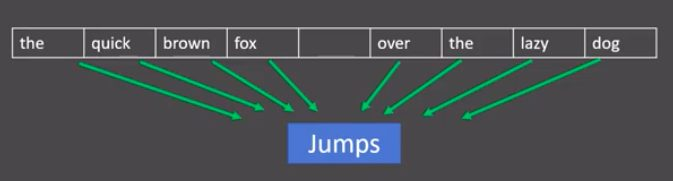

图中窗口大小为 9， 使用前后 4 个词汇对目标词汇进行预测。

> **问：**下文是以上下文各 1 个词汇来说明的，那么上下文各 4 个词汇的时候训练流程是怎么样的呢？
> 
> **答：**上下文都是一个词的时候，相当于输入是一个 5x2 的矩阵，隐藏层权重是 3x5 的，正常的隐藏层输出应该是 3x2 的，但在 CBOW 中，在训练阶段，隐藏层的输出是为了与输出层的权重矩阵进行运算，然后后续计算损失，所以隐藏层的输出必须是一个向量，所以就需要将正常神经网络隐藏层得到的输出取平均，变成一个向量。所以隐藏层的最终输出要是一个向量。
> 
> 而将一个矩阵转成一个向量最方便的方式就是直接取平均，所以无论上下文是 1 个词汇还是 4 个词汇，我们最后只需要将隐藏层输出结果后取个平均即可。（所以有说法说 CBOW 接收一个词的上下文词向量的平均值，其实表达的是一个意思，实现结果是一样的，只是实现方式不同罢了）
> 
> 比如上下文各 k 个词汇，词汇的 one\-hot 编码维度为 n，那么输入的就是一个 nxk 的矩阵，假设我们想得到 m 维词向量，那么隐藏层权重矩阵就是 mxn 维矩阵，我们将隐藏层输出的 mxk 矩阵按行取平均即可得到 mx1 列向量。而训练完成后得到的 mxn 维权重矩阵就是我们要的 word2vec 词向量，他实现了降维和稠密词向量。
> 
> 

- CBOW 模式下的 word2vec 过程说明

假设我们给定的训练语料只有一句话：Hope can set you free（愿你自由成长），窗口大小为 3，因此模型的第一个训练样本来自 Hope can set，因为是 CBOW 模式，所以将使用 Hope 和 set 作为输入，can 作为输出，在模型训练时，Hope、can、set 等词汇都使用它们的 one\-hot 编码。如图所示：每个 one\-hot 编码的单词与各自的变换矩阵（即隐藏层参数矩阵 3x5， 这里的 3 是指隐藏层神经元个数，属于超参数，可自定义）进行矩阵乘法运算，然后再取平均， 得到上下文表示矩阵 \(3x1\)。

> 注：这里采用的是 WX 的方式，X 是由列向量组成。
> 
> 

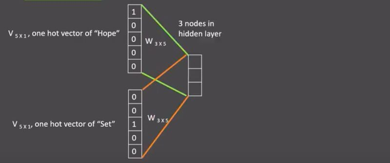

接着，将上下文表示矩阵与变换矩阵（输出层参数矩阵 5x3， 所有的变换矩阵共享参数）相乘，得到 5x1 的结果矩阵，它将与我们真正的目标矩阵即 can 的 one\-hot 编码矩阵（5x1）进行损失的计算，然后反向传播更新网络参数完成一次模型迭代。

> 在经典的 Word2Vec 中，隐藏层是线性的，即没有激活函数；输出层的激活函数使用 softmax，为了与目标 one\-hot 编码计算损失。
> 
> 

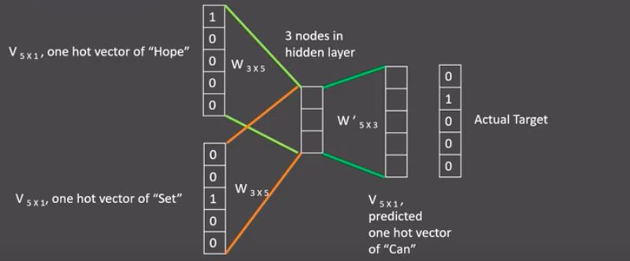

最后窗口按序向后移动，重新更新参数，直到所有语料被遍历完成，得到最终的变换矩阵（3x5），这个变换矩阵与每个词汇的 one\-hot 编码（5x1）相乘，得到的 3x1 的矩阵就是该词汇的 word2vec 张量表示。

> 隐藏层权重矩阵的输入维度值是 one \- hot 编码的维度，隐藏层权重矩阵的输出维度值就是我们最后想要的词向量维度（为了避免歧义，我没有用行和列来说，其实按的是 nn\.Liner 的参数来说的）。
> 
> 最后想要的是隐藏层的权重矩阵，按上文的记号，这个权重矩阵的列向量就是训练得到的 word2vec 稠密向量。这个权重矩阵与每个词汇的 one\-hot 编码相乘，得到的的列向量就是该词汇的 word2vec 张量表示。
> 
> 

##### Skip\-gram 模式

给定一段用于训练的文本语料， 再选定某段长度（窗口）作为研究对象， 使用目标词汇预测上下文词汇。

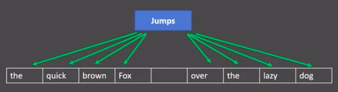

图中窗口大小为 9， 使用目标词汇对前后 4 个词汇进行预测。

- skip\-gram 模式下的 word2vec 过程说明

假设我们给定的训练语料只有一句话： Hope can set you free（愿你自由成长），窗口大小为 3，因此模型的第一个训练样本来自 Hope、can、set，因为是 skip\-gram 模式，所以将使用 can 作为输入 ，Hope 和 set 作为输出，在模型训练时，Hope、can、set 等词汇都使用它们的 one\-hot 编码。如图所示：将 can 的 one\-hot 编码与变换矩阵（即参数矩阵 3x5， 这里的 3 是指最后得到的词向量维度）相乘，得到目标词汇表示矩阵（3x1）。

接着，将目标词汇表示矩阵与多个变换矩阵（参数矩阵 5x3）相乘，得到多个 5x1 的结果矩阵，它将与我们 Hope 和 set 对应的 one\-hot 编码矩阵（5x1）分别进行损失的计算，然后更新网络参数完成一次模型迭代。

> 经典的参数更新方式是一共有几个上下文词就进行几次参数更新。比如上下各一个词那么一个窗口内就会进行两次参数更新。
> 
> 以下图为例，如果图中输出侧的两个权重矩阵是共享的，那么他的更新方式就是上面说的成对更新。
> 
> 但如果图中输出侧的两个权重矩阵确实代表的是两个不同的权重矩阵，即他表示输出层有 2\*5 个神经元，那么他采用的就是累计损失的方式，即将这两个词的损失累计后再反向传播更新参数。
> 
> 一般都是成对更新的方式，因为如果上下文前后词汇分别为 4 个，那么神经网络的输出层神经元数量就是 8\*5 个神经元，这种神经网络结构显然不太正常。
> 
> 

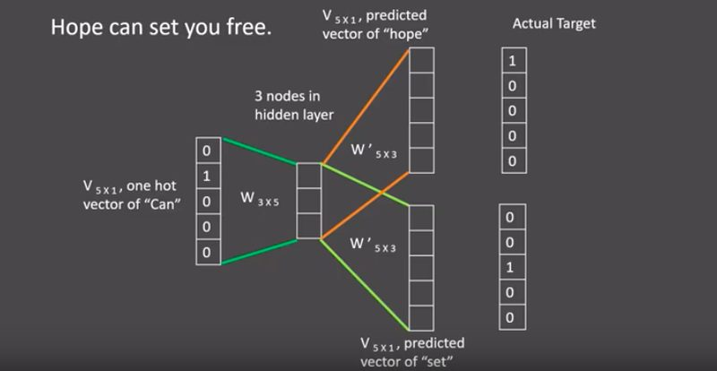

最后窗口按序向后移动，重新更新参数，直到所有语料被遍历完成，得到最终的变换矩阵即参数矩阵（3x5），这个变换矩阵与每个词汇的 one\-hot 编码（5x1）相乘，得到的 3x1 的矩阵就是该词汇的 word2vec 张量表示。

##### Skip\-gram 和 CBOW 比较

CBOW（Continuous Bag of Words）和 Skip\-gram 是Word2Vec模型的两种主要实现方式，它们分别从不同角度来建模单词之间的关系。 以下是它们之间的一些比较：

- CBOW （Continuous Bag of Words）模型原理

    - CBOW模型试图根据上下文中的周围单词来预测当前单词。它将周围单词的词向量求和或取平均作为上下文的表示，然后通过一个神经网络进行预测。

    - 计算效率：CBOW 相对于 Skip\-gram 在计算上更为高效，因为它将多个上下文单词的词向量求和或取平均，减少了模型的复杂度。

    - 数据需求：CBOW 通常需要比 Skip\-gram 更多的训练数据才能取得好的效果，因为它对上下文的整体信息进行了汇总。

    - 适用场景：CBOW 在训练数据较大的情况下往往表现较好，特别是在高频词的情况下。 

- Skip\-gram模型原理

    - Skip\-gram 模型试图根据当前单词来预测上下文中的周围单词。具体来说，它将当前单词的词向量作为输入，然后通过一个神经网络来预测周围单词。

    - 灵活性：skip\-gram 相对于CBOW在灵活性上更为强大，因为它将单词的上下文信息进行了明确建模，可以处理更复杂的语义关系。

    - 低频词处理：Skip\-gram 在处理低频词时往往更具优势，因为它能够生成更丰富的上下文信息，尤其是在大规模数据集中。

    - 训练速度：相对于 CBOW，Skip\-gram 的训练速度通常较慢，因为它需要对每个单词生成上下文。 

- 总结比较：

    - CBOW 适合相对来说原理简单，尤其是**高频词**的情况下，它的计算效率高。

    - Skip\-gram 对于**低频词**的处理更为出色，尤其在大规模数据集中，但相对计算效率较低。

    - CBOW将多个上下文单词汇总起来，能够快速生成词向量，但可能会丧失一些细节信息。

    - Skip\-gram 明确地建模了单词的上下文信息，因此在复杂的语义关系中表现更好，但训练速度相对较慢。

    - 总的来说，选择 CBOW 或 Skip\-gram 取决于具体的任务需求、数据集特性以及对计算资源的要求。

#### Word2Vec 的训练和使用

**获取训练数据**

数据来源：[http://mattmahoney\.net/dc/enwik9\.zip](http://mattmahoney.net/dc/enwik9.zip)

在这里，我们将研究英语维基百科的部分网页信息，它的大小在 300M 左右。这些语料已经被准备好， 我们可以通过 Matt Mahoney 的网站下载。

注意：这一小节是在 linux 系统上处理的，原始数据集放在 \.资料/数据集/enwik9\.zip，解压后数据为 \.资料/数据集/enwik9，预处理后的数据为\./data/fil9。预处理就是分词后的结构，接下来用预处理后的数据正常操作即可。file09 还是太大了，将其拆分为 wh02aa 到 wh02ag 共七个子文件。

fasttext 这个包暂不支持 python 3\.13。

> 用这个包主要是因为这个数据类型，正常可以用 **gensim** 包，因为 gensim 训练时需要传入由已分词句子组成的列表（或迭代器），而不是文件路径。
> 
> Gensim 是一个通用型 NLP 工具包。
> 
> 而 fastText \(`fasttext-community`\) 是一个专精型库，只做两件事，并力求做到极致：
> 
> 1. 高效学习词表示（词向量）。
> 
> 2. 高效进行句子分类。
> 
> 

`pip install fasttext-community`    这个包支持，而且首选，原版本的包已经基本不维持更新了。

- 查看原始数据

```PowerShell
$ head -10 data/enwik9

# 原始数据将输出很多包含XML/HTML格式的内容, 这些内容并不是我们需要的
<mediawiki xmlns="http://www.mediawiki.org/xml/export-0.3/" xmlns:xsi="http://www.w3.org/2001/XMLSchema-instance" xsi:schemaLocation="http://www.mediawiki.org/xml/export-0.3/ http://www.mediawiki.org/xml/export-0.3.xsd" version="0.3" xml:lang="en">
  <siteinfo>
    <sitename>Wikipedia</sitename>
    <base>http://en.wikipedia.org/wiki/Main_Page</base>
    <generator>MediaWiki 1.6alpha</generator>
    <case>first-letter</case>
      <namespaces>
      <namespace key="-2">Media</namespace>
      <namespace key="-1">Special</namespace>
      <namespace key="0" />
```

- 原始数据处理

```PowerShell
# 使用wikifil.pl文件处理脚本来清除XML/HTML格式的内容
# perl wikifil.pl data/enwik9 > data/fil9 #该命令已经执行
```

- 查看预处理后的数据

```PowerShell
# 查看前80个字符
head -c 80 data/fil9

# 输出结果为由空格分割的单词
anarchism originated as a term of abuse first used against early working class
```

**词向量的训练保存加载**

fasttext 是 facebook 开源的一个词向量与文本分类工具。

```PowerShell
# 训练词向量工具库的安装
# 方法1 简洁版
pip install fasttext     # 暂不支持 python3.13 且这个包基本不维护了
pip install fasttext-community    # 支持，首选，活跃维护更新

# 方法2：源码安装(推荐)
# 以 linux 安装为例：目录切换到虚拟开发环境目录下，再执行 git clone 操作
git clone https://github.com/facebookresearch/fastText.git
cd fastText
```

```Python
# 导入fasttext
import fasttext

def dm_fasttext_train_save_load():
    # 1 使用train_unsupervised(无监督训练方法) 训练词向量
    mymodel = fasttext.train_unsupervised('./data/fil9')
    print('训练词向量 ok')

    # 2 save_model()保存已经训练好词向量 
    # 注意，该行代码执行耗时很长 
    mymodel.save_model("./data/fil9.bin")
    print('保存词向量 ok')

    # 3 模型加载
    mymodel = fasttext.load_model('./data/fil9.bin')
    print('加载词向量 ok')


# 步骤1运行效果如下：
Read 124M words
Number of words:  218316
Number of labels: 0
Progress: 100.0% words/sec/thread:   53996 lr:  0.000000 loss:  0.734999 ETA:   0h 0m
## 有效训练词汇量为124M, 共218316个单词
```

**查看单词对应的词向量**

```Python
# 通过get_word_vector方法来获得指定词汇的词向量, 默认词向量训练出来是1个单词100特征
def dm_fasttext_get_word_vector():
    mymodel = fasttext.load_model('./data/fil9.bin')

    myvector = mymodel.get_word_vector('the')
    print('myvector->', type(myvector), myvector.shape, myvector)

# 运行效果如下：
array([-0.03087516,  0.09221972,  0.17660329,  0.17308897,  0.12863874,
        0.13912526, -0.09851588,  0.00739991,  0.37038437, -0.00845221,
        ...
       -0.21184735, -0.05048715, -0.34571868,  0.23765688,  0.23726143],
      dtype=float32)
```

**模型效果检验**

```Python
# 检查单词向量质量的一种简单方法就是查看其邻近单词, 通过我们主观来判断这些邻近单词是否与目标单词相关来粗略评定模型效果好坏.

# 查找"运动"的邻近单词, 我们可以发现"体育网", "运动汽车", "运动服"等. 
model.get_nearest_neighbors('sports') 
   
# *返回的结果格式为: [(相似度分数, 近义词), (相似度分数, 近义词)...]*
[(0.8414610624313354, 'sportsnet'), (0.8134572505950928, 'sport'), (0.8100415468215942, 'sportscars'), (0.8021156787872314, 'sportsground'), (0.7889881134033203, 'sportswomen'), (0.7863013744354248, 'sportsplex'), (0.7786710262298584, 'sporty'), (0.7696356177330017, 'sportscar'), (0.7619683146476746, 'sportswear'), (0.7600985765457153, 'sportin')]


# 查找"音乐"的邻近单词, 我们可以发现与音乐有关的词汇.
model.get_nearest_neighbors('music')

[(0.8908010125160217, 'emusic'), (0.8464668393135071, 'musicmoz'), (0.8444250822067261, 'musics'), (0.8113634586334229, 'allmusic'), (0.8106718063354492, 'musices'), (0.8049437999725342, 'musicam'), (0.8004694581031799, 'musicom'), (0.7952923774719238, 'muchmusic'), (0.7852965593338013, 'musicweb'), (0.7767147421836853, 'musico')]

# 查找"小狗"的邻近单词, 我们可以发现与小狗有关的词汇.
model.get_nearest_neighbors('dog')

[(0.8456876873970032, 'catdog'), (0.7480780482292175, 'dogcow'), (0.7289096117019653, 'sleddog'), (0.7269964218139648, 'hotdog'), (0.7114801406860352, 'sheepdog'), (0.6947550773620605, 'dogo'), (0.6897546648979187, 'bodog'), (0.6621081829071045, 'maddog'), (0.6605004072189331, 'dogs'), (0.6398137211799622, 'dogpile')]
```

**模型超参数设定**

```Python
# 在训练词向量过程中, 我们可以设定很多常用超参数来调节我们的模型效果, 如:
# 无监督训练模式: 'skipgram' 或者 'cbow', 默认为'skipgram', 在实践中，skipgram模式在利用子词方面比cbow更好.
# 词嵌入维度dim: 默认为100, 但随着语料库的增大, 词嵌入的维度往往也要更大.
# 数据循环次数epoch: 默认为5, 但当你的数据集足够大, 可能不需要那么多次.
# 学习率lr: 默认为0.05, 根据经验, 建议选择[0.01，1]范围内.
# 使用的线程数thread: 默认为12个线程, 一般建议和你的cpu核数相同.

model = fasttext.train_unsupervised(
    input='./data/fil9',            *# 训练数据的路径*
    model='cbow',                   *# 词向量模型: cbow, skipgram*
    dim=300,                        *# 词向量的维度*
    epoch=1,                        *# 训练轮数*
    lr=0.01,                        *# 学习率*
    thread=8                        *# 线程数*
)

Read 124M words
Number of words:  218316
Number of labels: 0
Progress: 100.0% words/sec/thread:   49523 lr:  0.000000 avg.loss:  1.777205 ETA:   0h 0m 0s
```

### 2\.3 word embedding 词嵌入

- 通过一定的方式将词汇映射到指定维度（一般是更高维度）的空间。

- **广义**的 word embedding 包括所有密集词汇向量的表示方法，如之前的 word2vec，即可认为是 word embedding 的一种。

- **狭义**的 word embedding 是指在神经网络中加入的 embedding 层（词嵌入层），对整个网络进行训练的同时产生的 embedding 矩阵（embedding 层的参数），这个 embedding 矩阵就是训练过程中所有输入词汇的向量表示组成的矩阵。

```Python
# 创建一个词嵌入层，假设这个词嵌入层支持20个单词，每个单词8个特征，也就是20*8的矩阵参数 
embd = nn.Embedding(num_embeddings=len(my_token_list), embedding_dim=8) 
print('embd-->', embd.weight.data, embd.weight.data.shape)
```

**问：**Word2Vec 方式产生词向量 和 word embedding（nn\.Embedding）方式产生有何异同？

- 相同点：都可用来对文本训练词向量

- 不同点：

    - word2vec 产生词向量后，某一个词向量比如单词 “the” 词向量就固定下来了，是静态的。

    - nn\.Embedding 层产生词向量后，词嵌入层作为整体神经网络的一部分，权重参数会参与更新，是动态的。

    - word2vec 使用起来一般需要两步：1）输入单词 the 拿到词向量；2）再送给神经网络进行使用

    - nn\.Embedding 层使用起来更方便，就1步，直接嵌入到神经网络中（**创建词向量和训练模型合成一步**），更易使用。

#### word embedding 的**可视化分析**

通过使用 tensorboard 可视化嵌入的词向量。

```Python
import torch                                                    *# 深度学习框架, 封装了和张量相关的各种操作*
from tensorflow.keras.preprocessing.text import Tokenizer       *# 词汇映射器.*
from torch.utils.tensorboard import SummaryWriter               *# 可视化 词向量*
import jieba                                                    *# 分词器.*
import torch.nn as nn                                           *# 神经网络模块*

# # 注意：
# # fs = tf.io.gfile.get_filesystem(save_path)
# # AttributeError: module 'tensorflow._api.v2.io.gfile' has no attribute 'get_filesystem'
# # 错误原因分析：
# #  1 from tensorboard.compat import tf 使用了tf 如果安装tensorflow，默认会调用它tf的api函数
# import tensorflow as tf
# import tensorboard as tb
# tf.io.gfile = tb.compat.tensorflow_stub.io.gfile


# 实验：nn.Embedding层词向量可视化分析
# 1 对句子分词 word_list
# 2 对句子word2id求my_token_list，对句子文本数值化sentence2id
# 3 创建nn.Embedding层，查看每个token的词向量数据
# 4 创建SummaryWriter对象, 可视化词向量
#   词向量矩阵embd.weight.data 和 词向量单词列表my_token_list添加到SummaryWriter对象中
#   summarywriter.add_embedding(embd.weight.data, my_token_list)
# 5 通过tensorboard观察词向量相似性
# 6 也可通过程序，从nn.Embedding层中根据idx拿词向量

def dm_nnembeding_show():

    # 1 对句子分词 word_list
    sentence1 = '传智教育是一家上市公司，旗下有黑马程序员品牌。我是在黑马这里学习人工智能'
    sentence2 = "我爱自然语言处理"
    sentences = [sentence1, sentence2]

    word_list = []
    for s in sentences:
        word_list.append(jieba.lcut(s))
    # print('word_list--->', word_list)

    # 2 对句子word2id求my_token_list，对句子文本数值化sentence2id
    mytokenizer = Tokenizer()
    mytokenizer.fit_on_texts(word_list)
    # print(mytokenizer.index_word, mytokenizer.word_index)
    # 字典的键是唯一的，所以返回的是去重之后的.

    # 打印my_token_list
    my_token_list = mytokenizer.index_word.values()
    print('my_token_list-->', my_token_list)

    # 打印文本数值化以后的句子
    sentence2id = mytokenizer.texts_to_sequences(word_list)
    print('sentence2id--->', sentence2id, len(sentence2id))

    # 3 创建nn.Embedding层
    embd = nn.Embedding(num_embeddings=len(my_token_list), embedding_dim=8)
    # print("embd--->", embd)
    # print('nn.Embedding层词向量矩阵-->', embd.weight.data, embd.weight.data.shape, type(embd.weight.data))

    # 4 创建SummaryWriter对象 词向量矩阵embd.weight.data 和 词向量单词列表my_token_list
    summarywriter = SummaryWriter(log_dir='./runs')
    summarywriter.add_embedding(embd.weight.data, my_token_list)
    summarywriter.close()

    # 5 通过tensorboard观察词向量相似性
    # cd 程序的当前目录下执行下面的命令
    # 启动tensorboard服务 tensorboard --logdir=runs --host 0.0.0.0
    # 通过浏览器，查看词向量可视化效果 http://127.0.0.1:6006

    print('从nn.Embedding层中根据idx拿词向量')
    # # 6 从nn.Embedding层中根据idx拿词向量
    for idx in range(len(mytokenizer.index_word)):
        tmpvec = embd(torch.tensor(idx))
        print('%4s'%(mytokenizer.index_word[idx+1]), tmpvec.detach().numpy())

```

程序运行效果

```Plain Text
my_token_list--> dict_values(['是', '黑马', '我', '传智', '教育', '一家', '上市公司', '，', '旗下', '有', '程序员', '品牌', '。', '在', '这里', '学习', '人工智能', '爱', '自然语言', '处理'])

sentence2id---> [[4, 5, 1, 6, 7, 8, 9, 10, 2, 11, 12, 13, 3, 1, 14, 2, 15, 16, 17], [3, 18, 19, 20]] 2

从nn.Embedding层中根据idx拿词向量

  是      [ 0.46067393 -0.9049023  -0.03143226 -0.32443136  0.03115687 -1.3352231
 -0.08336695 -2.4732168 ]
 黑马      [ 0.66760564  0.08703537  0.23735243  1.5896837  -1.8869231   0.22520915
 -1.0676078  -0.7654686 ]
  我      [-0.9093167  -0.6114051  -0.6825029   0.9269122   0.5208822   2.294128
 -0.11160549 -0.34862307]
 传智      [-1.1552105 -0.4274638 -0.8121502 -1.4969801 -1.3328248 -1.0934378
  0.6707438 -1.1796173]
 教育      [ 0.01580311 -1.1884228   0.59364647  1.5387698  -1.0822943   0.36760855
 -0.4652998  -0.57378227]
 一家      [-1.1898873  -0.42482868 -1.9391155  -1.5678993  -1.6960118   0.22525501
 -1.0754168   0.41797593]
上市公司     [ 0.590556   2.4274144  1.6698223 -0.9776848 -0.6119061  0.4434897
 -2.3726876 -0.2607738]
  ，      [-0.17568143  1.0074369   0.2571488   1.8940887  -0.5383494   0.65416646
  0.63454026  0.6235991 ]
 旗下      [ 2.8400452  -1.0096515   2.247107    0.30006626 -1.2687006   0.05855403
  0.01199368 -0.6156502 ]
  有      [ 0.89320636 -0.43819678  1.0345292   1.3546743  -1.4238662  -1.6994532
  0.30445674  2.673923  ]
程序员      [ 1.2147354   0.24878891  0.36161897  0.37458655 -0.48264053 -0.0141514
  1.2033817   0.7899459 ]
 品牌      [ 0.59799325 -0.01371854  0.0628166  -1.4829391   0.39795023 -0.39259398
 -0.60923046  0.54170054]
  。      [ 0.59599686  1.6038656  -0.10832139  0.25223547  0.37193906  1.1944667
 -0.91253406  0.6869221 ]
  在      [-1.161504    2.6963246  -0.6087775   0.9399654   0.8480068   0.684357
  0.96156543 -0.3541162 ]
 这里      [ 0.1034054  -0.01949253  0.8989019   1.61057    -1.5983531   0.17945968
 -0.17572908 -0.9724814 ]
 学习      [-1.3899843  -1.0846052  -1.1301199  -0.4078141   0.40511298  0.6562911
  0.9231357  -0.34704337]
人工智能     [-1.4966388  -1.0905199   1.001238   -0.75254333 -1.4210068  -1.854177
  1.0471514  -0.27140012]
  爱      [-1.5254552   0.6189947   1.2703396  -0.4826037  -1.4928672   0.8320283
  1.7333516   0.16908517]
自然语言     [-0.3856235  -1.2193452   0.9991112  -1.5821775   0.45017946 -0.66064674
  0.08045111  0.62901515]
 处理      [ 1.5062869   1.3156213  -0.21295634  0.47610474  0.08946162  0.57107806
 -1.0727187   0.16396333]

 # 词向量和词显示标签 写入磁盘ok 在当前目录下查看 ./runs 目录
```

在终端启动 tensorboard 服务：

```PowerShell
cd ~    # 切换路径的
tensorboard --logdir=runs --host 0.0.0.0

# 通过http://192.168.88.161:6006访问浏览器可视化页面
*通过 localhost:6006 访问即可*
```

浏览器展示并可以使用右侧近邻词汇功能检验效果。

这其实就是 PCA 主成分分析图。

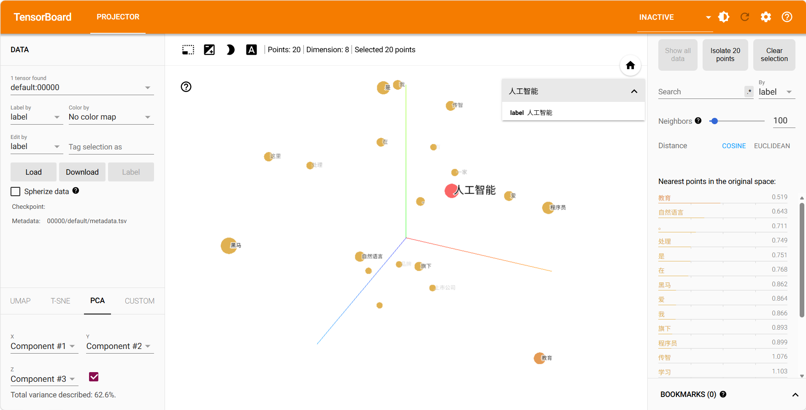


## 3 文本数据分析

- 文本数据分析的作用

    文本数据分析能够有效帮助我们理解数据语料，快速检查出语料可能存在的问题，并指导之后模型训练过程中一些超参数的选择。

    比如：关于标签 Y：分类问题查看标签是否均匀；关于数据 X：数据有没有脏数据 数据长度分布等等。

    > 数据质量类：错别字，语法错误，重复内容，缺失值，噪声数据 \.\.\.
    > 分布不均衡问题：标签分布不均，句子长度分布异常 \.\.\.
    > 
    > 

- 常用的几种文本数据分析方法

    - 标签数量分布

    - 句子长度分布

    - 词频统计与关键词词云

**数据集说明**

- 将基于真实的中文酒店评论语料来讲解常用的几种文本数据分析方法。

- 中文酒店评论语料：

    - 属于二分类的中文情感分析语料，该语料存放在 “\./data” 目录下。

    - 其中 train\.tsv 代表训练集，dev\.tsv 代表验证集，二者数据样式相同。

> csv 文件是以 逗号 做分割，tsv 文件是以 \\t （制表符 tab）做分割。
> 
> 

- train\.tsv 数据样式

```PowerShell
sentence    label
早餐不好,服务不到位,晚餐无西餐,早餐晚餐相同,房间条件不好,餐厅不分吸烟区.房间不分有无烟房.    0
去的时候 ,酒店大厅和餐厅在装修,感觉大厅有点挤.由于餐厅装修本来该享受的早饭,也没有享受(他们是8点开始每个房间送,但是我时间来不及了)不过前台服务员态度好!    1
有很长时间没有在西藏大厦住了，以前去北京在这里住的较多。这次住进来发现换了液晶电视，但网络不是很好，他们自己说是收费的原因造成的。其它还好。  1
非常好的地理位置，住的是豪华海景房，打开窗户就可以看见栈桥和海景。记得很早以前也住过，现在重新装修了。总的来说比较满意，以后还会住   1
交通很方便，房间小了一点，但是干净整洁，很有香港的特色，性价比较高，推荐一下哦    1
酒店的装修比较陈旧，房间的隔音，主要是卫生间的隔音非常差，只能算是一般的    0
酒店有点旧，房间比较小，但酒店的位子不错，就在海边，可以直接去游泳。8楼的海景打开窗户就是海。如果想住在热闹的地带，这里不是一个很好的选择，不过威海城市真的比较小，打车还是相当便宜的。晚上酒店门口出租车比较少。   1
位置很好，走路到文庙、清凉寺5分钟都用不了，周边公交车很多很方便，就是出租车不太爱去（老城区路窄爱堵车），因为是老宾馆所以设施要陈旧些，    1
酒店设备一般，套房里卧室的不能上网，要到客厅去。    0
```

- train\.tsv 数据样式说明

    - train\.tsv 中的数据内容共分为 2 列，第一列数据代表具有感情色彩的评论文本；第二列数据，0 或 1，代表每条文本数据是积极或者消极的评论，0 代表消极，1 代表积极。

### 3\.1 获取标签数量分布

```Python
# 导入必备工具包
import seaborn as sns    # 也是画图包
import pandas as pd
import matplotlib.pyplot as plt

# 思路分析 : 获取标签数量分布
# 0 什么标签数量分布：求标签0有多少个 标签1有多少个 标签2有多少个
# 1 设置显示风格plt.style.use('fivethirtyeight')
# 2 pd.read_csv(path, sep='\t') 读训练集 验证集数据
# 3 sns.countplot() 统计label标签的0、1分组数量
# 4 画图展示 plt.title() plt.show()
# 注意1：sns.countplot()相当于select * from tab1 group by
def dm_label_sns_countplot():

    # 1 设置显示风格plt.style.use('fivethirtyeight')
    ## *538风格 -> 一种具有现代感的可视化风格(不做也行)*
    plt.style.use('fivethirtyeight')

    # 2 pd.read_csv 读训练集 验证集数据
    ## *# 参1: 文件路径.    参2: 列分隔符(csv文件用, tsv文件用\t)*
    train_data = pd.read_csv(filepath_or_buffer = './data/train.tsv', sep='\t')
    dev_data = pd.read_csv(filepath_or_buffer = './data/dev.tsv', sep='\t')

    # 3 sns.countplot() 统计label标签的0、1分组数量
    *## 参1: 指定分类列,  参2: 数据集,  参3: 按指定分类变量给点上色,  参4: 是否显示图例(默认为True)*
    sns.countplot(x='label', data = train_data, hue='label', legend=False)

    # 4 画图展示 plt.title() plt.show() 
    plt.title('train_label')
    plt.show()

    # 验证集上标签的数量分布
    # 3-2 sns.countplot() 统计label标签的0、1分组数量
    sns.countplot(x='label', data = dev_data, hue='label', legend=False)

    # 4-2 画图展示 plt.title() plt.show()
    plt.title('dev_label')
    plt.show()
```

- 训练集标签数量分布：

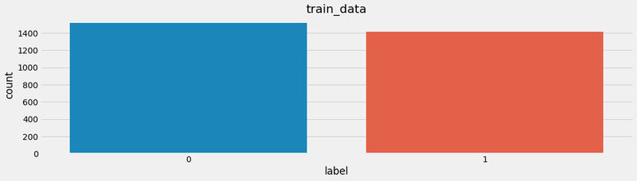

- 验证集标签数量分布：

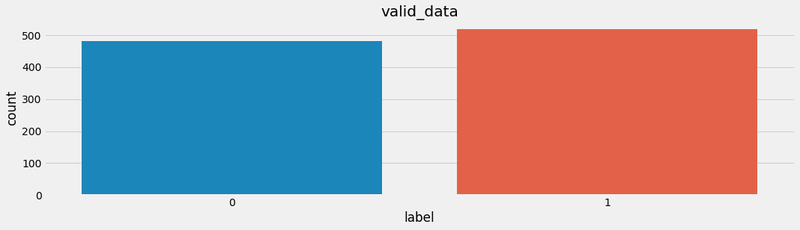

- 分析

    在深度学习模型评估中，我们一般使用 ACC 作为评估指标，若想将 ACC 的基线定义在 50% 左右， 则**需要我们的正负样本比例维持在 1:1 左右**， 否则就要进行必要的**数据增强或数据删减**。上图中训练和验证集正负样本都稍有不均衡，可以进行一些数据增强。

### 3\.2 获取句子长度分布

```Python
# 思路分析 : 获取句子长度分布 -绘制句子长度分布-柱状图 句子长度分布-密度曲线图
# 0 什么是句子长度分布：求长度为50的有多少个 长度51的有多少个 长度为52的有多少个
# 1 设置显示风格plt.style.use('fivethirtyeight')
# 2 pd.read_csv(path, sep='\t') 读训练集 验证集数据
# 3 新增数据长度列：train_data['sentence_length'] = list(map(lambda x:len(x) , ...))
# 4-1 绘制数据长度分布图-柱状图 sns.countplot(x='sentence_length', data=train_data)
#  画图展示 plt.xticks([]) plt.show()
# 4-2  绘制数据长度分布图-曲线图 sns.displot(x='sentence_length', data=train_data)
# 画图展示 plt.yticks([]) plt.show()

def dm_len_sns_countplot_distplot():
    # 1 设置显示风格plt.style.use('fivethirtyeight')
    plt.style.use('fivethirtyeight')

    # 2 pd.read_csv 读训练集 验证集数据
    train_data = pd.read_csv(filepath_or_buffer='./data/train.tsv', sep='\t')
    dev_data = pd.read_csv(filepath_or_buffer='./data/dev.tsv', sep='\t')

    # 3 求数据长度列 然后求数据长度的分布
    ## map()返回的是一个迭代器对象
    train_data['sentence_length'] = list(map(lambda x: len(x), train_data['sentence']))
    # *train_data['sentence_length'] = train_data['sentence'].apply(lambda x: len(x))    *
    *## 效果同上，pandas包里面的内容*

    # 4 绘制数据长度分布图-柱状图
    sns.countplot(x='sentence_length', data=train_data)
    # sns.countplot(x=train_data['sentence_length'])
    plt.xticks([]) # x轴上不要提示信息
    # plt.title('sentence_length countplot')
    plt.show()

    # 5 绘制数据长度分布图-曲线图
    ## 旧版画法
    # sns.displot(x='sentence_length', data=train_data)
    # # sns.displot(x=train_data['sentence_length'])
    # plt.yticks([]) # y轴上不要提示信息
    # plt.show()
    
    *# histplot() 直方图*
    ## kde: 核密度曲线
    sns.histplot(x='sentence_length', data=train_data, kde=True)
    plt.title('训练集句子长度分布_密度曲线图')
    plt.show()

    # 验证集
    # 3 求数据长度列 然后求数据长度的分布
    dev_data['sentence_length'] = list(map(lambda x: len(x), dev_data['sentence']))

    # 4 绘制数据长度分布图-柱状图
    sns.countplot(x='sentence_length', data=dev_data)
    # sns.countplot(x=dev_data['sentence_length'])
    plt.xticks([])  # x轴上不要提示信息
    # plt.title('sentence_length countplot')
    plt.show()

    # 5 绘制数据长度分布图-曲线图
    sns.displot(x='sentence_length', data=dev_data)
    # sns.displot(x=dev_data['sentence_length'])
    plt.yticks([])  # y轴上不要提示信息
    plt.show()
```

- 训练集句子长度分布

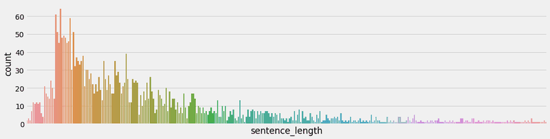

> 这种五颜六色的是由 sns\.countplot\(\) 的 palette 参数控制的。palette 是调色板的意思。
> 
> 但 `palette` 是用来给不同的 `hue`（分类类别）上色的，所以要实现上图中的效果还需要添加一列告诉 hue 每几个柱子用一个颜色。暂时未作细致研究。
> 
> 

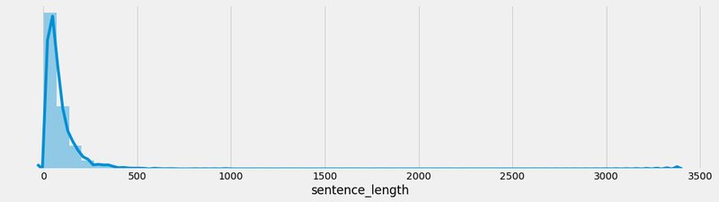

- 验证集句子长度分布

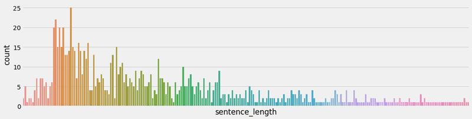

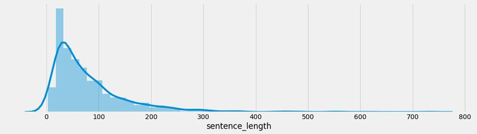

- 分析

    通过绘制句子长度分布图，可以得知我们的语料中大部分句子长度的分布范围，因为模型的输入要求为固定尺寸的张量，合理的长度范围对之后进行句子**截断或补齐**（规范长度）起到关键的指导作用。上图中大部分句子长度的范围大致为 20\-250 之间。

### 3\.3 获取正负样本长度散点分布

```Python
# 获取正负样本长度散点分布，也就是按照x正负样本进行分组 再按照y长度进行散点图
# train_data['sentence_length'] = list(map(lambda x: len(x), train_data['sentence']))
# sns.stripplot(y='sentence_length', x='label', data=train_data)
def dm03_sns_stripplot():
    # 1 设置显示风格plt.style.use('fivethirtyeight')
    plt.style.use('fivethirtyeight')

    # 2 pd.read_csv 读训练集 验证集数据
    train_data = pd.read_csv(filepath_or_buffer='./data/train.tsv', sep='\t')
    dev_data = pd.read_csv(filepath_or_buffer='./data/dev.tsv', sep='\t')

    # 3 求数据长度列 然后求数据长度的分布
    train_data['sentence_length'] = list(map(lambda x: len(x), train_data['sentence']))

    # 4 统计正负样本长度散点图 （对train_data数据，按照label进行分组，统计正样本散点图）
    sns.stripplot(y='sentence_length', x='label', data=train_data, hue='label', legend=False)
    plt.show()
    
    dev_data['sentence_length'] = list(map(lambda x: len(x), dev_data['sentence']))
    sns.stripplot(y='sentence_length', x='label', data=dev_data, hue='label', legend=False)
    plt.show()
```

- 训练集上正负样本的长度散点分布

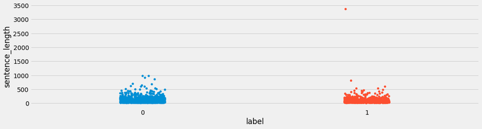

- 验证集上正负样本的长度散点分布

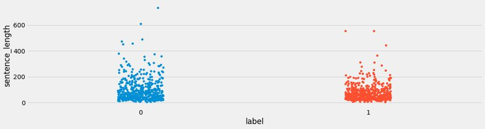

- 分析

    通过查看正负样本长度散点图，可以有效定位异常点的出现位置，帮助我们更准确进行人工语料审查。 

    上图中在训练集正样本中出现了异常点，它的句子长度近 3500 左右，需要我们人工审查。

### 3\.4 获取不同词汇总数统计

```Python
# 导入jieba用于分词
# 导入chain方法用于扁平化列表
import jieba
from itertools import chain

# 进行训练集的句子进行分词, 并统计出不同词汇的总数
# train_vocab = set(chain(*map(lambda x: jieba.lcut(x), train_data["sentence"])))
train_vocab = set(chain.from_iterable(map(lambda x: jieba.lcut(x), train_data["sentence"])))
print("训练集共包含不同词汇总数为：", len(train_vocab))

# 进行验证集的句子进行分词, 并统计出不同词汇的总数
# valid_vocab = set(chain(*map(lambda x: jieba.lcut(x), valid_data["sentence"])))
valid_vocab = set(chain.from_iterable(map(lambda x: jieba.lcut(x), valid_data["sentence"])))
print("验证集共包含不同词汇总数为：", len(valid_vocab))
```

> **`itertools.chain()`**：把多个可迭代对象串联成一个**迭代器**。
> 
> 为什么要使用 `*` ？
> 
> 如果不使用 `*`，相当于chain\(\) 只接收一个参数，而不是多个可迭代对象，相当于如果外面套一个 list 最后返回的就是一个嵌套列表。
> 
> 但这里有一个问题， `*`会直接消费 map 产生的迭代器，相当于破坏了 map 的惰性。解决方法就是使用**`chain.from_iterable()`**，它接收**一个**可迭代对象，惰性地逐个串联，不会把全部内容展开成参数；
> 
> ```Plain Text
> chain(*map(...)):
>   ┌─ 参数 tuple ─────────────────────────────┐
>   │ [list1] [list2] [list3] ... [listN]      │  ← N 个列表同时存活
>   └──────────────────────────────────────────┘
>         ↑ 全部在调用 chain 前就已生成
> 
> chain.from_iterable(map(...)):
>   ┌─ 只传 1 个参数：map 对象 ─┐
>   │ map ──> 每次 next 才产出一个 list ──> chain 用完即丢
>   └───────────────────────────┘
>         ↑ 同一时刻通常只有 1 个当前子列表存活
> ```
> 
> 

输出效果

```PowerShell
训练集共包含不同词汇总数为： 12147
验证集共包含不同词汇总数为： 6857
```

### 3\.5 获取高频形容词词云

```Python
# 使用jieba中的词性标注功能
import jieba.posseg as pseg
from wordcloud import WordCloud    # 词云包

# 每句话产生形容词列表
def get_a_list(text):
    r = []

    # 使用jieba的词性标注方法切分文本 找到形容词存入到列表中返回
    for g in pseg.lcut(text):
    *# print(f'g: {g}')            # 返回 词 和 词性*
    *# print(f'g.word: {g.word}')  # 返回 词*
    *# print(f'g.flag: {g.flag}')  # 返回 词性*
        if g.flag == "a":
            r.append(g.word)
    return r

# 根据词云列表产生词云
def  get_word_cloud(keywords_list):
    # 实例化词云生成器对象
    wordcloud = WordCloud(
        font_path="./data/SimHei.ttf",     # 字体路径
        max_words=100,                     # 最大显示数
        background_color='white'           # 背景色
    )
    # 准备数据
    ## *将关键词列表 -> 转换为 空格分割的字符串, 适配: 词云输入格式.*
    keywords_string = " ".join(keywords_list)
    # 产生词云
    wordcloud.generate(keywords_string)

    # 画图
    plt.figure()
    *# 参1: 生成词云图像的数据,  参2: 设置图像插值方法为: 双线性插值*
    plt.imshow(wordcloud, interpolation="bilinear")
    plt.axis('off')
    plt.show()


# 思路分析 训练集正样本词云 训练集负样本词云
# 1 获得训练集上正样本 p_train_data
#   eg: 先使用逻辑==操作检索符合正样本 train_data[train_data['label'] == 1]
# 2 获取正样本的每个句子的形容词 p_a_train_vocab = chain(*map(a,b))
# 3 调用绘制词云函数
def dm_word_cloud():
    # 1 获得训练集上正样本p_train_data
    #  eg: 先使用逻辑==操作检索符合正样本 train_data[train_data['label'] == 1]
    train_data = pd.read_csv(filepath_or_buffer='./data/train.tsv', sep='\t')
    p_train_data = train_data[train_data['label'] == 1 ]['sentence']

    # 2 获取正样本的每个句子的形容词 p_a_train_vocab = chain(*map(a,b))
    p_a_train_vocab = chain(*map(lambda x: get_a_list(x) , p_train_data))
    # print(p_a_train_vocab)
    # print(list(p_a_train_vocab))

    # 3 调用绘制词云函数
    get_word_cloud(p_a_train_vocab)

    print('*' * 60 )
    
    # 训练集负样本词云
    n_train_data = train_data[train_data['label'] == 0]['sentence']

    # 2 获取正样本的每个句子的形容词 p_a_train_vocab = chain(*map(a,b))
    n_a_train_vocab = chain(*map(lambda x: get_a_list(x) , n_train_data)  )
    # print(n_a_dev_vocab)
    # print(list(n_a_dev_vocab))

    # 3 调用绘制词云函数
    get_word_cloud(n_a_train_vocab)
```

- 训练集正样本形容词词云


- 训练集负样本形容词词云


**获取验证集高频形容词词云**

```Python
dev_data = pd.read_csv(filepath_or_buffer='./data/dev.tsv', sep='\t')
# 获得验证集上正样本
p_valid_data = valid_data[valid_data["label"]==1]["sentence"]

# 对正样本的每个句子的形容词
valid_p_a_vocab = chain(*map(lambda x: get_a_list(x), p_valid_data))
#print(train_p_n_vocab)

# 获得验证集上负样本
n_valid_data = valid_data[valid_data["label"]==0]["sentence"]

# 获取负样本的每个句子的形容词
valid_n_a_vocab = chain(*map(lambda x: get_a_list(x), n_valid_data))

# 调用绘制词云函数
get_word_cloud(valid_p_a_vocab)
get_word_cloud(valid_n_a_vocab)
```

- 验证集正样本形容词词云


- 验证集负样本形容词词云


- 分析：

    根据高频形容词词云显示，我们可以对当前语料质量进行简单评估，同时对违反语料标签含义的词汇进行人工审查和修正，来保证绝大多数语料符合训练标准。

    上图中的正样本大多数是褒义词，而负样本大多数是贬义词，基本符合要求，但是负样本词云中也存在 “豪华” 这样的褒义词，因此可以人工进行审查。


## 4 文本特征处理

- 文本特征处理的作用

    - 文本特征处理包括为语料添加具有普适性的文本特征，如：n\-gram 特征，以及对加入特征之后的文本语料进行必要的处理，如：长度规范。这些特征处理工作能够有效的将重要的文本特征加入模型训练中，增强模型评估指标。

- 常见的文本特征处理方法

    - 添加 n\-gram 特征

    - 文本长度规范

### 4\.1 n\-gram 特征

- 给定一段文本序列，其中 n 个词或字的相邻共现，可以作为一个特征，即 n\-gram 特征。

- 常用的 n\-gram 特征是 bi\-gram 和 tri\-gram 特征，分别对应 n 为 2 和 3。

- 例子

```Plain Text
假设给定分词列表: ["是谁", "敲动", "我心"]

对应的数值映射列表为: [1, 34, 21]

我们可以认为数值映射列表中的每个数字是词汇特征.

除此之外, 我们还可以把"是谁"和"敲动"两个词共同出现且相邻也作为一种特征加入到序列列表中,

假设1000就代表"是谁"和"敲动"共同出现且相邻

此时数值映射列表就变成了包含2-gram特征的特征列表: [1, 34, 21, 1000]

这里的"是谁"和"敲动"共同出现且相邻就是bi-gram特征中的一个.

"敲动"和"我心"也是共现且相邻的两个词汇, 因此它们也是bi-gram特征.

假设1001代表"敲动"和"我心"共同出现且相邻

那么, 最后原始的数值映射列表 [1, 34, 21] 添加了bi-gram特征之后就变成了 [1, 34, 21, 1000, 1001]
```

- 提取 n\-gram 特征

```Python
# 一般n-gram中的n取2或者3, 这里取2为例
ngram_range = 2

def create_ngram_set(input_list):
    """
    description: 从数值列表中提取所有的n-gram特征
    :param input_list: 输入的数值列表, 可以看作是词汇映射后的列表, 
                       里面每个数字的取值范围为[1, 25000]
    :return: n-gram特征组成的集合

    eg:
    >>> create_ngram_set([1, 3, 2, 1, 5, 3])
    {(3, 2), (1, 3), (2, 1), (1, 5), (5, 3)}
    """ 
    return set(zip(*[input_list[i:] for i in range(ngram_range)]))
```

调用

```Python
input_list = [1, 3, 2, 1, 5, 3]
res = create_ngram_set(input_list)
print(res)
```

输出效果

```Python
# 该输入列表的所有bi-gram特征
{(3, 2), (1, 3), (2, 1), (1, 5), (5, 3)}
```

##### 补充：如何计算两段文本的相似性

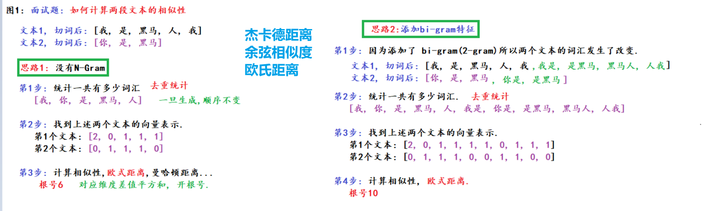

###### **杰卡德距离（Jaccard Distance）**

- **杰卡德距离（Jaccard Distance）**用于衡量两个集合（或二元向量）的差异程度，定义为：

$d_J(A,B)=1-J(A,B)$

其中 **杰卡德相似系数** 为：

$J(A,B)=\frac{|A\cap B|}{|A\cup B|}$

所以杰卡德距离也可写成：

$d_J(A,B)=1-\frac{|A\cap B|}{|A\cup B|}=\frac{|A\cup B|-|A\cap B|}{|A\cup B|}$

也就是：

$d_J(A,B)=\frac{|A\triangle B|}{|A\cup B|}$

其中 $A\triangle B$ 是对称差，即只属于其中一个集合的元素。

- **空集约定**

通常约定：

- 若 $A = B = \varnothing$，则 $J(A, B) = 1$，距离为 0；

- 若一个为空、一个非空，则距离为 1。

- **性质**

杰卡德距离是一个**距离度量**，满足：

1. 非负性：$d_J(A,B)\ge 0$

2. 同一性：$d_J(A,B)=0 \iff A=B$

3. 对称性：$d_J(A,B)=d_J(B,A)$

4. 三角不等式：$d_J(A,C)\le d_J(A,B)+d_J(B,C)$

取值通常在 $[0,1]$ 之间。


###### **余弦相似度（Cosine Similarity）**

- **余弦相似度（Cosine Similarity）**用于衡量两个向量在方向上的相似程度，定义为它们夹角的余弦值：

$\cos(\theta)=\frac{\mathbf{A}\cdot\mathbf{B}}{\|\mathbf{A}\|\,\|\mathbf{B}\|}
=\frac{\sum_{i=1}^{n}A_iB_i}
{\sqrt{\sum_{i=1}^{n}A_i^2}\sqrt{\sum_{i=1}^{n}B_i^2}}$

- **取值范围与含义**

    - 余弦相似度越大，方向越接近。

    - 对一般实数向量：取值在 $[-1,1]$。

        - $1$：方向完全相同；

        - $0$：正交，方向无关；

        - $-1$：方向完全相反。

    - 对非负向量（如词频、TF\-IDF、计数向量）：取值在 $[0,1]$。

- **余弦距离**

余弦距离通常定义为：

$d_{\cos}(\mathbf{A},\mathbf{B})=1-\cos(\mathbf{A},\mathbf{B})$

其范围通常为：

- 非负向量：$[0,1]$；

- 一般实数向量：$[0,2]$。

**注意：余弦距离严格来说不一定满足所有距离度量的性质，但在很多应用中直接作为距离使用。**

- **主要特点**

1. **只关注方向，不关注模长**

向量整体放大或缩小，不改变余弦相似度。

2. **适合高维稀疏向量**

常用于文本向量、TF\-IDF、用户行为向量等。

3. **对数值尺度不敏感**

例如 $(1,2)$ 和 $(10,20)$ 的余弦相似度为 1。

4. **零向量未定义**

若任一向量为零向量，分母为 0，余弦相似度没有定义，通常需要特殊处理。


###### 欧氏距离（Euclidean Distance）

- **欧氏距离（Euclidean Distance）**是最常见、最直观的距离度量方式，指在欧几里得空间中两个点之间的直线距离（即 L2 范数）。

- **主要特点与局限性**

1. **受量纲（单位）影响大**：

如果向量中不同维度的单位不同（例如一个是“身高（米）”，一个是“体重（千克）”），直接计算欧氏距离会导致数值大的特征主导距离结果。

*解决办法*：在使用欧氏距离前，通常需要对数据进行**标准化（Z\-score Normalization）或归一化（Min\-Max Scaling）**。

2. **高维空间失效（维度灾难）**：

在非常高维的空间中（如几千维的文本向量），所有点对之间的欧氏距离往往会趋于相等，导致距离度量失去区分度。此时，**余弦相似度**通常表现更好。

3. **关注绝对数值差异**：

与余弦相似度不同，欧氏距离**受向量长度（模长）影响**。比如 $(1,1)$ 和 $(2,2)$ 方向相同，但欧氏距离不为 0（为 $\sqrt{2}$），而余弦相似度为 1。

- **区别对比**

|对比项|**欧氏距离**|**余弦相似度**|**杰卡德距离**|
|---|---|---|---|
|数据对象|连续数值向量|连续数值向量|集合 / 二元向量|
|关注点|绝对空间位置的远近|向量方向的夹角|集合的重叠比例|
|是否受模长影响|受（长度不同距离不同）|不受（长度不同方向同则距离为0）|不适用|

### 4\.2 文本长度规范

一般模型的输入需要等尺寸大小的矩阵（每批量样本长度要一样），因此在进入模型前需要对每条文本数值映射后的长度进行规范，此时将根据句子长度分布分析出覆盖绝大多数文本的合理长度，对超长文本进行截断，对不足文本进行打 padding 补齐（一般使用数字 0），这个过程就是文本长度规范。

- 文本长度规范的实现 \-\-\- **调用 API**

```Python
from tensorflow.keras.preprocessing import sequence

# cutlen根据数据分析中句子长度分布，覆盖90%左右语料的最短长度.
# 这里假定cutlen为10
cutlen = 10

def padding(x_train):
    """
    description: 对输入文本张量进行长度规范
    :param x_train: 文本的张量表示, 形如: [[1, 32, 32, 61], [2, 54, 21, 7, 19]]
    :return: 进行截断补齐后的文本张量表示 
    """
    # 使用sequence.pad_sequences即可完成
    # return sequence.pad_sequences(x_train, cutlen)
    *## 参1: 待处理的文本张量.*
    *## 参2: 最大长度.*
    *## 参3: 截断策略, pre(默认, 从序列前端截断)   post(从序列后端截取)*
    *## 参4: 填充策略, pre(默认, 从序列前端补齐)   post(从序列后端补齐)*
    return sequence.pad_sequences(x_train, maxlen=cutlen, truncating='pre', padding='pre')
```

调用

```Python
# 假定x_train里面有两条文本, 一条长度大于10, 一天小于10
x_train = [[1, 23, 5, 32, 55, 63, 2, 21, 78, 32, 23, 1],
           [2, 32, 1, 23, 1]]

res = padding(x_train)
print(res)
```

输出结果

```Python
[[ 5 32 55 63  2 21 78 32 23  1]
 [ 0  0  0  0  0  2 32  1 23  1]]
```

- 文本长度规范的实现 \-\-\- **手动实现**

```Python
*# 定义函数, 对输入的文本张量进行截断补齐. -> 纯Python基础代码实现*
def padding_custom(x_train):
    """
    description: 实现等价于 
    sequence.pad_sequences(x_train, maxlen=cutlen, truncating='post', padding='post')
    的效果
    """
    *# 1. 定义遍历, 记录: 初始化列表.*
*    *list1 = []
    *# 2. 遍历语料库, 获取到每个句子.*
*    *for sentence in x_train:        *# sentence: (每个)句子.*
*        # 3. 处理超长文本, 截断维度, 保留前cutlen个元素*
*        *if len(sentence) > cutlen:
            *# 长度超长, 就: 截断, 并添加到列表中.*
*            *list1.append(sentence[:cutlen])
        *# 4. 走到这里, 处理短序列.*
*        *else:
            *# 4.1 计算需要补齐 0 的量.*
*            *padding_len = cutlen - len(sentence)
            *# 4.2 创建补齐的列表, 并添加到列表中.*
*            *list1.append(sentence + [0] * padding_len)

    *# 5. 返回处理后的列表.*
*    *return list1
```

调用

```Python
x_train = [[1, 23, 5, 32, 55, 63, 2, 21, 78, 32, 23, 1],
           [2, 32, 1, 23, 1]]

res = padding_custom(x_train)
print(res)
```

输出结果

```Python
[[1, 23, 5, 32, 55, 63, 2, 21, 78, 32], [2, 32, 1, 23, 1, 0, 0, 0, 0, 0]]
```


## 5 文本数据增强

### 5\.1 回译数据增强法

- 回译数据增强目前是文本数据增强方面效果较好的增强方法，一般基于google、百度、有道等翻译接口，将文本数据翻译成另外一种语言（一般选择**小语种**），之后再翻译回原语言，即可认为得到与原语料同标签的新语料， 将新语料加入到原数据集中即可认为是对原数据集数据增强。

- 回译数据增强优势

    - 操作简便， 获得新语料质量高。

- 回译数据增强存在的问题

    - 在短文本回译过程中，新语料与原语料可能存在很高的重复率，并不能有效增大样本的特征空间。

- 高重复率解决办法

    - 进行连续的多语言翻译，如：中文→韩文→日语→英文→中文，根据经验，最多只采用 3 次中间连续翻译，更多的翻译次数将产生效率低下，语义失真等问题。

- 回译数据增强实现（基于有道翻译接口）

> 这个接口早就已经停了，现在一般都是**接入大模型翻译**。
> 
> 

```Python
# 导入必备的工具包
import requests

# 思路分析
# 1 定义需要访问的有道翻译API接口--url
# 2 定义需要翻译的文本：text
# 3 定义data数据：from代表原始语言, to代表目标语言, i代表需要翻译的文本, doctype:文本的类型
# 4 requests.post(url=url, params=data)即代表访问api接口的方法


def dm_translate():
    url = 'http://fanyi.youdao.com/translate'
    # 第一次翻译，目标语言英文
    text1 = '这个价格非常便宜'
    data1 = {'from': 'zh-CHS', 'to': 'en', 'i': text1, 'doctype': 'json'}
    response1 = requests.post(url=url, params=data1)
    res1 = response1.json()
    # 打印第一次翻译结果
    print(res1)

    # 第二次翻译， 目标语言中文
    text2 = 'The price is very cheap'
    data2 = {'from': 'en', 'to': 'zh-CHS', 'i': text2, 'doctype': 'json'}
    response2 = requests.post(url=url, params=data2)
    res2 = response2.json()
    # 打印第二次翻译结果
    print(res2)

```

输出结果

```Plain Text
第一次翻译结果：{'type': 'ZH_CN2EN', 'errorCode': 0, 'elapsedTime': 1, 'translateResult': [[{'src': '这个价格非常便宜', 'tgt': 'The price is very cheap'}]]}

第二次翻译结果：{'type': 'EN2ZH_CN', 'errorCode': 0, 'elapsedTime': 1, 'translateResult': [[{'src': 'The price is very cheap', 'tgt': '价格非常便宜'}]]}
```

语言及其对应编码（前两个是有道方言）

```Python
'AUTO': '自动检测语言'
'zh-CHS': '中文',
'en': '英文'
'ja': '日语'
'ko': '韩语'
'fr': '法语'
'de': '德语'
```

---

# 手搓简单 RNN

## 基础版

### 0\. 例子设定

**任务**：many\-to\-one 回归。即只将最后时间步隐藏状态经过输出层后算损失。

> 回归问题输出层不用加 softmax/sigmoid。
> 
> 

**网络规模**：

- `input_size = 2`

- `hidden_size = 3`

- `output_size = 1`    \# 指输出层维度

- `batch_size = 1`

- `seq_len = 2`

**参数**（随意取的简单数）：

$W_{xh}=
\begin{bmatrix}
0.5 & 0.1\\
0.2 & 0.4\\
0.3 & 0.2
\end{bmatrix},\quad
W_{hh}=
\begin{bmatrix}
0.3 & 0.2 & 0.1\\
0.1 & 0.5 & 0.2\\
0.2 & 0.1 & 0.4
\end{bmatrix},\quad
b_h=
\begin{bmatrix}
0.1\\
-0.1\\
0.05
\end{bmatrix}$

$W_{hy}=
\begin{bmatrix}
0.6 & 0.4 & 0.3
\end{bmatrix},\quad
b_y=0.05$

**输入序列**：

$x_1=\begin{bmatrix}1\\0\end{bmatrix},\quad
x_2=\begin{bmatrix}0\\1\end{bmatrix}$

**初始隐藏状态**：

$h_0=\begin{bmatrix}0\\0\\0\end{bmatrix}$

**目标值**：$t=2$ 时 $y_2$ 的目标为 $1$。

**损失**：

$L=\frac12(y_2-1)^2$

**说明：**

使用$h_t = \tanh(W_{xh}x_t + W_{hh}h_{t-1} + b_h)$来计算，pytorch 中将偏置分开计算，是差不多的。

### 1\. 前向传播

- **t = 1**

$a_1 = W_{xh}x_1 + W_{hh}h_0 + b_h$

逐项：

$W_{xh}x_1=
\begin{bmatrix}0.5\\0.2\\0.3\end{bmatrix},\quad
W_{hh}h_0=
\begin{bmatrix}0\\0\\0\end{bmatrix}$

$a_1=
\begin{bmatrix}0.5\\0.2\\0.3\end{bmatrix}
+
\begin{bmatrix}0\\0\\0\end{bmatrix}
+
\begin{bmatrix}0.1\\-0.1\\0.05\end{bmatrix}
=
\begin{bmatrix}0.6\\0.1\\0.35\end{bmatrix}$

$h_1=\tanh(a_1)=
\begin{bmatrix}
\tanh(0.6)\\
\tanh(0.1)\\
\tanh(0.35)
\end{bmatrix}
\approx
\begin{bmatrix}
0.53705\\
0.09967\\
0.33638
\end{bmatrix}$

- **t = 2**

$a_2 = W_{xh}x_2 + W_{hh}h_1 + b_h$

$W_{xh}x_2=
\begin{bmatrix}0.1\\0.4\\0.2\end{bmatrix}$

$W_{hh}h_1=
\begin{bmatrix}
0.3 & 0.2 & 0.1\\
0.1 & 0.5 & 0.2\\
0.2 & 0.1 & 0.4
\end{bmatrix}
\begin{bmatrix}
0.53705\\
0.09967\\
0.33638
\end{bmatrix}
=
\begin{bmatrix}
0.21469\\
0.17082\\
0.25193
\end{bmatrix}$

$a_2=
\begin{bmatrix}0.1\\0.4\\0.2\end{bmatrix}
+
\begin{bmatrix}0.21469\\0.17082\\0.25193\end{bmatrix}
+
\begin{bmatrix}0.1\\-0.1\\0.05\end{bmatrix}
=
\begin{bmatrix}
0.41469\\
0.47082\\
0.50193
\end{bmatrix}$

$h_2=\tanh(a_2)\approx
\begin{bmatrix}
0.39247\\
0.43886\\
0.46364
\end{bmatrix}$

- **输出和损失**

$\begin{aligned}
y_2&=W_{hy}h_2+b_y\\
&=0.6\times0.39247+0.4\times0.43886+0.3\times0.46364+0.05\\
&\approx0.60012 \\[1.5ex]
L&=\frac12(0.60012-1)^2
=\frac12(-0.39988)^2
\approx0.07995
\end{aligned}$

### 2\. 反向传播 BPTT

RNN 的反向传播叫 **BPTT（Backpropagation Through Time，沿时间反向传播）**。

核心思想：把 RNN 按时间步**展开成一个深层前馈网络**，然后对这个展开图做标准反向传播。

#### **2\.1 输出层**

$\frac{\partial L}{\partial y_2}=y_2-1=-0.39988$

$\frac{\partial L}{\partial W_{hy}}
=
\frac{\partial L}{\partial y_2}h_2^\top
=
-0.39988\cdot
\begin{bmatrix}
0.39247 & 0.43886 & 0.46364
\end{bmatrix}
\approx
\begin{bmatrix}
-0.15694 & -0.17549 & -0.18540
\end{bmatrix}$

$\frac{\partial L}{\partial b_y}=\frac{\partial L}{\partial y_2} \cdot 1=-0.39988$

传回 $h_2$：

$\frac{\partial L}{\partial h_2}
=
W_{hy}^\top\frac{\partial L}{\partial y_2}
=
\begin{bmatrix}0.6\\0.4\\0.3\end{bmatrix}(-0.39988)
\approx
\begin{bmatrix}
-0.23993\\
-0.15995\\
-0.11996
\end{bmatrix}$

#### **2\.2 从 t = 2 反向**

定义 $\delta_t=\partial L/\partial h_t$。这里 $t=2$ 是最后时间步：

$\delta_2=
\begin{bmatrix}
-0.23993\\
-0.15995\\
-0.11996
\end{bmatrix}$

**tanh 导数**：

$\tanh'(a_2)=1-h_2^2
\approx
\begin{bmatrix}
1-0.39247^2\\
1-0.43886^2\\
1-0.46364^2
\end{bmatrix}
\approx
\begin{bmatrix}
0.84597\\
0.80740\\
0.78504
\end{bmatrix}$

$\delta_2^{act}=\delta_2\odot\tanh'(a_2)
\approx
\begin{bmatrix}
-0.20297\\
-0.12915\\
-0.09418
\end{bmatrix}$

这正是 $\partial L/\partial a_2$。

> 注：这里是有简化的。但是**当 ****`batch_size > 1`**** 时，现代深度学习框架（包括 PyTorch）一律采用逐元素相乘（Hadamard Product，**$\odot$**） 来做前向和反向运算，节省内存且提高效率。**
> 
> 实际的计算方式是 $\delta_2^{act}=\frac{\partial L}{\partial a_2}= \text{diag}(1 - \tanh^2(a_2)) \delta_2$，这里是用 Hadamard 积来表示的，计算结果是一致的。
> 
> 这个实际计算公式的推导见下文引用部分 **算 Jacobian **$\partial h_{t+1}/\partial h_t$。
> 
> 

**t=2 对参数的贡献**：

$\frac{\partial L}{\partial W_{hh}}\bigg|_{t=2}
=
\delta_2^{act}h_1^\top
\approx
\begin{bmatrix}
-0.10899 & -0.02022 & -0.06827\\
-0.06935 & -0.01287 & -0.04343\\
-0.05057 & -0.00938 & -0.03167
\end{bmatrix}$

$\frac{\partial L}{\partial W_{xh}}\bigg|_{t=2}
=
\delta_2^{act}x_2^\top
=
\begin{bmatrix}
0 & -0.20297\\
0 & -0.12915\\
0 & -0.09418
\end{bmatrix}$

$\frac{\partial L}{\partial b_h}\bigg|_{t=2}
=
\delta_2^{act}
\approx
\begin{bmatrix}
-0.20297\\
-0.12915\\
-0.09418
\end{bmatrix}$

**继续往 t=1 传**：

$\frac{\partial L}{\partial h_1}
=
W_{hh}^\top\delta_2^{act}
=
\begin{bmatrix}
0.3 & 0.1 & 0.2\\
0.2 & 0.5 & 0.1\\
0.1 & 0.2 & 0.4
\end{bmatrix}
\begin{bmatrix}
-0.20297\\
-0.12915\\
-0.09418
\end{bmatrix}
\approx
\begin{bmatrix}
-0.09264\\
-0.11459\\
-0.08380
\end{bmatrix}$

> ##### 重要说明
> 
> 注：这里 $\delta_t=\frac{\partial L}{\partial h_t}$的计算方式也有所简化，这要是因为这是 many\-to\-one 的，所以只考虑最后时间步的输出来计算损失。完整版的计算方式如下：
> 
> **BPTT 的核心递推的证明**
> 
> 1. **定义 **$\delta_t$
> 
> $\delta_t = \frac{\partial L}{\partial h_t}$
> 
> $h_t$ 会影响两处：
> 
> - 当前输出（如果当前时间步有损失 $L_t$）
> 
> - 下一时刻隐藏状态 $h_{t+1}$
> 
> 说明： $L_t$ 是 “当前这一步自己的损失”，$L$ 是 “所有步损失之和” 。即 $L = \sum_{t=1}^{T} L_{t}$。
> 
> BPTT 隐层递推里，直接项必须用 $L_t$，因为 $h_t$ 通过 $h_{t+1}$ 影响未来损失的部分已经交给递推项 $\delta_{t+1}$ 了；若直接项写成 $L$，就会重复计算间接路；同样若不写就会少计算直接路。
> 
> 所以由链式法则：
> 
> $\delta_t = \frac{\partial L_t}{\partial h_t} + \left( \frac{\partial h_{t+1}}{\partial h_t} \right)^\top \frac{\partial L}{\partial h_{t+1}}$
> 
> 即：
> 
> $\delta_t = \frac{\partial L_t}{\partial h_t} + \left( \frac{\partial h_{t+1}}{\partial h_t} \right)^\top \delta_{t+1}$
> 
> 关键就是算 Jacobian $\frac{\partial h_{t+1}}{\partial h_t}$。
> 
> Jacobian 是雅可比的意思。这里代表分子布局，也叫雅可比布局，即行向量对列向量求导。求导后行索引代表分子对应的分量，列索引代表分母对应的分量。
> 
> 2. **算 Jacobian **$\partial h_{t+1}/\partial h_t$
> 
> $h_{t+1}$ 是通过两步得到的：
> 
> $a_{t+1} = W_{hh}h_t + W_{xh}x_{t+1} + b_h \quad \Rightarrow \quad h_{t+1} = \tanh(a_{t+1})$
> 
> 链式法则：
> 
> $\frac{\partial h_{t+1}}{\partial h_t} = \frac{\partial h_{t+1}}{\partial a_{t+1}} \cdot \frac{\partial a_{t+1}}{\partial h_t}$
> 
> **2\.1 第一项：**$\partial h_{t+1}/\partial a_{t+1}$
> 
> $h_{t+1} = \tanh(a_{t+1})$ 是逐元素函数。对第 $i$ 个分量：
> 
> $h_{t+1,i} = \tanh(a_{t+1,i})$
> 
> $\frac{\partial h_{t+1,i}}{\partial a_{t+1,j}} = 
> \begin{cases} 
> \tanh'(a_{t+1,i}), & i = j \\ 
> 0, & i \neq j 
> \end{cases}$
> 
> 所以这是一个对角矩阵：
> 
> $\frac{\partial h_{t+1}}{\partial a_{t+1}} = \text{diag}(\tanh'(a_{t+1})) = \text{diag}(1 - \tanh^2(a_{t+1})) = \text{diag}(1 - h_{t+1}^2)$
> 
> 因为 $\tanh'(z) = 1 - \tanh^2(z)$，而 $h_{t+1} = \tanh(a_{t+1})$。
> 
> **2\.2 第二项：**$\partial a_{t+1}/\partial h_t$
> 
> $a_{t+1} = W_{hh}h_t + W_{xh}x_{t+1} + b_h$
> 
> 对 $h_t$ 求导，只有 $W_{hh}h_t$ 这一项依赖 $h_t$：
> 
> $\frac{\partial a_{t+1}}{\partial h_t} = W_{hh}$
> 
> **2\.3 合起来**
> 
> $\frac{\partial h_{t+1}}{\partial h_t} = \text{diag}(1 - \tanh^2(a_{t+1})) W_{hh}$
> 
> **3\. 代回 **$\delta_t$** 的递推**
> 
> $\delta_t = \frac{\partial L_t}{\partial h_t} + \left( \text{diag}(1 - \tanh^2(a_{t+1})) W_{hh} \right)^\top \delta_{t+1}$
> 
> 对角矩阵是对称的，转置不变；$(AB)^\top = B^\top A^\top$，所以：
> 
> $\left( \text{diag}(1 - \tanh^2(a_{t+1})) W_{hh} \right)^\top = W_{hh}^\top \text{diag}(1 - \tanh^2(a_{t+1}))$
> 
> 因此：
> 
> $\boxed{\delta_t = \frac{\partial L_t}{\partial h_t} + W_{hh}^\top \text{diag}(1 - \tanh^2(a_{t+1})) \delta_{t+1}}$
> 
> 当然这个公式不能算最后一个时间步，因为最后一个时间步的反向传播是输出层传过来的。
> 
> 

> 这就是回文说到的 “**长序列会反复乘** $W_{hh}^\top \text{diag}(1-\tanh^2(a))$” 的原因。
> 
> **详解梯度消失与梯度爆炸的原因**
> 
> 设只考虑从最后时间步 $T$ 传回 $t$ 的那条路径（忽略中间各步的直接损失项），有：
> 
> $\delta_t = \left( \prod_{j=t+1}^{T} W_{hh}^\top \text{diag}(1 - \tanh^2(a_j)) \right) \delta_T + (\text{各时间步直接损失的贡献})$
> 
> 即：从 $T$ 传到 $t$，要连续乘 $T - t$ 个矩阵：
> 
> $M_j = W_{hh}^\top \text{diag}(1 - \tanh^2(a_j))$
> 
> **谱半径决定长期行为（理论说明）**
> 
> 对矩阵 $M$，记谱半径：
> 
> $\rho(M) = \max_i |\lambda_i(M)|$
> 
> 其中 $\lambda_i$ 是特征值。矩阵连乘的渐近行为由谱半径控制：
> 
> $\|M^n\|^{1/n} \to \rho(M)$
> 
> 所以：
> 
> - 若 $\rho(M_j) < 1$（且一致地小于 1），连乘 $T - t$ 次后指数衰减：
> 
> $\left\| \prod_j M_j \right\| \sim \rho^{T-t} \to 0$
> 
> 这就是**梯度消失**：远处时间步的损失对早期参数的梯度几乎为 0，学不到长距离依赖。
> 
> - 若 $\rho(M_j) > 1$，连乘后指数增长：
> 
> $\left\| \prod_j M_j \right\| \sim \rho^{T-t} \to \infty$
> 
> 这就是**梯度爆炸**：梯度数值溢出，训练不稳定。
> 
> **两个因子的作用**
> 
> $M_j = W_{hh}^\top \text{diag}(1 - \tanh^2(a_j))$
> 
> - $\text{diag}(1 - \tanh^2(a_j))$：每个元素在 $(0, 1]$ 之间，因为 $\tanh' \in (0, 1]$。它会**缩小**梯度，且当 $a_j$ 很大时 $\tanh' \to 0$，饱和区梯度几乎为 0。
> 
> - $W_{hh}^\top$：可能放大也可能缩小，取决于其特征值。
> 
> 两者相乘的谱半径如果**系统性**偏离 1：
> 
> - 偏小 $\to$ 梯度消失；
> 
> - 偏大 $\to$ 梯度爆炸。
> 
> ******严格说不是 “单个矩阵谱半径”**
> 
> 严格地，连乘的长期增长率由**联合谱半径**决定，而不是每个 $M_j$ 的谱半径简单相乘。但在教学和直觉层面，常用 “$\rho(M_j)$ 偏离 1” 来解释：
> 
> - 若所有 $M_j$ 的谱半径都**明显**小于 1，连乘必然衰减；
> 
> - 若都**明显**大于 1，连乘必然增长；
> 
> - 若在 1 附近，则可能保持稳定，这也是为什么正交初始化、LSTM 门控能**缓解**梯度问题。
> 
> 

> 本例是 many\-to\-one ，所以是没有损失 $L_1$的，所以$\frac{\partial L}{\partial h_1}$的计算公式直接简化为：
> 
> $\delta_1 = \left( \frac{\partial h_{2}}{\partial h_1} \right)^\top \delta_{2} = W_{hh}^\top \text{diag}(1 - \tanh^2(a_{2})) \delta_{2} =W_{hh}^\top\delta_2^{act}$
> 
> 

#### **2\.3 从 t = 1 反向**

$\delta_1=
\begin{bmatrix}
-0.09264\\
-0.11459\\
-0.08380
\end{bmatrix}$

$\tanh'(a_1)=1-h_1^2
\approx
\begin{bmatrix}
1-0.53705^2\\
1-0.09967^2\\
1-0.33638^2
\end{bmatrix}
\approx
\begin{bmatrix}
0.71158\\
0.99007\\
0.88685
\end{bmatrix}$

$\delta_1^{act}=\delta_1\odot\tanh'(a_1)
\approx
\begin{bmatrix}
-0.06592\\
-0.11345\\
-0.07432
\end{bmatrix}$

**t=1 对参数的贡献**：

$\frac{\partial L}{\partial W_{hh}}\bigg|_{t=1}
=
\delta_1^{act}h_0^\top
=
\begin{bmatrix}
-0.06592\\
-0.11345\\
-0.07432
\end{bmatrix}
\begin{bmatrix}
0 & 0 & 0
\end{bmatrix}
=
\begin{bmatrix}
0 & 0 & 0\\
0 & 0 & 0\\
0 & 0 & 0
\end{bmatrix}$

$\frac{\partial L}{\partial W_{xh}}\bigg|_{t=1}
=
\delta_1^{act}x_1^\top
=
\begin{bmatrix}
-0.06592 & 0\\
-0.11345 & 0\\
-0.07432 & 0
\end{bmatrix}$

$\frac{\partial L}{\partial b_h}\bigg|_{t=1}
=
\delta_1^{act}
\approx
\begin{bmatrix}
-0.06592\\
-0.11345\\
-0.07432
\end{bmatrix}$

#### **2\.4 梯度累加**

$\begin{aligned}
\frac{\partial L}{\partial W_{hh}}
&=
\begin{bmatrix}
-0.10899 & -0.02022 & -0.06827\\
-0.06935 & -0.01287 & -0.04343\\
-0.05057 & -0.00938 & -0.03167
\end{bmatrix}
+
\begin{bmatrix}
0 & 0 & 0\\
0 & 0 & 0\\
0 & 0 & 0
\end{bmatrix}\\
&=
\begin{bmatrix}
-0.10899 & -0.02022 & -0.06827\\
-0.06935 & -0.01287 & -0.04343\\
-0.05057 & -0.00938 & -0.03167
\end{bmatrix}
\end{aligned}$

$\frac{\partial L}{\partial W_{xh}}
=
\begin{bmatrix}
0 & -0.20297\\
0 & -0.12915\\
0 & -0.09418
\end{bmatrix}
+
\begin{bmatrix}
-0.06592 & 0\\
-0.11345 & 0\\
-0.07432 & 0
\end{bmatrix}
=
\begin{bmatrix}
-0.06592 & -0.20297\\
-0.11345 & -0.12915\\
-0.07432 & -0.09418
\end{bmatrix}$

$\frac{\partial L}{\partial b_h}
=
\begin{bmatrix}
-0.20297\\
-0.12915\\
-0.09418
\end{bmatrix}
+
\begin{bmatrix}
-0.06592\\
-0.11345\\
-0.07432
\end{bmatrix}
=
\begin{bmatrix}
-0.26889\\
-0.24260\\
-0.16850
\end{bmatrix}$

$\frac{\partial L}{\partial b_y}=-0.39988$

### 3\. 参数更新与验证

取学习率 $\alpha=0.1$：

$W_{hh}^{new}
=
W_{hh}-\alpha\frac{\partial L}{\partial W_{hh}}
\approx
\begin{bmatrix}
0.31090 & 0.20202 & 0.10683\\
0.10694 & 0.50129 & 0.20434\\
0.20506 & 0.10094 & 0.40317
\end{bmatrix}$

$W_{xh}^{new}
\approx
\begin{bmatrix}
0.50659 & 0.12030\\
0.21135 & 0.41292\\
0.30743 & 0.20942
\end{bmatrix}$

$b_h^{new}
\approx
\begin{bmatrix}
0.12689\\
-0.07574\\
0.06685
\end{bmatrix}$

$W_{hy}^{new}
\approx
\begin{bmatrix}
0.61569 & 0.41755 & 0.31854
\end{bmatrix},
\quad
b_y^{new}\approx0.08999$

再跑一遍前向：

$h_1^{new}\approx
\begin{bmatrix}
0.5605\\
0.1348\\
0.3577
\end{bmatrix},
\quad
h_2^{new}\approx
\begin{bmatrix}
0.4518\\
0.4918\\
0.5007
\end{bmatrix}$

$y_2^{new}\approx0.73301$

$L^{new}=\frac12(0.73301-1)^2\approx0.03564$

损失从 **0\.07995 降到 0\.03564**，说明这次 BPTT 参数更新方向正确。

### 4\. 对应的 PyTorch 代码

```Python
import torch
import torch.nn as nn

rnn = nn.RNN(input_size=2, hidden_size=3, num_layers=1)
linear = nn.Linear(3, 1)

with torch.no_grad():
    rnn.weight_ih_l0.copy_(torch.tensor([[0.5, 0.1],
                                         [0.2, 0.4],
                                         [0.3, 0.2]]))
    rnn.weight_hh_l0.copy_(torch.tensor([[0.3, 0.2, 0.1],
                                         [0.1, 0.5, 0.2],
                                         [0.2, 0.1, 0.4]]))
    rnn.bias_ih_l0.copy_(torch.tensor([0.1, -0.1, 0.05]))
    rnn.bias_hh_l0.zero_()
    linear.weight.copy_(torch.tensor([[0.6, 0.4, 0.3]]))
    linear.bias.copy_(torch.tensor([0.05]))

x = torch.tensor([[[1., 0.]], [[0., 1.]]])  # [seq_len=2, batch=1, input=2]
h0 = torch.zeros(1, 1, 3)

output, hn = rnn(x, h0)
y2 = linear(output[-1])              # [1, 1]
loss = 0.5 * (y2 - 1.0) ** 2

loss.backward()

print("output:", output.shape)       # [2, 1, 3]
print("hn:", hn.shape)               # [1, 1, 3]
print("y2:", y2.item())              # ≈ 0.60012
print("loss:", loss.item())          # ≈ 0.07995
print("dW_hh:", rnn.weight_hh_l0.grad)
print("dW_xh:", rnn.weight_ih_l0.grad)
print("db_h:", rnn.bias_ih_l0.grad + rnn.bias_hh_l0.grad)
print("dW_hy:", linear.weight.grad)
print("db_y:", linear.bias.grad)
```

注意 PyTorch 的 `nn.RNN` 把偏置拆成了 `bias_ih_l0` 和 `bias_hh_l0` 两个，所以：

```Python
db_h = rnn.bias_ih_l0.grad + rnn.bias_hh_l0.grad
```

才对应上面手算的 $b_h$ 梯度。

### 5\. 从这个例子能看到什么

1. **前向是逐时间步递推**：$h_2$ 依赖 $h_1$，$h_1$ 依赖 $h_0$。

2. **反向是沿时间倒着传**：$\delta_2 \to \delta_1$，中间乘了 $W_{hh}^\top$ 和 $\tanh'$。

3. **参数共享导致梯度累加**：

    - $W_{xh}$ 和 $b_h$ 的梯度来自 $t=1$ 和 $t=2$ 两个时间步；

    - $W_{hh}$ 在 $t=1$ 的贡献为 0，仅仅因为 $h_0=0$，并不是一般情况下为 0。

4. **长序列会反复乘** $W_{hh}^\top \text{diag}(1-\tanh^2(a))$，如果这个乘积的谱半径偏离 1，就会出现**梯度消失或爆炸**。

> 具体解释见上文 “重要说明”部分。
> 
> 

5. **PyTorch 的 ****`loss.backward()`**** 自动完成上面所有 BPTT 计算**，自只需要保证形状和损失写对。


## 把偏置拆开算的情况

> 把偏置拆开算是不影响核心的，改动也不大，看完上面的稍微看一下下面的就懂了，有区别的地方已经做标红处理。
> 
> 

下面把偏置拆成 **`b_ih`** 和 **`b_hh`** 两个，隐藏层维度仍为 3。  

为了和上一个例子对比，取：

$b_{ih}=
\begin{bmatrix}
0.06\\
-0.06\\
0.03
\end{bmatrix},\quad
b_{hh}=
\begin{bmatrix}
0.04\\
-0.04\\
0.02
\end{bmatrix}$

它们的和正好等于原来的 $b_h$：

$b_{ih}+b_{hh}=
\begin{bmatrix}
0.1\\
-0.1\\
0.05
\end{bmatrix}=b_h$

所以**前向数值和上一个隐藏层为 3 的例子完全相同**，区别在反向时两个偏置各自有梯度、各自更新。

### 0\. 例子设定

**任务**：many\-to\-one 回归。即只将最后时间步隐藏状态经过输出层后算损失。

> 回归输出不要加 softmax/sigmoid。
> 
> 

**网络规模**：

- `input_size = 2`

- `hidden_size = 3`

- `output_size = 1`

- `batch_size = 1`

- `seq_len = 2`

**参数**：

$W_{xh}=
\begin{bmatrix}
0.5 & 0.1\\
0.2 & 0.4\\
0.3 & 0.2
\end{bmatrix},\quad
W_{hh}=
\begin{bmatrix}
0.3 & 0.2 & 0.1\\
0.1 & 0.5 & 0.2\\
0.2 & 0.1 & 0.4
\end{bmatrix}$

$b_{ih}=
\begin{bmatrix}
0.06\\
-0.06\\
0.03
\end{bmatrix},\quad
b_{hh}=
\begin{bmatrix}
0.04\\
-0.04\\
0.02
\end{bmatrix}$

$W_{hy}=
\begin{bmatrix}
0.6 & 0.4 & 0.3
\end{bmatrix},\quad
b_y=0.05$

**输入序列**：

$x_1=\begin{bmatrix}1\\0\end{bmatrix},\quad
x_2=\begin{bmatrix}0\\1\end{bmatrix}$

**初始隐藏状态**：

$h_0=\begin{bmatrix}0\\0\\0\end{bmatrix}$

**目标值**：$t=2$ 时 $y_2$ 的目标为 $1$。

**损失**：

$L=\frac12(y_2-1)^2$

### 1\. 前向传播

偏置分开后，前向公式变为：

$a_t=W_{xh}x_t+b_{ih}+W_{hh}h_{t-1}+b_{hh}$

因为 $b_{ih}+b_{hh}=b_h$，所以下面的 $a_t,h_t,y_2,L$ 与上一个例子完全相同。

- **t = 1**

$a_1=W_{xh}x_1+b_{ih}+W_{hh}h_0+b_{hh}
=
\begin{bmatrix}0.5\\0.2\\0.3\end{bmatrix}
+
\begin{bmatrix}0.06\\-0.06\\0.03\end{bmatrix}
+
\begin{bmatrix}0\\0\\0\end{bmatrix}
+
\begin{bmatrix}0.04\\-0.04\\0.02\end{bmatrix}
=
\begin{bmatrix}0.6\\0.1\\0.35\end{bmatrix}$

$h_1=\tanh(a_1)\approx
\begin{bmatrix}
0.53705\\
0.09967\\
0.33638
\end{bmatrix}$

- **t = 2**

$a_2=W_{xh}x_2+b_{ih}+W_{hh}h_1+b_{hh}
\approx
\begin{bmatrix}
0.41469\\
0.47082\\
0.50193
\end{bmatrix}$

$h_2=\tanh(a_2)\approx
\begin{bmatrix}
0.39247\\
0.43886\\
0.46364
\end{bmatrix}$

- **输出和损失**

$y_2=W_{hy}h_2+b_y
\approx0.60012$

$L=\frac12(0.60012-1)^2
\approx0.07995$

### 2\. 反向传播 BPTT

#### 2\.1 输出层

$\frac{\partial L}{\partial y_2}=y_2-1=-0.39988$

$\frac{\partial L}{\partial W_{hy}}
=
-0.39988\cdot
\begin{bmatrix}
0.39247 & 0.43886 & 0.46364
\end{bmatrix}
\approx
\begin{bmatrix}
-0.15694 & -0.17549 & -0.18540
\end{bmatrix}$

$\frac{\partial L}{\partial b_y}=-0.39988$

传回 $h_2$：

$\frac{\partial L}{\partial h_2}
=
\begin{bmatrix}0.6\\0.4\\0.3\end{bmatrix}(-0.39988)
\approx
\begin{bmatrix}
-0.23993\\
-0.15995\\
-0.11996
\end{bmatrix}$

#### 2\.2 从 t = 2 反向

$\delta_2=
\begin{bmatrix}
-0.23993\\
-0.15995\\
-0.11996
\end{bmatrix}$

$\tanh'(a_2)=1-h_2^2
\approx
\begin{bmatrix}
0.84597\\
0.80740\\
0.78504
\end{bmatrix}$

$\delta_2^{act}=\delta_2\odot\tanh'(a_2)
\approx
\begin{bmatrix}
-0.20297\\
-0.12915\\
-0.09418
\end{bmatrix}$

**t=2 对参数的贡献**：

$\frac{\partial L}{\partial W_{hh}}\bigg|_{t=2}
=
\delta_2^{act}h_1^\top
\approx
\begin{bmatrix}
-0.10899 & -0.02022 & -0.06827\\
-0.06935 & -0.01287 & -0.04343\\
-0.05057 & -0.00938 & -0.03167
\end{bmatrix}$

$\frac{\partial L}{\partial W_{xh}}\bigg|_{t=2}
=
\delta_2^{act}x_2^\top
=
\begin{bmatrix}
0 & -0.20297\\
0 & -0.12915\\
0 & -0.09418
\end{bmatrix}$

**偏置分开后，t=2 对两个偏置的贡献分别都是 **$\delta_2^{act}$：

$\frac{\partial L}{\partial b_{ih}}\bigg|_{t=2}
=
\frac{\partial L}{\partial b_{hh}}\bigg|_{t=2}
=
\delta_2^{act}
\approx
\begin{bmatrix}
-0.20297\\
-0.12915\\
-0.09418
\end{bmatrix}$

**继续往 t=1 传**：

$\frac{\partial L}{\partial h_1}
=
W_{hh}^\top\delta_2^{act}
\approx
\begin{bmatrix}
-0.09264\\
-0.11459\\
-0.08380
\end{bmatrix}$

#### 2\.3 从 t = 1 反向

$\delta_1=
\begin{bmatrix}
-0.09264\\
-0.11459\\
-0.08380
\end{bmatrix}$

$\tanh'(a_1)=1-h_1^2
\approx
\begin{bmatrix}
0.71158\\
0.99007\\
0.88685
\end{bmatrix}$

$\delta_1^{act}=\delta_1\odot\tanh'(a_1)
\approx
\begin{bmatrix}
-0.06592\\
-0.11345\\
-0.07432
\end{bmatrix}$

**t=1 对参数的贡献**：

$\frac{\partial L}{\partial W_{hh}}\bigg|_{t=1}
=
\delta_1^{act}h_0^\top
=
\begin{bmatrix}
0 & 0 & 0\\
0 & 0 & 0\\
0 & 0 & 0
\end{bmatrix}$

$\frac{\partial L}{\partial W_{xh}}\bigg|_{t=1}
=
\delta_1^{act}x_1^\top
=
\begin{bmatrix}
-0.06592 & 0\\
-0.11345 & 0\\
-0.07432 & 0
\end{bmatrix}$

**t=1 对两个偏置的贡献分别都是 **$\delta_1^{act}$：

$\frac{\partial L}{\partial b_{ih}}\bigg|_{t=1}
=
\frac{\partial L}{\partial b_{hh}}\bigg|_{t=1}
=
\delta_1^{act}
\approx
\begin{bmatrix}
-0.06592\\
-0.11345\\
-0.07432
\end{bmatrix}$

#### 2\.4 梯度累加

$W_{hh}$ 和 $W_{xh}$ 的梯度与上一个例子相同：

$\frac{\partial L}{\partial W_{hh}}
\approx
\begin{bmatrix}
-0.10899 & -0.02022 & -0.06827\\
-0.06935 & -0.01287 & -0.04343\\
-0.05057 & -0.00938 & -0.03167
\end{bmatrix}$

$\frac{\partial L}{\partial W_{xh}}
\approx
\begin{bmatrix}
-0.06592 & -0.20297\\
-0.11345 & -0.12915\\
-0.07432 & -0.09418
\end{bmatrix}$

两个偏置的梯度分别累加：

$\frac{\partial L}{\partial b_{ih}}
=
\delta_2^{act}+\delta_1^{act}
\approx
\begin{bmatrix}
-0.20297\\
-0.12915\\
-0.09418
\end{bmatrix}
+
\begin{bmatrix}
-0.06592\\
-0.11345\\
-0.07432
\end{bmatrix}
=
\begin{bmatrix}
-0.26889\\
-0.24260\\
-0.16850
\end{bmatrix}$

$\frac{\partial L}{\partial b_{hh}}
=
\delta_2^{act}+\delta_1^{act}
\approx
\begin{bmatrix}
-0.26889\\
-0.24260\\
-0.16850
\end{bmatrix}$

**注意**：这里每个偏置的梯度都等于原来单偏置 $b_h$ 的梯度。  

如果两个偏置都参与更新，那么总偏置 $b_{ih}+b_{hh}$ 的有效更新量会是单偏置情况的 **2 倍。**

### 3\. 参数更新与验证

取学习率 $\alpha=0.1$。

$W_{hh},W_{xh},W_{hy},b_y$ 的更新与上一个例子相同：

$W_{hh}^{new}
\approx
\begin{bmatrix}
0.31090 & 0.20202 & 0.10683\\
0.10694 & 0.50129 & 0.20434\\
0.20506 & 0.10094 & 0.40317
\end{bmatrix}$

$W_{xh}^{new}
\approx
\begin{bmatrix}
0.50659 & 0.12030\\
0.21135 & 0.41292\\
0.30743 & 0.20942
\end{bmatrix}$

$W_{hy}^{new}
\approx
\begin{bmatrix}
0.61569 & 0.41755 & 0.31854
\end{bmatrix},
\quad
b_y^{new}\approx0.08999$

两个偏置分别更新：

$b_{ih}^{new}
=
b_{ih}-0.1\frac{\partial L}{\partial b_{ih}}
\approx
\begin{bmatrix}
0.06\\
-0.06\\
0.03
\end{bmatrix}
+
\begin{bmatrix}
0.02689\\
0.02426\\
0.01685
\end{bmatrix}
=
\begin{bmatrix}
0.08689\\
-0.03574\\
0.04685
\end{bmatrix}$

$b_{hh}^{new}
=
b_{hh}-0.1\frac{\partial L}{\partial b_{hh}}
\approx
\begin{bmatrix}
0.04\\
-0.04\\
0.02
\end{bmatrix}
+
\begin{bmatrix}
0.02689\\
0.02426\\
0.01685
\end{bmatrix}
=
\begin{bmatrix}
0.06689\\
-0.01574\\
0.03685
\end{bmatrix}$

更新后的总偏置：

$b_{ih}^{new}+b_{hh}^{new}
\approx
\begin{bmatrix}
0.15378\\
-0.05148\\
0.08370
\end{bmatrix}$

再跑一遍前向：

$h_1^{new}\approx
\begin{bmatrix}
0.5786\\
0.1585\\
0.3724
\end{bmatrix},
\quad
h_2^{new}\approx
\begin{bmatrix}
0.4821\\
0.5219\\
0.5212
\end{bmatrix}$

$y_2^{new}\approx0.77075$

$L^{new}=\frac12(0.77075-1)^2\approx0.02628$

损失从 **0\.07995 降到 0\.02628**。  

比上一个单偏置例子的 $0.03564$ 降得更多，因为两个偏置都各自更新了，总偏置的更新量相当于单偏置的 2 倍。

> 若希望 “偏置分开” 但总偏置更新量与单偏置完全一致，可以：
> 
> - 只更新其中一个偏置；或
> 
> - 对两个偏置都使用学习率 $\alpha/2$；或
> 
> - 把两个偏置的梯度合并后再统一更新。
> 
> 

### 4\. 对应的 PyTorch 代码

```Python
import torch
import torch.nn as nn

rnn = nn.RNN(input_size=2, hidden_size=3, num_layers=1)
linear = nn.Linear(3, 1)

with torch.no_grad():
    rnn.weight_ih_l0.copy_(torch.tensor([[0.5, 0.1],
                                         [0.2, 0.4],
                                         [0.3, 0.2]]))
    rnn.weight_hh_l0.copy_(torch.tensor([[0.3, 0.2, 0.1],
                                         [0.1, 0.5, 0.2],
                                         [0.2, 0.1, 0.4]]))
    # 偏置分开：b_ih 和 b_hh
    rnn.bias_ih_l0.copy_(torch.tensor([0.06, -0.06, 0.03]))
    rnn.bias_hh_l0.copy_(torch.tensor([0.04, -0.04, 0.02]))
    linear.weight.copy_(torch.tensor([[0.6, 0.4, 0.3]]))
    linear.bias.copy_(torch.tensor([0.05]))

x = torch.tensor([[[1., 0.]], [[0., 1.]]])  # [seq_len=2, batch=1, input=2]
h0 = torch.zeros(1, 1, 3)

output, hn = rnn(x, h0)
y2 = linear(output[-1])              # [1, 1]
loss = 0.5 * (y2 - 1.0) ** 2

loss.backward()

print("output:", output.shape)       # [2, 1, 3]
print("hn:", hn.shape)               # [1, 1, 3]
print("y2:", y2.item())              # ≈ 0.60012
print("loss:", loss.item())          # ≈ 0.07995

print("db_ih:", rnn.bias_ih_l0.grad)
# ≈ [-0.26889, -0.24260, -0.16850]
print("db_hh:", rnn.bias_hh_l0.grad)
# ≈ [-0.26889, -0.24260, -0.16850]

print("db_ih + db_hh:", rnn.bias_ih_l0.grad + rnn.bias_hh_l0.grad)
# ≈ [-0.53778, -0.48520, -0.33700]
# 这是两个偏置都参与更新时，总偏置的有效梯度
```

在 PyTorch 中，`nn.RNN` 的前向就是：

```Plain Text
a_t = W_ih x_t + b_ih + W_hh h_{t-1} + b_hh
```

所以：

- `bias_ih_l0.grad` 和 `bias_hh_l0.grad` **分别**都是 $\sum_t \delta_t^{act}$；

- 两者之和是两个偏置都更新时总偏置的有效梯度；

- 若只希望总偏置按单偏置方式更新，可以只更新 `bias_ih_l0`，或对两个偏置使用一半学习率。

### 偏置分开的影响

1. **偏置分开后，前向结构不变**：只要 $b_{ih}+b_{hh}$ 不变，前向的 $a_t,h_t,y_2,L$ 就完全不变。

2. **反向时两个偏置的梯度相同**：因为两者都直接加到 $a_t$ 上，所以

    $\frac{\partial L}{\partial b_{ih}}
=
\frac{\partial L}{\partial b_{hh}}
=
\sum_t \delta_t^{act}$

3. **两个偏置都更新时，总偏置更新量翻倍**：这是参数化方式带来的差异，不是数学错误。若要和单偏置更新完全一致，需要只更新一个偏置或使用一半学习率。

4. **`W_{hh}`**** 和 ****`W_{xh}`**** 的梯度不变**：偏置拆分不影响它们，因为 $a_t$ 对 $W_{hh},W_{xh}$ 的依赖没变。

5. **PyTorch 的 ****`nn.RNN`**** 天然就是两个偏置**：`bias_ih_l0` 和 `bias_hh_l0`。手算单偏置时，可以把两者之和看成一个 $b_h$；但反向时要注意两个偏置各自都有梯度。


## 加入批次计算

为了符合 **PyTorch 底层（如 cuDNN / ATen）的实际计算逻辑**，使用**矩阵乘法（GEMM）** 的视角来展示。

PyTorch 底层处理 RNN 时，循环遍历时间步，但在**每个时间步内部**，会对整个 batch 进行**矩阵乘法**，并利用 BLAS 库进行加速。

### 0\. 例子设定

- `input_size = 2`

- `hidden_size = 3`

- `output_size = 1`

- **`batch_size = 2`**

- `seq_len = 2`

**参数**：

$W_{ih} = W_{xh} = \begin{bmatrix}0.5 & 0.1\\0.2 & 0.4\\0.3 & 0.2\end{bmatrix},\quad
W_{hh}=\begin{bmatrix}0.3 & 0.2 & 0.1\\0.1 & 0.5 & 0.2\\0.2 & 0.1 & 0.4\end{bmatrix},\quad
b_{ih}=\begin{bmatrix}0.1\\-0.1\\0.05\end{bmatrix},\quad b_{hh}=\begin{bmatrix}0\\0\\0\end{bmatrix}$

$W_{hy}=\begin{bmatrix}0.6 & 0.4 & 0.3\end{bmatrix},\quad
b_y=0.05$

> 注：在 PyTorch 中，`weight_ih` 的形状是 `[hidden_size, input_size]`，计算时底层实际执行的是 $X W_{ih}^\top$。
> 
> 

**输入序列**（`[seq_len=2, batch=2, input=2]`）：

> 这里 batch 是 batch\_size 的意思。
> 
> 

- 样本 1（第1行）：$x_1^{(1)}=[1, 0]$，$x_2^{(1)}=[0, 1]$，目标值 $y^{(1)}=1$。

- 样本 2（第2行）：$x_1^{(2)}=[0, 1]$，$x_2^{(2)}=[1, 0]$，目标值 $y^{(2)}=0$。

按时间步拆开后，输入矩阵为（**行代表样本，列代表特征**）：

$X_1 = \begin{bmatrix} 1 & 0 \\ 0 & 1 \end{bmatrix},\quad X_2 = \begin{bmatrix} 0 & 1 \\ 1 & 0 \end{bmatrix}$

> #### 关于批次计算的说明
> 
> 为了更清晰地说明样本与批次是如何计算的，改为下面的数字说明，但计算还是用上面的。
> 
> - 样本 1（第1行）：$x_1^{(1)}=[1, 2]$，$x_2^{(1)}=[3,4]$，目标值 $y^{(1)}=1$。
> 
> - 样本 2（第2行）：$x_1^{(2)}=[5, 6]$，$x_2^{(2)}=[7, 8]$，目标值 $y^{(2)}=0$。
> 
> 按时间步拆开后，输入矩阵为（**行代表样本，列代表特征**）：
> 
> $X_1 = \begin{bmatrix} 1 & 2 \\ 5 & 6 \end{bmatrix},\quad X_2 = \begin{bmatrix} 3 & 4 \\ 7 & 8 \end{bmatrix}$
> 
> 我来总结一下具体的流程：
> 
> 一个样本 seq\_len 为多少就需要对应多少给个时间步，时间步需要依次运算，不可并行计算。
> 
> 当需要加入批次时，相当于每个时间步之前只算一个样本的，现在通过矩阵运算同时算 batch\_size 个样本的，矩阵运算可保证各样本的时间步是对应的。
> 
> 由于是矩阵运算，所以同一批次样本内 seq\_len 要相同，否则无法保证每个时间步的输入 X 维度一致（靠后的时间步的 X 会少一些行），那样就无法进行完整的前向传播。
> 
> 再举一个其他的例子，假设seq\_len=5, batch\_size=3, input\_size=8。
> 
> ```Python
> import torch
> 
> x = torch.tensor([
>     # ================= t=0 (第1个时间步的输入) =================
>     [
>         [ 1.,  2.,  3.,  4.,  5.,  6.,  7.,  8.],  # 样本 A 在 t=0 的输入 (8维)
>         [ 9., 10., 11., 12., 13., 14., 15., 16.],  # 样本 B 在 t=0 的输入 (8维)
>         [17., 18., 19., 20., 21., 22., 23., 24.]   # 样本 C 在 t=0 的输入 (8维)
>     ],
>     
>     # ================= t=1 (第2个时间步的输入) =================
>     [
>         [25., 26., 27., 28., 29., 30., 31., 32.],  # 样本 A 在 t=1 的输入
>         [33., 34., 35., 36., 37., 38., 39., 40.],  # 样本 B 在 t=1 的输入
>         [41., 42., 43., 44., 45., 46., 47., 48.]   # 样本 C 在 t=1 的输入
>     ],
>     
>     # ================= t=2 (第3个时间步的输入) =================
>     [
>         [49., 50., 51., 52., 53., 54., 55., 56.],  # 样本 A 在 t=2 的输入
>         [57., 58., 59., 60., 61., 62., 63., 64.],  # 样本 B 在 t=2 的输入
>         [65., 66., 67., 68., 69., 70., 71., 72.]   # 样本 C 在 t=2 的输入
>     ],
>     
>     # ================= t=3 (第4个时间步的输入) =================
>     [
>         [73., 74., 75., 76., 77., 78., 79., 80.],  # 样本 A 在 t=3 的输入
>         [81., 82., 83., 84., 85., 86., 87., 88.],  # 样本 B 在 t=3 的输入
>         [89., 90., 91., 92., 93., 94., 95., 96.]   # 样本 C 在 t=3 的输入
>     ],
>     
>     # ================= t=4 (第5个时间步的输入) =================
>     [
>         [ 97.,  98.,  99., 100., 101., 102., 103., 104.], # 样本 A 在 t=4 的输入
>         [105., 106., 107., 108., 109., 110., 111., 112.], # 样本 B 在 t=4 的输入
>         [113., 114., 115., 116., 117., 118., 119., 120.]  # 样本 C 在 t=4 的输入
>     ]
> ])
> 
> print(x.shape)
> # torch.Size([5, 3, 8])
> ```
> 
> 

**初始隐藏状态**

$H_0 = \begin{bmatrix} 0 & 0 & 0 \\ 0 & 0 & 0 \end{bmatrix}$

### 1\. 前向传播（矩阵化）

在 PyTorch 底层，每个时间步的核心计算公式是：

$A_t = X_t W_{ih}^\top + b_{ih} + H_{t-1} W_{hh}^\top + b_{hh}$

$H_t = \tanh(A_t)$

> 这是因为 PyTorch 源码中 $W_{ih}$ 是 `[out_features, in_features]` 的形状。
> 
> 

- **t = 1**

**输入部分**：

$X_1 W_{ih}^\top = \begin{bmatrix} 1 & 0 \\ 0 & 1 \end{bmatrix} \begin{bmatrix} 0.5 & 0.2 & 0.3 \\ 0.1 & 0.4 & 0.2 \end{bmatrix} = \begin{bmatrix} 0.5 & 0.2 & 0.3 \\ 0.1 & 0.4 & 0.2 \end{bmatrix}$

加上偏置 $b_{ih}$（广播到每一行）：

$\begin{bmatrix} 0.5 & 0.2 & 0.3 \\ 0.1 & 0.4 & 0.2 \end{bmatrix} + \begin{bmatrix} 0.1 & -0.1 & 0.05 \\ 0.1 & -0.1 & 0.05 \end{bmatrix} = \begin{bmatrix} 0.6 & 0.1 & 0.35 \\ 0.2 & 0.3 & 0.25 \end{bmatrix}$

**隐藏状态部分**：因为 $H_0$ 全为 0，所以 $H_0 W_{hh}^\top = 0$。

**合并**：

$A_1 = \begin{bmatrix} 0.6 & 0.1 & 0.35 \\ 0.2 & 0.3 & 0.25 \end{bmatrix}$

**激活**：

$H_1 = \tanh(A_1) \approx \begin{bmatrix} 0.53705 & 0.09967 & 0.33638 \\ 0.19738 & 0.29131 & 0.24492 \end{bmatrix}$

- **t = 2**

**输入部分**：

$X_2 W_{ih}^\top = \begin{bmatrix} 0 & 1 \\ 1 & 0 \end{bmatrix} \begin{bmatrix} 0.5 & 0.2 & 0.3 \\ 0.1 & 0.4 & 0.2 \end{bmatrix} = \begin{bmatrix} 0.1 & 0.4 & 0.2 \\ 0.5 & 0.2 & 0.3 \end{bmatrix}$

加上偏置 $b_{ih}$：

$\begin{bmatrix} 0.2 & 0.3 & 0.25 \\ 0.6 & 0.1 & 0.35 \end{bmatrix}$

**隐藏状态部分**：

$H_1 W_{hh}^\top = \begin{bmatrix} 0.53705 & 0.09967 & 0.33638 \\ 0.19738 & 0.29131 & 0.24492 \end{bmatrix} \begin{bmatrix} 0.3 & 0.1 & 0.2 \\ 0.2 & 0.5 & 0.1 \\ 0.1 & 0.2 & 0.4 \end{bmatrix}$$= \begin{bmatrix} 0.21469 & 0.17082 & 0.25193 \\ 0.14197 & 0.21438 & 0.16658 \end{bmatrix}$

**合并**：

$A_2 = \begin{bmatrix} 0.2 & 0.3 & 0.25 \\ 0.6 & 0.1 & 0.35 \end{bmatrix} + \begin{bmatrix} 0.21469 & 0.17082 & 0.25193 \\ 0.14197 & 0.21438 & 0.16658 \end{bmatrix} = \begin{bmatrix} 0.41469 & 0.47082 & 0.50193 \\ 0.74197 & 0.31438 & 0.51658 \end{bmatrix}$

**激活**：

$H_2 = \tanh(A_2) \approx \begin{bmatrix} 0.39247 & 0.43886 & 0.46364 \\ 0.62988 & 0.30442 & 0.47535 \end{bmatrix}$

- **输出与损失**

$Y_2 = H_2 W_{hy}^\top + b_y = \begin{bmatrix} 0.39247 & 0.43886 & 0.46364 \\ 0.62988 & 0.30442 & 0.47535 \end{bmatrix} \begin{bmatrix} 0.6 \\ 0.4 \\ 0.3 \end{bmatrix} + 0.05 = \begin{bmatrix} 0.60012 \\ 0.69230 \end{bmatrix}$

使用 PyTorch 默认的 `MSELoss`（对 batch 求平均，即除以 2）：

$L = \frac{1}{2} \left[ \frac{1}{2}(0.60012-1)^2 + \frac{1}{2}(0.69230-0)^2 \right] \approx 0.15980$

### 2\. 反向传播（矩阵化）

PyTorch 的底层反向传播也全部是矩阵乘法，利用 `matmul` 一次性算出所有梯度。

#### **2\.1 输出层**

$\frac{\partial L}{\partial Y_2} = \frac{1}{2} (Y_2 - T_2) = \begin{bmatrix} -0.19994 \\ 0.34615 \end{bmatrix}$

**参数梯度**（矩阵乘法形式）：

$\begin{aligned}
\frac{\partial L}{\partial W_{hy}} &= \left(\frac{\partial L}{\partial Y_2}\right)^\top H_2 = \begin{bmatrix} -0.19994 & 0.34615 \end{bmatrix} \begin{bmatrix} 0.39247 & 0.43886 & 0.46364 \\ 0.62988 & 0.30442 & 0.47535 \end{bmatrix} \\[0.6cm] 
&= \begin{bmatrix} 0.13956 & 0.01762 & 0.07184 \end{bmatrix}
\end{aligned}$

$\frac{\partial L}{\partial b_y} = \sum_{\text{batch}} \frac{\partial L}{\partial Y_2} = -0.19994 + 0.34615 = 0.14621$

**继续回传**：

$\delta_2 = \frac{\partial L}{\partial H_2} = \frac{\partial L}{\partial Y_2} W_{hy} = \begin{bmatrix} -0.19994 \\ 0.34615 \end{bmatrix} \begin{bmatrix} 0.6 & 0.4 & 0.3 \end{bmatrix} = \begin{bmatrix} -0.11996 & -0.07998 & -0.05998 \\ 0.20769 & 0.13846 & 0.10385 \end{bmatrix}$

#### **2\.2 从 t = 2 反向**

$\tanh'(A_2) = 1 - H_2^2 \approx \begin{bmatrix} 0.84597 & 0.80740 & 0.78504 \\ 0.60325 & 0.90733 & 0.77404 \end{bmatrix}$

$\delta_2^{act} = \delta_2 \odot \tanh'(A_2) \approx \begin{bmatrix} -0.10148 & -0.06458 & -0.04709 \\ 0.12529 & 0.12563 & 0.08038 \end{bmatrix}$

**t=2 参数梯度**（利用矩阵乘法，直接算出 batch 的总和）：

$\begin{aligned}
\frac{\partial L}{\partial W_{hh}}\bigg|_{t=2} &= (\delta_2^{act})^\top H_1 = \begin{bmatrix} -0.10148 & 0.12529 \\ -0.06458 & 0.12563 \\ -0.04709 & 0.08038 \end{bmatrix} \begin{bmatrix} 0.53705 & 0.09967 & 0.33638 \\ 0.19738 & 0.29131 & 0.24492 \end{bmatrix}
\\[0.6cm]
&= \begin{bmatrix} -0.02977 & 0.02639 & -0.00345 \\ -0.00988 & 0.03016 & 0.00905 \\ -0.00942 & 0.01873 & 0.00385 \end{bmatrix}
\end{aligned}$

$\frac{\partial L}{\partial W_{ih}}\bigg|_{t=2} = (\delta_2^{act})^\top X_2 = \begin{bmatrix} -0.10148 & 0.12529 \\ -0.06458 & 0.12563 \\ -0.04709 & 0.08038 \end{bmatrix} \begin{bmatrix} 0 & 1 \\ 1 & 0 \end{bmatrix} = \begin{bmatrix} 0.12529 & -0.10148 \\ 0.12563 & -0.06458 \\ 0.08038 & -0.04709 \end{bmatrix}$

$\frac{\partial L}{\partial b_h}\bigg|_{t=2} = \sum_{\text{batch}} \delta_2^{act} = \begin{bmatrix} 0.02381 \\ 0.06105 \\ 0.03329 \end{bmatrix}$

**往 t=1 传递**：

$\begin{aligned}
\delta_1 &= \delta_2^{act} W_{hh} = \begin{bmatrix} -0.10148 & -0.06458 & -0.04709 \\ 0.12529 & 0.12563 & 0.08038 \end{bmatrix} \begin{bmatrix} 0.3 & 0.2 & 0.1 \\ 0.1 & 0.5 & 0.2 \\ 0.2 & 0.1 & 0.4 \end{bmatrix} 
\\[0.6cm]
&= \begin{bmatrix} -0.04632 & -0.05730 & -0.04191 \\ 0.06623 & 0.09592 & 0.06981 \end{bmatrix}
\end{aligned}$

#### **2\.3 从 t = 1 反向**

$\tanh'(A_1) = 1 - H_1^2 \approx \begin{bmatrix} 0.71158 & 0.99007 & 0.88685 \\ 0.96104 & 0.91514 & 0.94002 \end{bmatrix}$

$\delta_1^{act} = \delta_1 \odot \tanh'(A_1) \approx \begin{bmatrix} -0.03296 & -0.05673 & -0.03717 \\ 0.06365 & 0.08778 & 0.06562 \end{bmatrix}$

**t=1 参数梯度**：

$\frac{\partial L}{\partial W_{hh}}\bigg|_{t=1} = (\delta_1^{act})^\top H_0 = \begin{bmatrix} 0 & 0 & 0 \\ 0 & 0 & 0 \\ 0 & 0 & 0 \end{bmatrix}$

$\frac{\partial L}{\partial W_{ih}}\bigg|_{t=1} = (\delta_1^{act})^\top X_1 = \begin{bmatrix} -0.03296 & 0.06365 \\ -0.05673 & 0.08778 \\ -0.03717 & 0.06562 \end{bmatrix} \begin{bmatrix} 1 & 0 \\ 0 & 1 \end{bmatrix} = \begin{bmatrix} -0.03296 & 0.06365 \\ -0.05673 & 0.08778 \\ -0.03717 & 0.06562 \end{bmatrix}$

$\frac{\partial L}{\partial b_h}\bigg|_{t=1} = \sum_{\text{batch}} \delta_1^{act} = \begin{bmatrix} 0.03069 \\ 0.03105 \\ 0.02845 \end{bmatrix}$

#### **2\.4 梯度累加**

$\frac{\partial L}{\partial W_{hh}} = \begin{bmatrix} -0.02977 & 0.02639 & -0.00345 \\ -0.00988 & 0.03016 & 0.00905 \\ -0.00942 & 0.01873 & 0.00385 \end{bmatrix}$

$\frac{\partial L}{\partial W_{ih}} = \begin{bmatrix} 0.12529 & -0.10148 \\ 0.12563 & -0.06458 \\ 0.08038 & -0.04709 \end{bmatrix} + \begin{bmatrix} -0.03296 & 0.06365 \\ -0.05673 & 0.08778 \\ -0.03717 & 0.06562 \end{bmatrix} = \begin{bmatrix} 0.09233 & -0.03783 \\ 0.06890 & 0.02320 \\ 0.04321 & 0.01853 \end{bmatrix}$

$\frac{\partial L}{\partial b_h} = \begin{bmatrix} 0.02381 \\ 0.06105 \\ 0.03329 \end{bmatrix} + \begin{bmatrix} 0.03069 \\ 0.03105 \\ 0.02845 \end{bmatrix} = \begin{bmatrix} 0.05450 \\ 0.09210 \\ 0.06174 \end{bmatrix}$

### 3\. PyTorch 验证代码

```Python
import torch
import torch.nn as nn

rnn = nn.RNN(input_size=2, hidden_size=3, num_layers=1)
linear = nn.Linear(3, 1)

with torch.no_grad():
    rnn.weight_ih_l0.copy_(torch.tensor([[0.5, 0.1],
                                         [0.2, 0.4],
                                         [0.3, 0.2]]))
    rnn.weight_hh_l0.copy_(torch.tensor([[0.3, 0.2, 0.1],
                                         [0.1, 0.5, 0.2],
                                         [0.2, 0.1, 0.4]]))
    rnn.bias_ih_l0.copy_(torch.tensor([0.1, -0.1, 0.05]))
    rnn.bias_hh_l0.zero_()
    linear.weight.copy_(torch.tensor([[0.6, 0.4, 0.3]]))
    linear.bias.copy_(torch.tensor([0.05]))

# 两个样本不同的输入
x = torch.tensor([
    [[1., 0.], [0., 1.]],  # t=1
    [[0., 1.], [1., 0.]]   # t=2
])  # [seq_len=2, batch=2, input=2]

h0 = torch.zeros(1, 2, 3)

output, hn = rnn(x, h0)
y2 = linear(output[-1])

# 目标值 [batch=2, 1]
target = torch.tensor([[1.0], [0.0]])
loss = 0.5 * nn.MSELoss()(y2, target)

loss.backward()

print("y2:", y2.flatten().tolist())       # [0.60012, 0.69230]
print("loss:", loss.item())               # 0.15980
print("dW_hh:\n", rnn.weight_hh_l0.grad)
print("dW_ih:\n", rnn.weight_ih_l0.grad)
print("db_h:", rnn.bias_ih_l0.grad + rnn.bias_hh_l0.grad)
```

### 4\. PyTorch 底层实现特点总结

1. **没有 ****`for batch`**** 循环**：从上面的公式可以看出，不管是前向还是反向，涉及到 batch 的地方全部是**矩阵乘法**（如 $X_t W_{ih}^\top$），底层的 BLAS 库会把这些运算分配到多个 CPU 核心或 GPU 线程上。

2. **只在时间步上循环**：不管 batch 多大，PyTorch 在调度时只需要在 `seq_len` 维度上循环。这就是为什么 RNN 的训练速度也受序列长度影响，但 batch 增大时，计算时间不会线性增加。

3. **梯度的并行累加**：求 $W_{ih}$ 的梯度时，用到了 $(\delta_t^{act})^\top X_t$，这个矩阵乘法本身就会自动把 batch 维度压缩掉，相当于在硬件层面完成了 `sum` 求和。


> 感觉不用太深究 RNN，之前需要手撕 RNN，但现在更多是手撕 **Transformer**。
> 
> 所以差不多得了，再追求点效率，也别太折磨自己。
> 
> 

---

# RNN 及其变体

> RNN \-\-\> LSTM \-\-\> GRU \-\-\> 全球人名分类案列 \-\-\> 注意力机制 \-\-\> 英译法案列
> 
> 

## 0 RNN 总体介绍

### **什么是 RNN 模型**

- RNN（Recurrent Neural Network），中文称作循环神经网络，它一般以序列数据为输入，通过网络内部的结构设计有效捕捉序列之间的关系特征，一般也是以序列形式进行输出。

- 一般单层神经网络结构

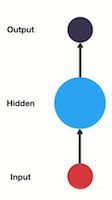

- RNN 单层网络结构


- 以时间步对 RNN 进行展开后的单层网络结构


- RNN 的循环机制使模型隐层上一时间步产生的结果，能够作为当下时间步输入的一部分（当下时间步的输入除了正常的输入外还包括上一步的隐层输出）对当下时间步的输出产生影响。

    - 输入有两个：数据端输入、上一时间步的隐藏层输入

    - 输出有两个：数据端输出、本时间步的隐藏层输出

### **RNN 模型的作用**

- 因为 RNN 结构能够很好利用序列之间的关系，因此针对自然界具有连续性的输入序列，如人类的语言， 语音等进行很好的处理，广泛应用于 NLP 领域的各项任务，如文本分类、情感分析、意图识别、机器翻译等。

- 下面以一个用户意图识别的例子进行简单的分析：


- 第一步：用户输入了 “What time is it ？”，我们首先需要对它进行基本的分词，因为 RNN 是按照顺序工作的，每次只接收一个单词进行处理。


- 第二步：首先将单词 “What” 输送给 RNN，它将产生一个输出 O1。


- 第三步：继续将单词 “time” 输送给 RNN， 但此时 RNN 不仅仅利用 “time” 来产生输出 O2，还会使用来自上一时间步的隐藏状态 h1 作为输入信息。

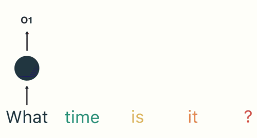

- 第四步：重复这样的步骤，直到处理完所有的单词。

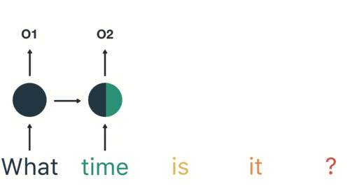

- 第五步：最后，将最终的隐层输出 O5 进行处理来解析用户意图。

若意图识别是 18 个分类，O5 输出结果再经过一个 softmax 层转成分类概率计算，就可以对分类意图识别。

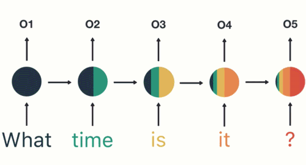

### **RNN 模型的分类**

- 可从两个角度对 RNN 模型进行分类。第一个角度是输入和输出的结构，第二个角度是 RNN 的内部构造。

- 按照**输入和输出**的结构进行分类

    - N vs N \- RNN        输入N个序列，输出N个序列        写诗 写对联 固定场景表达

    - N vs 1 \- RNN        输入N个序列，输出1个的值         情感分类 意图识别

    - 1 vs N \- RNN        输入1个序列，输出N个的值         看图说话

    - N vs M \- RNN       输入N个序列，输出M个序列         翻译、语音转换；文本生成、摘要

- 按照** RNN 的内部构造**进行分类

    - 传统 RNN            输入层，隐藏层 \(词嵌入层，循环网络层\)，输出层

    - LSTM                  遗忘门，输入门，细胞状态，输出门

    - Bi\-LSTM              双向 LSTM，句子从前往后做一次 LSTM，从后往前做一次 LSTM，结果合并

    - GRU                   重置门，更新门

    - Bi\-GRU               双向 GRU，句子从前往后做一次 GRU，从后往前做一次 GRU，结果合并


- N vs N \- RNN

    > 损失：每个时间步都算损失，再求和或平均。
    > 
    > 

    它是 RNN 最基础的结构形式，最大的特点就是：输入和输出序列是等长的。

    由于这个限制的存在，使其适用范围比较小，可用于生成等长度的合辙诗句。

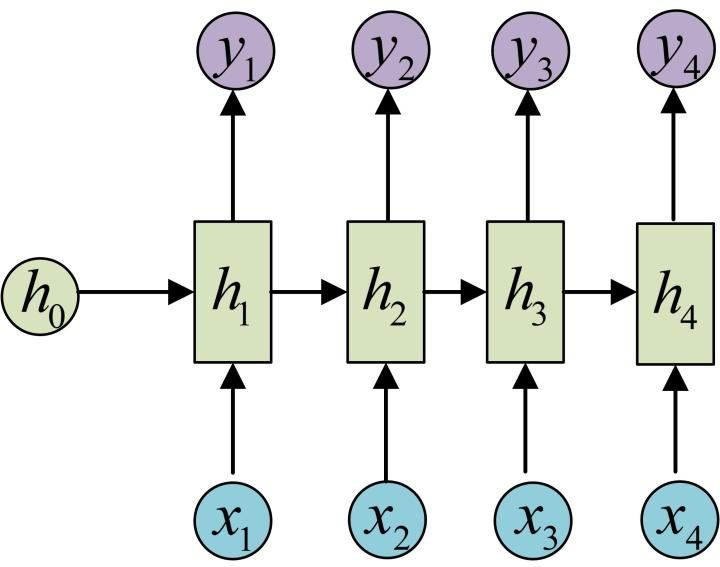

- N vs 1 \- RNN

    > 损失：只对最后一个时间步算一次。
    > 
    > 

    有时候我们要处理的问题输入是一个序列，而要求输出是一个单独的值而不是序列，应该怎样建模呢？

    我们只要在最后一个隐层输出 h 上进行线性变换就可以了，大部分情况下，为了更好的明确结果，还要使用sigmoid 或者 softmax 进行处理。 

    这种结构经常被应用在文本分类问题上。

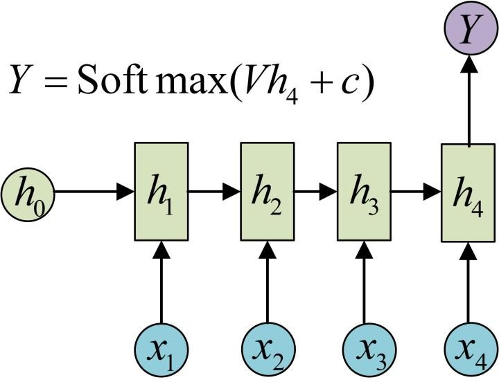

- 1 vs N \- RNN

    如果输入不是序列而输出为序列的情况怎么处理呢？

    我们最常采用的一种方式就是**使该输入作用于每次的输出之上**。 

    > 或者：
    > 
    > - 输入只在一个时间步喂入，后续时间步输入为零或可学习起始符；
    > 
    > - 或者用 decoder 结构，把上一步输出作为下一步输入。
    > 
    > 

    这种结构可用于将图片生成文字任务等。

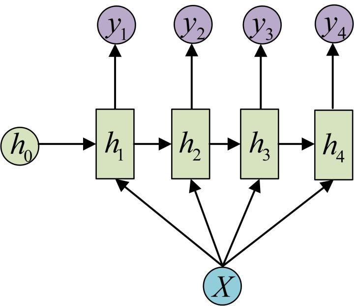

- N vs M \- RNN

    这是一种不限输入输出长度的 RNN 结构，它由编码器和解码器两部分组成，两者的内部结构都是某类 RNN， 它也被称为 seq2seq 架构。输入数据首先通过编码器，最终输出一个隐含变量 c，之后最常用的做法是使用这个隐含变量 c 作用在解码器进行解码的每一步上，以保证输入信息被有效利用。

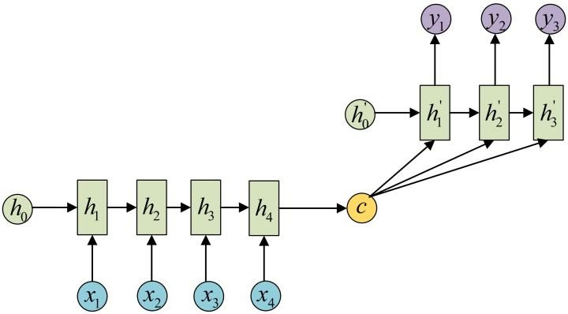

seq2seq 架构最早被提出应用于机器翻译，因为其输入输出不受限制，如今也是应用最广的 RNN 模型结构。在机器翻译、阅读理解、文本摘要等众多领域都进行了非常多的应用实践。


- 关于 RNN 的内部构造进行分类的内容将在后面使用单独的小节详细讲解。


## 1 传统 RNN 模型

### 1\.1 传统 RNN 内部结构分析

- RNN 内部结构图

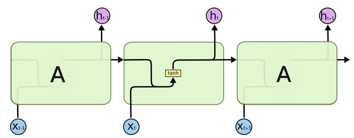

- 结构解释图


- 内部结构分析  

    我们把目光集中在中间的方块部分，它的输入有两部分，分别是 h\(t\-1\) 以及 x\(t\)，分别代表上一时间步的隐层输出以及此时间步的输入，它们进入RNN 结构体后，会 “融合” 到一起，这种融合根据结构解释可知，是将二者进行拼接，形成新的张量 \[x\(t\), h\(t\-1\)\]，之后这个新的张量将通过一个全连接层（线性层），该层使用 tanh 作为激活函数，最终得到该时间步的隐层输出 h\(t\)， 它将作为下一个时间步的输入和 x\(t\+1\) 一起进入结构体。 以此类推。

- 内部结构过程演示

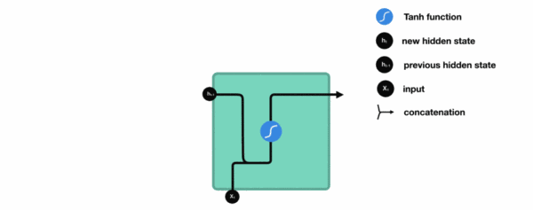

- 根据结构分析得出内部计算公式

    - 在学术界论文中：

$h_t = tanh(W_t[X_t, h_{t-1}] + b_t)$

相当于用矩阵参数对数据进行加权求和，再通过激活层添加非线性因素。

- 在工业界实现中，如 pytorch 框架中：

$h_t = \tanh (W_{ih}x_t + b_{ih} + W_{hh}h_{(t-1)} + b_{hh})$

> 从这个公式可以看出，**RNN 在时间步间是共享状态转移矩阵的**，$W_{ih}、W_{hh}、b_{ih}、b_{hh}$都是与时间 t 无关的。
> 
> 

```Python
class RNN(RNNBase):
*
*    .. math::*
*        h_t = \tanh(x_t W_{ih}^T + b_{ih} + h_{t-1}W_{hh}^T + b_{hh})
```

相当于用隐藏层数据 @ 内部隐藏层参数矩阵 Whh \+ 用时间步数据 @ 内部参数矩阵 Wih，再用 tanh 激活。

- 激活函数 tanh 的作用

    用于帮助调节流经网络的值， tanh 函数将值压缩在 \-1 和 1 之间。

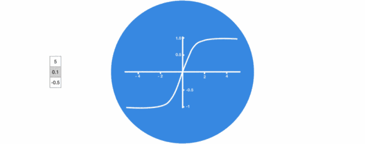

### 1\.2 使用 Pytorch 构建 RNN 模型

- 位置：在 torch\.nn 工具包之中，通过 torch\.nn\.RNN 可调用


> 注：这里面的 batch 是 batch\_size 的意思。
> 
> 

- nn\.RNN 使用示例 1 \-\-\- 演示 RNN API 的 9 个参数


> 区分 **output\_size** 与 output 的第三个维度大小 **hidden\_size**。
> 
> 注：上面写的输出向量的维度是指 output 的第三个维度，即 hidden\_size；而不是经过全连接层（输出层）之后的输出维度，即全连接层神经元个数，这个才叫 output\_size。
> 
> **注：这个还要看是在创建类的时候还是在实例化之后。**具体的可以看下面的 “RNN案列：人名分类器” 。
> 
> 简单来说，一般 forword\(\) 的返回结果是经过输出层后的。所以在模型实例化阶段返回的结果就是 forword\(\) 规定返回的结果，也就是经过输出层的结果。
> 
> 而在创建类的过程的，是先隐藏层再输出层的顺序来的，所以在创建类时，forword\(\) 首次构建隐藏层时是没有经过输出层的。
> 
> 为了以示区分，在 “RNN案列：人名分类器” 中，分别使用 `rr, hn = self.rnn(input, h0)` 和 `output, hn = self.rnn(input, h0)` 来区分创建类阶段和实例化之后阶段。
> 
> 

```Python
import torch
import torch.nn as nn

def  dm_rnn_for_base():
    '''
    第一个参数：input_size(输入张量x的维度，即词向量维度)
    第二个参数：hidden_size(隐藏层的维度， 隐藏层的神经元个数)
    第三个参数：num_layer(隐藏层的数量)
    '''
    rnn = nn.RNN(5, 6, 1)    # A

    '''
    第一个参数：sequence_length(输入序列的长度)
    第二个参数：batch_size(批次的样本数量)
    第三个参数：input_size(输入张量的维度)
    '''
    input = torch.randn(1, 3, 5)    # B

    '''
    第一个参数：num_layer * num_directions(层数*网络方向)
    第二个参数：batch_size(批次的样本数)
    第三个参数：hidden_size(隐藏层的维度， 隐藏层神经元的个数)
    '''
    h0 = torch.randn(1, 3, 6)    # C    # 这里其实常初始化为全0

    # [1,3,5],[1,3,6] ---> [1,3,6],[1,3,6]
    output, hn = rnn(input, h0)

    print('output--->',output.shape, output)
    print('hn--->',hn.shape, hn)
    print('rnn模型--->', rnn)

# 程序运行效果如下：
output---> torch.Size([1, 3, 6]) tensor([[[ 0.8947, -0.6040,  0.9878, -0.1070, -0.7071, -0.1434],
         [ 0.0955, -0.8216,  0.9475, -0.7593, -0.8068, -0.5549],
         [-0.1524,  0.7519, -0.1985,  0.0937,  0.2009, -0.0244]]],
       grad_fn=<StackBackward0>)
hn---> torch.Size([1, 3, 6]) tensor([[[ 0.8947, -0.6040,  0.9878, -0.1070, -0.7071, -0.1434],
         [ 0.0955, -0.8216,  0.9475, -0.7593, -0.8068, -0.5549],
         [-0.1524,  0.7519, -0.1985,  0.0937,  0.2009, -0.0244]]],
       grad_fn=<StackBackward0>)
rnn模型---> RNN(5, 6)
```

- nn\.RNN 使用示例 2 \-\-\- 调整输入数据的长度 \(sequence\_length\)

```Python
# 输入数据长度发生变化
def  dm_rnn_for_sequencelen():
    '''
    第一个参数：input_size(输入张量x的维度)
    第二个参数：hidden_size(隐藏层的维度， 隐藏层的神经元个数)
    第三个参数：num_layer(隐藏层的数量)
    '''
    rnn = nn.RNN(5, 6, 1)    # A
    '''
    第一个参数：sequence_length(输入序列的长度)
    第二个参数：batch_size(批次的样本数量)
    第三个参数：input_size(输入张量的维度)
    '''
    input = torch.randn(20, 3, 5)    # B
    '''
    第一个参数：num_layer * num_directions(层数*网络方向)
    第二个参数：batch_size(批次的样本数)
    第三个参数：hidden_size(隐藏层的维度， 隐藏层神经元的个数)
    '''
    h0 = torch.randn(1, 3, 6)    # C

    # [20,3,5],[1,3,6] --->[20,3,6],[1,3,6]
    output, hn = rnn(input, h0)  

    print('output--->', output.shape)
    print('hn--->', hn.shape)
    print('rnn模型--->', rnn)

# 程序运行效果如下： 
output---> torch.Size([20, 3, 6])
hn---> torch.Size([1, 3, 6])
rnn模型---> RNN(5, 6)
```

- nn\.RNN 使用示例 3 \-\-\- 调整模型隐藏层层数 \(num\_layer\)

```Python
def dm_run_for_hiddennum():
    '''
    第一个参数：input_size(输入张量x的维度)
    第二个参数：hidden_size(隐藏层的维度， 隐藏层的神经元个数)
    第三个参数：num_layer(隐藏层的数量)
    '''
    rnn = nn.RNN(5, 6, 2)    # A 隐藏层个数从1-->2 下面程序需要修改的地方？
    '''
    第一个参数：sequence_length(输入序列的长度)
    第二个参数：batch_size(批次的样本数量)
    第三个参数：input_size(输入张量的维度)
    '''
    input = torch.randn(1, 3, 5)    # B
    '''
    第一个参数：num_layer * num_directions(层数*网络方向)
    第二个参数：batch_size(批次的样本数)
    第三个参数：hidden_size(隐藏层的维度， 隐藏层神经元的个数)
    '''
    h0 = torch.randn(2, 3, 6)    # C
    
    # [1,3,5],[2,3,6] ---> [1,3,6],[2,3,6]
    output, hn = rnn(input, h0)  
    print('output-->', output.shape, output)
    print('hn-->', hn.shape, hn)
    print('rnn模型--->', rnn)  # nn模型---> RNN(5, 6, num_layers=11)

    # 结论：若只有一个隐藏层 output输出结果等于hn
    # 结论：如果有2个隐藏层，output的输出结果有2个，hn等于最后一个隐藏层
    # 即 output[-1] == hn[-1]

# 程序运行效果如下： 
output--> torch.Size([1, 3, 6]) tensor([[[ 0.4987, -0.5756,  0.1934,  0.7284,  0.4478, -0.1244],
         [ 0.6753,  0.5011, -0.7141,  0.4480,  0.7186,  0.5437],
         [ 0.6260,  0.7600, -0.7384, -0.5080,  0.9054,  0.6011]]],
       grad_fn=<StackBackward0>)
hn--> torch.Size([2, 3, 6]) tensor([[[ 0.4862,  0.6872, -0.0437, -0.7826, -0.7136, -0.5715],
         [ 0.8942,  0.4524, -0.1695, -0.5536, -0.4367, -0.3353],
         [ 0.5592,  0.0444, -0.8384, -0.5193,  0.7049, -0.0453]],

        [[ 0.4987, -0.5756,  0.1934,  0.7284,  0.4478, -0.1244],
         [ 0.6753,  0.5011, -0.7141,  0.4480,  0.7186,  0.5437],
         [ 0.6260,  0.7600, -0.7384, -0.5080,  0.9054,  0.6011]]],
       grad_fn=<StackBackward0>)
rnn模型---> RNN(5, 6, num_layers=2)
```

#### 总结（非常非常重要）

在 PyTorch `nn.RNN` 这个 API 里：

> `output` 的每个时间步就是最后一层的隐藏状态 $h_{t}^{(L)}$。
> 
> 

也就是说，`nn.RNN` 本身没有额外的输出层，它返回的 `output` 就是隐藏状态序列，不是经过 $W_{hy}h_t+b_y​$ 得到的 $y_t$。

如果在后面接：

```Python
linear = nn.Linear(6, 10)    # 即输出层
y = linear(output)
```

这时 `y` 才是我们通常说的 “该时间步的输出” $y_t$，而 `output` 仍然是隐藏状态。

所以总结成一句话：

**在 ****`nn.RNN`**** 的返回值里，****`output`**** 名字叫输出，内容其实是最后一层的隐藏状态序列（即最后一层所有时间步的隐藏在状态）；****`hn`**** 是每一层最后一个时间步的隐藏状态。****`output[-1] == hn[-1]`****。**

另：`nn.RNN` 的返回值都是经过激活函数之后的结果，`nn.RNN` 默认 `nonlinearity='tanh'`。

> **RNN/GRU/LSTM 每个时间步对外输出的都是隐藏状态 ht；最终 “数据端” 的任务输出取决于后面接的输出层，以及取哪些时间步的 ht。**
> 
> **也就是说隐藏状态 ht 一方面沿相邻时间步传递，另一方面作为该时间步的层输出被收集起来，供输出层、下一层或后续池化/预测使用。**
> 
> **只是为了方便计算，用 output 来承接最后一层各时间步的隐藏状态（****也可以理解为 output 是覆盖更新的****），这样最后只需选择将需要的部分从 output 中拿出来送入输出层即可。****比如 N vs 1 任务只需要最后一个隐藏层的最后一个时间步的隐藏状态作为输出，那么只需要取出 ****`output[-1]`**** ****传入输出层即可。**
> 
> 

### 1\.3 传统 RNN 优缺点

- 传统 RNN 的优势

    由于内部结构简单，对计算资源要求低，相比之后的 RNN 变体：LSTM 和 GRU ，模型参数总量少了很多，在**短序列任务**上性能和效果都表现优异。 

- 传统 RNN 的缺点

    传统 RNN 在解决长序列之间的关联时，通过实践，证明经典 RNN 表现很差，原因是在进行反向传播的时候， 过长的序列导致梯度的计算异常，发生梯度消失或爆炸。

#### 梯度消失或爆炸介绍

> 这部分的详细解释见上文 “手搓简单 RNN” 中的 “重要说明” 部分。
> 
> 

根据反向传播算法和链式法则，梯度的计算可以简化为以下公式

$D_n=\sigma^{\prime}(z_1)w_1\cdot\sigma^{\prime}(z_2)w_2\cdot_{\cdots}\cdot\sigma^{\prime}(z_n)w_n$

其中 sigmoid 的导数值域是固定的，在 \[0, 0\.25\] 之间，而一旦公式中的 w 也小于 1，那么通过这样的公式连乘后，最终的梯度就会变得非常非常小，这种现象称作梯度消失。反之，如果我们人为的增大 w 的值，使其大于 1，那么连乘够就可能造成梯度过大，称作梯度爆炸。

> 这里的 sigmoid 只是举例，实际还是常用 tanh 或 relu，况且对 sigmoid 来说 w\>4 时才**可能**造成梯度爆炸。所以这一小段是不严谨的，猜测仅仅是原作者选了一个较为熟悉的激活函数来说明，具体解释还是以上文我自己写的为准。
> 
> 

- 梯度消失或爆炸的危害

    如果在训练过程中发生了梯度消失，权重无法被更新，最终导致训练失败；梯度爆炸所带来的梯度过大，大幅度更新网络参数，在极端情况下，结果会溢出（NaN值）。


## 2 LSTM 模型

LSTM（Long Short\-Term Memory）也称**长短时记忆**结构，它是传统 RNN 的变体，与经典 RNN 相比能够有效捕捉长序列之间的语义关联，缓解梯度消失或爆炸现象。同时 LSTM 的结构更复杂，它的核心结构可以分为四个部分去解析：

- 遗忘门

- 输入门

- 细胞状态

- 输出门

### 2\.1 LSTM 内部结构分析


> 说明：里面的 `*` 表示 Hadamard 积，`@` 表示正常矩阵乘法，即和张量运算一致。
> 
> 只需记住右上角部分，其他理解。重点是后面的 Transformer。
> 
> 注：可在 右上角\.\.\. \-\-\> 页宽设置 \-\-\> 全宽模式 下查看。
> 
> 

- LSTM 内部结构图

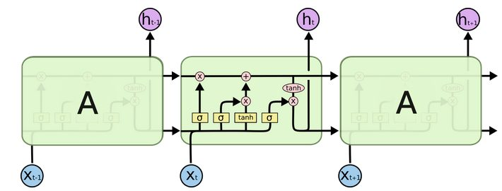

每个时间步有三个输入：数据端输入，上一个时间步细胞状态$C_{t-1}$，上一个时间步的$h_{t-1}$

每个时间步有三个输出：数据端输出，本时间步细胞状态$C_{t}$，本时间步的$h_{t}$

- 结构解释图：

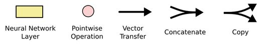

- **遗忘门**部分结构图与计算公式

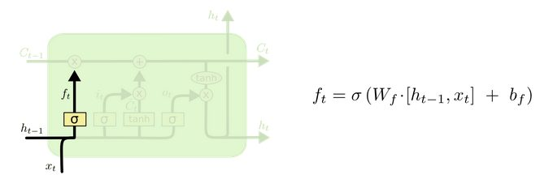

- 遗忘门结构分析

    与传统 RNN 的内部结构计算非常相似，首先将当前时间步输入 x\(t\) 与上一个时间步隐含状态 h\(t\-1\) 拼接， 得到 \[x\(t\), h\(t\-1\)\]， 然后通过一个全连接层做变换，最后通过 sigmoid 函数进行激活得到 f\(t\) ，我们可以将 f\(t\) 看作是门值，好比一扇门开合的大小程度，门值都将作用在通过该扇门的张量，遗忘门门值将作用的上一层的细胞状态上，代表遗忘过去的多少信息，又因为遗忘门门值是由 x\(t\)，h\(t\-1\) 计算得来的，因此整个公式意味着根据当前时间步输入和上一个时间步隐含状态 h\(t\-1\) 来决定遗忘多少上一层的细胞状态所携带的过往信息。

- 遗忘门内部结构过程演示

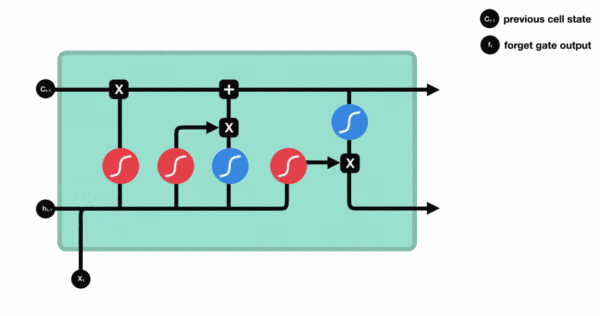

- 激活函数sigmiod的作用

    用于帮助调节流经网络的值， sigmoid 函数将值压缩在 0 和 1 之间。


- **输入门**部分结构图与计算公式

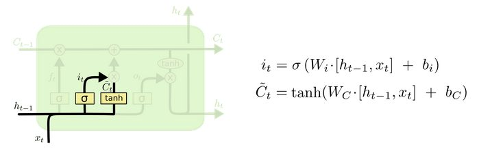

- 输入门结构分析

    我们看到输入门的计算公式有两个，第一个就是产生输入门门值的公式，它和遗忘门公式几乎相同，区别只是在于它们之后要作用的目标上。这个公式意味着输入信息有多少需要进行过滤。输入门的第二个公式是与传统RNN 的内部结构计算相同。对于 LSTM 来讲，它得到的是当前的细胞状态，而不是像经典 RNN 一样得到的是隐含状态。

- 输入门内部结构过程演示

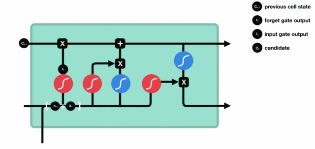

- **细胞状态**更新图与计算公式

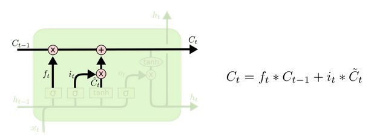

- 细胞状态更新分析

    细胞更新的结构与计算公式非常容易理解， 这里没有全连接层， 只是将刚刚得到的遗忘门门值与上一个时间步得到的 C\(t\-1\) 相乘， 再加上输入门门值与当前时间步得到的未更新 C\(t\) 相乘的结果。 最终得到更新后的 C\(t\)作为下一个时间步输入的一部分。 整个细胞状态更新过程就是对遗忘门和输入门的应用。

- 细胞状态更新过程演示

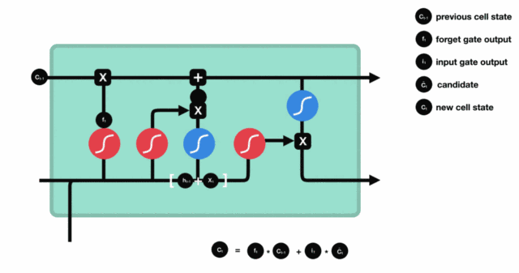

- **输出门**部分结构图与计算公式

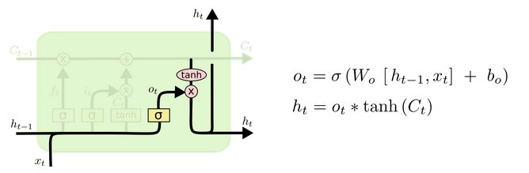

- 输出门结构分析

    输出门部分的公式也是两个，第一个即是计算输出门的门值，它和遗忘门输入门计算方式相同。第二个即是使用这个门值产生隐含状态 h\(t\)，他将作用在更新后的细胞状态 C\(t\) 上，并做 tanh 激活，最终得到 h\(t\) 作为下一时间步输入的一部分。整个输出门的过程，就是为了产生隐含状态 h\(t\)。

- 输出门内部结构过程演示

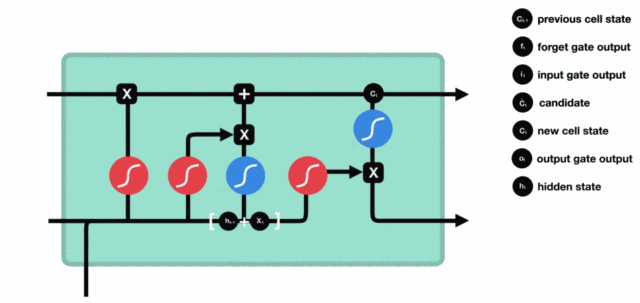

### 2\.2 Bi\-LSTM 介绍

Bi\-LSTM 即双向 LSTM，它没有改变 LSTM 本身任何的内部结构，只是将 LSTM 应用两次且方向不同，再将两次得到的 LSTM 结果进行拼接作为最终输出。

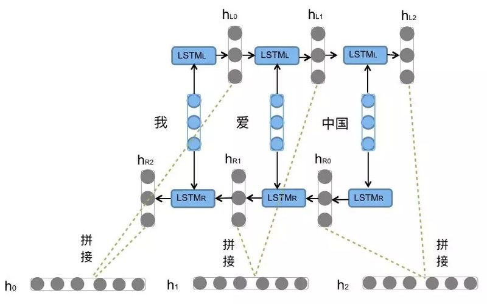

- Bi\-LSTM 结构分析

    图中对 “我爱中国” 这句话或者叫这个输入序列，进行了从左到右和从右到左两次 LSTM 处理，将得到的结果张量进行了拼接作为最终输出。这种结构能够捕捉语言语法中一些特定的前置或后置特征，增强语义关联，但是模型参数和计算复杂度也随之增加了一倍，一般需要对语料和计算资源进行评估后决定是否使用该结构。

### 2\.3 使用 Pytorch 构建 LSTM 模型

- 位置：在 torch\.nn 工具包之中，通过 torch\.nn\.LSTM 可调用。

- nn\.LSTM 类初始化主要参数解释

    - input\_size：输入张量x中特征维度的大小。

    - hidden\_size：隐层张量h中特征维度的大小。

    - num\_layers：隐藏层的数量。

    - bidirectional：是否选择使用双向 LSTM， 如果为 True，则使用；默认不使用。

- nn\.LSTM 类实例化对象主要参数解释

    - input：输入张量 x。

    - h0：初始化的隐层张量 h。

    - c0：初始化的细胞状态张量 c。

- nn\.LSTM 使用示例

```Python
# 定义LSTM的参数含义: (input_size, hidden_size, num_layers)
# 定义输入张量的参数含义: (sequence_length, batch_size, input_size)
# 定义隐藏层初始张量和细胞初始状态张量的参数含义:
# (num_layers * num_directions, batch_size, hidden_size)

import torch.nn as nn
import torch

rnn = nn.LSTM(5, 6, 2)
input = torch.randn(1, 3, 5)
h0 = torch.randn(2, 3, 6)
c0 = torch.randn(2, 3, 6)
output, (hn, cn) = rnn(input, (h0, c0))    # 必须以元组形式传入和输出，因为只接收两个参数

*# **写法2**: 不传入 h0和c0 -> 底层会自动创建1个 全0的 h0(上一时刻隐藏状态) 和 c0(上一时刻细胞状态)*
# output, (hn, cn) = rnn(input)

# 输出结果
>>> output
tensor([[[ 0.0447, -0.0335,  0.1454,  0.0438,  0.0865,  0.0416],
         [ 0.0105,  0.1923,  0.5507, -0.1742,  0.1569, -0.0548],
         [-0.1186,  0.1835, -0.0022, -0.1388, -0.0877, -0.4007]]],
       grad_fn=<StackBackward>)
>>> hn
tensor([[[ 0.4647, -0.2364,  0.0645, -0.3996, -0.0500, -0.0152],
         [ 0.3852,  0.0704,  0.2103, -0.2524,  0.0243,  0.0477],
         [ 0.2571,  0.0608,  0.2322,  0.1815, -0.0513, -0.0291]],

        [[ 0.0447, -0.0335,  0.1454,  0.0438,  0.0865,  0.0416],
         [ 0.0105,  0.1923,  0.5507, -0.1742,  0.1569, -0.0548],
         [-0.1186,  0.1835, -0.0022, -0.1388, -0.0877, -0.4007]]],
       grad_fn=<StackBackward>)
>>> cn
tensor([[[ 0.8083, -0.5500,  0.1009, -0.5806, -0.0668, -0.1161],
         [ 0.7438,  0.0957,  0.5509, -0.7725,  0.0824,  0.0626],
         [ 0.3131,  0.0920,  0.8359,  0.9187, -0.4826, -0.0717]],

        [[ 0.1240, -0.0526,  0.3035,  0.1099,  0.5915,  0.0828],
         [ 0.0203,  0.8367,  0.9832, -0.4454,  0.3917, -0.1983],
         [-0.2976,  0.7764, -0.0074, -0.1965, -0.1343, -0.6683]]],
       grad_fn=<StackBackward>)
```

### 2\.4 LSTM 优缺点

- LSTM 优势：LSTM 的门结构能够有效减缓长序列问题中可能出现的梯度消失或爆炸，虽然并不能杜绝这种现象，但在更长的序列问题上表现优于传统 RNN。**LSTM 在处理长时序依赖问题时相对于普通 RNN 和 GRU 效果更好。**

- LSTM 缺点：由于内部结构相对较复杂，因此训练效率在同等算力下较传统 RNN 低很多。


## 3 GRU 模型

GRU（Gated Recurrent Unit）也称**门控循环单元**结构，它也是传统 RNN 的变体，同 LSTM 一样能够有效捕捉长序列之间的语义关联，缓解梯度消失或爆炸现象。同时它的结构和计算要比 LSTM 更简单，比 RNN 要复杂。它的核心结构可以分为两个部分去解析：

- 更新门

- 重置门

### 3\.1 GRU 内部结构分析


> 说明：里面的 `*` 表示 Hadamard 积，`@` 表示正常矩阵乘法，即和张量运算一致。
> 
> 只需记住右上角部分，其他理解。重点是后面的 Transformer。
> 
> 

- GRU 内部结构图

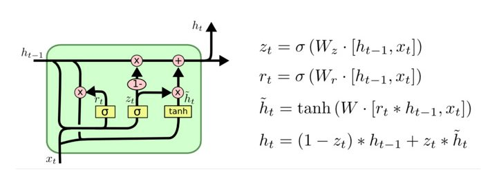

- 结构解释图


- GRU 的更新门和重置门结构图

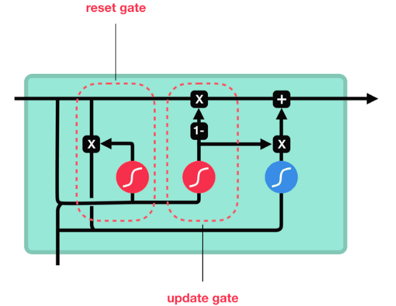

- 内部结构分析

    和之前分析过的 LSTM 中的门控一样，首先计算更新门和重置门的门值，分别是 z\(t\) 和 r\(t\)，计算方法就是使用 x\(t\) 与 h\(t\-1\) 拼接进行线性变换，再经过 sigmoid 激活。之后重置门门值作用在了 h\(t\-1\) 上，代表控制上一时间步传来的信息有多少可以被利用。接着就是使用这个重置后的 h\(t\-1\) 进行基本的 RNN 计算，即与 x\(t\)拼接进行线性变化，经过 tanh 激活，得到新的 h\(t\)。最后更新门的门值会作用在新的 h\(t\)，而 1\-门值 会作用在 h\(t\-1\) 上，随后将两者的结果相加，得到最终的隐含状态输出 h\(t\)，这个过程意味着更新门有能力保留之前的结果，当门值趋于 1 时，输出就是新的 h\(t\)；而当门值趋于 0 时，输出就是上一时间步的 h\(t\-1\)。

### 3\.2 Bi\-GRU 介绍

Bi\-GRU 与 Bi\-LSTM 的逻辑相同，都是不改变其内部结构，而是将模型应用两次且方向不同，再将两次得到的 GRU结果进行拼接作为最终输出。具体参见上小节中的 Bi\-LSTM。

### 3\.3 使用 Pytorch 构建 GRU 模型

- 位置：在 torch\.nn 工具包之中，通过 torch\.nn\.GRU 可调用。

- nn\.GRU 类初始化主要参数解释：

    - input\_size：输入张量 x 中特征维度的大小。

    - hidden\_size：隐层张量 h 中特征维度的大小。

    - num\_layers：隐藏层的数量。

    - bidirectional：是否选择使用双向 GRU，如果为 True，则使用；默认不使用。

- nn\.GRU 类实例化对象主要参数解释

    - input：输入张量 x。

    - h0：初始化的隐层张量 h。

- nn\.GRU 使用示例

```Python
import torch
import torch.nn as nn

rnn = nn.GRU(5, 6, 2)
input = torch.randn(1, 3, 5)
h0 = torch.randn(2, 3, 6)    # 这里其实常初始化为全0
output, hn = rnn(input, h0)

# 输出结果
>>> output
tensor([[[-0.2097, -2.2225,  0.6204, -0.1745, -0.1749, -0.0460],
         [-0.3820,  0.0465, -0.4798,  0.6837, -0.7894,  0.5173],
         [-0.0184, -0.2758,  1.2482,  0.5514, -0.9165, -0.6667]]],
       grad_fn=<StackBackward>)
>>> hn
tensor([[[ 0.6578, -0.4226, -0.2129, -0.3785,  0.5070,  0.4338],
         [-0.5072,  0.5948,  0.8083,  0.4618,  0.1629, -0.1591],
         [ 0.2430, -0.4981,  0.3846, -0.4252,  0.7191,  0.5420]],

        [[-0.2097, -2.2225,  0.6204, -0.1745, -0.1749, -0.0460],
         [-0.3820,  0.0465, -0.4798,  0.6837, -0.7894,  0.5173],
         [-0.0184, -0.2758,  1.2482,  0.5514, -0.9165, -0.6667]]],
       grad_fn=<StackBackward>)
>>> rnn       
GRU(5, 6, num_layers=2)
```

### 3\.4 GRU 优缺点

- GRU的优势

    GRU 和 LSTM 作用相同，在捕捉长序列语义关联时，能有效抑制梯度消失或爆炸，效果都优于传统 RNN 且**计算复杂度相比 LSTM 要小。但 LSTM 在处理长时序依赖问题时相对于普通 RNN 和 GRU 效果更好**。

- GRU 的缺点

    GRU 仍然不能完全解决梯度消失问题，同时其作为 RNN 的变体，有着 RNN 结构本身的一大弊端，即**不可并行计算**，这在数据量和模型体量逐步增大的未来，是 RNN 发展的关键瓶颈。

    

## 4 RNN 案例：人名分类器

> 参考 PyTorch 官方教程 “NLP From Scratch: Classifying Names with a Character\-Level RNN” 。
> 
> 

> N vs 1 RNN，只需要最后一个时间步的隐藏状态进入输出层，后面就是 ANN 问题。
> 
> 

**案例介绍**

- 关于人名分类问题：以一个人名为输入，使用模型帮助我们判断它最有可能是来自哪一个国家的人名，这在某些国际化公司的业务中具有重要意义，在用户注册过程中，会根据用户填写的名字直接给他分配可能的国家或地区选项，以及该国家或地区的国旗，限制手机号码位数等等，提高效率和友好度。

- 数据存放路径：\./data/name\_classfication\.txt

- 数据格式说明：每一行第一个单词为人名，第二个单词为国家名。中间用制表符 tab 分割。

- 数据一共有 20074 条，有 18 个国家。

```Plain Text
Huffmann    German
Hummel  German
Hummel  German
Hutmacher   German
Ingersleben German
Jaeger  German
Jager   German
Deng    Chinese
Ding    Chinese
Dong    Chinese
Dou Chinese
Duan    Chinese
Eng Chinese
Fan Chinese
Fei Chinese
Abaimov Russian
Abakeliya   Russian
Abakovsky   Russian
Abakshin    Russian
Abakumoff   Russian
Abakumov    Russian
Abakumtsev  Russian
Abakushin   Russian
Abalakin    Russian
```

**案例步骤**

整个案例的实现可分为以下五个步骤

- 第一步，任务识别

- 第二步，对 data 文件中的数据进行处理，满足训练要求

> 数据处理三部曲：读数据到内存、构建数据集对象 TensorDataset、构建 DataLoader
> 
> 

- 第三步，构建 RNN 模型（包括传统 RNN，LSTM 以及 GRU）

    - 搭建模型和模型的测试程序（重点）

- 第四步，构建训练函数并进行训练

- 第五步，构建预测函数并进行预测

**任务识别（基本实现分析）**

- 根据人名预测是哪一个国家（18 个国家）

    - 典型就是一个分类问题

- 文本数值化和数值张量化的技术选型分析（数据如何送给模型？）

    - 比如：每个姓氏构成一个单词：“zhang”、“wang”、“li”、“Weston” 等等，需要转成张量送给模型。

        - 技术路线 1：以单词为单位，word2id 后送给 RNN 模型抽取事物特征进行分类。这样每个姓氏只能整体送 1 次。

        - 技术路线 2：比如，z\-h\-a\-n\-g 以字母为单位，送给 RNN 模型抽取事物特征进行分类。

    - 本案例：文本数值化方案采用**技术路线 2**，即以字母为单位，进行文本数值化和数值张量化。

        - 用户输入人名也是 1 个字符 1 个字符的输入，所以就 1 个字符 1 个字符的送给模型提取字符串的特征。

        - 比如：一共有 57 个字母（大小写 26×2 \+ 5 个常用标点），构成字母表。每个字母进行 one\-hot 编码，再送给 RNN 模型。

- 短文本分类，模型选型分析（如何选模型？）

    - 模型可以选择 RNN、LSTM、GRU。

    - 分别测试三个模型的准确率、损失下降情况、训练时间等等，综合对比三个模型在数据集的表现，选择合适的模型。

**导入必备的工具包**

```Python
# 导入torch工具
import torch
# 导入nn准备构建模型
import torch.nn as nn
import torch.nn.functional as F    # *常用的函数库*
import torch.optim as optim        *# 优化器模块*
# 导入torch的数据源 数据迭代器工具包
from  torch.utils.data import Dataset, DataLoader
# *字符串处理模块，*用于获得常见字母及字符规范化
import string
# 导入时间工具包
import time
# 引入制图工具包  
import matplotlib.pyplot as plt
*# 进度条*
from tqdm import tqdm                               

*# 解决绘图时, 中文乱码问题*
plt.rcParams['font.sans-serif'] = ['SimHei']        
plt.rcParams['axes.unicode_minus'] = False
```

### 4\.1 数据预处理

这里需要对 data 文件中的数据进行处理，满足训练要求。

> 文件加载 \-\> 封装成 Tensor \-\> 数据集对象 \(TensorDataset\) \-\> 数据加载器 \(DataLoader\)
> 
> 

#### 获取常用的字符数量

```Python
# 获取所有常用字符包括字母和常用标点
all_letters = string.ascii_letters + " .,;'"

# 获取常用字符数量
n_letters = len(all_letters)

print("n_letter:", n_letters)
```

输出结果

```Plain Text
n_letter: 57
```

#### 国家名种类数和个数

```Python
# 国家名 种类数
categorys = ['Italian', 'English', 'Arabic', 'Spanish', 'Scottish', 'Irish', 'Chinese', 'Vietnamese', 'Japanese', 'French', 'Greek', 'Dutch', 'Korean', 'Polish', 'Portuguese', 'Russian', 'Czech', 'German']
# 国家名 个数
categorynum = len(categorys)
print('categorys-->', categorys)
print('categorynum-->', categorynum )
```

输出结果

```Plain Text
categorys--> ['Italian', 'English', 'Arabic', 'Spanish', 'Scottish', 'Irish', 'Chinese', 'Vietnamese', 'Japanese', 'French', 'Greek', 'Dutch', 'Korean', 'Polish', 'Portuguese', 'Russian', 'Czech', 'German']
categorynum--> 18
```

#### 读取数据到内存

```Python
# 思路分析
# 1 打开数据文件 open(filename, mode='r', encoding='utf-8')
# 2 按行读文件、提取样本x 样本y line.strip().split('\t')
# 3 返回样本x的列表、样本y的列表 my_list_x, my_list_y
def read_data(filename):
    my_list_x, my_list_y= [], []
    # 打开文件
    with open(filename, mode='r', encoding='utf-8') as f:
        # 按照行读数据
        for line in f.readlines():
            # *过滤无效数据, 假设(整行的)长度小于等于 5, 就过滤掉. 整行长度 = 人名 + '\t' + 国家名*
            if len(line) <= 5:
                continue
            # 按照行提取样本x 样本y
            x, y = line.strip().split('\t')
            my_list_x.append(x)
            my_list_y.append(y)

    # 打印样本的数量.   目的：*判断数据是否正确*
    print('my_list_x->', len(my_list_x))    # 20074
    print('my_list_y->', len(my_list_y))    # 20074

    # 返回样本x的列表、样本y的列表
    return my_list_x, my_list_y
```

#### 构建数据集对象 TensorDataset

```Python
# 原始数据 --> 数据源NameClassDataset --> 数据迭代器DataLoader
# 构造数据源 NameClassDataset，把语料转换成 x y
# 1 init函数 设置样本x和y self.my_list_x self.my_list_y 条目数self.sample_len
# 2 __len__(self)函数  获取样本条数
# 3 __getitem__(self, index)函数 获取第几条样本数据
#       按索引 获取数据样本 x y
#       样本x one-hot张量化 tensor_x[li][all_letters.find(letter)] = 1
#       样本y 张量化 torch.tensor(categorys.index(y), dtype=torch.long)
#       返回tensor_x, tensor_y
class NameClassDataset(Dataset):
    def __init__(self, my_list_x, my_list_y):
        # 样本x
        self.my_list_x = my_list_x
        # 样本y
        self.my_list_y = my_list_y
        # 样本条目数
        self.sample_len = len(my_list_x)

    # 获取样本条数
    # *外界用 len(NameClassDataset对象) 的时候, 自动触发*
    def __len__(self):
        return self.sample_len

    # 根据索引获取对应样本数据
    def __getitem__(self, index):
        *"""*
        *根据指定的索引, 获取其对应的样本, 并进行 one-hot编码 和 张量转换.*
        *:param index: 样本索引*
        *:return:  tensor_x: 人名(特征)的one-hot编码,  tensor_y: 国家(标签)的张量表示*
        *"""*
        # 对index异常值进行修正 [0, self.sample_len-1]
        index = min(max(index, 0), self.sample_len-1)

        # 按索引获取 数据样本 x y
        x = self.my_list_x[index]
        y = self.my_list_y[index]

        # 样本x one-hot张量化
        tensor_x = torch.zeros(len(x), n_letters)
        # 遍历人名 的 每个字母 做成one-hot编码
        for li, letter in enumerate(x):
            # letter2indx 使用all_letters.find(letter)查找字母在all_letters表中的位置 给one-hot赋值
            tensor_x[li][all_letters.find(letter)] = 1

        # 样本y 张量化
        tensor_y = torch.tensor(categorys.index(y), dtype=torch.long)

        # 返回结果
        return tensor_x, tensor_y
```

> `find()`主要用于**字符串**/字节串，`index()`**还**适用于**列表、元组等**序列。
> 
> `find()`是 “找不到返回 \-1”，`index()`是 “找不到就报错”。
> 
> 

文本张量化，这里也就是人名张量化，是通过 one\-hot 编码来完成。

```Plain Text
# 将字符串(单词粒度)转化为张量表示，如："ab" --->
# tensor([[[1., 0., 0., 0., 0., 0., 0., 0., 0., 0., 0., 0., 0., 0., 0., 0., 0.,
#          0., 0., 0., 0., 0., 0., 0., 0., 0., 0., 0., 0., 0., 0., 0., 0., 0.,
#          0., 0., 0., 0., 0., 0., 0., 0., 0., 0., 0., 0., 0., 0., 0., 0., 0.,
#          0., 0., 0., 0., 0., 0.]],

#        [[0., 1., 0., 0., 0., 0., 0., 0., 0., 0., 0., 0., 0., 0., 0., 0., 0.,
#          0., 0., 0., 0., 0., 0., 0., 0., 0., 0., 0., 0., 0., 0., 0., 0., 0.,
#          0., 0., 0., 0., 0., 0., 0., 0., 0., 0., 0., 0., 0., 0., 0., 0., 0.,
#          0., 0., 0., 0., 0., 0.]]])
```

#### 构建数据加载器 DataLoader

```Python
def dm_test_NameClassDataset():

    # 1 获取数据
    myfilename = './data/name_classfication.txt'
    my_list_x, my_list_y = read_data(myfilename)
    print('my_list_x length:', len(my_list_x))
    print('my_list_y length:', len(my_list_y))

    # 2 实例化dataset对象
    nameclassdataset = NameClassDataset(my_list_x, my_list_y)

    # 3 实例化dataloader
    mydataloader = DataLoader(dataset=nameclassdataset, batch_size=1, shuffle=True)
    for i, (x, y) in enumerate (mydataloader):
        print('x.shape', x.shape, x)
        print('y.shape', y.shape, y)
        break
```

> **注：**`DataLoader`的默认 collate 函数无法把不同长度的张量堆成一个 batch。
> 
> `DataLoader`默认会用`torch.stack`把 batch 内样本堆起来，但`torch.stack`要求每个维度完全一致。姓名长度不同，`seq_len`就不同，于是不使用 batch\_size=1 就会报错。
> 
> **解决方案：**“文本预处理 \-\- 4\.2 文本长度规范”：可使用数字 0 打 **padding** 补齐。
> 
> ```Python
> import torch
> from torch.nn.utils.rnn import pad_sequence
> 
> # 用 pad_sequence 把同一 batch 的姓名补齐到最大长度
> def my_collate_fn(batch):
>     # batch 是 [(x1, y1), (x2, y2), ...]
>     xs, ys = zip(*batch)
> 
>     # xs 中每个是 [seq_len_i, 57]
>     # pad_sequence 默认在 dim=0 补齐，batch_first=True 得到 [B, max_len, 57]
>     xs = pad_sequence(xs, batch_first=True, padding_value=0)
> 
>     # y 如果是标量张量
>     ys = torch.stack(ys, dim=0)
> 
>     return xs, ys
> 
> my_dataloader = DataLoader(
>     name_class_dataset,
>     batch_size=3,
>     shuffle=True,
>     collate_fn=my_collate_fn
> )
> ```
> 
> 

输出结果（batch\_size=1）

```Plain Text
my_list_x length: 20074
my_list_y length: 20074
x.shape torch.Size([1, 5, 57]) tensor([[[0., 0., 0., 0., 0., 0., 0., 0., 0., 0., 0., 0., 0., 0., 0., 0., 0.,
          0., 0., 0., 0., 0., 0., 0., 0., 0., 1., 0., 0., 0., 0., 0., 0., 0.,
          0., 0., 0., 0., 0., 0., 0., 0., 0., 0., 0., 0., 0., 0., 0., 0., 0.,
          0., 0., 0., 0., 0., 0.],
         [0., 1., 0., 0., 0., 0., 0., 0., 0., 0., 0., 0., 0., 0., 0., 0., 0.,
          0., 0., 0., 0., 0., 0., 0., 0., 0., 0., 0., 0., 0., 0., 0., 0., 0.,
          0., 0., 0., 0., 0., 0., 0., 0., 0., 0., 0., 0., 0., 0., 0., 0., 0.,
          0., 0., 0., 0., 0., 0.],
         [1., 0., 0., 0., 0., 0., 0., 0., 0., 0., 0., 0., 0., 0., 0., 0., 0.,
          0., 0., 0., 0., 0., 0., 0., 0., 0., 0., 0., 0., 0., 0., 0., 0., 0.,
          0., 0., 0., 0., 0., 0., 0., 0., 0., 0., 0., 0., 0., 0., 0., 0., 0.,
          0., 0., 0., 0., 0., 0.],
         [0., 0., 0., 0., 0., 0., 0., 0., 0., 0., 0., 0., 0., 0., 0., 0., 0.,
          0., 0., 0., 0., 0., 0., 0., 0., 1., 0., 0., 0., 0., 0., 0., 0., 0.,
          0., 0., 0., 0., 0., 0., 0., 0., 0., 0., 0., 0., 0., 0., 0., 0., 0.,
          0., 0., 0., 0., 0., 0.],
         [1., 0., 0., 0., 0., 0., 0., 0., 0., 0., 0., 0., 0., 0., 0., 0., 0.,
          0., 0., 0., 0., 0., 0., 0., 0., 0., 0., 0., 0., 0., 0., 0., 0., 0.,
          0., 0., 0., 0., 0., 0., 0., 0., 0., 0., 0., 0., 0., 0., 0., 0., 0.,
          0., 0., 0., 0., 0., 0.]]])
y.shape torch.Size([1]) tensor([15])
```

### 4\.2 模型构建

#### 构建 RNN 模型

```Python
# RNN类 实现思路分析：
# 1 init函数 准备三个层 self.rnn self.linear self.softmax=nn.LogSoftmax(dim=-1)
#    def __init__(self, input_size, hidden_size, output_size, num_layers=1)

# 2 forward(input, hidden)函数
#   让数据经过三个层 返回logsoftmax结果和hn
#   形状变化 [seqlen,1,57],[1,1,128]) -> [1,18],[1,1,128]

# 3 初始化隐藏层输入数据 init_hidden()
#   形状[self.num_layers, 1, self.hidden_size]
class My_RNN(nn.Module):

    def __init__(self, input_size, hidden_size, output_size, num_layers=1):
        super(RNN, self).__init__()
        # 1 init函数 准备三个层 self.rnn self.linear self.softmax=nn.LogSoftmax(dim=-1)
        self.input_size = input_size        # 57个字符
        self.hidden_size = hidden_size
        # 区分 output_size 与 output 的第三个维度的大小 hidden_size
        # 这里下面的 output 改为用 rr 代替了
        self.output_size = output_size      # 18个国家 
        self.num_layers = num_layers

        # 定义rnn层
        self.rnn = nn.RNN(self.input_size, self.hidden_size, self.num_layers)

        # 定义linear层
        self.linear = nn.Linear(self.hidden_size, self.output_size)

        # 定义softmax层
        # *多分类交叉熵损失函数CrossEntropyLoss(新版写法) = NLLLoss损失函数 + LogSoftmax(dim=-1)  旧版写法*
        # 优化：*如果用CrossEntropyLoss损失函数, 这行代码可以省略不写*
        self.logsoftmax = nn.LogSoftmax(dim=-1)

    def forward(self, input, hidden):
        '''
        input [6,57]-2维矩阵    hidden [1,1,57]-3维矩阵
        所以需要将input的形状改为：*[seq_len, batch_size, input_size]*
        '''
        # 数据形状 [6,57] -> [6,1,57]，即添加 batch_size
        input = input.unsqueeze(1)
        # 1 数据经过模型 提取事物特征
        # 数据形状 [seqlen,1,57],[1,1,128]) -> [seqlen,1,128],[1,1,128]
        rr, hn = self.rnn(input, hidden)

        # 数据形状 [seqlen,1,128] -> [1, 128]  
        # 得到的形状为 *[batch_size, hidden_size]*
        tmp_rr = rr[-1]    # 取最后一个时间步的隐藏状态，因为这是 N vs 1 RNN

        # 2 数据经过全连接层 [1,128] -->[1,18]
        tmp_rr = self.linear(tmp_rr)

        # 3 数据经过softmax层返回
        return self.logsoftmax(tmp_rr), hn

    def init_hidden(self):
        # 初始化隐藏层输入数据 init_hidden()
        return torch.zeros(self.num_layers, 1, self.hidden_size)
```

torch\.unsqueeze 演示

```Python
>>> x = torch.tensor([1, 2, 3, 4])    # x.shape: torch.Size([4])
# 在指定位置添加形状为 1 的维度（升维）
>>> torch.unsqueeze(x, 0)    
tensor([[1, 2, 3, 4]])                # shape: torch.Size([1, 4])
>>> torch.unsqueeze(x, 1)
tensor([[1],                          # shape: torch.Size([4, 1])
        [2],
        [3],
        [4]])
```

调用（RNN 模型测试）

```Python
def dm01_test_myrnn():

    # 1 实例化RNN对象
    my_rnn = My_RNN(57, 128, 18)
    print('my_rnn-->', my_rnn)

    # 2 准备测试数据
    input = torch.randn(6, 57)
    print(input.shape)
    h0 = my_rnn.init_hidden()

    # 3 给模型1次性的送数据
    # [seqlen, 57], [1, 1, 128]) -> [1,18], [1,1,128]
    # 注：my_rnn 是实列化对象，由上面的 My_RNN 类可知，他最后返回的是 self.logsoftmax(tmprr), hn
    # 所以下面的 output 指的是经过输出层的输出
    output, hn = my_rnn(input, h0)
    print(f'实列化之后输出的形状: {output.shape}, \n输出的内容: {output}')
    print(f'隐藏状态的形状: {hn.shape}')

    # 4 给模型1个字符1个字符的喂数据（没啥用）
    hidden = my_rnn.init_hidden()
    for i in range(input.shape[0]):
        tmp_input = input[i].unsqueeze(0)
        output, hidden = my_rnn(tmp_input, hidden)    # 前后都要用hidden命名保证循环
    # 最后一次ouput
    print('一个字符一个字符的送数据: output-->', output.shape, output)    
    '''
    一次性送 = PyTorch 在内部自动完成时间步展开，只需要传一次数据，隐藏状态在内部自动沿时间步传递；
    逐个送 = 手动把上一次的隐藏状态 hidden 喂给下一次。
    '''
```

调用结果

```Plain Text
my_rnn--> My_RNN(
  (rnn): RNN(57, 128)
  (linear): Linear(in_features=128, out_features=18, bias=True)
  (softmax): LogSoftmax(dim=-1)
)
torch.Size([6, 57])
实列化之后输出的形状: torch.Size([1, 18]), 
输出的内容: tensor([[-2.8666, -3.0165, -2.9671, -2.8834, -2.9867, -2.7852, -2.8554, -2.8086,
         -2.5992, -3.0084, -3.0820, -2.9646, -2.9571, -2.5509, -3.1808, -2.7037,
         -3.3565, -2.7767]], grad_fn=<LogSoftmaxBackward0>)
隐藏状态的形状: torch.Size([1, 1, 128])
一个字符一个字符的送数据: output--> torch.Size([1, 18]) tensor([[-2.8666, -3.0165, -2.9671, -2.8834, -2.9867, -2.7852, -2.8554, -2.8086,
         -2.5992, -3.0084, -3.0820, -2.9646, -2.9571, -2.5509, -3.1808, -2.7037,
         -3.3565, -2.7767]], grad_fn=<LogSoftmaxBackward0>)
```

#### 构建 LSTM 模型

```Python
# LSTM类 实现思路分析：
# 1 init函数 准备三个层 self.rnn self.linear self.softmax=nn.LogSoftmax(dim=-1)
#    def __init__(self, input_size, hidden_size, output_size, num_layers=1)

# 2 forward(input, hidden)函数
#   让数据经过三个层 返回logsoftmax结果和hn
#   形状变化 [seqlen,1,57],[1,1,128]) -> [1,18],[1,1,128]

# 3 初始化隐藏层输入数据 init_hidden()
#   形状[self.num_layers, 1, self.hidden_size]
class My_LSTM(nn.Module):

    def __init__(self, input_size, hidden_size, output_size, num_layers=1):
        super(LSTM, self).__init__()
        # 1 init函数 准备三个层 self.rnn self.linear self.softmax=nn.LogSoftmax(dim=-1)
        self.input_size = input_size
        self.hidden_size = hidden_size
        self.output_size = output_size
        self.num_layers = num_layers

        # 定义rnn层
        self.rnn = nn.LSTM(self.input_size, self.hidden_size, self.num_layers)

        # 定义linear层
        self.linear = nn.Linear(self.hidden_size, self.output_size)

        # 定义softmax层
        self.logsoftmax = nn.LogSoftmax(dim=-1)

    def forward(self, input, hidden, c):
        # 让数据经过三个层 返回softmax结果和 hn c
        # 数据形状 [6,57] -> [6,1,52]
        input = input.unsqueeze(1)
        # 把数据送给模型 提取事物特征
        # 数据形状 [seqlen,1,57],[1,1,128], [1,1,128]) -> [seqlen,1,128],[1,1,128],[1,1,128]
        rr, (hn, cn) = self.rnn(input, (hidden, c))
        # 数据形状 [seqlen,1,128] -> [1, 128]
        tmp_rr = rr[-1]

        tmp_rr = self.linear(tmp_rr)

        return self.logsoftmax(tmp_rr), hn, cn

    def init_hidden(self):
        # 初始化隐藏层输入数据 init_hidden()
        hidden = c = torch.zeros(self.num_layers, 1, self.hidden_size)
        return hidden, c
```

#### 构建 GRU 模型

```Python
# GRU类 实现思路分析：
# 1 init函数 准备三个层 self.rnn self.linear self.softmax=nn.LogSoftmax(dim=-1)
#    def __init__(self, input_size, hidden_size, output_size, num_layers=1)

# 2 forward(input, hidden)函数
#   让数据经过三个层 返回logsoftmax结果和hn
#   形状变化 [seqlen,1,57],[1,1,128]) -> [1,18],[1,1,128]

# 3 初始化隐藏层输入数据 init_hidden()
#   形状[self.num_layers, 1, self.hidden_size]
class My_GRU(nn.Module):

    def __init__(self, input_size, hidden_size, output_size, num_layers=1):
        super(GRU, self).__init__()
        # 1 init函数 准备三个层 self.rnn self.linear self.softmax=nn.LogSoftmax(dim=-1)
        self.input_size = input_size
        self.hidden_size = hidden_size
        self.output_size = output_size
        self.num_layers = num_layers

        # 定义rnn层
        self.rnn = nn.GRU(self.input_size, self.hidden_size, self.num_layers)

        # 定义linear层
        self.linear = nn.Linear(self.hidden_size, self.output_size)

        # 定义softmax层
        self.logsoftmax = nn.LogSoftmax(dim=-1)

    def forward(self, input, hidden):
        # 让数据经过三个层 返回softmax结果和hn
        # 数据形状 [6,57] -> [6,1,52]
        input = input.unsqueeze(1)
        # 把数据送给模型 提取事物特征
        # 数据形状 [seqlen,1,57],[1,1,128]) -> [seqlen,1,128],[1,1,128]
        rr, hn = self.rnn(input, hidden)
        # 数据形状 [seqlen,1,128] -> [1, 128]
        tmp_rr = rr[-1]

        tmp_rr = self.linear(tmp_rr)

        return self.logsoftmax(tmp_rr), hn

    def init_hidden(self):
        # 初始化隐藏层输入数据 init_hidden()
        return torch.zeros(self.num_layers, 1,self.hidden_size)
```

#### 模型 RNN\_LSTM\_GRU 测试

```Python
def dm_test_rnn_lstm_gru():

    # one-hot编码特征57（n_letters），也是RNN的输入尺寸
    n_letters = 57

    # 定义隐层的最后一维尺寸大小
    n_hidden = 128

    # 输出尺寸为语言类别总数categorynum # 1个字符预测成18个类别
    output_size = 18

    # 1 获取数据
    myfilename = './data/name_classfication.txt'
    my_list_x, my_list_y  = read_data(myfilename)

    # 2 实例化dataset对象
    nameclassdataset = NameClassDataset(my_list_x, my_list_y)

    # 3 实例化dataloader
    mydataloader = DataLoader(dataset=nameclassdataset, batch_size=1, shuffle=True)

    my_rnn = My_RNN(n_letters, n_hidden, categorynum)
    my_lstm = My_LSTM(n_letters, n_hidden, categorynum)
    my_gru = My_GRU(n_letters, n_hidden, categorynum)

    print('rnn 模型:', my_rnn)
    print('lstm 模型:', my_lstm)
    print('gru 模型:', my_gru)

    for i, (x, y) in enumerate(mydataloader):    # x的第一个维度表示batch_size
        # print(f'x: {x}, x.shape: {x.shape}')    *# 输入数据的词向量形式, 例如: x.shape: torch.Size([1, 10, 57])*
        # print(f'y: {y}, y.shape: {y.shape}')    *# 输出数据(国家的编号), 例如: y: tensor([15]), y.shape: torch.Size([1])*
        output, hidden = my_rnn(x[0], my_rnn.init_hidden())    # 在内部升维
        print("rnn output.shape-->:", output.shape, output)
        if (i == 0):
            break

    for i, (x, y) in enumerate(mydataloader):
        hidden, c = my_lstm.init_hidden()
        # 不能以元组形式，因为my_lstm是实例化的，所以要和forward方法保持一致
        output, hidden, c = my_lstm(x[0], hidden, c)    # 前向传播    
        print("lstm output.shape-->:", output.shape, output)
        if (i == 0):
            break

    for i, (x, y) in enumerate(mydataloader):
        output, hidden = my_gru(x[0], my_gru.init_hidden())
        print("gru output.shape-->:", output.shape, output)
        if (i == 0):
            break
```

输出结果

```Plain Text
rnn 模型: My_RNN(
  (rnn): RNN(57, 128)
  (linear): Linear(in_features=128, out_features=18, bias=True)
  (softmax): LogSoftmax(dim=-1)
)
lstm 模型: My_LSTM(
  (rnn): LSTM(57, 128)
  (linear): Linear(in_features=128, out_features=18, bias=True)
  (softmax): LogSoftmax(dim=-1)
)
gru 模型: My_GRU(
  (rnn): GRU(57, 128)
  (linear): Linear(in_features=128, out_features=18, bias=True)
  (softmax): LogSoftmax(dim=-1)
)
rnn output.shape-->: torch.Size([1, 18]) tensor([[-2.9552, -2.9024, -2.8828, -2.7737, -2.8387, -3.0154, -2.8587, -2.9567,
         -2.8406, -3.0098, -2.8152, -2.8472, -2.9561, -2.8780, -2.8332, -2.8117,
         -2.9560, -2.9384]], grad_fn=<LogSoftmaxBackward0>)
lstm output.shape-->: torch.Size([1, 18]) tensor([[-2.9283, -3.0017, -2.8902, -2.8179, -2.8484, -2.8152, -2.9654, -2.8846,
         -2.8642, -2.8602, -2.8860, -2.9505, -2.8806, -2.9436, -2.8388, -2.9312,
         -2.9241, -2.8211]], grad_fn=<LogSoftmaxBackward0>)
gru output.shape-->: torch.Size([1, 18]) tensor([[-2.8898, -3.0236, -2.7403, -2.8986, -2.8163, -2.9486, -2.8674, -2.9294,
         -2.8889, -3.0082, -2.8785, -2.8741, -2.8736, -2.7923, -2.9261, -2.8990,
         -2.9456, -2.8668]], grad_fn=<LogSoftmaxBackward0>)
```

### 4\.3 构建训练函数并进行训练

#### 构建 RNN 训练函数

```Python
# 思路分析
# 从文件获取数据、实例化数据源对象nameclassdataset 数据迭代器对象mydataloader
# 实例化模型对象my_rnn 损失函数对象mycrossentropyloss=nn.NLLLoss() 优化器对象myadam
# 定义模型训练的参数
#       starttime total_iter_num total_loss  total_loss_list total_acc_num  total_acc_list
# 外层for循环 控制轮数 for epoch_idx in range(epochs)
# 内层for循环 控制迭代次数 for i, (x, y) in enumerate(mydataloader)
    # 给模型喂数据   # 计算损失  # 梯度清零 # 反向传播  # 梯度更新
    # 计算辅助信息   # 累加总损失和准确数 每100次训练计算一个总体平均损失 总体准确率 每2000次训练 打印日志
    # 其他          # 预测对错 i_predit_tag = (1 if torch.argmax(output).item() == y.item() else 0)

# 模型保存
    # torch.save(my_rnn.state_dict(), './my_rnn_model_%d.bin' % (epoch_idx + 1))
# 返回 累计平均损失列表total_loss_list, 时间total_time, 累计准确率total_acc_list


# 模型训练参数
mylr = 1e-3
epochs = 1

def my_train_rnn():
    torch.manual_seed(123)    # 其实应该写在主函数下

    # 获取数据
    myfilename = './data/name_classfication.txt'
    my_list_x, my_list_y = read_data(myfilename)

    # 实例化dataset对象
    nameclassdataset = NameClassDataset(my_list_x, my_list_y)

    # 实例化 模型
    input_size, n_hidden, output_size = 57, 128, 18
    my_rnn = My_RNN(input_size, n_hidden, output_size)
    # print('my_rnn模型-->', my_rnn)

    # 实例化 损失函数 adam优化器
    criterion = nn.NLLLoss()    # *CrossEntropyLoss() = NLLLoss() + LogSoftmax()*
    optimizer = optim.Adam(my_rnn.parameters(), lr=mylr)
    
    my_rnn.train()

    # 定义模型训练参数
    start_time = time.time()
    total_iter_num = 0        # 已训练的样本数
    total_loss = 0.0          # 已训练的损失和
    total_loss_list = []      # 每100个样本求一次累计平均损失 形成累计损失列表
    total_acc_num = 0         # 已训练样本预测准确总数
    total_acc_list = []       # 每100个样本求一次*累*计准确率 形成累计准确率列表

    # 外层for循环 控制轮数
    for epoch_idx in range(epochs):
        print(f'\n开始第{epoch_idx + 1}/{epochs} 轮训练...')

        # 实例化dataloader
        mydataloader = DataLoader(dataset=nameclassdataset, batch_size=1, shuffle=True)

        # 内层for循环 控制迭代次数
        for i, (x, y) in enumerate(tqdm(mydataloader)):    *# 优化: 这里加入**进度条*
            # 给模型喂数据
            output, hidden = my_rnn(x[0], my_rnn.init_hidden())

            # 计算损失
            myloss = criterion(output, y)

            # 梯度清零
            optimizer.zero_grad()
            # 反向传播
            myloss.backward()
            # 梯度更新
            optimizer.step()

            # 计算总损失
            total_iter_num += 1
            total_loss += myloss.item()

            # 计算总准确率
            i_predit_tag = (1 if torch.argmax(output).item() == y.item() else 0)
            total_acc_num += i_predit_tag

            # 每100次训练 求一次累计平均损失 累计准确率
            if total_iter_num % 100 == 0:
                avg_loss = total_loss/ total_iter_num
                total_loss_list.append(avg_loss)
             
                avg_acc = total_acc_num/ total_iter_num
                total_acc_list.append(avg_acc)

            # 每2000次训练 打印日志
            if total_iter_num % 2000 == 0:
                avg_loss = total_loss / total_iter_num                
                avg_acc = total_acc_num / total_iter_num
                print(
                    f'轮次: {epoch_idx + 1}, '
                    f'累计训练样本数: {total_iter_num}, '
                    f'累计平均损失: {avg_loss:.4f}, '
                    f'累计耗时: {time.time() - start_time:.2f}s, '
                    f'累计准确率: {avg_acc:.4f}'
                )
                                
        # 每个轮次保存模型（为了备份）
        torch.save(my_rnn.state_dict(), f'./model/my_rnn_model_{epoch_idx + 1}epoch.bin') 

    # 训练结束，计算总时间
    total_time = round(time.time() - start_time, 2)
    print(f'训练完成, 总耗时: {total_time}s, 总训练了 {total_iter_num} 个样本!!')
    
    *# 优化: 可以把下述返回的三个值(累计平均损失列表, 训练总耗时, 累计准确率列表), 存储到文件中.*
    *#       因为一会儿会 可视化3个模型的训练结果, 如果没有存储的话, 会把 训练动作从新跑一次.*

    return total_loss_list, total_time, total_acc_list
```

#### 构建 LSTM 训练函数

```Python
# 思路分析同 RNN 实现分析

def my_train_lstm():
    torch.manual_seed(123)

    # 获取数据
    myfilename = './data/name_classfication.txt'
    my_list_x, my_list_y = read_data(myfilename)

    # 实例化dataset对象
    nameclassdataset = NameClassDataset(my_list_x, my_list_y)

    # 实例化 模型
    input_size, n_hidden, output_size = 57, 128, 18
    my_rnn = My_LSTM(input_size, n_hidden, output_size)

    # 实例化 损失函数 adam优化器
    criterion = nn.NLLLoss()    # *CrossEntropyLoss() = NLLLoss() + LogSoftmax()*
    optimizer = optim.Adam(my_rnn.parameters(), lr=mylr)
    
    my_rnn.train()

    # 定义模型训练参数
    start_time = time.time()
    total_iter_num = 0        # 已训练的样本数
    total_loss = 0.0          # 已训练的损失和
    total_loss_list = []      # 每100个样本求一次累计平均损失 形成累计损失列表
    total_acc_num = 0         # 已训练样本预测准确总数
    total_acc_list = []       # 每100个样本求一次*累*计准确率 形成累计准确率列表

    # 外层for循环 控制轮数
    for epoch_idx in range(epochs):
        print(f'\n开始第{epoch_idx + 1}/{epochs} 轮训练...')

        # 实例化dataloader
        mydataloader = DataLoader(dataset=nameclassdataset, batch_size=1, shuffle=True)

        # 内层for循环 控制迭代次数
        for i, (x, y) in enumerate(tqdm(mydataloader)):    *# 优化: 这里加入**进度条*
            # 给模型喂数据
            hidden, c = my_rnn.init_hidden()
            output, hidden, c = my_rnn(x[0], hidden, c)

            # 计算损失
            myloss = criterion(output, y)

            # 梯度清零
            optimizer.zero_grad()
            # 反向传播
            myloss.backward()
            # 梯度更新
            optimizer.step()

            # 计算总损失
            total_iter_num += 1
            total_loss += myloss.item()

            # 计算总准确率
            i_predit_tag = (1 if torch.argmax(output).item() == y.item() else 0)
            total_acc_num += i_predit_tag

            # 每100次训练 求一次累计平均损失 累计准确率
            if total_iter_num % 100 == 0:
                avg_loss = total_loss/ total_iter_num
                total_loss_list.append(avg_loss)
             
                avg_acc = total_acc_num/ total_iter_num
                total_acc_list.append(avg_acc)

            # 每2000次训练 打印日志
            if total_iter_num % 2000 == 0:
                avg_loss = total_loss / total_iter_num                
                avg_acc = total_acc_num / total_iter_num
                print(
                    f'轮次: {epoch_idx + 1}, '
                    f'累计训练样本数: {total_iter_num}, '
                    f'累计平均损失: {avg_loss:.4f}, '
                    f'累计耗时: {time.time() - start_time:.2f}s, '
                    f'累计准确率: {avg_acc:.4f}'
                )
                                
        # 每个轮次保存模型（为了备份）
        torch.save(my_rnn.state_dict(), f'./model/my_lstm_model_{epoch_idx + 1}epoch.bin') 

    # 训练结束，计算总时间
    total_time = round(time.time() - start_time, 2)
    print(f'训练完成, 总耗时: {total_time}s, 总训练了 {total_iter_num} 个样本!!')

    return total_loss_list, total_time, total_acc_list
```

#### 构建 GRU 训练函数

```Python
# 思路分析同 RNN 实现分析

def my_train_gru():
    torch.manual_seed(123)

    # 获取数据
    myfilename = './data/name_classfication.txt'
    my_list_x, my_list_y = read_data(myfilename)

    # 实例化dataset对象
    nameclassdataset = NameClassDataset(my_list_x, my_list_y)

    # 实例化 模型
    input_size, n_hidden, output_size = 57, 128, 18
    my_rnn = My_GRU(input_size, n_hidden, output_size)
    # print('my_rnn模型-->', my_rnn)

    # 实例化 损失函数 adam优化器
    criterion = nn.NLLLoss()    # *CrossEntropyLoss() = NLLLoss() + LogSoftmax()*
    optimizer = optim.Adam(my_rnn.parameters(), lr=mylr)
    
    my_rnn.train()

    # 定义模型训练参数
    start_time = time.time()
    total_iter_num = 0        # 已训练的样本数
    total_loss = 0.0          # 已训练的损失和
    total_loss_list = []      # 每100个样本求一次累计平均损失 形成累计损失列表
    total_acc_num = 0         # 已训练样本预测准确总数
    total_acc_list = []       # 每100个样本求一次*累*计准确率 形成累计准确率列表

    # 外层for循环 控制轮数
    for epoch_idx in range(epochs):
        print(f'\n开始第{epoch_idx + 1}/{epochs} 轮训练...')

        # 实例化dataloader
        mydataloader = DataLoader(dataset=nameclassdataset, batch_size=1, shuffle=True)

        # 内层for循环 控制迭代次数
        for i, (x, y) in enumerate(tqdm(mydataloader)):    *# 优化: 这里加入**进度条*
            # 给模型喂数据
            output, hidden = my_rnn(x[0], my_rnn.init_hidden())

            # 计算损失
            myloss = criterion(output, y)

            # 梯度清零
            optimizer.zero_grad()
            # 反向传播
            myloss.backward()
            # 梯度更新
            optimizer.step()

            # 计算总损失
            total_iter_num += 1
            total_loss += myloss.item()

            # 计算总准确率
            i_predit_tag = (1 if torch.argmax(output).item() == y.item() else 0)
            total_acc_num += i_predit_tag

            # 每100次训练 求一次累计平均损失 累计准确率
            if total_iter_num % 100 == 0:
                avg_loss = total_loss/ total_iter_num
                total_loss_list.append(avg_loss)
             
                avg_acc = total_acc_num/ total_iter_num
                total_acc_list.append(avg_acc)

            # 每2000次训练 打印日志
            if total_iter_num % 2000 == 0:
                avg_loss = total_loss / total_iter_num                
                avg_acc = total_acc_num / total_iter_num
                print(
                    f'轮次: {epoch_idx + 1}, '
                    f'累计训练样本数: {total_iter_num}, '
                    f'累计平均损失: {avg_loss:.4f}, '
                    f'累计耗时: {time.time() - start_time:.2f}s, '
                    f'累计准确率: {avg_acc:.4f}'
                )
                                
        # 每个轮次保存模型（为了备份）
        torch.save(my_rnn.state_dict(), f'./model/my_gru_model_{epoch_idx + 1}epoch.bin') 

    # 训练结束，计算总时间
    total_time = round(time.time() - start_time, 2)
    print(f'训练完成, 总耗时: {total_time}s, 总训练了 {total_iter_num} 个样本!!')

    return total_loss_list, total_time, total_acc_list
```

#### 模型训练并制图

```Python
def dm_test_train_rnn_lstm_gru():
    total_loss_list_rnn, total_time_rnn, total_acc_list_rnn = my_train_rnn()

    total_loss_list_lstm, total_time_lstm, total_acc_list_lstm = my_train_lstm()

    total_loss_list_gru, total_time_gru, total_acc_list_gru = my_train_gru()

    # 绘制损失对比曲线
    # 创建画布0
    plt.figure(0)
    *# 绘制各模型损失曲线.*
    plt.plot(total_loss_list_rnn, label='RNN')
    plt.plot(total_loss_list_lstm, label='LSTM')
    plt.plot(total_loss_list_gru, label='GRU')
    *# 2.3 设置图表属性*
    plt.title('模型损失对比曲线')
    plt.xlabel('训练步数(每100步)')
    plt.ylabel('平均损失值')
    plt.grid(True, linestyle='--', alpha=0.7)
    plt.legend(loc='upper right')
    plt.savefig('./img/RNN_LSTM_GRU_loss_time.png')
    plt.show()

    # 绘制柱状图
    # 创建画布1
    plt.figure(1)
    *# 准备x轴 和 y轴标签内容.*
    x_data = ['RNN', 'LSTM', 'GRU']
    y_data = [total_time_rnn, total_time_lstm, total_time_gru]
    *# 绘制柱状图*
    plt.bar(range(len(x_data)), y_data, tick_label=x_data)
    *# 设置图表属性*
    plt.title('模型耗时对比柱状图')
    plt.savefig('./img/RNN_LSTM_GRU_time.png')
    plt.show()

    # 绘制准确率对比曲线
    plt.figure(2)
    *# 绘制各模型准确率曲线.*
    plt.plot(total_acc_list_rnn, label='RNN', color='red')
    plt.plot(total_acc_list_lstm, label='LSTM', color='green')
    plt.plot(total_acc_list_gru, label='GRU', color='orange')
    *# 绘制图表属性.*
    plt.title('模型准确率对比曲线')
    plt.legend(loc='upper left')
    plt.savefig('./img/RNN_LSTM_GRU_acc.png')
    plt.show()
```

RNN 模型训练日志输出

```Plain Text
开始第1/1 轮训练...
 10%|▉         | 2003/20074 [00:03<00:32, 552.59it/s]轮次: 1, 累计训练样本数: 2000, 累计平均损失: 1.5173, 累计耗时: 3.73s, 累计准确率: 0.5530
 20%|█▉        | 4001/20074 [00:07<00:44, 362.01it/s]轮次: 1, 累计训练样本数: 4000, 累计平均损失: 1.3768, 累计耗时: 7.78s, 累计准确率: 0.5923
 30%|██▉       | 5955/20074 [00:11<00:24, 566.04it/s]轮次: 1, 累计训练样本数: 6000, 累计平均损失: 1.2940, 累计耗时: 11.39s, 累计准确率: 0.6140
 40%|███▉      | 7952/20074 [00:14<00:19, 634.47it/s]轮次: 1, 累计训练样本数: 8000, 累计平均损失: 1.2469, 累计耗时: 14.81s, 累计准确率: 0.6284
 50%|████▉     | 10006/20074 [00:18<00:16, 599.12it/s]轮次: 1, 累计训练样本数: 10000, 累计平均损失: 1.2110, 累计耗时: 18.15s, 累计准确率: 0.6392
 60%|█████▉    | 12001/20074 [00:21<00:13, 591.73it/s]轮次: 1, 累计训练样本数: 12000, 累计平均损失: 1.1868, 累计耗时: 21.54s, 累计准确率: 0.6462
 70%|██████▉   | 14006/20074 [00:25<00:09, 620.99it/s]轮次: 1, 累计训练样本数: 14000, 累计平均损失: 1.1754, 累计耗时: 25.07s, 累计准确率: 0.6485
 80%|███████▉  | 15975/20074 [00:28<00:06, 632.50it/s]轮次: 1, 累计训练样本数: 16000, 累计平均损失: 1.1551, 累计耗时: 28.46s, 累计准确率: 0.6529
 90%|████████▉ | 17992/20074 [00:33<00:04, 437.80it/s]轮次: 1, 累计训练样本数: 18000, 累计平均损失: 1.1440, 累计耗时: 33.87s, 累计准确率: 0.6558
 99%|█████████▉| 19955/20074 [00:38<00:00, 543.00it/s]轮次: 1, 累计训练样本数: 20000, 累计平均损失: 1.1328, 累计耗时: 38.83s, 累计准确率: 0.6593
100%|██████████| 20074/20074 [00:38<00:00, 515.41it/s]
训练完成, 总耗时: 38.96s, 总训练了 20074 个样本!!
```

LSTM 模型训练日志输出

```Plain Text
开始第1/1 轮训练...
 10%|▉         | 1991/20074 [00:07<01:09, 259.37it/s]轮次: 1, 累计训练样本数: 2000, 累计平均损失: 1.6289, 累计耗时: 7.60s, 累计准确率: 0.5220
 20%|█▉        | 3982/20074 [00:15<01:00, 266.69it/s]轮次: 1, 累计训练样本数: 4000, 累计平均损失: 1.4364, 累计耗时: 15.61s, 累计准确率: 0.5785
 30%|██▉       | 6002/20074 [00:29<02:09, 109.08it/s]轮次: 1, 累计训练样本数: 6000, 累计平均损失: 1.3169, 累计耗时: 29.01s, 累计准确率: 0.6145
 40%|███▉      | 7993/20074 [00:50<02:14, 89.92it/s]轮次: 1, 累计训练样本数: 8000, 累计平均损失: 1.2452, 累计耗时: 50.21s, 累计准确率: 0.6326
 50%|████▉     | 9990/20074 [01:01<00:32, 312.55it/s]轮次: 1, 累计训练样本数: 10000, 累计平均损失: 1.1895, 累计耗时: 61.27s, 累计准确率: 0.6480
 60%|█████▉    | 11994/20074 [01:07<00:25, 322.92it/s]轮次: 1, 累计训练样本数: 12000, 累计平均损失: 1.1319, 累计耗时: 67.45s, 累计准确率: 0.6646
 70%|██████▉   | 13976/20074 [01:13<00:20, 302.60it/s]轮次: 1, 累计训练样本数: 14000, 累计平均损失: 1.0954, 累计耗时: 73.47s, 累计准确率: 0.6768
 80%|███████▉  | 15988/20074 [01:21<00:16, 253.94it/s]轮次: 1, 累计训练样本数: 16000, 累计平均损失: 1.0659, 累计耗时: 81.81s, 累计准确率: 0.6849
 90%|████████▉ | 18003/20074 [01:30<00:09, 224.88it/s]轮次: 1, 累计训练样本数: 18000, 累计平均损失: 1.0442, 累计耗时: 90.00s, 累计准确率: 0.6903
100%|█████████▉| 19990/20074 [01:38<00:00, 257.62it/s]轮次: 1, 累计训练样本数: 20000, 累计平均损失: 1.0173, 累计耗时: 98.38s, 累计准确率: 0.6973
100%|██████████| 20074/20074 [01:38<00:00, 203.35it/s]
训练完成, 总耗时: 98.72s, 总训练了 20074 个样本!!
```

GRU 模型训练日志输出

```Plain Text
开始第1/1 轮训练...
 10%|▉         | 1992/20074 [00:09<01:49, 165.01it/s]轮次: 1, 累计训练样本数: 2000, 累计平均损失: 1.4980, 累计耗时: 9.41s, 累计准确率: 0.5675
 20%|█▉        | 4003/20074 [00:19<01:28, 182.38it/s]轮次: 1, 累计训练样本数: 4000, 累计平均损失: 1.3056, 累计耗时: 19.49s, 累计准确率: 0.6198
 30%|██▉       | 6002/20074 [00:30<01:11, 196.61it/s]轮次: 1, 累计训练样本数: 6000, 累计平均损失: 1.2227, 累计耗时: 30.32s, 累计准确率: 0.6448
 40%|███▉      | 7996/20074 [00:41<01:19, 152.85it/s]轮次: 1, 累计训练样本数: 8000, 累计平均损失: 1.1592, 累计耗时: 41.73s, 累计准确率: 0.6591
 50%|████▉     | 9977/20074 [00:50<00:44, 228.06it/s]轮次: 1, 累计训练样本数: 10000, 累计平均损失: 1.1024, 累计耗时: 50.44s, 累计准确率: 0.6723
 60%|█████▉    | 11990/20074 [00:59<00:42, 190.46it/s]轮次: 1, 累计训练样本数: 12000, 累计平均损失: 1.0631, 累计耗时: 59.13s, 累计准确率: 0.6849
 70%|██████▉   | 13990/20074 [01:07<00:21, 284.55it/s]轮次: 1, 累计训练样本数: 14000, 累计平均损失: 1.0244, 累计耗时: 67.30s, 累计准确率: 0.6954
 80%|███████▉  | 15990/20074 [01:14<00:13, 303.04it/s]轮次: 1, 累计训练样本数: 16000, 累计平均损失: 0.9942, 累计耗时: 74.32s, 累计准确率: 0.7036
 90%|████████▉ | 17999/20074 [01:22<00:07, 277.16it/s]轮次: 1, 累计训练样本数: 18000, 累计平均损失: 0.9683, 累计耗时: 82.39s, 累计准确率: 0.7116
100%|█████████▉| 19979/20074 [01:29<00:00, 307.50it/s]轮次: 1, 累计训练样本数: 20000, 累计平均损失: 0.9481, 累计耗时: 89.36s, 累计准确率: 0.7174
100%|██████████| 20074/20074 [01:29<00:00, 224.01it/s]
训练完成, 总耗时: 89.61s, 总训练了 20074 个样本!!
```

#### 模型训练结果分析

> 细节:
>     绘制图像时出现以下提示，需要将 "E:\\\\conda\-envs\\\\NLP\-study\\\\Lib\\\\site\- packages\\\\torch\\\\lib\\\\libiomp5md\.dll" 目录下的 libiomp5md\.dll 文件删除
>     OMP: Error \#15: Initializing libiomp5md\.dll, but found libiomp5md\.dll already initialized\.
> 
> 

- **损失对比曲线分析**


模型训练的损失降低快慢代表模型收敛程度。由图可知，传统 RNN 的模型第一个轮次开始收敛情况最好，然后是 GRU，最后是 LSTM，这是因为 RNN 模型简单参数少，见效快。随着训练数据的增加，GRU 效果最好、LSTM 效果次之、RNN 效果排最后。

所以在以后的模型选用时，要通过对任务的分析以及实验对比，选择最适合的模型。

- **训练耗时分析**


模型训练的耗时长短代表模型的计算复杂度，由图可知，也正如我们之前的理论分析，传统 RNN 复杂度最低，耗时几乎只是后两者的一半，然后是GRU，最后是复杂度最高的 LSTM。

- **训练准确率分析**


由图可知，GRU 效果最好、LSTM 效果次之、RNN 效果排最后。

- **结论**

模型选用一般应通过实验对比，并非越复杂或越先进的模型表现越好，而是需要结合自己的特定任务，从对数据的分析和实验结果中获得最佳答案。

在没有其他条件下，考虑实验数据，综合分析可以选择 GRU 模型。

### 4\.4 构建预测函数并进行预测

```Python
#  *记录模型的参数的路径*
my_path_rnn = './model/my_rnn_model_1epoch.bin'
my_path_lstm = './model/my_lstm_model_1epoch.bin'
my_path_gru = './model/my_gru_model_1epoch.bin'

# 将人名转化为onehot张量
# eg 'bai' --> [3,57]
def lineToTensor(x):
    # 文本张量化x
    tensor_x = torch.zeros(len(x), n_letters)
    # 遍历这个人名中的每个字符索引和字符
    for li, letter in enumerate(x):
        # letter在字符串all_letters中的位置 就是onehot张量1索引的位置
        # letter在字符串all_letters中的位置 使用字符串find()方法获取
        tensor_x[li][all_letters.find(letter)] = 1
    return tensor_x
```

#### 构建 RNN 预测函数

```Python
# 思路分析
# 1 输入文本数据 张量化one-hot
# 2 实例化模型 加载已训练模型参数 m.load_state_dict(torch.load(my_path_rnn))
# 3 模型预测 with torch.no_grad()
# 4 从预测结果中取出前3名,显示打印结果 output.topk(3, 1, True)
#   category_idx = topi[0][i] category = categorys[category_idx]

# 构建rnn预测函数
def my_predict_rnn(x):

    n_letters = 57
    n_hidden = 128
    n_categories = 18


    # 输入文本, 张量化one-hot
    x_tensor = lineToTensor(x)

    # 实例化模型 加载已训练模型参数
    my_rnn = My_RNN(n_letters, n_hidden, n_categories)
    my_rnn.load_state_dict(torch.load(my_path_rnn))
    
    # *进行预测, 不计算梯度.  -> 节省内存和计算机资源*
    with torch.no_grad():
        # 模型预测
        output, hidden = my_rnn(x_tensor, my_rnn.init_hidden())

        # 从预测结果中取出前3名
        # 3表示取前3名, 1表示要排序的维度, True表示是否返回最大或是最下的元素
        ## 输出维度与output相同
        topv, topi = output.topk(3, 1, True)

        print(f'RNN(待预测文本) => {x}')
        for i in range(3):
            value = topv[0][i].item()
            category_idx = topi[0][i].item()
            category = categorys[category_idx]
            print(f'\tvalue: {value:.5f}  category: {category}')
```

#### 构建 LSTM 预测函数

```Python
# 构建LSTM 预测函数
def my_predict_lstm(x):

    n_letters = 57
    n_hidden = 128
    n_categories = 18

    # 输入文本, 张量化one-hot
    x_tensor = lineToTensor(x)

    # 实例化模型 加载已训练模型参数
    my_lstm = LSTM(n_letters, n_hidden, n_categories)
    my_lstm.load_state_dict(torch.load(my_path_lstm))

    with torch.no_grad():
        # 模型预测
        hidden, c = my_lstm.init_hidden()
        output, hidden, c = my_lstm(x_tensor, hidden, c)

        # 从预测结果中取出前3名
        # 3表示取前3名, 1表示要排序的维度, True表示是否返回最大或是最下的元素
        topv, topi = output.topk(3, 1, True)
        
        print(f'LSTM(待预测文本) => {x}')
        for i in range(3):
            value = topv[0][i].item()
            category_idx = topi[0][i].item()
            category = categorys[category_idx]
            print(f'\tvalue: {value:.5f}  category: {category}') 
```

#### 构建 GRU 预测函数

```Python
# 构建GRU 预测函数
def my_predict_gru(x):

    n_letters = 57
    n_hidden = 128
    n_categories = 18

    # 输入文本, 张量化one-hot
    x_tensor = lineToTensor(x)

    # 实例化模型 加载已训练模型参数
    my_gru = GRU(n_letters, n_hidden, n_categories)
    my_gru.load_state_dict(torch.load(my_path_gru))

    with torch.no_grad():
        # 模型预测
        output, hidden = my_gru(x_tensor, my_gru.init_hidden())

        # 从预测结果中取出前3名
        # 3表示取前3名, 1表示要排序的维度, True表示是否返回最大或是最下的元素
        topv, topi = output.topk(3, 1, True)

        print(f'GRU(待预测文本) => {x}')
        for i in range(3):
            value = topv[0][i].item()
            category_idx = topi[0][i].item()
            category = categorys[category_idx]
            print(f'\tvalue: {value:.5f}  category: {category}')
```

#### 构建 RNN\_LSTM\_GRU 预测调用函数

```Python
# 把三个函数的入口地址 组成列表，统一输入数据进行测试
def dm_test_predict_rnn_lstm_gru():        
    for func in [my_predict_rnn, my_predict_lstm, my_predict_gru]:
        func('Zhang')
```

输出结果

```Plain Text
RNN(待预测文本) => Zhang
        value: -1.43944  category: Russian
        value: -1.61380  category: Korean
        value: -1.74424  category: Japanese
LSTM(待预测文本) => Zhang
        value: -0.19968  category: Chinese
        value: -2.55204  category: Korean
        value: -3.17622  category: Vietnamese
GRU(待预测文本) => Zhang
        value: -0.88443  category: Chinese
        value: -0.90663  category: Russian
        value: -2.97300  category: English
```

---

# 注意力机制

这个文档里面不合理的地方是因为他参考的是旧的 pytorch seq2seq 英译法教程，这并不是标准的注意力机制，新版教程在 2023 年纠正，使用的是标准加性注意力机制。

## 0 写在前面

[Attention Is All You Need](https://arxiv.org/pdf/1706.03762)

这一章节注意是依据 seq2seq 架构介绍软注意力机制。自注意力机制的介绍很少，可以理解为就说了一个Q=K=V。

重点内容在 “加 Attention 的 Encoder\-Decoder 框架”、“Attention 机制的本质思想”、“ tensorflow 与 Pytorch 的注意力机制实现” 的最后一段。

下面我凭借目前的理解来梳理一下，至少目前我感觉我的理解是正确且自洽的：

seq2seq 架构由编码器和解码器两大部分组成，下面直接以在解码器加入 Attention 后的 seq2seq 架构说明，编码器和解码器也直接以 GRU 为例。编码器部分就是正常的 GRU，每一时间步都会产生一个隐藏状态，这里只需要隐藏状态，并不像正常的 GRU 一样还需要 output，因为预测发生在解码器。每一时间步产生的隐藏状态就是 K 和 V。在注意力机制下，解码器的每个 GRU 内部 cell（注意这里从 GRU 的 cell 内部结构来说，前面的词嵌入层和后面的全连接层在需要的时候会单独说明）都需要三个输入，有两个输出。三个输入分别为：上一时间步的隐藏状态、中间语义张量（也叫上下文向量）、上一时间步预测结果的词向量。两个输出分别为：隐藏状态、预测输出（从cell 角度来看，预测输出就是隐藏状态，只是最后一层的隐藏状态在经过全连接层和 softmax 后会得到预测结果。但在编写解码器框架时还是和正常一样的，因为这是 pytorch RNN 层提供的输入和输出，不需要后面的输出层就可以了。理解就可以了，实际编写代码主要取决于框架的使用，由于框架的作用，实际操作中也是把上下文向量和上一时间步预测结果的词向量拼接后 再经过一个线性层降维成 GRU 需要的维度后 再和解码器上一时间步隐藏状态送入 GRU）。

反向传播的过程暂时还未学习，这一节也没有涉及，不过可以猜测和正常的 RNN 应该是有点相似的。但得益于 pytorch 的封装也无需考虑反向传播。

下面说一下中间语义张量的计算，即 “注意力概率分布的计算” 和 “Attention 机制的本质思想” 部分，“Attention 计算过程” 的结果即为中间语义张量，简单来说就是解码器当前的预测状态为 q，编码器每一时间步产生的隐藏状态就是 k 和 V，q 和 k 先计算得到相似度（score），score 再经过 softmax 得到权重，权重再与 v 进行加权求和即得到中间语义张量。各注意力计算规则的区别就在于 score 的计算方式不同。

我觉得这一节的主要内容就是上面的过程。不过还暂时未学习最后的 seq2seq 英译法案例，希望会给我带来更深刻的理解。

2026\.11\.2 22:54

“RNN 案例：seq2seq 英译法” 的 “构建基于 GRU 和 Attention 的解码器” 中也说明了上述原理以及一些代码实现的细节。

## 1 注意力机制介绍

- 人类视觉的注意力机制

    - 人类视觉通过长期进化形成视觉注意力机制，是大脑信号处理机制，会快速扫描全局图像，获得需要重点关注的目标区域。

    - 人类利用有限的注意力资源从大量信息中快速筛选出高价值信息。比如：更多投入到人的脸部、文本的标题以及文章首句等位置。

    - 举例

        当我们看到下面这张图时，短时间内大脑可能只对图片中的 “锦江饭店” 有印象，即注意力集中在了 “锦江饭店” 处。短时间内，大脑可能并没有注意到锦江饭店上面有一串电话号码，下面有几个行人，后面还有 “喜运来大酒家” 等信息。


        所以，大脑在短时间内处理信息时，主要将图片中最吸引人注意力的部分读出来了，大脑注意力只关注吸引人的部分，类似下图所示。


- 注意力机制（Attention Mechanism）概念

    - 观察事物时，能够快速判断一种事物，是因为大脑能把注意力放在事物最具有辨识度的地方，从而可快速判断。并非是从头到尾的观察一遍事物后，才能有判断结果。正是基于这样的理论，就产生了注意力机制。

    - 注意力机制早在上世纪九十年代就有研究，最早注意力机制应用在视觉领域，后来伴随着 2017 年 Transformer 模型结构的提出，注意力机制在 NLP，CV 相关问题的模型网络设计上被广泛应用。“注意力机制” 实际上就是想将人的感知方式、注意力的行为应用在机器上，让机器学会去感知数据中的重要和不重要的部分。

- 注意力机制是一个非常重要、强大的工具

    - 是一种在深度学习中常用的技术，它允许模型在处理序列数据时能够集中关注输入数据的不同部分。

    - 自然语言处理中，注意力机制被广泛应用于机器翻译（比如 Transformer 模型）、文本摘要、问答系统等任务。

    - 图像处理中，比如在图像描述生成、图像分类等任务中，甚至扩展到了多模态任务，如图像与文本之间的关联问题。

    - 注意力机制是一个非常重要且强大的工具，可以帮助模型更好地理解和利用输入数据的信息。

- 问：与 RNN 提取事物特征对比，说一说为什么要引入到注意力机制？

    - 从 RNN 模型角度来看：

        1. RNN 一个时间步一个时间步的提取事物特征，无法并行运算，**效率低**。

        2. RNN 提取长序列特征时，前面单词的特征会遗忘，**没有重点**，即无法有效捕捉全局关键信息。

    - 从带有注意力机制的模型来看：

        1. 可以**并行**提取事物特征。

        2. 而且还能**注意到关键点。**

    - 综上，带有注意力机制的模型能更加灵活的提取事物特征（能动态关注输入数据中的关键部分，避免长信息遗忘，让模型更灵活）。


## 2 注意力机制的输入

> 看后文的 “Attention 机制的本质思想” 。
> 
> 这一部分和下一部分主要是为了好理解的，其实十分十分的不严谨，入门后还按照这样理解的有福了。
> 
> 

> **QKV 核心逻辑总结**
> 
> QKV 的本质："问题"、"索引"、"内容" 的匹配机制。
> 
> - 用 Query 表达当前的任务需求。
> 
> - 用 Key 作为索引，和 Query 计算相似度，找到最相关的信息位置。
> 
> - 用 Value 作为实际内容，根据相似度权重输出最终结果。
> 
> 

需要三个指定的输入 Q \(query\)，K \(key\)，V \(value\)，然后通过计算公式得到注意力的结果，这个结果代表 query 在 key 和 value 作用下的注意力表示。当输入的 Q=K=V 时，称作自注意力计算规则；当 Q、K、V 不相等时称为一般注意力计算规则。

- Query \(查询\)、Key \(键\) 和 Value \(值\)

    - Query \(Q\) 查询向量：表示输入序列要查询的问题

    > 当前要解决的问题，也是触发注意力计算的 "需求向量"。
    > 
    > 

    - Key \(K\) 键向量：表示关注的内容的索引（关键字）

    > 用来匹配问题的索引，用来和 Q 计算相似度。
    > 
    > 

    - Value \(V\) 值向量：表示关注的内容

    > 最终要获取的实际内容。
    > 
    > 

QKV 是注意力机制中的核心组件，它们协同工作以使模型能够灵活地关注输入数据的不同部分，从而提升模型的性能和表达能力。即 QKV 分工明确，协同完成 "聚焦关键信息" 的任务。

- **栗子**：资料库中找文件的 QKV

    - Q（query）查询张量，相当于正在研究的课题。

    - K（key）索引张量，相当于文件夹上贴的标签；比如：key\#1、key\#2。

    - V（value）内容张量，相当于正在查找的内容；比如：文档、书籍资料。

在这个栗子中，Q 和 K 进行比较相关性（相似度），然后再从 V 中找到关心的内容。

- **栗子**：自然语言处理问答任务

    - 查询 \(Q\)：这个新闻的主题是关于什么的？

    - 键 \(K\)：这个新闻报道了当地政府的新政策。

    - 值 \(V\)：这个新闻说了政府的新政策是什么。

在这个例子中，查询是询问新闻的主题。模型通过比较查询和键（这里是两个新闻报道）来确定哪个报道更符合查询的主题。然后，值提供了报道中的具体信息，以帮助模型更好地理解主题。

- **栗子**：文本生成任务

    - 查询 \(Q\)：请给我生成一段关于环保的短文。

    - 键 \(K\)：环保。

    - 值 \(V\)：我们应该采取一系列措施来保护环境。

在这个例子中，查询是关于生成一段关于环保的短文。通过比较查询和键，模型可以确定需要生成的内容应该与环保相关。然后，值提供了一个关于环保的具体建议，以帮助模型生成合适的文本。

- **栗子**：文本摘要任务

    - 查询 \(Q\)：这篇文章的主要内容是什么？

    - 键 \(K\)：这篇文章介绍了最新的科学发现。

    - 值 \(V\)：最新的科学发现证实了某种假设。

在这个例子中，查询是关于文章的主要内容。通过比较查询和键，模型可以确定文章的主要内容是关于科学发现的。然后，值提供了科学发现的具体内容，以帮助模型进行适当的文本摘要。


## 3 注意力机制的实现步骤

> 看后文的 “Attention 机制的本质思想” 。
> 
> 这一部分和上面的几个例子主要是为了好理解的，其实十分十分的不严谨，入门后还按照这样理解的有福了。
> 
> 

- 第 1 步：用查询张量 Q 与 K 进行运算（相似度运算）得到一个注意力机制的权重分布（就是一个权重系数）

- 第 2 步：用权重分布乘以内容得到注意机制的结果表示

> 先算权重，再加权求和。
> 
> 

最终的目标如下：attention\(Q, K, V\) \-\-\-\> attention\_weights, attention\_q

释义：attention 是关于 QKV 的函数，通过 QKV 运算，普通的 Q 升级成一个更加强大的 Q。

> attention\_q 就是中间语义张量，也叫上下文向量。
> 
> 


**栗子**：下面句子中，it 指代的是谁？

\<s\> A robot must obey the orders given it by human beings except where such orders would conflict with the First Law\. \(机器人必须服从人类给它的命令，除非这些命令与第一定律相冲突。\)

——艾萨克·阿西莫夫 \(Isaac Asimov\) “机器人学三定律” 中的第二定律

> 模型在处理文本时，需要知道一句话从哪里开始。`<s>` 会被人工添加在输入文本的最前面。
> 
> 


- 分析：对上面一句话要形成 QKV

Q：要查询的问题就是 it；    K：就是每个单词的索引；    V：每个单词的词向量表示

- 第一步：Q 和 K 进行计算 \(比如相似度\)，得到注意力机制的权重分布 attention\_weights: \[0\.001, 0\.3, 0\.5, 0\.002, 0\.001, 0\.00003 ……\]

    - 注意：这个权重分布指 “it” 单词和文本序列 22 个 token 形成的权重分布。数据形状是 \[1, 22\]。

- 第二步：用 权重分布 `@` 内容 进行加权求和，得到注意力机制的结果表示 attention\_q

    - 比如：\<s\> 3个特征，a 3个特征；用 0\.001\*\<s\>词向量 \+ 0\.3\*a的词向量 \+ 0\.5\*robot词向量 \+\.\.\. = attention\_q \(它也是三个特征\)。

综上： attention 是关于 QKV 的函数，通过 QKV 运算，普通的 Q 升级成一个更加强大的 Q。

背后的意义是：值向量加权混合得到的结果也是一个向量，它将其 50% 的注意力放在了单词 "robot" 上，30% 的注意力放在了 "a" 上，还有 19% 的注意力放在了 "it" 上（即输出的 attention\_q 不再是一个孤立的 “it” 向量，而是融合了整个句子中最相关信息的增强向量）。


## 4 seq2seq 架构中的注意力机制

### 4\.1 seq2seq 架构

Sequence\-to\-Sequence 架构是一种在自然语言处理领域中非常重要的模型结构，广泛应用于诸如机器翻译、文本摘要、对话系统等任务。该架构的核心思想是将输入序列映射为一个中间表示，然后再从这个中间表示生成目标序列。

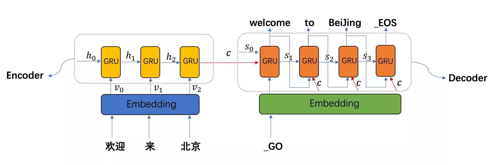

> 注：\_Go 表示文本开始，\_EOS 表示文本结束。
> 
> 

- seq2seq 模型架构包括三部分，分别是 encoder \(编码器\)、decoder \(解码器\)、中间语义张量 c。

- 图中表示的是一个中文到英文的翻译：欢迎 来 北京 → welcome to BeiJing。**编码器**首先处理中文输入 “欢迎 来 北京”，通过 GRU 模型获得每个时间步的输出张量（*即隐藏状态 ht，这里不再需要 output *），最后将它们拼接成一个中间语义张量 c；接着**解码器**将使用这个中间语义张量 c 以及上一时间步输出的隐藏状态和上一时间步的预测输出，再接一个 全连接层 \+ softtmax 逐个生成对应的翻译语言。

- 详细解读（无 Attention 的 seq2seq）

> 结合后文 "普通 Encoder\-Decoder 框架" 来看。
> 
> 

1. **编码器 （Encoder）**

    - 编码器负责将输入序列（例如一段文本）映射成一个中间的表示（中间语义张量 c），通常是一个固定长度的向量。

    - 常用的编码器结构是循环神经网络（RNN）或者长短时记忆网络（LSTM），近年来也包括了 Transformer 模型。

    - 编码器的工作流程（无 Attention）

        - 对输入的文本序列每个时间步都会产生一个隐藏状态。这些隐藏状态会捕捉到输入序列的信息，并被传递给下一个时刻。

        - 在 Seq2Seq 中，编码器将整个输入序列处理完后，最后一个时刻的隐藏状态会被用作解码器的初始隐藏状态。

2. **解码器（Decoder）**

    - 解码器接受编码器传递过来的初始隐藏状态，并逐步生成目标序列。

    - 解码器也是一个 RNN 系列模型，现在通常会包含一个额外的注意力机制，以便在生成目标序列过程中动态地关注输入序列的不同部分。

    - 解码器的工作流程（无 Attention）

        - 一个时间步一个时间步的解码，采用自回归机制进行解码（当前输出作为下一步输入）。

        - 每个时间步都会用到中间语义张量 C。

**普通 seq2seq 的痛点与改进**

> 结合后文 "加 Attention 的 Encoder\-Decoder 框架" 来看。
> 
> 

- 原生痛点：中间语义张量 C 是固定的。以机器翻译为例：

    - 当输入序列很长时，比如直接一篇文章输进去，模型的计算量很大，且会丢失早期信息，导致翻译或者生成效果下降；

    - 在翻译时，可能在不同的语境下，同一个词具有不同的含义，但是网络对这些词向量并没有区分度，没有考虑词与词之间的相关性（**用的都是同一个 C**），导致翻译效果比较差。

- 核心改进：解码时引入注意力机制。

    - 让解码器在生成每个词时，能动态关注输入序列的不同部分，从而提升长序列的处理能力；

    - 同时让解码器注意到每个词向量之间的相关性，有侧重地进行翻译，模拟人类理解的过程（**每个时间步使用不同的 C**）。

注意力机制就是解决上面 “信息利用不细致" 的问题。比如：

当 Decoder（解码器）要生成 “Welcome” 的时候，让它多关注 Encoder 里的 “欢迎” 对应的信息。

要生成 “to” 的时候，让它多关注 Encoder 里的 “来” 对应的信息。

要生成 “BeiJing” 的时候，让它多关注 Encoder 里的 “北京” 对应的信息。

这样就比靠 1个 “总信息包 \(中间语义张量c\)” 翻译好多了。像人翻译的时候，心里会想着原文的词，精确查找信息，翻译就更精准，更自然。

通俗来讲就是对于模型的每一个输入项——可能是图片中的不同部分，或者是语句中的某个单词——分配一个权重，这个权重的大小就代表了我们希望模型对该部分一个关注程度。这样一来，通过权重大小来模拟人在处理信息的注意力的侧重，有效的提高了模型的性能，并且一定程度上降低了计算量。

### 4\.2 注意力机制的分类及实现

深度学习中的注意力机制通常可分为三类：软注意（全局注意）、硬注意（局部注意）和自注意（内注意）。

- 软注意力机制 \(Soft/Global Attention\)：对每个输入项的分配的权重为 0\-1 之间，也就是某些部分关注的多一点，某些部分关注的少一点。因为对大部分信息都有考虑，但考虑程度不一样，所以相对来说计算量比较大。

- 硬注意力机制 \(Hard/Local Attention，\[了解即可\]\)：对每个输入项分配的权重非 0 即 1，和软注意不同，硬注意机制只考虑那部分需要关注，哪部分不关注，也就是直接舍弃掉一些不相关项。优势在于可以减少一定的时间和计算成本，但有可能丢失掉一些本应该注意的信息。

- 自注意力机制 \(Self/Intra Attention\)：对每个输入项分配的权重取决于输入项之间的相互作用，即通过输入项内部的 “表决” 来决定应该关注哪些输入项。和前两种相比，在处理很长的输入时，具有并行计算的优势。

#### Soft Attention

需要注意：注意力机制是一种通用的思想和技术，不依赖于任何模型，换句话说，注意力机制可以用于任何模型。这里只是以文本处理领域的 Encoder\-Decoder 框架为例进行理解。

下面用普通 Encoder\-Decoder 框架以及加 Attention 的 Encoder\-Decoder 框架做对比。

##### 普通 Encoder\-Decoder 框架

下图是 Encoder\-Decoder 框架的一种抽象表示方式：

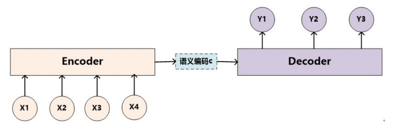

上图图例可以把它看作由一个句子（或篇章）生成另外一个句子（或篇章）的通用处理模型。对于句子对，我们的目标是给定输入句子 Source，期待通过 Encoder\-Decoder 框架来生成目标句子 Target。Source 和 Target 可以是同一种语言，也可以是两种不同的语言。而 Source 和 Target 分别由各自的单词序列构成：

$Source = \langle X_1, X_2 \cdots X_m \rangle$

$Target = \langle y_1, y_2 \cdots y_n \rangle$

encoder 顾名思义就是对输入句子 Source 进行编码，将输入句子通过非线性变换转化为中间语义表示 C：

$C = F(X_1,X_2 \cdots X_m)$

对于解码器 Decoder 来说，其任务是根据句子 Source 的中间语义表示 C 和之前已经生成的历史信息 $y_1, y_2, \cdots, $$y_{i-1}$ 来生成 $i$时刻要生成的单词$y_i$：

$y_i = f(C, y_1, y_2, \cdots, y_{i-1})$

上述图中展示的 Encoder\-Decoder 框架是没有体现出 “注意力机制” 的，所以可以把它看作是注意力不集中的分心模型。为什么说它注意力不集中呢？目标句子 Target 中每个单词的生成过程如下：

$y_1 = f(C) \\ y_2 = f(C, y_1) \\ y_3 = f(C, y_1, y_2)$

其中$f$是 Decoder 的非线性变换函数。从这里可以看出，在生成目标句子的单词时，不论生成哪个单词，它们使用的输入句子 Source 的语义编码 C 都是一样的，没有任何区别。而语义编码 C 又是通过对 source 经过 Encoder 编码产生的，因此对于 target 中的任何一个单词，source 中任意单词对某个目标单词$y_i$来说影响力都是相同的，这就是为什么说上图中的模型没有体现注意力的原因。

> 注：上述计算$y_t$时应该还需要解码器的上一步隐藏状态$s_{t-1}$，即$y_t = f(c, s_{t-1}, y_1, y_2, \cdots, y_{t-1})$。
> 
> **实际操作中，只传入上一时间步的预测结果**$y_{t-1}$，他已经利用了他前面时间步的所有输出信息，相当于有信息传递，所以只需要输入上一时间步的预测结果就已经利用了前面所有时间步的预测结果信息。
> 
> **且传入的是预测结果是再次经过词嵌入层后得到的词向量。**当前时间步的预测输出是根据当前时间步的隐藏状态经过全连接层和 softmax 后得到的。
> 
> 即解码器的每个时间步需要三个输入：上一时间步的隐藏状态、上一时间步的预测输出（词向量）、中间语义张量。
> 
> 可参考 “seq2seq 架构” 中的图。
> 
> 

##### 加 Attention 的 Encoder\-Decoder 框架

举例说明，为何添加 Attention：

比如机器翻译任务，输入 source 为：Tom chase Jerry，输出 target 为：“汤姆”，“追逐”，“杰瑞”。在翻译 “Jerry”这个单词的时候，普通 Encoder\-Decoder 框架中，source 里的每个单词对翻译目标单词 “杰瑞” 贡献是相同的，很明显这里不太合理，显然 “Jerry” 对于翻译成 “杰瑞” 更重要。

如果引入 Attention 模型，在生成 “杰瑞” 的时候，应该体现出英文单词对于翻译当前中文单词不同的影响程度，比如给出类似下面一个概率分布值：\(Tom, 0\.3\)  \(Chase, 0\.2\)  \(Jerry, 0\.5\)。每个英文单词的概率代表了翻译当前单词 “杰瑞” 时，注意力分配模型分配给不同英文单词的注意力大小。

因此，基于上述例子所示，对于 target 中任意一个单词都应该有对应的 source 中的单词的注意力分配概率。而且，由于注意力模型的加入，原来在生成 target 单词时候的中间语义 C 就不再是固定的，而是会根据注意力概率变化的$C_i$，加入了注意力模型的 Encoder\-Decoder 框架就变成了下图所示：

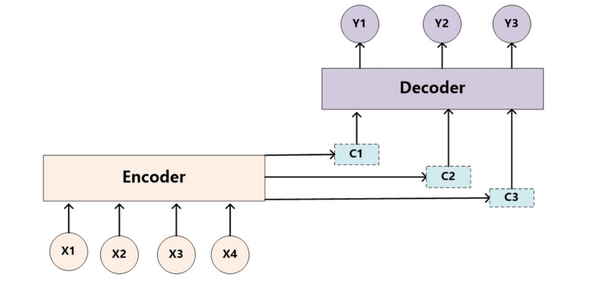

即生成目标句子单词的过程成了下面的形式：

$y_1 = f_1(C_1) \\ y_2 = f_1(C_2, y_1) \\ y_3 = f_1(C_3, y_1, y_2)$

> 注：上述计算$y_t$时应该还需要解码器的上一步隐藏状态$s_{t-1}$，即$y_t = f(c_{t}, s_{t-1}, y_1, y_2, \cdots, y_{t-1})$。
> 
> **实际操作中，只传入上一时间步的预测结果**$y_{t-1}$，他已经利用了他前面时间步的所有输出信息，相当于有信息传递，所以只需要输入上一时间步的预测结果就已经利用了前面所有时间步的预测结果信息。
> 
> **且传入的是预测结果是再次经过词嵌入层后得到的词向量。**当前时间步的预测输出是根据当前时间步的隐藏状态经过全连接层和 softmax 后得到的。
> 
> 即解码器的每个时间步需要三个输入：上一时间步的隐藏状态、上一时间步的预测输出（词向量）、中间语义张量。
> 
> seq2seq 加入注意力机制后的区别就是中间语义张量的计算。
> 
> 

而每个$C_i$可能对应着不同的源语句子单词的注意力分配概率分布，比如对于上面的英汉翻译来说，其对应的信息可能如下：

$\begin{aligned}
C_{Tom}=g(0.6*f_2(Tom), 0.2*f_2(Chase), 0.2*f_2(Jerry)) \\ C_{Chase}=g(0.2*f_2(Tom), 0.7*f_2(Chase), 0.1*f_2(Jerry)) \\ C_{Jerry}=g(0.3*f_2(Tom), 0.2*f_2(Chase), 0.5*f_2(Jerry))
\end{aligned}$

$f_2$函数代表 Encoder 对输入英文单词的某种变换函数，比如如果 Encoder 是用的 RNN 模型的话，这个$f_2$函数的结果往往是某个时刻输入后隐层节点输出的隐藏状态值；g 代表 Encoder 根据单词的中间表示合成整个句子中间语义表示的变换函数，一般的做法中，g 函数就是对构成元素加权求和，即公式：

$C_i = \sum_{j=1}^{L_x}a_{ij}h_j$

其中$L_x$代表输入句子 source 的长度，$a_{ij}$代表在 Target 输出第 i 个单词时 source 输入句子中的第 j 个单词的**注意力分配系数**，而$h_j$则是 RNN 输入 source 中第 j 个单词后产生的**隐藏状态**。

假设 $C_i$ 下标 i 就是上面例子所说的 “汤姆”，那么$L_x$就是 3，$h_1 = f(\text{Tom}),  h_2 = f(\text{Chase}), h_3 = f(\text{jerry})$分别是输入句子每个单词后的隐藏状态，对应的注意力模型权值则分别是 0\.6，0\.2，0\.2，所以 g 函数本质上就是加权求和函数，如果形象表示的话，翻译中文单词 “汤姆” 的时候，数学公式对应的中间语义表示 $C_i$ 的形成过程类似下图所示：

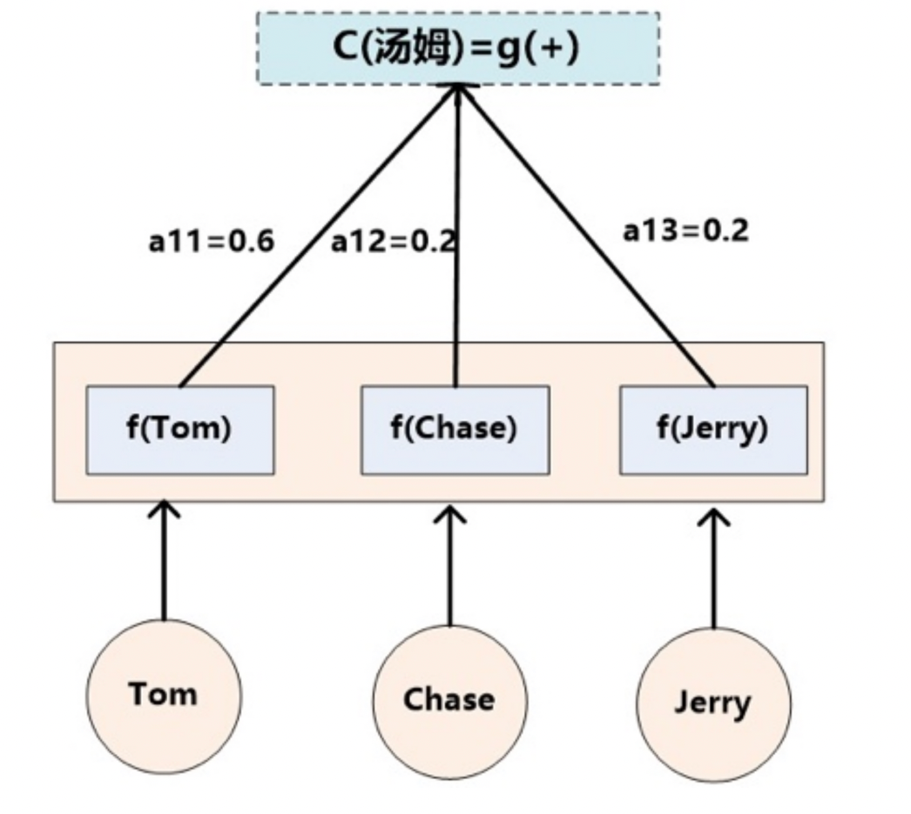

##### 注意力概率分布的计算

为了便于说明，我们假设 Encoder\-Decoder 框架中，Encoder 和 Decoder 都采用 RNN 模型，如下图所示：

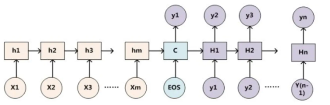

那么注意力分配概率分布值的通用计算过程如下：

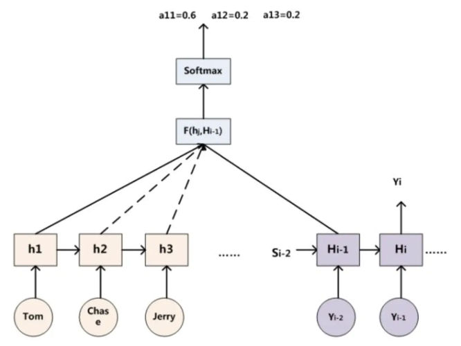

上图中$h_i$表示 Source 中单词 j 对应的隐层节点状态$h_j$，$H_i$表示 Target 中单词 i 的隐层节点状态，注意力计算的是 Target 中单词 i 对 Source 中每个单词的对齐可能性，即$F(h_j, H_{i-1})$，函数 F 可以用不同的方法，然后函数 F 的输出经过 softmax 进行归一化就得到了注意力分配概率分布。

上面就是经典的 Soft Attention 模型的基本思想，区别只是函数 F 会有所不同。

##### Attention 机制的本质思想

其实 Attention 机制可以看作，Target 中每个单词是对 Source 每个单词的加权求和，而权重是 Source 中每个单词对 Target 中每个单词的重要程度。因此，Attention 的本质思想会表示成下图：

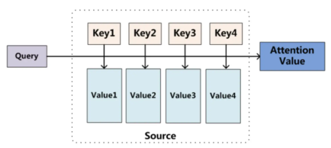

将 Source 中的构成元素看作是一系列的数据对，给定 Target 中的某个元素 Query，通过计算 Query 和各个 Key 的相似性或者相关性，即权重系数；然后对 Value 进行加权求和，并得到最终的 Attention 数值。**将本质思想表示成公式如下：**

$Attention(Query, Source) = \sum_{i=1}^{L_x} Similarity(Query, Key_i) * Value_i$

深度学习中的注意力机制中提到：Source 中的 Key 和 Value 合二为一，指向的是同一个东西，也即输入句子中每个单词后对应的**隐藏状态**，所以可能不容易看出这种能够体现本质思想的结构。因此，Attention 计算转换为下面 3 个阶段。

输入由三部分构成：Query、Key 和 Value。其中，\(Key，Value\) 是具有相互关联的 KV 对，Query 是输入的 “问题”，Attention 可以将 Query 转化为与 Query 最相关的向量表示。

Attention 的计算主要分 3 步，如下图所示。

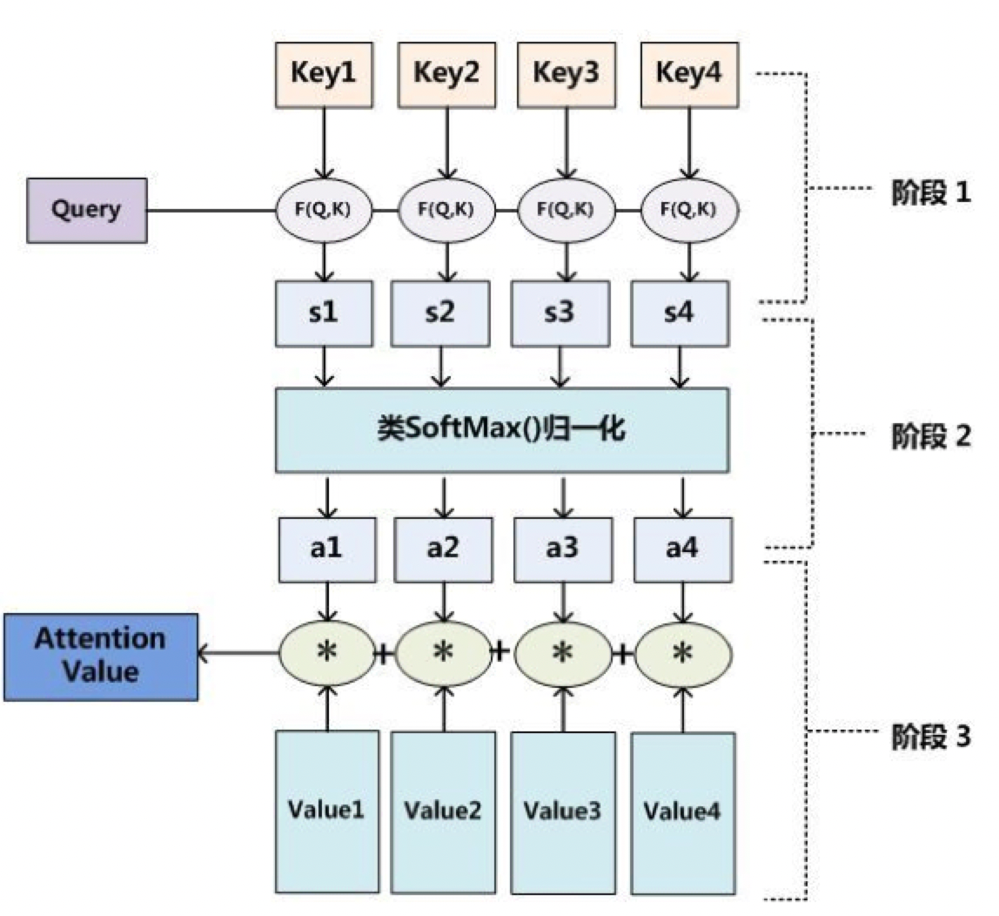

###### Attention **计算过程**

- 第一步：Query 和 Key 进行相似度计算，得到 Attention Score；

- 第二步：对 Attention Score 进行 Softmax 归一化，得到权值矩阵；

- 第三步：权重矩阵与 Value 进行加权求和计算。

计算结果即为中间语义张量，也叫上下文向量。也就是本文档有些地方写的 attention\_q、更加强大的 Q，这两个叫法都不准确，可以忽略。

###### QKV 的**含义理解**

Query、Key 和 Value 的含义是什么呢？

我们以前面大脑读图为例。Value 可以理解为人眼视网膜对整张图片信息的原始捕捉，不受 “注意力” 所影响。我们可以将 Value 理解为像素级别的信息，那么假设只要一张图片呈现在人眼面前，图片中的像素都会被视网膜捕捉到。Key 与 Value 相关联，Key 是图片原始信息所对应的关键性提示信息，比如 “锦江饭店” 部分是将图片中的原始像素信息抽象为中文文字和牌匾的提示信息。一个中文读者看到这张图片时，读者大脑有意识地向图片获取信息，即发起了一次 Query，Query 中包含了读者的意图等信息。在一次读图过程中，Query 与 Key 之间计算出 Attention Score，得到最具有吸引力的部分，并只对具有吸引力的 Value 信息进行提取，反馈到大脑中。就像上面的例子中，经过大脑的注意力机制的筛选，一次 Query 后，大脑只关注 “锦江饭店” 的牌匾部分。

再以一个搜索引擎的检索为例。使用某个 Query 去搜索引擎里搜索，搜索引擎里面有好多文章，每个文章的全文可以被理解成 Value；文章的关键性信息是标题，可以将标题认为是 Key。搜索引擎用 Query 和那些文章们的标题（Key）进行匹配，看看相似度（计算 Attention Score）。我们想得到跟 Query 相关的知识，于是用这些相似度将检索的文章 Value 做一个加权和，那么就得到了一个新的信息，新的信息融合了相关性强的文章们，而相关性弱的文章可能被过滤掉。

#### Hard Attention

上文使用一种软性注意力的方式进行 Attention 机制，它通过注意力分布来加权求和融合各个输入向量。而硬性注意力（Hard Attention）机制则不是采用这种方式，它是根据注意力分布选择输入向量中的一个作为输出。这里有两种选择方式：

1. 选择注意力分布中分数最大的那一项对应的输入向量作为 Attention 机制的输出。

2. 根据注意力分布进行随机采样，采样结果作为 Attention 机制的输出。

硬性注意力通过以上两种方式选择 Attention 的输出，这会使得最终的损失函数与注意力分布之间的函数关系不可导，导致无法使用反向传播算法训练模型，硬性注意力通常需要使用强化学习来进行训练。因此，一般深度学习算法会使用软性注意力的方式进行计算。

#### Self Attention

Self Attention 是 Google 在 transformer 模型中提出的，上面介绍的都是一般情况下 Attention 发生在 Target 元素 Query 和 Source 中所有元素之间。而 Self Attention 指的是 Source 内部元素之间或者 Target 内部元素之间发生的 Attention 机制，**也可以理解为 Target=Source 这种特殊情况下的注意力机制**。当然，具体的计算过程仍然是一样的，只是计算对象发生了变化而已。

上面内容也有说到，一般情况下 Attention 本质上是 Target 和 Source 之间的一种单词对齐机制。那么如果是 Self Attention 机制，到底学的是哪些规律或者抽取了哪些特征呢？或者说引入 Self Attention 有什么增益或者好处呢？仍然以机器翻译为例来说明，如下图所示：


从上图中可以看到，Self Attention 可以远距离的捕捉到语义层面的特征（its 的指代对象是 Law）。

传统的 RNN、LSTM 在获取长距离语义特征和结构特征的时候，需要按照序列顺序依次计算，距离越远，联系信息的损耗越大，有效提取和捕获的可能性越小。

但是应用 self\-attention 时，计算过程中会直接将句子中任意两个 token 的联系通过一个计算步骤直接联系起来。

### 4\.3 注意力计算规则

注意力机制需要三个指定的输入 Q \(query\)，K \(key\)，V \(value\)，然后通过计算公式得到注意力的结果，这个结果代表 query 在 key 和 value 作用下的注意力表示。当输入的 Q=K=V 时，称作**自注意力计算规则**；当 Q、K、V 不相等时称为**一般注意力计算规则**。

目标：Attention\(Q, K, V\) \-\-\-\> attention\_weights, attention\_q

> attention\_q 就是中间语义张量，也叫上下文向量。
> 
> 

**Attention 计算过程**

- 第一步：Query 和 Key 进行相似度计算，得到 Attention Score；

- 第二步：对 Attention Score 进行 Softmax 归一化，得到权值矩阵；

- 第三步：权重矩阵与 Value 进行加权求和计算。

**常见的注意力计算规则**

1. 拼接/MLP 打分

将 Q，K 进行纵轴拼接，做一次线性变化，再使用 softmax 处理获得结果，最后与 V 做张量乘法。

$Attention(Q,K,V)=Softmax(Linear([Q,K]))\cdot V$

纵轴拼接在有 batch 时就是最后一个维度特征层拼接，即 dim=\-1。

解读：拼接是为了让后续的线性层（Linear）能够同时看到 Q 和 K 的所有信息，从而学习出它们之间的相关性分数。

2. 加性注意力（Additive Attention / Bahdanau Attention）

将 Q，K 进行纵轴拼接，做一次线性变化后再使用 tanh 函数激活，然后再进行内部求和，最后使用 softmax 处理获得结果，再与 V 做张量乘法。

$Attention(Q,K,V)=Softmax(sum(tanh(Linear([Q,K]))))\cdot V$

解读：拼接、线性变换后，加了一个 tanh⁡ 激活函数引入非线性，然后把特征维度上的值加起来（sum 相当于乘一个向量做点积。这里标准做法是用一个可学习向量$v^T$做点积，而不是一个粗暴的sum），得到一个分数。在 Transformer 出现之前，机器翻译等任务经常用它。

加性注意力和拼接打分两者的输入本质上是一样的，但操作顺序不同：

- 拼接打分：先拼成一个大向量 $[q, k]$，然后扔进一个全连接层 Linear，直接输出 1 个数。

- 加性注意力：先各自映射（$W_q q$ 和 $W_k k$），然后相加，再通过$\tanh$和$v^\top$算出分数。

加性注意力之所以更好，是因为：

- 它在相加前进行了 “降维”，参数量通常比直接拼接输入全连接层要少。

- 相加操作在逻辑上更强调 “特征对齐”，只有语义相似的 Q 和 K 在映射后相加，才会得到较大的响应。

补充：标准的加性注意力公式：

$Attention(Q, K, V) = Softmax(V_{score}^{\text{T}} \tanh(W_q Q + W_k K + b)) \cdot V$

这个公式和上面的核心逻辑是一样的。在 pytorch 官方教程中，流程图是以标准公式绘制的，而实际代码实现是通过上面的公式实现的，原因是这样实现简单。

具体见后文 “ 构建基于 GRU 和 Attention 的解码器” 。

3. 缩放点积注意力（Scaled Dot\-Product Attention）

将 Q 与 K 的转置做点积运算，然后除以一个缩放系数，再使用 softmax 处理获得结果，最后与 V 做张量乘法。

$Attention(Q,K,V)=Softmax(\frac{Q\cdot K^T}{\sqrt{d_{k}}})\cdot V$

解读：这就是目前所有大模型（Transformer/GPT/BERT）都在用的绝对标准答案。因为纯靠矩阵乘法，在 GPU 上算得飞快；并且 Transformer 强制规定$d_q = d_k = d_v$，这就直接废掉了加性注意力 “兼容不同维度” 的优势。之所以除以$\sqrt{d_k}$（缩放系数，通常是 Q/K 的维度开根号），是因为维度太大时点积结果会很大，经过 softmax 后会导致梯度消失，除以系数能让数值更稳定。

> 前面两个适用于一般注意力机制，最后一个适用于自注意力机制。
> 
> 

### 4\.4 注意力机制的作用

- 在解码器端的注意力机制：能够根据模型目标有效的聚焦编码器的输出结果，当其作为解码器的输入时提升效果。改善以往编码器输出是单一定长张量，无法存储过多信息的情况。

- 在编码器端的注意力机制：主要解决表征问题，相当于特征提取过程，得到输入的注意力表示。一般使用自注意力（self\-attention）。

注意力机制在网络中实现的图形表示：

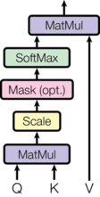

说明：这个图来自 [Attention Is All You Need](https://arxiv.org/pdf/1706.03762) 原文，Scale 表示压缩，Mask 表示掩码，opt\. 是可选的意思。掩码简单来说就是只让看当前预测之前的内容，后面的内容不让看，具体在 Transformer 中讲解。

### 4\.5 注意力机制代码实现

#### torch\.bmm\(\)

bmm\(\) 和 matmul\(\) 的应用场景

- `torch.matmul()`              matrix multiply：矩阵乘法

    - 适用于通用的场景，会根据输入维度自动处理并支持广播。所以很适合于**输入维度不确定或者需要广播**时。

    - 例如：\(10, 3, 4\) @ \(1, 4, 5\) \-\-\> \(10, 3, 5\)         \# 广播机制，会把 1 广播成 10

- `torch.bmm()`

PyTorch 中专门用于**批量矩阵乘法**，它的全称是 Batch Matrix Multiply。在处理序列数据时 \(如 RNN、Transformer 等\) 效率更高，因为是**并行计算**。

```Python
torch.bmm(input, mat2) -> torch.Tensor
```

核心规则是：`input` 和 `mat2` 必须是 **3D 张量**，且第一个维度（批次维度）的大小必须相同（**不支持广播机制**）。

- 总结

    - 在处理批量矩阵乘法且输入是 3 维张量且第一个维度（批次维度）的大小相同时，优先用`torch.bmm()`，因为效率更高。

    - 当输入维度不确定 或者 需要广播时，使用`torch.matmul()`。

- `torch.bmm()`运算演示

```Python
import torch

# 如果参数1形状是(b × n × m), 参数2形状是(b × m × p), 则输出为(b × n × p)
input = torch.randn(10, 3, 4)
mat2 = torch.randn(10, 4, 5)
res = torch.bmm(input, mat2)
res_shape = res.size()    # 或：res.shape
print(res_shape)        # torch.Size([10, 3, 5])
```

- 在注意力机制中

当注意力权重矩阵和 V **都是三维张量且第一维都代表 batch\_size且相等 **时，则做 bmm 运算。bmm 是一种特殊的张量乘法运算。

#### tensorflow 与 Pytorch 的注意力机制实现

以 seq2seq 架构的翻译应用为例。

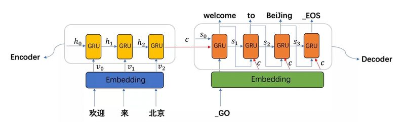

在上述机器翻译架构中加入 Attention 的方式有两种。

- 第一种 tensorflow 版本（传统方式），如下图所示：

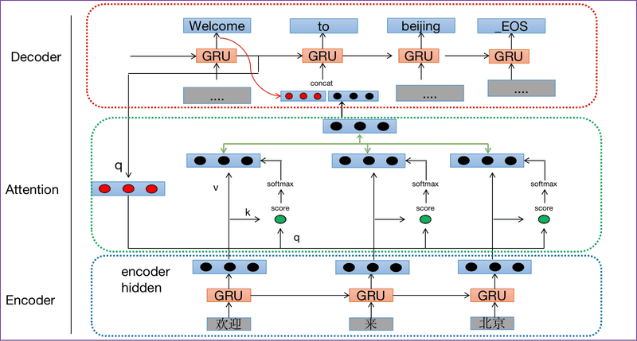

上图翻译应用中的 Q、K、V 解释

- 查询张量 Q：解码器每一步输出（上一步输出的隐藏状态，即解码器当前隐藏状态）

- 键张量 K：编码部分每个时间步的结果组合而成（即编码器各隐藏状态）

- 值张量 V：编码部分每个时间步的结果组合而成（即编码器各隐藏状态）

- 第二种 Pytorch 版本（改进版），如下图所示：


上图翻译应用中的 Q、K、V 解释

- 查询张量 Q：解码器每一步的输出（上一步输出的隐藏状态，即解码器当前隐藏状态）

- 键张量 K：编码部分每个时间步输出结果组合而成（即编码器各隐藏状态）

- 值张量 V：编码部分每个时间步输出结果组合而成（即编码器各隐藏状态）

- 两个版本对比

    - pytorch 版本的是乘型 attention，tensorflow 版本的是加型 attention。

    - pytorch 版过程如下：

        - 采用自回归机制，比如：输入“go” 来预测 “welcome”，输入“welcome” 来预测 “to”，输入 “to” 来预测 “Beijing”（这个 “to” 里面已经包含了 “welcome” 的信息，相当于有信息传递，所以只需要输入上一时间步的预测结果就已经利用了前面所有时间步的预测结果信息）。在输入“welcome” 来预测 “to” 解码中，可使用注意力机制，下面以此为例进行说明。

        - 查询张量 Q：一般可以是 “welcome” 以后输出的隐藏状态，查询张量 Q 要生成谁就是谁的查询张量（比如这里为了生成 “to”，则查询张量就是 “to” 的查询张量）

        - 键向量 K：来自编码器所有的隐藏状态

        - 值向量 V：同样来自编码器的隐藏状态（这里 Key 和 Value 是同一个东西，只是在不同计算阶段使用）

        - 查询张量 Q 要生成 “to” 时，解码器利用上一时间步的隐藏状态并作为查询向量 `q`，这个 `q` 跑到中间的注意力模块，与编码器的三个隐藏状态 `k` 进行对比计算得分 \(score\)，得分经过 softmax 变成权重，权重乘以编码器的隐藏状态 `v`，得出当前解码需要的中间语义张量，解码器再结合上一时间步隐藏状态、中间语义张量和 "Welcome" ，通过 GRU 最终算出了下一个词 "to"。

        > 注：每一个时间步的隐藏状态经过一个全连接层和 softmax 之后才有预测结果，然后将这个预测结果经过 GRU 的词嵌入层转为词向量后再和隐藏状态一起喂给下一个时间步。
        > 
        > 

#### 代码演示注意力机制实现步骤

> 仅做演示，切莫当真，以实际为主，我已经尽量改了。
> 
> 

- 第一步：根据注意力计算规则，对 Q，K，V 进行相应的计算。

- 第二步：根据第一步采用的计算方法，如果是拼接方法，则需要将 Q 与第二步的计算结果再进行拼接；如果是转置点积，一般是自注意力，Q 与 V 相同，则不需要进行与 Q 的拼接。

- 第三步：最后为了使整个 attention 机制按照指定尺寸输出，使用线性层作用在第二步的结果上做一个线性变换，得到最终对 Q 的注意力表示。

> QKV 说明
> 
> - 在 RNN seq2seq 注意力里，Q 通常就是解码器当前隐藏状态，K 和 V 都是编码器所有时间步的隐藏状态；
> 
> - 在 Transformer self\-attention 里，Q、K、V 全部来自同一个输入序列 X，只是三组不同投影；
> 
> - 在 Transformer cross\-attention（Encoder\-Decoder Attention）里，Q 来自解码器，K/V 来自编码器；
> 
> 

```Python
# 任务描述：以 seq2seq 为例，仅演示一下计算过程，都是自定义，都是假设
# 有 QKV，维度均为假设，
# 任务：输入查询张量q，通过注意力机制来计算如下信息：
# 1、查询张量q的注意力权重分布：查询张量q和k的相关性（相识度）
# 2、查询张量q的结果表示：有一个普通的q升级成一个更强大q；用q和v做bmm运算
# 3 注意：qkv 以实际为主，这里只是演示

import torch
import torch.nn as nn
import torch.nn.functional as F

# MyAtt类实现思路分析
# 1 init函数 (self, query_size, key_size, value_size1, value_size2, output_size)
# 准备2个线性层 注意力权重分布self.attn；注意力结果表示，按照指定维度进行输出层 self.attn_combine
# 2 forward(self, Q, K, V):
# 求查询张量q的注意力权重分布, attn_weights[1,32]
# 求查询张量q的注意力结果表示 bmm运算, attn_applied[1,1,64]
# q 与 attn_applied 融合（实际这里还需要上一时间步的预测结果经过词嵌入层后的词向量），再按照指定维度输出 output[1,1,32]
# 返回注意力结果表示output:[1,1,32], 注意力权重分布attn_weights:[1,32]

class MyAttn(nn.Module):
    #                   32          32          32              64      32
    def __init__(self, query_size, key_size, value_size1, value_size2, output_size):
        super(MyAtt, self).__init__()
        self.query_size = query_size        *# 查询张量Q的维度, 例如: 32 -> Q [1,1,32]*
        self.key_size = key_size            *# 键张量K的维度, 例如: 32 -> K [1,1,32]*
        self.value_size1 = value_size1      *# 值张量V的序列长度, 例如: 32*
        self.value_size2 = value_size2      *# 值张量V的维度, 例如: 64 -> V [1,32,64]*
        self.output_size = output_size      *# 输出张量的维度, 例如: 32*

        # 线性层1 注意力权重分布
        # 用于计算得分时的维度转换，保证后面能和V正常加权求和
        self.attn = nn.Linear(self.query_size + self.key_size, self.value_size1)

        # 线性层2 注意力结果表示按照指定维度输出层 self.attn_combine
        # 用于预测结果时的维度转换
        self.attn_combine = nn.Linear(self.query_size + self.value_size2, self.output_size)

    def forward(self, Q, K, V):
        # 1 求查询张量q的注意力权重分布, attn_weights[1,32]
        # [1,1,32],[1,1,32]--> [1,32],[1,32]（全连接层只能介绍二维数据）->[1,64]
        # [1,64] --> [1,32]    # 第一个线性层的作用
        # tmp1 = torch.cat((Q[0], K[0]), dim=1)    # 拼接
        # tmp2 = self.attn(tmp1)                   # 计算得分
        # tmp3 = F.softmax(tmp2, dim=1)            # softmax转为概率
        attn_weights = F.softmax(self.attn(torch.cat((Q[0], K[0]), dim=-1)), dim=-1)

        # 2 求查询张量q的结果表示 bmm运算, attn_applied[1,1,64]
        # 先把[1,32]变为[1,1,32]，方便bmm运算
        # [1,1,32] * [1,32,64] ---> [1,1,64]    # 与v加权求和，得到中间语义张量
        attn_applied =  torch.bmm(attn_weights.unsqueeze(0), V)

        # 3 q 与 attn_applied 融合，再按照指定维度输出 output[1,1,64]
        # 实际这里还需要上一时间步的预测结果经过词嵌入层后的词向量
        output = torch.cat((Q[0], attn_applied[0]), dim=-1)
        # 3-2 shape [1,96] --> [1,32] --> [1,1,32]
        output = self.attn_combine(output).unsqueeze(0)

        # 4 返回注意力结果表示output:[1,1,32], 注意力权重分布attn_weights:[1,32]
        return output, attn_weights

```

调用

```Python
if __name__ == '__main__':

    query_size = 32
    key_size = 32
    value_size1 = 32     # 32个单词
    value_size2 = 64     # 64个特征
    output_size = 32

    Q = torch.randn(1, 1, 32)
    K = torch.randn(1, 1, 32)
    V = torch.randn(1, 32, 64)

    # 1 实例化注意力类 对象
    myatt_obj = MyAttn(query_size, key_size, value_size1, value_size2, output_size)

    # 2 把QKV数据扔给注意机制，求查询张量q的注意力结果表示、注意力权重分布
    output, attn_weights = myatt_obj(Q, K, V)
    print('查询张量q的注意力结果表示output--->', output.shape, output)
    print('查询张量q的注意力权重分布attn_weights--->', attn_weights.shape, attn_weights)

```

输出结果

```Python
查询张量q的注意力结果表示output---> torch.Size([1, 1, 32]) tensor([[[ 0.3135, -0.0539,  0.0597, -0.0046, -0.3389, -0.1238,  1.0385,
           0.8896, -0.0268, -0.0705, -0.8409,  0.6547,  0.5909, -0.6048,
           0.6303, -0.2233,  0.7678, -0.3140,  0.3635, -0.3234, -0.1053,
           0.5845,  0.1163, -0.2203, -0.0812, -0.0868,  0.0218, -0.0597,
           0.6923, -0.1848, -0.8266, -0.0614]]], grad_fn=<UnsqueezeBackward0>)
查询张量q的注意力权重分布attn_weights---> torch.Size([1, 32]) tensor([[0.0843, 0.0174, 0.0138, 0.0431, 0.0110, 0.0308, 0.0608, 0.0216, 0.0101,
         0.0406, 0.0462, 0.0111, 0.0349, 0.0065, 0.0383, 0.0526, 0.0151, 0.0193,
         0.0294, 0.0632, 0.0322, 0.0072, 0.0294, 0.0388, 0.0135, 0.0443, 0.0594,
         0.0332, 0.0117, 0.0168, 0.0293, 0.0344]], grad_fn=<SoftmaxBackward0>)
```


## 6 RNN 案例：seq2seq 英译法

案列来源：

- PyTorch 官方英文原版教程：
[NLP From Scratch: Translation with a Sequence to Sequence Network and Attention](https://pytorch.org/tutorials/intermediate/seq2seq_translation_tutorial.html)

- ApacheCN 中文翻译版：[https://pytorch\.apachecn\.org/2\.0/tutorials/intermediate/seq2seq\_translation\_tutorial](https://pytorch.apachecn.org/2.0/tutorials/intermediate/seq2seq_translation_tutorial)

这个案例有待参考新版教程重新实现。

### 6\.1 seq2seq 模型架构


下面的案例通过英译法来讲解 seq2seq 设计与实现。

### 6\.2 案例介绍

#### 案例需求

- 输入一句英文，使用模型翻译成法文。

- 使用 seq2seq 架构探索英文和法文之间的关系。

- 在解码器端增加注意力机制。

#### 案例价值

- 属于 AI 赋能互联网业务。

- 比如：为企业和个人提供不同语种间快速翻译能力。

- 比如：快速探索 source 源文本和目标文本 target 之间的关系。

#### 数据集介绍

- 数据集路径：/data/eng\-fra\.txt

- 数据格式说明：

    - 每一行有 2 列，第 1 列为英文，第 2 列为法文，中间用制表符 tab 分割。

    - 标注好的，可以训练的数据一共有 63594 条。

- 数据预览

```Plain Text
i am from brazil .  je viens du bresil .
i am from france .  je viens de france .
i am from russia .  je viens de russie .
i am frying fish .  je fais frire du poisson .
i am not kidding .  je ne blague pas .
i am on duty now .  maintenant je suis en service .
i am on duty now .  je suis actuellement en service .
i am only joking .  je ne fais que blaguer .
i am out of time .  je suis a court de temps .
i am out of work .  je suis au chomage .
i am out of work .  je suis sans travail .
i am paid weekly .  je suis payee a la semaine .
i am pretty sure .  je suis relativement sur .
i am truly sorry .  je suis vraiment desole .
i am truly sorry .  je suis vraiment desolee .
```

#### 任务识别（基本实现分析）

- 给出一个英文，翻译成法文，最终每个时间步相当于一个分类问题

    - 其中 source 单词 \-\- 英文数目：2803；target单词 \-\- 法文数目：4345

    - 探索 source 文本（eg：英文）和 target 文本（eg：法文）之间的语义关系。

    - eg：输入一个英文（2803 个词汇的一个）来找一个法文（4345 个词汇中的一个）。

    - 不是单词之间的直译：i \<\-\-\-\> 我；love \<\-\-\-\> 爱；china \<\-\-\-\> 中国。

- 文本数值化数值张量的技术选型分析（数据如何送给模型？）

    - 探索 source 文本和 target 文本之间的关系，属于 word 词汇之间的语义抽象和探索。

    - 使用单词张量化技术。

    - 文本分词 \-\-\> 数值化（word2idx idx2word） \-\-\> 数值张量化（word2vec）。

    - 本案例：把句子分词，按照词表转成数字序列，再通过 nn\.Embedding 构建词向量，再送给模型。

- 模型选型分析（如何选模型？）

    - 模型解码：可以带注意力机制，也可以不带注意力机制。

    - 模型训练：可采用 Teacher\-forcing 方式，也可以不采用 Teacher\-forcing。

    - 注意：训练模型时，需要把英文和法文（标准答案）一块送给模型，来训练模型。

    - 每个时间步的预测值和真实值之间有差异，计算 loss，反向传播不断的更新模型权重参数，学习英译法数据的规律。

### 6\.3 案例步骤

基于 GRU 的 seq2seq 模型架构实现翻译的过程：

- 第一步：导入工具包和工具函数

- 第二步：对持久化文件中数据进行处理，以满足模型训练要求

- 第三步：构建基于 GRU 的编码器和解码器

- 第四步：构建模型训练函数，并进行训练

- 第五步：构建模型评估函数，并进行测试以及 Attention 效果分析

#### 1 导入工具包和工具函数

```Plain Text
python 3.11.18
torch 2.14.1+cu130、torchvision 0.29.1+cu130
matplotlib 3.11.2、numpy 2.4.6、tqdm 4.70.1

torch 2.14.1+cu130 | built cuda 13.0 | cuda available True
device 0: NVIDIA GeForce RTX 3060 Laptop GPU
```

```Python
# 用于正则表达式
import re
# 用于构建网络结构和函数的torch工具包
import torch
import torch.nn as nn
import torch.nn.functional as F
from torch.utils.data import Dataset, DataLoader
# torch中预定义的优化方法工具包
import torch.optim as optim
import time
# 用于随机生成数据
import random
import matplotlib.pyplot as plt
from tqdm import tqdm   *# 进度条*

# 设备选择, 我们可以选择在cuda或者cpu上运行你的代码
device = torch.device("cuda" if torch.cuda.is_available() else "cpu")
print(f'当前设备: {device}')

# 起始标志
SOS_token = 0
# 结束标志
EOS_token = 1
# 最大句子长度不能超过10个 (包含标点)
MAX_LENGTH = 10
# 数据文件路径
data_path = './data/eng-fra.txt'

# 文本清洗工具函数
def normalizeString(s):
    """字符串规范化函数, 参数s代表传入的字符串"""
    s = s.lower().strip()
    # 在.!?前加一个空格*,*
    # *使用正则表达式的捕获组替换，*这里的\1表示第一个分组   正则中的\num
    s = re.sub(r"([.!?])", r" \1", s)
    # s = re.sub(r"([.!?])", r" ", s)    # 简单的直接把标点替换为空格
    # 使用正则表达式将字符串中 不是 大小写字母和正常标点的都替换成空格
    s = re.sub(r"[^a-zA-Z.!?]+", r" ", s)
    return s
```

##### `re.sub()`

1. `r` 前缀表示 "反斜杠不算转义符，原样保留"。正则里大量用 `\`，若不用 `r` 会先被 Python 字符串转义一遍。

2. 圆括号把 `[.!?]` 包起来，形成捕获分组（capturing group），Python 会给它编号：

    - 第 0 组：整个匹配（这里就是那个标点本身）

    - 第 1 组：`([.!?])` 里的内容 —— 也就是被匹配到的那个标点

没有分组也能匹配，但没有分组就无法在替换串里引用它。**分组是"把匹配到的内容记住"的手段**。

3. `\num`

    - `\1`（也可写 `\g<1>`）：反向**引用**第 1 个分组捕获到的内容。这是正则里 `\num` 的通用写法。

    - `" "` 前面一个空格：真正插入的字符。

    - 整体含义："把每个标点替换成『空格 \+ 这个标点本身』" —— 即在标点前插一个空格。

    - 经典用法

    ```Python
    re.sub(r"(\d)\1+", r"\1", "a111b22")   # → 'a1b2'
    
    # \d 表示数字，(\d) 捕获一个数字， \1 反向引用刚捕获的数字，
    # + 修饰前面的 \1，表示"这个反向引用再重复 1 次或多次"。
    # r"\1" 分组引用，替换成"分组 1 捕获到的内容"
    ```

4. 否定字符集 `[^...]`

    - `[` 后紧跟 `^` 表示取反：匹配 "不在这个集合里" 的任意字符。

    - 写在第一个才表示字符串开头，多行模式下为每行开头。

5. 量词 `+`

    - `+` 修饰前面的 `[...]`，表示前面的字符集重复 1 次或多次。

#### 2 数据预处理

对持久化文件中数据进行处理，以满足模型训练要求

##### 1 清洗文本和构建文本字典

清洗文本和构建文本字典思路分析

```Python
# my_getdata() 清洗文本构建字典思路分析
# 1 按行读文件 open().read().strip().split(\n) my_lines
# 2 按行清洗文本 构建语言对 my_pairs[] tmppair[]
# 2-1格式 [['英文', '法文'], ['英文', '法文'], ['英文', '法文'], ['英文', '法文']....]
# 2-2调用清洗文本工具函数normalizeString(s)
# 3 遍历语言对 构建英语单词字典 法语单词字典 my_pairs->pair->pair[0].split(' ') pair[1].split(' ')->word
# 3-1 english_word2index english_word_n french_word2index french_word_n
# 其中 english_word2index = {0: "SOS", 1: "EOS"}  english_word_n=2
# 3-2 english_index2word french_index2word
# 4 返回数据的7个结果
# english_word2index, english_index2word, english_word_n,
# french_word2index, french_index2word, french_word_n, my_pairs
```

代码实现

> `read()` 把整个文件读成 "一个大字符串"；`readlines()` 把整个文件读成 "一个字符串列表"（每行一项，且保留行尾 `\n`）。两者都是一次性全量加载。
> 
> 

```Python
def my_getdata():

    # 1 按行读文件 open().read().strip().split(\n)
    my_lines = open(data_path, encoding='utf-8').read().strip().split('\n')
    print('my_lines-->', len(my_lines))

    # 2 按行清洗文本 构建语言对 my_pairs
    # 格式 [['英文句子', '法文句子'], ['英文句子', '法文句子'], ['英文句子', '法文句子'], ... ]
    # tmp_pair, my_pairs = [], []
    # for l in my_lines:
    #     for s in l.split('\t'):
    #         tmp_pair.append(normalizeString(s))
    #     my_pairs.append(tmp_pair)
    #     tmp_pair = []
    my_pairs = [[normalizeString(s) for s in l.split('\t')] for l in my_lines]
    print('len(pairs)-->', len(my_pairs))

    # 打印前4条数据
    print(my_pairs[:4])
    # 打印第8001条的英文 法文数据
    print('my_pairs[8000][0]-->', my_pairs[8000][0])
    print('my_pairs[8000][1]-->', my_pairs[8000][1])

    # 3 遍历语言对 构建英语单词字典 法语单词字典
    # 3-1 english_word2index english_word_n french_word2index french_word_n
    english_word2index = {"SOS": 0, "EOS": 1}
    *# english_word2index = {'SOS': SOS_token, 'EOS': EOS_token}       # 效果同上*
    english_word_n = 2    # *初始化英语词汇表大小计数器, 初始值为: 2, 因为已经包含: SOS和EOS*

    french_word2index = {"SOS": 0, "EOS": 1}
    french_word_n = 2

    # 遍历语言对 获取英语单词字典 法语单词字典
    for pair in my_pairs:
       for word in pair[0].split(' '):
           if word not in english_word2index:
               english_word2index[word] = english_word_n
               english_word_n += 1

       for word in pair[1].split(' '):
           if word not in french_word2index:
               french_word2index[word] = french_word_n
               french_word_n += 1

    # 3-2 english_index2word french_index2word
    english_index2word = {v: k for k, v in english_word2index.items()}
    french_index2word = {v: k for k, v in french_word2index.items()}

    print('len(english_word2index)-->', len(english_word2index))
    print('len(french_word2index)-->', len(french_word2index))
    print('english_word_n-->', english_word_n, 'french_word_n-->', french_word_n)

    return english_word2index, english_index2word, english_word_n, french_word2index, french_index2word, french_word_n, my_pairs
```

调用

```Python
# 全局函数 获取英语单词字典 法语单词字典 语言对列表my_pairs
english_word2index, english_index2word, english_word_n, \
    french_word2index, french_index2word, french_word_n, \
    my_pairs = my_getdata()
```

输出结果

```Plain Text
my_lines--> 10599
len(pairs)--> 10599
[['i m .', 'j ai ans .'], ['i m ok .', 'je vais bien .'], ['i m ok .', 'ca va .'], ['i m fat .', 'je suis gras .']]
my_pairs[8000][0]--> they re in the science lab .
my_pairs[8000][1]--> elles sont dans le laboratoire de sciences .
len(english_word2index)--> 2803
len(french_word2index)--> 4345
english_word_n--> 2803 french_word_n--> 4345
```

##### 2 构建数据源对象

```Python
# 原始数据 -> 数据源MyPairsDataset --> 数据迭代器DataLoader
# 构造数据源 MyPairsDataset，把语料xy 文本数值化 再转成tensor_x tensor_y
# 1 __init__(self, my_pairs)函数 设置self.my_pairs 条目数self.sample_len
# 2 __len__(self)函数  获取样本条数
# 3 __getitem__(self, index)函数 获取第几条样本数据
#       按索引 获取数据样本 x y
#       样本x 文本数值化   word2id  x.append(EOS_token)
#       样本y 文本数值化   word2id  y.append(EOS_token)
#       返回tensor_x, tensor_y

class MyPairsDataset(Dataset):
    def __init__(self, my_pairs):
        # 样本
        self.my_pairs = my_pairs

        # 样本条目数
        self.sample_len = len(my_pairs)

    # 获取样本条数
    def __len__(self):
        return self.sample_len

    # 获取第几条 样本数据
    def __getitem__(self, index):

        # 对index异常值进行修正 [0, self.sample_len-1]
        index = min(max(index, 0), self.sample_len-1)

        # 按索引获取 数据样本 x y
        x = self.my_pairs[index][0]
        y = self.my_pairs[index][1]

        # 样本x 文本数值化
        x = [english_word2index[word] for word in x.split(' ')]
        x.append(EOS_token)    
        # 现在不添加SOS_token是因为编码器不需要SOS，只有解码器需要。解释见“构建基于 GRU 的解码器”的测试部分
        tensor_x = torch.tensor(x, dtype=torch.long, device=device)

        # 样本y 文本数值化
        y = [french_word2index[word] for word in y.split(' ')]
        y.append(EOS_token)
        tensor_y = torch.tensor(y, dtype=torch.long, device=device)
        # 注意 tensor_x tensor_y都是一维数组，通过DataLoader拿出数据是二维数据
        # print('tensor_y.shape===>', tensor_y.shape, tensor_y)

        # 返回结果
        return tensor_x, tensor_y
```

##### 3 构建数据迭代器

```Python
def dm_test_MyPairsDataset():

    # 1 实例化dataset对象
    mypairsdataset = MyPairsDataset(my_pairs)

    # 2 实例化dataloader
    mydataloader = DataLoader(dataset=mypairsdataset, batch_size=1, shuffle=True)
    
    for  i, (x, y) in enumerate(mydataloader):
        print('x:', x.shape, x)
        print('y:', y.shape, y)
        if i == 1:
            break
            
    return mydataloader
```

输出结果

```Python
x: torch.Size([1, 7]), tensor([[ 129,   78,  653,   42, 1874,    4,    1]], device='cuda:0')
y: torch.Size([1, 6]), tensor([[ 960, 2163,  118,  590,    5,    1]], device='cuda:0')
x: torch.Size([1, 6]), tensor([[  2,   3, 499, 777,   4,   1]], device='cuda:0')
y: torch.Size([1, 6]), tensor([[   6,  580,  233, 1431,    5,    1]], device='cuda:0')
```

#### 3 构建基于 GRU 的编码器和解码器

##### 1 构建基于 GRU 的编码器

编码器结构图：


实现思路分析

```Python
# EncoderRNN类 实现思路分析：
# 1 init函数 定义2个层 self.embedding self.gru (batch_first=True)
#    def __init__(self, input_size, hidden_size): # 2803 256

# 2 forward(input, hidden)函数，返回output, hidden
#   数据经过词嵌入层 数据形状 [1,6] --> [1,6,256]
#   数据经过gru层 形状变化 gru([1,6,256],[1,1,256]) --> [1,6,256] [1,1,256]

# 3 初始化隐藏层输入数据 inithidden()
#   形状 torch.zeros(1, 1, self.hidden_size, device=device)

```

构建基于 GRU 的编码器

```Python
class EncoderRNN(nn.Module):
    def __init__(self, input_size, hidden_size):

        # input_size 编码器 词嵌入层单词数 eg：2803
        # hidden_size 编码器 词嵌入层每个单词的特征数 eg 256
        super(EncoderRNN, self).__init__()
        self.input_size = input_size
        self.hidden_size = hidden_size

        # 实例化nn.Embedding层
        self.embedding = nn.Embedding(input_size, hidden_size)

        # 实例化nn.GRU层 注意参数batch_first=True
        self.gru = nn.GRU(hidden_size, hidden_size, batch_first=True)

    def forward(self, input, hidden):

        # 数据经过词嵌入层 数据形状 [1,6] --> [1,6,256]
        # *[batch_size, seq_len] --> [batch_size, seq_len, hidden_size]*
        output = self.embedding(input)

        # 数据经过gru层 数据形状 gru([1,6,256],[1,1,256]) --> [1,6,256] [1,1,256]
        # *[batch_size, seq_len, hidden_size], [num_layer, batch_size, hidden_size]*
        # --> *[batch_size, seq_len, hidden_size], [num_layer, batch_size, hidden_size]*
        output, hidden = self.gru(output, hidden)
        return output, hidden

    def inithidden(self):
        # 将隐层张量初始化成为1x1xself.hidden_size大小的张量
        return torch.zeros(1, 1, self.hidden_size, device=device)
```

调用，即测试基于 GRU 的编码器

```Python
def dm_test_EncoderRNN():

    # 实例化dataset对象
    mypairsdataset = MyPairsDataset(my_pairs)

    # 实例化dataloader
    mydataloader = DataLoader(dataset=mypairsdataset, batch_size=1, shuffle=True)

    # 实例化模型
    input_size = english_word_n
    hidden_size = 256 
    my_encoderrnn = EncoderRNN(input_size, hidden_size)
    print('my_encoderrnn模型结构-->', my_encoderrnn)

    # 给encode模型喂数据
    for i, (x, y) in enumerate(mydataloader):

        print(f'x: {x.shape}, {x}')
        print(f'y: {y.shape}, {y}')

        # 一次性的送数据
        hidden = my_encoderrnn.inithidden()
        encode_output_c, hidden = my_encoderrnn(x, hidden)
        print('encode_output_c:', encode_output_c.shape, encode_output_c)
        print('hidden:', hidden.shape, hidden)
        print(encode_output_c[0][-1] == hidden[0])

        *# # 一个字符一个字符给为模型喂数据*
        *# hidden = my_encoderrnn.inithidden()*
        *# for i in range(x.shape[1]):*
        *#     tmp = x[0][i].view(1,-1)*
        *#     output, hidden = my_encoderrnn(tmp, hidden)*
        *# *
        # *print('观察：最后一个时间步output输出是否相等') *
        # *print('encode_output_c[0][-1]===>', encode_output_c[0][-1])*
        # *print('output===>', output)*

        break
```

输出结果

```Plain Text
my_encoderrnn模型结构--> EncoderRNN(
  (embedding): Embedding(2803, 256)
  (gru): GRU(256, 256, batch_first=True)
)
x: torch.Size([1, 9]), tensor([[ 129,  124,   19,  238,  564,  538,  129, 1050,    1]],
       device='cuda:0')
y: torch.Size([1, 8]), tensor([[ 210,  211,   30,   14,  528, 1392, 1888,    1]], device='cuda:0')
encode_output_c: torch.Size([1, 9, 256]), tensor([[[ 0.4518,  0.1018, -0.4572,  ..., -0.2008,  0.2958, -0.2857],
         [ 0.3913,  0.0675, -0.1438,  ..., -0.1400,  0.1939,  0.4356],
         [ 0.5998, -0.3428, -0.5424,  ...,  0.2629, -0.0607,  0.2650],
         ...,
         [ 0.5140,  0.2073, -0.5201,  ..., -0.0619,  0.3162, -0.0880],
         [ 0.3192, -0.4234, -0.2621,  ...,  0.0142,  0.1833,  0.2959],
         [ 0.5303, -0.0459, -0.0435,  ..., -0.2247, -0.0168, -0.3310]]],
       device='cuda:0', grad_fn=<CudnnRnnBackward0>)
hidden: torch.Size([1, 1, 256]), tensor([[[ 5.3025e-01, -4.5860e-02, -4.3489e-02, -7.3112e-02,  3.0796e-01,
          -3.3002e-01,  3.8290e-02,  4.0379e-01, -2.3946e-02, -4.9021e-02,
          ...,
           1.3508e-01, -1.2233e-03,  2.8378e-01, -2.2466e-01, -1.6779e-02,
          -3.3098e-01]]], device='cuda:0', grad_fn=<CudnnRnnBackward0>) 
tensor([[True, True, True, True, True, True, True, True, True, True, True, True,
         True, True, True, True, True, True, True, True, True, True, True, True,
         ...,
         True, True, True, True, True, True, True, True, True, True, True, True,
         True, True, True, True]], device='cuda:0')
```

##### 2 构建基于 GRU 的解码器

解码器结构图：


> 解码器嵌入层后的 ReLU，是一个特定实现中的可选设计，主要目的是增加非线性，但缺乏普适性。而在标准的 RNN/LSTM/GRU 模型中，非线性的任务已经由循环单元内部完成，因此通常不需要，也不建议在词嵌入层后画蛇添足地加上 ReLU。
> 
> 这里添加一个 ReLU 只是因为在 PyTorch 的一个经典 seq2seq 翻译教程中是这么设计的，并不代表解码器的框架是如此设计的。
> 
> 

构建基于 GRU 的解码器实现思路分析

```Python
# DecoderRNN 类 实现思路分析：
# 解码器的作用：提取事物特征 进行分类（所以比 编码器 多了 线性层 和 softmax层）
# 1 init函数 定义四个层 self.embedding self.gru self.out self.softmax=nn.LogSoftmax(dim=-1)
#    def __init__(self, output_size, hidden_size): # 4345 256

# 2 forward(input, hidden)函数，返回output, hidden
#   数据经过词嵌入层 数据形状 [1,1] --> [1,1,256]
#   数据经过relu()层 output = F.relu(output)
#   数据经过gru层 形状变化 gru([1,1,256],[1,1,256]) --> [1,1,256] [1,1,256]
#   数据结果out层 形状变化 [1,1,256]->[1,256]-->[1,4345]
#   返回 解码器分类output[1,4345]，最后隐层张量hidden[1,1,256]

# 3 初始化隐藏层输入数据 inithidden()
#   形状 torch.zeros(1, 1, self.hidden_size, device=device)
```

编码实现

```Python
class DecoderRNN(nn.Module):

    def __init__(self, output_size, hidden_size):

        # output_size 解码器 词嵌入层单词数 eg：4345
        # hidden_size 解码器 词嵌入层每个单词的特征数 eg 256
        super(DecoderRNN, self).__init__()
        self.output_size = output_size
        self.hidden_size = hidden_size

        # 实例化词嵌入层
        self.embedding = nn.Embedding(output_size, hidden_size)

        # 实例化gru层，输入尺寸256 输出尺寸256
        # 带注意力的解码器需要编码器所有时间步的隐藏状态，这正是编码器gru的output，他受batch_first控制
        # 不带注意力的倒是无所谓
        self.gru = nn.GRU(hidden_size, hidden_size, batch_first=True)

        # 实例化线性输出层out 输入尺寸256 输出尺寸4345
        self.out = nn.Linear(hidden_size, output_size)

        # 实例化softomax层 数值归一化 以便分类
        self.softmax = nn.LogSoftmax(dim=-1)

    def forward(self, input, hidden):

        # 数据经过词嵌入层
        # 数据形状 [1,1] --> [1,1,256]
        # *输入: [batch_size, 1], 输出: [batch_size, 1, hidden_size]*
        output = self.embedding(input)

        # 数据结果relu层使Embedding矩阵更稀疏，以防止过拟合
        output = F.relu(output)

        # 数据经过gru层
        # 数据形状 gru([1,1,256],[1,1,256]) --> [1,1,256] [1,1,256]
        output, hidden = self.gru(output, hidden)

        # 数据经过softmax层 归一化
        # 数据形状变化 [1,1,256]->[1,256] ---> [1,4345]
        output = self.softmax(self.out(output[0]))
        return output, hidden

    def inithidden(self):

        # 将隐层张量初始化成为1x1xself.hidden_size大小的张量
        return torch.zeros(1, 1, self.hidden_size, device=device)

```

调用，即测试基于 GRU 的解码器，无 Attention 版

> 这段代码在解码器阶段第一个应该传入 SOS\_token，但这只是测试代码。在训练阶段中是正确的。
> 
> 注：只有解码器需要在第一个传入 SOS\_token，因为解码器是自回归的，但编码器不是。
> 
> 源句里的 `EOS` 是告诉编码器 “源句到此结束”。在教程这种一次只处理一个句子、batch=1 的设置里，其实编码器处理完最后一个词后，**最后一个隐藏状态就是整句表示（无注意力版本）**，`EOS` 不是绝对必需；但保留 `EOS` 可以让模型明确看到句子边界，尤其对变长句子、批处理和更一般的实现有帮助。
> 
> 解码器是自回归的：它要根据已经生成的词，预测下一个词。因此它需要一个明确的“开始信号”：
> 
> ```Plain Text
> 第1步：输入 SOS      -> 预测 "i"
> 第2步：输入 "i"      -> 预测 "am"
> 第3步：输入 "am"     -> 预测 "a"
> 第4步：输入 "a"      -> 预测 "student"
> 第5步：输入 "student"-> 预测 EOS
> ```
> 
> 如果没有 `SOS`，解码器第一步没有 “上一个词”可以作为输入，就缺少一个统一的起始符号。`SOS` 的作用是告诉解码器：现在开始翻译，请输出第一个目标词。
> 
> 

```Python
def dm03_test_DecoderRNN():

    # 实例化dataset对象
    mypairsdataset = MyPairsDataset(my_pairs)

    # 实例化dataloader
    mydataloader = DataLoader(dataset=mypairsdataset, batch_size=1, shuffle=True)

    # 实例化模型
    input_size = english_word_n
    hidden_size = 256
    my_encoderrnn = EncoderRNN(input_size, hidden_size)
    print('my_encoderrnn模型结构-->', my_encoderrnn)

    # 实例化模型
    input_size = french_word_n
    hidden_size = 256 
    my_decoderrnn = DecoderRNN(input_size, hidden_size)
    print('my_decoderrnn模型结构-->', my_decoderrnn)

    # 给模型喂数据 完整演示编码 解码流程
    for i, (x, y) in enumerate(mydataloader):
        
        print('x.shape:', x.shape, x)
        print('y.shape:', y.shape, y)   # 数据加载器输出形状：[batch_size, seq_len]

        # 1 编码：一次性的送数据（一句话的所有分词）
        hidden = my_encoderrnn.inithidden()
        encode_output_c, hidden = my_encoderrnn(x, hidden)
        print('encode_output_c.shape-->', encode_output_c.shape)
        print('观察：最后一个时间步output输出:') 
        print('encode_output_c[0][-1].shape===>', encode_output_c[0][-1].shape)

        # 2 解码: 一个字符一个字符的解码
        # 最后1个隐藏层的输出 作为 解码器的第1个时间步隐藏层输入
        for i in range(y.shape[1]):
            tmp = y[0][i].view(1, -1)     
            # 解码器初始隐藏状态为编码器的最后时间步隐藏状态
            output, hidden = my_decoderrnn(tmp, hidden)
            print(f'第 {i + 1} 个法语单词的预测概率分布: {output.shape}')
        break
```

无注意力版本里，编码器的信息只在第 0 步通过 `encoder_hidden` 注入一次。之后每一步的 `decoder_hidden` 都是解码器 GRU 自己递归产生的，不再回看编码器。`encoder_outputs` 虽然作为参数传入，但只被用来取 `batch_size`，内容完全没参与计算（这里是官方教程里面的做法，上面的代码就没有`encoder_outputs`的事）。

这正是无注意力 Seq2Seq 的瓶颈所在：整个源句子的信息被压缩进一个固定长度的初始隐藏状态，解码过程中无法再访问源句子的其他部分。注意力机制要解决的，就是这个“只看一次、之后再也看不到源句”的问题。

输出结果

```Plain Text
my_encoderrnn模型结构--> EncoderRNN(
  (embedding): Embedding(2803, 256)
  (gru): GRU(256, 256, batch_first=True)
)
my_decoderrnn模型结构--> DecoderRNN(
  (embedding): Embedding(4345, 256)
  (gru): GRU(256, 256, batch_first=True)
  (out): Linear(in_features=256, out_features=4345, bias=True)
  (softmax): LogSoftmax(dim=-1)
)
x.shape: torch.Size([1, 8]) tensor([[ 14,  40, 883, 677, 589, 609,   4,   1]])
y.shape: torch.Size([1, 6]) tensor([[1358, 1125,  247, 2863,    5,    1]])
encode_output_c.shape--> torch.Size([1, 8, 256])
观察：最后一个时间步output输出:
encode_output_c[0][-1].shape==> torch.Size([256])
第 1 个法语单词的预测概率分布: torch.Size([1, 4345])
第 2 个法语单词的预测概率分布: torch.Size([1, 4345])
第 3 个法语单词的预测概率分布: torch.Size([1, 4345])
第 4 个法语单词的预测概率分布: torch.Size([1, 4345])
第 5 个法语单词的预测概率分布: torch.Size([1, 4345])
第 6 个法语单词的预测概率分布: torch.Size([1, 4345])
# 解码器是逐字符预测的
```

##### 3 构建基于 GRU 和 Attention 的解码器

###### **非常重要说明**

> 以下摘抄自 pytorch 官方教程：
> 
> 如果只有上下文向量在编码器和解码器之间传递，那么这个单一的向量就承担了编码整个句子的任务。
> 
> 注意力机制使得解码器网络能够在每一步输出时，专注于编码器输出的不同部分。首先，我们会计算出一组注意力权重。这些权重会与编码器的输出向量相乘，从而得到加权组合结果。这个结果（在代码中被称为 `attn_applied` ）包含了关于输入序列中特定部分的信息，从而帮助解码器选择正确的输出词。
> 
> 计算注意力权重是通过另一个前馈层来完成的，该层以解码器的输入和隐藏状态作为输入。由于训练数据中的句子长度各不相同，因此为了实际构建并训练这个层，我们需要选择一个最大句子长度（即输入长度，用于编码器的输出）。长度最长的句子会使用所有的注意力权重，而较短的句子则只会使用前几个权重。
> 
> 
> 
> Bahdanau Attention，也被称为加性注意力（Additive Attention），是一种在 sequence\-to\-sequence  模型中常用的注意力处理机制，尤其适用于神经机器翻译任务。该机制由 Bahdanau 等人在他们的论文《通过联合学习来对齐和翻译实现神经机器翻译》 [Neural Machine Translation by Jointly Learning to Align and Translate](https://arxiv.org/pdf/1409.0473) 中提出。这种注意力机制利用学习到的对齐模型来计算编码器和解码器隐藏状态之间的注意力得分，同时采用前馈神经网络来计算对齐得分。
> 
> 不过，还有其他替代的注意力机制可供选择。例如 Luong attention，它通过计算解码器隐藏状态与编码器隐藏状态之间的点积来生成注意力得分。这种机制并不需要使用 Bahdanau 注意力机制中的非线性变换。
> 
> 在这个教程中，我们将使用 Bahdanau Attention。不过，尝试修改注意力机制，采用 Luong 注意力机制也会是一个很有价值的练习。
> 
> 

**对上面流程图的解读和 pytorch 官方教程中代码实现的说明：**

这张图是一个非常经典的**带有加性注意力机制（Bahdanau Attention）的解码器（Decoder）计算流程图**。

它详细展示了在**某一个时间步 **$t$，解码器是如何结合“当前输入的词”、“上一步的隐藏状态”以及“编码器的所有输出”，来计算注意力并生成预测结果的。

我们可以把整张图分为**四个区域**来详细解读：

**左侧：当前词的输入处理**

这部分主要负责处理解码器在当前步接收到的输入。

- **input**：当前步的输入词索引（第一步是 `SOS`，后续步可能是预测词或真实词）。

- **embedding**：词嵌入层（`nn.Embedding`），将离散的词索引转换为稠密向量。

- **dropout**：Dropout 层，用于防止过拟合。

- **embedded**：经过 dropout 后的**当前词的词向量**。

**中间上方：计算注意力得分（Alignment Scores）**

$Attention(Q, K, V) = Softmax(V_{score}^{\text{T}} \tanh(W_q Q + W_k K + b)) \cdot V$

$Attention(Q,K,V)=Softmax(sum(tanh(Linear([Q,K]))))\cdot V$

这部分是注意力的核心，用于计算 “当前解码状态” 与 “编码器每个时间步状态” 之间的相关性。

- **prev\_hidden**：解码器在上一步的隐藏状态（$h_{t-1}$），即 Q。

- **encoder\_outputs**：编码器在所有时间步的隐藏状态集合（$h_1, h_2, ..., h_T$），即 K，同时也是 V。

- **fc\_hidden \& fc\_encoder**：两个全连接层（Fully Connected）。它们的作用是将 `prev_hidden` 和 `encoder_outputs` 映射到同一个特征空间中，以便计算相似度。

- **add \& tanh**：将映射后的两个向量**相加**（也有实现是用拼接），然后通过 `tanh` 激活函数（这也是“加性注意力”名称的由来：$v^T \tanh(W_1 h_{t-1} + W_2 h_s)$）。

- **alignment\_vector**：这是一个可学习的权重向量 $v$。

- **mm（矩阵乘法）**：将 `tanh` 的输出与 `alignment_vector` 进行点积，得到一个标量（具体维度上会得到一个序列长度大小的向量）。

> **细节**
> 
> - `alignment_vector` 的形状是 `(hidden_size, 1)`（在这个上下文里，它就是一个固定维度的权重向量 v）。
> 
> - `mm`（矩阵乘法，实际使用 bmm 计算）：将 `tanh` 的输出与 `alignment_vector` 进行矩阵乘法。维度变化是 `(MAX_LENGTH, hidden_size) × (hidden_size, 1)` = `(MAX_LENGTH, 1)`。
> 
> 结论：在标准实现中，它不需要额外“转为”最大长度，因为 `mm` 出来的结果天然就是 `MAX_LENGTH` 的长度（前提是 `encoder_outputs` 已经经过了 Padding 补齐到了最大长度）
> 
> **另外**
> 
> 在教程旧源码中，由于使用的是 MLP 公式来计算注意力得分，代码中直接将 prev\_hidden 与 encoder\_outputs 拼接，得到一个长度为 `hidden_size * 2` 的向量，然后定义一个线性层直接将拼接后的向量映射到 `MAX_LENGTH` 的长度，直接算出注意力得分。在新源码中是按照第一个公式计算的。
> 
> 

- **alignment\_scores**：也就是原始的注意力得分，表示解码器当前步对源句每一个词的关注程度。

**右侧：生成上下文向量（Context Vector）**

这部分将得分转化为权重，并对编码器的状态进行加权求和。

- **softmax**：将 `alignment_scores` 转化为概率分布，使得所有时间步的注意力权重之和为 1。

- **attn\_weights**：即注意力权重（$\alpha_{t,s}$），表示当前解码步对源句各个词赋予的权重。

- **mm（矩阵乘法）**：将 `attn_weights` 与 `encoder_outputs` 相乘并求和。

- **context\_vector**：即**上下文向量**。它是编码器所有隐藏状态的加权和，代表着解码器在生成当前词时，**“看”到的源句的重点信息**。

**底部：GRU 更新与输出生成**

这部分是将“当前词向量”和“上下文向量”结合，更新解码状态并预测下一个词。

- **gru**：接收三个输入——左边传来的 `embedded`（当前词）、右边传来的 `context_vector`（上下文信息）和解码器上一时间步的隐藏状态。在很多实现中，前两个向量会先被**拼接**在一起再输入 GRU。GRU 更新后输出：

    - **hidden**：当前步的隐藏状态（$h_t$），将作为下一步的 `prev_hidden` 传入。

    - **输出向量**：GRU 的输出。

- **log\_softmax**：将 GRU 的输出向量通过一个线性层（图中未画出）映射到目标语言词表大小，然后用 `log_softmax` 计算对数概率。

- **output**：最终输出，即当前步预测目标语言各个词的概率分布。

**对比 PyTorch 教程的源码（重要细节）**

如果你把这张图和 PyTorch 那篇教程里的 `AttnDecoderRNN` 源码对比，会发现有一些细微的**实现差异**，但核心逻辑完全一致：

1. **计算得分的方法**：图中画的是经典的**加性注意力（Bahdanau）**（先分别做 `fc`，再 `add` 和 `tanh`）。而教程旧源码中使用了更简化的写法：直接把 `embedded` 和 `hidden` 拼接，然后用一个 `self.attn = nn.Linear(...)` 直接算出分数。下文的案列就是使用的这种旧方法，这还不是加性，这是错误的。新源码使用的就是标准的加性注意力。

2. **拼接位置**：图中 `embedded` 和 `context_vector` 分别直接输入 `gru`。而在教程旧源码中，是用 `attn_combine` 将 `embedded` 和 `context_vector` 拼接（`torch.cat`）后，再通过一个线性层降维成 GRU 需要的维度才输入 `gru`。在新源码中就是按照结构图来实现的。

3. **对齐维度**：由于教程中的 batch size 固定为 1，源码中的 `mm` 操作（如 `torch.bmm`）主要是为了处理张量维度的对齐。

**总结**：这张图非常完美地展示了 Sequence\-to\-Sequence 模型中 Attention 机制的数学本质——**“查询（Query，即 prev\_hidden）”与“键（Key，即 encoder\_outputs）”计算相似度，得到“权重”，再对“值（Value，即 encoder\_outputs）”进行加权求和，得到上下文，指导当前步的解码。**

解码器结构图：

我不知道原来这个图在干嘛，似乎把 QKV 理解错了，他的下半部分没毛病，表示上下文向量和词向量拼接后 再通过线性层降维成 GRU 需要的维度后 再和上一时间步隐藏状态一起送入 gru ，问题在于注意力得分权重是 Q 和 K 来计算的，他把 QKV 弄错了，应该用 prev\_hidden 与 encoder\_outputs 计算权重。另外这个 relu 的解释和上一部分没有 Attention 的解码器一样，删了最好。结构图修正如下。

破案了，这个原图是旧版pytorch教程的实现方式（2023 年之前的版本），这是错误的，艹！

问题提出链接：

https://github\.com/spro/practical\-pytorch/issues/84

旧版中：

- `embedded`（当前词向量） \+ `hidden`（上一步状态） 拼接，构成了 Query \(Q\)。

- 然后它直接把 Q 扔进了一个线性层 `Linear(2H, MAX_LENGTH)`，直接输出了分数！

那 Key \(K\) 去哪了？
在这个特殊的简化写法里，它根本没有显式地和 K 做交互。作者利用了一个固定长度的线性层 `out_features = MAX_LENGTH`，把这个线性层当成了“查表机”：只要你（Q）输入当前状态，我就直接预测出你对源句第 1 个词、第 2 个词……第 `MAX_LENGTH` 个词的分数。相当于模型通过训练，硬生生背下了这个映射关系，把 K 的作用隐含在了这个线性层的权重里。

这种做法是不正确的！！！

新版使用的是标准加性注意力，上面的流程图就是新版的。

所有的不对劲到这里都有了解决\.\.\.\.


PyTorch 的这篇 Seq2Seq 翻译教程在 2023 年经历了一次**彻底的重构**。这次重构不仅仅是改了几个变量名，而是从底层的张量维度、网络架构到代码的组织方式都进行了全面的现代化升级。

###### 以下是新旧版教程的主要区别总结：

###### 核心区别：Batch（批处理）的支持

- **旧版（单句模式）**：只能一次输入一个句子（Batch Size = 1）。所有的张量维度中都有一个硬编码的 `1`（例如 `view(1, 1, -1)`）。如果想把代码用到实际项目中，处理速度极慢。

- **新版（批处理模式）**：原生支持 Batch（批量输入多个句子）。GRU 使用了 `batch_first=True`，张量维度变成了 `(batch_size, seq_len, hidden_size)`。这让代码可以直接用于真实的数据集训练。

###### 注意力机制的实现（你之前最关注的）

- **旧版（“偷懒”的简化版）**：

    - 直接把当前输入 `embedded` 和上一步状态 `hidden` 拼接。

    - 用一个 `nn.Linear(2H, MAX_LENGTH)` 强行映射，直接得出注意力得分。

    - **致命缺点**：如果源句长度变化，或者需要处理长短不一的 Batch，这种固定输出 `MAX_LENGTH` 的写法就会崩溃，而且完全没有体现出 Q 和 K 的交互。

- **新版（标准的 Bahdanau 加性注意力）**：

    - 将注意力机制抽离成了一个独立的类 `BahdanauAttention`。

    - 严格实现了标准公式：`query` \(Q\) 和 `keys` \(K\) 分别过线性层（`Wa`, `Ua`）后相加，过 `tanh`，再乘权重向量 `Va`。

    - 完全符合你之前发的那张经典注意力结构图，逻辑严谨且支持任意长度。

###### 解码器（Decoder）的控制流组织

- **旧版（单步计算）**：

    - 解码器的 `forward` 函数**只处理一个时间步**。

    - 控制翻译过程（比如什么时候用 Teacher Forcing，什么时候输入上一个预测词）的 `for` 循环，是写在外部的 `train()` 和 `evaluate()` 函数里的。

- **新版（整体计算）**：

    - 解码器的 `forward` 函数接收整个目标序列（`target_tensor`），并在内部用一个 `for` 循环遍历时间步。

    - 把 Teacher Forcing 的判断逻辑（`if target_tensor is not None`）直接封装进了解码器内部。

    - 引入了辅助函数 `forward_step` 专门处理单个时间步，代码结构更加面向对象。

###### 编码器（Encoder）的输入方式

- **旧版**：在 `train()` 里写一个 `for ei in range(input_length)`，把输入句子拆开，**一个词一个词地**送进编码器。

- **新版**：直接把整个源句序列（或者整个 Batch）一次性喂给编码器。内部的 GRU 会自动处理序列长度，而且新版编码器现在也会返回 `encoder_outputs` 的序列（供注意力使用）以及 `encoder_hidden`。

###### 数据集与词表构建的规范化

- **旧版**：自己写了一个非常简易的 `Lang` 类，手动统计词频、建字典，只能处理 demo 级别的数据。

- **新版**：虽然依然使用了类似的 `Lang` 类，但在数据预处理（Padding、截断、构建 DataLoader）上引入了更规范的张量处理方式，为 Batch 训练铺平了道路。

###### 总结对比表

|特性|旧版教程 \(2022年及以前\)|新版教程 \(2023年至今\)|
|---|---|---|
|Batch 支持|❌ 仅限单句 \(Batch=1\)|✅ 支持任意大小的 Batch|
|注意力计算|❌ 简单粗暴的 `Linear` 映射|✅ 标准 Q/K/V 加性注意力 \(`BahdanauAttention`\)|
|解码循环位置|在外部 `train()` 函数中|封装在解码器内部|
|训练逻辑 \(Teacher Forcing\)|在外部判断并分配输入|在解码器 `forward` 内部判断|
|张量维度|`(1, 1, hidden_size)`|`(batch_size, seq_len, hidden_size)`|
|代码复用性|较差（代码揉在一起）|良好（模块化设计）|

**一句话总结**：旧版教程是为了**快速讲明白原理**而写的“教学草稿”，存在不少为了短小精悍而妥协的写法；新版教程是一份**可以直接拿去跑真实项目**的“工程级代码”，在注意力实现、张量维度和架构设计上都达到了工业标准。


注：encoder\_outputs 需要经过 Padding 补齐到了最大长度，这是为了进行 bmm 运算。

实现思路分析

```Python
# 构建基于GRU和Attention的解码器
# AttnDecoderRNN 类 实现思路分析：
# 1 init函数 定义六个层
#   self.embedding self.attn  self.attn_combine
#   self.gru self.out self.softmax=nn.LogSoftmax(dim=-1)
#   def __init__(self, output_size, hidden_size, dropout_p=0.1, max_length=MAX_LENGTH):: # 4345 256

# 2 forward(input, hidden, encoder_outputs)函数，返回output, hidden
#   数据经过词嵌入层 数据形状 [1,1] --> [1,1,256]
#   1 求查询张量q的注意力权重分布, attn_weights[1,10]
#   2 求查询张量q的注意力结果表示 bmm运算, attn_applied[1,1,256]
#   3 q 与 attn_applied 融合，经过层attn_combine 按照指定维度输出 output[1,1,256]
#   数据经过relu()层 output = F.relu(output)
#   数据经过gru层 形状变化 gru([1,1,256],[1,1,256]) --> [1,1,256] [1,1,256]
#   返回 # 返回解码器分类output[1,4345]，最后隐层张量hidden[1,1,256] 注意力权重张量attn_weights[1,10]

# 3 初始化隐藏层输入数据 inithidden()
#   形状 torch.zeros(1, 1, self.hidden_size, device=device)

# 相对传统RNN解码 AttnDecoderRNN类多了注意力机制,需要构建QKV
# 1 在init函数中 (self, output_size, hidden_size, dropout_p=0.1, max_length=MAX_LENGTH)
    # 增加层 self.attn  self.attn_combine  self.dropout
# 2 增加函数 attentionQKV(self, Q, K, V)
# 3 函数forward(self, input, hidden, encoder_outputs)
    # encoder_outputs 每个时间步解码准备qkv 调用attentionQKV
    # 函数返回值 output, hidden, attn_weights
# 4 调用需要准备中间语义张量C encode_output_c
```

编码实现

这份代码是按旧版实现的，但我是在努力按新版理解，然后努力理解之后发现教程是错的\.\.\.\.\.

最主要的就在于注意力机制的实现。

下面的这份代码还未修改正确，应该参考 PyTorch 官方英文原版教程（2023 修订版）：
[NLP From Scratch: Translation with a Sequence to Sequence Network and Attention](https://pytorch.org/tutorials/intermediate/seq2seq_translation_tutorial.html)

参考这里面的代码。

我觉得我已经会了，现在我要先去学下一部分了。

###### BIG 错误！！！主要是注意力机制的计算

```Python
class AttnDecoderRNN(nn.Module):
    def __init__(self, output_size, hidden_size, dropout_p=0.1, max_length=MAX_LENGTH):

        # output_size   解码器 词嵌入层单词数 eg：4345
        # hidden_size   解码器 词嵌入层每个单词的特征数 eg 256
        # dropout_p     置零比率，默认0.1,
        # max_length    最大长度10
        super(AttnDecoderRNN, self).__init__()
        self.output_size = output_size
        self.hidden_size = hidden_size
        self.dropout_p = dropout_p
        self.max_length = max_length

        # 定义nn.Embedding层 nn.Embedding(4345,256)
        # 这里假设了词向量维度和隐藏层维度一样，实际可以不一致
        self.embedding = nn.Embedding(self.output_size, self.hidden_size)

        # 定义线性层1：求q的注意力得分    
        # q 和 k 拼接,用于计算注意力得分
        # [1,1,512] -> [1,1,10] 
        # q 和 k都是隐藏状态，维度一致，可以直接拼接
        # 编码器只记录最后一层的隐藏状态，所以第一个维度为1
        # 解码器通常也是只有一个隐藏层
        # [*num_layers(1)*, batch_size, hidden_size*2] -> [*num_layers(1)*,batch_size, max_length]
        # 这里线性层的输入要是二维的，需要展平
        # 这里刚好batch_size在第二个维度且第一个维度值为*num_layers(1)*，所以直接去掉一个维度就可以了
        # [1,512] -> [1,10] 
        self.attn = nn.Linear(self.hidden_size * 2, self.max_length)

        # 定义线性层2：词向量 +注意力结果表示 融合后，在按照指定维度输出    
        # 上下文向量和词向量拼接，降维成 GRU 需要的维度后后续输入 GRU
        # [1,1,512] -> [1,1,256]    正常 gru 的输入就是词向量维度
        # 依旧是线性层输入是二维的，需要提取处理
        # 这里第一个维度是 batch_size，理论上需要把后面两个维度展平，和上面的处理理论上不一样
        self.attn_combine = nn.Linear(self.hidden_size * 2, self.hidden_size)

        # 定义dropout层
        self.dropout = nn.Dropout(self.dropout_p)

        # 定义gru层
        # 这里定义batch_first=True，说明词向量和上下文向量融合后的维度是[batch_size, seq_len, input_size]
        self.gru = nn.GRU(self.hidden_size, self.hidden_size, batch_first=True)

        # 定义out层 解码器按照类别进行输出(256,4345)
        self.out = nn.Linear(self.hidden_size, self.output_size)

        # 实例化softomax层 数值归一化 以便分类
        self.softmax = nn.LogSoftmax(dim=-1)

    def forward(self, input, hidden, encoder_outputs):
        # *参1: input 当前时间步的输入词索引 -> [batch_size, 1], 解码的seq_len为1*
        *# 参2: 解码器 hidden 上一个时间步的隐藏状态 -> [num_layers(1), batch_size, hidden_size]*
        *# 参3: encoder_**output**s 编码器**所有**时间步的隐藏状态 -> [batch_size, seq_len, hidden_size]*
            # *encoder_outputs记录的就是最后一层所有时间步的输出，但这个数据维度受编码器batch_first的控制*
            # 这就导致了 q 和 k 的维度不匹配，无法拼接，所以这里假设编码器的gru设置*batch_first=False*
        # 参3 的 seq_len 应该预处理成 max_length, 方便批次处理和后续运算
        # 即正确维度应该是*[max_length, batch_size, hidden_size],方便QK的计算*

        # 数据经过词嵌入层
        # 数据形状 [1,1] --> [1,1,256]    # 逐字符预测
        embedded = self.embedding(input)

        # 使用dropout进行随机丢弃，防止过拟合
        embedded = self.dropout(embedded)

        # 1 求查询张量q的注意力权重分布, attn_weights[1,10]    
        # 这里是错误的
        attn_weights = F.softmax(
            self.attn(torch.cat((embedded[0], hidden[0]), 1)), dim=1)    
        # 这里是因为线性层只能输入二维数据,
        # *[num_layers(1), batch_size, hidden_size]*
        # *[max_length, batch_size, hidden_size]*
        # 这里刚好batch_size在第二个维度且第一个维度值为*num_layers(1)*，所以直接去掉一个维度就可以了
        # 处理后刚好保证第一个维度是batch_size，且第二个维度大小正确

        # 2 求查询张量q的注意力结果表示 bmm运算, attn_applied[1,1,256]
        # 权重与编码器个时间步隐藏状态加权求和
        # [], [max_length]
        # [1,1,10],[1,10,256] ---> [1,1,256]    # 批量求和
        attn_applied = torch.bmm(attn_weights.unsqueeze(0), encoder_outputs.unsqueeze(0))
        # 这里使用unsqueeze(0)来升维，使处理后的维度是[num_layyers,batch_size, hidden_size]，
        # 与gru隐藏状态要求一致

        # 3 输入词向量 与 上下文向量attn_applied 融合，再按照指定维度输出 output[1,1,256]
        # 词向量维度是[batch_size, seq_len, input_size]    # 前面把input_size和hidden_size设置成大小一样
        # 前面处理过的上下文向量维度是[num_layyers, batch_size, hidden_size]
        output = torch.cat((embedded[0], attn_applied[0]), 1)    # 这里输出是[1, 256]
        # 这里正常应该保留batch_size，后面两个维度合并，这个只是batch_size为1，算取巧了
        # 上面能直接这样是因为上面的batch_size在第二个维度
        output = self.attn_combine(output).unsqueeze(0)    
        # 经过线性层后再把维度升上来，同样严格来说应该是unsqueeze(1) ，
        # 但由于seq_len和batch_size都为1，这里就没有区分,同样是一种简化取巧处理

        # 查询张量q的注意力结果表示 使用relu激活
        output = F.relu(output)

        # 查询张量经过gru、softmax进行分类结果输出
        # 数据形状[1,1,256],[1,1,256] --> [1,1,256], [1,1,256]
        output, hidden = self.gru(output, hidden)
        # 数据形状[1,1,256]->[1,256]->[1,4345]
        output = self.softmax(self.out(output[0]))

        # 返回解码器分类output[1,4345]，最后隐层张量hidden[1,1,256] 注意力权重张量attn_weights[1,10]
        return output, hidden, attn_weights

    def inithidden(self):
        # 将隐层张量初始化成为1x1xself.hidden_size大小的张量
        return torch.zeros(1, 1, self.hidden_size, device=device)

```

调用

```Python
def dm_test_AttnDecoderRNN():
    # 1 实例化 数据集对象
    mypairsdataset = MyPairsDataset(my_pairs)

    # 2 实例化 数据加载器对象
    mydataloader = DataLoader(dataset=mypairsdataset, batch_size=1, shuffle=True)

    #  实例化 编码器my_encoderrnn
    my_encoderrnn = EncoderRNN(english_word_n, 256)

    # 实例化 解码器DecoderRNN
    my_attndecoderrnn = AttnDecoderRNN(french_word_n, 256)

    # 3 遍历数据迭代器
    for i, (x, y) in enumerate(mydataloader):

        # 编码-方法1 一次性给模型送数据
        hidden = my_encoderrnn.inithidden()
        print('x--->', x.shape, x)
        print('y--->', y.shape, y)

        # [1, 6, 256], [1, 1, 256]) --> [1, 6, 256][1, 1, 256]
        output, hidden = my_encoderrnn(x, hidden)
        # print('output-->', output.shape, output)
        # print('最后一个时间步取出output[0,-1]-->', output[0, -1].shape, output[0, -1])

        # 中间语义张量C
        encode_output_c = torch.zeros(MAX_LENGTH, my_encoderrnn.hidden_size,device=device)
        for idx in range(output.shape[1]):
            encode_output_c[idx] = output[0, idx]

        # # 编码-方法2 一个字符一个字符给模型送数据
        # hidden = my_encoderrnn.inithidden()
        # for i in range(x.shape[1]):
        #     tmp = x[0][i].view(1, -1)
        #     # [1, 1, 256], [1, 1, 256]) --> [1, 1, 256][1, 1, 256]
        #     output, hidden = my_encoderrnn(tmp, hidden)
        # print('一个字符一个字符output', output.shape, output)

        # 解码-必须一个字符一个字符的解码 
        for i in range(y.shape[1]):
            tmp = y[0][i].view(1, -1)
            output, hidden, attn_weights = my_attndecoderrnn(tmp, hidden, encode_output_c)
            print('解码output.shape', output.shape )
            print('解码hidden.shape', hidden.shape)
            print('解码attn_weights.shape', attn_weights.shape)

        break

```

输出结果

```Python
x---> torch.Size([1, 7]) tensor([[ 129,   78, 1873,  294, 1215,    4,    1]])
y---> torch.Size([1, 6]) tensor([[ 210, 3097,  248, 3095,    5,    1]])
解码output.shape torch.Size([1, 4345])
解码hidden.shape torch.Size([1, 1, 256])
解码attn_weights.shape torch.Size([1, 10])
解码output.shape torch.Size([1, 4345])
解码hidden.shape torch.Size([1, 1, 256])
解码attn_weights.shape torch.Size([1, 10])
解码output.shape torch.Size([1, 4345])
解码hidden.shape torch.Size([1, 1, 256])
解码attn_weights.shape torch.Size([1, 10])
解码output.shape torch.Size([1, 4345])
解码hidden.shape torch.Size([1, 1, 256])
解码attn_weights.shape torch.Size([1, 10])
解码output.shape torch.Size([1, 4345])
解码hidden.shape torch.Size([1, 1, 256])
解码attn_weights.shape torch.Size([1, 10])
解码output.shape torch.Size([1, 4345])
解码hidden.shape torch.Size([1, 1, 256])
解码attn_weights.shape torch.Size([1, 10])

```

#### 4 构建模型训练函数，并进行训练

##### 1 teacher\_forcing 介绍

它是一种用于序列生成任务的训练技巧，在 seq2seq 架构中，根据循环神经网络理论，解码器每次应该使用上一步的结果作为输入的一部分，但是训练过程中，一旦上一步的结果是错误的，就会导致这种错误被累积，无法达到训练效果，因此，我们需要一种机制改变上一步出错的情况，因为训练时我们是已知正确的输出应该是什么，因此可以强制将上一步结果设置成正确的输出，这种方式就叫做 teacher\_forcing。

**问题：**

You can observe outputs of teacher\-forced networks that read with coherent grammar but wander far from the correct translation \- intuitively it has learned to represent the output grammar and can “pick up” the meaning once the teacher tells it the first few words, but it has not properly learned how to create the sentence from the translation in the first place\.

你可以观察到，那些由教师操控的网络在输出结果时，虽然能够遵循一定的语法规则，但翻译结果却与正确的意思相差甚远。直观上来说，这些网络似乎已经学会了如何表示输出的语法结构，并且能够在教师说出最初几个词之后“理解”其含义。不过，它们并没有真正掌握如何从翻译后的文本构建完整的句子。

即 teacher\_forcing 可能导致模型在推理阶段出现不稳定的行为。

**所以 teacher\_forcing\_ratio 不宜过大。**

##### 2 teacher\_forcing 的作用

- 能够在训练的时候矫正模型的预测，避免在序列生成的过程中误差进一步放大。

- teacher\_forcing 能够极大的加快模型的收敛速度，令模型训练过程更快更平稳。

##### 3 构建内部迭代训练函数

> - 模型训练参数
> 
> 

```Python
# 模型训练参数
mylr = 1e-4
epochs = 2
# 设置teacher_forcing比率为0.5
teacher_forcing_ratio = 0.5
print_interval_num = 1000
plot_interval_num = 100
```

> - 实现思路分析
> 
> 

```Python
# 内部迭代训练函数Train_Iters
# 1 编码 encode_output, encode_hidden = my_encoderrnn(x, encode_hidden)
# 数据形状 eg [1,6],[1,1,256] --> [1,6,256],[1,1,256]

# 2 解码参数准备和解码
# 解码参数1 固定长度C encoder_outputs_c = torch.zeros(MAX_LENGTH, my_encoderrnn.hidden_size, device=device)
# 解码参数2 decode_hidden # 解码参数3 input_y = torch.tensor([[SOS_token]], device=device)
# 数据形状数据形状 [1,1],[1,1,256],[10,256] ---> [1,4345],[1,1,256],[1,10]
# output_y, decode_hidden, attn_weight = my_attndecoderrnn(input_y, decode_hidden, encode_output_c)
# 计算损失 target_y = y[0][idx].view(1)
# 每个时间步处理 for idx in range(y_len): 处理三者之间关系input_y output_y target_y

# 3 训练策略 use_teacher_forcing = True if random.random() < teacher_forcing_ratio else False
# teacher_forcing  把样本真实值y作为下一次输入 input_y = y[0][idx].view(1, -1)
# not teacher_forcing 把预测值y作为下一次输入
# topv,topi = output_y.topk(1) # if topi.squeeze().item() == EOS_token: break input_y = topi.detach()

# 4 其他 # 计算损失  # 梯度清零 # 反向传播  # 梯度更新 # 返回 损失列表myloss.item()/y_len

```

> - 编码实现
> 
> 

```Python
def Train_Iters(x, y, my_encoderrnn, my_attndecoderrnn, myadam_encode, myadam_decode, mycrossentropyloss):

    # 1 编码 encode_output, encode_hidden = my_encoderrnn(x, encode_hidden)
    encode_hidden = my_encoderrnn.inithidden()
    encode_output, encode_hidden = my_encoderrnn(x, encode_hidden) # 一次性送数据
    # [1,6],[1,1,256] --> [1,6,256],[1,1,256]

    # 2 解码参数准备和解码
    # 解码参数1 encode_output_c [10,256]
    encode_output_c = torch.zeros(MAX_LENGTH, my_encoderrnn.hidden_size, device=device)
    for idx in range(x.shape[1]):
        encode_output_c[idx] = encode_output[0, idx]

    # 解码参数2
    decode_hidden = encode_hidden

    # 解码参数3
    input_y = torch.tensor([[SOS_token]], device=device)

    myloss = 0.0
    y_len = y.shape[1]

    use_teacher_forcing = True if random.random() < teacher_forcing_ratio else False
    # for 和 if 应该换一个位置？？？
    if use_teacher_forcing:
        for idx in range(y_len):
            # 数据形状数据形状 [1,1],[1,1,256],[10,256] ---> [1,4345],[1,1,256],[1,10]
            output_y, decode_hidden, attn_weight = my_attndecoderrnn(input_y, decode_hidden, encode_output_c)
            target_y = y[0][idx].view(1)
            myloss = myloss + mycrossentropyloss(output_y, target_y)
            input_y = y[0][idx].view(1, -1)
    else:
        for idx in range(y_len):
            # 数据形状数据形状 [1,1],[1,1,256],[10,256] ---> [1,4345],[1,1,256],[1,10]
            output_y, decode_hidden, attn_weight = my_attndecoderrnn(input_y, decode_hidden, encode_output_c)
            target_y = y[0][idx].view(1)
            myloss = myloss + mycrossentropyloss(output_y, target_y)

            topv, topi = output_y.topk(1)
            if topi.squeeze().item() == EOS_token:
                break
            input_y = topi.detach()

    # 梯度清零
    myadam_encode.zero_grad()
    myadam_decode.zero_grad()

    # 反向传播
    myloss.backward()

    # 梯度更新
    myadam_encode.step()
    myadam_decode.step()

    # 返回 损失列表myloss.item()/y_len
    return myloss.item() / y_len
```

##### 4 构建模型训练函数

> - 实现思路分析
> 
> 

```Python
# Train_seq2seq() 思路分析
# 实例化 mypairsdataset对象  实例化 mydataloader
# 实例化编码器 my_encoderrnn 实例化解码器 my_attndecoderrnn
# 实例化编码器优化器 myadam_encode 实例化解码器优化器 myadam_decode
# 实例化损失函数 mycrossentropyloss = nn.NLLLoss()
# 定义模型训练的参数
# epoches mylr=1e4 teacher_forcing_ratio print_interval_num  plot_interval_num (全局)
# plot_loss_list = [] (返回) print_loss_total plot_loss_total starttime (每轮内部)

# 外层for循环 控制轮数 for epoch_idx in range(1, 1+epochs):
# 内层for循环 控制迭代次数 # for item, (x, y) in enumerate(mydataloader, start=1):
#   调用内部训练函数 Train_Iters(x, y, my_encoderrnn, my_attndecoderrnn, myadam_encode, myadam_decode, mycrossentropyloss)
# 计算辅助信息
#   计算打印屏幕间隔损失-每隔1000次 # 计算画图间隔损失-每隔100次
#   每个轮次保存模型 torch.save(my_encoderrnn.state_dict(), PATH1)
#   所有轮次训练完毕 画损失图 plt.figure() .plot(plot_loss_list) .save('x.png') .show()

```

> - 编码实现
> 
> 

```Python
def Train_seq2seq():

    # 实例化 mypairsdataset对象  实例化 mydataloader
    mypairsdataset = MyPairsDataset(my_pairs)
    mydataloader = DataLoader(dataset=mypairsdataset, batch_size=1, shuffle=True)

    # 实例化编码器 my_encoderrnn 实例化解码器 my_attndecoderrnn
    my_encoderrnn = EncoderRNN(2803, 256)
    my_attndecoderrnn = AttnDecoderRNN(output_size=4345, hidden_size=256, dropout_p=0.1, max_length=10)

    # 实例化编码器优化器 myadam_encode 实例化解码器优化器 myadam_decode
    myadam_encode = optim.Adam(my_encoderrnn.parameters(), lr=mylr)
    myadam_decode = optim.Adam(my_attndecoderrnn.parameters(), lr=mylr)

    # 实例化损失函数 mycrossentropyloss = nn.NLLLoss()
    mycrossentropyloss = nn.NLLLoss()

    # 定义模型训练的参数
    plot_loss_list = []

    # 外层for循环 控制轮数 for epoch_idx in range(1, 1+epochs):
    for epoch_idx in range(1, 1+epochs):

        print_loss_total, plot_loss_total = 0.0, 0.0
        starttime = time.time()

        # 内层for循环 控制迭代次数
        for item, (x, y) in enumerate(mydataloader, start=1):
            # 调用内部训练函数
            myloss = Train_Iters(x, y, my_encoderrnn, my_attndecoderrnn, myadam_encode, myadam_decode, mycrossentropyloss)
            print_loss_total += myloss
            plot_loss_total += myloss

            # 计算打印屏幕间隔损失-每隔1000次
            if item % print_interval_num ==0 :
                print_loss_avg = print_loss_total / print_interval_num
                # 将总损失归0
                print_loss_total = 0
                # 打印日志，日志内容分别是：训练耗时，当前迭代步，当前进度百分比，当前平均损失
                print('轮次%d  损失%.6f 时间:%d' % (epoch_idx, print_loss_avg, time.time() - starttime))

            # 计算画图间隔损失-每隔100次
            if item % plot_interval_num == 0:
                # 通过总损失除以间隔得到平均损失
                plot_loss_avg = plot_loss_total / plot_interval_num
                # 将平均损失添加plot_loss_list列表中
                plot_loss_list.append(plot_loss_avg)
                # 总损失归0
                plot_loss_total = 0

        # 每个轮次保存模型
        torch.save(my_encoderrnn.state_dict(), './my_encoderrnn_%d.pth' % epoch_idx)
        torch.save(my_attndecoderrnn.state_dict(), './my_attndecoderrnn_%d.pth' % epoch_idx)

    # 所有轮次训练完毕 画损失图
    plt.figure()
    plt.plot(plot_loss_list)
    plt.savefig('./s2sq_loss.png')
    plt.show()

    return plot_loss_list
```

> - 输出效果
> 
> 

```Python
轮次1  损失8.123402 时间:4
轮次1  损失6.658305 时间:8
轮次1  损失5.252497 时间:12
轮次1  损失4.906939 时间:16
轮次1  损失4.813769 时间:19
轮次1  损失4.780460 时间:23
轮次1  损失4.621599 时间:27
轮次1  损失4.487508 时间:31
轮次1  损失4.478538 时间:35
轮次1  损失4.245148 时间:39
轮次1  损失4.602579 时间:44
轮次1  损失4.256789 时间:48
轮次1  损失4.218111 时间:52
轮次1  损失4.393134 时间:56
轮次1  损失4.134959 时间:60
轮次1  损失4.164878 时间:63

```

##### 5 损失曲线分析

损失下降曲线


> 一直下降的损失曲线，说明模型正在收敛，能够从数据中找到一些规律应用于数据。
> 
> 

#### 5 构建模型评估函数并测试

##### 1 构建模型评估函数

```Python
# 模型评估代码与模型预测代码类似，需要注意使用with torch.no_grad()
# 模型预测时，第一个时间步使用SOS_token作为输入 后续时间步采用预测值作为输入，也就是自回归机制
def Seq2Seq_Evaluate(x, my_encoderrnn, my_attndecoderrnn):
    with torch.no_grad():
        # 1 编码：一次性的送数据
        encode_hidden = my_encoderrnn.inithidden()
        encode_output, encode_hidden = my_encoderrnn(x, encode_hidden)

        # 2 解码参数准备
        # 解码参数1 固定长度中间语义张量c
        encoder_outputs_c = torch.zeros(MAX_LENGTH, my_encoderrnn.hidden_size, device=device)
        x_len = x.shape[1]
        for idx in range(x_len):
            encoder_outputs_c[idx] = encode_output[0, idx]

        # 解码参数2 最后1个隐藏层的输出 作为 解码器的第1个时间步隐藏层输入
        decode_hidden = encode_hidden

        # 解码参数3 解码器第一个时间步起始符
        input_y = torch.tensor([[SOS_token]], device=device)

        # 3 自回归方式解码
        # 初始化预测的词汇列表
        decoded_words = []
        # 初始化attention张量
        decoder_attentions = torch.zeros(MAX_LENGTH, MAX_LENGTH)
        for idx in range(MAX_LENGTH): # note:MAX_LENGTH=10
            output_y, decode_hidden, attn_weights = my_attndecoderrnn(input_y, decode_hidden, encoder_outputs_c)
            # 预测值作为为下一次时间步的输入值
            topv, topi = output_y.topk(1)
            decoder_attentions[idx] = attn_weights

            # 如果输出值是终止符，则循环停止
            if topi.squeeze().item() == EOS_token:
                decoded_words.append('<EOS>')
                break
            else:
                decoded_words.append(french_index2word[topi.item()])

            # 将本次预测的索引赋值给 input_y，进行下一个时间步预测
            input_y = topi.detach()

        # 返回结果decoded_words， 注意力张量权重分布表(把没有用到的部分切掉)
        return decoded_words, decoder_attentions[:idx + 1]

```

##### 2 模型评估函数调用

```Python
# 加载模型
PATH1 = './gpumodel/my_encoderrnn.pth'
PATH2 = './gpumodel/my_attndecoderrnn.pth'
def dm_test_Seq2Seq_Evaluate():
    # 实例化dataset对象
    mypairsdataset = MyPairsDataset(my_pairs)
    # 实例化dataloader
    mydataloader = DataLoader(dataset=mypairsdataset, batch_size=1, shuffle=True)

    # 实例化模型
    input_size = english_word_n
    hidden_size = 256  # 观察结果数据 可使用8
    my_encoderrnn = EncoderRNN(input_size, hidden_size)
    # my_encoderrnn.load_state_dict(torch.load(PATH1))
    my_encoderrnn.load_state_dict(torch.load(PATH1, map_location=lambda storage, loc: storage), False)
    print('my_encoderrnn模型结构--->', my_encoderrnn)

    # 实例化模型
    input_size = french_word_n
    hidden_size = 256  # 观察结果数据 可使用8
    my_attndecoderrnn = AttnDecoderRNN(input_size, hidden_size)
    # my_attndecoderrnn.load_state_dict(torch.load(PATH2))
    my_attndecoderrnn.load_state_dict(torch.load(PATH2, map_location=lambda storage, loc: storage), False)
    print('my_decoderrnn模型结构--->', my_attndecoderrnn)

    my_samplepairs = 
    [
      ['i m impressed with your french .', 'je suis impressionne par votre francais .'],
      ['i m more than a friend .', 'je suis plus qu une amie .'],
      ['she is beautiful like her mother .', 'elle est belle comme sa mere .']
    ]
    print('my_samplepairs--->', len(my_samplepairs))

    for index, pair in enumerate(my_samplepairs):
        x = pair[0]
        y = pair[1]

        # 样本x 文本数值化
        tmpx = [english_word2index[word] for word in x.split(' ')]
        tmpx.append(EOS_token)
        tensor_x = torch.tensor(tmpx, dtype=torch.long, device=device).view(1, -1)

        # 模型预测
        decoded_words, attentions = Seq2Seq_Evaluate(tensor_x, my_encoderrnn, my_attndecoderrnn)
        # print('decoded_words->', decoded_words)
        output_sentence = ' '.join(decoded_words)

        print('\n')
        print('>', x)
        print('=', y)
        print('<', output_sentence)

```

> - 输出效果：
> 
> 

```Python
> i m impressed with your french .
= je suis impressionne par votre francais .
< je suis impressionnee par votre francais . <EOS>

> i m more than a friend .
= je suis plus qu une amie .
< je suis plus qu une amie . <EOS>

> she is beautiful like her mother .
= elle est belle comme sa mere .
< elle est sa sa mere . <EOS>

> you re winning aren t you ?
= vous gagnez n est ce pas ?
< tu restez n est ce pas ? <EOS>

> he is angry with you .
= il est en colere apres toi .
< il est en colere apres toi . <EOS>

> you re very timid .
= vous etes tres craintifs .
< tu es tres craintive . <EOS>

```

##### 3 Attention 张量制图

```Python
def dm_test_Attention():

    # 实例化dataset对象
    mypairsdataset = MyPairsDataset(my_pairs)
    # 实例化dataloader
    mydataloader = DataLoader(dataset=mypairsdataset, batch_size=1, shuffle=True)

    # 实例化模型
    input_size = english_word_n
    hidden_size = 256  # 观察结果数据 可使用8
    my_encoderrnn = EncoderRNN(input_size, hidden_size)
    # my_encoderrnn.load_state_dict(torch.load(PATH1))
    my_encoderrnn.load_state_dict(torch.load(PATH1, map_location=lambda storage, loc: storage), False)

    # 实例化模型
    input_size = french_word_n
    hidden_size = 256  # 观察结果数据 可使用8
    my_attndecoderrnn = AttnDecoderRNN(input_size, hidden_size)
    # my_attndecoderrnn.load_state_dict(torch.load(PATH2))
    my_attndecoderrnn.load_state_dict(torch.load(PATH2, map_location=lambda storage, loc: storage), False)

    sentence = "we re both teachers ."
    # 样本x 文本数值化
    tmpx = [english_word2index[word] for word in sentence.split(' ')]
    tmpx.append(EOS_token)
    tensor_x = torch.tensor(tmpx, dtype=torch.long, device=device).view(1, -1)

    # 模型预测
    decoded_words, attentions = Seq2Seq_Evaluate(tensor_x, my_encoderrnn, my_attndecoderrnn)
    print('decoded_words->', decoded_words)

    # print('\n')
    # print('英文', sentence)
    # print('法文', output_sentence)

    plt.matshow(attentions.numpy()) # 以矩阵列表的形式 显示
    # 保存图像
    plt.savefig("./s2s_attn.png")
    plt.show()

    print('attentions.numpy()--->\n', attentions.numpy())
    print('attentions.size--->', attentions.size())
```

> - 输出效果：
> 
> 

```Python
decoded_words-> ['nous', 'sommes', 'toutes', 'deux', 'enseignantes', '.', '<EOS>']

```

> - Attention 可视化：
> 
> 


- Attention 图像的纵坐标代表输入的源语言各个词汇对应的索引，0\-6 分别对应［“we”，“re”，“both”，“teachers”，“\.”，“”］，纵坐标代表生成的目标语言各个词汇对应的索引，0\-7 代表［‘nous’，‘sommes’，‘toutes’，‘deux’，‘enseignantes’，‘\.’，‘’］，图中浅色小方块（颜色越浅说明影响越大）代表词汇之间的影响关系，比如源语言的第 1 个词汇对生成目标语言的第 1 个词汇影响最大，源语言的第 4，5 个词对生成目标语言的第 5 个词会影响最大，通过这样的可视化图像，我们可以知道 Attention 的效果好坏，与我们人为去判定到底还有多大的差距。进而衡量我们训练模型的可用性。


---


# Transformer 架构与实现

本篇是课程的核心章节：先讲清 Transformer 的动机与整体架构，再按「输入—编码器—解码器—输出—模型构建」的顺序逐层实现，最后用机器翻译案例与语言模型构建串起全流程；讲义末尾的「Transformer 精选问答」是本章的知识点复盘与面试题式总结。

讲义包含背景介绍、架构总览、各子层的原理与代码实现、模型构建、Transformer 机器翻译案例、基于 Transformer 构建语言模型，以及精选问答（各子模块作用、Decoder 模块、Self\-attention 详解、Multi\-head Attention 详解、Transformer 优势）。

实际课程只讲到模型构建。

## 1 Transformer 背景介绍

### Transformer 的诞生

Transformer 是一种在自然语言处理领域中引起了革命性变革的模型架构。它首次被提出于 2017 年的论文《Attention is All You Need》中，由 Google 的研究团队提出。论文：https://arxiv\.org/pdf/1706\.03762\.pdf

这篇论文开创了一种全新的模型架构，成为了许多自然语言处理任务的基础，如机器翻译、文本摘要、对话生成等。随后许多基于 Transformer 的变种模型也相继涌现，例如 BERT、GPT 等，进一步推动了自然语言处理领域的发展。

2018 年 10 月，Google 发出一篇论文《BERT：Pre\-training of Deep Bidirectional Transformers for Language Understanding》，BERT 模型横空出世，并横扫 NLP 领域 11 项任务的最佳成绩！

论文地址：[https://arxiv\.org/pdf/1810\.04805\.pdf](https://arxiv.org/pdf/1810.04805.pdf)

而在 BERT 中发挥重要作用的结构就是 Transformer，之后又相继出现 XLNET，roBERT 等模型击败了 BERT，但是他们的核心没有变，仍然是Transformer。

### Transformer 的优势

相比之前占领市场的 LSTM 和 GRU 模型，Transformer 有两个显著的优势：

1. Transformer 能够利用分布式 GPU 进行并行训练，提升模型训练效率。

2. 在分析预测更长的文本时，捕捉间隔较长的语义关联效果更好。

下面是一张 RNN、LSTM、Transformer 对长文本提取事物特征效果对比图：


1. RNN 和 LSTM 文本长度 20\~30 之间效果下降显著。

2. Transformer 超过句子长度 40 以后也能保持较好效果。

#### Transformer 的并行计算

对于 Transformer 比传统序列模型 RNN/LSTM 具备优势的第一大原因就是强大的并行计算能力。

- 对于 RNN 来说，任意时刻 t 的输入是时刻 t 的输入 x\(t\) 和上一时刻的隐藏层输出 h\(t\-1\)，经过运算后得到当前时刻隐藏层的输出 h\(t\)，这个 h\(t\) 也即将作为下一时刻 t\+1 的输入的一部分。这个计算过程是 RNN 的本质特征，RNN 的历史信息是需要通过这个时间步一步一步向后传递的。而这就意味着 RNN 序列后面的信息只能等到前面的计算结束后，将历史信息通过 hidden state 传递给后面才能开始计算，形成链式的序列依赖关系，无法实现并行。

- 对于 Transformer 结构来说，在 self\-attention 层，无论序列的长度是多少，都可以一次性计算所有单词之间的注意力关系，这个 attention 的计算是同步的，可以实现并行。

#### Transformer 架构的并行化过程

##### Transformer 架构中 Encoder 的并行化

首先 Transformer 的并行化主要体现在 Encoder 模块上。


上图最底层绿色的部分，整个序列所有的 token 可以并行的进行 Embedding 操作，这一层的处理是没有依赖关系的。

上图第二层土黄色的部分，也就是 Transformer 中最重要的 self\-attention 部分，这里对于任意一个单词比如 x1，要计算 x1 对于其他所有 token 的注意力分布，得到 z1。这个过程是具有依赖性的，必须等到序列中所有的单词完成 Embedding 才可以进行。因此这一步是不能并行处理的。但是从另一个角度看，我们真实计算注意力分布的时候，采用的都是矩阵运算，也就是可以一次性的计算出所有 token 的注意力张量，从这个角度看也算是实现了并行，只是矩阵运算的 “并行” 和词嵌入的 “并行” 概念上不同而已。

上图第三层蓝色的部分，也就是前馈全连接层，对于不同的向量 z 之间也是没有依赖关系的，所以这一层是可以实现并行化处理的。也就是所有的向量 z 输入 Feed Forward 网络的计算可以同步进行，互不干扰。

##### Transformer 架构中 Decoder 的并行化

其次 Transformer 的并行化也部分的体现在 Decoder 模块上。


Decoder 模块在**训练阶段**采用了并行化处理。其中 Self\-Attention 和 Encoder\-Decoder Attention 两个子层的并行化也是在进行矩阵乘法，和 Encoder 的理解是一致的。在进行 Embedding 和 Feed Forward 的处理时，因为各个 token 之间没有依赖关系，所以也是可以完全并行化处理的，这里和 Encoder 的理解也是一致的。

Decoder 模块在**预测阶段**基本上不认为采用了并行化处理。因为第一个 time step 的输入只是一个“SOS”，后续每一个 time step 的输入也只是依次添加之前所有的预测 token。

注意：最重要的区别是训练阶段目标文本如果有 20 个 token，在训练过程中是一次性的输入给 Decoder 端，可以做到一些子层的并行化处理（**一次前向传播，所有位置并行计算损失（****Teacher Forcing****）**）。但是在预测阶段，如果预测的结果语句总共有 20 个 token，则需要重复处理 20 次循环的过程，每次的输入添加进去一个 token，每次的输入序列比上一次多一个 token，所以不认为是并行处理。

#### Transformer 的特征抽取能力

对于 Transformer 比传统序列模型 RNN/LSTM 具备优势的第二大原因就是强大的特征抽取能力。

- Transformer 因为采用了 Multi\-head Attention 结构和计算机制，拥有比 RNN/LSTM 更强大的特征抽取能力，这里并不仅仅由理论分析得来，而是大量的试验数据和对比结果，清楚的展示了 Transformer 的特征抽取能力远远胜于 RNN/LSTM。

注意：不是越先进的模型就越无敌，在很多具体的应用中 RNN/LSTM 依然大有用武之地，要具体问题具体分析。

#### 为什么说 Transformer 可以代替 seq2seq？

##### seq2seq 的两大缺陷

- seq2seq 架构的第一大缺陷是将 Encoder 端的所有信息压缩成一个固定长度的语义向量中，用这个固定的向量来代表编码器端的全部信息。这样既会造成信息的损耗，也无法让 Decoder 端在解码的时候去用注意力聚焦哪些是更重要的信息。

- seq2seq 架构的第二大缺陷是无法并行，本质上和 RNN/LSTM 无法并行的原因一样。

##### Transformer 的改进

Transformer 架构同时解决了 seq2seq 的两大缺陷，既可以并行计算，又应用 Multi\-head Attention 机制来解决 Encoder 固定编码的问题，让 Decoder 在解码的每一步可以通过注意力去关注编码器输出中最重要的那些部分。

### Transformer 的市场

在著名的 SOTA 机器翻译榜单上，几乎所有排名靠前的模型都使用 Transformer。


其基本上可以看作是工业界的风向标，市场空间自然不必多说！

## 2 认识 Transformer 架构

### Transformer 模型的作用

基于 seq2seq 架构的 transformer 模型可以完成 NLP 领域研究的典型任务，如机器翻译，文本生成等。同时又可以构建预训练语言模型，用于不同任务的迁移学习。

### Transformer 总体架构图


在接下来的架构分析中，将假设使用 Transformer 模型架构处理从一种语言文本到另一种语言文本的翻译工作，因此很多命名方式遵循 NLP 中的规则。比如：Embeddding 层将称作文本嵌入层，Embedding 层产生的张量称为词嵌入张量，它的最后一维将称作词向量等。


**Transformer 总体架构**

- 输入部分

- 输出部分

- 编码器部分

- 解码器部分

#### 输入部分

- 源文本嵌入层及其位置编码器

- 目标文本嵌入层及其位置编码器


#### 输出部分

- 线性层

- softmax 层


#### 编码器部分

> 论文原文：
> 
> 编码器由 N = 6 个相同结构的层堆叠而成。每层有两个子层。第一个子层是多头自注意力机制，第二个子层是简单的逐位置全连接前馈网络。我们为两个子层分别设置残差连接，随后执行层归一化。因此，每个子层对应的输出为 LayerNorm\(x \+ Sublayer\(x\)\)，其中 Sublayer\(x\) 是该子层自身实现的函数。为便于进行残差相加，模型中的所有子层和嵌入层的输出维度均为$d_{\text{model}}=512$。
> 
> 

- 由 N 个编码器层堆叠而成

- 每个编码器层由两个子层连接结构组成

- 第一个子层连接结构包括一个多头自注意力子层和规范化层以及一个残差连接

- 第二个子层连接结构包括一个前馈全连接子层和规范化层以及一个残差连接


编码器部分层和层之间的连接方式


#### 解码器部分

> 论文原文：
> 
> 解码器也由 N = 6 个相同结构的层堆叠而成。除编码器层中已有的两个子层外，解码器每层还插入第三个子层，对编码器堆栈的输出执行多头注意力。与编码器类似，每个子层都采用残差连接，随后进行层归一化。我们还修改了解码器堆栈中的自注意力子层，使当前位置无法关注后续位置。该掩码与输出嵌入右移一位相结合，保证位置 i 的预测只依赖位置 i 之前的已知输出。
> 
> 

- 由 N 个解码器层堆叠而成

- 每个解码器层由三个子层连接结构组成

- 第一个子层连接结构包括一个带掩码的多头自注意力子层和规范化层以及一个残差连接

- 第二个子层连接结构包括一个多头源注意力子层和规范化层以及一个残差连接

- 第三个子层连接结构包括一个前馈全连接子层和规范化层以及一个残差连接


解码器部分层和层之间的连接方式


## 3 输入部分实现

> 论文原话：对嵌入与位置编码的和应用 Dropout。
> 
> 注：实现细节是 **词向量放大 \+ 位置编码 \+ dropout**
> 
> 

### 3\.1 文本嵌入层的作用与实现

无论是源文本嵌入还是目标文本嵌入，都是为了将文本中词汇的数字表示转变为向量表示，希望在这样的高维空间捕捉词汇间的关系。

- 文本嵌入层的代码分析

```Python
# 导入必备的工具包
import torch

# 预定义的网络层torch.nn, 工具开发者已经帮助我们开发好的一些常用层, 
# 比如，卷积层, lstm层, embedding层等, 不需要我们再重新造轮子.
import torch.nn as nn

# 数学计算工具包
import math

# torch中变量封装函数Variable.
from torch.autograd import Variable
```

```Python
# Embeddings类 实现思路分析
# 1 init函数 (self, d_model, vocab)
    # 设置类属性 定义词嵌入层 self.lut层
# 2 forward(x)函数
    # self.lut(x) * math.sqrt(self.d_model)
class Embeddings(nn.Module):
    def __init__(self, d_model, vocab):  
    # 这里故意把参数顺序写反是为了表明这是自定义的，加入了词向量放大操作
    # 其实先写vocab_size，再写d_model更好，与nn.Embedding的参数顺序一致，但这里牵一发而动全身
    # 两种写法都合理
        # 参数d_model 每个词汇的特征尺寸 词嵌入维度
        # 参数vocab   词汇表大小
        super(Embeddings, self).__init__()
        self.d_model = d_model
        self.vocab = vocab

        # 定义词嵌入层
        self.lut = nn.Embedding(self.vocab, self.d_model)    # 单词索引映射为词向量

    def forward(self, x):
        # 将x传给self.lut并与根号下self.d_model相乘作为结果返回
        # x经过词嵌入后 增大x的值, 词嵌入后的embedding_vector+位置编码信息,值量纲差不多
        # 让 embedding 向量的量级与位置编码可比，防止位置信息淹没语义信息
        return self.lut(x) * math.sqrt(self.d_model)
```

nn\.Embedding 演示

```Python
>>> embedding = nn.Embedding(10, 3)
>>> input = torch.LongTensor([[1,2,4,5],[4,3,2,9]])    # 每个数字表示一个单词索引
# 每批次两个句子，每个句子长度为4
>>> embedding(input)
tensor([[[-0.0251, -1.6902,  0.7172],
         [-0.6431,  0.0748,  0.6969],
         [ 1.4970,  1.3448, -0.9685],
         [-0.3677, -2.7265, -0.1685]],

        [[ 1.4970,  1.3448, -0.9685],
         [ 0.4362, -0.4004,  0.9400],
         [-0.6431,  0.0748,  0.6969],
         [ 0.9124, -2.3616,  1.1151]]])
# torch.Size([2, 4, 3])

>>> embedding = nn.Embedding(10, 3, padding_idx=0)
>>> input = torch.LongTensor([[0,2,0,5]])
>>> embedding(input)
tensor([[[ 0.0000,  0.0000,  0.0000],
         [ 0.1535, -2.0309,  0.9315],
         [ 0.0000,  0.0000,  0.0000],
         [-0.1655,  0.9897,  0.0635]]])
```

调用，即测试

```Python
def dm_test_Embeddings():
    d_model = 512   # 词嵌入维度是512维
    vocab = 1000    # 词表大小是1000
    # 实例化词嵌入层
    my_embeddings = Embeddings(d_model, vocab)
    x = Variable(torch.LongTensor([[100,2,421,508],[491,998,1,221]]))
    embed = my_embeddings(x)
    print('embed.shape:', embed.shape, '\nembed-->\n',embed)
```

输出结果

```Plain Text
embed.shape: torch.Size([2, 4, 512]) 
embed-->
tensor([[[-19.0429, -44.2167,   2.6662,  ..., -21.1199, -36.5275, -15.6872],
     [-25.4621,  25.6046, -45.5382,  ...,  43.7159,   0.9437,  -3.1733],
     [-15.7487,   8.1787, -20.6409,  ...,  -8.7201,  -3.2585, -22.1298],
     [ 21.5044,   2.0660,  -1.4059,  ...,  -6.3673,   3.4387, -22.4600]],

    [[ 15.7010,   2.6187,  14.1192,  ..., -19.1751,  10.5954,   9.1155],
     [-21.5745,   9.6403,  17.9778,  ...,   2.3668,  30.1526, -30.3724],
     [-17.6655,  33.6687,  19.3059,  ..., -10.6276,  -0.8653,  10.0715],
     [ 12.9400, -23.6355,  -2.4750,  ...,  19.1028,   6.6492, -45.1315]]],
   grad_fn=<MulBackward0>)
```

### 3\.2 位置编码器的作用与实现

因为在 Transformer 的编码器结构中，并没有针对词汇位置信息的处理，因此需要在 Embedding 层后加入位置编码器，将因词汇位置不同而可能会产生不同语义的信息加入到词嵌入张量中，以弥补位置信息的缺失。

比如：“在教室中间唱我爱中国。” 两个 “中” 字在句子中的位置不同，表示的含义不同。

> 论文原文：
> 
> 本模型省去了循环和卷积。为使模型能够利用序列顺序，我们必须加入关于词元相对位置或绝对位置的信息。为此，我们将位置编码加到编码器和解码器堆栈底部的输入嵌入上。位置编码与嵌入的维度同为$d_{\text{model}}$，可以直接相加。位置编码有多种选择，包括**可学习的编码**和**固定编码**。
> 
> 本文使用不同频率的正弦和余弦函数。
> 
> $\text{PE}_{(\text{pos},2i)} = \sin\left(\text{pos} / 10000^{2i/d_{\text{model}}}\right)$
> 
> $\text{PE}_{(\text{pos},2i+1)} = \cos\left(\text{pos} / 10000^{2i/d_{\text{model}}}\right)$
> 
> 其中，pos 表示位置，$i$是维度索引。也就是说，位置编码的每一个维度都对应一条正弦波。波长从 $2\pi$ 到 $10000 \cdot 2\pi$ 按等比数列变化。我们选择这种函数，是因为我们推测它便于模型学习按相对位置分配注意力。对于任意固定偏移 $k$，$\text{PE}_{\text{pos}+k}$ 都可以表示为 $\text{PE}_{\text{pos}}$ 的线性函数。
> 
> **我们还尝试了可学习的位置嵌入，发现两种方案的结果几乎相同。**我们选择正弦式编码，因为它可能让模型外推到比训练时更长的序列。
> 
> 

解读：

给数据添加位置信息是通过位置编码（Position Encoding）来实现的。

位置编码函数以当前元素在序列中的位置作为输入，然后使用一组预定义的参数（即位置参数）来生成对应位置的向量。

PE 可以理解为是一个关于单词位置和奇偶特征的函数。其中，PE 代表位置编码函数，**pos 代表当前元素在句子中的位置**，i 代表嵌入向量的第几个特征（奇数特征、偶数特征），d\_model 代表嵌入向量的维度。

$2i$表示偶数维度， $2i+1$表示奇数维度。**所以对一个**$d_{\text{model}}=512$**维的词向量，**$i$**的取值范围为 0\~255（2\*255\+1 = 511）。**

$10000^{\frac{2i}{d_{\text{model}}}}$：周期缩放因子。$i$**越大，周期越长。**周期越长，可以理解为变化越慢。

每一个 token（每一个 pos）都能算出来一个$d_{\text{model}}$大小的向量（每一个 pos 都取完不同的 i 代入两个公式都能算出来$d_{\text{model}}$个 PE），把这个向量加到自己原来的词向量上，得到新的词向量中就有了位置信息。即：

$X = \text{Embedding}(X) \cdot \sqrt{d_{\text{model}}} + PE$

例如 $d_{\text{model}} = 4$ 时，位置 $pos$ 的编码是：

$[\sin(pos/10000^0), \cos(pos/10000^0), \sin(pos/10000^{0.5}), \cos(pos/10000^{0.5})]$

> 可以把每个位置编码想象成一组 “时钟指针”：
> 
> - 低维度变化很快，像秒针；
> 
> - 高维度变化很慢，像时针；
> 
> - 多个不同频率的正弦波组合起来，就能给每个位置一个较独特的 “指纹”（不同 pos 得到的向量不同，模型就可以区分位置）。
> 
> 

三角函数应用在此处的一个重要的优点，因为对于任意的 PE\(pos\+k\)，都可以表示为 PE\(pos\) 的线性函数，**大大方便计算**。而且周期性函数不受序列长度的限制，也可以增强模型的泛化能力。

$\sin(\alpha+\beta)=\sin(\alpha)\cos(\beta)+\cos(\alpha)\sin(\beta)\\ \cos(\alpha+\beta)=\cos(\alpha)\cos(\beta)-\sin(\alpha)\sin(\beta)$

解释：有点像递归的感觉，比如 sin\(5\) = sin\(2\)cos\(3\) \+ cos\(2\)sin\(3\) 这种感觉。 

> 直观上，除了方便计算外，正弦/余弦的组合可以通过旋转表达相对位移。这让模型更容易学习 “相邻” 或 “前面几个词” 等相对关系。
> 
> 

> 除了前面 **每个位置有独特编码** 和  **相对位置关系可被线性表达 **两个性质外，还有：
> 
> - **无参数、可计算任意长度**
> 
> 正弦位置编码不需要训练参数，理论上可以算任意 pos。
> 但注意：理论可算 ≠ 实际外推好。模型只在训练长度内见过这些模式，超长外推通常仍会变差。
> 
> - **值域有界**
> 
> sin/cos 输出在 \[−1,1\]，不会随位置增大而爆炸。
> 
> 

通过这种方式，Transformer 可以在每个输入元素的嵌入向量中加入其位置信息，从而在训练过程中自动学习到元素间的相对位置关系。

其他现代替换方案：可学习位置嵌入、**RoPE \(旋转位置编码\)** 或 ALiBi \(注意力偏置\)。

#### 位置编码器的代码分析

```Python
# 位置编码器类PositionalEncoding 实现思路分析
# 1 init函数  (self, d_model, dropout, max_len=5000)
#   super()函数 定义层self.dropout
#   定义位置编码矩阵pe  定义位置列-矩阵position 定义变化矩阵div_term
#   套公式div_term = torch.exp(torch.arange(0, d_model, 2) * -(math.log(10000.0)/d_model))
#   位置列-矩阵 * 变化矩阵 阿达码积my_matmulres
#   给pe矩阵偶数列奇数列赋值 pe[:, 0::2] pe[:, 1::2]
#   pe矩阵注册到模型缓冲区 pe.unsqueeze(0)三维 self.register_buffer('pe', pe)
# 2 forward(self, x) 返回self.dropout(x)
#   给x数据添加位置特征信息 x = x + Variable( self.pe[:,:x.size()[1]], requires_grad=False)

class PositionalEncoding(nn.Module):
    def __init__(self, d_model, dropout, max_len=5000):   
    # 这里的 max_len 相当于位置编码里面的pos，由于是固定位置编码，所以后面与词向量相加时
    # 截取前面需要的长度就可以,这其实主要是考虑工程实现
        # 参数d_model 词嵌入维度 eg: 512个特征
        # 参数max_len 单词token个数 eg: 60个单词
        super(PositionalEncoding, self).__init__()

        # 定义dropout层
        self.dropout = nn.Dropout(p=dropout)

        # 思路：位置编码矩阵 + 特征矩阵 相当于给特征增加了位置信息
        # 定义位置编码矩阵PE eg pe[60, 512], 位置编码矩阵和特征矩阵形状是一样的
        pe = torch.zeros(max_len, d_model)

        # 定义位置列-矩阵position  数据形状[max_len,1] eg: [0,1,2,3,4...60]^T
        position = torch.arange(0, max_len).unsqueeze(1)
        # print('position-->', position.shape, position)

        # 定义变化矩阵div_term [1,256]    256*2=512（奇偶）
        # torch.arange(start=0, end=512, 2)结果并不包含end。在start和end之间做一个等差数组 [0, 2, 4, 6 ... 510]
        # *10000 ^ (2i / d_model) = e ^ ((2i / d_model) * ln(10000))   再取一个倒数*
        div_term = torch.exp(torch.arange(0, d_model, 2) * -(math.log(10000.0) / d_model))
        # div_term.shape: torch.Size([256])    
        # 不影响下面的 *，会自动广播（注意一下这里是如何广播的）
        # 这里实际广播机制的做法并不是把torch.Size([256])直接变为torch.Size([1,256]) 再矩阵乘法
        # 因为 * 表示的是逐元素相乘
        # 而是把[60,1]广播到[60,256]，把[256]也广播到[60,256]，然后逐元素相乘
        # 至于为什么这么广播呢，**见本代码块上方笔记**

        # 位置列-矩阵 @ 变化矩阵 做矩阵运算 [60*1]@ [1*256] ==> 60 *256
        # 矩阵相乘也就是行列对应位置相乘再相加，其含义，给每一个列属性（列特征）增加位置编码信息
        my_matmulres = position * div_term    
        # 这里若使用矩阵乘法会直接报错（矩阵乘法的广播要求最后两维必须满足1矩阵乘法）
        # print('my_matmulres-->', my_matmulres.shape, my_matmulres)

        # 给位置编码矩阵奇数列，赋值sin曲线特征
        pe[:, 0::2] = torch.sin(my_matmulres)
        # 给位置编码矩阵偶数列，赋值cos曲线特征
        pe[:, 1::2] = torch.cos(my_matmulres)

        # 形状变化 [60,512]-->[1,60,512]
        pe = pe.unsqueeze(0)    # 升维，为了与原本的词向量相加

        # 把pe位置编码矩阵 注册成模型的持久缓冲区buffer; 模型保存再加载时，可以根模型参数一样，一同被加载
        # 什么是buffer: 对模型效果有帮助的，但是却不是模型结构中超参数或者参数，不参与模型训练
        self.register_buffer('pe', pe)    # 第一个参数为 name
        # register_buffer 是 nn.Module 的一个方法，
        # 用来将不需要梯度更新、但属于模型状态的张量（Tensor）注册为“缓冲区”（Buffer）
        # 使用的是固定位置编码，由公式计算得出，不需要学习

    def forward(self, x):
        # 注意：输入的x形状*[batch_size, seq_len, d_model]* eg *[2, 4, 512]* 
        # pe是1*60*512 形状 如何进行相加
        # 只需按照x的单词个数 给特征增加位置信息
        x = x + self.pe[:, :x.size(1)]    # 省略第三维会自动全选； 通过广播机制相加
        return self.dropout(x)    # 对嵌入与位置编码的和应用 Dropout
```

nn\.Dropout 演示

```Python
>>> m = nn.Dropout(p=0.2)
>>> input = torch.randn(4, 5)
>>> output = m(input)
>>> output
tensor([[ 1.0145, -0.6222, -0.0314,  0.2922,  1.8298],
        [-1.7593, -2.1104, -0.0747,  0.7413, -0.0000],
        [ 0.2821,  1.4011, -0.1383,  0.0000, -0.2026],
        [-1.8346,  2.2260,  1.8042,  1.8323, -0.0000]])
```

torch\.unsqueeze 演示

```Python
>>> x = torch.tensor([1, 2, 3, 4])
>>> torch.unsqueeze(x, 0)    # 或：x.unsqueeze(0)
tensor([[ 1,  2,  3,  4]])
>>> torch.unsqueeze(x, 1)
tensor([[ 1],
        [ 2],
        [ 3],
        [ 4]])
```

调用，即测试

```Python
def dm_test_PositionalEncoding():

    d_model = 512  # 词嵌入维度是512维
    vocab = 1000  # 词表大小是1000

    # 1 实例化前面定义的词嵌入层
    my_embeddings = Embeddings(d_model, vocab)

    # 2 让数据经过词嵌入层 [2,4] -->[2,4,512]
    x = Variable(torch.LongTensor([[100, 2, 421, 508], [491, 998, 1, 221]]))
    embed = my_embeddings(x)
    # print('embed-->', embed.shape)

    # 3 创建pe位置矩阵 生成位置特征数据[1,60,512]
    my_pe = PositionalEncoding(d_model=d_model, dropout=0.1, max_len=60)

    # 4 给词嵌入数据embed 添加位置特征 [2,4,512] --> [2,4,512]
    pe_result = my_pe(embed)
    print('pe_result.shape-->', pe_result.shape)
    print('pe_result-->', pe_result)
```

输出结果

```Plain Text
pe_result.shape--> torch.Size([2, 4, 512])
pe_result--> tensor([[[ -6.3490, -19.3785,  -2.8700,  ..., -23.4560, -31.7405,   9.0657],
         [-27.7453,  19.5398,  62.4924,  ...,  -7.7443,  12.3955, -29.1615],
         [ 80.8307,   4.9565,  -0.7523,  ...,   8.2715,  26.7639,  -6.9124],
         [ 13.3252, -21.8653,   0.0000,  ...,  -8.4563,  17.7678,   9.6917]],

        [[  5.2631,  22.0867,  15.3600,  ...,  80.5963,   2.4491, -36.0901],
         [-19.0809,  67.3568,  10.3016,  ...,  -5.6103, -14.2998, -51.2010],
         [-31.1153,  44.8199,  -6.9740,  ...,  39.6247,  33.6903,  18.5471],
         [ 13.7074,  26.4221, -27.3353,  ...,  24.1987,  29.1897, -20.5858]]],
       grad_fn=<MulBackward0>)
```

##### 广播机制总结（逐元素乘法与矩阵乘法）

下面把 `*`（逐元素乘法）和 `@`（矩阵乘法 / `matmul`）的广播机制放在一起总结。

|操作|广播范围|核心规则|
|---|---|---|
|`*`|**所有维度**都可广播|从右往左对齐，维数为 1 或缺失则扩展|
|`@`|**只有 batch（前导）维**可广播|**最后两维必须满足矩阵乘法**，内维不能广播|

###### `*` 的广播规则（标准 broadcasting）

规则：

1. 两个张量从**最右维**开始向左逐维比较。

2. 每一对维度满足以下之一即可（**标准 broadcasting 的要求**）：

    - 相等

    - 其中一个是 `1`

    - 其中一个缺失（视为 `1`）

3. 结果为每维取最大值。

4. 所有维度都对齐后，逐元素相乘。

示例：

```Python
a = torch.randn(60, 1)
b = torch.randn(256)
c = a * b              # [60, 256]

# 对齐：
# a: [60,   1]
# b: [ 1, 256]   (b 前面缺失会补 1)
# -> [60, 256]
```

```Python
torch.randn(3, 1, 4) * torch.randn(5, 4)   # [3, 5, 4]
torch.randn(8, 1) * torch.randn(1, 6)      # [8, 6]
torch.randn(5, 1) * torch.randn(5, 3)      # [5, 3]
```

不兼容会报错：

```Python
torch.randn(3, 2) * torch.randn(4, 2)   # 报错：3 vs 4 不可广播
```

###### `@` 的广播规则（matmul）

规则：

1. 把两个张量分成两部分：**最后两维**是矩阵维，**前面所有维**是 batch 维。

2. **最后两维必须满足矩阵乘法**：`[..., M, K] @ [..., K, N] -> [..., M, N]`，内维 `K` 必须相等，**不能广播**。

3. **batch 维按 ****`*`**** 的广播规则对齐**（从右往左，1 可扩展）。

4. 对每个 batch 做矩阵乘法。

示例：

```Python
A = torch.randn(60, 1, 256)
B = torch.randn(   256, 128)
C = A @ B              # [60, 1, 128]

# 对齐：
# A: [60, 1, 256]
# B: [ 1,256, 128]     (B 前面补 1)
# 最后两维: [1,256] @ [256,128] -> [1,128]
# batch 维: [60,1] 和 [1] 广播 -> [60,1]
# 结果: [60, 1, 128]
```

```Python
A = torch.randn(8, 1, 3, 4)
B = torch.randn(   5, 4, 2)
C = A @ B              # [8, 5, 3, 2]
```

最后两维不能广播：

```Python
A = torch.randn(3, 1)
B = torch.randn(4, 2)
A @ B    # 报错：内维 1 vs 4 不匹配
```

对比同样的形状用 `*`：

```Python
A * B    # [3, 2]，广播成功
```

###### `@` 对一维张量的特殊处理

一维张量不参与普通广播，而是按位置临时补维：

|表达式|等价形状|结果|
|---|---|---|
|`[K] @ [K, N]`|`[1,K] @ [K,N]`|`[N]`|
|`[M, K] @ [K]`|`[M,K] @ [K,1]`|`[M]`|
|`[K] @ [K]`|`[1,K] @ [K,1]`|标量|
|`[B, K] @ [K]`|`[B,K] @ [K,1]`|`[B]`|

注意：这是“补维后算完再删维”，不是广播。

**`[M, K] @ [M]`****是直接报错的。**

###### 对齐方式示意

```Plain Text
* : 从右往左，每一维都可以是 1 或缺失
     [60, 1]
     [ 1,256]
     --------
     [60,256]

@ : 右两维 = 矩阵维，严格匹配；左边 = batch 维，按 * 规则广播
     [60, 1, 256]
     [ 1,256, 128]
     ------------
     batch: [60,1] vs [1]  -> [60,1]
     mat  : [1,256] @ [256,128] -> [1,128]
     结果 : [60, 1, 128]
```

###### 底层实现差异

||`*`|`@`|
|---|---|---|
|调度|TensorIterator|matmul 调度器|
|计算|逐元素乘|GEMM / batched GEMM|
|广播|真正按需扩展/stride=0 视图|只对 batch 维用 stride=0 视图|
|内维不匹配|可能广播|直接报错|

###### 常见坑

```Python
# 坑 1：以为 @ 能把内维 1 广播成任意值
torch.randn(3, 1) @ torch.randn(4, 2)   # 报错

# 坑 2：一维 @ 二维，结果少一维
torch.randn(256) @ torch.randn(60, 256) # [60]，不是 [1, 60] 或 [60, 1]

# 坑 3：* 和 @ 数值偶尔相同，但语义不同
a = torch.randn(60, 1)
b = torch.randn(256)
a * b                  # 广播逐元素乘 -> [60,256]
a @ b.unsqueeze(0)     # 矩阵乘 -> [60,256]，数值相同但走 GEMM

# 坑 4：bmm 不支持 batch 广播
torch.bmm(torch.randn(8,3,4), torch.randn(5,4,2))  # 报错，batch 必须相等
torch.matmul(torch.randn(8,3,4), torch.randn(5,4,2)) # [8,5,3,2]，可以
```

###### 记忆口诀

> **`*`**** 全维广播，从右对齐，1 可扩展。**
> 
> **`@`**** 只广播 batch 维，最后两维必须“内维相等”，不能广播。**
> 
> **`@`**** 的一维是补维不是广播；****`bmm`**** 连 batch 都不广播，只有 ****`matmul`****/****`@`**** 广播 batch。**
> 
> 

###### 速查表

|形状 A|形状 B|`A * B`|`A @ B`|
|---|---|---|---|
|`[60,1]`|`[256]`|`[60,256]`|报错（1 vs 256）|
|`[60,1]`|`[1,256]`|`[60,256]`（广播）|`[60,256]`（矩阵乘）|
|`[60,1,256]`|`[256,128]`|报错（256 vs 128）|`[60,1,128]`|
|`[8,1,3,4]`|`[5,4,2]`|报错|`[8,5,3,2]`|
|`[3,1]`|`[4,2]`|`[3,2]`|报错|
|`[256]`|`[60,256]`|`[60,256]`|`[60]`（特殊处理）|

#### 绘制词汇向量中位置特征分布曲线

```Python
import matplotlib.pyplot as plt
import numpy as np

# 绘制PE位置特征sin-cos曲线
def dm_draw_PE_feature():

    # 1 创建pe位置矩阵[1,5000,20]，每一列数值信息：奇数列sin曲线 偶数列cos曲线
    my_pe = PositionalEncoding(d_model=20, dropout=0)
    print('my_positionalencoding.shape-->', my_pe.pe.shape)

    # 2 创建数据x[1,100,20], 给数据x添加位置特征  [1,100,20] ---> [1,100,20]
    y = my_pe(torch.zeros(1, 100, 20))    # 给词向量初始化为全0，方便只绘制位置编码
    print('y-->', y.shape)

    # 3 画图 绘制pe位置矩阵的第4-7列特征曲线（从0开始计数）
    plt.figure(figsize=(20, 20))
    # 第0个句子的，所有单词的，绘制4到8维度的特征 看看sin-cos曲线变化
    plt.plot(np.arange(100), y[0, :, 4:8].numpy())
    plt.legend(["dim %d" %p for p in [4,5,6,7]])
    plt.show()

    # print('直接查看pe数据形状--->', my_pe.pe.shape) # [1,5000,20]
    # 直接绘制pe数据也是ok
    # plt.figure(figsize=(20, 20))
    # # 第0个句子的，所有单词的，绘制4到8维度的特征 看看sin-cos曲线变化
    # plt.plot(np.arange(100), my_pe.pe[0,0:100, 4:8])
    # plt.legend(["dim %d" %p for p in [4,5,6,7]])
    # plt.show()
```

输出结果


效果分析：

- 每条颜色的曲线代表某一个词汇中的特征在不同位置的含义。

- 保证同一词汇随着所在位置不同它对应位置嵌入向量会发生变化。

- 正弦波和余弦波的值域范围都是 1 到 \-1 这又很好的控制了嵌入数值的大小，有助于梯度的快速计算。

## 4 编码器部分实现

### 4\.1 掩码张量

#### 掩码张量介绍

掩代表遮掩，码就是我们张量中的数值，它的尺寸不定，里面一般只有 1 和 0 的元素，代表位置被遮掩或者不被遮掩，至于是 0 位置被遮掩还是 1 位置被遮掩可以自定义，因此它的作用就是让另外一个张量中的一些数值被遮掩，也可以说被替换，它的表现形式是一个张量。

#### 掩码张量的作用

在 Transformer 中，掩码张量的主要作用在应用 attention 时，有一些生成的 attention 张量中的值计算有可能已知了未来信息而得到的，**未来信息被看到是因为训练时会把整个输出结果都一次性进行 Embedding**，但是理论上解码器的的输出却不是一次就能产生最终结果的，而是一次次通过上一次结果综合得出的，因此，未来的信息可能被提前利用。所以，我们会进行遮掩。

#### 生成掩码张量的代码分析

上三角矩阵和`np.triu()`函数演示

```Python
# 上三角矩阵：下面矩阵中0组成的形状为上三角矩阵
'''
[[[0. 1. 1. 1. 1.]
  [0. 0. 1. 1. 1.]
  [0. 0. 0. 1. 1.]
  [0. 0. 0. 0. 1.]
  [0. 0. 0. 0. 0.]]]

# np.triu()函数功能介绍 
# triu(m, k)
    # m：表示一个矩阵
    # K：表示对角线的起始位置（k取值默认为0）
    # return: 返回函数的上三角矩阵
'''

def dm_test_nptriu():
    # 测试产生上三角矩阵
    print(np.triu([[1, 1, 1, 1, 1],
                   [2, 2, 2, 2, 2],
                   [3, 3, 3, 3, 3],
                   [4, 4, 4, 4, 4],
                   [5, 5, 5, 5, 5]], k=1))
    print(np.triu([[1, 1, 1, 1, 1],
                   [2, 2, 2, 2, 2],
                   [3, 3, 3, 3, 3],
                   [4, 4, 4, 4, 4],
                   [5, 5, 5, 5, 5]], k=0))
    print(np.triu([[1, 1, 1, 1, 1],
                   [2, 2, 2, 2, 2],
                   [3, 3, 3, 3, 3],
                   [4, 4, 4, 4, 4],
                   [5, 5, 5, 5, 5]], k=-1))

# 结果输出：
[[0 1 1 1 1]
 [0 0 2 2 2]
 [0 0 0 3 3]
 [0 0 0 0 4]
 [0 0 0 0 0]]

[[1 1 1 1 1]
 [0 2 2 2 2]
 [0 0 3 3 3]
 [0 0 0 4 4]
 [0 0 0 0 5]]

[[1 1 1 1 1]
 [2 2 2 2 2]
 [0 3 3 3 3]
 [0 0 4 4 4]
 [0 0 0 5 5]]
```

下三角矩阵

```Python
# 没有直接生成下三角矩阵的函数
# 可以通过 1 - 上三角矩阵 转为下三角矩阵

import numpy as np

temp = np.triu(m=np.ones((5,5), "uint8"), k=1)
print(1 - temp)

# 输出结果
[[1 0 0 0 0]
 [1 1 0 0 0]
 [1 1 1 0 0]
 [1 1 1 1 0]
 [1 1 1 1 1]]
```

生成掩码函数，即下三角矩阵（且元素只有 0 和 1）

生成向后遮掩的掩码张量函数：subsequent\_mask\(\)

- 它的输入是 size，代表掩码张量的大小。

- 它的输出是一个最后两维形成 1 方阵的下三角阵。

```Python
# 下三角矩阵作用: 生成字符时,希望模型不要使用当前字符和后面的字符。
    # 使用遮掩mask，防止未来的信息可能被提前利用
    # 实现方法： 1 - 上三角矩阵
# 函数 subsequent_mask 实现分析
# 产生上三角矩阵 np.triu(m=np.ones((1, size, size)), k=1).astype('uint8')
# 返回下三角矩阵 torch.from_numpy(1 - my_mask )
def subsequent_mask(size):
    # 产生上三角矩阵 产生一个方阵
    subsequent_mask = np.triu(m = np.ones((1, size, size)), k=1).astype('uint8')
    # 返回下三角矩阵
    return torch.from_numpy(1 - subsequent_mask)
```

调用，即测试

```Python
def dm_test_subsequent_mask():
    # 产生5*5的下三角矩阵
    size = 5
    sm = subsequent_mask(size)
    print('下三角矩阵-->\n', sm)
```

输出结果

```Plain Text
下三角矩阵-->
 tensor([[[1, 0, 0, 0, 0],
         [1, 1, 0, 0, 0],
         [1, 1, 1, 0, 0],
         [1, 1, 1, 1, 0],
         [1, 1, 1, 1, 1]]], dtype=torch.uint8)
```

#### 掩码张量的可视化

```Python
plt.figure(figsize=(5,5))
plt.imshow(subsequent_mask(20)[0])
plt.show()
```

输出结果


结果分析

- 通过观察可视化方阵，**黄色是 1 的部分，这里代表被遮掩**，紫色代表没有被遮掩的信息，横坐标代表目标词汇的位置，纵坐标代表可查看的位置；

- 我们看到，在 0 的位置我们看望过去都是黄色的，都被遮住了；从第 1 个位置看过去，就能看到位置 0 的词，其他位置看不到，以此类推。

- **这并不代表实际的因果掩码，一般是允许看自己的（因为要预测的是下一个 token，不是当前 token）。**


### 4\.2 注意力机制

这里使用的注意力计算规则：

$Attention(Q,K,V)=Softmax(\frac{Q\cdot K^T}{\sqrt{d_{k}}})\cdot V$

#### Self attention机制详解

- self\-attention 的机制和原理。

- 为什么要使用三元组 \(Q, K, V\) 来计算 self\-attention。

- softmax 函数的输入是如何影响输出分布的。

- softmax 函数反向传播进行梯度求导的数学过程。

- softmax 函数出现梯度消失的原因。

- self\-attention 计算规则中归一化的原因。

> 思考题1：Transformer 中一直强调的 self\-attention 是什么？为什么能发挥如此大的作用？计算的时候如果不使用三元组 \(Q, K, V\)，而仅仅使用 \(Q, V\) 或者 \(K, V\) 或者 \(V\) 行不行？
> 
> 思考题2：self\-attention 公式中的归一化有什么作用？为什么要添加 scaled？
> 
> 

##### 1 Self\-attention的机制和原理

self\-attention 是一种通过自身和自身进行关联的 attention 机制，从而得到更好的 representation 来表达自身。

self\-attention 是 attention 机制的一种特殊情况。在 self\-attention 中，Q=K=V，序列中的每个单词（token）都和该序列中的其他所有单词（token）进行 attention 规则的计算。

attention 机制计算的特点在于，可以直接跨越一句话中不同距离的 token，可以远距离地学习到序列的知识依赖和语序结构。

self\-attention 可以远距离地捕捉到语义层面的特征。应用传统的 RNN、LSTM，在获取长距离语义特征和结构特征的时候，需要按照序列顺序依次计算，距离越远的联系信息的损耗越大，有效提取和捕获的可能性越小。但是应用 self\-attention 时，计算过程中会直接将句子中任意两个 token 的联系通过一个计算步骤直接联系起来。

###### self\-attention 为什么要使用 \(Q, K, V\) 三元组而不是其他形式

- 首先从分析的角度看，查询 Query 是一条独立的序列信息，通过关键词 Key 的提示作用，得到最终语义的真实值 Value 表达，数学意义更充分、完备。

- 这里不使用 \(K, V\) 或者 \(V\) 没有什么必须的理由，也没有相关的论文来严格阐述比较试验的结果差异，所以可以作为开放性问题未来去探索，只要明确在经典 self\-attention 实现中用的是三元组就好。

##### 2 Self\-attention 中的归一化概述

self\-attention 公式中的归一化有什么作用？为什么要添加 scaled？

- 训练上的意义：随着词嵌入维度 $d_k$ 的增大，$q \cdot k$ 点积后的结果也会增大，在训练时会将带有饱和区间的激活函数（比如：sigmoid 激活函数、tanh 激活函数、逻辑回归 softmax）推入梯度非常小的区域，可能出现梯度消失的现象，造成模型收敛困难。

- 数学上的意义：假设 q 和 k 的统计变量是满足标准正态分布的独立随机变量，意味着 q 和 k 满足均值为 0，方差为 1。那么 q 和 k 的点积结果就是均值为 0，方差为 $d_k$。为了抵消这种方差被放大 $d_k$ 倍的影响，在计算中主动将点积缩放 $1/\sqrt{d_k}$，这样点积后的结果依然满足均值为 0，方差为 1。

###### 维度与点积大小的关系

针对为什么维度会影响点积的大小，原始论文中有这样的一点解释如下：

To illustrate why the dot products get large, assume that the components of q and k are independent random variables with mean 0 and variance 1\. Then their doct product, q\*k = \(q1k1\+q2k2\+\.\.\.\.\.\.\+q\(d\_k\)k\(d\_k\)\), has mean 0 and variance d\_k\.

我们分两步对其进行一个推导。

首先就是假设向量 q 和 k 的各个分量是相互独立的随机变量，$X=q_i$，$Y=k_i$，X 和 Y 各自有 $d_k$ 个分量，也就是向量的维度等于 $d_k$，有 $E(X)=E(Y)=0$，以及 $D(X)=D(Y)=1$。

可以得到：

$E(XY)=E(X)E(Y)=0\times0=0$

同理，对于 $D(XY)$ 推导如下：

$\begin{aligned}
D(XY)
&=E(X^2\cdot Y^2)-[E(XY)]^2\\
&=E(X^2)E(Y^2)-[E(X)E(Y)]^2\\
&=E(X^2-0^2)E(Y^2-0^2)-[E(X)E(Y)]^2\\
&=E(X^2-[E(X)]^2)E(Y^2-[E(Y)]^2)-[E(X)E(Y)]^2\\
&=D(X)D(Y)-[E(X)E(Y)]^2\\
&=1\times1-(0\times0)^2\\
&=1
\end{aligned}$

根据期望和方差的性质，对于互相独立的变量满足下式：

$E\left(\sum_i Z_i\right)=\sum_i E(Z_i),\quad
D\left(\sum_i Z_i\right)=\sum_i D(Z_i)$

上述公式简读为：和的期望等于期望的和；和的方差等于方差的和。

根据上面的公式，可以很轻松地得出 $q\cdot k$ 的均值为 $E(qk)=0$，$D(qk)=d_k$。

所以方差越大，对应的 $qk$ 的点积就越大，这样 softmax 的输出分布就会更偏向最大值所在的分量。

一个技巧就是将点积除以 $\sqrt{d_k}$，将方差在数学上重新“拉回 1”，如下所示：

$D\left(\frac{q\cdot k}{\sqrt{d_k}}\right)=\frac{d_k}{(\sqrt{d_k})^2}=1$

最终的结论：通过数学上的技巧将方差控制在 1，也就有效地控制了点积结果的发散，也就控制了对应的梯度消失的问题。

##### 3 softmax的梯度变化

我们分 3 个步骤来解释 softmax 的梯度问题：

- 第一步：softmax 函数的输入分布是如何影响输出的。

- 第二步：softmax 函数在反向传播的过程中是如何梯度求导的。

- 第三步：softmax 函数出现梯度消失现象的原因。

###### 3\.1 softmax函数的输入分布是如何影响输出的

对于一个输入向量 x，softmax 函数将其做了一个归一化的映射。首先通过自然底数 e 将输入元素之间的差距先“拉大”，然后再归一化为一个新的分布。在这个过程中假设某个输入 x 中最大的元素下标是 k，如果输入的数量级变大（就是 x 中的每个分量绝对值都很大），那么在数学上会造成 $y_k$ 的值非常接近 1。

具体用一个例子来演示，假设输入的向量 $x = [a, a, 2a]$，那么随便给几个不同数量级的值来看看对 $y_3$ 产生的影响：

```Plain Text
a = 1时,   y3 = 0.5761168847658291  # e^2 / (e^1 + e^1 + e^2))
a = 10时,  y3 = 0.9999092083843412  # e^20 / (e^10 + e^10 + e^20))
a = 100时, y3 = 1.0                 # e^200 / (e^100 + e^100 + e^200))
```

采用一段实例代码将 a 在不同取值下，对应的 $y_3$ 全部画出来，以曲线的形式展示：

```Python
from math import exp
from matplotlib import pyplot as plt
import numpy as np 

f = lambda x: exp(x * 2) / (exp(x) + exp(x) + exp(x * 2))
x = np.linspace(0, 100, 100)
y_3 = [f(x_i) for x_i in x]
plt.plot(x, y_3)
plt.show()
```

得到如下的曲线


从上图可以很清楚地看到输入元素的数量级对 softmax 最终的分布影响非常之大。

结论：在输入元素的数量级较大时，softmax 函数几乎将全部的概率分布都分配给了最大值分量所对应的标签。通俗地讲：数据的方差变大（离散程度变大），最大值强占了所有概率。

###### 3\.2 softmax函数在反向传播的过程中是如何梯度求导的

softmax 函数在反向传播中容易梯度消失，所以要看一看 softmax 函数在反向传播中是如何求导的。

首先定义神经网络的输入和输出：

设

$X=[x_1,x_2,\cdots,x_n],\quad Y=softmax(X)=[y_1,y_2,\cdots,y_n]$

则

$y_i=\frac{e^{x_i}}{\sum_{j=1}^{n}e^{x_j}},\quad 显然\sum_{i=1}^{n}y_i=1$

反向传播就是输出端的损失函数对输入端求偏导的过程。这里要分两种情况，第一种如下所示：

$\begin{aligned}
(1)\ 当\ i=j\ 时&\\
\frac{\partial{y_i}}{\partial{x_j}}
&=\frac{\partial{y_i}}{\partial{x_i}}\\
&=\frac{\partial}{\partial{x_i}}\left(\frac{e^{x_i}}{\sum_k e^{x_k}}\right)\\
&=\frac{(e^{x_i})'(\sum_k e^{x_k})-e^{x_i}(\sum_k e^{x_k})'}{(\sum_k e^{x_k})^2}\\
&=\frac{e^{x_i}\cdot(\sum_k e^{x_k})-e^{x_i}\cdot e^{x_i}}{(\sum_k e^{x_k})^2}\\
&=\frac{e^{x_i}\cdot(\sum_k e^{x_k})}{(\sum_k e^{x_k})^2}-\frac{e^{x_i}\cdot e^{x_i}}{(\sum_k e^{x_k})^2}\\
&=\frac{e^{x_i}}{\sum_k e^{x_k}}-\frac{e^{x_i}}{\sum_k e^{x_k}}\cdot\frac{e^{x_i}}{\sum_k e^{x_k}}\\
&=y_i-y_i\cdot y_i\\
&=y_i(1-y_i)
\end{aligned}$

第二种如下所示：

$\begin{aligned}
(2)\ 当\ i\neq j\ 时&\\
\frac{\partial{y_i}}{\partial{x_j}}
&=\frac{\partial}{\partial{x_j}}\left(\frac{e^{x_i}}{\sum_k e^{x_k}}\right)\\
&=\frac{(e^{x_i})'(\sum_k e^{x_k})-e^{x_i}(\sum_k e^{x_k})'}{(\sum_k e^{x_k})^2}\\
&=\frac{0\cdot(\sum_k e^{x_k})-e^{x_i}\cdot e^{x_j}}{(\sum_k e^{x_k})^2}\\
&=-\frac{e^{x_i}\cdot e^{x_j}}{(\sum_k e^{x_k})^2}\\
&=-\frac{e^{x_i}}{\sum_k e^{x_k}}\cdot\frac{e^{x_j}}{\sum_k e^{x_k}}\\
&=-y_i\cdot y_j
\end{aligned}$

经过对两种情况分别的求导计算，可以得出最终的结论如下：

$\frac{\partial y_i}{\partial x_j}=
\begin{cases}
y_i-y_i\cdot y_i, & i=j \\
0-y_i\cdot y_j, & i\neq j
\end{cases}$

所以：

$\frac{\partial Y}{\partial X}=diag(Y)-Y^T\cdot Y \quad (当Y的shape为(1,n)时)$

把抽象的数学公式，映射成矩阵表示，见 3\.3 节表示（$i=j$ 时，两个矩阵对角线减对角线；$i\neq j$ 时，对应位置相减）。

###### 3\.3 softmax函数出现梯度消失现象的原因

根据第二步中 softmax 函数的求导结果，可以将最终的结果以矩阵形式展开如下：

$\frac{\partial g(X)}{\partial X}\approx
\begin{bmatrix}
\hat y_1 & 0 & \cdots & 0 \\
0 & \hat y_2 & \cdots & 0 \\
\vdots & \vdots & \ddots & \vdots \\
0 & 0 & \cdots & \hat y_d
\end{bmatrix}
-
\begin{bmatrix}
\hat y_1^2 & \hat y_1 \hat y_2 & \cdots & \hat y_1 \hat y_d \\
\hat y_2 \hat y_1 & \hat y_2^2 & \cdots & \hat y_2 \hat y_d \\
\vdots & \vdots & \ddots & \vdots \\
\hat y_d \hat y_1 & \hat y_d \hat y_2 & \cdots & \hat y_d^2
\end{bmatrix}$

根据第一步中的讨论结果，当输入 x 的分量值较大时，softmax 函数会将大部分概率分配给最大的元素。假设最大元素是 $x_1$，那么 softmax 的输出分布将产生一个接近 one\-hot 的结果张量 $\hat y=[1,0,0,\ldots,0]$，此时结果矩阵变为：

$\frac{\partial g(X)}{\partial X}\approx
\begin{bmatrix}
1 & 0 & \cdots & 0 \\
0 & 0 & \cdots & 0 \\
\vdots & \vdots & \ddots & \vdots \\
0 & 0 & \cdots & 0
\end{bmatrix}
-
\begin{bmatrix}
1 & 0 & \cdots & 0 \\
0 & 0 & \cdots & 0 \\
\vdots & \vdots & \ddots & \vdots \\
0 & 0 & \cdots & 0
\end{bmatrix}
=0$

结论：综上可以得出，所有的梯度都消失为 0（接近于 0），参数几乎无法更新，模型收敛困难。

#### 注意力计算规则的代码分析

```Python
# 自注意力机制函数attention 实现思路分析
# attention(query, key, value, mask=None, dropout=None)
# 1 求查询张量特征尺寸大小 d_k
# 2 求查询张量q的权重分布socres  q@k^T /math.sqrt(d_k)
# 形状[2,4,512] @ [2,512,4] --->[2,4,4]
# 3 是否对权重分布scores进行 scores.masked_fill(mask == 0, -1e9)
# 4 求查询张量q的权重分布 p_attn F.softmax()
# 5 是否对p_attn进行dropout if dropout is not None:
# 6 求查询张量q的注意力结果表示 [2,4,4]@[2,4,512] --->[2,4,512]
# 7 返回q的注意力结果表示 q的权重分布

# 通用代码，后面需要掩码的时候直接把mask传入即可，需要随机失活就传入失活概率
def attention(query, key, value, mask=None, dropout=None):
    # query, key, value：代表注意力的三个输入张量 *形状通常是: [batch_size, seq_len, d_model]*
    # mask：代表掩码张量
    # dropout：传入的dropout实例化对象

    # 1 求查询张量特征尺寸大小
    d_k = query.size(-1)

    # 2 求查询张量q的权重分布socres  q@k^T /math.sqrt(d_k)
    # [2,4,512] @ [2,512,4] --->[2,4,4]
    scores =  torch.matmul(query, key.transpose(-2, -1)) / math.sqrt(d_k)

   # 3 是否对权重分布scores 进行 masked_fill (可选)
    if mask is not None:
        # 根据mask矩阵0的位置 对sorces矩阵对应位置进行掩码
        scores = scores.masked_fill(mask == 0, -1e9)
        # *将scores中遮挡的部分设置为负无穷(极小值), *
        # *这样softmax()后这些位置的权重会接近0(对应 Decoder中'不能看未来位置'的需求)*
        #** masked_fill 具有广播机制**

    # 4 求查询张量q的权重分布 softmax
    p_attn = F.softmax(scores, dim=-1)
    **# ****[2,4,4] 表示一个批次有两句话，每句话有四个单词，每个单词和其他四个单词的权重分布**

    # 5 是否对p_attn进行dropout (可选)
    if dropout is not None:
        p_attn = dropout(p_attn)

    # 返回 查询张量q的注意力结果表示 bmm-matmul运算；注意力查询张量q的权重分布p_attn
    # [2,4,4]*[2,4,512] --->[2,4,512]
    return torch.matmul(p_attn, value), p_attn
```

**tensor\.mased\_fill\(\) 演示**

tensor\.masked\_fill\(mask, value\) / torch\.masked\_fill\(input, mask, value\) 

第一个是**原地修改版本**（tensor 表示要原地修改的张量，即第二个的 input），第二个是**返回一个新张量**。

- `mask`：**Bool 张量**，**形状必须能 ****broadcast**** 到 ****`input`**

- `value`：标量（Python 数字或 0 维张量）

- 语义：`mask == True` 的位置被替换成 `value`，`False` 的位置保持不变

```Python
>>> input = torch.randn(5, 5)
>>> input 
tensor([[ 0.1055, -0.3886,  1.5338, -1.6717,  1.7323],
        [ 1.4441,  0.0289,  1.0291,  2.0182, -0.2120],
        [-0.4132,  1.7257,  0.1279,  1.5165, -0.3691],
        [-0.9924,  0.2433, -0.3950, -0.1877, -0.0697],
        [-1.2227,  1.4488,  0.5588,  0.4707, -0.2991]])
>>> mask = torch.zeros(5, 5)
>>> mask
tensor([[0., 0., 0., 0., 0.],
        [0., 0., 0., 0., 0.],
        [0., 0., 0., 0., 0.],
        [0., 0., 0., 0., 0.],
        [0., 0., 0., 0., 0.]])

>>> input.masked_fill(mask == 0, -1e9)    # 极小值/负无穷 遮挡
tensor([[-1.0000e+09, -1.0000e+09, -1.0000e+09, -1.0000e+09, -1.0000e+09],
        [-1.0000e+09, -1.0000e+09, -1.0000e+09, -1.0000e+09, -1.0000e+09],
        [-1.0000e+09, -1.0000e+09, -1.0000e+09, -1.0000e+09, -1.0000e+09],
        [-1.0000e+09, -1.0000e+09, -1.0000e+09, -1.0000e+09, -1.0000e+09],
        [-1.0000e+09, -1.0000e+09, -1.0000e+09, -1.0000e+09, -1.0000e+09]])
```

调用，即测试

```Python
def dm_test_attention():

    d_model = 512   # 词嵌入维度是512维
    vocab = 1000    # 词表大小是1000

    # 输入x 是一个长整型张量, 形状是2 x 4
    x = torch.LongTensor([[100, 2, 421, 508], [491, 998, 1, 221]])    
    my_embeddings =  Embeddings(d_model, vocab)    # 实例化
    x = my_embeddings(x)

    dropout = 0.1   # 置0比率为0.1
    max_len = 60    # 句子最大长度

    my_pe = PositionalEncoding(d_model, dropout, max_len)    # 实例化
    pe_result = my_pe(x)

    query = key = value = pe_result # torch.Size([2, 4, 512])
    attn1, p_attn1 = attention(query, key, value)
    print('编码阶段 对注意力权重分布 不做掩码')
    print('注意力权重 p_attn1-->',p_attn1.shape, '\n', p_attn1)  # torch.Size([2, 4, 4])
    print('注意力表示结果 attn1-->', attn1.shape, '\n', attn1)  # torch.Size([2, 4, 512])

    print('*' * 50)
    
    print('编码阶段 对注意力权重分布 做掩码')
    mask = torch.zeros(2, 4, 4)    # 仅做测试看一下，实际不可能这样
    # 这里有广播机制，甚至可以写torch.zeros(1)
    # 注意广播机制从右到左，要求匹配/为1/缺失
    attn2, p_attn2 = attention(query, key, value, mask=mask)
    print("注意力权重 p_attn2-->", p_attn2.shape, '\n',p_attn2)
    print("注意力表示结果 attn2-->", attn2.shape, '\n', attn2)
```

对注意力权重分布不做掩码

```Plain Text
编码阶段 对注意力权重分布 不做掩码
注意力权重 p_attn1--> torch.Size([2, 4, 4]) 
 tensor([[[1., 0., 0., 0.],
         [0., 1., 0., 0.],
         [0., 0., 1., 0.],
         [0., 0., 0., 1.]],

        [[1., 0., 0., 0.],
         [0., 1., 0., 0.],
         [0., 0., 1., 0.],
         [0., 0., 0., 1.]]], grad_fn=<SoftmaxBackward0>)
注意力表示结果 attn1--> torch.Size([2, 4, 512]) 
 tensor([[[ 44.7449,  54.3616,  26.8261,  ...,  19.0635, -18.6284,  31.5430],
         [-15.6625,  22.7993,   0.8864,  ...,   5.7670, -13.6669, -24.4659],
         [  7.5418,  37.0576, -16.9318,  ...,  44.9160,  14.9246,   3.9773],
         [ 12.6941,   7.1106, -16.8938,  ...,  41.8852,  -1.2939, -23.8751]],

        [[ 35.8076, -28.2593,   0.0000,  ..., -18.0751,  -7.6109, -18.9212],
         [  0.0000,  13.4511,  60.3647,  ...,  -3.1866, -30.1779,  22.9219],
         [-24.6156,  31.9683,  -2.5262,  ..., -24.2111,  -2.0382,   6.7247],
         [ 33.4411, -20.6284,  -4.9740,  ...,  11.4844,   0.0000,   7.1890]]],
       grad_fn=<UnsafeViewBackward0>)
```

##### 输入参数带有 mask 

带有 mask 的输出结果（这里的 mask 是全零矩阵，仅做演示，实际不可能这样）

```Plain Text
**************************************************
编码阶段 对注意力权重分布 做掩码
注意力权重 p_attn2--> torch.Size([2, 4, 4]) 
 tensor([[[0.2500, 0.2500, 0.2500, 0.2500],    # 全部遮掩时，在经过softmax之后变为均匀分布
         [0.2500, 0.2500, 0.2500, 0.2500],
         [0.2500, 0.2500, 0.2500, 0.2500],
         [0.2500, 0.2500, 0.2500, 0.2500]],

        [[0.2500, 0.2500, 0.2500, 0.2500],
         [0.2500, 0.2500, 0.2500, 0.2500],
         [0.2500, 0.2500, 0.2500, 0.2500],
         [0.2500, 0.2500, 0.2500, 0.2500]]], grad_fn=<SoftmaxBackward0>)
注意力表示结果 attn2--> torch.Size([2, 4, 512]) 
 tensor([[[12.3296, 30.3323, -1.5283,  ..., 27.9079, -4.6661, -3.2052],
         [12.3296, 30.3323, -1.5283,  ..., 27.9079, -4.6661, -3.2052],
         [12.3296, 30.3323, -1.5283,  ..., 27.9079, -4.6661, -3.2052],
         [12.3296, 30.3323, -1.5283,  ..., 27.9079, -4.6661, -3.2052]],

        [[11.1583, -0.8671, 13.2161,  ..., -8.4971, -9.9567,  4.4786],
         [11.1583, -0.8671, 13.2161,  ..., -8.4971, -9.9567,  4.4786],
         [11.1583, -0.8671, 13.2161,  ..., -8.4971, -9.9567,  4.4786],
         [11.1583, -0.8671, 13.2161,  ..., -8.4971, -9.9567,  4.4786]]],
       grad_fn=<UnsafeViewBackward0>)
```


### 4\.3 多头注意力机制

#### 多头注意力机制概念

从多头注意力的结构图中，貌似这个所谓的多个头就是指多组线性变换层，其实并不是。这里只使用了一组线性变化层，即三个变换张量对 Q，K，V 分别进行线性变换，这些变换不会改变原有张量的尺寸，因此每个变换矩阵都是方阵，得到输出结果后，多头的作用才开始显现，每个头开始从词义层面分割输出的张量，也就是每个头都想获得一组 Q，K，V 进行注意力机制的计算，但是句子中的每个词的表示只获得一部分，也就是只分割了最后一维的词嵌入向量。这就是所谓的多头，将每个头的获得的输入送到注意力机制中，就形成多头注意力机制。

#### 多头注意力机制结构图


- 线性变换：QKV 分别输入到线性层，不改变维度               \[2, 4, 512\] \-\-\>

- view 切分：特征做多头切分，比如：512 个特征切分成 h=8 个头，每个头 64 个特征            \[2, 4, 8, 64\] \-\-\>

- attention 操作：通过 attention 函数进行多头特征提取      

先 transpose 为 \[2, 8, 4, 64\] \-\-\> 再 attention 函数 \[2, 8, 4, 64\]

- Concat 操作：合并多头特征提取结果         

先 transpose 为 \[2, 4, 8, 64\] \-\-\> 再 view 函数合并多头 \[2, 4, 512\]

- 线性层变换，最后的得到我们想要的数据形状

#### 多头注意力机制的作用

这种结构设计能让每个注意力机制去优化每个词汇的不同特征部分，从而均衡同一种注意力机制可能产生的偏差，让词义拥有来自更多元的表达，实验表明可以从而提升模型效果。

#### 多头注意力机制的代码实现

```Python
# 多头注意力机制类 MultiHeadedAttention 实现思路分析
# 1 init函数  (self, head, embedding_dim, dropout=0.1)
    # 每个头特征尺寸大小self.d_k  多少个头self.head  线性层列表self.linears
    # self.linears = clones(nn.Linear(embedding_dim, embedding_dim), 4)
    # 注意力权重分布self.attn=None  dropout层self.dropout
# 2 forward(self, query, key, value, mask=None)
    # 2-1 掩码增加一个维度[8,4,4] -->[1,8,4,4] 求多少批次batch_size
    # 2-2 数据经过线性层 切成8个头,view(batch_size, -1, self.head, self.d_k), transpose(1,2)数据形状变化
    #     数据形状变化[2,4,512] ---> [2,4,8,64] ---> [2,8,4,64]
    # 2-3 24个头 一起送入到attention函数中求 x, self.attn
    # attention([2,8,4,64],[2,8,4,64],[2,8,4,64],[1,8,4,4]) ==> x[2,8,4,64], self.attn[2,8,4,4]]
    # 2-4 数据形状再变化回来 x.transpose(1,2).contiguous().view(,,)
    # 数据形状变化 [2,8,4,64] ---> [2,4,8,64] ---> [2,4,512]
    # 2-5 返回最后线性层结果 return self.linears[-1](x)

# 深度copy模型 输入模型对象和copy的个数 存储到模型列表中
# clones 必须返回 nn.ModuleList，不能是普通 list
def clones(module, N):
    return nn.ModuleList([copy.deepcopy(module) for _ in range(N)])

class MultiHeadedAttention(nn.Module):

    def __init__(self, head, embedding_dim, dropout=0.1):

        super(MultiHeadedAttention, self).__init__()
        # 确认数据特征能否被被整除 eg 特征尺寸512% 头数8
        assert embedding_dim % head == 0
        # assert 指“断言”：在代码中声明某个条件必须为真，用于开发/调试阶段检查程序假设。
        # assert condition, "错误信息"    失败抛 AssertionError
        
        # 计算每个头特征尺寸 特征尺寸512// 头数8 = 64
        self.d_k = embedding_dim // head
        # 多少头数
        self.head = head
        # 四个线性层
        self.linears = clones(nn.Linear(embedding_dim, embedding_dim), 4)
        # 注意力权重分布，用于可视化或者分析
        self.attn = None
        # dropout层
        self.dropout = nn.Dropout(p = dropout)

    def forward(self, query, key, value, mask=None):

        # 若使用掩码，则掩码增加一个维度[8,4,4] -->[1,8,4,4]
        if mask is not None:
            mask = mask.unsqueeze(0)
        # 这里可以忽略，因为 **mased_fill 会广播，但要求输入至少是二维的**

        # 求数据多少行 eg:[2,4,512] 则batch_size=2
        batch_size = query.size(0)

        # 数据形状变化[2,4,512] ---> [2,4,8,64] ---> [2,8,4,64]
        # 4代表4个单词 8代表8个头 让句子长度4和句子特征64靠在一起 更有利捕捉句子特征
        query, key, value = [
            liner(x).view(batch_size, -1, self.head, self.d_k).transpose(1,2)
            for liner, x in zip(self.linears, (query, key, value)) 
            ]

        # myoutptlist_data = []
        # for model, x in zip(self.linears, (query, key, value)):
        #     print('x--->', x.shape) # [2,4,512]
        #     myoutput = model(x)
        #     print('myoutput--->',  myoutput.shape)  # [2,4,512]
        #     # [2,4,512] --> [2,4,8,64] --> [2,8,4,64]
        #     tmpmyoutput = myoutput.view(batch_size, -1,  self.head, self.d_k).transpose(1, 2)
        #     myoutptlist_data.append(tmpmyoutput)
        # mylen = len(myoutptlist_data)   # mylen:3
        # query = myoutptlist_data[0]     # [2,8,4,64]
        # key = myoutptlist_data[1]       # [2,8,4,64]
        # value = myoutptlist_data[2]     # [2,8,4,64]
 
        # 注意力结果表示x形状 [2,8,4,64]    *[batch_size, head, seq_len, d_k]*
        # 注意力权重attn形状：[2,8,4,4]    *[batch_size, head, seq_len, seq_len]*
        # attention([2,8,4,64],[2,8,4,64],[2,8,4,64],[1,8,4,4]) ==> x[2,8,4,64], self.attn[2,8,4,4]]
        x, self.attn = attention(query, key, value, mask=mask, dropout=self.dropout)    # 调用前面写的函数

        # 数据形状变化 [2,8,4,64] ---> [2,4,8,64] ---> [2,4,512]
        attn_x = x.transpose(1,2).contiguous().view(batch_size, -1, self.head*self.d_k)
        # transpose 不会真正移动数据，只改 stride，所以得到的张量是非连续的。
        # 而 .view() 要求张量在内存中连续, 所以必须调用 .contiguous() 强制复制成连续内存。

        # 返回最后变化后的结果 [2,4,512]---> [2,4,512]
        return self.linears[-1](attn_x)
```

tensor\.view\(\) 演示

```Python
>>> x = torch.randn(4, 4)
>>> x.size()
torch.Size([4, 4])
>>> y = x.view(16)
>>> y.size()
torch.Size([16])
>>> z = x.view(-1, 8)  # the size -1 is inferred from other dimensions
>>> z.size()
torch.Size([2, 8])

>>> a = torch.randn(1, 2, 3, 4)
>>> a.size()
torch.Size([1, 2, 3, 4])
>>> b = a.transpose(1, 2)  # Swaps 2nd and 3rd dimension
>>> b.size()
torch.Size([1, 3, 2, 4])
>>> c = a.view(1, 3, 2, 4)  # Does not change tensor layout in memory
>>> c.size()
torch.Size([1, 3, 2, 4])
>>> torch.equal(b, c)
False
```

torch\.transpose\(\) 演示

```Python
>>> x = torch.randn(2, 3)
>>> x
tensor([[ 1.0028, -0.9893,  0.5809],
        [-0.1669,  0.7299,  0.4942]])
>>> torch.transpose(x, 0, 1)
tensor([[ 1.0028, -0.1669],
        [-0.9893,  0.7299],
        [ 0.5809,  0.4942]])
```

函数调用，即测试

```Python
# 测试多头注意力机制
def dm_test_MultiHeadedAttention():

    d_model = 512  # 词嵌入维度是512维
    vocab = 1000  # 词表大小是1000
    # 输入x 是一个长整型张量, 形状是2 x 4
    x = torch.LongTensor([[100, 2, 421, 508], [491, 998, 1, 221]])

    my_embeddings = Embeddings(d_model, vocab)
    x = my_embeddings(x)

    dropout = 0.1  # 置0比率为0.1
    max_len = 60   # 句子最大长度
    my_pe = PositionalEncoding(d_model, dropout, max_len)
    pe_result = my_pe(x)

    head = 8  # 头数head
    query = key = value = pe_result  # torch.Size([2, 4, 512])

    # 输入的掩码张量mask
    mask = torch.zeros(8, 4, 4)    # 仅演示用
    # **注意力机制中会广播**
    # 这里会广播到[2,8,4,4] 与scores保持一致
    # 这里有广播机制，甚至可以写torch.zeros(1)
    # 注意广播机制从右到左，要求匹配/为1/缺失
    
    my_mha = MultiHeadedAttention(head, d_model, dropout)
    x = my_mha(query, key, value, mask)
    print('多头注意机制后的x', x.shape, '\n', x)
    print('多头注意力机制的注意力权重分布', my_mha.attn.shape)
```

输出结果

```Plain Text
多头注意机制后的x torch.Size([2, 4, 512]) 
tensor([[[-2.9384,  2.5006, -0.8888,  ..., -6.1134, -6.5651, -5.7406],
         [-0.9007,  0.9144, -1.2935,  ..., -6.6897, -6.7292, -6.2146],
         [-3.5213,  1.2106, -4.2973,  ..., -5.6040, -7.7500, -2.3606],
         [-1.3711,  4.1226, -3.8623,  ..., -6.0207, -8.6360, -4.6519]],

        [[ 6.1754,  3.4284, -5.4673,  ..., -7.7355, -6.7766, -4.9681],
         [ 5.4382,  6.4217, -4.3761,  ..., -8.3668, -3.1675, -6.6081],
         [ 9.0191,  3.2935, -4.4196,  ..., -5.2750, -5.3374, -5.1187],
         [ 5.8635,  4.2653, -4.7956,  ..., -9.4884, -8.6182, -4.5732]]],
       grad_fn=<AddBackward0>)
多头注意力机制的注意力权重分布 torch.Size([2, 8, 4, 4])
```


### 4\.4 前馈全连接层

#### 前馈全连接层

> 论文原文：
> 
> 除了注意力子层，编码器和解码器的每一层还包含一个全连接前馈网络。它以相同的方式独立作 用于每个位置，由两次线性变换组成，中间使用 ReLU 激活。 
> 
> $\text{FFN}(x) = \text{max}(0, xW1 + b1)W2 + b2$
> 
> 同一层的线性变换在各位置之间共享参数，不同层使用各自的参数。也可以将其视为两次卷积核大小均为 1 的卷积。输入和输出的维度为 $d_{\text{model}} = 512$，中间层的维度为 $d_{\text{ff}} = 2048$。
> 
> 

- 在 Transformer 中前馈全连接层就是具有两层线性层的全连接网络。

    - 一般是先升维再降维，经过两层后数据形状不变。

    - 在原始论文的 base model 中，升维的维度是原先的 4 倍。原论文在表 3 中做过$d_{ff}$的消融实验，简单来说就是宽带减半影响模型效果，宽度翻倍收益很小（受制于算力）。

    - 那么为什么是升维呢？

        - 可以理解为在高维空间中更易线性可分。可以想一下 SVM 的思想。

- 前馈全连接层中同一个句子的不同 token 之间是**共享权重**的，即在原论文中$W_1、W_2$的大小分别为$512 \times 2048、2048 \times 512$。即同一句话的所有 token 的词向量都由同一个矩阵映射。

    - 为什么可以这么做呢？因为每个 token 在前馈全连接层无需区分位置信息，位置信息和上下文信息已经由前面的位置编码和注意力机制完成，这一层的作用是融合得到的向量（这涉及到前馈全连接层的作用和论文中说的 “可以将其视为两次卷积核大小均为 1 的卷积”）。

    - 这么做的最大好处当然就是可以减少参数量，前馈全连接层的参数量大小与句子长度无关。

    - **注意区分架构内共享权重和训练时所有批次样本共享同一套模型参数**：任何神经网络所有批次样都是本共享同一套模型参数，但普通 ANN 是没有架构内权重共享的。注意区分。

- 前馈全连接层的作用

    - 注意力只在**位置维**上做加权平均——权重非负，和为 1 ——一个位置多占一点其他位置就需要让；

    - FFN（Feed\-Forward Networks，前馈网络）只在**特征维**上做线性变换，**把注意力机制得到的向量加工成新的组合**。

    - 前者负责让信息相遇，后者负责让相遇的信息变成新的东西。

    - **举个例子**，比如一句话只有 北 师 大 三个 token，在注意力机制下，对每个词的处理只是给这三个词分配不同的权重，但实际上要体现出 北师大 的含义，就需要把他们的信息融合起来，无论注意力机制怎么调整权重，都无法从一个词中体现出 北师大 代表 北京师范大学 的意思，只有将注意力机制得到的每个 token 的上下文向量通过前馈全连接层融合起来，模型才能学习到 北师大 背后代表的 北京师范大学 的信息。

        - 若感觉 北师大 和 北京师范大学 的对比不够强烈，可以对比 科软 和 中国科学技术大学软件学院，甚至可以对比 BNU 和 Beijing Normal University。

    - 可以理解为每个中间神经元是一种模式，在第二层写回内容。

- **为什么说 “可以将其视为两次卷积核大小均为 1 的卷积” ？**

    - 逐 token 作用、同句所有 token 共享权重——这两条合起来恰好就是卷积核做的事情（卷积核 $W_k$ 不随输出位置$i,j$改变，同一个卷积核在图像左上角、中间、右下角都用同一组权重）。而**大小为 1 的卷积核的作用就是让各通道的信息融合，**同样在Transformer 中，前馈全连接层的作用也是融合各 token 之间的信息。**这两个只是在实现方式上的不同选择。**

- 值得注意的是 FFN 的参数相对于多头注意力机制层的参数是要多的，以原文参数量设置为例：FNN 层的参数量为$512 \times 2048 + 2048 \times 512 = 2,097,152$，而多头注意力机制的参数量为 4 个线性层的权重矩阵$4 \times 512 ^2 = 1,048,576$，FNN 的参数量大约为多头注意力机制的 2 倍。这就产生了一个优化方法，比如** MoE（Mixture\-of\-Experts，混合专家）**。

- 此外激活函数的使用也可以优化，比如GELU、swiGLU。

#### 前馈全连接层的代码分析

```Python
# 前馈全连接层 PositionwiseFeedForward 实现思路分析
# 1 init函数  (self,  d_model, d_ff, dropout=0.1):
   # 定义线性层self.w1 self.w2, self.dropout层
# 2 forward(self, x)
   # 数据经过self.w1(x) -> F.relu() ->self.dropout() ->self.w2 返回

class PositionwiseFeedForward(nn.Module):
    def __init__(self,  d_model, d_ff, dropout=0.1):
        # d_model  第1个线性层输入维度
        # d_ff     第2个线性层输出维度
        super(PositionwiseFeedForward, self).__init__()
        # 定义线性层w1 w2 dropout
        self.w1 = nn.Linear(d_model, d_ff)
        self.w2 = nn.Linear(d_ff, d_model)
        self.dropout = nn.Dropout(p= dropout)   

    def forward(self, x):
        # 数据依次经过第1个线性层 relu激活层 dropout层，然后是第2个线性层
        return  self.w2(self.dropout(F.relu(self.w1(x))))
```

- ReLU 函数公式：ReLU\(x\) = max\(0，x\)

- ReLU 函数图像：


函数调用，即测试

```Python
def dm_test_PositionwiseFeedForward():
    d_model = 512  # 词嵌入维度是512维
    vocab = 1000  # 词表大小是1000
    # 输入x 是一个长整型张量, 形状是2 x 4
    x = torch.LongTensor([[100, 2, 421, 508], [491, 998, 1, 221]])

    my_embeddings = Embeddings(d_model, vocab)
    x = my_embeddings(x)

    dropout = 0.1  # 置0比率为0.1
    max_len = 60  # 句子最大长度
    my_pe = PositionalEncoding(d_model, dropout, max_len)
    pe_result = my_pe(x)

    head = 8  # 头数head
    query = key = value = pe_result  # torch.Size([2, 4, 512])

    # 输入的掩码张量mask
    mask = torch.zeros(8, 4, 4)
    # **注意力机制中会广播**
    # 这里会广播到[2,8,4,4] 与scores保持一致
    # 这里有广播机制，甚至可以写torch.zeros(1)
    # 注意广播机制从右到左，要求匹配/为1/缺失
    
    my_mha = MultiHeadedAttention(head, d_model, dropout)
    x = my_mha(query, key, value, mask)    # *多头注意力层结果*

    # 测试前馈全链接层
    my_PFF = PositionwiseFeedForward(d_model=512, d_ff=2048, dropout=0.1)
    ff_result = my_PFF(x)
    print('ff_result-->', ff_result.shape, '\n', ff_result)
```

输出结果

```Plain Text
ff_result--> torch.Size([2, 4, 512]) 
tensor([[[-0.1989,  0.5191,  1.3063,  ...,  0.1391, -0.8836,  0.5450],
         [-0.2717,  0.6541,  0.9768,  ..., -0.1452, -0.8929,  0.9798],
         [-0.3297, -0.1791,  0.8489,  ...,  0.6890, -1.0303,  1.1638],
         [ 0.0308, -0.2209,  1.3144,  ..., -0.6433, -1.1207,  0.6042]],

        [[-1.3265, -1.3563,  0.6005,  ..., -0.4166,  0.1078, -0.0522],
         [-0.2736, -2.5544,  1.3333,  ..., -0.1704, -0.3514, -0.1901],
         [-0.0454, -1.1244,  1.4875,  ..., -0.5366, -0.0143,  0.1453],
         [-1.2958, -1.6615,  0.4268,  ..., -0.5896,  0.1486,  0.1122]]],
       grad_fn=<AddBackward0>)
```


### 4\.5 规范化层

#### 规范化层的作用

> 也叫**层归一化。**操作步骤和批量归一化一致（先标准化再缩放平移）。
> 
> 问：BN \(Batch Normalization，批量归一化\) 和 LN \(Layer Normalization，层归一化\) 的区别？
> 
> 答：区别在于**统计量沿哪些维度计算****。**
> 
> **BN** 针对于** 同一个特征，不同的样本** 进行规范化。一般用于处理**图片**（对同一通道的所有批次样本做归一化）。
> 
> **LN** 针对于 **一个样本，不同的特征** 进行规范化。一般用于处理**文本**。
> 
> 

它是所有深层网络模型都需要的标准网络层，因为随着网络层数的增加，通过多层的计算后参数可能开始出现过大或过小的情况（梯度变化也不稳定），这样可能会导致学习过程出现异常，模型可能收敛非常的慢。因此都会在一定层数后接规范化层进行数值的规范化，使其特征数值在合理范围内。

- 缓解梯度消失和梯度爆炸

- 加速训练过程

#### 规范化层的代码实现

```Python
# 规范化层 LayerNorm 实现思路分析
# 1 init函数  (self, features, eps=1e-6):
   # 定义线性层self.a2 self.b2, nn.Parameter(torch.ones(features))
# 2 forward(self, x) 返回标准化后的结果
    # 对数据求均值 保持形状不变 x.mean(-1, keepdims=True)
    # 对数据求方差 保持形状不变 x.std(-1, keepdims=True)
    # 对数据进行标准化变换 反向传播可学习参数a2 b2 
    # eg self.a2 * (x-mean)/(std + self.eps) + self.b2

class LayerNorm(nn.Module):

    def __init__(self, features, eps=1e-6):
        # 参数features 待规范化的数据维度
        # 参数 eps=1e-6 防止分母为零

        super(LayerNorm, self).__init__()

        # 定义a2 规范化层的系数 y=kx+b中的k
        self.a2 = nn.Parameter(torch.ones(features))
        # torch.nn.Parameter，它是 Tensor 的子类，用来标记“这是模型需要学习的参数”。

        # 定义b2 规范化层的系数 y=kx+b中的b
        self.b2 = nn.Parameter(torch.zeros(features))

        self.eps = eps

    def forward(self, x):

        # 对数据求均值 保持形状不变
        # [2,4,512] -> [2,4,1]
        mean = x.mean(-1,keepdims=True)

        # 对数据求方差 保持形状不变
        # [2,4,512] -> [2,4,1]
        std = x.std(-1, keepdims=True)

        # 对数据进行标准化变换 反向传播可学习参数a2 b2
        # 注意 * 表示对应位置相乘 不是矩阵运算
        y = self.a2 * (x-mean)/(std + self.eps) + self.b2
        return  y
```

函数调用，即测试

```Python
# 规范化层测试
def dm_test_LayerNorm():
    embedding_dim = 512  # 词嵌入维度是512维
    vocab = 1000  # 词表大小是1000
    # 输入x 是一个长整型张量, 形状是2 x 4
    x = torch.LongTensor([[100, 2, 421, 508], [491, 998, 1, 221]])

    emb = Embeddings(embedding_dim, vocab)
    embr = emb(x)

    dropout = 0.1
    max_len = 60  # 句子最大长度
    x = embr  # [2, 4, 512]
    pe = PositionalEncoding(embedding_dim, dropout, max_len)
    pe_result = pe(x)

    query = key = value = pe_result  # torch.Size([2, 4, 512])
    # 调用验证

    d_ff = 2048
    head = 8

    # 多头注意力机制的输出 作为前馈全连接层的输入
    mask = torch.zeros(8, 4, 4)
    # **注意力机制中会广播**
    # 这里会广播到[2,8,4,4] 与scores保持一致
    # 这里有广播机制，甚至可以写torch.zeros(1)
    # 注意广播机制从右到左，要求匹配/为1/缺失
    mha = MultiHeadedAttention(head, embedding_dim, dropout)
    mha_result = mha(query, key, value, mask)

    x = mha_result
    ff = PositionwiseFeedForward(embedding_dim, d_ff, dropout)
    ff_result = ff(x)

    features = d_model = 512
    eps = 1e-6
    x = ff_result
    ln = LayerNorm(features, eps)
    ln_result = ln(x)
    print('规范化层:', ln_result.shape, '\n', ln_result)
```

输出结果

```Plain Text
规范化层: torch.Size([2, 4, 512]) 
tensor([[[ 1.1413, -0.0875,  1.9878,  ...,  0.4824,  1.2250, -0.5582],
         [ 0.3969,  0.0417,  0.6030,  ...,  0.6712,  0.0858, -0.7419],
         [ 0.1618, -0.4729,  1.1678,  ..., -0.4206,  0.2535,  1.0424],
         [ 0.2952, -0.1489,  0.7079,  ...,  0.5554,  0.3931,  0.4711]],

        [[ 0.8428,  0.9732, -1.2423,  ..., -1.1651, -1.3559,  1.0449],
         [ 1.4975, -0.2760, -0.9415,  ..., -0.2475, -1.1027,  0.8396],
         [ 0.5669,  1.0264, -0.6982,  ..., -0.5022, -0.7629,  0.7721],
         [ 1.2806, -0.3767, -0.0539,  ..., -0.4042, -0.4116,  0.3944]]],
       grad_fn=<AddBackward0>)
```


### 4\.6 子层连接结构

#### 子层连接结构

如图所示，输入到每个子层以及规范化层的过程中，还使用了残差链接（跳跃连接），因此我们把这一部分结构整体叫做**子层连接**（代表子层及其链接结构），在每个编码器层中，都有两个子层，这两个子层加上周围的链接结构就形成了两个子层连接结构。

- 子层连接结构图


#### 子层连接结构的代码分析

```Python
# 子层连接结构 子层(前馈全连接层 或者 注意力机制层)+ norm层 + 残差连接
# SublayerConnection实现思路分析
# 1 init函数  (self, size, dropout=0.1):
   # 定义self.norm层 self.dropout层, 其中LayerNorm(size)
# 2 forward(self, x, sublayer) 返回+以后的结果
    # 数据self.norm() -> sublayer()->self.dropout() + x

class SublayerConnection(nn.Module):
    def __init__(self, size, dropout=0.1):
        # 参数size 词嵌入维度尺寸大小
        # 参数dropout 置零比率

        super(SublayerConnection, self).__init__()
        # 定义norm层
        self.norm = LayerNorm(size)    # 调用前面写的规范化层
        # 定义dropout
        self.dropout = nn.Dropout(dropout)

    def forward(self, x, sublayer):
        # 参数x 代表数据
        # sublayer: 函数入口地址 子层函数(前馈全连接层 或者 注意力机制层函数的入口地址)
        # 方式1 # 数据self.norm() -> sublayer()->self.dropout() + x     Pre-LN
        myres = x + self.dropout(sublayer(self.norm(x)))
        # 方式2 对每个子层的输出先应用 Dropout，随后将其与该子层的输入相加并归一化。（论文原话）
        # *myres = self.norm(x + self.dropout(sublayer(x)))    **Post-LN*
        return myres
        
        # 现代大模型几乎都用 Pre-LN（方式 1）:残差路径干净、**深层稳定**，是现代 LLM 的主流选择
```

函数调用，即测试

```Python
def dm_test_SublayerConnection():
    size = 512
    head = 8
    d_model = 512
    vocab = 1000  # 词表大小是1000
    # 输入x 是一个长整型张量, 形状是2 x 4
    x = torch.LongTensor([[100, 2, 421, 508], [491, 998, 1, 221]])

    emb = Embeddings(d_model, vocab)
    embr = emb(x)

    dropout = 0.2
    max_len = 60  # 句子最大长度
    x = embr  # [2, 4, 512]
    pe = PositionalEncoding(d_model, dropout, max_len)
    pe_result = pe(x)

    x = pe_result
    mask = torch.zeros(8, 4, 4)    # 仅测试
    # **注意力机制中会广播**
    # 这里会广播到[2,8,4,4] 与scores保持一致
    # 这里有广播机制，甚至可以写torch.zeros(1)
    # 注意广播机制从右到左，要求匹配/为1/缺失

    # 多头注意力子层
    self_attn = MultiHeadedAttention(head, d_model, dropout)
    sublayer = lambda t: self_attn(t, t, t, mask)    # *匿名函数(Lambda表达式)*
    # *如果省略匿名函数那得到的就直接是一个张量, 所以必须要用匿名函数或者局部函数，得到一个函数对象*
    # 等价于：
    # def sublayer(x):    # 局部函数
    #     return self_attn(x, x, x, mask)

    # 子层链接结构
    sc = SublayerConnection(size, dropout)
    sc_result = sc(x, sublayer)    # sublayer需要是一个函数对象而不是张量
    # sc_result = sc(x, lambda t: self_attn(t, t, t, mask)    # 推荐这种
    # sc_result = sc(x, lambda t: MultiHeadedAttention(head, d_model)(t, t, t, mask)
    print('sc_result.shape-->', sc_result.shape)
    print('sc_result--->', sc_result)
```

##### 匿名函数（lambda 表达式）

```Python
# 上面的代码块里面的注释主要说明一个东西：**匿名函数也是函数。**

# 关于这里匿名函数的更多说明见上方代码下面编码器层的代码
# 两个地方说明三种写法的区别：（**重要**）
# lambda x:self_attn(x, x, x, mask)    # 把传入的一个参数展开成多个参数
# self_attn(x, x, x, mask)    # 一个函数会直接运行
# self_attn    # 一个实例化对象，pytorch中forword会自动调用
```

输出结果

```Plain Text
sc_result.shape--> torch.Size([2, 4, 512])
sc_result--> tensor([[[-30.8925,  57.5868,  -6.7073,  ...,   2.2304,   0.0866, -25.0320],
         [ 19.7721,  -0.2945, -10.9359,  ...,  -0.1355,  -9.1049,  35.7419],
         [  0.1608,   3.0822,   0.1203,  ...,   2.9998,  40.5865,  12.3813],
         [  0.0765,  14.6370, -22.0670,  ...,   6.8273,   0.2928,  26.7776]],

        [[ -0.2359,  -0.0000, -26.8415,  ...,  10.3175, -25.3874,  20.8764],
         [ 23.7864,  -0.2481,  51.0186,  ...,  -7.8931,   9.0427,  -2.3697],
         [-21.1101,  -0.4014,  37.0955,  ..., -26.1717,  35.2731, -37.8626],
         [  7.5792,  21.9032, -18.7778,  ...,   4.6249, -33.6907,  22.5649]]],
       grad_fn=<AddBackward0>)
```


### 4\.7 编码器层

#### 编码器层的作用

作为编码器的组成单元，每个编码器层完成一次对输入的特征提取过程，即编码过程。

- 编码器层的构成图


#### 编码器层的代码分析

```Python
# 编码器层类 EncoderLayer 实现思路分析
# init函数 (self, size, self_attn, feed_forward, dropout):
    # 实例化多头注意力层对象self_attn # 前馈全连接层对象feed_forward  size词嵌入维度512
    # clones两个子层连接结构 self.sublayer = clones(SublayerConnection(size,dropout),2)
# forward函数 (self, x, mask)
    # 数据经过子层连接结构1 self.sublayer[0](x, lambda x: self.self_attn(x, x, x, mask))
    # 数据经过子层连接结构2 self.sublayer[1](x, self.feed_forward)

class EncoderLayer(nn.Module):
    def __init__(self, size, self_atten, feed_forward, dropout=0.1):

        super(EncoderLayer, self).__init__()
        # 实例化多头注意力层对象
        self.self_attn = self_atten

        # 前馈全连接层对象feed_forward
        self.feed_forward = feed_forward

        # size词嵌入维度512
        self.size = size

        # clones两个子层连接结构  clones也是自编函数 
        self.sublayer = clones(SublayerConnection(size, dropout) ,2)

    def forward(self, x, mask):

        # 数据经过第1个子层连接结构 
        # 参数x：传入的数据  参数lambda x... : 子函数入口地址
        x = self.sublayer[0](x, lambda t:self.self_attn(t, t, t, mask))
        # sublayer(self.norm(x))    节选自SublayerConnection.forward代码
        # 即若只传实例化对象，那么forward自动调用时只会给sublayer传入一个参数self.norm(x)
        # 而这里的sublayer就是self.self_attn，他也会自动调用forward，即*self.self_attn.forward(x)*
        # 这里的x接收的是传过来的self.norm(x),即 t 表示 self.norm(x)
        # 而自己设计的多头注意力层至少需要传三个参数，参数不足，会直接报错：
        # TypeError: forward() missing 2 required positional arguments

        # 数据经过第2个子层连接结构
        # 参数x：传入的数据  self.feed_forward子函数入口地址
        x = self.sublayer[1](x, self.feed_forward)    # 只需传入实例化对象，**forward是自动调用的**，这里能调用成功
        # 这里会自动调用两次**forward，**一次是*self.sublayers[1].forward(x, self.feed_forward)*
        # 相当于执行 myres = x + self.dropout(*self.feed_forward*(self.norm(x))) 并返回 myres    
        ## 这是子层连接结构中forward的内部构造
        ## 所以传给*self.feed_forward这个对象（函数对象）的其实是self.norm(x)，而不是x*
        
        # 接着另一次是*self.feed_forward.forward(x)，这里的x接收的是上一个forward传过来的self.norm(x)*
        ## 这个forward函数的内部构造是：
        #     def forward(self, x):
        #         # 数据依次经过第1个线性层 relu激活层 dropout层，然后是第2个线性层
        #         return  self.w2(self.dropout(F.relu(self.w1(x))))
        
        return  x
```

##### 续：匿名函数（lambda 表达式）

```Python
# **问：什么时候需要用匿名函数，什么时候不需要呢？**
# 答：SublayerConnection 只给子层 sublayer 传 self.norm(x) 这 1 个参数。
# MultiHeadAttention.forward 需要 query/key/value/mask 多个参数（mask默认为None），
# 所以必须用 lambda t: self_attn(t, t, t, mask) 把单参数展开成多参数；t 表示 self.norm(x)
# FeedForward.forward 只需要 x 一个参数，所以直接传 self.feed_forward 即可。

这个问答相当于总结上面的注释内容.

第一个 “匿名函数（lambda 表达式）” 的内容和第三个 “再续：匿名函数（lambda 表达式” 主要是在说明：**匿名函数也是函数**。
这一部分其实也在说明匿名函数也是函数，只是这里主要在解释代码运作流程。
```

函数调用，即测试

```Python
def dm_test_EncoderLayer():

    d_model = 512
    vocab = 1000  # 词表大小是1000
    # 输入x 是长整型张量, 形状是2 x 4
    x = torch.LongTensor([[100, 2, 421, 508], [491, 998, 1, 221]])

    emb = Embeddings(d_model, vocab)
    embr = emb(x)

    dropout = 0.2
    max_len = 60  # 句子最大长度
    x = embr  # [2, 4, 512]
    pe = PositionalEncoding(d_model, dropout, max_len)
    pe_result = pe(x)

    x = pe_result

    size = 512
    head = 8
    d_ff = 2048

    # 实例化多头注意力机制类对象
    self_attn = MultiHeadedAttention(head, d_model, dropout)
    # 实例化前馈全连接层对象
    feed_forward = PositionwiseFeedForward(d_model, d_ff, dropout)
    # mask数据，仅测试
    mask = torch.zeros(8, 4, 4)   # **注意力机制中会广播**
    # 这里会广播到[2,8,4,4] 与scores保持一致
    # 这里有广播机制，甚至可以写torch.zeros(1)
    # 注意广播机制从右到左，要求匹配/为1/缺失

    # 实例化编码器层对象
    my_encoderlayer = EncoderLayer(size, self_attn, feed_forward, dropout)

    # 数据通过编码层编码
    el_result = my_encoderlayer(x, mask)
    print('el_result.shape:', el_result.shape, '\n', el_result)
    
    print('-' * 30)
    print(f'编码器层对象: \n{my_encoderlayer}')
```

输出结果

```Plain Text
el_result.shape: torch.Size([2, 4, 512]) 
tensor([[[ 27.1315,  64.8418, -10.6292,  ..., -23.3170, -30.5543,  13.2727],
         [ -0.1474,  54.1129,   0.0000,  ...,  -0.1820, -35.7688, -15.1666],
         [ -0.0691,   8.3125,   7.3380,  ...,  40.2273, -10.4544, -14.1511],
         [ 34.2015, -25.0465, -31.5629,  ..., -42.4037, -35.9813,  44.9897]],

        [[ -8.8238,   0.0935, -13.7027,  ..., -20.9247, -19.9678,  -0.1526],
         [-18.8739,   0.3252,  28.1221,  ...,  34.7250,  -0.7414,   8.1599],
         [ 52.2108,  -0.6148, -16.3005,  ...,   3.1570, -15.0894,   0.9009],
         [-22.5749, -54.0201,   3.9647,  ...,  12.6702,  -0.2983,  13.6588]]],
       grad_fn=<AddBackward0>)
------------------------------
编码器层对象: 
EncoderLayer(
  (self_attn): MultiHeadAttention(
    (linears): ModuleList(
      (0-3): 4 x Linear(in_features=512, out_features=512, bias=True)
    )
    (dropout): Dropout(p=0.2, inplace=False)
  )
  (feed_forward): FeedForward(
    (linear1): Linear(in_features=512, out_features=2048, bias=True)
    (linear2): Linear(in_features=2048, out_features=512, bias=True)
    (dropout): Dropout(p=0.2, inplace=False)
  )
  (sublayer): ModuleList(
    (0-1): 2 x SublayerConnection(
      (norm): LayerNorm()
      (dropout): Dropout(p=0.2, inplace=False)
    )
  )
)
```


### 4\.8 编码器

#### 编码器的作用

编码器用于对输入进行指定的特征提取过程，也称为编码，由 N 个编码器层堆叠而成。

- 编码器的结构图：


- 如果使用 Post\-LN 架构（原始论文）：每层内部的归一化已经处理了输出的尺度，通常不需要在 6 层后额外添加。

- 如果使用 Pre\-LN 架构（这是目前训练深层模型更稳定的选择）：强烈建议在 N 层编码器输出之后加入一层`LayerNorm`。这是 Pre\-LN 设计的标准收尾步骤，用于稳定最终表征。

#### 编码器的代码分析

```Python
# 编码器类 Encoder 实现思路分析
# init函数 (self, layer, N)
    # 实例化多个编码器层对象self.layers   通过方法clones(layer, N)
    # 实例化规范化层 self.norm = LayerNorm(layer.size)
# forward函数 (self, x, mask)
    # 数据经过N个层 x = layer(x, mask)
    #  返回规范化后的数据 return self.norm(x)

class Encoder(nn.Module):
    def __init__(self, layer, N):
        # 参数layer 1个编码器层
        # 参数 编码器层的个数

        super(Encoder, self).__init__()

        # 实例化多个编码器层对象
        self.layers = clones(layer, N)

        # 实例化规范化层
        self.norm = LayerNorm(layer.size)    # Pre-LN 采用
        # LayerNorm(layer.size) 依赖 EncoderLayer 在 __init__ 里存了 self.size = size

    def forward(self, x, mask):
        # 数据经过N个层 x = layer(x, mask)
        for layer in self.layers:
            x = layer(x, mask)    # x 是不断覆盖的，mask传的都一样。
            # 实际操作中，编码器层的 mask 传入的是 padding mask 不随层变化
            # padding mask即 忽略填充 token
            # 如果 mask 每层不同（比如某些变体），才需要在循环里更新。

        # 返回规范化后的数据 return self.norm(x)
        return self.norm(x)
```

##### 编码器掩码矩阵的说明

```Python
在处理变长序列时，通常会把一个 batch 里的句子 padding 到相同长度。例如：
句子1: [我, 爱, 你, <pad>, <pad>]
句子2: [他, 很, 好, 吗, <pad>]        
<pad> 不是真实内容，不应该影响 attention 计算。Padding Mask 就是标记哪些位置是 padding。

在 attention 中，通常把 key 位置的 padding mask 掉，使 query 不会 attend 到 padding token。
```

函数调用，即测试

```Python
def dm_test_Encoder():
    d_model = 512
    vocab = 1000  # 词表大小是1000
    # 输入x 是一个长整型张量, 形状是2 x 4
    x = torch.LongTensor([[100, 2, 421, 508], [491, 998, 1, 221]])
    # writeFile("dafdsafds")

    emb = Embeddings(d_model, vocab)
    embr = emb(x)

    dropout = 0.2
    max_len = 60  # 句子最大长度
    x = embr  # [2, 4, 512]
    pe = PositionalEncoding(d_model, dropout, max_len)
    pe_result = pe(x)
    x = pe_result  # 获取位置编码器层 编码以后的结果

    size = 512
    head = 8
    d_model = 512
    d_ff = 2048
    c = copy.deepcopy    # “冗余写法” 因为定义的clones函数已经深拷贝了; 
    # 解码器层才需要深拷贝，因为一个解码器层有两个多头注意力机制层；
    # 而一个编码器层只有一个，无需拷贝；不同的编码器层由clones函数深拷贝
    attn = MultiHeadedAttention(head, d_model, dropout)
    dropout = 0.2
    ff = PositionwiseFeedForward(d_model, d_ff, dropout)
    layer = EncoderLayer(size, c(attn), c(ff), dropout)

    # 编码器中编码器层的个数N
    N = 6
    mask = torch.zeros(8, 4, 4)    # 仅测试
    # **注意力机制中会广播**
    # 这里会广播到[2,8,4,4] 与scores保持一致
    # 这里有广播机制，甚至可以写torch.zeros(1)
    # 注意广播机制从右到左，要求匹配/为1/缺失

    # 实例化编码器对象
    en = Encoder(layer, N)
    en_result = en(x, mask)
    print('en_result.shape-->', en_result.shape)
    print('en_result-->',en_result )
    
    return en_result    # 用于解码器层源注意力机制的 k 和 v
```

输出结果

```Plain Text
en_result.shape---> torch.Size([2, 4, 512])
en_result---> tensor([[[-0.2184,  0.0614, -0.6718,  ..., -0.3551,  1.0668,  1.4026],
         [ 0.7157, -0.0899,  0.0247,  ..., -0.0708,  0.4524,  0.2722],
         [ 0.0519,  1.5825,  1.0757,  ..., -0.8435, -0.0662,  0.6865],
         [-0.0924,  0.0881, -0.1037,  ...,  1.4178, -0.0214,  0.5966]],

        [[-1.4012,  2.1713,  1.6771,  ..., -0.0964,  0.7202,  0.0828],
         [ 0.1039,  1.8749,  0.0414,  ...,  0.5602,  2.9122,  0.0356],
         [-0.1112, -0.5311,  0.4800,  ..., -0.0533, -0.8752,  0.5790],
         [ 0.6887, -0.9975,  0.0244,  ..., -0.2390, -0.9284,  0.8737]]],
       grad_fn=<AddBackward0>)
```


## 5 解码器部分实现

解码器层中的各个部分，如，多头注意力机制，规范化层，前馈全连接网络，子层连接结构都与编码器中的实现相同。因此这里可以直接拿来构建解码器层。

### 5\.1 解码器层

#### 解码器层的作用

作为解码器的组成单元，每个解码器层根据给定的输入向目标方向进行特征提取操作，即解码过程。

- 解码器层的构成图


#### 解码器层的代码实现

```Python
# 解码器层类 DecoderLayer 实现思路分析
# init函数 (self, size, self_attn, src_attn, feed_forward, dropout)
    # 词嵌入维度尺寸大小size 自注意力机制层对象self_attn 一般注意力机制层对象src_attn 前馈全连接层对象feed_forward
    # clones3子层连接结构 self.sublayer = clones(SublayerConnection(size,dropout),3)
# forward函数 (self, x, memory, source_mask, target_mask)
    # 数据经过子层连接结构1 self.sublayer[0](x, lambda x:self.self_attn(x, x, x, target_mask))
    # 数据经过子层连接结构2 self.sublayer[1](x, lambda x:self.src_attn(x, m, m, source_mask))
    # 数据经过子层连接结构3 self.sublayer[2](x, self.feed_forward)

class DecoderLayer(nn.Module):
    def __init__(self, size, self_attn, src_attn, feed_forward, dropout=0.1):
        super(DecoderLayer, self).__init__()
        # 词嵌入维度尺寸大小
        self.size = size
        # 带掩码的多头自注意力机制层对象 q=k=v
        self.self_attn = self_attn
        # （编码器-解码器）多头源注意力机制对象 q!=k=v
        self.src_attn = src_attn
        # 前馈全连接层对象
        self.feed_forward = feed_forward
        # clones 3子层连接结构
        self.sublayers = clones(SublayerConnection(size, dropout), 3)

    def forward(self, x, memory, target_mask, source_mask):
        m = memory    # 编码器的输出序列，表示每个位置的 “上下文信息”，提供 k 和 v
        # 数据经过子层连接结构1     带掩码的多头注意力机制 子层连接结构
        x = self.sublayers[0](x, lambda t:self.self_attn(t, t, t, target_mask))
        # 数据经过子层连接结构2     多头源注意力机制（编码器-解码器）子层连接结构
        x = self.sublayers[1](x, lambda t:self.src_attn (t, m, m, source_mask))
        # 在Pre-LN框架下，在标准 pre-norm cross-attention 子层里，
        # 通常只对 query 侧的 x 做 LayerNorm，
        # 编码器输出 m 作为 K/V 原样传入，不会在这个子层再归一化。
        # 数据经过子层连接结构3     子层为 前馈全连接层 的 子层连接结构
        x = self.sublayers[2](x, self.feed_forward)
        return  x
```

##### 再续：匿名函数（lambda 表达式）

```Python
这里和上面两处的解释是一样的。

再说明一下这里：x = self.sublayers[1](x, lambda t:self.src_attn (t, m, m, source_mask))
这里需要匿名函数是如果直接写一个函数对象放在这里，同样只会传入一个参数self.norm(x)
这里使用匿名函数之后，相当于是接收self.norm(x)和 m m source_mask，这里其实就是函数的用法。

意思就是子层连接函数保证 t 接收的是 self.norm(x)，而其他三个参数都是直接传进来的，并没有经过其他函数的处理，也就是说 **m 并没有经过层归一化，即 在Pre-LN框架下 多头源注意力机制只对 Q 做层归一化，而不对 K 和 V 做层归一化。**
```

##### 解码器掩码矩阵的说明

```Python
Causal Mask，也叫 因果掩码 / 自回归掩码 / 下三角掩码，用于自回归生成模型，如 GPT、Decoder-only Transformer。它保证第 t 个位置只能看到位置 0 到 t，不能看到未来位置。每个 token 只能关注自己和之前的 token，不能“偷看”未来（根据 0 到 t 预测 t + 1）。

在 Decoder-only 模型或 Decoder self-attention 中，通常需要同时使用：
final_mask = causal_mask & padding_mask    即不能看未来，也不能看 padding.

在 encoder-decoder cross-attention 中，通常使用 encoder 输入的 padding mask，因为 decoder 不应该关注 encoder 的 padding 位置.

即：target_mask 使用 final_mask = causal_mask & padding_mask（decoder 输入的 padding mask）
   source_mask 使用 encoder 输入的 padding mask
```

函数调用，即测试

```Python
def dm_test_DecoderLayer():
    d_model = 512
    vocab = 1000  # 词表大小是1000，input和output的词表大小不一定一样（大概率不一样）
    # 输入x 是一个长整型张量, 形状是2 x 4
    x = torch.LongTensor([[736, 45, 892, 310], [158, 667, 924, 3]])  # 索引  
    # 解码器层初始输入outputs，仅测试用，实际还要插入起始符终止符等

    emb = Embeddings(d_model, vocab)
    embr = emb(x)

    dropout = 0.2
    max_len = 60  # 句子最大长度
    x = embr  # [2, 4, 512]
    pe = PositionalEncoding(d_model, dropout, max_len)
    pe_result = pe(x)


    # 类的实例化参数与解码器层类似, 相比多出了src_attn, 但是和self_attn是同一个类.
    head = 8
    d_ff = 2048
    size = 512
    multi_attn = MultiHeadedAttention(head, d_model, dropout)
    self_attn = copy.deepcopy(multi_attn)       *# 深拷贝 -> 确保参数不会共享.*
    src_attn = copy.deepcopy(multi_attn)

    # 前馈全连接层也和之前相同
    ff = PositionwiseFeedForward(d_model, d_ff, dropout)
    
    x = pe_result    # 获取位置编码器层 编码以后的结果

    # 产生编码器结果 # 注意此函数返回编码以后的结果 要有返回值
    en_result = dm_test_Encoder()    # 获得编码器输出，用于解码器层源注意力机制的 k 和 v
    memory = en_result
    
    # *source_mask 和 target_mask真实作用不同(要根据你真正的业务来判断), 这里就随便举例了.*
    mask = torch.zeros(8, 4, 4)
    target_mask = source_mask = mask

    # 实例化解码器层 对象
    dl = DecoderLayer(size, self_attn, src_attn, ff, dropout)

    # 对象调用
    dl_result = dl(x, memory, target_mask, source_mask)

    print(dl_result.shape)
    print(dl_result)
    print(f'解码器层对象: \n{my_decoder_layer}')
```

输出结果

```Plain Text
torch.Size([2, 4, 512])
tensor([[[-27.4382,   0.6516,   6.6735,  ..., -42.2930, -44.9728,   0.1264],
         [-28.7835,  26.4919,  -0.5608,  ...,   0.5652,  -2.9634,   9.7438],
         [-19.6998,  13.5164,  45.8216,  ...,  23.9127,  22.0259,  34.0195],
         [ -0.1647,   0.2331, -36.4173,  ..., -20.0557,  29.4576,   2.5048]],

        [[ 29.1466,  50.7677,  26.4624,  ..., -39.1015, -27.9200,  19.6819],
         [-10.7069,  28.0897,  -0.4107,  ..., -35.7795,   9.6881,   0.3228],
         [ -6.9027, -16.0590,  -0.8897,  ...,   4.0253,   2.5961,  37.4659],
         [  9.8892,  32.7008,  -6.6772,  ..., -11.4273, -21.4676,  32.5692]]],
       grad_fn=<AddBackward0>)
解码器层对象: 
DecoderLayer(
  (self_attn): MultiHeadAttention(
    (linears): ModuleList(
      (0-3): 4 x Linear(in_features=512, out_features=512, bias=True)
    )
    (dropout): Dropout(p=0.2, inplace=False)
  )
  (src_attn): MultiHeadAttention(
    (linears): ModuleList(
      (0-3): 4 x Linear(in_features=512, out_features=512, bias=True)
    )
    (dropout): Dropout(p=0.2, inplace=False)
  )
  (feed_forward): FeedForward(
    (linear1): Linear(in_features=512, out_features=2048, bias=True)
    (linear2): Linear(in_features=2048, out_features=512, bias=True)
    (dropout): Dropout(p=0.2, inplace=False)
  )
  (sublayers): ModuleList(
    (0-2): 3 x SublayerConnection(
      (norm): LayerNorm()
      (dropout): Dropout(p=0.1, inplace=False)
    )
  )
)
```


### 5\.2 解码器

#### 解码器的作用

根据编码器的结果以及上一次预测的结果，对下一次可能出现的 ‘值’ 进行特征表示。

- 解码器的结构图


#### 解码器的代码分析

```python
# 解码器类 Decoder 实现思路分析
# init函数 (self, layer, N):
    # self.layers clones N个解码器层clones(layer, N)
    # self.norm 定义规范化层 LayerNorm(layer.size)
# forward函数 (self, x, memory, source_mask, target_mask)
    # 数据以此经过各个子层  x = layer(x, memory, source_mask, target_mask)
    # 数据最后经过规范化层  return self.norm(x)
    # 返回处理好的数据

class Decoder(nn.Module):

    def __init__(self, layer, N):
        # 参数layer 单个解码器层对象
        # 参数N 解码器层对象的个数

        super(Decoder, self).__init__()

        # clones N个解码器层
        self.layers = clones(layer, N)

        # 定义规范化层
        self.norm = LayerNorm(layer.size)    # 同编码器部分注释, Pre-LN 采用
        # LayerNorm(layer.size) 依赖 DecoderLayer 在 __init__ 里存了 self.size = size

    def forward(self, x, memory, target_mask, source_mask):

        # 数据以此经过各个子层
        for layer in self.layers:
            x = layer(x, memory, target_mask, source_mask)    # x 不断更新，其他不变

        # 数据最后经过规范化层
        return self.norm(x)
```

函数调用，即测试

```python
# 测试 解码器
def dm_test_Decoder():
    d_model = 512
    vocab = 1000  # 词表大小是1000，input和output的词表大小不一定一样（大概率不一样）
    # 输入x 是一个长整型张量, 形状是2 x 4
    x = torch.LongTensor([[736, 45, 892, 310], [158, 667, 924, 3]])  # 索引  
    # 解码器层初始输入outputs，仅测试用，实际还要插入起始符终止符等

    emb = Embeddings(d_model, vocab)
    embr = emb(x)

    dropout = 0.2
    max_len = 60  # 句子最大长度
    x = embr  # [2, 4, 512]
    pe = PositionalEncoding(d_model, dropout, max_len)
    pe_result = pe(x)


    # 类的实例化参数与解码器层类似, 相比多出了src_attn, 但是和self_attn是同一个类.
    head = 8
    d_ff = 2048
    size = 512
    multi_attn = MultiHeadedAttention(head, d_model, dropout)
    self_attn = copy.deepcopy(multi_attn)       *# 深拷贝 -> 确保参数不会共享.*
    src_attn = copy.deepcopy(multi_attn)

    # 前馈全连接层也和之前相同
    ff = PositionwiseFeedForward(d_model, d_ff, dropout)
    
    x = pe_result    # 获取位置编码器层 编码以后的结果

    # 产生编码器结果 # 注意此函数返回编码以后的结果 要有返回值
    en_result = dm_test_Encoder()    # 获得编码器输出，用于解码器层源注意力机制的 k 和 v
    memory = en_result
    
    # *source_mask 和 target_mask真实作用不同(要根据你真正的业务来判断), 这里就随便举例了.*
    mask = torch.zeros(8, 4, 4)
    target_mask = source_mask = mask

    # 实例化解码器层 对象
    layer = DecoderLayer(size, self_attn, src_attn, ff, dropout)
    
    N = 6
    # 实例化 解码器 对象
    de = Decoder(layer, N)

    # 对象调用
    de_result = de(x, memory, target_mask, source_mask)

    print(de_result.shape)
    print(de_result)
    print(f'解码器对象: \n{de}')
    
    return de_result
```

输出结果

```Plain Text
de_result.shape: torch.Size([2, 4, 512])
de_result: tensor([[[-1.3795,  0.9432,  0.2700,  ...,  1.2595, -0.8284, -0.0351],
         [ 0.0037, -0.8857, -0.0827,  ...,  1.0080,  1.2363, -0.4595],
         [ 0.2764, -1.0175,  0.3435,  ..., -1.0336,  1.8775, -1.5953],
         [ 0.4975,  0.7307, -0.0577,  ...,  0.2761,  0.7992,  0.4749]],

        [[ 0.4156,  1.3672, -0.0944,  ...,  0.0366, -0.1842, -1.2630],
         [-0.5171, -0.6969, -0.2895,  ..., -0.9658,  2.2947,  0.5670],
         [ 0.3588,  2.3337,  0.0139,  ..., -0.1140, -1.8036,  0.0090],
         [-0.3477, -0.1593,  0.4177,  ...,  0.0038,  0.0407,  0.5783]]],
       grad_fn=<AddBackward0>)
解码器对象: 
Decoder(
  (layers): ModuleList(
    (0-5): 6 x DecoderLayer(
      (self_attn): MultiHeadAttention(
        (linears): ModuleList(
          (0-3): 4 x Linear(in_features=512, out_features=512, bias=True)
        )
        (dropout): Dropout(p=0.2, inplace=False)
      )
      (src_attn): MultiHeadAttention(
        (linears): ModuleList(
          (0-3): 4 x Linear(in_features=512, out_features=512, bias=True)
        )
        (dropout): Dropout(p=0.2, inplace=False)
      )
      (feed_forward): FeedForward(
        (w1): Linear(in_features=512, out_features=2048, bias=True)
        (w2): Linear(in_features=2048, out_features=512, bias=True)
        (dropout): Dropout(p=0.2, inplace=False)
      )
      (sublayers): ModuleList(
        (0-2): 3 x SublayerConnection(
          (norm): LayerNorm()
          (dropout): Dropout(p=0.2, inplace=False)
        )
      )
    )
  )
  (norm): LayerNorm()
)
```


## 6 输出部分实现

输出部分包含：

- 线性层

- softmax 层


### 6\.1 线性层的作用

通过对上一步的线性变化得到指定维度的输出，也就是转换维度的作用。

### 6\.2 softmax 层的作用

使最后一维的向量中的数字缩放到 0\-1 的概率值域内，并满足他们的和为 1。

### 6\.3 线性层和 softmax 层的代码分析

```python
# 解码器类 Generator 实现思路分析
# init函数 (self, d_model, vocab_size)
    # 定义线性层self.project
# forward函数 (self, x)
    # 数据 F.log_softmax(self.project(x), dim=-1)

class Generator(nn.Module):
    def __init__(self, d_model, vocab_size):
        # 参数d_model 线性层输入特征尺寸大小
        # 参数vocab_size 线层输出尺寸大小
        super(Generator, self).__init__()
        # 定义线性层
        self.project = nn.Linear(d_model, vocab_size) 

    def forward(self, x):
        # 数据经过线性层 最后一个维度归一化 log方式
        x = F.log_softmax(self.project(x), dim=-1)
        return x
```

nn\.Linear 演示

```python
>>> m = nn.Linear(20, 30)
>>> input = torch.randn(128, 20)
>>> output = m(input)
>>> print(output.size())
torch.Size([128, 30])
```

函数调用，即测试

```python
if __name__ == '__main__':

    # 实例化output层对象
    d_model = 512
    vocab_size = 1000
    my_generator = Generator(d_model, vocab_size)

    # 准备模型数据
    # x = dm_test_Decoder()    # 解码器输出序列
    x = torch.randn(2, 4, 512)

    # 数据经过out层
    gen_result = my_generator(x)
    print('gen_result-->', gen_result.shape, '\n', gen_result)
```

输出结果

```python
gen_result--> torch.Size([2, 4, 1000]) 
 tensor([[[-6.5949, -7.0295, -6.5928,  ..., -7.4317, -7.5488, -6.4871],
         [-7.0481, -6.2352, -7.2797,  ..., -6.1491, -6.1621, -7.1798],
         [-8.1724, -7.0675, -8.2814,  ..., -6.0033, -7.1100, -7.6844],
         [-6.2466, -6.6074, -6.1852,  ..., -6.8373, -7.6600, -6.8578]],

        [[-7.7598, -7.4174, -6.2134,  ..., -7.8000, -6.9862, -6.9261],
         [-6.4790, -7.5458, -6.2342,  ..., -6.8340, -6.6827, -7.0287],
         [-7.2524, -7.2598, -7.0600,  ..., -7.5680, -6.9492, -6.7689],
         [-6.6260, -6.1928, -6.7045,  ..., -6.6323, -7.9005, -7.5397]]],
       grad_fn=<LogSoftmaxBackward0>)
```


## 7 模型完整构建

软件工程要 高内聚低耦合

- **高内聚**：软件模块内部，每个功能明确、集中

- **低耦合**：模型之间，接口和接口之间，分工明确、合理

通过上面的小节，已经完成了所有组成部分的实现，接下来实现完整的编码器\-解码器结构。

Transformer 总体架构图：


### 7\.1 编码器\-解码器结构的代码实现

EncoderDecoder 函数完成编码解码的子任务，就是把编码和解码的流程进行封装实现。

```python
# 编码解码内部函数类 EncoderDecoder 实现分析
# init函数 (self, encoder, decoder, source_embed, target_embed, generator)
    # 5个成员属性赋值 encoder 编码器对象 decoder 解码器对象 source_embed source端词嵌入层对象
    # target_embed target端词嵌入层对象 generator 输出层对象
# forward函数 (self, source,  target, source_mask, target_mask)
    # 1 编码 s.encoder(self.src_embed(source), source_mask)
    # 2 解码 s.decoder(self.tgt_embed(target), memory, source_mask, target_mask)
    # 3 输出 s.generator()

# 使用EncoderDecoder类来实现编码器-解码器结构
class EncoderDecoder(nn.Module):
    def __init__(self, encoder, decoder, source_embed, target_embed, generator):
        """初始化函数中有5个参数, 分别是编码器对象, 解码器对象, 
           源数据嵌入函数, 目标数据嵌入函数, 以及输出部分的类别生成器对象"""
        super(EncoderDecoder, self).__init__()
        # 将参数传入到类中
        self.encoder = encoder
        self.decoder = decoder
        self.src_embed = source_embed    # 词向量放大 + 位置编码 + dropout, 即编码器起始输入处理
        self.tgt_embed = target_embed    # 词向量放大 + 位置编码 + dropout, 即解码器起始输入处理
        self.generator = generator

    def forward(self, source, target, source_mask, target_mask):
        """在forward函数中，有四个参数, source代表源数据, target代表目标数据, 
           source_mask和target_mask代表对应的掩码张量"""

        # 在函数中, 将source, source_mask传入编码函数, 得到结果后,
        # 与source_mask，target，和target_mask一同传给解码函数    
        return self.generator(self.decode(self.encode(source, source_mask), 
                                          source_mask, target, target_mask))
        # 这里写的参数要与传入的对象设计的参数顺序一致，即后面两个函数的参数顺序.
    
    # 编写上面要用的 self.encode() 函数 和  self.decode() 函数
    def encode(self, source, source_mask):
        """编码函数, 以source和source_mask为参数"""
        # 使用src_embed对source做处理, 然后和source_mask一起传给self.encoder
        return self.encoder(self.src_embed(source), source_mask)

    def decode(self, memory, source_mask, target, target_mask):
        """解码函数, 以memory即编码器的输出, source_mask, target, target_mask为参数"""
        # 使用tgt_embed对target做处理, 然后和source_mask, target_mask, memory一起传给self.decoder
        return self.decoder(self.tgt_embed(target), memory, target_mask, source_mask)
```

实例化参数

```python
vocab_size = 1000
d_model = 512
encoder = en
decoder = de
source_embed = seq1    
target_embed = seq2    # 这里面包括 词向量放大 + 位置编码 + 随机失活
generator = gen

**# 这里面的对象都需要实例化，这是后文 make_model() 函数（自定义函数）干的事情**
```

输入参数

```python
# 假设源数据与目标数据相同, 实际中并不相同
source = target = torch.LongTensor([[100, 2, 421, 508], [491, 998, 1, 221]])

# 假设src_mask与tgt_mask相同，实际中并不相同
source_mask = target_mask = torch.zeros(8, 4, 4)
```

调用

```python
ed = EncoderDecoder(encoder, decoder, source_embed, target_embed, generator)
ed_result = ed(source, target, source_mask, target_mask)
print(ed_result)
print(ed_result.shape)
```

输出结果

```python
tensor([[[ 0.2102, -0.0826, -0.0550,  ...,  1.5555,  1.3025, -0.6296],
         [ 0.8270, -0.5372, -0.9559,  ...,  0.3665,  0.4338, -0.7505],
         [ 0.4956, -0.5133, -0.9323,  ...,  1.0773,  1.1913, -0.6240],
         [ 0.5770, -0.6258, -0.4833,  ...,  0.1171,  1.0069, -1.9030]],

        [[-0.4355, -1.7115, -1.5685,  ..., -0.6941, -0.1878, -0.1137],
         [-0.8867, -1.2207, -1.4151,  ..., -0.9618,  0.1722, -0.9562],
         [-0.0946, -0.9012, -1.6388,  ..., -0.2604, -0.3357, -0.6436],
         [-1.1204, -1.4481, -1.5888,  ..., -0.8816, -0.6497,  0.0606]]],
       grad_fn=<AddBackward0>)
torch.Size([2, 4, 512])
```

接着将基于以上结构构建用于训练的模型。

### 7\.2 Tansformer 模型构建过程的代码分析

`make_model()`函数初始化一个组件对象 \(轮子对象\)，调用`EncoderDecoder()`函数。

```python
# make_model函数实现思路分析
# 函数原型 (source_vocab, target_vocab, N=6, d_model=512, d_ff=2048, head=8, dropout=0.1)
# 实例化多头注意力层对象 attn
# 实例化前馈全连接对象ff
# 实例化位置编码器对象position
# 构建 EncoderDecoder对象(Encoder对象, Decoder对象,
    # source端输入部分nn.Sequential(),
    # target端输入部分nn.Sequential(),
    # 线性层输出Generator)
# 对模型参数初始化 nn.init.xavier_uniform_(p)
# 注意使用 c = copy.deepcopy
# 返回model

# 不需要深拷贝的层：在整个网络中最前端或最末端只实例化一次的模块
# （如 Embeddings、最后的 Generator）

def make_model(source_vocab, target_vocab, N=6, 
               d_model=512, d_ff=2048, head=8, dropout=0.1):
    c = copy.deepcopy
    # 实例化多头注意力层对象
    attn = MultiHeadedAttention(head=8, embedding_dim=512, dropout=dropout)

    # 实例化前馈全连接对象ff
    ff = PositionwiseFeedForward(d_model=d_model, d_ff=d_ff, dropout=dropout)

    # 实例化 位置编码器对象position
    position = PositionalEncoding(d_model=d_model, dropout=dropout)    # 还一个参数max_len=5000

    # 构建 EncoderDecoder对象
    model = EncoderDecoder(
        # 编码器对象
        Encoder(EncoderLayer(d_model, c(attn), c(ff), dropout), N),
        # 解码器对象
        Decoder(DecoderLayer(d_model, c(attn), c(attn), c(ff), dropout), N),
        # 词嵌入层 位置编码器层容器
        nn.Sequential(Embeddings(d_model, source_vocab), c(position)),
        # 词嵌入层 位置编码器层容器
        nn.Sequential(Embeddings(d_model, target_vocab), c(position)),
        # 输出层对象
        Generator(d_model, target_vocab))
   
    
    # **参数初始化**
    for p in model.parameters():
        if p.dim() > 1:
            nn.init.xavier_uniform_(p)
        '''
        parameters() 会深度优先把整棵树里的 nn.Parameter 全部吐出来。于是循环里：
        dim() > 1 的：所有 Linear 的 weight、Embedding 的 lut.weight、Generator 的 
                      project.weight → 走 Xavier。    
                      # 注：lut, project 都是自己设计类时候的命名，不是pytorch自带
        dim() == 1 的：所有 bias、所有 LayerNorm.weight → 被 if 跳过，
                       保持各模块默认初始化（Linear bias=0，LayerNorm weight=1、bias=0）。
        '''
    return model    # 返回模型架构
```

- `nn.Sequential()`

一个**按顺序存放**子模块的 “容器”，它的 `forward` 就是把输入依次喂给每个子模块，**前一个的输出作为后一个的输入**。

用**伪代码**看它的核心逻辑（等价于真实实现）：

```Python
class Sequential(Module):
    def forward(self, input):
        for module in self:    # 遍历所有子模块
            input = module(input)   # 注意：module(input) 又走 __call__ → forward
        return input
```

- `nn.init.xavier_uniform_()` 

```Markdown
# 均匀分布的 Xavier 初始化
# 结果服从均匀分布U(-a, a)    
# a = gain * sqrt (6 / (fan_in + fan_out))  
# gain：可调缩放系数，默认 1.0，可通过 nn.init.calculate_gain('tanh') 等得到推荐值。
# fan_in 和 fan_out 分别指上一层神经元个数和当前层神经元个数
>>> w = torch.empty(3, 5)
>>> w = nn.init.xavier_uniform_(w, gain=nn.init.calculate_gain('relu'))
>>> w
tensor([[-0.7742,  0.5413,  0.5478, -0.4806, -0.2555],
        [-0.8358,  0.4673,  0.3012,  0.3882, -0.6375],
        [ 0.4622, -0.0794,  0.1851,  0.8462, -0.3591]])
```

- PyTorch 约定：**以 \_ 结尾表示 in\-place（原地修改）**。

```Plain Text
nn.init.xavier_uniform_(p)   # 原地修改 p，返回 p
nn.init.xavier_uniform(p)    # 返回新张量，p 不变（较少用）
```

函数调用，即测试

```python
def dm_test_make_model():
    source_vocab = 800
    target_vocab = 1000
    N = 6

    my_transform_model_obj = make_model(source_vocab, target_vocab,
                                       N=6, d_model=512, d_ff=2048, head=8, dropout=0.1)
    print(my_transform_model_obj)

    # 假设源数据与目标数据相同, 实际中并不相同
    source = target = torch.LongTensor([[1, 2, 3, 8], [3, 4, 1, 8]])

    # 假设src_mask与tgt_mask相同，实际中并不相同
    source_mask = target_mask = torch.zeros(2, 8, 4, 4)  
    mydata = my_transform_model_obj(source, target, source_mask, target_mask)
    # EncoderDecoder 类中 forward 定义的参数顺序
    print('mydata.shape-->', mydata.shape)    # torch.Size([2, 4, 1000])
    print('mydata-->', mydata)
```

输出结果 1

```python
# 根据Transformer结构图构建的最终模型结构
EncoderDecoder(
  (encoder): Encoder(
    (layers): ModuleList(
      (0-5): 6 x EncoderLayer(
        (self_attn): MultiHeadedAttention(
          (linears): ModuleList(
            (0-3): 4 x Linear(in_features=512, out_features=512, bias=True)
          )
          (dropout): Dropout(p=0.1, inplace=False)
        )
        (feed_forward): PositionwiseFeedForward(
          (w1): Linear(in_features=512, out_features=2048, bias=True)
          (w2): Linear(in_features=2048, out_features=512, bias=True)
          (dropout): Dropout(p=0.1, inplace=False)
        )
        (sublayer): ModuleList(
          (0-1): 2 x SublayerConnection(
            (norm): LayerNorm()
            (dropout): Dropout(p=0.1, inplace=False)
          )
        )
      )
    )
    (norm): LayerNorm()
  )
  (decoder): Decoder(
    (layers): ModuleList(
      (0-5): 6 x DecoderLayer(
        (self_attn): MultiHeadedAttention(
          (linears): ModuleList(
            (0-3): 4 x Linear(in_features=512, out_features=512)
          )
          (dropout): Dropout(p=0.1, inplace=False)
        )
        (src_attn): MultiHeadedAttention(
          (linears): ModuleList(
            (0-3): 4 x Linear(in_features=512, out_features=512, bias=True)
          )
          (dropout): Dropout(p=0.1, inplace=False)
        )
        (feed_forward): PositionwiseFeedForward(
          (w1): Linear(in_features=512, out_features=2048, bias=True)
          (w2): Linear(in_features=2048, out_features=512, bias=True)
          (dropout): Dropout(p=0.1, inplace=False)
        )
        (sublayer): ModuleList(
          (0-2): 3 x SublayerConnection(
            (norm): LayerNorm()
            (dropout): Dropout(p=0.1, inplace=False)
          )
        )
      )
    )
    (norm): LayerNorm()
  )
  (src_embed): Sequential(
    (0): Embeddings(
      (lut): Embedding(800, 512)
    )
    (1): PositionalEncoding(
      (dropout): Dropout(p=0.1, inplace=False)
    )
  )
  (tgt_embed): Sequential(
    (0): Embeddings(
      (lut): Embedding(1000, 512)
    )
    (1): PositionalEncoding(
      (dropout): Dropout(p=0.1, inplace=False)
    )
  )
  (generator): Generator(
    (project): Linear(in_features=512, out_features=1000, bias=True)
  )
)
```

输出结果 2

```python
mydata.shape--> torch.Size([2, 4, 1000])
mydata--> tensor([[[-5.7188, -7.4484, -8.0710,  ..., -9.1009, -7.7561, -6.1054],
         [-6.7604, -8.1813, -8.1233,  ..., -7.7539, -8.1921, -7.0365],
         [-6.6139, -8.4309, -8.0176,  ..., -8.9429, -8.2295, -6.8527],
         [-6.6079, -8.4657, -8.2147,  ..., -8.8127, -6.9746, -6.1084]],

        [[-6.7538, -7.9822, -7.6833,  ..., -8.8334, -7.0283, -7.4291],
         [-6.7661, -7.6868, -8.0763,  ..., -8.6204, -7.7191, -7.6031],
         [-5.9538, -7.0344, -7.3635,  ..., -8.5833, -7.5199, -6.9852],
         [-6.6039, -8.2063, -8.2185,  ..., -8.5063, -6.9020, -7.1619]]],
       grad_fn=<LogSoftmaxBackward0>)
```

### 7\.3 API 调用

pytorch 中提供对 Transformer 编码器、解码器、编码器解码器的封装

```Plain Text
from torch.nn import Transformer
```

参考案例：

[8 案例Transformer机器翻译模型\.html](图片和附件/8%20案例Transformer机器翻译模型.html)

[NLP 基础课程整合文档](https://my.feishu.cn/docx/GoCMdremnoaWnpxD9vach2S7nBa) 第四篇的 4\.8 也有。

---

# 迁移学习与预训练模型

本篇把视角从「从零训练」切到「站在巨人肩膀上」：先讲迁移学习的概念与价值，再介绍 NLP 中常用的预训练模型，最后落到 Hugging Face Transformers 库的使用与一次完整的迁移学习实践。

讲义包含 fasttext 工具（介绍、模型架构、文本分类、训练词向量、词向量迁移）、迁移学习概念、NLP 常用预训练模型、Transformers 库使用、迁移学习实践，以及 NLP 标准数据集与 huggingface 平台使用指南等拓展资料；课件（上、中、下三讲）完整覆盖 fasttext、词向量与迁移学习实践的教学版本。

建议先跑通 fasttext 的文本分类与词向量实验，再进入 Transformers 库与迁移学习实践；标准数据集与平台指南可在做项目时查阅。

## 1 fasttext 工具介绍

fasttext 是自然语言处理（NLP）任务的开源工具包，由 Facebook AI Research（FAIR）开发。

它被广泛用于各种任务，包括情感分析、文本分类、命名实体识别、机器翻译等。


### 1\.1 fasttext 作用

作为 NLP 工程领域常用的工具包，fasttext 有两大作用：

- 进行**文本分类**

- **训练词向量**

### 1\.2 fasttext 工具包的优势

正如它的名字，在保持较高精度的情况下，快速的进行训练和预测是 fasttext 的最大优势。

fasttext 优势的原因：

- fasttext 工具包中内含的 **fasttext 模型**具有十分简单的网络结构。

- 使用 fasttext 模型训练词向量时使用**层次 softmax** 结构，来提升超多类别下的模型性能。

- 采用**负采样（negative sampling）**，每次训练仅仅更新一小部分的权重，降低梯度下降过程中的计算量。

- 由于 fasttext 模型过于简单无法捕捉词序特征，因此会进行 **n\-gram 特征提取**以弥补模型缺陷提升精度。

> **负采样和层次 softmax 是两种互斥的输出层（损失）优化方法****，**即一般只能选择二者之一来代替 softmax。**fastText 默认用负采样。**
> 
> 

### 1\.3 fasttext 的安装

```python
pip install fasttext-community
```

### 1\.4 验证安装

```python
import fasttext
```


## 2 fasttext

### 2\.1 Fasttext 模型架构

FastText 模型架构和 Word2Vec 中的 CBOW 模型很类似，不同之处在于，FastText 预测标签，而 CBOW 模型预测中间词。

FastText 的模型分为三层架构：

- 输入层：是对文档 embedding 之后的向量，包含 N\-gram 特征

- 隐藏层：是对输入数据的求和平均

- 输出层：是文档对应的预测 label


### 2\.2 层次 softmax（hierarchical softmax）

为了提高效率，在 FastText 中计算分类标签概率的时候，不再使用传统的 softmax 来进行多分类的计算，而是使用**哈夫曼树**，使用层次化的 softmax 来进行概率的计算。

#### 2\.1 哈夫曼树（Huffman Tree）

- 概念：当利用 n 个结点试图构建一棵树时，如果构建的这棵树的**带权路径长度最小**，称这棵树为 “最优二叉树”，有时也叫 “赫夫曼树” 或者 “哈夫曼树”。

- 特点：权值越大的节点距离根节点也较近。

#### 2\.2 哈夫曼树相关概念

- 二叉树：每个节点最多有 2 个子树的有序树，两个子树分别称为左子树、右子树。有序的意思是：树有左右之分，不能颠倒。

- 叶子节点：一棵树当中没有子节点的节点称为叶子节点。

- 路径和路径长度：在一棵树中，从一个节点往下可以到达孩子或孙子节点之间的通路，称为路径。通路中分支的数目称为路径长度。

- 节点的权及带权路径长度：若将树中节点赋予一个有某种含义的数值，则这个数值称为该节点的权，**节点的带权路径长度**为：从根节点到该节点之间的路径长度与该节点的权的乘积。

- **树的带权路径长度**：树的带权路径长度规定为所有**叶子节点**的带权路径长度之和，记为 WPL（weighted path length）。WPL 最小的二叉树就是赫夫曼树。

#### 2\.3 构建哈夫曼树

假设有 n 个权值，则构造出的哈夫曼树有 n 个叶子节点。n 个权值分别设为 w1、w2、…、wn，则哈夫曼树的构造规则为（**贪心**方法）：

- 步骤 1：将 w1、w2、…，wn 看成是有 n 棵树的森林（每棵树仅有一个节点）；

- 步骤 2：在森林中选出两个根节点的权值最小的树合并，作为一颗新树的左、右子树（权重较小的在左，权重较大的在右），且新树的根节点权值为其左、右子树根节点权值之和；

- 步骤 3：从森林中删除选取的两棵树，并将新树加入森林；

- 步骤 4：重复 2\-3 步骤，直到森林只有一颗树为止，该树就是所求的哈夫曼树。

举例说明，构建 huffman 树：

- 假设有四个 Label 分别为：A\~D，统计其在语料库出现的频数：


- 第一次合并建树：


- 第二次合并建树：


- 第三次合并建树：


- WPL 为$1\times9 + 2\times7 + 3\times3 + 3\times5 =47$。

- 由上图可以看出**权重越大，距离根节点越近**。

- 叶子的个数为 n，构造哈夫曼树中新增的节点的个数为 n\-1。

#### 2\.4 哈夫曼编码

哈夫曼编码一般规定哈夫曼树中的左分支为 0，右分支为 1，从根节点到每个叶节点所经过的分支对应的 0 和 1 组成的序列便为该节点对应字符的编码。这样的编码称为哈夫曼编码。

- 上图例子中对应的编码如下：


|字符|哈夫曼编码|
|---|---|
|A|111|
|B|0|
|C|10|
|D|110|

#### 2\.5 转化为梯度计算


上图中，红色为哈夫曼编码，即 D 的哈夫曼编码为 110，那么此时如何定义条件概率$P(D|\text{context})$？

以 D 为例，从根节点到 D 中间经历了 3 次分支，每次分支都可以认为是进行了一次 2 分类，根据哈夫曼编码，可以把数字 0 对应分支认为是负类，数字 1 对应的分支认为是正类。

在逻辑回归中使用 sigmoid 函数进行 2 分类时：一个节点被分为正类的概率是$\sigma(X^T\theta) = 1/(1+e^{-x^T\theta})$，被分为负类的概率是$1-\sigma(X^T\theta)$，其中$\theta$ 就是图中非叶子节点对应的参数。

从根节点出发，到达 D 一共经历三次分支，将每次分类结果的概率罗列出来：

- 第一次：$P(1|X, \theta_1) = \sigma(X^T\theta_1)$，即从根节点到 15 节点的概率是在知道$x$和$\theta_1$的情况下取值为 1 的概率

- 第二次：$P(1|X, \theta_2) = \sigma(X^T\theta_2)$

- 第三次：$P(0|X, \theta_3) = 1-\sigma(X^T\theta_3)$

但是我们需要求的是$P(D|\text{context})$，它等于前 3 词的概率乘积，公式如下 \($d_j$ 是第$j$个节点的哈夫曼编码\)：

$
P(\text{Label|Context}) = \prod_{j=2}^{4} P(d_j|X, \theta_{j-1}) 
\\[1.0em]
P(d_j|X, \theta_{j-1}) = [\sigma(X^T \theta_{j-1})]^{d_j} \cdot [1 - \sigma(X^T \theta_{j-1})]^{1-d_j}$

在机器学习的逻辑回归中，我们会经常把二分类的损失函数定义为对数似然损失，即：

$
l = -\frac{1}{M} \sum_{\text{label} \in \text{labels}} \log P(\text{label}|\text{context})
$

式子中，求和符号表示的是使用样本的过程中，每个 label 对应的概率取对数后的和，之后求取均值。

带入前面$P(\text{label}|\text{context})$的定义得到损失函数：

$
l = -\frac{1}{M}  \sum_{\text{label} \in \text{labels}} \log \prod_{j=2} \left[ \vphantom{\sum} [\sigma(X^T \theta_{j-1})]^{d_j} \cdot [1 - \sigma(X^T \theta_{j-1})]^{1-d_j} \right]
$

有了损失函数之后，接下来就是对其中的 $X,\theta$ 进行求导，并更新。

#### 2\.6 层次 softmax 的优势

传统的 softmax 的时间复杂度为$O(L)$（labels 的数量），但是使用层次化 softmax 之后时间复杂度为$O(\log L)$（二叉树的高度和宽度的近似），从而在多分类的场景提高了效率。

### 2\.3 负采样（negative sampling）

#### 3\.1 负采样原理

- 为什么需要负采样？

训练一个神经网络意味着要输入训练样本并且不断调整神经元的权重，从而不断提高对目标的准确预测。每当神经网络经过一批训练样本的训练，它的权重就会进行一次调整。比如我们利用 Skip\-Gram 进行词向量的训练，如果词汇量的数量为上万个，那么我们利用 softmax 计算概率时，需要计算上万个概率值，且每个值都需要进行反向传播更新模型参数，这是非常消耗计算资源的，并且实际中训练起来会非常慢。

不同于原本每个训练样本更新所有的权重，**负采样每次让一批训练样本仅仅更新一小部分的权重**，这样就会降低梯度下降过程中的计算量。

- 举例说明负采样原理

当我们用训练样本（input word：“hello”，output word：“man”）来训练我们的神经网络时，“hello” 和 “man” 都是经过 one\-hot 编码的。如果我们的 vocabulary 大小为 10000 ，在输出层，我们期望对应 “man” 单词的那个神经元结点输出 1，其余 9999 个都应该输出 0。在这里，这 9999 个我们期望输出为 0 的神经元结点所对应的单词我们称为 “negative” word。

当使用负采样时，我们将随机选择一小部分的 negative words（比如选 5 个 negative words）来更新对应的权重。同时我们也会对我们的 “positive” word 进行权重更新（在我们上面的例子中，这个单词指的是 “man”）。

注意，对于小规模数据集，选择 5\-20 个 negative words 会比较好，对于大规模数据集可以仅选择 2\-5 个 negative words。

假如我们的隐层—输出层拥有 300 x 10000 的权重矩阵。如果使用了负采样的方法我们仅仅去更新我们的 positive word—“man” 的和我们选择的其他 5 个 negative words 的结点对应的权重，共计 6 个输出神经元，相当于每次只更新 300×6=1800 个权重。对于 3 百万的权重来说，相当于只计算了 0\.06% 的权重，这样计算效率就大幅度提高。

- **补充**

负采样不计算原来的 softmax，而是用一组二分类任务替代它。即对 1 个正样本和 K 个负样本做 sigmoid 二分类。

由此可以看出，**负采样和层次 softmax 是两种互斥的输出层（损失）优化方法****，**即一般只能选择二者之一来代替 softmax。fastText 默认用负采样。

#### 3\.2 负采样的优势

- 提高训练速度：选择了部分数据进行计算损失，损失计算更加简单。

- 改进效果：增加部分负样本，能够模拟真实场景下的噪声情况，能够让模型的稳健性更强。


## 3 fasttext 文本分类

### 3\.1 文本分类介绍

#### 1\.1 文本分类概念

文本分类的是将文档（例如电子邮件，帖子，文本消息，产品评论等）分配给一个或多个类别。当今文本分类的实现多是使用机器学习方法从训练数据中提取分类规则以进行分类，因此构建文本分类器需要带标签的数据。

#### 1\.2 文本分类种类

- 二分类

    文本被分类两个类别中，往往这两个类别是对立面。比如：判断一句评论是好评还是差评。

    损伤函数：二元交叉熵损失    `nn.BCELoss()`

- 单标签多分类

    文本被分入到多个类别中，且每条文本只能属于某一个类别（即被打上某一个标签）。比如：输入一个人名，判断它是来自哪个国家的人名。

    损失函数：多元交叉熵损失    `nn.CrossEntropyLoss()`

- 多标签多分类

    文本被分入到多个类别中，但每条文本可以属于多个类别（即被打上多个标签）。比如：输入一段描述，判断可能是和哪些兴趣爱好有关，一段描述中可能即讨论了美食，又讨论了游戏爱好。

    拆分成多个二分类问题解决。

### 3\.2 文本分类案列

- 第一步：获取数据

- 第二步：训练集与验证集的划分

- 第三步：训练模型

- 第四步：使用模型进行预测并评估

- 第五步：模型调优

- 第六步：模型保存与重加载

#### 2\.1 获取数据

数据集介绍，本案例使用烹饪相关的数据集，它是由 facebook AI 实验室提供的演示数据集。

```Shell
# 数据集在虚拟机/root/data/cooking下

# 查看数据的前10条
$ head cooking.stackexchange.txt
```

```Plain Text
__label__sauce __label__cheese How much does potato starch affect a cheese sauce recipe?
__label__food-safety __label__acidity Dangerous pathogens capable of growing in acidic environments
__label__cast-iron __label__stove How do I cover up the white spots on my cast iron stove?
__label__restaurant Michelin Three Star Restaurant; but if the chef is not there
__label__knife-skills __label__dicing Without knife skills, how can I quickly and accurately dice vegetables?
__label__storage-method __label__equipment __label__bread What's the purpose of a bread box?
__label__baking __label__food-safety __label__substitutions __label__peanuts how to seperate peanut oil from roasted peanuts at home?
__label__chocolate American equivalent for British chocolate terms
__label__baking __label__oven __label__convection Fan bake vs bake
__label__sauce __label__storage-lifetime __label__acidity __label__mayonnaise Regulation and balancing of readymade packed mayonnaise and other sauces
```

- 数据说明

cooking\.stackexchange\.txt 中的每一行都包含一个标签列表，后跟相应的文档，标签列表以类似“\_\_label\_\_sauce \_\_label\_\_cheese” 的形式展现，代表有两个标签 sauce 和 cheese，所有标签均以前缀\_\_label\_\_开头，**这是 fastText 识别标签或单词的方式**。标签之后的一段话就是文本信息。如：How much does potato starch affect a cheese sauce recipe？

源数据下载地址：https://dl\.fbaipublicfiles\.com/fasttext/data/cooking\.stackexchange\.tar\.gz 

#### 2\.2 训练集与验证集的划分

```Shell
# 查看数据总数
$ wc cooking.stackexchange.txt 

15404  169582 1401900 cooking.stackexchange.txt 
# 多少行 多少单词 占用字节数(多大)
```

```Shell
# 12404条数据作为训练数据
$ head -n 12404 cooking.stackexchange.txt > cooking.train
# 3000条数据作为验证数据
$ tail -n 3000 cooking.stackexchange.txt > cooking.valid
```

#### 2\.3 训练模型

```python
# 导入fasttext
import fasttext
# 使用fasttext的train_supervised方法进行文本分类模型的训练
model = fasttext.train_supervised(input="./data/cooking.train.text")
# 直接就自动训练好了，训练和预测速度很快，但精度不高，后续可以优化
```

结果输出

```Plain Text
Read 0M words                    # 读取的单词数量为 0 MB
Number of words:  14543          # 不重复的词汇总数
Number of labels: 735            # 标签总数
Progress: 100.0% words/sec/thread:   33361 lr:  0.000000 avg.loss:  9.947872 ETA:   0h 0m 0s
# Progress: 训练进度, 因为我们这里显示的是最后的训练完成信息, 所以进度是100%
# words/sec/thread: 每个线程每秒处理的平均词汇数
# lr: 当前的学习率, 因为训练完成所以学习率是0
# avg.loss: 训练过程的平均损失 
# ETA: 预计剩余训练时间, 因为已训练完成所以是0
```

`fasttext.train_supervised()`源码

```Python
...
unsupervised_default = {
    "model": "skipgram",    # word2vec两种模式的一种（注意是无监督时）
    "lr": 0.05,
    "dim": 100,
    "ws": 5,
    "epoch": 5,
    "minCount": 5,
    "minCountLabel": 0,
    "minn": 3,
    "maxn": 6,
    "neg": 5,
    "wordNgrams": 1,        # N-gram 特征
    "loss": "ns",           # 损失优化方式：负采样  'hs'表示分层softmax 还有其他的优化方式，如'ova'
    "bucket": 2000000,
    "thread": multiprocessing.cpu_count() - 1,
    "lrUpdateRate": 100,
    "t": 1e-4,
    "label": "__label__",
    "verbose": 2,
    "pretrainedVectors": "",
    "seed": 0,
    "autotuneValidationFile": "",
    "autotuneMetric": "f1",
    "autotunePredictions": 1,
    "autotuneDuration": 60 * 5,  *# 5 minutes*
*    *"autotuneModelSize": "",
}
...

def train_supervised(*kargs, **kwargs):
    *"""*
*    Train a supervised model and return a model object.*

*    input must be a filepath. The input text does not need to be tokenized*
*    as per the tokenize function, but it must be preprocessed and encoded*
*    as UTF-8. You might want to consult standard preprocessing scripts such*
*    as tokenizer.perl mentioned here: http://www.statmt.org/wmt07/baseline.html*

*    The input file must must contain at least one label per line. For an*
*    example consult the example datasets which are part of the fastText*
*    repository such as the dataset pulled by classification-example.sh.*
*    """*
*    *supervised_default = unsupervised_default.copy()
    supervised_default.update(
        {
            "lr": 0.1,
            "minCount": 1,
            "minn": 0,
            "maxn": 0,
            "loss": "softmax",        # 损失优化方式：不使用  可改为'ns'或者'hs'或者'ova'....
            "model": "supervised",
        }
    )
    
    arg_names = [
        "input",
        "lr",
        "dim",
        "ws",
        "epoch",
        "minCount",
        "minCountLabel",
        "minn",
        "maxn",
        "neg",
        "wordNgrams",
        "loss",
        "bucket",
        "thread",
        "lrUpdateRate",
        "t",
        "label",
        "verbose",
        "pretrainedVectors",
        "seed",
        "autotuneValidationFile",
        "autotuneMetric",
        "autotunePredictions",
        "autotuneDuration",
        "autotuneModelSize",
    ]
    args, manually_set_args = read_args(kargs, kwargs, arg_names, supervised_default)
    a = _build_args(args, manually_set_args)
    ft = _FastText(args=a)
    fasttext.train(ft.f, a)
    ft.set_args(ft.f.getArgs())
    return ft
```

#### 2\.4 使用模型进行预测并评估

```python
# 使用模型预测一段输入文本, 通过我们常识, 可知预测是正确的, 但是对应预测概率并不大
>>> model.predict("Which baking dish is best to bake a banana bread?")
# 元组中的第一项代表标签, 第二项代表对应的概率
(('__label__baking',), array([0.06550845]))
```

```python
# 通过我们常识可知预测是错误的
>>> model.predict("Why not put knives in the dishwasher?")
(('__label__food-safety',), array([0.07541209]))
```

```python
# 为了评估模型到底表现如何, 在3000条的验证集上进行测试
>>> model.test("./data/cooking.valid.text")
# 元组中的每项分别代表, 验证集样本数量, 精度(准确率)以及召回率 
(3000, 0.124, 0.0541)
# 可以看到模型精度和召回率表现都很差, 接下来学习如何进行优化.
```

#### 2\.5 模型调优

模型调优采用以下方法：

1. 数据方面：重新处理数据

2. 增加训练轮数

3. 调整学习率

4. 增加 n\-gram 特征

5. 修改损失计算方式

6. 自动超参数调优

7. 实际生产中多标签多分类问题的损失计算方式

##### 1 原始数据处理

```Plain Text
# 通过查看数据, 可以发现数据中存在许多标点符号与单词相连以及大小写不统一, 
# 这些因素对最终的分类目标没有益处, 反是增加了模型提取分类规律的难度,
# 因此选择将它们去除或转化

# 处理前的部分数据
__label__fish Arctic char available in North-America
__label__pasta __label__salt __label__boiling When cooking pasta in salted water how much of the salt is absorbed?
__label__coffee Emergency Coffee via Chocolate Covered Coffee Beans?
__label__cake Non-beet alternatives to standard red food dye
__label__cheese __label__lentils Could cheese "halt" the tenderness of cooking lentils?
__label__asian-cuisine __label__chili-peppers __label__kimchi __label__korean-cuisine What kind of peppers are used in Gochugaru ()?
__label__consistency Pavlova Roll failure
__label__eggs __label__bread What qualities should I be looking for when making the best French Toast?
__label__meat __label__flour __label__stews __label__braising Coating meat in flour before browning, bad idea?
__label__food-safety Raw roast beef on the edge of safe?
__label__pork __label__food-identification How do I determine the cut of a pork steak prior to purchasing it?
```

```Shell
# 通过 Linux 服务器终端进行简单的数据预处理
# 使标点符号与单词分离并统一使用小写字母
>> cat cooking.stackexchange.txt | sed -e "s/\([.\!?,'/()]\)/ \1 /g" | tr "[:upper:]" "[:lower:]" > cooking.preprocessed.txt
>> head -n 12404 cooking.preprocessed.txt > cooking.pre.train
>> tail -n 3000 cooking.preprocessed.txt > cooking.pre.valid
```

```Plain Text
# 处理后的部分数据
__label__fish arctic char available in north-america
__label__pasta __label__salt __label__boiling when cooking pasta in salted water how much of the salt is absorbed ?
__label__coffee emergency coffee via chocolate covered coffee beans ?
__label__cake non-beet alternatives to standard red food dye
__label__cheese __label__lentils could cheese "halt" the tenderness of cooking lentils ?
__label__asian-cuisine __label__chili-peppers __label__kimchi __label__korean-cuisine what kind of peppers are used in gochugaru  (  )  ?
__label__consistency pavlova roll failure
__label__eggs __label__bread what qualities should i be looking for when making the best french toast ?
__label__meat __label__flour __label__stews __label__braising coating meat in flour before browning ,  bad idea ?
__label__food-safety raw roast beef on the edge of safe ?
__label__pork __label__food-identification how do i determine the cut of a pork steak prior to purchasing it ?
```

数据处理后进行训练并测试

```python
# 重新训练
>>> model = fasttext.train_supervised(input="./data/cooking.pre.train")
Read 0M words

# 不重复的词汇总数减少很多, 因为之前会把带大写字母或者与标点符号相连接的单词都认为是新的单词
Number of words:  8952
Number of labels: 735

# 我们看到平均损失有所下降
Progress: 100.0% words/sec/thread:   65737 lr:  0.000000 avg.loss:  9.966091 ETA:   0h 0m 0s

# 重新测试
>>> model.test("./data/cooking.pre.valid")
# 我们看到精度和召回率都有所提升
(3000, 0.161, 0.06962663975782038)
```

##### 2 增加训练轮数

```python
# 设置train_supervised方法中的参数epoch来增加训练轮数, 默认的轮数是5次
# 增加轮数意味着模型能够有更多机会在有限数据中调整分类规律, 当然这也会增加训练时间
>>> model = fasttext.train_supervised(input="./data/cooking.pre.train", epoch=25)
Read 0M words
Number of words:  8952
Number of labels: 735

# 我们看到平均损失继续下降
Progress: 100.0% words/sec/thread:   66283 lr:  0.000000 avg.loss:  7.203885 ETA:   0h 0m 0s

>>> model.test("./data/cooking.pre.valid")
# 我们看到精度已经提升到了42%, 召回率提升至18%.
(3000, 0.4206666666666667, 0.1819230214790255)
```

##### 3 调整学习率

```python
# 设置train_supervised方法中的参数lr来调整学习率, 默认的学习率大小是0.1
# 增大学习率意味着增大了梯度下降的步长使其在有限的迭代步骤下更接近最优点
>>> model = fasttext.train_supervised(input="./data/cooking.pre.train", lr=1.0, epoch=25)
Read 0M words
Number of words:  8952
Number of labels: 735

# 平均损失继续下降
Progress: 100.0% words/sec/thread:   66027 lr:  0.000000 avg.loss:  4.278283 ETA:   0h 0m 0s

>>> model.test("./data/cooking.pre.valid")
# 我们看到精度已经提升到了47%, 召回率提升至20%.
(3000, 0.47633333333333333, 0.20599682860025947)
```

##### 4 增加 n\-gram 特征

```python
# 设置train_supervised方法中的参数wordNgrams来添加n-gram特征, 默认是1, 也就是没有n-gram特征
# 我们这里将其设置为2意味着添加2-gram特征, 这些特征帮助模型捕捉前后词汇之间的关联, 更好的提取分类规则用于模型分类, 当然这也会增加模型训时练占用的资源和时间.
>>> model = fasttext.train_supervised(input="./data/cooking.pre.train", lr=1.0,                                                  epoch=25, wordNgrams=2)
Read 0M words
Number of words:  8952
Number of labels: 735

# 平均损失继续下降
Progress: 100.0% words/sec/thread:   65084 lr:  0.000000 avg.loss:  3.189422 ETA:   0h 0m 0s

>>> model.test("./data/cooking.pre.valid")
# 我们看到精度已经提升到了49%, 召回率提升至21%.
(3000, 0.49233333333333335, 0.2129162462159435)
```

##### 5 修改损失计算方式

```python
# 随着我们不断的添加优化策略, 模型训练速度也越来越慢
# 为了能够提升fasttext模型的训练效率, 减小训练时间
# 设置train_supervised方法中的参数loss来修改损失计算方式(等效于输出层的结构), 默认是softmax层结构
# 我们这里将其设置为'hs', 代表层次softmax结构, 意味着输出层的结构(计算方式)发生了变化, 将以一种更低复杂度的方式来计算损失.
# 设置为'ns'，代表负采样
>>> model = fasttext.train_supervised(input="./data/cooking.pre.train", lr=1.0,                                                  epoch=25, wordNgrams=2, loss='hs')
Read 0M words
Number of words:  8952
Number of labels: 735
Progress: 100.0% words/sec/thread: 1341740 lr:  0.000000 avg.loss:  2.225962 ETA:   0h 0m 0s
>>> model.test("./data/cooking.pre.valid")
# 我们看到精度和召回率稍有波动, 但训练时间却缩短到仅仅几秒
(3000, 0.483, 0.20887991927346114)
```

##### 6 自动超参数调优

```python
# 手动调节和寻找超参数是非常困难的, 因为参数之间可能相关, 并且不同数据集需要的超参数也不同, 
# 因此可以使用fasttext的autotuneValidationFile参数进行自动超参数调优.
# autotuneValidationFile参数需要指定验证数据集所在路径, 它将在验证集上使用随机搜索方法寻找可能最优的超参数.
# 使用autotuneDuration参数可以控制随机搜索的时间, 默认是300s, 根据不同的需求, 我们可以延长或缩短时间.
# 验证集路径'cooking.pre.valid', 随机搜索600秒
>>> model = fasttext.train_supervised(
        input='./data/cooking.pre.train',                                                          autotuneValidationFile='./data/cooking.pre.valid', 
        autotuneDuration=600
    )

Progress: 100.0% Trials:   38 Best score:  0.376170 ETA:   0h 0m 0s
Training again with best arguments
Read 0M words
Number of words:  8952
Number of labels: 735
Progress: 100.0% words/sec/thread:   63791 lr:  0.000000 avg.loss:  1.888165 ETA:   0h 0m 0s
```

##### 7 实际生产中多标签多分类问题的损失计算方式

```python
# 针对多标签多分类问题, 使用'softmax'或者'hs'有时并不是最佳选择, 因为我们最终得到的应该是多个标签, 而softmax却只能最大化一个标签. 
# 所以我们往往会选择为每个标签使用独立的二分类器作为输出层结构, 
# 对应的损失计算方式为'ova'表示 one vs all.
# 这种输出层的改变意味着我们在统一语料下同时训练多个二分类模型,
# 对于二分类模型来讲, lr不宜过大, 这里我们设置为0.2
>>> model = fasttext.train_supervised(input="./data/cooking.pre.train", 
                                      lr=0.2, epoch=25, wordNgrams=2, loss='ova')
Read 0M words
Number of words:  8952
Number of labels: 735
Progress: 100.0% words/sec/thread:   65044 lr:  0.000000 avg.loss:  7.713312 ETA:   0h 0m 0s 

# 我们使用模型进行单条样本的预测, 来看一下它的输出结果.
# 参数 k 代表指定模型输出多少个标签, 默认为1, 这里设置为-1, 意味着尽可能多的输出.
# 参数 threshold代表显示的标签概率阈值, 设置为0.5, 意味着显示概率大于0.5的标签
>>> model.predict("which baking dish is best to bake a banana bread ?", 
                  k=-1, threshold=0.5)

# 可以看到根据输入文本, 输出了它的三个最有可能的标签
(('__label__baking', '__label__bananas', '__label__bread'), array([1.00000, 0.939923, 0.592677]))
```

#### 2\.6 模型保存与重加载

```python
# 使用model的save_model方法保存模型到指定目录，可以在指定目录下找到model_cooking.bin文件
>>> model.save_model("./model/model_cooking.bin")

# 使用fasttext的load_model进行模型的重加载
>>> model = fasttext.load_model("./model/model_cooking.bin")

# 重加载后的模型使用方法和之前完全相同
>>> model.predict("which baking dish is best to bake a banana bread ?", 
                  k=-1, threshold=0.5)
(('__label__baking', '__label__bananas', '__label__bread'), array([1.00000, 0.939923, 0.592677]))
```


## 4 训练词向量

### 4\.1 训练词向量介绍

#### 1\.1 词向量

用向量表示文本中的词汇（或字符）是现代机器学习中最流行的做法，这些向量能够很好的捕捉语言之间的关系，从而提升基于词向量的各种 NLP 任务的效果。

#### 1\.2 训练词向量的过程

- 第一步：获取数据

- 第二步：训练词向量

- 第三步：模型超参数设定

- 第四步：模型效果检验

- 第五步：模型的保存与重加载

### 4\.2 实现步骤

同 文本预处理 的 Word2vec 部分。

#### 2\.1 数据介绍

数据集仍然使用：英语维基百科的部分网页信息

注意：原始数据集已经放在/root/data/enwik9\.zip，解压后数据为/root/data/enwik9，预处理后的数据为/root/data/fil9

- 查看预处理后的数据：

```python
# 查看前80个字符
head -c 80 data/fil9

# 输出结果为由空格分割的单词
 anarchism originated as a term of abuse first used against early working class
```

#### 2\.2 训练词向量

```python
# 代码运行在python解释器中
# 导入fasttext
>>> import fasttext
# 使用fasttext的train_unsupervised(无监督训练方法)进行词向量的训练
# 它的参数是数据集的持久化文件路径'data/fil9'
# 注意，该行代码执行耗时很长
>>> model1 = fasttext.train_unsupervised('data/fil9') 

# 可以使用以下代码加载已经训练好的模型
>>> model = fasttext.load_model("data/fil9.bin")

# 有效训练词汇量为124M, 共218316个单词
Read 124M words
Number of words:  218316
Number of labels: 0
Progress: 100.0% words/sec/thread:   53996 lr:  0.000000 loss:  0.734999 ETA:   0h 0m
```

查看单词对应的词向量：

```python
# 通过get_word_vector方法来获得指定词汇的词向量
>>> model.get_word_vector("the")

array([-0.03087516,  0.09221972,  0.17660329,  0.17308897,  0.12863874,
        0.13912526, -0.09851588,  0.00739991,  0.37038437, -0.00845221,
        ...
       -0.21184735, -0.05048715, -0.34571868,  0.23765688,  0.23726143],
      dtype=float32)
```

#### 2\.3 模型超参数设定

```python
# 在训练词向量过程中, 我们可以设定很多常用超参数来调节我们的模型效果, 如:
# 无监督训练模式: 'skipgram' 或者 'cbow', 默认为'skipgram', 在实践中，skipgram模式在利用子词方面比cbow更好.
# 词嵌入维度dim: 默认为100, 但随着语料库的增大, 词嵌入的维度往往也要更大.
# 数据循环次数epoch: 默认为5, 但当你的数据集足够大, 可能不需要那么多次.
# 学习率lr: 默认为0.05, 根据经验, 建议选择[0.01，1]范围内.
# 使用的线程数thread: 默认为12个线程, 一般建议和你的cpu核数相同.

>>> model = fasttext.train_unsupervised('data/fil9', "cbow", dim=300, epoch=1, lr=0.1, thread=8)

Read 124M words
Number of words:  218316
Number of labels: 0
Progress: 100.0% words/sec/thread:   49523 lr:  0.000000 avg.loss:  1.777205 ETA:   0h 0m 0s
```

#### 2\.4 模型效果检验

```python
# 检查单词向量质量的一种简单方法就是查看其邻近单词, 通过我们主观来判断这些邻近单词是否与目标单词相关来粗略评定模型效果好坏.

# 查找"运动"的邻近单词, 我们可以发现"体育网", "运动汽车", "运动服"等. 
>>> model.get_nearest_neighbors('sports')

[(0.8414610624313354, 'sportsnet'), (0.8134572505950928, 'sport'), (0.8100415468215942, 'sportscars'), (0.8021156787872314, 'sportsground'), (0.7889881134033203, 'sportswomen'), (0.7863013744354248, 'sportsplex'), (0.7786710262298584, 'sporty'), (0.7696356177330017, 'sportscar'), (0.7619683146476746, 'sportswear'), (0.7600985765457153, 'sportin')]


# 查找"音乐"的邻近单词, 我们可以发现与音乐有关的词汇.
>>> model.get_nearest_neighbors('music')

[(0.8908010125160217, 'emusic'), (0.8464668393135071, 'musicmoz'), (0.8444250822067261, 'musics'), (0.8113634586334229, 'allmusic'), (0.8106718063354492, 'musices'), (0.8049437999725342, 'musicam'), (0.8004694581031799, 'musicom'), (0.7952923774719238, 'muchmusic'), (0.7852965593338013, 'musicweb'), (0.7767147421836853, 'musico')]

# 查找"小狗"的邻近单词, 我们可以发现与小狗有关的词汇.
>>> model.get_nearest_neighbors('dog')

[(0.8456876873970032, 'catdog'), (0.7480780482292175, 'dogcow'), (0.7289096117019653, 'sleddog'), (0.7269964218139648, 'hotdog'), (0.7114801406860352, 'sheepdog'), (0.6947550773620605, 'dogo'), (0.6897546648979187, 'bodog'), (0.6621081829071045, 'maddog'), (0.6605004072189331, 'dogs'), (0.6398137211799622, 'dogpile')]
```

#### 2\.5 模型的保存与重加载

```python
# 使用save_model保存模型
>>> model.save_model("data/fil91.bin")

# 使用fasttext.load_model加载模型
>>> model = fasttext.load_model("data/fil91.bin")
>>> model.get_word_vector("the")

array([-0.03087516,  0.09221972,  0.17660329,  0.17308897,  0.12863874,
        0.13912526, -0.09851588,  0.00739991,  0.37038437, -0.00845221,
        ...
       -0.21184735, -0.05048715, -0.34571868,  0.23765688,  0.23726143],
      dtype=float32)
```


## 5 词向量迁移

### 5\.1 词向量迁移介绍

- 使用在大型语料库上已经进行训练完成的词向量模型。

- fasttext 工具提供可迁移的词向量：

    - fasttext 提供了 157 种语言的 在 CommonCrawl 和 Wikipedia 语料上进行训练的 可迁移词向量模型，它们采用 CBOW 模式进行训练，词向量维度为 300 维。可通过该地址查看具体语言词向量模型：https://fasttext\.cc/docs/en/crawl\-vectors\.html

    - fasttext 提供了 294 种语言的 在 Wikipedia 语料上进行训练的 可迁移词向量模型，它们采用 skip\-gram 模式进行训练，词向量维度同样是 300 维。可通过该地址查看具体语言词向量模型：https://fasttext\.cc/docs/en/pretrained\-vectors\.html

### 5\.2 使用 fasttext 进行词向量迁移

- 第一步：下载词向量模型压缩的 bin\.gz 文件

- 第二步：解压 bin\.gz 文件到 bin 文件

- 第三步：加载 bin 文件获取词向量

- 第四步：利用邻近词进行效果检验

#### 2\.1 下载词向量模型压缩的 bin\.gz 文件

```Shell
# 这里我们以迁移在CommonCrawl和Wikipedia语料上进行训练的中文词向量模型为例:
# 下载中文词向量模型(bin.gz文件)
wget https://dl.fbaipublicfiles.com/fasttext/vectors-crawl/cc.zh.300.bin.gz
```

#### 2\.2 解压 bin\.gz 文件到 bin 文件

```Shell
# 使用gunzip进行解压, 获取cc.zh.300.bin文件
gunzip cc.zh.300.bin.gz
```

#### 2\.3 加载 bin 文件获取词向量

```python
# 加载模型
>>> model = fasttext.load_model("cc.zh.300.bin")

# 查看前100个词汇(这里的词汇是广义的, 可以是中文符号或汉字))
>>> model.words[:100]
['，', '的', '。', '</s>', '、', '是', '一', '在', '：', '了', '（', '）', "'", '和', '不', '有', '我', ',', ')', '(', '“', '”', '也', '人', '个', ':', '中', '.', '就', '他', '》', '《', '-', '你', '都', '上', '大', '！', '这', '为', '多', '与', '章', '「', '到', '」', '要', '？', '被', '而', '能', '等', '可以', '年', '；', '|', '以', '及', '之', '公司', '对', '中国', '很', '会', '小', '但', '我们', '最', '更', '/', '1', '三', '新', '自己', '可', '2', '或', '次', '好', '将', '第', '种', '她', '…', '3', '地', '對', '用', '工作', '下', '后', '由', '两', '使用', '还', '又', '您', '?', '其', '已']


# 使用模型获得'音乐'这个名词的词向量
>>> model.get_word_vector("音乐")
array([-6.81843981e-02,  3.84048335e-02,  4.63239700e-01,  6.11658543e-02,
        9.38086119e-03, -9.63955745e-02,  1.28141120e-01, -6.51574507e-02,
        ...
        3.13430429e-02, -6.43611327e-02,  1.68979481e-01, -1.95011273e-01],
      dtype=float32)    
```

#### 2\.4 利用邻近词进行效果检验

```python
# 以'音乐'为例, 返回的邻近词基本上与音乐都有关系, 如乐曲, 音乐会, 声乐等.
>>> model.get_nearest_neighbors("音乐")
[(0.6703276634216309, '乐曲'), (0.6569967269897461, '音乐人'), (0.6565821170806885, '声乐'), (0.6557438373565674, '轻音乐'), (0.6536258459091187, '音乐家'), (0.6502416133880615, '配乐'), (0.6501686573028564, '艺术'), (0.6437276005744934, '音乐会'), (0.639589250087738, '原声'), (0.6368917226791382, '音响')]


# 以'美术'为例, 返回的邻近词基本上与美术都有关系, 如艺术, 绘画, 霍廷霄(满城尽带黄金甲的美术师)等.
>>> model.get_nearest_neighbors("美术")
[(0.724744975566864, '艺术'), (0.7165924310684204, '绘画'), (0.6741853356361389, '霍廷霄'), (0.6470299363136292, '纯艺'), (0.6335071921348572, '美术家'), (0.6304370164871216, '美院'), (0.624431312084198, '艺术类'), (0.6244068741798401, '陈浩忠'), (0.62302166223526, '美术史'), (0.621710479259491, '环艺系')]


# 以'周杰伦'为例, 返回的邻近词基本上与明星有关系, 如杰伦, 周董, 陈奕迅等.
>>> model.get_nearest_neighbors("周杰伦")
[(0.6995140910148621, '杰伦'), (0.6967097520828247, '周杰倫'), (0.6859776377677917, '周董'), (0.6381043195724487, '陈奕迅'), (0.6367626190185547, '张靓颖'), (0.6313326358795166, '张韶涵'), (0.6271176338195801, '谢霆锋'), (0.6188404560089111, '周华健'), (0.6184280514717102, '林俊杰'), (0.6143589019775391, '王力宏')]
```


## 6 迁移学习

- 迁移学习（Transfer Learning）概念

    - 利用在一个任务上学到的知识来改善在另一个相关任务上的性能。

    - 释义：就是把已经学习知识迁移到另外一个地方，形象比喻成迁移学习。

- 迁移学习的形式

    - 特征迁移：将在一个任务上训练的模型的一部分（如词嵌入或者更高层的特征）应用于另一个任务。

    - 模型迁移：将在一个任务上训练的模型应用于另一个任务，通常会对源模型进行微调以适应新任务。

    - 知识迁移：将从源任务中学到的知识（例如，词嵌入、模型参数等）应用于目标任务。

### 6\.1 预训练模型（Pretrained model）

一般情况下预训练模型都是大型模型，具备复杂的网络结构、众多的参数量，以及在足够大的数据集下进行训练而产生的模型。在 NLP 领域，预训练模型往往是语言模型。因为语言模型的训练是无监督的，可以获得大规模语料，同时语言模型又是许多典型 NLP 任务的基础，如机器翻译，文本生成，阅读理解等，常见的预训练模型有 BERT，GPT，roBERTa，transformer\-XL 等。

### 6\.2 微调（Fine\-tuning）

根据给定的预训练模型，改变它的部分参数或者为其新增部分输出结构后，再通过在小部分数据集上训练，来使整个模型更好的适应特定任务。

### 6\.3 两种迁移方式

- 直接使用预训练模型，进行相同任务的处理，不需要调整参数或模型结构，这些模型开箱即用。但是这种情况一般只适用于普适任务，如：fasttest 工具包中预训练的词向量模型。另外，很多预训练模型开发者为了达到开箱即用的效果，将模型结构分各个部分保存为不同的预训练模型，提供对应的加载方法来完成特定目标。比如 BERT 模型里面的文本特征抽取、文本分类、命名实体识别、阅读理解等。

- 更加主流的迁移学习方式是发挥预训练模型特征抽象的能力，然后再通过微调的方式，通过训练更新小部分参数以此来适应不同的任务。这种迁移方式需要提供小部分的标注数据来进行监督学习。


## 7 NLP 中的常用预训练模型

### 7\.1 分类


- 自回归语言模型（Auto Regressive Language Model, AR）

    - 只使用 Transformer 的解码器。 **Decoder\-Only**

    - 主要做文本语言生成；比如：“已知 abcdef，来生成 g”。

    - 是根据上文内容预测下一个可能的单词，就是常说的自左向右的语言模型任务。

    - 优点：从左向右的生成内容，能匹配很多自然语言任务。比如生成类 NLP 任务，比如文本摘要，机器翻译等。

    - 缺点：只能利用上文或者下文的信息，不能同时利用上文和下文的信息。

    - 例子：GPT、GPT2、Transformer\-XL、XLNET

- 自编码语言模型（Auto Encoder Language Model, AE）

    - 只使用 Transformer 的编码器。  **Eecoder\-Only**

    - 主要适合做语言理解；比如：阅读理解，完型填空，提取句子特征做分类等等。

    - 自编码语言模型是对输入的句子随机 Mask 其中的单词，根据上下文单词来预测这些被 Mask 掉的单词。

    - 优点：它能比较自然地融入双向语言模型，同时看到被预测单词的上文和下文。

    - 缺点：训练时使用［Mask］标记，推理时不使用 Mask 规则，规则不一致对模型有影响。

    - 例子：BERT、ALBERT、RoBERTa、ELECTRA

- Seq2Seq 编码和解码混合类型的语言模型

    - **Encoder\-Decoder** 模型。

    - 既可以做文本理解任务，也可以做文本生成任务。

    - 工作方式：编码和解码相互结合的方式，比如：文本摘要任务，一般是要先编码，然后再解码生成摘要。

    - 优点：能拥有编码模型和解码模型的两种功能。

    - 缺点：模型会变得比较大。

    - 例子：BART、Pegasus、T5

### 7\.2 一些预训练模型

#### 2\.1 BERT 及其变体

- bert\-base\-uncased：编码器具有 12 个隐层，输出 768 维张量，12 个自注意力头，共 110M 参数量，在小写的英文文本上进行训练而得到。

- bert\-large\-uncased：编码器具有 24 个隐层，输出 1024 维张量，16 个自注意力头，共 340M 参数量，在小写的英文文本上进行训练而得到。

- **bert\-base\-cased**：编码器具有 12 个隐层，输出 768 维张量，12 个自注意力头，共 110M 参数量，在不区分大小写的**英文文本**上进行训练而得到。

- bert\-large\-cased：编码器具有 24 个隐层，输出 1024 维张量，16 个自注意力头，共 340M 参数量，在不区分大小写的英文文本上进行训练而得到。

- bert\-base\-multilingual\-uncased：编码器具有 12 个隐层，输出 768 维张量，12 个自注意力头，共 110M 参数量，在小写的 102 种语言文本上进行训练而得到。

- bert\-large\-multilingual\-uncased：编码器具有 24 个隐层，输出 1024 维张量，16 个自注意力头，共 340M 参数量，在小写的 102 种语言文本上进行训练而得到。

- **bert\-base\-chinese**：编码器具有 12 个隐层，输出 768 维张量，12 个自注意力头，共 110M 参数量，在**简体和繁体中文文本**上进行训练而得到。

#### 2\.2 GPT

- openai\-gpt：编码器具有 12 个隐层，输出 768 维张量，12 个自注意力头，共 110M 参数量，由 OpenAI 在英文语料上进行训练而得到。

#### 2\.3 GPT\-2 及其变体

- gpt2：编码器具有 12 个隐层，输出 768 维张量，12 个自注意力头，共 117M 参数量，在 OpenAI GPT\-2 英文语料上进行训练而得到。

- gpt2\-xl：编码器具有 48 个隐层，输出 1600 维张量，25 个自注意力头，共 1558M 参数量，在大型的 OpenAI GPT\-2 英文语料上进行训练而得到。

#### 2\.4 Transformer\-XL

- transfo\-xl\-wt103：编码器具有 18 个隐层，输出 1024 维张量，16 个自注意力头，共 257M 参数量，在 wikitext\-103 英文语料进行训练而得到。

#### 2\.5 XLNet 及其变体

- xlnet\-base\-cased：编码器具有 12 个隐层，输出 768 维张量，12 个自注意力头，共 110M 参数量，在英文语料上进行训练而得到。

- xlnet\-large\-cased：编码器具有 24 个隐层，输出 1024 维张量，16 个自注意力头，共 240 参数量，在英文语料上进行训练而得到。

#### 2\.6 XLM

- xlm\-mlm\-en\-2048：编码器具有 12 个隐层，输出 2048 维张量，16 个自注意力头，在英文文本上进行训练而得到。

#### 2\.7 RoBERTa 及其变体

- roberta\-base：编码器具有 12 个隐层，输出 768 维张量，12 个自注意力头，共 125M 参数量，在英文文本上进行训练而得到。

- roberta\-large：编码器具有 24 个隐层，输出 1024 维张量，16 个自注意力头，共 355M 参数量，在英文文本上进行训练而得到。

#### 2\.8 DistilBERT 及其变体

- distilbert\-base\-uncased：基于 bert\-base\-uncased 的蒸馏（压缩）模型，编码器具有 6 个隐层，输出 768 维张量，12 个自注意力头，共 66M 参数量。

- distilbert\-base\-multilingual\-cased：基于 bert\-base\-multilingual\-uncased 的蒸馏（压缩）模型，编码器具有 6 个隐层，输出 768 维张量，12 个自注意力头，共 66M 参数量。

#### 2\.9 ALBERT

- albert\-base\-v1：编码器具有 12 个隐层，输出 768 维张量，12 个自注意力头，共 125M 参数量，在英文文本上进行训练而得到。

- albert\-base\-v2：编码器具有 12 个隐层，输出 768 维张量，12 个自注意力头，共 125M 参数量，在英文文本上进行训练而得到，相比 v1 使用了更多的数据量，花费更长的训练时间。

#### 2\.10 T5 及其变体

- t5\-small：编码器具有 6 个隐层，输出 512 维张量，8 个自注意力头，共 60M 参数量，在 C4 语料上进行训练而得到。

- t5\-base：编码器具有 12 个隐层，输出 768 维张量，12 个自注意力头，共 220M 参数量，在 C4 语料上进行训练而得到。

- t5\-large：编码器具有 24 个隐层，输出 1024 维张量，16 个自注意力头，共 770M 参数量，在 C4 语料上进行训练而得到。

#### 2\.11 XLM\-RoBERTa 及其变体

- xlm\-roberta\-base：编码器具有 12 个隐层，输出 768 维张量，8 个自注意力头，共 125M 参数量，在 2\.5TB 的 100 种语言文本上进行训练而得到。

- xlm\-roberta\-large：编码器具有 24 个隐层，输出 1027 维张量，16 个自注意力头，共 355M 参数量，在 2\.5TB 的 100 种语言文本上进行训练而得到。

### 7\.3 预训练模型说明

所有上述预训练模型及其变体都是以 transformer 为基础，只是在模型结构如神经元连接方式，编码器隐层数，多头注意力的头数等发生改变，这些改变方式的大部分依据都是由在标准数据集上的表现而定，因此，对于我们使用者而言，不需要从理论上深度探究这些预训练模型的结构设计的优劣，只需要在自己处理的目标数据上，尽量遍历所有可用的模型对比得到最优效果即可。


## 8 Transformers 库使用

### 8\.1 了解 Transformers 库

Huggingface 总部位于纽约，是一家专注于自然语言处理、人工智能和分布式系统的创业公司。他们所提供的聊天机器人技术一直颇受欢迎，但更出名的是他们在 NLP 开源社区上的贡献。Huggingface 一直致力于自然语言处理 NLP 技术的平民化（democratize），希望每个人都能用上最先进（SOTA，state\-of\-the\-art）的 NLP 技术，而非困窘于训练资源的匮乏。同时 Hugging Face 专注于 NLP 技术，拥有大型的开源社区。尤其是在 github 上开源的自然语言处理，预训练模型库 Transformer**s**，已被下载超过一百万次，github 上超过 24000 个 star。

Huggingface Transformers 是基于一个开源 transformer 模型结构提供的预训练语言库。它支持 Pytorch，Tensorflow2\.0，并且支持两个框架的相互转换。Transformers 提供了 NLP 领域大量 state\-of\-the\-art 的预训练语言模型结构的模型和调用框架。

框架支持了最新的各种 NLP 预训练语言模型，使用者可快速的进行模型调用，并且支持模型 further pretraining 和 下游任务 fine\-tuning。举个例子 Transformers 库提供了很多 SOTA 的预训练模型，比如 BERT，GPT\-2，RoBERTa，XLM，DistilBert，XLNet，CTRL。

社区 Transformer 的访问地址为：https://huggingface\.co/，见下图。


- 点击 Model 链接可查看、下载预训练模型。点击 Datasets 链接可查看、下载数据集。点击 Docs 链接可以阅读预训练模型的编程文档，十分方便。

- SOTA（state\-of\-the\-art）是指目前对某项任务 “最好的” 算法或技术。

### 8\.2 Transformers 库三层应用结构

- 管道（Pipline）方式：高度集成的极简使用方式，只需要几行代码即可实现一个 NLP 任务。

    - 使用比较简单，对 api 函数进行高度封装。

- 自动模型（AutoMode）方式：可载入并使用 BERTology 系列模型。

    - 在切换模型时无需修改代码，是灵活性与便利性的平衡点。

- 具体模型（SpecificModel）方式：在使用时，需要明确指定具体的模型，并按照每个 BERTology 系列模型中的特定参数进行调用，该方式相对复杂，但具有较高的灵活度。

    - 当需要实现全新的模型架构、自定义复杂的训练循环，或进行底层张量操作时，就可以直接使用 PyTorch/TensorFlow 的原生模块，同时继承 Transformers 的基类来复用模型加载、保存等便捷功能。这一层赋予了研究者最大的自由度，允许他们突破库的既定范式，进行前沿探索。

    - 主要掌握这种方式。


注：“BERTology” 一词，源自 “BERT” 与 “\-ology”（学科）的结合，特指围绕原始 BERT 模型展开的整个研究生态。它并非指代某一个单一模型，而是一个模型家族，其核心特征是都继承了 BERT 的双向 Transformer 编码器结构和掩码语言模型（MLM） 的预训练范式，并在此基础上从不同维度进行了革新与优化。

**在 Transformers 库，自动模型（AutoModel）和具体方式两者的区别和联系？**

- 两者都能实现 nlp 任务

- 自动模型（AutoModel）是**通过任务类型方式让 Transformers 框架管理各个厂商的预训练模型**。比如：完型填空任务，各个厂商的能支持完型填空的预训练模型，Transformers 可以统一管理起来（规定好输入和输出），让开发者更易方便使用。

- 具体指定模型方式是**开发者自己调用具体的预训练模型**。比如完型填空任务各个厂商的输入和输出可能不一样。需要开发者自己把控。指定模型方式会更加灵活，但是难度也大。

### 8\.3 管道方式完成多种 NLP 任务

#### **重要说明**

Transformers v5 的 `pipeline(task=...)` 在 NLP 方面仍支持 `"text-classification"`（别名 `"sentiment-analysis"`）、`"token-classification"`（别名 `"ner"`）、`"fill-mask"`、`"zero-shot-classification"`、`"text-generation"` 和 `"text-embedding"`（`"feature-extraction"` 已重命名为 `"text-embedding"`，但旧参数名 `"feature-extraction"` 目前仍可作为别名使用）；

而已移除 `"question-answering"`、`"summarization"`、`"translation"`、`"text2text-generation"` 以及 `"translation_xx_to_yy"` 这类参数化翻译任务。

因为这些已经十分落后了，推荐使用**生成式模型**。

注意：若虚拟机中已经安装 transformers，以下安装步骤不需再次执行。

```Shell
# 注意在执行clone之前，要查看当前是在那个目录下，比如$HOME/nlpdev/目录下
# 克隆huggingface的transfomers文件
git clone https://github.com/huggingface/transformers.git

# 进行transformers文件夹
cd transformers

# 切换transformers到指定版本
git checkout v4.19.0

# 安装transformers包
pip install transformers
```

```Shell
# 安装datasets数据库，
# 注意 workon xxx虚拟机开发环境，在虚拟机开发环境下安装
pip install datasets
```

#### 3\.1 文本分类任务

文本分类是指模型可以根据文本中的内容来进行分类。例如根据内容对情绪进行分类，根据内容对商品分类等。文本分类模型一般是通过有监督训练得到的。对文本内容的具体分类，依赖于训练时所使用的样本标签。

```python
# 导入工具包
import os  *# 注意：os 必须最先导入*
*# **指定huggingface下载路径*
*# 必须放在 from transformers import ... 之前！*
os.environ['HF_HOME'] = r'E:\python files\NLP_study\chapter05_fasttext\HuggingFace_PretrainedModel'

import torch
from transformers import pipeline
import numpy as np

# 情感分类任务
def dm01_test_classification():

    # 1 使用中文预训练模型chinese_sentiment
    # 模型下载地址 git clone https://huggingface.co/techthiyanes/chinese_sentiment

    # 2 实例化pipeline对象
    # 加载本地的预训练模型,此时参数model为模型在本地存放路径
    # my_model = pipeline(task='sentiment-analysis', model='./chinese_sentiment')
    # my_model = pipeline(task='sentiment-analysis', model='./bert-base-chinese')
    # 自动从官网下载预训练模型
    my_model = pipeline("text-classification", model="techthiyanes/chinese_sentiment")   
    # 可从官网查找使用方式（下文图片有教程）

    # 3 文本送给模型 进行文本分类
    output = my_model('我爱北京天安门，天安门上太阳升。')
    print('output-->', output)

# 结果输出
output--> [{'label': 'star 5', 'score': 0.6314294338226318}]
```

- pipeline 函数可以自动从官网下载预训练模型，也可以加载本地的预训练模型。

##### HuggingFace 中预训练模型查找和使用（transformers 库）


> 现在页面基本没变，还是如上操作。
> 
> **关键是先在步骤 3 下选择模型类别再搜索具体模型**，比如后文的特征提取就选 Feature Extraction。
> 
> 一定要先选择模型类别，因为一个模型可能可以完成多种任务，这由`pipeline()`函数的参数`task`控制，先选择模型类别再选择具体模型，点击 use this model 后会自动设置好参数。
> 
> 后面几种任务的区别仅是先选择完成指定任务对应的模型类别，再从中挑选模型即可。
> 
> 这个文档里使用的很多模型已经无了，但选择模型类别后找一个下载量较高的即可（这里我选择按文档原模型名字搜索后的第一个模型）。
> 
> 
> 
> 


> Hugging Face 目前主要通过 Inference Providers（推理服务提供商） 提供在线测试功能。所以不是所有模型都能直接在线运行了。
> 
> Hugging Face的国内版魔搭社区：https://www\.modelscope\.cn/home，不少支持在线测试。
> 
> 页面基本没变，点击使用按钮后的新页面（2026\.11\.12），从这里即可以找到使用方式和说明文档。
> 
> 管道方式和自动模型方式在这里都有说明。
> 
> 


#### 3\.2 特征提取任务

特征抽取任务（在 HuggingFace 中叫 Feature Extraction）只返回文本处理后的特征，属于预训练模型的范畴。**特征抽取任务的输出结果需要和其他模型一起工作。**

```python
# 特征抽取任务
def dm02_test_feature_extraction():
    # 1 下载中文预训练模型 git clone https://huggingface.co/bert-base-chinese

    # 2 实例化pipeline对象 返回模型对象
    # my_model = pipeline(task='feature-extraction', model='./bert-base-chinese')
    my_model = pipeline("feature-extraction", model="cambridgeltl/tacl-bert-base-chinese")

    # 3 给模型送数据 提取语句特征
    output = my_model('人生该如何起头')
    print('output-->', type(output), np.array(output).shape)

# 输出结果
# output--> <class 'list'> (1, 9, 768)
# 7个字变成9个字原因: [CLS] 人 生 该 如 何 起 头 [SEP]
```

- 不带任务头输出：特征抽取任务属于不带任务头输出，本 bert\-base\-chinese 模型的 9 个字，每个字的特征维度是 768。

- 带头任务头输出：其他有指定任务类型的比如文本分类、完型填空属于带头任务输出，会根据具体任务类型不同输出不同的结果。

#### 3\.3 完型填空任务

完型填空任务又被叫做 “遮蔽语言建模任务”，在 HuggingFace 中叫 Fill\-Mask，它属于 BERT 模型训练过程中的子任务。下面完成一个中文场景的完型填空。

```python
# 完型填空任务
def dm03_test_fill_mask():

    # 1 下载预训练模型 全词模型git clone https://huggingface.co/hfl/chinese-bert-wwm

    # 2 实例化pipeline对象 返回一个模型
    # my_model = pipeline(task='fill-mask', model='chinese-bert-wwm')
    my_model = pipeline("fill-mask", model="hfl/chinese-bert-wwm")
    # 3 给模型送数据 做预测
    input = '我想明天去[MASK]家吃饭。'    
    output = my_model(input)
    # 这个模型必须使用[MASK]占位；且一次只能预测一个[MASK]，如果多个需要通过循环实现
 
    # 4 输出预测结果
    print('output-->', output)

# 输出结果
output-->
[{'score': 0.34331339597702026, 'token': 1961, 'token_str': '她', 'sequence': '我 想 明 天 去 她 家 吃 饭.'},
{'score': 0.2533259987831116, 'token': 872, 'token_str': '你', 'sequence': '我 想 明 天 去 你 家 吃 饭.'},
{'score': 0.1874391734600067, 'token': 800, 'token_str': '他', 'sequence': '我 想 明 天 去 他 家 吃 饭.'},
{'score': 0.1273055076599121, 'token': 2769, 'token_str': '我', 'sequence': '我 想 明 天 去 我 家 吃 饭.'},
{'score': 0.02162978984415531, 'token': 2644, 'token_str': '您', 'sequence': '我 想 明 天 去 您 家 吃 饭.'}]
```

可以在官网在线查找完型填空结果。


目前页面（这个支持在线测试，测试需要登录）


#### 3\.4 阅读理解任务

阅读理解任务又称为 “抽取式问答任务”，在 HuggingFace 中叫 Question\-Answering，即输入一段文本和一个问题，让模型输出结果。

```python
# 阅读理解任务(抽取式问答)
def dm04_test_question_answering():

    # 问答语句
    context = '我叫张三，我是一个程序员，我的喜好是打篮球。'
    questions = ['我是谁？', '我是做什么的？', '我的爱好是什么？']

    # 1 下载模型 git clone https://huggingface.co/luhua/chinese_pretrain_mrc_roberta_wwm_ext_large
    
    # 这个模型现在已经无了
    
    # 2 实例化化pipeline 返回模型
    # model = pipeline('question-answering', model='chinese_pretrain_mrc_roberta_wwm_ext_large')
    model = pipeline("question-answering", model="luhua/chinese_pretrain_mrc_roberta_wwm_ext_large")

    # 3 给模型送数据 的预测结果
    print(model(context=context, question=questions))

    # 输出结果
    '''
    [{'score': 1.2071758523357623e-12, 'start': 2, 'end': 4, 'answer': '张三'},
     {'score': 2.60890374192968e-06, 'start': 9, 'end': 12, 'answer': '程序员'},
     {'score': 4.1686924134864967e-08, 'start': 18, 'end': 21, 'answer': '打篮球'}]
    '''
```

#### 3\.5 文本摘要任务

在 HuggingFace 中叫 Summarization。摘要生成任务的输入一段文本，输出是一段概况、简单的文字。

```python
# 文本摘要任务
def dm05_test_summarization():

    # 1 下载模型 git clone https://huggingface.co/sshleifer/distilbart-cnn-12-6

    # 2 实例化pipline 返回模型
    # my_model = pipeline(task = 'summarization', model="distilbart-cnn-12-6")
    my_model = pipeline("summarization", model="philschmid/distilbart-cnn-12-6-samsum")

    # 3 准备文本 送给模型
    text = "BERT is a transformers model pretrained on a large corpus of English data " \
           "in a self-supervised fashion. This means it was pretrained on the raw texts " \
           "only, with no humans labelling them in any way (which is why it can use lots " \
           "of publicly available data) with an automatic process to generate inputs and " \
           "labels from those texts. More precisely, it was pretrained with two objectives:Masked " \
           "language modeling (MLM): taking a sentence, the model randomly masks 15% of the " \
           "words in the input then run the entire masked sentence through the model and has " \
           "to predict the masked words. This is different from traditional recurrent neural " \
           "networks (RNNs) that usually see the words one after the other, or from autoregressive " \
           "models like GPT which internally mask the future tokens. It allows the model to learn " \
           "a bidirectional representation of the sentence.Next sentence prediction (NSP): the models" \
           " concatenates two masked sentences as inputs during pretraining. Sometimes they correspond to " \
           "sentences that were next to each other in the original text, sometimes not. The model then " \
           "has to predict if the two sentences were following each other or not."
    output = my_model(text)

    # 4 打印摘要结果
    print('output--->', output)

# 输出结果
output---> [{'summary_text': ' BERT is a transformers model pretrained on a large corpus 
of English data in a self-supervised fashion . It was pretrained with two objectives: 
Masked language modeling (MLM) and next sentence prediction (NSP) This allows the model 
to learn a bidirectional representation of the sentence .'}]
```

#### 3\.6 NER 任务

实体词识别/命名实体识别（named entity recognition, NER）任务是 NLP 中的基础任务。它用于识别文本中的人名（PER）、地名（LOC）、组织（ORG）以及其他实体（MISC）等。例如：（王 B\-PER）（小 I\-PER）（明 I\-PER）（在 O）（办 B\-LOC）（公 I\-LOC）（室 I\-LOC）。其中 O 表示一个非实体，B 表示一个实体的开始，I 表示一个实体块的内部。

实体词识别本质上是一个**分类任务**（又叫序列标注任务），所以在 HuggingFace 中叫 Token Classification，实体词识别是句法分析的基础，而句法分析优势 NLP 任务的核心。

```python
# NER任务
def dm06_test_ner():

    # 1 下载模型 git clone https://huggingface.co/uer/roberta-base-finetuned-cluener2020-chinese

    # 2 实例化pipeline 返回模型
    # model = pipeline('ner', model='roberta-base-finetuned-cluener2020-chinese')
    model = pipeline("token-classification", model="uer/roberta-base-finetuned-cluener2020-chinese")

    # 3 给模型送数据 打印NER结果
    print(model('我爱北京天安门，天安门上太阳升。'))

    '''
    [{'entity': 'B-address', 'score': 0.8838121, 'index': 3, 'word': '北', 'start': 2, 'end': 3},
     {'entity': 'I-address', 'score': 0.83543754, 'index': 4, 'word': '京', 'start': 3, 'end': 4},
     {'entity': 'I-address', 'score': 0.4240591, 'index': 5, 'word': '天', 'start': 4, 'end': 5},
     {'entity': 'I-address', 'score': 0.7524443, 'index': 6, 'word': '安', 'start': 5, 'end': 6},
     {'entity': 'I-address', 'score': 0.6949866, 'index': 7, 'word': '门', 'start': 6, 'end': 7},
     {'entity': 'B-address', 'score': 0.65552264, 'index': 9, 'word': '天', 'start': 8, 'end': 9},
     {'entity': 'I-address', 'score': 0.5376768, 'index': 10, 'word': '安', 'start': 9, 'end': 10},
     {'entity': 'I-address', 'score': 0.510813, 'index': 11, 'word': '门', 'start': 10, 'end': 11}]
    '''
```

### 8\.4 自动模型方式完成多种 NLP 任务

#### 4\.1 文本分类任务

文本分类是指模型可以根据文本中的内容来进行分类。例如根据内容对情绪进行分类，根据内容对商品分类等。文本分类模型一般是通过有监督训练得到的。对文本内容的具体分类，依赖于训练时所使用的样本标签。

```python
# 导入工具包
import torch
# *自动配置模型参数 自动加载模型（通用类） 自动加载和模型匹配的分词器*
from transformers import AutoConfig, AutoModel, AutoTokenizer
# *用于文本分类的模型  用于掩码语言建模的模型  用于问题回答的模型*
from transformers import AutoModelForSequenceClassification, AutoModelForMaskedLM, AutoModelForQuestionAnswering
# 文本摘要 ner
from transformers import AutoModelForSeq2SeqLM, AutoModelForTokenClassification

# 情感分类任务
def dm01_test_classification():

    # # 1 加载tokenizer
    # my_tokenizer = AutoTokenizer.from_pretrained('./chinese_sentiment')
    # # 2 加载模型
    # my_model = AutoModelForSequenceClassification.from_pretrained('./chinese_sentiment')
    my_tokenizer = AutoTokenizer.from_pretrained("techthiyanes/chinese_sentiment")      *# 下载过的模型不会再次下载*
    my_model = AutoModelForSequenceClassification.from_pretrained("techthiyanes/chinese_sentiment")
    
    # 3 文本转张量
    message = '人生该如何起头'

    # 3-1 return_tensors='pt' 返回是二维tensor
    # 目前仍支持encode
    msg_tensor1 = my_tokenizer.encode(text=message, return_tensors='pt', 
                                      padding=True, truncation=True, max_length=20)
    print('msg_tensor1-->', msg_tensor1)

    # 3-2 不用return_tensors='pt'是一维列表
    msg_list2 = my_tokenizer.encode(text=message, padding=True, truncation=True, 
                                    max_length=20)
    print('msg_list2-->', msg_list2)
    msg_tensor2 = torch.tensor([msg_list2])
    print('msg_tensor2-->', msg_tensor2)

    # 4 数据送给模型
    # 4-1
    my_model.eval()
    output1 = my_model(msg_tensor2)
    print('情感分类模型头输出outpout1-->', output1)
    # 4-2
    output2 = my_model(msg_tensor2, return_dict=False)
    print('情感分类模型头输出outpout2-->', output2)
```

```Python
def dm01_text_classification():
    model_name = "hfl/chinese-bert-wwm"

    *# 1. 加载Tokenizer分词器.*
*    *my_tokenizer = AutoTokenizer.from_pretrained(model_name)

    *# 2. 加载模型.*
*    *my_model = AutoModelForMaskedLM.from_pretrained(model_name)

    *# 3. 文本转张量.*
*    *message = '人生该如何起头'

    *# ---------------------------------------------------------*
*    # 3.2 思路1: **直接调用分词器，传 return_tensors='pt'*
*    # ---------------------------------------------------------*
*    *msg_tensor1 = my_tokenizer(
        text=message,
        return_tensors='pt',
        padding='max_length',
        truncation=True,
        max_length=5,
    )
    *# 注意：**新版本返回的是 BatchEncoding (字典)，不是纯 Tensor！*
*    *print(f'msg_tensor1: {msg_tensor1}, 类型: {type(msg_tensor1)}')

    *# ---------------------------------------------------------*
*    # 3.3 思路2: 返回列表，手动转张量*
*    # ---------------------------------------------------------*
*    *msg_dict2 = my_tokenizer(
        text=message,
        padding='max_length',
        truncation=True,
        max_length=5,
    )

    *# 【关键修复】必须从字典中提取出真正的 input_ids 列表*
*    *msg_list2 = msg_dict2['input_ids']
    print(f'msg_list2: {msg_list2}, 类型: {type(msg_list2)}')  *# 这里才是真正的 list*

*    # 手动把上述的列表转成二维张量.*
*    *msg_tensor2 = torch.tensor([msg_list2])

    device = next(my_model.parameters()).device
    msg_tensor2 = msg_tensor2.to(device)
    print(f'msg_tensor2: {msg_tensor2}, 类型: {type(msg_tensor2)}')

    *# ---------------------------------------------------------*
*    # 4. 模型推理*
*    # ---------------------------------------------------------*
*    *my_model.eval()

    *# 针对思路1的推理（【最推荐写法】）：由于 msg_tensor1 是字典，直接解包传给模型最完美*
*    # 这样模型能同时拿到 input_ids 和 attention_mask*
*    *result = my_model(**msg_tensor1)
    print(f'result(包含模型输出的字典): {result}')

    *# 针对思路2的推理：由于 msg_tensor2 是纯纯的 input_ids 张量，可以直接传*
*    *result2 = my_model(msg_tensor2, return_dict=False)
    print(f'result2(包含模型输出的元组): {result2}')
```

- AutoTokenizer、AutoModelForSequenceClassification 函数可以自动从官网下载预训练模型，也可以加载本地的预训练模型。

- AutoModelForSequenceClassification 类管理着分类任务，会根据参数的输入选用不同的模型。

- AutoTokenizer 的 encode\(\) 函数使用 return\_tensors='pt' 参数和不使用 pt 参数对文本编码的结果不同。

- AutoTokenizer 的 encod\(\) 函数使用 padding='max\_length' 可以按照最大程度进行补齐，俗称打 padding。

- 调用模型的 forward 函数输入 return\_dict=False 参数，返回结果也不同。

程序运行结果

```Plain Text
msg_tensor1--> tensor([[ 101,  782, 4495, 6421, 1963,  862, 6629, 1928,  102]])
msg_list2--> [101, 782, 4495, 6421, 1963, 862, 6629, 1928, 102]
msg_tensor2--> tensor([[ 101,  782, 4495, 6421, 1963,  862, 6629, 1928,  102]])
情感分类模型头输出outpout1--> SequenceClassifierOutput(loss=None, logits=tensor([[-2.7387, -1.7528,  0.2273,  2.0507,  1.4128]],
       grad_fn=<AddmmBackward>), hidden_states=None, attentions=None)
情感分类模型头输出outpout2--> (tensor([[-2.7387, -1.7528,  0.2273,  2.0507,  1.4128]],
       grad_fn=<AddmmBackward>),)
       
# 注:101代表[CLS] 102代表[SEP]
```

```Python
msg_tensor1: {'input_ids': tensor([[ 101,  782, 4495, 6421,  102]]), 'token_type_ids': tensor([[0, 0, 0, 0, 0]]), 'attention_mask': tensor([[1, 1, 1, 1, 1]])}, 类型: <class 'transformers.tokenization_utils_base.BatchEncoding'>
msg_list2: [101, 782, 4495, 6421, 102], 类型: <class 'list'>
msg_tensor2: tensor([[ 101,  782, 4495, 6421,  102]]), 类型: <class 'torch.Tensor'>
result(包含模型输出的字典): MaskedLMOutput(loss=None, logits=tensor([[[-10.1331,  -9.7957, -10.0913,  ...,  -8.6323,  -8.0897,  -8.9470],
         [-11.3446, -11.0031, -11.6459,  ...,  -8.2812,  -8.9895,  -9.5233],
         [-11.5670, -11.4483, -11.2182,  ...,  -6.7318,  -8.2265,  -7.9039],
         [ -8.1359,  -8.6734,  -8.3366,  ...,  -7.0824,  -8.1393,  -6.0389],
         [-10.5463, -10.5080, -10.5706,  ...,  -8.2440,  -7.2766,  -9.1448]]],
       grad_fn=<ViewBackward0>), hidden_states=None, attentions=None)
result2(包含模型输出的元组): (tensor([[[-10.1331,  -9.7957, -10.0913,  ...,  -8.6323,  -8.0897,  -8.9470],
         [-11.3446, -11.0031, -11.6459,  ...,  -8.2812,  -8.9895,  -9.5233],
         [-11.5670, -11.4483, -11.2182,  ...,  -6.7318,  -8.2265,  -7.9039],
         [ -8.1359,  -8.6734,  -8.3366,  ...,  -7.0824,  -8.1393,  -6.0389],
         [-10.5463, -10.5080, -10.5706,  ...,  -8.2440,  -7.2766,  -9.1448]]],
       grad_fn=<ViewBackward0>),)
```

#### 4\.2 特征提取任务

特征抽取任务只返回文本处理后的特征，属于预训练模型的范畴。特征抽取任务的输出结果需要和其他模型一起工作。

```python
# 特征提取任务-不带任务输出头的任务
def dm02_test_feature_extraction():
    # model_name = './bert-base-chinese'    # 本地路径
    model_name = "cambridgeltl/tacl-bert-base-chinese"
    *# 1. 加载 Tokenizer -> 分词器对象, 把文本 转成 模型可接收的输入格式.*
    my_tokenizer = AutoTokenizer.from_pretrained(model_name)

    *# 2. 加载模型.*
    my_model = AutoModel.from_pretrained(model_name)    # 通用模型可直接使用AutoModel

    # 3 文本转张量
    message = ['你是谁', '人生该如何起头']
    msgs_tensor = my_tokenizer(text=message, return_tensors='pt', 
                               truncation=True, pad_to_max_length=True, 
                               max_length=30)
    print('msgs_tensor--->', msgs_tensor)

    # 4 给模型送数据提取特征
    my_model.eval()
    output = my_model(**msgs_tensor)
    print('不带模型头输出output--->')
    print(output)
    print('outputs.last_hidden_state.shape--->', output.last_hidden_state.shape)  # torch.Size([2, 30, 768])
    print('outputs.pooler_output.shape--->', output.pooler_output.shape)  # torch.Size([2, 768])
```

- 不带任务头输出：特征抽取任务属于不带任务头输出，本 bert\-base\-chinese 模型的 9 个字，每个字的特征维度是 768。

- 带头任务头输出：其他有指定任务类型的比如文本分类，完型填空属于带头任务输出，会根据具体任务类型不同输出不同的结果。

程序运行结果

```Python
msgs_tensor---> 
# 1 input_ids对两个句子text2id以后的结果，
# 101表示段落开头，102代表句子结束
# 后面的0表示 按照编码要求pad_to_max_length=True和max_length=30补充pad零
{'input_ids': tensor([[ 101,  872, 3221, 6443,  102,    0,    0,    0,    0,    0,    0,    0,
            0,    0,    0,    0,    0,    0,    0,    0,    0,    0,    0,    0,
            0,    0,    0,    0,    0,    0],
        [ 101,  782, 4495, 6421, 1963,  862, 6629, 1928,  102,    0,    0,    0,
            0,    0,    0,    0,    0,    0,    0,    0,    0,    0,    0,    0,
            0,    0,    0,    0,    0,    0]]), 
  # 2 token_type_ids *用于**区分句子对** (单句全为0, 句子对中前句为0, 后句为1)*
 'token_type_ids': tensor([[0, 0, 0, 0, 0, 0, 0, 0, 0, 0, 0, 0, 0, 0, 0, 0, 0, 0, 0, 0, 0, 0, 0, 0,
         0, 0, 0, 0, 0, 0],
        [0, 0, 0, 0, 0, 0, 0, 0, 0, 0, 0, 0, 0, 0, 0, 0, 0, 0, 0, 0, 0, 0, 0, 0,
         0, 0, 0, 0, 0, 0]]), 
     # 3 attention_mask表示注意力机制的掩码数据，1表示有真实数据，0表示是pad数据需要掩 
 'attention_mask': tensor([[1, 1, 1, 1, 1, 0, 0, 0, 0, 0, 0, 0, 0, 0, 0, 0, 0, 0, 0, 0, 0, 0, 0, 0,
         0, 0, 0, 0, 0, 0],
        [1, 1, 1, 1, 1, 1, 1, 1, 1, 0, 0, 0, 0, 0, 0, 0, 0, 0, 0, 0, 0, 0, 0, 0,
         0, 0, 0, 0, 0, 0]])}

# 1 last_hidden_state表示最后一个隐藏层的数据 [2,30,768]
# 2 pooler_output表示池化，也就是对最后一个隐藏层再进行线性变换以后平均池化的结果。分类时候使用。
不带模型头输出output---> 
BaseModelOutputWithPoolingAndCrossAttentions(last_hidden_state=tensor([[[ 0.3343,  0.2954, -0.2351,  ...,  1.1301, -0.6061, -1.2732],
         [ 1.6261,  0.1939, -0.2271,  ...,  0.0360, -1.2327, -1.3071],
         [ 1.0976, -0.6748, -0.3231,  ...,  0.0363, -0.7261, -0.3128],
         ...,
         [ 1.6690,  0.2506, -0.4039,  ..., -0.4142, -0.7162, -0.8821],
         [ 0.9820,  0.1693,  0.1839,  ...,  0.6340, -0.8979, -0.8304],
         [ 3.8123,  0.2749, -0.2271,  ..., -0.2347, -0.4798, -0.7679]],

        [[ 1.2820,  0.2555,  0.0617,  ...,  0.9543, -0.8292, -0.3858],
         [-0.1476,  0.4668,  0.3830,  ...,  0.0871, -0.9809, -0.9213],
         [ 2.3631,  0.0429,  0.2880,  ...,  0.7012, -0.5221, -0.6583],
         ...,
         [ 1.5411,  0.4545,  0.0646,  ...,  0.3581, -1.3518, -0.2127],
         [ 1.9731,  0.6295, -0.2506,  ...,  0.4143, -1.0296, -0.2472],
         [ 0.8679,  0.5433, -0.1565,  ...,  0.7829, -0.6100, -0.7584]]],
       grad_fn=<NativeLayerNormBackward0>), pooler_output=tensor([[ 0.2959,  1.0000,  0.4753,  ...,  0.9125,  0.9792,  0.9998],
        [ 0.9710,  0.9789,  1.0000,  ..., -0.7969,  0.1745,  0.9433]],
       grad_fn=<TanhBackward0>), hidden_states=None, past_key_values=None, attentions=None, cross_attentions=None)

outputs.last_hidden_state.shape---> torch.Size([2, 30, 768])
outputs.pooler_output.shape---> torch.Size([2, 768])
```

#### 4\.3 完型填空任务

完型填空任务又被叫做“遮蔽语言建模任务”，它属于 BERT 模型训练过程中的子任务。下面完成一个中文场景的完型填空。

```python
# 完型填空任务
def dm03_test_fill_mask():

    # 1 加载tokenizer
    # modename = "./chinese-bert-wwm"    # 本地路径
    # modename = "./bert-base-chinese"    # 通用模型
    modelname = "hfl/chinese-bert-wwm"
    my_tokenizer = AutoTokenizer.from_pretrained(modename)

    # 2 加载模型
    my_model = AutoModelForMaskedLM.from_pretrained(modename)

    # 3 文本转张量
    inputs = my_tokenizer('我想明天去[MASK]家吃饭.', return_tensors='pt')
    print('input--->', inputs)

    # 4 给模型送数据提取特征
    my_model.eval()
    output = my_model(**inputs)
    print('output--->', output) 
    print('output.logits--->', output.logits.shape) # [1,11,21128]

    # 5 取概率最高
    mask_pred_idx = torch.argmax(output.logits[0][6]).item()
    print('打印概率最高的字:', my_tokenizer.convert_ids_to_tokens([mask_pred_idx]))

```

程序运行结果

```python
# 1 input_ids 对句子text2id以后的结果 
# 2 token_type_ids 句子分段信息
# 3 attention_mask 句子掩码信息
inputs---> {'input_ids': tensor([[ 101, 2769, 2682, 3209, 1921, 1343,  103, 2157, 1391, 7649,  119,  102]]), 'token_type_ids': tensor([[0, 0, 0, 0, 0, 0, 0, 0, 0, 0, 0, 0]]), 'attention_mask': tensor([[1, 1, 1, 1, 1, 1, 1, 1, 1, 1, 1, 1]])}

# 1 logits表示MASK预测的结果，也是一种分类概率
# 2 output.logits的分类形状 [1, 11, 21128]
# 3 通过 my_tokenizer.convert_ids_to_tokens()函数完成id2text的操作
output---> MaskedLMOutput(loss=None, logits=tensor([[[ -9.9017,  -9.6006,  -9.8032,  ...,  -7.9744,  -7.7402,  -8.2912],
         [-14.3878, -15.0353, -14.7893,  ..., -10.0437, -10.5279,  -9.7544],
         [-14.2215, -14.1145, -14.5770,  ...,  -6.3246,  -4.1784,  -4.6072],
         ...,
         [-14.6938, -16.8133, -15.1296,  ...,  -9.2327,  -8.1931, -15.2430],
         [-10.8649, -11.4887, -11.5731,  ...,  -6.5378,  -0.8715,  -5.3870],
         [-11.8495, -11.8358, -12.0314,  ...,  -8.4242,  -6.2741,  -8.2787]]],
       grad_fn=<AddBackward0>), hidden_states=None, attentions=None)
output.logits---> torch.Size([1, 11, 21128])
打印概率最高的字: ['你']
```

#### 4\.4 阅读理解任务

阅读理解任务又称为“抽取式问答任务”，即输入一段文本和一个问题，让模型输出结果。

```python
# 阅读理解任务(抽取式问答)
def dm04_test_question_answering():

    # # 1 加载tokenizer
    # my_tokenizer = AutoTokenizer.from_pretrained('./chinese_pretrain_mrc_roberta_wwm_ext_large')
    # # 2 加载模型
    # my_model = AutoModelForQuestionAnswering.from_pretrained('./chinese_pretrain_mrc_roberta_wwm_ext_large')
    
    model_name = "luhua/chinese_pretrain_mrc_roberta_wwm_ext_large"
    *# 1. 加载分词器对象Tokenizer*
    my_tokenizer = AutoTokenizer.from_pretrained(model_name)
    *# 2. 加载模型.*
    my_model = AutoModelForQuestionAnswering.from_pretrained(model_name)

    # 3 文本转张量
    # 文字中的标点符号如果是中文的话，会影响到预测结果 也可以去掉标点符号
    context = '我叫张三 我是一个程序员 我的喜好是打篮球'
    questions = ['我是谁？', '我是做什么的？', '我的爱好是什么？']

    # 4 给模型送数据 模型做抽取式问答
    # *该模型是针对于每个问题进行问答推理的, 即: 逐个问题生成, 此处要用for循环.*
    my_model.eval()
    for question in questions:
        inputs = my_tokenizer(question, context, return_tensors='pt')
        print('input--->', inputs)
        output = my_model(**inputs)
        print('output--->', output)
        start, end = torch.argmax(output.start_logits).item(), torch.argmax(output.end_logits).item() + 1
        answer =  my_tokenizer.convert_ids_to_tokens(inputs['input_ids'][0][start:end])
        print('question:', question, 'answer:', answer)
```

程序运行结果

```python
# input_ids表示text2id后结果   *[CLS] + 问题 + [SEP] + 上下文 + [SEP]   注意: 空格不统计.*
# token_type_ids表示句子分段信息     *0 -> 问题, 1 -> 上下文*
# attention_mask表示句子attention掩码信息    *1 -> 真实, 0 -> 填充*
input---> {'input_ids': tensor([[ 101, 2769, 3221, 6443, 8043,  102, 2769, 1373, 2476,  676, 2769, 3221,
          671,  702, 4923, 2415, 1447, 2769, 4638, 1599, 1962, 3221, 2802, 5074,
         4413,  102]]), 'token_type_ids': tensor([[0, 0, 0, 0, 0, 0, 1, 1, 1, 1, 1, 1, 1, 1, 1, 1, 1, 1, 1, 1, 1, 1, 1, 1,
         1, 1]]), 'attention_mask': tensor([[1, 1, 1, 1, 1, 1, 1, 1, 1, 1, 1, 1, 1, 1, 1, 1, 1, 1, 1, 1, 1, 1, 1, 1,
         1, 1]])}

# start_logits end_logits分布表示从原文中抽取答案的位置概率
# 比如：start_logits的最大值代表句子答案最可能开始的位置
# 比如：end_logits的最大值代表句子答案可能结束的位置
output---> QuestionAnsweringModelOutput(loss=None, start_logits=tensor([[ -1.9978, -11.4788, -12.6324, -11.8324, -12.4148, -11.9371,  -2.7246,
          -6.6402,   3.9131,  -2.9533,  -7.0866,  -9.5696,  -4.2775,  -8.9042,
           0.5753,  -6.9468,  -7.0469,  -8.5334, -11.3796,  -9.3905, -11.0242,
         -11.1047,  -5.7124,  -2.7293,  -7.5896, -12.6013]],
       grad_fn=<CopyBackwards>), end_logits=tensor([[ -1.3483, -12.0141, -11.6312, -11.6629, -11.9607, -12.0039,  -4.6118,
          -7.4034,  -2.3499,   4.7159,  -7.2880,  -9.5317,  -6.6742,  -6.0915,
          -7.0023,  -4.9691,   1.4515,  -7.8329,  -9.0895, -10.3742,  -8.7482,
          -9.8567,  -7.2930,  -5.8163,  -1.7323, -12.2525]],
       grad_fn=<CopyBackwards>), hidden_states=None, attentions=None)
question: 我是谁？ answer: ['张', '三']
...
question: 我是做什么的？ answer: ['程', '序', '员']
question: 我的爱好是什么？ answer: ['打', '篮', '球']

# decode 代替 convert_ids_to_tokens
# 具体可见下方 4.5
*answer = my_tokenizer.**decode**(inputs.input_ids[0][start:end], **skip_special_tokens**=True)*
*print(f'question: {question}, answer: {answer}')*

question: 我是谁？, answer: 张 三
question: 我是做什么的？, answer: 程 序 员
question: 我的爱好是什么？, answer: 乒 乓 球
```

#### 4\.5 文本摘要任务

摘要生成任务的输入一一段文本，输出是一段概况、简单的文字。

```python
# 文本摘要任务
def dm05_test_summarization():
    text = "BERT is a transformers model pretrained on a large corpus of English data " \
           "in a self-supervised fashion. This means it was pretrained on the raw texts " \
           "only, with no humans labelling them in any way (which is why it can use lots " \
           "of publicly available data) with an automatic process to generate inputs and " \
           "labels from those texts. More precisely, it was pretrained with two objectives:Masked " \
           "language modeling (MLM): taking a sentence, the model randomly masks 15% of the " \
           "words in the input then run the entire masked sentence through the model and has " \
           "to predict the masked words. This is different from traditional recurrent neural " \
           "networks (RNNs) that usually see the words one after the other, or from autoregressive " \
           "models like GPT which internally mask the future tokens. It allows the model to learn " \
           "a bidirectional representation of the sentence.Next sentence prediction (NSP): the models" \
           " concatenates two masked sentences as inputs during pretraining. Sometimes they correspond to " \
           "sentences that were next to each other in the original text, sometimes not. The model then " \
           "has to predict if the two sentences were following each other or not."

    # # 1 加载tokenizer
    # my_tokenizer = AutoTokenizer.from_pretrained(pretrained_model_name_or_path="distilbart-cnn-12-6")
    # # 2 加载模型
    # my_model = AutoModelForSeq2SeqLM.from_pretrained(pretrained_model_name_or_path='distilbart-cnn-12-6')
    
    model_name = "philschmid/distilbart-cnn-12-6-samsum"
    *# 加载分词器对象Tokenizer 和 模型对象.*
    my_tokenizer = AutoTokenizer.from_pretrained(model_name)
    my_model = AutoModelForSeq2SeqLM.from_pretrained(model_name)
    
    # 3 文本转张量
    input = my_tokenizer([text], return_tensors='pt')
    # print('input--->', input)

    # 4 送给模型做摘要
    my_model.eval()
    output = my_model.generate(input.input_ids)    # input['input_ids']
    print('output--->', output)

    # 5 处理摘要结果
    # 5-1 decode 的 skip_special_tokens 参数可以去除 token 前面的特殊字符
    print([my_tokenizer.decode(g, skip_special_tokens=True, 
           clean_up_tokenization_spaces=False) for g in output])
    print([my_tokenizer.decode(g, skip_special_tokens=False, 
           clean_up_tokenization_spaces=False) for g in output])
    
    # 5-2 convert_ids_to_tokens 函数只能将 ids 还原为 token
    # *BPE(Byte-Pair Encoding)**, 字节对编码(切词), GPT底层就是用它(BPE)切词的.*
    print(my_tokenizer.convert_ids_to_tokens(output[0]))

```

程序运行结果

```python
output---> tensor([[    2,     0, 11126,   565,    16,    10,  7891,   268,  1421, 11857,
         26492,    15,    10,   739, 42168,     9,  2370,   414,    11,    10,
          1403,    12, 16101, 25376,  2734,   479,    85,    21, 11857, 26492,
            19,    80, 10366,    35, 31755,   196,  2777, 19039,    36, 10537,
           448,    43,     8,   220,  3645, 16782,    36,   487,  4186,    43,
            20,  3092, 10146, 26511,  1626,    80, 24397, 11305,    25, 16584,
           148, 11857, 32155,   479,  7411,    51, 20719,     7, 11305,    14,
            58,   220,     7,   349,    97,    11,     5,  1461,  2788,     6,
          2128,    45,   479,     2]])

['BERT is a transformers model pretrained on a large corpus of English data in a self-supervised fashion. It was pretrained with two objectives: Masked language modeling (MLM), Next sentence prediction (NSP) and concatenating sentences as inputs during pretraining.']
['</s><s>BERT is a transformers model pretrained on a large corpus of English data in a self-supervised fashion. It was pretrained with two objectives: Masked language modeling (MLM), Next sentence prediction (NSP) and concatenating sentences as inputs during pretraining.</s>']
['</s>', '<s>', 'BER', 'T', 'Ġis', 'Ġa', 'Ġtransform', 'ers', 'Ġmodel', 'Ġpret', 'rained', 'Ġon', 'Ġa', 'Ġlarge', 'Ġcorpus', 'Ġof', 'ĠEnglish', 'Ġdata', 'Ġin', 'Ġa', 'Ġself', '-', 'super', 'vised', 'Ġfashion', '.', 'ĠIt', 'Ġwas', 'Ġpret', 'rained', 'Ġwith', 'Ġtwo', 'Ġobjectives', ':', 'ĠMask', 'ed', 'Ġlanguage', 'Ġmodeling', 'Ġ(', 'ML', 'M', '),', 'ĠNext', 'Ġsentence', 'Ġprediction', 'Ġ(', 'N', 'SP', ')', 'Ġand', 'Ġconc', 'aten', 'ating', 'Ġsentences', 'Ġas', 'Ġinputs', 'Ġduring', 'Ġpret', 'raining', '.', '</s>']
```

#### 4\.6 NER 任务

实体词识别（NER）任务是 NLP 中的基础任务。它用于识别文本中的人名（PER）、地名（LOC）、组织（ORG）以及其他实体（MISC）等。例如：（王 B\-PER）（小 I\-PER）（明 I\-PER）（在 O）（办 B\-LOC）（公 I\-LOC）（室 I\-LOC）。其中 O 表示一个非实体，B 表示一个实体的开始，I 表示一个实体块的内部。

实体词识别本质上是一个**分类任务**（又叫序列标注任务），实体词识别是句法分析的基础，而句法分析优势 NLP 任务的核心。

```python
# NER任务
def dm06_test_ner():
    # # 1 加载tokenizer 加载模型 加载配置文件
    # # https://huggingface.co/uer/roberta-base-finetuned-cluener2020-chinese
    # my_tokenizer = AutoTokenizer.from_pretrained('roberta-base-finetuned-cluener2020-chinese')
    # my_model = AutoModelForTokenClassification.from_pretrained('roberta-base-finetuned-cluener2020-chinese')
    # config = AutoConfig.from_pretrained('roberta-base-finetuned-cluener2020-chinese')
    
    model_name = "uer/roberta-base-finetuned-cluener2020-chinese"
    *# 加载分词器.*
    my_tokenizer = AutoTokenizer.from_pretrained(model_name)
    *# 加载模型.*
    my_model = AutoModelForTokenClassification.from_pretrained(model_name)
    *# 加载配置文件.  为了 id2label*
    config = AutoConfig.from_pretrained(model_name)
    
    # 2 数据张量化
    inputs = my_tokenizer('我爱北京天安门，天安门上太阳升', return_tensors='pt')
    print('inputs--->', inputs.input_ids.shape, inputs.input_ids) # torch.Size([1, 17])

    # 3 送入模型 预测ner概率 每个字预测的标签概率
    my_model.eval()
    logits = my_model(inputs.input_ids).logits
    print('logits--->', logits.shape)           # torch.Size([1, 17, 32])

    # 4 对预测数据 进行显示
    input_tokens = my_tokenizer.convert_ids_to_tokens(inputs.input_ids[0])
    print('input_tokens--->', input_tokens)
    outputs = []

    for token, value in zip(input_tokens, logits[0]):
    
        *# 过滤掉特殊字符*
        if token in my_tokenizer.all_special_tokens:
            continue

        # 获得每个字预测概率最大的标签索引
        idx = torch.argmax(value).item()

        # 打印索引对应标签
        outputs.append((token, config.id2label[idx]))

    print(outputs)
```

程序运行结果

```python
inputs---> torch.Size([1, 17]) tensor([[ 101, 2769, 4263, 1266,  776, 1921, 2128, 7305, 8024, 1921, 2128, 7305, 677, 1922, 7345, 1285,  102]])

logits---> torch.Size([1, 17, 32])

input_tokens---> ['[CLS]', '我', '爱', '北', '京', '天', '安', '门', '，', '天', '安', '门', '上', '太', '阳', '升', '[SEP]']

[('我', 'O'), ('爱', 'O'), ('北', 'B-address'), ('京', 'I-address'), ('天', 'I-address'), ('安', 'I-address'), ('门', 'I-address'), ('，', 'O'), ('天', 'B-address'), ('安', 'I-address'), ('门', 'I-address'), ('上', 'O'), ('太', 'O'), ('阳', 'O'), ('升', 'O')]
```

### 8\.5 具体模型方式完成 NLP 任务

具体模型方式完成 NLP 任务，其方式和自动模型几乎一致。**只是在加载模型和分词器的 API 上稍有不同。**

#### 5\.1 完型填空任务

完型填空任务又被叫做 “遮蔽语言建模任务”，它属于 BERT 模型训练过程中的子任务。下面完成一个中文场景的完型填空。

```python
import torch            *# Pytorch深度学习框架, 张量计算, 自动求导...*

*# BertTokenizer: 自动加载和模型匹配的分词器(即: 通用的分词器加载类)*
*# BertModelForMaskedLM: 用于 掩码语言建模的 模型.*
from transformers import BertTokenizer, BertForMaskedLM

# 具体模型完型填空任务
def dm01_test_bert_fill_mask():

    # 1 加载tokenizer
    # modename = "./bert-base-chinese"
    modelname = "hfl/chinese-bert-wwm"
    my_tokenizer = BertTokenizer.from_pretrained(modename)

    # 2 加载模型
    my_model = BertForMaskedLM.from_pretrained(modename)

    # 3 文本转张量
    inputs = my_tokenizer.encode_plus('我想明天去[MASK]家吃饭', return_tensors='pt')
    print('inputs--->', inputs)

    # 4 给模型送数据提取特征
    output = my_model(**inputs)
    print('output--->', output)
    print('output.logits--->', output.logits.shape)  # [1,11,21128]

    # 5 取概率最高
    mask_pred_idx = torch.argmax(output.logits[0][6]).item()
    print('打印概率最高的字:', my_tokenizer.convert_ids_to_tokens([mask_pred_idx]))
```

程序运行结果

```python
# input_ids表示text2id后结果 
# token_type_ids表示句子分段信息 
# attention_mask表示句子attention掩码信息
inputs---> {'input_ids': tensor([[ 101, 2769, 2682, 3209, 1921, 1343,  103, 2157, 1391, 7649,  102]]), 'token_type_ids': tensor([[0, 0, 0, 0, 0, 0, 0, 0, 0, 0, 0]]), 'attention_mask': tensor([[1, 1, 1, 1, 1, 1, 1, 1, 1, 1, 1]])}

output---> MaskedLMOutput(loss=None, logits=tensor([[[ -8.1771,  -8.1008,  -8.1191,  ...,  -6.8355,  -6.9482,  -6.9834],
         [ -8.2775,  -8.1251,  -8.1655,  ...,  -6.8471,  -7.4265,  -6.1365],
         [-14.1093, -13.1037, -14.6324,  ...,  -6.0959,  -3.7550,  -5.7456],
         ...,
         [-16.2103, -16.7243, -15.9876,  ...,  -5.9727,  -8.2757,  -7.3852],
         [-13.5615, -13.7670, -13.4497,  ...,  -7.8282,  -4.9095,  -9.1699],
         [-10.3200, -10.1068, -10.4439,  ...,  -6.6468,  -7.0597,  -7.5027]]],
       grad_fn=<AddBackward0>), hidden_states=None, attentions=None)

output.logits---> torch.Size([1, 11, 21128])
```


## 9 迁移学习实践

### 9\.1 通过微调方式进行迁移学习的两种类型

- 类型一：直接加载预训练模型进行输入文本的特征表示，后接自定义网络进行微调输出结果。

- 类型二：使用指定任务类型的微调脚本微调预训练模型，后接带有输出头的预定义网络输出结果。

说明：所有类型的实战演示，都将针对中文文本进行

### 9\.2 迁移学习\-中文分类

#### 1 任务介绍

直接加载预训练模型进行输入文本的特征表示，后接自定义网络进行微调输出结果。

#### 2 数据介绍

数据文件有三个：train\.csv，test\.csv，validation\.csv，数据样式都是一样的。

```Plain Text
label,text
1,选择珠江花园的原因就是方便，有电动扶梯直接到达海边，周围餐馆、食廊、商场、超市、摊位一应俱全。酒店装修一般，但还算整洁。 泳池在大堂的屋顶，因此很小，不过女儿倒是喜欢。 包的早餐是西式的，还算丰富。 服务吗，一般
1,15.4寸笔记本的键盘确实爽，基本跟台式机差不多了，蛮喜欢数字小键盘，输数字特方便，样子也很美观，做工也相当不错
0,房间太小。其他的都一般。。。。。。。。。
0,"1.接电源没有几分钟,电源适配器热的不行. 2.摄像头用不起来. 3.机盖的钢琴漆，手不能摸，一摸一个印. 4.硬盘分区不好办."
1,"今天才知道这书还有第6卷,真有点郁闷:为什么同一套书有两种版本呢?当当网是不是该跟出版社商量商量,单独出个第6卷,让我们的孩子不会有所遗憾。"
```

导入工具包和辅助工具实例化对象

```python
# 导入工具包
import torch
from datasets import load_dataset    # *HuggingFace的数据集加载工具, 可以加载: 本地文件, 或者公开数据源(GLUE, SQuAD)...*
from transformers import BertTokenizer, BertModel    *# 导入BERT相关组件(中文分词器, 预训练的BERT模型)*
from transformers import AdamW    # 已废弃，可使用torch里面的优化器
import time

*# 使用GPU*
device = torch.device("cuda" if torch.cuda.is_available() else "cpu")
# 后续要把模型和数据都 .to(device) 放到指定设备

# # 加载字典和分词工具 实例化分词工具
# my_tokenizer = BertTokenizer.from_pretrained("cambridgeltl/tacl-bert-base-chinese")
# # 加载预训练模型 实例化预训练模型
# my_model_pretrained = BertModel.from_pretrained("cambridgeltl/tacl-bert-base-chinese").to(device)

*# from_pretrained 会直接在这个目录下寻找 model.safetensors 或 pytorch_model.bin*
*# 加载分词器.*
my_tokenizer = BertTokenizer.from_pretrained("./HuggingFace_PretrainedModel/hub/models--cambridgeltl--tacl-bert-base-chinese/snapshots/c86daf0753de79319b2066897a54c6cae64daf85")
*# 加载模型.*
my_model_pretrained = BertModel.from_pretrained("./HuggingFace_PretrainedModel/hub/models--cambridgeltl--tacl-bert-base-chinese/snapshots/c86daf0753de79319b2066897a54c6cae64daf85").to(device)
```

通过 huggingface 的 datasets 工具，加载代码如下：

```python
def dm_file2dataset():

    # 实例化数据源对象my_dataset_train
    print('\n加载训练集')
    # *# 方式1*
    # my_dataset_train= load_dataset(path='./data', data_files='train.csv', split='train')
    # 方式2
    my_dataset_train = load_dataset('csv', data_files='./data/train.csv', split='train')
    print('dataset_train--->', my_dataset_train)
    print(my_dataset_train[0:3])

    # 实例化数据源对象my_dataset_test
    print('\n加载测试集')
    my_dataset_test = load_dataset('csv', data_files='./data/test.csv', split='train')
    print('my_dataset_test--->', my_dataset_test)
    print(my_dataset_test[0:3])

    print('\n加载验证集')
    # 实例化数据源对象my_dataset_train
    my_dataset_validation = load_dataset('csv', data_files='./data/validation.csv', split="train")
    print('my_dataset_validation--->', my_dataset_validation)
    print(my_dataset_validation[0:3])
    
''' 
⚠️ 关键点：这里的 'train' 并不是"训练集"的意思，而是"split 的名字"。
因为 train.csv 这个文件本身只有一个 split，所以 datasets 会自动给这个 CSV 的唯一 split 命名为 'train'。

因此 test.csv 和 validation.csv 也必须写 split='train'——不是笔误，否则返回的是 DatasetDict，
而不是单个 Dataset，后续处理逻辑会不统一。

datasets 加载test.csv 和 validation.csv时发现只有一个文件、一个划分，
它会自动给这个划分命名为 'train'（默认约定）
于是 DatasetDict 里只有一个键：'train'
'''
```

通过 huggingface 的 datasets 工具，加载信息文件信息如下：

```Python
加载训练集
dataset_train---> Dataset({
    features: ['label', 'text'],
    num_rows: 9600
})
{'label': [1, 1, 0], 'text': ['选择珠江花园的原因就是方便，有电动扶梯直接到达海边，周围餐馆、食廊、商场、超市、摊位一应俱全。酒店装修一般，但还算整洁。 泳池在大堂的屋顶，因此很小，不过女儿倒是喜欢。 包的早餐是西式的，还算丰富。 服务吗，一般', '15.4寸笔记本的键盘确实爽，基本跟台式机差不多了，蛮喜欢数字小键盘，输数字特方便，样子也很美观，做工也相当不错', '房间太小。其他的都一般。。。。。。。。。']}

加载测试集
my_dataset_test---> Dataset({
    features: ['label', 'text'],
    num_rows: 1200
})
{'label': [1, 0, 0], 'text': ['这个宾馆比较陈旧了，特价的房间也很一般。总体来说一般', '怀着十分激动的心情放映，可是看着看着发现，在放映完毕后，出现一集米老鼠的动画片！开始还怀疑是不是赠送的个别现象，可是后来发现每张DVD后面都有！真不知道生产商怎么想的，我想看的是猫和老鼠，不是米老鼠！如果厂家是想赠送的话，那就全套米老鼠和唐老鸭都赠送，只在每张DVD后面添加一集算什么？？简直是画蛇添足！！', '还稍微重了点，可能是硬盘大的原故，还要再轻半斤就好了。其他要进一步验证。贴的几种膜气泡较多，用不了多久就要更换了，屏幕膜稍好点，但比没有要强多了。建议配赠几张膜让用用户自己贴。']}

加载验证集
my_dataset_validation---> Dataset({
    features: ['label', 'text'],
    num_rows: 1200
})
{'label': [1, 1, 0], 'text': ['這間酒店環境和服務態度亦算不錯,但房間空間太小~~不宣容納太大件行李~~且房間格調還可以~~ 中餐廳的廣東點心不太好吃~~要改善之~~~~但算價錢平宜~~可接受~~ 西餐廳格調都很好~~但吃的味道一般且令人等得太耐了~~要改善之~~', '<荐书> 推荐所有喜欢<红楼>的红迷们一定要收藏这本书,要知道当年我听说这本书的时候花很长时间去图书馆找和借都没能如愿,所以这次一看到当当有,马上买了,红迷们也要记得备货哦!', '商品的不足暂时还没发现，京东的订单处理速度实在.......周二就打包完成，周五才发货...']}
```

#### 3 数据预处理

对持久化文件中数据进行处理，以满足模型训练要求。

数据预处理和相关测试函数

```python
# 数据集处理自定义函数
def collate_fn1(data):

    # data传过来的数据是list eg: 一批数据，批次大小8，即8个字典
    # [{'text':'xxxx','label':0} , {'text':'xxxx','label':1}, ...]
    sents = [i['text'] for i in data]
    labels = [i['label'] for i in data]

    # 编码text2id 对多句话进行编码用batch_encode_plus函数（已废弃，现在 __call__ 方法直接调用）
    data = my_tokenizer(
        batch_text_or_text_pairs=sents,    # 待处理文本列表
        truncation=True,                   # 启用文本截断          
        padding='max_length',              
        max_length=500,
        return_tensors='pt',               # 返回二维张量
        return_length=True                 # *返回编码后的序列长度(可选)*
    )
    
    # input_ids: 编码之后的数字
    # token_type_ids: *区分句子对** (单句全为0, 句子对中前句为0, 后句为1)*
    # attention_mask: 是补零的位置是0,其他位置是1
    input_ids = data['input_ids']
    attention_mask = data['attention_mask']
    token_type_ids = data['token_type_ids']   
     
    labels = torch.LongTensor(labels)

    # 返回text2id信息 掩码信息 句子分段信息 标签y
    return input_ids, attention_mask, token_type_ids, labels


# 测试数据
def dm01_test_dataset():

    # 实例化数据源 通过训练文件
    dataset_train = load_dataset('csv', data_files='./data/train.csv', split="train")
    print('dataset_train--->', dataset_train)

    # 实例化数据迭代器 mydataloader
    mydataloader = torch.utils.data.DataLoader(
        dataset_train,
        batch_size=8,
        collate_fn=collate_fn1,    # *指定数据整理函数, 即: 每批次的数据都要被这个函数处理.*
        shuffle=True,
        drop_last=True        # 删除最后批次数不足的数据
    )
    print('mydataloader_len--->', len(mydataloader))    # 96000 / batch_size

    # 调整数据迭代器对象数据返回格式
    for i, (input_ids, attention_mask, token_type_ids, labels) in enumerate(mydataloader):
        print(len(mydataloader))
        print(input_ids.shape, attention_mask.shape, token_type_ids.shape, labels)
        # 打印句子text2id后的信息
        print('input_ids:', input_ids)
        # 打印句子attention掩码信息
        print('attention_mask:', attention_mask)
        # 打印句子分段信息
        print('token_type_ids:', token_type_ids)
        # 打印目标y信息
        print('labels:', labels)
        break
```

程序运行结果

```python
# 显示训练集字段和样本数目
dataset_train---> Dataset({
    features: ['label', 'text'],
    num_rows: 9600
})
mydataloader_len---> 1200

# 显示处理后送给模型的数据信息
torch.Size([8, 500]) torch.Size([8, 500]) torch.Size([8, 500]) tensor([1, 1, 0, 0, 1, 0, 0, 0])

# 句子text2id后的信息
input_ids: tensor([[ 101, 6848, 2885,  ...,    0,    0,    0],
        [ 101, 8115,  119,  ...,    0,    0,    0],
        [ 101, 2791, 7313,  ...,    0,    0,    0],
        ...,
        [ 101, 3322, 1690,  ...,    0,    0,    0],
        [ 101, 1457, 1457,  ...,    0,    0,    0],
        [ 101, 6821, 3315,  ...,    0,    0,    0]])

# 句子注意力机制掩码信息
attention_mask: tensor([[1, 1, 1,  ..., 0, 0, 0],
        [1, 1, 1,  ..., 0, 0, 0],
        [1, 1, 1,  ..., 0, 0, 0],
        ...,
        [1, 1, 1,  ..., 0, 0, 0],
        [1, 1, 1,  ..., 0, 0, 0],
        [1, 1, 1,  ..., 0, 0, 0]])

# 句子分段信息
token_type_ids: tensor([[0, 0, 0,  ..., 0, 0, 0],
        [0, 0, 0,  ..., 0, 0, 0],
        [0, 0, 0,  ..., 0, 0, 0],
        ...,
        [0, 0, 0,  ..., 0, 0, 0],
        [0, 0, 0,  ..., 0, 0, 0],
        [0, 0, 0,  ..., 0, 0, 0]])

# 句子的标签信息
labels: tensor([1, 1, 0, 0, 1, 0, 0, 0])
```

#### 4 自定义下游任务网络模型

自定义单层的全连接网络作为微调网络。根据实际经验，自定义的微调网络参数总数应大于 0\.5 倍的训练数据量，小于 10 倍的训练数据量，这样有助于模型在合理的时间范围内收敛。

自定义下游任务网络模型

```python
# 定义下游任务模型
class MyModel(torch.nn.Module):
    def __init__(self):
        super().__init__()

        # 定义全连接层 full_conected
        self.fc = torch.nn.Linear(768, 2)    

    def forward(self, input_ids, attention_mask, token_type_ids):

        # 预训练模型不训练 只进行特征抽取 [8,500] ---> [8,768]
        with torch.no_grad():
            out = my_model_pretrained(
                input_ids=input_ids,
                attention_mask=attention_mask,
                token_type_ids=token_type_ids    
            )        # 关键字传参
        # 后续直接把实例化模型 .to(device) 所以这里填入数据就不需要.to(device)

        # 下游任务模型训练 数据经过全连接层 [8,768] --> [8,2]
        # last_hidden_state返回最后一层每个 token 的隐状态，形状为[B, L, 768]
        # L是这个 batch 内序列的实际长度，由 tokenizer 的 padding 策略决定
        # last_hidden_state[:, 0, :] 即为*[CLS] 的原始隐状态*
        # 选 [CLS] 是因为它是 BERT 预训练时专门用来聚合整句信息的位置
        out = self.fc(out.last_hidden_state[:, 0])

        # 数据进行softmax归一化 分类概率值
        out = out.softmax(dim=1)

        return out
```

模型测试

```python
# 下游任务模型输入和输出测试
def dm02_test_mymodel():

    # 实例化数据源 通过训练文件
    dataset_train = load_dataset('csv', data_files='./data/train.csv', split="train")
    # print('dataset_train--->', dataset_train)

    # 实例化数据迭代器 mydataloader
    mydataloader = torch.utils.data.DataLoader(dataset_train,
                                               batch_size=8,
                                               collate_fn=collate_fn1,
                                               shuffle=False,
                                               drop_last=True)
    # print('mydataloader--->', len(mydataloader))

    # 实例化下游任务模型
    mymodel = MyModel().to(device)
    print('mymodel--->', mymodel)
    
    # 调整数据迭代器对象数据返回格式
    for i, (input_ids, attention_mask, token_type_ids, labels) in enumerate(mydataloader):
        # print(len(mydataloader))
        # print(input_ids.shape, attention_mask.shape, token_type_ids.shape, labels)

        # 数据送给模型
        y_out = mymodel(input_ids.to(device), attention_mask.to(device), token_type_ids.to(device))
        print('y_out---->', y_out.shape, y_out)
        break
```

输出结果

```python
# 模型信息打印
mymodel---> MyModel(
  (fc): Linear(in_features=768, out_features=2, bias=True)
)

# 模型运算后分类结果展示
y_out----> torch.Size([8, 2]) tensor([[0.4062, 0.5938],
        [0.2788, 0.7212],
        [0.3671, 0.6329],
        [0.2496, 0.7504],
        [0.2995, 0.7005],
        [0.2566, 0.7434],
        [0.2537, 0.7463],
        [0.3832, 0.6168]], device='cuda:0', grad_fn=<SoftmaxBackward>)
```

#### 5 模型训练

```python
# 模型训练
def dm03_train_model():

    # 实例化下游任务模型my_model
    my_model = MyModel().to(device)

    # 实例化优化器my_optimizer
    my_optimizer = torch.optim.AdamW(my_model.parameters(), lr=5e-4)

    # 实例化损失函数my_criterion
    my_criterion = torch.nn.CrossEntropyLoss()

    # 实例化数据源对象my_dataset_train
    my_dataset_train = load_dataset('csv', data_files='./data/train.csv', split="train")
    # print('dataset_train--->', my_dataset_train)

    # 不训练预训练模型 只让预训练模型计算数据特征 不需要计算梯度
    for param in my_model_pretrained.parameters():
        param.requires_grad_(False)

    # 设置训练参数
    epochs = 3

    # 设置模型为训练模型
    my_model.train()

    # 外层for循环 控制轮数
    for eporch_idx in range(epochs):

        # 每次轮次开始计算时间
        start_time = (int)(time.time())
        # 实例化数据迭代器对象my_dataloader
        my_dataloader = torch.utils.data.DataLoader(my_dataset_train,
                                                    batch_size=8,
                                                    collate_fn=collate_fn1,
                                                    shuffle=True,
                                                    drop_last=True)

        # 内层for循环 控制迭代次数  每轮96000 / batch_size=1200次
        for i, (input_ids, attention_mask, token_type_ids, 
                labels) in enumerate(my_dataloader, start=1):    # start=1表示i从1开始计数

            # 给模型喂数据 [8,500] --> [8,2]
            my_out = my_model(input_ids=input_ids.to(device),
                              attention_mask=attention_mask.to(device),
                              token_type_ids=token_type_ids.to(device))
                              
            labels = labels.to(device)

            # 计算损失
            my_loss = my_criterion(my_out, labels)

            # 梯度清零
            my_optimizer.zero_grad()
            # 反向传播
            my_loss.backward()
            # 梯度更新
            my_optimizer.step()

            # 每5次迭代 算一下准确率
            if i % 5 == 0:
                out = my_out.argmax(dim=1) # [8,2] --> (8,)
                accuracy = (out == labels).sum().item() / len(labels)
                print('轮次:%d 迭代数:%d 损失:%.6f 准确率%.3f 时间%ds' \
                      %(eporch_idx, i, my_loss.item(), accuracy, (int)(time.time())-start_time))

        # 每个轮次保存模型
        torch.save(my_model.state_dict(), './model/my_model_eporch_%d.bin' % (eporch_idx + 1))
```

模型训练结果输出

```python
轮次:0 迭代数:5 损失:0.735494 准确率0.250 时间40s
轮次:0 迭代数:10 损失:0.614211 准确率0.875 时间81s
轮次:0 迭代数:15 损失:0.635408 准确率0.750 时间119s
轮次:0 迭代数:20 损失:0.575522 准确率1.000 时间157s
轮次:0 迭代数:25 损失:0.661196 准确率0.625 时间196s
轮次:0 迭代数:30 损失:0.546462 准确率0.875 时间234s
轮次:0 迭代数:35 损失:0.609517 准确率0.875 时间272s
轮次:0 迭代数:40 损失:0.529246 准确率1.000 时间310s
轮次:0 迭代数:45 损失:0.474820 准确率1.000 时间348s
轮次:0 迭代数:50 损失:0.540127 准确率0.875 时间387s
轮次:0 迭代数:55 损失:0.575326 准确率0.625 时间426s
...
# 从以上的训练输出效果来看，预训练模型是十分强大的，只需要短短的几次迭代，就可以让准确率上88%

# 损失和准确率都只基于「当前这一个 batch 的 8 条数据」，不是总的，因此不能算震荡

# 在 GPU 上训练比上面快很多 一轮训练仅需 97s
轮数: 1, 迭代的步数: 20, 当前的损失值: 0.55, (Acc)准确率: 0.88, 耗时: 2.85s
轮数: 1, 迭代的步数: 40, 当前的损失值: 0.64, (Acc)准确率: 0.50, 耗时: 4.48s
轮数: 1, 迭代的步数: 60, 当前的损失值: 0.54, (Acc)准确率: 0.75, 耗时: 6.10s
轮数: 1, 迭代的步数: 80, 当前的损失值: 0.60, (Acc)准确率: 0.62, 耗时: 7.72s
轮数: 1, 迭代的步数: 100, 当前的损失值: 0.41, (Acc)准确率: 0.88, 耗时: 9.32s
轮数: 1, 迭代的步数: 120, 当前的损失值: 0.32, (Acc)准确率: 0.88, 耗时: 10.91s
轮数: 1, 迭代的步数: 140, 当前的损失值: 0.78, (Acc)准确率: 0.38, 耗时: 12.48s
轮数: 1, 迭代的步数: 160, 当前的损失值: 0.40, (Acc)准确率: 0.88, 耗时: 14.08s
轮数: 1, 迭代的步数: 180, 当前的损失值: 0.55, (Acc)准确率: 0.75, 耗时: 15.72s
轮数: 1, 迭代的步数: 200, 当前的损失值: 0.91, (Acc)准确率: 0.75, 耗时: 17.28s
轮数: 1, 迭代的步数: 220, 当前的损失值: 0.35, (Acc)准确率: 1.00, 耗时: 18.84s
轮数: 1, 迭代的步数: 240, 当前的损失值: 0.42, (Acc)准确率: 0.62, 耗时: 20.40s
轮数: 1, 迭代的步数: 260, 当前的损失值: 0.28, (Acc)准确率: 1.00, 耗时: 22.00s
轮数: 1, 迭代的步数: 280, 当前的损失值: 0.56, (Acc)准确率: 0.62, 耗时: 23.60s
轮数: 1, 迭代的步数: 300, 当前的损失值: 0.74, (Acc)准确率: 0.75, 耗时: 25.23s
轮数: 1, 迭代的步数: 320, 当前的损失值: 0.36, (Acc)准确率: 0.88, 耗时: 26.82s
轮数: 1, 迭代的步数: 340, 当前的损失值: 0.35, (Acc)准确率: 0.75, 耗时: 28.39s
轮数: 1, 迭代的步数: 360, 当前的损失值: 0.20, (Acc)准确率: 1.00, 耗时: 29.94s
轮数: 1, 迭代的步数: 380, 当前的损失值: 0.19, (Acc)准确率: 1.00, 耗时: 31.49s
轮数: 1, 迭代的步数: 400, 当前的损失值: 0.46, (Acc)准确率: 0.75, 耗时: 33.03s
轮数: 1, 迭代的步数: 420, 当前的损失值: 0.39, (Acc)准确率: 0.88, 耗时: 34.58s
轮数: 1, 迭代的步数: 440, 当前的损失值: 0.78, (Acc)准确率: 0.75, 耗时: 36.13s
轮数: 1, 迭代的步数: 460, 当前的损失值: 0.16, (Acc)准确率: 1.00, 耗时: 37.67s
轮数: 1, 迭代的步数: 480, 当前的损失值: 0.75, (Acc)准确率: 0.75, 耗时: 39.22s
轮数: 1, 迭代的步数: 500, 当前的损失值: 0.38, (Acc)准确率: 0.88, 耗时: 40.77s
轮数: 1, 迭代的步数: 520, 当前的损失值: 0.23, (Acc)准确率: 0.88, 耗时: 42.38s
轮数: 1, 迭代的步数: 540, 当前的损失值: 0.24, (Acc)准确率: 0.88, 耗时: 43.93s
轮数: 1, 迭代的步数: 560, 当前的损失值: 0.21, (Acc)准确率: 0.88, 耗时: 45.49s
轮数: 1, 迭代的步数: 580, 当前的损失值: 0.39, (Acc)准确率: 0.75, 耗时: 47.06s
轮数: 1, 迭代的步数: 600, 当前的损失值: 0.25, (Acc)准确率: 0.88, 耗时: 48.62s
轮数: 1, 迭代的步数: 620, 当前的损失值: 0.22, (Acc)准确率: 0.88, 耗时: 50.21s
轮数: 1, 迭代的步数: 640, 当前的损失值: 0.40, (Acc)准确率: 0.75, 耗时: 51.77s
轮数: 1, 迭代的步数: 660, 当前的损失值: 0.29, (Acc)准确率: 0.88, 耗时: 53.34s
轮数: 1, 迭代的步数: 680, 当前的损失值: 0.46, (Acc)准确率: 0.62, 耗时: 54.94s
轮数: 1, 迭代的步数: 700, 当前的损失值: 0.47, (Acc)准确率: 0.88, 耗时: 56.52s
轮数: 1, 迭代的步数: 720, 当前的损失值: 0.23, (Acc)准确率: 1.00, 耗时: 58.08s
轮数: 1, 迭代的步数: 740, 当前的损失值: 0.49, (Acc)准确率: 0.75, 耗时: 59.63s
轮数: 1, 迭代的步数: 760, 当前的损失值: 0.20, (Acc)准确率: 1.00, 耗时: 61.20s
轮数: 1, 迭代的步数: 780, 当前的损失值: 0.13, (Acc)准确率: 1.00, 耗时: 62.76s
轮数: 1, 迭代的步数: 800, 当前的损失值: 0.36, (Acc)准确率: 0.88, 耗时: 64.35s
轮数: 1, 迭代的步数: 820, 当前的损失值: 0.60, (Acc)准确率: 0.75, 耗时: 66.02s
轮数: 1, 迭代的步数: 840, 当前的损失值: 0.15, (Acc)准确率: 1.00, 耗时: 68.08s
轮数: 1, 迭代的步数: 860, 当前的损失值: 0.34, (Acc)准确率: 0.88, 耗时: 69.65s
轮数: 1, 迭代的步数: 880, 当前的损失值: 0.48, (Acc)准确率: 0.62, 耗时: 71.22s
轮数: 1, 迭代的步数: 900, 当前的损失值: 0.31, (Acc)准确率: 0.88, 耗时: 72.77s
轮数: 1, 迭代的步数: 920, 当前的损失值: 0.08, (Acc)准确率: 1.00, 耗时: 74.33s
轮数: 1, 迭代的步数: 940, 当前的损失值: 0.28, (Acc)准确率: 0.88, 耗时: 75.90s
轮数: 1, 迭代的步数: 960, 当前的损失值: 0.47, (Acc)准确率: 0.75, 耗时: 77.45s
轮数: 1, 迭代的步数: 980, 当前的损失值: 0.61, (Acc)准确率: 0.88, 耗时: 79.01s
轮数: 1, 迭代的步数: 1000, 当前的损失值: 0.17, (Acc)准确率: 0.88, 耗时: 80.74s
轮数: 1, 迭代的步数: 1020, 当前的损失值: 0.47, (Acc)准确率: 0.75, 耗时: 82.39s
轮数: 1, 迭代的步数: 1040, 当前的损失值: 0.13, (Acc)准确率: 1.00, 耗时: 84.01s
轮数: 1, 迭代的步数: 1060, 当前的损失值: 0.49, (Acc)准确率: 0.88, 耗时: 85.63s
轮数: 1, 迭代的步数: 1080, 当前的损失值: 0.58, (Acc)准确率: 0.75, 耗时: 87.26s
轮数: 1, 迭代的步数: 1100, 当前的损失值: 1.00, (Acc)准确率: 0.75, 耗时: 88.87s
轮数: 1, 迭代的步数: 1120, 当前的损失值: 0.26, (Acc)准确率: 0.88, 耗时: 90.50s
轮数: 1, 迭代的步数: 1140, 当前的损失值: 0.78, (Acc)准确率: 0.75, 耗时: 92.16s
轮数: 1, 迭代的步数: 1160, 当前的损失值: 0.32, (Acc)准确率: 0.75, 耗时: 93.78s
轮数: 1, 迭代的步数: 1180, 当前的损失值: 0.42, (Acc)准确率: 0.88, 耗时: 95.43s
轮数: 1, 迭代的步数: 1200, 当前的损失值: 0.40, (Acc)准确率: 0.75, 耗时: 97.06s
...
```

#### 6 模型评估

```python
# 模型测试
def dm04_evaluate_model():

    # 实例化数据源对象my_dataset_test
    print('\n加载测试集')
    my_dataset_test = load_dataset('csv', data_files='./data/test.csv', split='train')
    # print('my_dataset_test--->', my_dataset_test)
    # print(my_dataset_test[0:3])

    # 实例化下游任务模型my_model
    path = './model/my_model_eporch_3.bin'
    my_model = MyModel().to(device)
    my_model.load_state_dict(torch.load(path))
    # print('my_model-->', my_model)

    # 设置下游任务模型为评估模式
    my_model.eval()

    # 设置评估参数
    correct = 0
    total = 0

    # 实例化化dataloader
    my_loader_test = torch.utils.data.DataLoader(my_dataset_test,
                                                 batch_size=8,
                                                 collate_fn=collate_fn1,
                                                 shuffle=True,      # 没有必要用 True
                                                 drop_last=True)    # 删除最后批次数不足的数据

    # 给模型送数据 测试预测结果
    for i, (input_ids, attention_mask, token_type_ids,
            labels) in enumerate(my_loader_test, start=1):
        
        labels = labels.to(device)
        
        # 预训练模型进行特征抽取 
        # *测试阶段是因为可以节省显存和算了*
        with torch.no_grad():
            my_out = my_model(input_ids=input_ids.to(device),
                        attention_mask=attention_mask,.to(device)
                        token_type_ids=token_type_ids.to(device))

        # 贪心算法求预测结果
        out = my_out.argmax(dim = 1)

        # 计算准确率
        correct += (out == labels).sum().item()
        total += len(labels)

        # 每5次迭代打印一次准确率
        if i % 5 == 0:
            print(correct / total, end=" ")
            # 解码批次的第一个样本
            print(my_tokenizer.decode(input_ids[0], skip_special_tokens=True), end=" ")
            print('预测值 真实值:', out[0].item(), labels[0].item())

```

输出结果

```python
0.875 我 没 有 收 到 这 本 书 ， 我 明 明 和 另 外 一 本 一 起 买 的 ， 服 务 也 不 好 。 至 少 应 该 让 我 知 道 这 个 情 况 在 ！ 预测值 真实值: 0 0
0.8125 也 许 这 不 算 一 个 很 好 的 理 由, 但 是 我 之 所 以 喜 欢 读 书 而 不 是 看 网 上 的 资 料 什 么 的, 就 是 喜 欢 闻 着 书 香. 这 本 书 可 能 是 印 刷 的 油 墨 不 好 还 是 什 么 原 因, 感 觉 臭 臭 的 不 好 闻. 里 面 是 一 些 关 于 中 式 英 语 的 小 趣 闻, 有 些 小 乐 趣, 但 感 觉 对 于 有 浓 重 中 式 思 维 习 惯 说 英 说 的 人 来 说 才 比 较 有 点 用 处. 预测值 真实值: 1 0
0.8409090909090909 1. 有 急 事 出 去 ， 要 们 童 叫 出 租 车 ， 他 们 就 叫 酒 店 里 的 黑 车 ， 价 格 是 普 通 出 租 价 的 两 倍 。 你 提 出 不 要 酒 店 的 黑 车 时 ， 他 们 就 告 诉 你 外 面 拦 不 到 出 租 车 ， 我 们 自 己 走 出 去 时 ， 外 面 出 租 车 随 时 可 以 拦 到 。 住 店 期 间 不 止 一 次 发 生 。 预测值 真实值: 0 0
0.828125 这 本 书 中 的 图 片 很 让 人 触 动 ， 比 如 为 劳 拉 祈 祷 的 校 友 ， 惠 特 尼 和 马 特 的 笑 容 ， 很 动 人 。 预测值 真实值: 1 1
0.8511904761904762 这 是 我 住 过 的 最 差 的 酒 店 ， 房 间 气 味 难 闻 ， 刚 打 了 灭 蚊 药 水 ， 换 了 三 个 房 间 还 是 如 此 ， 服 务 员 说 ： 住 久 了 就 习 惯 了 ， 每 个 宾 馆 都 有 自 己 的 味 道 。 考 ！ 我 又 不 是 来 体 验 生 活 的 。 周 围 环 境 复 杂 ， 脏 乱 差 。 预测值 真实值: 0 0
.....
```

### 9\.3 迁移学习\-中文填空

#### 1 任务介绍

**完型填空是一个分类问题，即预测 \[MASK\] 处的单词是词表中的哪一个（真实标签就是本来的 token\_id）。**

使用预训练模型——bert 模型提取文本特征，后面添加全连接层和softmax进行单标签多分类。

```python
# 输入一句话，MASK一个字，训练模型进行填空
[CLS] 选 择 珠 江 花 园 的 原 因 就 是 方 便 ， 有 [MASK] 动 扶 梯 直 接 到 达 海 边 ， 周 围 餐 馆 [SEP]
# 本句MASK的字为“电”
```

#### 2 数据介绍

数据文件有三个：train\.csv，test\.csv，validation\.csv，数据样式都是一样的。

```python
label,text
1,选择珠江花园的原因就是方便，有电动扶梯直接到达海边，周围餐馆、食廊、商场、超市、摊位一应俱全。酒店装修一般，但还算整洁。 泳池在大堂的屋顶，因此很小，不过女儿倒是喜欢。 包的早餐是西式的，还算丰富。 服务吗，一般
1,15.4寸笔记本的键盘确实爽，基本跟台式机差不多了，蛮喜欢数字小键盘，输数字特方便，样子也很美观，做工也相当不错
0,房间太小。其他的都一般。。。。。。。。。
0,"1.接电源没有几分钟,电源适配器热的不行. 2.摄像头用不起来. 3.机盖的钢琴漆，手不能摸，一摸一个印. 4.硬盘分区不好办."
1,"今天才知道这书还有第6卷,真有点郁闷:为什么同一套书有两种版本呢?当当网是不是该跟出版社商量商量,单独出个第6卷,让我们的孩子不会有所遗憾。"
```

导入工具包和辅助工具实例化对象

```python
import torch
from torch.utils.data import DataLoader
from datasets import load_dataset
from transformers import BertTokenizer, BertModel
import time

*# 使用GPU或者MPS(苹果的M系列芯片)*
device = torch.device("cuda" if torch.cuda.is_available() else "cpu")

# # 加载字典和分词工具
# my_tokenizer = BertTokenizer.from_pretrained('bert-base-chinese')
# # 加载预训练模型
# my_model_pretrained = BertModel.from_pretrained('bert-base-chinese').to(device)

*# todo 1. 加载分词器.*
my_tokenizer = BertTokenizer.from_pretrained("./HuggingFace_PretrainedModel/hub/models--cambridgeltl--tacl-bert-base-chinese/snapshots/c86daf0753de79319b2066897a54c6cae64daf85")
*# todo 2. 加载模型.*
my_model_pretrained = BertModel.from_pretrained("./HuggingFace_PretrainedModel/hub/models--cambridgeltl--tacl-bert-base-chinese/snapshots/c86daf0753de79319b2066897a54c6cae64daf85").to(device)
```

#### 3 数据预处理

对持久化文件中数据进行处理，以满足模型训练要求。

数据预处理和相关测试函数

```python
# 数据集处理自定义函数
def collate_fn2(data):
    sents = [i['text'] for i in data]

    # 文本数值化
    data = my_tokenizer(batch_text_or_text_pairs=sents,
                        truncation=True,
                        padding='max_length',
                        max_length=32,
                        return_tensors='pt',
                        return_length=True)

    # input_ids 编码之后的数字
    # attention_mask 是补零的位置是0,其他位置是1
    input_ids = data['input_ids']
    attention_mask = data['attention_mask']
    token_type_ids = data['token_type_ids']

    # 把第16个词固定替换为mask
    labels = input_ids[:, 16].reshape(-1).clone()  # 取出数据8句话 在第16个位置clone出来 做标签
    labels = torch.LongTensor(labels)
    
    input_ids[:, 16] = my_tokenizer.get_vocab()[my_tokenizer.mask_token]    # *将第16个位置的token_id设置为 [MASK]的id*
    *# input_ids[:, 16] = my_tokenizer.get_vocab()['[MASK]']                       # 写法2*
    # input_ids[:, 16] = my_tokenizer.mask_token_id                               *# 写法3*


    # tmpa = input_ids[:, 16]
    # print('tmpa--->', tmpa, tmpa.shape)       # torch.Size([8]
    # print('labels-->', labels.shape, labels)  # torch.Size([8]

    return input_ids, attention_mask, token_type_ids, labels


# 数据源 数据迭代器 测试
def dm01_test_dataset():

    # 生成数据源dataset对象
    dataset_train_tmp = load_dataset('csv', data_files='./data/train.csv', split="train")
    # print('dataset_train_tmp--->', dataset_train_tmp)

    # 按照条件过滤数据源对象
    my_dataset_train = dataset_train_tmp.filter(lambda x: len(x['text']) > 32)
    # print('my_dataset_train--->', my_dataset_train)
    # print('my_dataset_train[0:3]-->', my_dataset_train[0:3])

    # 通过dataloader进行迭代
    mydataloader = DataLoader(my_dataset_train, batch_size=8, collate_fn=collate_fn2, shuffle=True, drop_last=True)
    print('mydataloader--->', mydataloader)

    # 不训练,不需要计算梯度
    for param in my_model_pretrained.parameters():
        param.requires_grad_(False)

    # 调整数据迭代器对象数据返回格式
    for i, (input_ids, attention_mask, token_type_ids, labels) in enumerate(mydataloader):

        print(input_ids.shape, attention_mask.shape, token_type_ids.shape, labels)

        print('\n第1句mask的信息')
        print(my_tokenizer.decode(input_ids[0]))
        print(my_tokenizer.decode(labels[0]))

        print('\n第2句mask的信息')
        print(my_tokenizer.decode(input_ids[1]))
        print(my_tokenizer.decode(labels[1]))
        break

```

程序运行结果

```python
mydataloader---> <torch.utils.data.dataloader.DataLoader object at 0x7fbe28611cd0>
torch.Size([8, 32]) torch.Size([8, 32]) torch.Size([8, 32]) tensor([3160, 1905, 8152, 7415, 7231, 1331, 2360, 5831])

第1句mask的信息
[CLS] 文 章 总 体 不 错 ， 不 过 太 多 的 历 史 资 [MASK] 重 复 ， 感 觉 没 有 步 步 好 看 了 ， 作 [SEP]
料

第2句mask的信息
[CLS] 第 一 散 热 一 般 。 。 。 用 了 一 会 托 腕 [MASK] 就 发 烫 了? 第 二 液 晶 屏 和 主 机 部 [SEP]
处
```

#### 4 自定义下游任务网络模型

自定义下游任务网络模型

```python
# 定义下游任务模型
class MyModel(torch.nn.Module):
    def __init__(self):
        super().__init__()
        # 定义全连接层 *把bert模型的768维 -> 21128维(词汇表大小)*
        self.decoder = torch.nn.Linear(768, my_tokenizer.vocab_size, bias=False)
        # 设置全连接层偏置为零(这里直接不要偏置，所以这段代码没有意义)
        # self.decoder.bias = torch.nn.Parameter(torch.zeros(my_tokenizer.vocab_size))    # 不受bias=False影响
        # torch.nn.init.zeros_(self.decoder.bias)    # 受bias=False影响，会报错

    def forward(self, input_ids, attention_mask, token_type_ids):
        # 预训练模型不进行训练
        with torch.no_grad():
            out = my_model_pretrained(input_ids=input_ids,
                             attention_mask=attention_mask,
                             token_type_ids=token_type_ids)

        # 下游任务进行训练 形状[8,768] ---> [8, 21128]
        out = self.decoder(out.last_hidden_state[:, 16])

        # 返回
        return out
```

模型测试

```python
# 模型输入和输出测试
def dm02_test_mymodel():
    # 生成数据源dataset对象
    dataset_train_tmp = load_dataset('csv', data_files='./data/train.csv', split="train")
    # print('dataset_train_tmp--->', dataset_train_tmp)

    # 按照条件过滤数据源对象，留下长度>32的样本，因为补0的数据没有意义，不利于预测
    my_dataset_train = dataset_train_tmp.filter(lambda x: len(x['text']) > 32)
    # print('my_dataset_train--->', my_dataset_train)
    # print('my_dataset_train[0:3]-->', my_dataset_train[0:3])

    # 通过dataloader进行迭代
    mydataloader = DataLoader(my_dataset_train, batch_size=8, collate_fn=collate_fn2, shuffle=True, drop_last=True)
    print('mydataloader--->', mydataloader)

    # 不训练,不需要计算梯度
    for param in my_model_pretrained.parameters():
        param.requires_grad_(False)

    # 实例化下游任务模型
    mymodel = MyModel().to(device)

    # 调整数据迭代器对象数据返回格式
    for i, (input_ids, attention_mask, token_type_ids, labels) in enumerate(mydataloader):

        print(input_ids.shape, attention_mask.shape, token_type_ids.shape, labels)

        print('\n第1句mask的信息')
        print(my_tokenizer.decode(input_ids[0]))
        print(my_tokenizer.decode(labels[0]))

        print('\n第2句mask的信息')
        print(my_tokenizer.decode(input_ids[1]))
        print(my_tokenizer.decode(labels[1]))

        # 给模型喂数据 [8,768] ---> [8,21128] 填空就是分类 21128个单词中找一个单词
        myout = mymodel(input_ids.to(device), attention_mask.to(device), token_type_ids.to(device))
        print('myout--->', myout.shape, myout)
        break
```

输出结果

```python
mydataloader---> <torch.utils.data.dataloader.DataLoader object at 0x7fd7c0765c10>
torch.Size([8, 32]) torch.Size([8, 32]) torch.Size([8, 32]) tensor([ 702, 6381,  857, 8024, 2218, 1961, 3175, 2141])

第1句mask的信息
[CLS] 很 重, 背 出 去 很 累. 好 象 屏 幕 上 有 [MASK] 亮 点, 不 过 很 小 ( 屏 本 来 就 很 小 [SEP]
个

第2句mask的信息
[CLS] 我 于 11 月 22 日 订 购 了 《 杜 拉 拉 升 职 [MASK] 》 并 已 通 过 银 行 付 款 ， 为 什 么 订 [SEP]
记
myout---> torch.Size([8, 21128]) tensor([[-0.3201,  0.3877,  0.1041,  ...,  0.2262,  0.5397,  0.5053],
        [ 0.0626,  0.1335,  0.7057,  ..., -0.6277, -0.2287, -0.0532],
        [ 0.3807,  0.2024,  0.0514,  ..., -0.0113,  0.3084,  0.4678],
        ...,
        [ 0.3452,  0.1774,  0.0127,  ..., -0.3960,  0.2417, -0.0260],
        [-0.4155,  0.2038,  0.2512,  ..., -0.4112, -0.1052,  0.3574],
        [ 0.3464,  0.3439,  0.6628,  ..., -0.1706,  0.1020,  0.4141]],
       device='cuda:0', grad_fn=<AddmmBackward>)
```

#### 5 模型训练

```python
# 模型训练 - 填空
def dm03_train_model():

    # 实例化数据源对象my_dataset_train
    dataset_train_tmp = load_dataset('csv', data_files='./data/train.csv', split="train")
    my_dataset_train = dataset_train_tmp.filter(lambda x: len(x['text']) > 32)
    # print('my_dataset_train--->', my_dataset_train)

    # 实例化下游任务模型my_model
    my_model = MyModel().to(device)

    # 实例化优化器my_optimizer
    my_optimizer = torch.optim.AdamW(my_model.parameters(), lr=5e-4)

    # 实例化损失函数my_criterion
    my_criterion = torch.nn.CrossEntropyLoss()

    # 不训练预训练模型 只让预训练模型计算数据特征 不需要计算梯度
    for param in my_model_pretrained.parameters():
        param.requires_grad_(False)

    # 设置训练参数
    epochs = 3

    # 设置模型为训练模型
    my_model.train()

    # 外层for循环 控制轮数
    for eporch_idx in range(epochs):

        # 实例化数据迭代器对象my_dataloader
        my_dataloader = torch.utils.data.DataLoader(my_dataset_train,
                                                    batch_size=8,
                                                    collate_fn=collate_fn2,
                                                    shuffle=True,
                                                    drop_last=True)
        starttime = (int)(time.time())
        # 内层for循环 控制迭代次数
        for i, (input_ids, attention_mask, token_type_ids, labels) in enumerate(my_dataloader, start=1):
            # 给模型喂数据 [8,32] --> [8,21128]
            my_out = my_model(input_ids=input_ids.to(device),
                        attention_mask=attention_mask.to(device),
                        token_type_ids=token_type_ids.to(device))
                        
            labels = labels.to(device)

            # 计算损失
            my_loss = my_criterion(my_out, labels)

            # 梯度清零
            my_optimizer.zero_grad()
            # 反向传播
            my_loss.backward()
            # 梯度更新
            my_optimizer.step()

            # 每5次迭代 算一下准确率
            if i % 20 == 0:
                out = my_out.argmax(dim=1) # [8,21128] --> (8,)
                accuracy = (out == labels).sum().item() / len(labels)
                print('轮次:%d 迭代数:%d 损失:%.6f 准确率%.3f 时间%d' \
                      %(eporch_idx, i, my_loss.item(), accuracy, (int)(time.time())-starttime))

        # 每个轮次保存模型
        torch.save(my_model.state_dict(), './model/my_model_mask_%d.bin' % (eporch_idx + 1))
```

模型训练结果输出

```python
轮次:2 迭代数:680 损失:0.324525 准确率0.875 时间370
轮次:2 迭代数:700 损失:0.776103 准确率0.750 时间381
轮次:2 迭代数:720 损失:0.681674 准确率0.875 时间392
轮次:2 迭代数:740 损失:0.654384 准确率0.750 时间402
轮次:2 迭代数:760 损失:0.612616 准确率0.875 时间413
轮次:2 迭代数:780 损失:0.918874 准确率0.625 时间424
轮次:2 迭代数:800 损失:0.640087 准确率0.750 时间435
轮次:2 迭代数:820 损失:0.410612 准确率1.000 时间446
轮次:2 迭代数:840 损失:0.395016 准确率1.000 时间457
轮次:2 迭代数:860 损失:0.313001 准确率0.875 时间468
轮次:2 迭代数:880 损失:1.534165 准确率0.750 时间479
轮次:2 迭代数:900 损失:0.384014 准确率0.875 时间490
轮次:2 迭代数:920 损失:0.386283 准确率1.000 时间501
轮次:2 迭代数:940 损失:1.168535 准确率0.750 时间512
轮次:2 迭代数:960 损失:0.568617 准确率0.875 时间522
轮次:2 迭代数:980 损失:1.178597 准确率0.750 时间533
轮次:2 迭代数:1000 损失:0.534274 准确率0.875 时间544
轮次:2 迭代数:1020 损失:0.371301 准确率1.000 时间555
轮次:2 迭代数:1040 损失:0.106059 准确率1.000 时间566
轮次:2 迭代数:1060 损失:1.153722 准确率0.750 时间577
轮次:2 迭代数:1080 损失:0.352150 准确率1.000 时间588
轮次:2 迭代数:1100 损失:1.242567 准确率0.625 时间598
轮次:2 迭代数:1120 损失:0.548795 准确率0.875 时间609
# 只需要3个轮次，就可以填空准确率达到88%以上

轮数: 1, 迭代的步数: 20, 当前的损失值: 7.45, (Acc)准确率: 0.12, 耗时: 0.87s
轮数: 1, 迭代的步数: 40, 当前的损失值: 9.65, (Acc)准确率: 0.12, 耗时: 1.18s
轮数: 1, 迭代的步数: 60, 当前的损失值: 6.66, (Acc)准确率: 0.25, 耗时: 1.49s
轮数: 1, 迭代的步数: 80, 当前的损失值: 7.06, (Acc)准确率: 0.25, 耗时: 1.80s
轮数: 1, 迭代的步数: 100, 当前的损失值: 7.98, (Acc)准确率: 0.12, 耗时: 2.09s
轮数: 1, 迭代的步数: 120, 当前的损失值: 4.91, (Acc)准确率: 0.25, 耗时: 2.38s
轮数: 1, 迭代的步数: 140, 当前的损失值: 6.73, (Acc)准确率: 0.25, 耗时: 2.68s
轮数: 1, 迭代的步数: 160, 当前的损失值: 8.69, (Acc)准确率: 0.25, 耗时: 3.07s
轮数: 1, 迭代的步数: 180, 当前的损失值: 3.08, (Acc)准确率: 0.75, 耗时: 3.38s
轮数: 1, 迭代的步数: 200, 当前的损失值: 4.91, (Acc)准确率: 0.12, 耗时: 3.81s
轮数: 1, 迭代的步数: 220, 当前的损失值: 2.76, (Acc)准确率: 0.50, 耗时: 4.14s
轮数: 1, 迭代的步数: 240, 当前的损失值: 4.81, (Acc)准确率: 0.25, 耗时: 4.54s
轮数: 1, 迭代的步数: 260, 当前的损失值: 3.11, (Acc)准确率: 0.62, 耗时: 4.84s
轮数: 1, 迭代的步数: 280, 当前的损失值: 5.40, (Acc)准确率: 0.38, 耗时: 5.19s
轮数: 1, 迭代的步数: 300, 当前的损失值: 5.31, (Acc)准确率: 0.50, 耗时: 5.52s
轮数: 1, 迭代的步数: 320, 当前的损失值: 3.23, (Acc)准确率: 0.25, 耗时: 5.89s
轮数: 1, 迭代的步数: 340, 当前的损失值: 4.14, (Acc)准确率: 0.38, 耗时: 6.26s
轮数: 1, 迭代的步数: 360, 当前的损失值: 6.17, (Acc)准确率: 0.25, 耗时: 6.60s
轮数: 1, 迭代的步数: 380, 当前的损失值: 2.32, (Acc)准确率: 0.62, 耗时: 6.97s
轮数: 1, 迭代的步数: 400, 当前的损失值: 4.21, (Acc)准确率: 0.75, 耗时: 7.29s
轮数: 1, 迭代的步数: 420, 当前的损失值: 4.12, (Acc)准确率: 0.38, 耗时: 7.59s
轮数: 1, 迭代的步数: 440, 当前的损失值: 2.42, (Acc)准确率: 0.62, 耗时: 7.92s
轮数: 1, 迭代的步数: 460, 当前的损失值: 2.43, (Acc)准确率: 0.38, 耗时: 8.26s
轮数: 1, 迭代的步数: 480, 当前的损失值: 2.89, (Acc)准确率: 0.50, 耗时: 8.56s
轮数: 1, 迭代的步数: 500, 当前的损失值: 5.25, (Acc)准确率: 0.12, 耗时: 8.85s
轮数: 1, 迭代的步数: 520, 当前的损失值: 3.91, (Acc)准确率: 0.38, 耗时: 9.15s
轮数: 1, 迭代的步数: 540, 当前的损失值: 4.35, (Acc)准确率: 0.62, 耗时: 9.47s
轮数: 1, 迭代的步数: 560, 当前的损失值: 3.40, (Acc)准确率: 0.50, 耗时: 9.82s
轮数: 1, 迭代的步数: 580, 当前的损失值: 4.32, (Acc)准确率: 0.50, 耗时: 10.12s
轮数: 1, 迭代的步数: 600, 当前的损失值: 7.50, (Acc)准确率: 0.25, 耗时: 10.41s
轮数: 1, 迭代的步数: 620, 当前的损失值: 2.72, (Acc)准确率: 0.75, 耗时: 10.78s
轮数: 1, 迭代的步数: 640, 当前的损失值: 6.61, (Acc)准确率: 0.25, 耗时: 11.10s
轮数: 1, 迭代的步数: 660, 当前的损失值: 3.31, (Acc)准确率: 0.50, 耗时: 11.40s
轮数: 1, 迭代的步数: 680, 当前的损失值: 5.14, (Acc)准确率: 0.25, 耗时: 11.69s
轮数: 1, 迭代的步数: 700, 当前的损失值: 4.05, (Acc)准确率: 0.38, 耗时: 12.08s
轮数: 1, 迭代的步数: 720, 当前的损失值: 2.78, (Acc)准确率: 0.62, 耗时: 12.41s
轮数: 1, 迭代的步数: 740, 当前的损失值: 4.53, (Acc)准确率: 0.38, 耗时: 12.72s
轮数: 1, 迭代的步数: 760, 当前的损失值: 2.50, (Acc)准确率: 0.75, 耗时: 13.01s
轮数: 1, 迭代的步数: 780, 当前的损失值: 2.43, (Acc)准确率: 0.62, 耗时: 13.37s
轮数: 1, 迭代的步数: 800, 当前的损失值: 6.19, (Acc)准确率: 0.12, 耗时: 13.67s
轮数: 1, 迭代的步数: 820, 当前的损失值: 2.74, (Acc)准确率: 0.38, 耗时: 13.97s
轮数: 1, 迭代的步数: 840, 当前的损失值: 2.03, (Acc)准确率: 0.50, 耗时: 14.26s
轮数: 1, 迭代的步数: 860, 当前的损失值: 1.39, (Acc)准确率: 0.62, 耗时: 14.60s
轮数: 1, 迭代的步数: 880, 当前的损失值: 1.42, (Acc)准确率: 0.88, 耗时: 14.90s
轮数: 1, 迭代的步数: 900, 当前的损失值: 4.25, (Acc)准确率: 0.50, 耗时: 15.21s
轮数: 1, 迭代的步数: 920, 当前的损失值: 3.31, (Acc)准确率: 0.50, 耗时: 15.50s
轮数: 1, 迭代的步数: 940, 当前的损失值: 1.33, (Acc)准确率: 0.50, 耗时: 15.83s
轮数: 1, 迭代的步数: 960, 当前的损失值: 2.54, (Acc)准确率: 0.62, 耗时: 16.13s
轮数: 1, 迭代的步数: 980, 当前的损失值: 3.68, (Acc)准确率: 0.62, 耗时: 16.43s
轮数: 1, 迭代的步数: 1000, 当前的损失值: 5.84, (Acc)准确率: 0.38, 耗时: 16.72s
轮数: 1, 迭代的步数: 1020, 当前的损失值: 6.08, (Acc)准确率: 0.38, 耗时: 17.02s
轮数: 1, 迭代的步数: 1040, 当前的损失值: 3.34, (Acc)准确率: 0.62, 耗时: 17.40s
轮数: 1, 迭代的步数: 1060, 当前的损失值: 2.14, (Acc)准确率: 0.75, 耗时: 17.69s
轮数: 1, 迭代的步数: 1080, 当前的损失值: 3.59, (Acc)准确率: 0.50, 耗时: 17.99s
轮数: 1, 迭代的步数: 1100, 当前的损失值: 3.47, (Acc)准确率: 0.75, 耗时: 18.28s
轮数: 1, 迭代的步数: 1120, 当前的损失值: 4.21, (Acc)准确率: 0.50, 耗时: 18.65s
轮数: 1, 迭代的步数: 1140, 当前的损失值: 5.47, (Acc)准确率: 0.25, 耗时: 18.94s
轮数: 1, 迭代的步数: 1160, 当前的损失值: 3.88, (Acc)准确率: 0.50, 耗时: 19.23s
轮数: 1, 迭代的步数: 1180, 当前的损失值: 2.47, (Acc)准确率: 0.75, 耗时: 19.53s
```

#### 6 模型评估

```python
# 模型测试：填空
def dm04_evaluate_model():

    # 实例化数据源对象my_dataset_test
    # print('\n加载测试集')
    my_dataset_tmp = load_dataset('csv', data_files='./data/test.csv', split='train')
    my_dataset_test = my_dataset_tmp.filter(lambda x: len(x['text']) > 32)
    # print('my_dataset_test--->', my_dataset_test)
    # print(my_dataset_test[0:3])

    # 实例化下游任务模型my_model
    path = './model/my_model_mask_3.bin'
    my_model = MyModel().to(device)
    my_model.load_state_dict(torch.load(path))
    # print('my_model-->', my_model)

    # 设置下游任务模型为评估模式
    my_model.eval()

    # 设置评估参数
    correct = 0
    total = 0

    # 实例化化dataloader
    my_loader_test = torch.utils.data.DataLoader(my_dataset_test,
                                                 batch_size=8,
                                                 collate_fn=collate_fn2,
                                                 shuffle=True,
                                                 drop_last=True)

    # 给模型送数据 测试预测结果
    for i, (input_ids, attention_mask, token_type_ids,
            labels) in enumerate(my_loader_test):
        
        labels = labels.to(device)
        
        with torch.no_grad():
            my_out = my_model(input_ids=input_ids.to(device),
                        attention_mask=attention_mask.to(device),
                        token_type_ids=token_type_ids.to(device))
        
        out = my_out.argmax(dim=1)
        correct += (out == labels).sum().item()
        total += len(labels)

        if i % 25 == 0:
            print(i+1, my_tokenizer.decode(input_ids[0]))
            print('预测值:', my_tokenizer.decode(out[0]), '\t真实值:', my_tokenizer.decode(labels[0]))
            print(correct / total)
```

输出结果

```python
26 [CLS] 大 堂 是 喧 闹 的 ， 房 间 地 毯 是 脏 的 ， [MASK] 室 淋 浴 龙 头 是 坏 的 ， 毛 巾 是 黄 颜 [SEP]
预测值: 寝  真实值: 浴
0.62
51 [CLS] 外 观 漂 亮 ， 13 寸 黄 金 比 例 ， 悬 浮 键 [MASK] 设 计 ， 噪 音 很 低 ， 和 我 公 司 发 的 [SEP]
预测值: 盘  真实值: 盘
0.6625
76 [CLS] 某 些 酒 店 人 员 对 待 顾 客 不 诚 恳 。 说 [MASK] 你 换 房 间 ， 骗 你 说 是 价 钱 贵 的 房 [SEP]
预测值: 让  真实值: 给
0.68
101 [CLS] 看 这 本 书 有 种 感 觉 就 是 作 者 在 苦 口 [MASK] 心 的 告 戒 读 者 如 何 如 何 ， 为 了 证 [SEP]
预测值: 婆  真实值: 婆
0.6775
126 [CLS] 房 间 很 舒 适 也 很 干 净 ， 周 围 虽 然 不 [MASK] 闹 但 很 安 静 ， 离 虹 桥 机 场 很 静 ， [SEP]
预测值: 吵  真实值: 热
0.681
```

### 9\.4 迁移学习\-中文句子关系

#### 1 任务介绍

下一句话任务 NSP \(Next Sentence Prediction\)，中文句子关系任务。输入 2 句话，判断第二句是否为第一句的下半句。是一个二分类问题。

#### 2 数据介绍

数据文件有三个：train\.csv，test\.csv，validation\.csv，数据样式都是一样的。

```Plain Text
label,text
1,选择珠江花园的原因就是方便，有电动扶梯直接到达海边，周围餐馆、食廊、商场、超市、摊位一应俱全。酒店装修一般，但还算整洁。 泳池在大堂的屋顶，因此很小，不过女儿倒是喜欢。 包的早餐是西式的，还算丰富。 服务吗，一般
1,15.4寸笔记本的键盘确实爽，基本跟台式机差不多了，蛮喜欢数字小键盘，输数字特方便，样子也很美观，做工也相当不错
0,房间太小。其他的都一般。。。。。。。。。
0,"1.接电源没有几分钟,电源适配器热的不行. 2.摄像头用不起来. 3.机盖的钢琴漆，手不能摸，一摸一个印. 4.硬盘分区不好办."
1,"今天才知道这书还有第6卷,真有点郁闷:为什么同一套书有两种版本呢?当当网是不是该跟出版社商量商量,单独出个第6卷,让我们的孩子不会有所遗憾。"
```

导入工具包和辅助工具实例化对象

```python
import torch
from torch.utils.data import DataLoader, Dataset
from datasets import load_dataset
from transformers import BertTokenizer, BertModel
import time
import random  

*# 使用GPU或者MPS(苹果的M系列芯片)*
device = torch.device("cuda" if torch.cuda.is_available() else "cpu")

# # 加载字典和分词工具
# my_tokenizer = BertTokenizer.from_pretrained('bert-base-chinese')
# # 加载预训练模型
# my_model_pretrained = BertModel.from_pretrained('bert-base-chinese').to(device)

*# todo 1. 加载分词器.*
my_tokenizer = BertTokenizer.from_pretrained("./HuggingFace_PretrainedModel/hub/models--cambridgeltl--tacl-bert-base-chinese/snapshots/c86daf0753de79319b2066897a54c6cae64daf85")
*# todo 2. 加载模型.*
my_model_pretrained = BertModel.from_pretrained("./HuggingFace_PretrainedModel/hub/models--cambridgeltl--tacl-bert-base-chinese/snapshots/c86daf0753de79319b2066897a54c6cae64daf85").to(device)
```

#### 3 数据预处理

对持久化文件中数据进行处理，以满足模型训练要求。

数据预处理和相关测试函数

```python
# 自定义数据源类，划分出上一句话和下一句话及是否配对的标签
class MyDataSet(Dataset):

    def __init__(self, data_csv_files):

        # 生成数据源dataset对象
        my_dataset_temp= load_dataset('csv', data_files=data_csv_files, split="train")
        # print('my_dataset_temp--->', my_dataset_temp)

        # 按照条件过滤数据源对象
        self.my_dataset = my_dataset_temp.filter(lambda x: len(x['text']) > 44)
        # print('self.my_dataset--->', self.my_dataset)
        # print('self.my_dataset[0:3]-->', self.my_dataset[0:3])

    def __len__(self):
        self.len = len(self.my_dataset)
        return self.len      # 7472

    def __getitem__(self, index):
        # 1是下一句话 0不是下一句
        label = 1
        text = self.my_dataset[index]['text']
        sentence1 = text[0:22]
        sentence2 = text[22:44]

        # 产生负样本: 随机产生0和1 一半概率选中0, 替换为无关的一句话
        if random.randint(0, 1) == 0:    # 闭区间的整数，等概率选取
            j = random.randint(0, self.len - 1)
            while j == index:     *# 抽到自己就重新抽*        
                j = random.randint(0, len(self.dataset_item) - 1)
            sentence2 = self.my_dataset[j]['text'][22:44]
            label = 0

        # 返回两句话 和两句话之间的关系
        return sentence1, sentence2, label


# 数据集处理自定义函数
def collate_fn3(data):
    *# data的数据维度是: [(sent1, sent2, label), (sent1, sent2, label), (sent1, sent2, label), ...]*
    sents = [i[:2] for i in data]
    labels = [i[2] for i in data]

    # 文本数值化
    data = my_tokenizer(batch_text_or_text_pairs=sents,
                        truncation=True,
                        padding='max_length',
                        max_length=50, # *[CLS] + 句子1 + [SEP] + 句子2 + [SEP]* = 47
                        return_tensors='pt',
                        return_length=True)

    # input_ids 编码之后的数字
    # attention_mask 是补零的位置是0,其他位置是1
    input_ids = data['input_ids']
    attention_mask = data['attention_mask']
    token_type_ids = data['token_type_ids']

    # 注意labels不要忘记需要转成tensor 1维数组
    labels = torch.LongTensor(labels)

    return input_ids, attention_mask, token_type_ids, labels
```

数据源 数据迭代器测试

```python
# 定义数据源 DataSet
def dm01_test_dataset():

    data_files = './data/train.csv'
    mydataset = MyDataSet(data_files)
    print('mydataset-->', mydataset, len(mydataset))
    # print(mydataset[3])

    # 通过dataloader进行迭代
    mydataloader = DataLoader(mydataset, batch_size=8, collate_fn=collate_fn3, Tshuffle=True, drop_last=True)
    print('mydataloader--->', mydataloader)
    for (input_ids, attention_mask, token_type_ids, labels) in mydataloader:
        print(my_tokenizer.decode(input_ids[0])) # 打印每个批次的第1句话
        print(input_ids.shape, attention_mask.shape, token_type_ids.shape, labels)
        break
```

程序运行结果

```python
mydataset--> <__main__.MyDataSet object at 0x7fb4a8471ad0> 7472
mydataloader---> <torch.utils.data.dataloader.DataLoader object at 0x7fb44835d8d0>
# 下面2句话 不是上下文关系
[CLS] 选 择 珠 江 花 园 的 原 因 就 是 方 便 ， 有 电 动 扶 梯 直 接 到 [SEP] 达 海 边 ， 周 围 餐 馆 、 食 廊 、 商 场 、 超 市 、 摊 位 一 应 [SEP] [PAD] [PAD] [PAD]
torch.Size([8, 50]) torch.Size([8, 50]) torch.Size([8, 50]) tensor([1, 1, 1, 0, 0, 0, 1, 0])

# 下面2句话 是上下文关系
[CLS] 选 择 珠 江 花 园 的 原 因 就 是 方 便 ， 有 电 动 扶 梯 直 接 到 [SEP] 忙 忙 碌 碌 镇 和 青 蛙 弗 洛 格 的 成 长 故 事 ， 那 几 本 书 我 [SEP] [PAD] [PAD] [PAD]
```

#### 4 自定义下游任务网络模型

自定义下游任务网络模型

```python
# 定义下游任务模型NSP
class MyModel(torch.nn.Module):
    def __init__(self):
        super().__init__()

        # 定义全连接层
        self.fc = torch.nn.Linear(768, 2)

    def forward(self, input_ids, attention_mask, token_type_ids):

        # 预训练模型不训练
        with torch.no_grad():
            out = my_model_pretrained(input_ids=input_ids,
                       attention_mask=attention_mask,
                       token_type_ids=token_type_ids)

        # 下游任务模型训练 数据经过全连接层
        out = self.fc(out.last_hidden_state[:, 0])

        # 数据进行softmax归一化 分类概率值
        out = out.softmax(dim=1)

        return out
```

模型测试

```python
# NSP模型输入和输出测试
def dm02_test_mymodel():

    data_files = './data/train.csv'
    mydataset = MyDataSet(data_files)
    print('mydataset-->', mydataset, len(mydataset))

    # 通过dataloader进行迭代
    mydataloader = DataLoader(mydataset, batch_size=8, collate_fn=collate_fn3, shuffle=True, drop_last=True)
    print('mydataloader--->', mydataloader)

    # 实例化下游任务模型
    mymodel = MyModel().to(device)

    # 给模型喂数据
    for (input_ids, attention_mask, token_type_ids, labels) in mydataloader:
        print(my_tokenizer.decode(input_ids[0]))
        print(input_ids.shape, attention_mask.shape, token_type_ids.shape, labels)

        # 给模型喂数据 [8,768] ---> [8,2] nsp任务是二分类
        myout = mymodel(input_ids.to(device), attention_mask.to(device), token_type_ids.to(device))
        print('myout--->', myout.shape, myout)
        break
```

输出结果

```python
mydataset--> <__main__.MyDataSet object at 0x7fe4b86b8610> 7472

mydataloader---> <torch.utils.data.dataloader.DataLoader object at 0x7fe4d8b4ad50>

# 这2句话 第2句话是第1句话的下文
[CLS] 我 家 小 宝 同 学 特 别 喜 爱 卡 梅 拉 系 列 故 事, 每 天 晚 上 [SEP] 睡 觉 前 非 讲 不 可, 那 些 可 爱 的 故 事 会 陪 着 他 进 入 梦 [SEP] [PAD] [PAD] [PAD]

torch.Size([8, 50]) torch.Size([8, 50]) torch.Size([8, 50]) tensor([1, 0, 1, 1, 1, 1, 0, 1])
myout---> torch.Size([8, 2]) tensor([[0.8149, 0.1851],
        [0.4211, 0.5789],
        [0.7687, 0.2313],
        [0.7724, 0.2276],
        [0.7527, 0.2473],
        [0.7036, 0.2964],
        [0.7887, 0.2113],
        [0.7259, 0.2741]], device='cuda:0', grad_fn=<SoftmaxBackward>)

# 这2句话 第2句话不是第1句话的下文
[CLS] 昨 天 我 把 这 套 书 看 完 了 ， 结 尾 我 不 是 很 喜 欢 有 点 太 [SEP] 一 部 分 没 意 思, 而 且 不 值 那 么 多 钱, 上 当 了, 现 在 [SEP] [PAD] [PAD] [PAD]

```

#### 5 模型训练

```python
# 模型训练NSP
def dm03_train_model():

    data_files = './data/train.csv'
    mydataset = MyDataSet(data_files)
    # print('mydataset-->', mydataset, len(mydataset))
    # print(mydataset[3])

    # 实例化下游任务模型my_model
    my_model = MyModel().to(device)

    # 实例化优化器my_optimizer
    my_optimizer = torch.optim.AdamW(my_model.parameters(), lr=5e-4)

    # 实例化损失函数my_criterion
    my_criterion = torch.nn.CrossEntropyLoss()

    # 不训练预训练模型 只让预训练模型计算数据特征 不需要计算梯度
    for param in my_model_pretrained.parameters():
        param.requires_grad_(False)

    # 设置训练参数
    epochs = 3

    # 设置模型为训练模型
    my_model.train()

    # 外层for循环 控制轮数
    for eporch_idx in range(epochs):

        # 实例化数据迭代器对象my_dataloader
        my_dataloader = torch.utils.data.DataLoader(mydataset,
                                                    batch_size=8,
                                                    collate_fn=collate_fn3,
                                                    shuffle=True,
                                                    drop_last=True)
        starttime = (int)(time.time())

        # 内存for循环 控制迭代次数
        for i, (input_ids, attention_mask, token_type_ids, labels) in enumerate(my_dataloader):
            
            labels = labels.to(device)
            
            # 给模型喂数据 [8,50] --> [8,2]
            my_out = my_model(input_ids=input_ids.to(device),
                        attention_mask=attention_mask.to(device),
                        token_type_ids=token_type_ids.to(device))

            # 计算损失
            my_loss = my_criterion(my_out, labels)
            # 梯度清零
            my_optimizer.zero_grad()
            # 反向传播
            my_loss.backward()

            # 梯度更新
            my_optimizer.step()

            # 每5次迭代 算一下准确率
            if i % 20 == 0:
                out = my_out.argmax(dim=1) # [8,2] --> (8,)
                accuracy = (out == labels).sum().item() / len(labels)
                print('轮次:%d 迭代数:%d 损失:%.6f 准确率%.3f 时间%d' \
                      %(eporch_idx, i, my_loss.item(), accuracy, (int)(time.time())-starttime))

        # 每个轮次保存模型
        torch.save(my_model.state_dict(), './model/my_model_nsp_%d.bin' % (eporch_idx + 1))

```

模型训练结果输出

```python
轮次:0 迭代数:20 损失:0.535745 准确率0.750 时间13
轮次:0 迭代数:40 损失:0.389325 准确率1.000 时间26
轮次:0 迭代数:60 损失:0.361616 准确率1.000 时间39
轮次:0 迭代数:80 损失:0.417564 准确率0.875 时间52
轮次:0 迭代数:100 损失:0.375896 准确率1.000 时间65
轮次:0 迭代数:120 损失:0.402824 准确率0.875 时间78
轮次:0 迭代数:140 损失:0.650159 准确率0.625 时间91
轮次:0 迭代数:160 损失:0.541370 准确率0.625 时间104
轮次:0 迭代数:180 损失:0.613911 准确率0.625 时间117
轮次:0 迭代数:200 损失:0.449493 准确率0.875 时间130
轮次:0 迭代数:220 损失:0.545564 准确率0.750 时间143
轮次:0 迭代数:240 损失:0.314993 准确率1.000 时间156
轮次:0 迭代数:260 损失:0.409358 准确率1.000 时间169
轮次:0 迭代数:280 损失:0.513622 准确率0.750 时间182
轮次:0 迭代数:300 损失:0.360398 准确率1.000 时间197
轮次:0 迭代数:320 损失:0.430326 准确率0.875 时间210
轮次:0 迭代数:340 损失:0.379781 准确率1.000 时间224

轮数: 1, 迭代的步数: 20, 当前的损失值: 0.76, (Acc)准确率: 0.75, 耗时: 0.93s
轮数: 1, 迭代的步数: 40, 当前的损失值: 0.45, (Acc)准确率: 0.62, 耗时: 1.25s
轮数: 1, 迭代的步数: 60, 当前的损失值: 0.13, (Acc)准确率: 1.00, 耗时: 1.58s
轮数: 1, 迭代的步数: 80, 当前的损失值: 0.33, (Acc)准确率: 0.88, 耗时: 1.89s
轮数: 1, 迭代的步数: 100, 当前的损失值: 0.54, (Acc)准确率: 0.62, 耗时: 2.20s
轮数: 1, 迭代的步数: 120, 当前的损失值: 0.30, (Acc)准确率: 0.88, 耗时: 2.51s
轮数: 1, 迭代的步数: 140, 当前的损失值: 0.27, (Acc)准确率: 0.88, 耗时: 2.83s
轮数: 1, 迭代的步数: 160, 当前的损失值: 0.71, (Acc)准确率: 0.62, 耗时: 3.14s
轮数: 1, 迭代的步数: 180, 当前的损失值: 0.42, (Acc)准确率: 0.88, 耗时: 3.45s
轮数: 1, 迭代的步数: 200, 当前的损失值: 0.09, (Acc)准确率: 1.00, 耗时: 3.77s
轮数: 1, 迭代的步数: 220, 当前的损失值: 0.02, (Acc)准确率: 1.00, 耗时: 4.08s
轮数: 1, 迭代的步数: 240, 当前的损失值: 0.89, (Acc)准确率: 0.62, 耗时: 4.39s
轮数: 1, 迭代的步数: 260, 当前的损失值: 0.63, (Acc)准确率: 0.75, 耗时: 4.70s
轮数: 1, 迭代的步数: 280, 当前的损失值: 0.80, (Acc)准确率: 0.75, 耗时: 5.01s
轮数: 1, 迭代的步数: 300, 当前的损失值: 0.60, (Acc)准确率: 0.75, 耗时: 5.36s
轮数: 1, 迭代的步数: 320, 当前的损失值: 0.18, (Acc)准确率: 0.88, 耗时: 5.68s
轮数: 1, 迭代的步数: 340, 当前的损失值: 0.17, (Acc)准确率: 1.00, 耗时: 6.01s
轮数: 1, 迭代的步数: 360, 当前的损失值: 0.18, (Acc)准确率: 1.00, 耗时: 6.32s
轮数: 1, 迭代的步数: 380, 当前的损失值: 0.56, (Acc)准确率: 0.75, 耗时: 6.63s
轮数: 1, 迭代的步数: 400, 当前的损失值: 0.46, (Acc)准确率: 0.88, 耗时: 6.95s
轮数: 1, 迭代的步数: 420, 当前的损失值: 0.32, (Acc)准确率: 0.88, 耗时: 7.26s
轮数: 1, 迭代的步数: 440, 当前的损失值: 0.49, (Acc)准确率: 0.88, 耗时: 7.57s
轮数: 1, 迭代的步数: 460, 当前的损失值: 0.68, (Acc)准确率: 0.75, 耗时: 7.88s
轮数: 1, 迭代的步数: 480, 当前的损失值: 0.46, (Acc)准确率: 0.62, 耗时: 8.20s
轮数: 1, 迭代的步数: 500, 当前的损失值: 0.36, (Acc)准确率: 0.75, 耗时: 8.50s
轮数: 1, 迭代的步数: 520, 当前的损失值: 0.17, (Acc)准确率: 1.00, 耗时: 8.82s
轮数: 1, 迭代的步数: 540, 当前的损失值: 0.14, (Acc)准确率: 0.88, 耗时: 9.13s
轮数: 1, 迭代的步数: 560, 当前的损失值: 0.42, (Acc)准确率: 0.75, 耗时: 9.44s
轮数: 1, 迭代的步数: 580, 当前的损失值: 0.20, (Acc)准确率: 0.88, 耗时: 9.76s
轮数: 1, 迭代的步数: 600, 当前的损失值: 0.20, (Acc)准确率: 1.00, 耗时: 10.07s
轮数: 1, 迭代的步数: 620, 当前的损失值: 0.38, (Acc)准确率: 0.75, 耗时: 10.39s
轮数: 1, 迭代的步数: 640, 当前的损失值: 0.36, (Acc)准确率: 0.75, 耗时: 10.71s
轮数: 1, 迭代的步数: 660, 当前的损失值: 0.40, (Acc)准确率: 0.75, 耗时: 11.03s
轮数: 1, 迭代的步数: 680, 当前的损失值: 0.27, (Acc)准确率: 1.00, 耗时: 11.34s
轮数: 1, 迭代的步数: 700, 当前的损失值: 0.56, (Acc)准确率: 0.62, 耗时: 11.65s
轮数: 1, 迭代的步数: 720, 当前的损失值: 0.43, (Acc)准确率: 0.88, 耗时: 12.00s
轮数: 1, 迭代的步数: 740, 当前的损失值: 0.09, (Acc)准确率: 1.00, 耗时: 12.31s
轮数: 1, 迭代的步数: 760, 当前的损失值: 0.67, (Acc)准确率: 0.75, 耗时: 12.63s
轮数: 1, 迭代的步数: 780, 当前的损失值: 0.40, (Acc)准确率: 0.88, 耗时: 12.94s
轮数: 1, 迭代的步数: 800, 当前的损失值: 0.38, (Acc)准确率: 0.75, 耗时: 13.25s
轮数: 1, 迭代的步数: 820, 当前的损失值: 0.39, (Acc)准确率: 0.88, 耗时: 13.57s
轮数: 1, 迭代的步数: 840, 当前的损失值: 0.34, (Acc)准确率: 0.75, 耗时: 13.88s
轮数: 1, 迭代的步数: 860, 当前的损失值: 0.36, (Acc)准确率: 0.88, 耗时: 14.19s
轮数: 1, 迭代的步数: 880, 当前的损失值: 0.45, (Acc)准确率: 0.62, 耗时: 14.54s
轮数: 1, 迭代的步数: 900, 当前的损失值: 0.20, (Acc)准确率: 1.00, 耗时: 14.85s
轮数: 1, 迭代的步数: 920, 当前的损失值: 0.45, (Acc)准确率: 0.75, 耗时: 15.17s
```

#### 6 模型评估

```python
# 模型测试
def dm04_evaluate_model():

    # 实例化数据源对象my_dataset_test
    data_files = './data/train.csv'
    mydataset = MyDataSet(data_files)

    # 实例化下游任务模型my_model
    path = './model/my_model_nsp_3.bin'
    my_model = MyModel().to(device)
    my_model.load_state_dict(torch.load(path))
    # print('my_model-->', my_model)

    # 设置下游任务模型为评估模式
    my_model.eval()

    # 设置评估参数
    correct = 0
    total = 0

    # 实例化化dataloader
    my_loader_test = torch.utils.data.DataLoader(mydataset,
                                                 batch_size=8,
                                                 collate_fn=collate_fn3,
                                                 shuffle=True,
                                                 drop_last=True)

    # 给模型送数据 测试预测结果
    for i, (input_ids, attention_mask, token_type_ids,
            labels) in enumerate(my_loader_test, start=1):
        
        labels = labels.to(device)
        
        with torch.no_grad():
            my_out = my_model(input_ids=input_ids.to(device),
                        attention_mask=attention_mask.to(device),
                        token_type_ids=token_type_ids.to(device))

        out = my_out.argmax(dim=1)
        correct += (out == labels).sum().item()
        total += len(labels)

        if i % 20 == 0:
            *# 打印平均准确率*
            print(f'Acc(准确率): {correct / total:.2f}')
            
            *# 解码第1个样本的文本, 并打印预测结果.*
            *# **skip_special_tokens**: 忽略特殊符号, 例如: [CLS], [SEP]...*
            *# **clean_up_tokenization_spaces**: 保留原始分词空格*
            text_list = my_tokenizer.decode(input_ids[0], skip_special_tokens=False, clean_up_tokenization_spaces=True)
            print(f'原始文本是: {text_list}')
            print(f'预测的标签是: {out[0]}, 真实标签是: {labels[0]}')
```

输出结果

```python
Acc(准确率): 0.79
原始文本是: [CLS] 每 每 阅 读 此 书 ， 我 都 怀 着 一 种 激 荡 和 惊 叹 的 心 
情 ， [SEP] 这 好 像 就 是 我 童 年 记 忆 里 那 套 带 给 我 很 多 快 乐 和 疑 
[SEP] [PAD] [PAD] [PAD]
预测的标签是: 1, 真实标签是: 0
Acc(准确率): 0.81
原始文本是: [CLS] 酒 店 设 备 不 错 ， 也 干 净 ， 但 离 地 铁 站 还 是 有 一 
段 距 [SEP] 给 孩 子 读 书 也 不 错 啊 ， 没 有 想 到 ， 居 然 就 是 一 本 说 
[SEP] [PAD] [PAD] [PAD]
预测的标签是: 0, 真实标签是: 0
Acc(准确率): 0.81
原始文本是: [CLS] 书 里 面 的 文 字 都 是 现 世 最 流 行 最 有 名 的 词 句 ； 
画 都 [SEP] 是 现 存 的 传 世 珍 宝 。 合 在 一 起 使 得 整 本 书 格 调 和 档 
[SEP] [PAD] [PAD] [PAD]
预测的标签是: 1, 真实标签是: 1
Acc(准确率): 0.80
原始文本是: [CLS] 给 孩 子 朗 读 的 好 处 大 家 都 知 道, 关 键 是 如 何 读, 读
[SEP] [UNK] 的 就 好 了 ， 应 该 再 配 一 根 [UNK] 电 脑 连 接 [SEP] [PAD] 
[PAD] [PAD] [PAD] [PAD] [PAD] [PAD] [PAD]
预测的标签是: 0, 真实标签是: 0
Acc(准确率): 0.81
原始文本是: [CLS] 里 面 的 内 容 很 浅 ， 而 且 没 有 系 统 性 ， 没 有 买 和 
收 藏 [SEP] 要 漂 亮 ， 性 能 没 的 说 ， 有 这 个 价 位 能 买 到 的 最 好 的 
[SEP] [PAD] [PAD] [PAD]
预测的标签是: 1, 真实标签是: 0
```

### 9\.5 迁移学习\-微调脚本中文分类

#### 1 数据介绍

使用文本二分类的任务类型 SST\-2 的微调脚本微调中文预训练模型，后接带有分类输出头的预定义网络输出结果。目标是判断句子的情感倾向。

准备中文酒店评论的情感分析语料，语料样式与 SST\-2 数据集相同，标签 0 代表差评，标签 1 好评

语料存放在与 glue\_data/同级目录 cn\_data/下，其中的 SST\-2 目录包含 train\.csv 和 dev\.csv

- train\.csv

```python
sentence    label
早餐不好,服务不到位,晚餐无西餐,早餐晚餐相同,房间条件不好,餐厅不分吸烟区.房间不分有无烟房.    0
去的时候 ,酒店大厅和餐厅在装修,感觉大厅有点挤.由于餐厅装修本来该享受的早饭,也没有享受(他们是8点开始每个房间送,但是我时间来不及了)不过前台服务员态度好!    1
有很长时间没有在西藏大厦住了，以前去北京在这里住的较多。这次住进来发现换了液晶电视，但网络不是很好，他们自己说是收费的原因造成的。其它还好。  1
非常好的地理位置，住的是豪华海景房，打开窗户就可以看见栈桥和海景。记得很早以前也住过，现在重新装修了。总的来说比较满意，以后还会住   1
交通很方便，房间小了一点，但是干净整洁，很有香港的特色，性价比较高，推荐一下哦 1
酒店的装修比较陈旧，房间的隔音，主要是卫生间的隔音非常差，只能算是一般的    0
酒店有点旧，房间比较小，但酒店的位子不错，就在海边，可以直接去游泳。8楼的海景打开窗户就是海。如果想住在热闹的地带，这里不是一个很好的选择，不过威海城市真的比较小，打车还是相当便宜的。晚上酒店门口出租车比较少。   1
位置很好，走路到文庙、清凉寺5分钟都用不了，周边公交车很多很方便，就是出租车不太爱去（老城区路窄爱堵车），因为是老宾馆所以设施要陈旧些，    1
酒店设备一般，套房里卧室的不能上网，要到客厅去。    0
```

- dev\.csv

```python
sentence    label
房间里有电脑，虽然房间的条件略显简陋，但环境、服务还有饭菜都还是很不错的。如果下次去无锡，我还是会选择这里的。 1
我们是5月1日通过携程网入住的，条件是太差了，根本达不到四星级的标准，所有的东西都很陈旧，卫生间水龙头用完竟关不上，浴缸的漆面都掉了，估计是十年前的四星级吧，总之下次是不会入住了。  0
离火车站很近很方便。住在东楼标间，相比较在九江住的另一家酒店，房间比较大。卫生间设施略旧。服务还好。10元中式早餐也不错，很丰富，居然还有青菜肉片汤。 1
坐落在香港的老城区，可以体验香港居民生活，门口交通很方便，如果时间不紧，坐叮当车很好呀！周围有很多小餐馆，早餐就在中远后面的南北嚼吃的，东西很不错。我们定的大床房，挺安静的，总体来说不错。前台结账没有银联！ 1
酒店前台服务差，对待客人不热情。号称携程没有预定。感觉是客人在求他们，我们一定得住。这样的宾馆下次不会入住！  0
价格确实比较高，而且还没有早餐提供。  1
是一家很实惠的酒店，交通方便，房间也宽敞，晚上没有电话骚扰，住了两次，有一次住５０１房间，洗澡间排水不畅通，也许是个别问题．服务质量很好，刚入住时没有调好宽带，服务员很快就帮忙解决了．    1
位置非常好，就在西街的街口，但是却闹中取静，环境很清新优雅。  1
房间应该超出30平米,是HK同级酒店中少有的大;重装之后,设备也不错. 1
```

- 语料在服务器上存放路径展示


#### 2 运行代码

在 run\_glue\.py 同级目录执行以下命令

```Shell
# 定义DATA_DIR: 微调数据所在路径, 这里我们使用glue_data中的数据作为微调数据
# export DATA_DIR="/root/data/glue_data" # 目前版本暂不需要

# 定义SAVE_DIR: 模型的保存路径, 我们将模型保存在当前目录的bert_finetuning_test文件中
export SAVE_DIR="./bert_finetuning_sst2_test/"

# 使用python运行微调脚本
# --model_name_or_path: 选择具体的模型或者变体, 中文语料上微调, 选择bert-base-uncased
# --task_name: 它将代表对应的任务类型, 如MRPC代表句子对二分类任务
# --do_train: 使用微调脚本进行训练
# --do_eval: 使用微调脚本进行验证
# --max_seq_length: 输入句子的最大长度, 超过则截断, 不足则补齐
# --learning_rate: 学习率
# --num_train_epochs: 训练轮数
# --output_dir $SAVE_DIR: 训练后的模型保存路径
# --overwrite_output_dir: 再次训练时将清空之前的保存路径内容重新写入

# 注1 虚拟机中执行以下命令耗时较长，建议在有GPU的主机上执行
# 注2 该命令已在虚拟机执行，再次执行会覆盖缓存的模型

python run_glue_forcnsst2.py \
  --task_name sst2 \
  --model_name_or_path bert-base-chinese \
  --do_train \
  --do_eval \
  --train_file "/Users/xxxxxx/transformers/examples/pytorch/text-classification/cn_data/SST-2/train.csv" \
  --validation_file "/Users/xxxxxx/transformers/examples/pytorch/text-classification/cn_data/SST-2/dev.csv" \
  --max_seq_length 128 \
  --learning_rate 2e-5 \
  --num_train_epochs 1.0 \
  --output_dir "bert-base-uncased-finetuning" \
  --overwrite_output_dir

# 注3 本命令已形成mycnsst2.sh shell文件，使用命令直接执行即可。比如： sh mycnnsst2.sh
```

检验效果

```Plain Text
# 找到mycnnsst2.sh的文件路径，比如：/Users/xxxxxx/transformers/examples/pytorch/text-classification
(nlp382) xxxxxx@bogon text-classification % sh mycnsst2.sh

# 最终打印模型的验证结果, 准确率高达0.88.

[INFO|trainer.py:2463] 2022-05-15 11:50:30,323 >> ***** Running Evaluation *****
[INFO|trainer.py:2465] 2022-05-15 11:50:30,323 >>   Num examples = 1000
[INFO|trainer.py:2468] 2022-05-15 11:50:30,324 >>   Batch size = 8
100%|███████████████████████████████████████████████████████████████████████████████████████████████████████████████████████████| 125/125 [04:06<00:00,  1.99s/it]05/15/2022 11:54:39 - INFO - datasets.metric - Removing /Users/xxxxxx/.cache/huggingface/metrics/glue/sst2/default_experiment-1-0.arrow
100%|███████████████████████████████████████████████████████████████████████████████████████████████████████████████████████████| 125/125 [04:06<00:00,  1.97s/it]
***** eval metrics *****
  epoch                   =        1.0
  eval_accuracy           =      0.885
  eval_loss               =     0.3328
  eval_runtime            = 0:04:08.99
  eval_samples            =       1000
  eval_samples_per_second =      4.016
  eval_steps_per_second   =      0.502
```

#### 3 查看模型文件内容

```Plain Text
-rw-r--r--  1        1390  5 15 11:54 README.md
-rw-r--r--  1         389  5 15 11:54 all_results.json
-rw-r--r--  1         216  5 15 11:54 eval_results.json
-rw-r--r--  1         590  5 15 11:50 trainer_state.json
-rw-r--r--  1         193  5 15 11:50 train_results.json
-rw-r--r--  1        3119  5 15 11:50 training_args.bin
-rw-r--r--  1      439390  5 15 11:50 tokenizer.json
-rw-r--r--  1      109540  5 15 11:50 vocab.txt
-rw-r--r--  1         112  5 15 11:50 special_tokens_map.json
-rw-r--r--  1         322  5 15 11:50 tokenizer_config.json
-rw-r--r--  1   409150611  5 15 11:50 pytorch_model.bin
-rw-r--r--  1        1005  5 15 11:50 config.json
```

#### 4 使用本地微调模型

```python
import torch
from transformers import AutoTokenizer, AutoModelForSequenceClassification, AutoModel

def  dm01_use_model():

    # 0 找到自己预训练模型的路径
    mymodelname = '/Users/xxxx/transformers/examples/pytorch/text-classification/bert-base-uncased-finetuning'
    print(mymodelname)

    # 1 本地加载预训练模型的tokenizer
    tokenizer = AutoTokenizer.from_pretrained(mymodelname)

    # 2 本地加载 预训练模型 带分类模型头
    model = AutoModelForSequenceClassification.from_pretrained(mymodelname)
    # model = AutoModelForSequenceClassification.from_pretrained(model_checkpoint, num_labels=2)

    # 3 默认情况下 加载预训练模型，不带头
    # model2 = AutoModel.from_pretrained(mymodelname)

    text = "早餐不好,服务不到位,晚餐无西餐,早餐晚餐相同,房间条件不好"
    index = tokenizer.encode(text)
    tokens_tensor = torch.tensor([index])

    # 使用评估模式
    with torch.no_grad():
        # 使用模型预测获得结果
        result = model(tokens_tensor)
        print('result.logits--->', result.logits)

    predicted_label = torch.argmax(result.logits).item()
    print('预测标签为>', predicted_label)

    text1 = "房间应该超出30平米,是HK同级酒店中少有的大;重装之后,设备也不错."
    index = tokenizer.encode(text1)
    tokens_tensor = torch.tensor([index])

    # 使用评估模式
    with torch.no_grad():
        # 使用模型预测获得结果
        result = model(tokens_tensor)
        print('result.logits--->', result.logits)

    predicted_label = torch.argmax(result[0]).item()
    print('预测标签为>', predicted_label)
```

输出效果

```python
输入文本为: 早餐不好,服务不到位,晚餐无西餐,早餐晚餐相同,房间条件不好
预测标签为: 0

输入文本为: 房间应该超出30平米,是HK同级酒店中少有的大;重装之后,设备也不错.
预测标签为: 1
```

---

# BERT 系列模型

本篇围绕「预训练 \+ 微调」范式展开：先讲 BERT 的架构与两大预训练任务，再讲 BERT 系列模型（RoBERTa、XLNet、ALBERT、DistilBERT 等）的改进思路，并把 ELMo、GPT 与 BERT 放在一起横向对比；补充的 GPT\-2、GPT\-3 两节把这条技术脉络延伸到生成式大模型。

讲义包含 BERT 模型介绍、BERT 模型特点、BERT 系列模型介绍、ELMo 模型介绍、GPT 模型介绍、BERT/GPT/ELMo 对比，以及（来自旧版讲义的）GPT\-2、GPT\-3 介绍；课件（54 页）以讲授版形式覆盖 BERT 系列模型全章。

建议先掌握 BERT 的 Embedding 组成与 MLM/NSP 两个预训练任务，再读系列模型与横向对比，最后用 GPT\-2/GPT\-3 一节理解「预训练—生成式」的走向。

## 1 BERT 模型介绍

### 1\.1 BERT 简介

BERT 是 2018 年 10 月由 Google AI 研究院提出的一种预训练模型。

- BERT 的全称是 Bidirectional Encoder Representation from Transformers。

- BERT 在机器阅读理解顶级水平测试 SQuAD1\.1（Standford Question Answering Dataset，斯坦福问答数据集）中表现出惊人的成绩：全部两个衡量指标上全面超越人类，并且在 11 种不同 NLP 测试中创出 SOTA 表现。包括将 GLUE 基准推高至 80\.5%（绝对改进 7\.7%），MultiNLI 准确度达到 86\.7%（绝对改进 4\.6%）。成为 NLP 发展史上的里程碑式的模型成就。

    - GLUE（General Language Understanding Evaluation，通用语言理解评估）是自然语言处理（NLP）领域一个里程碑式的多任务基准测试平台，用于评估和比较模型在多种自然语言理解（NLU）任务上的综合能力。

    - MultiNLI（Multi\-Genre Natural Language Inference，多体裁自然语言推理）是 GLUE 基准中 MNLI 任务的底层数据集。它旨在通过跨体裁的泛化评估，更全面地衡量模型的句子理解与推理能力。

#### GLUE 基准数据集

- 有关 GLUE 基准数据集（General Language Understanding Evaluation）

NLP 主要任务自然语言理解（NLU）和自然语言生成（NLG）。为了让 NLU 任务发挥最大的作用 来自纽约大学、华盛顿大学等机构创建了一个 GLUE（多任务的自然语言理解基准和分析平台）

所有数据集均为英文

GLUE 的论文为：GLUE：A Multi\-Task Benchmark and Analysis Platform for Natural Language Understanding

GLUE 的官网为：https://gluebenchmark\.com/

截止至 2020 年 1 月其中包括 11 个子任务数据集，成为衡量 NLP 研究发展的衡量标准。

有关 GLUE 基准数据集作用：

- GLUE 包含九项 NLU 任务，语言均为英语。分别是 CoLA、SST\-2、MRPC、STS\-B、QQP、MNLI、QNLI、RTE、WNLI

- GLUE 九项任务涉及到自然语言推断、文本蕴含、情感分析、语义相似等多个任务。

像 BERT、XLNet、RoBERTa、ERINE、T5 等知名模型都会在此基准上进行测试。目前，大家要把预测结果上传到官方的网站上，官方会给出测试的确认结果。

- 有关 CLUE 基准数据集

为更好的服务中文语言理解、任务和产业界，做为通用语言模型测评的补充，通过搜集整理发布中文任务及标准化测评等方式完善基础设施，最终促进中文 NLP 的发展。

官方链接：https://www\.cluebenchmarks\.com/

Github 链接：https://github\.com/CLUEbenchmark/CLUE

### 1\.2 BERT 的架构

总体架构：如下图所示，最左边的就是 BERT 的架构图，可以很清楚的看到 BERT 采用了 Transformer Encoder block 进行连接，是一个典型的双向编码模型。


- BERT 采用了 Transformer Encoder 编码器，是一个典型的深度双向编码模型。

    - eg：T2 单词特征可以从左到右，从右到左的提取事物特征，并深度融合其他单词的特征。

- GPT 采用 Transformer Decoder 解码器，是从左到右的提取事物特征。

- EELMo 使用独立的从左到右提取特征，右到左的提取特征，然后拼接拼接起来。

    - eg：只是从左到右提取 T2，再从右到左的提取 T2，拼接起来，不是深度融合。

从上面的架构图中可以看到，宏观上 BERT 分三个主要模块。

- 最底层黄色标记的 Embedding 模块

- 中间层蓝色标记的 Transformer 模块

- 最上层绿色标记的预微调模块

#### 2\.1 Embedding 模块

BERT 中的该模块是由三种 Embedding 共同组成而成，如下图


- Token Embeddings 是**词嵌入张量**，第一个单词是 CLS 标志，可以用于之后的分类任务。

- Segment Embeddings 是**句子分段嵌入张量**，是为了服务后续的两个句子为输入的预训练任务。

- Position Embeddings 是**位置编码张量**，此处注意和传统的 Transformer 不同，不是三角函数计算的固定位置编码，而是通过学习得出来的（**旋转位置编码**）。

- 整个 Embedding 模块的输出张量就是这 3 个张量的直接加和结果。

#### 2\.2 双向 Transformer 模块

**BERT 中只使用了经典 Transformer 架构中的 Encoder 部分，完全舍弃了 Decoder 部分。**而两大预训练任务也集中体现在训练 Transformer 模块中。

#### 2\.3 预微调模块

经过中间层 Transformer 的处理后，BERT 的最后一层根据任务的不同需求而做不同的调整即可。

比如对于 sequence\-level 的分类任务，BERT 直接取第一个 \[CLS\] token 的 final hidden state，再加一层全连接层后进行 softmax 来预测最终的标签。

对于不同的任务，微调都集中在预微调模块，几种重要的 NLP 微调任务架构图展示如下：


从上图中可以发现，在面对特定任务时，只需要对预微调层进行微调，就可以利用 Transformer 强大的注意力机制来模拟很多下游任务，并得到 SOTA 的结果。（**上图四个任务分别是：句子对关系判断，单文本主题分类，问答任务（QA），单句贴标签（NER）**）

若干可选的超参数建议如下：

```python
Batch size: 16, 32
Learning rate (Adam): 5e-5, 3e-5, 2e-5
Epochs: 3, 4
```

### 1\.3 BERT 的预训练任务

- 什么是预训练任务？

预训练模型是先通过一批语料进行模型训练，然后在这个初步训练好的模型基础上，再继续训练或者另作他用。预训练模型的训练和使用分别对应两个阶段：预训练阶段（pre\-training）和微调（fune\-tuning）阶段。

**预训练阶段**一般会在超大规模的语料上，采用无监督（unsupervised）或者弱监督（weak\-supervised）的方式训练模型 ，期望模型能够获得语言相关的知识，比如句法，语法知识等等。经过超大规模语料的 “洗礼”，预训练模型往往会是一个 Super 模型，一方面体现在它具备足够多的语言知识，一方面是因为它的参数规模很大。

**微调阶段**是利用预训练好的模型，去定制化地训练某些任务，使得预训练模型 “更懂” 这个任务。例如，利用预训练好的模型继续训练文本分类任务，将会获得比较好的一个分类结果，直观地想，预训练模型已经懂得了语言的知识，在这些知识基础上去学习文本分类任务将会事半功倍。

利用预训练模型去微调的一些任务（例如前述文本分类）被称为**下游任务（down\-stream）**。

- BERT 包含两个预训练任务（BERT 模型出厂时，模型参数是如何被初始化的？）：

    - 任务一：Masked LM （带 mask 的语言模型训练，MLM）

    - 任务二：Next Sentence Prediction （下一句话预测任务，NSP）

事实证明：BERT 预训练完成后，可接入多种类型的下游任务，例如文本分类，序列标注，阅读理解等等。通过在这些任务上进行微调，可以获得比较好的实验结果。

想让模型拥有什么样的能力，就设计什么样的任务。每个任务通过损失函数来完成能力的学习。

#### 3\.1 任务一：Masked LM

带 mask 的语言模型训练

关于传统的语言模型训练，都是采用 left\-to\-right，或者 left\-to\-right \+ right\-to\-left 结合的方式，但这种单向方式或者拼接的方式提取特征的能力有限。为此 BERT 提出一个**深度双向表达模型（deep bidirectional representation）**。

**即采用 MASK 任务来训练模型（****类似完形填空 \+ 纠错****）:**

- 在原始训练文本中，随机的抽取 15% 的 token 作为参与 MASK 任务的对象。

- 在这些被选中的 token 中，数据生成器并不是把它们全部变成［MASK］，而是有下列 3 种情况。

    - 在 80% 的概率下，用 \[MASK\] 标记替换该 token，比如 my dog is hairy \-\> my dog is \[MASK\]

    - 在 10% 的概率下，用一个随机的单词替换 token，比如 my dog is hairy \-\> my dog is apple

    - 在 10% 的概率下，保持该 token 不变，比如 my dog is hairy \-\> my dog is hairy

模型在训练的过程中，并不知道它将要预测哪些单词？哪些单词是原始的样子？哪些单词被遮掩成了 \[MASK\]？哪些单词被替换成了其他单词？正是在这样一种高度不确定的情况下，反倒逼着模型快速学习该 token 的分布式上下文的语义，尽最大努力学习原始语言说话的样子。同时因为原始文本中只有 15% 的 token 参与了 MASK 操作，并不会破坏原语言的表达能力和语言规则。

#### 3\.2 任务二：Next Sentence Prediction

下一句话预测任务

在 NLP 中有一类重要的问题比如 QA（Quention\-Answer），NLI（Natural Language Inference），需要模型能够很好的理解两个句子之间的关系，从而需要在模型的训练中引入对应的任务。在 BERT 中引入的就是 Next Sentence Prediction 任务。采用的方式是输入句子对（A，B），模型来预测句子 B 是不是句子 A 的真实的下一句话。

- 所有参与任务训练的语句都被选中作为句子 A。

    - 其中 50% 的 B 是原始文本中真实跟随 A 的下一句话。（标记为 IsNext，代表正样本）

    - 其中 50% 的 B 是原始文本中随机抽取的一句话。（标记为 NotNext，代表负样本）

在任务二中，BERT 模型可以在测试集上取得 97%\-98% 的准确率。


## 2 BERT 模型特点

> 思考题：BERT 模型的优点和缺点？
> 
> 思考题：BERT 的 MLM 任务中为什么采用了 80%，10%，10%的策略？
> 
> 思考题：长文本预测任务如果想用 BERT 来实现，要如何构造训练样本？
> 
> 

### 2\.1 BERT 模型优缺点

#### 1\.1 BERT 的优点

- 通过预训练，加上 Fine\-tunning，在 11 项 NLP 任务上取得最优结果。

- BERT 的根基源于 Transformer，相比传统 RNN 更加高效，可以并行化处理同时能捕捉长距离的语义和结构依赖。

- BERT 采用了 Transformer 架构中的 Encoder 模块，不仅仅获得了真正意义上的 bidirectional context，而且为后续微调任务留出了足够的调整空间。

#### 1\.2 BERT 的缺点

- BERT 模型过于庞大，参数太多，不利于资源紧张的应用场景，也不利于上线的实时处理。

- BERT 目前给出的中文模型中，是以字为基本 token 单位的，很多需要词向量的应用无法直接使用。同时该模型无法识别很多生僻词，只能以 UNK 代替。

- BERT 中第一个预训练任务 MLM 中，［MASK］标记只在训练阶段出现，而在预测阶段不会出现，这就造成了一定的信息偏差，因此训练时不能过多的使用［MASK］，否则会影响模型的表现。

- 按照 BERT 的 MLM 任务中的约定，每个 batch 数据中只有 15%的 token 参与了训练，被模型学习和预测，所以 BERT 收敛的速度比 left\-to\-right 模型要慢很多（left\-to\-right 模型中每一个 token 都会参与训练）。

### 2\.2 BERT 的 MLM 任务

#### 2\.1 BERT 的 MLM 任务中为什么采用了 80%，10%，10%的策略？

- 首先，如果所有参与训练的 token 被 100% 的［MASK］，那么在 fine\-tunning 的时候所有单词都是已知的，不存在［MASK］，那么模型就只能根据其他 token 的信息和语序结构来预测当前词，而无法利用到这个词本身的信息，因为它们从未出现在训练过程中，等于模型从未接触到它们的信息，等于整个语义空间损失了部分信息。采用 80% 的概率下应用［MASK］，既可以让模型去学着预测这些单词，又以 20% 的概率保留了语义信息展示给模型。

- 保留下来的信息如果全部使用原始 token，那么模型在预训练的时候可能会偷懒，直接照抄当前 token 信息。采用 10% 概率下 random token 来随机替换当前 token，会让模型不能去死记硬背当前的 token，而去尽力学习单词周边的语义表达和远距离的信息依赖，尝试建模完整的语言信息。

- 最后再以 10% 的概率保留原始的 token，意义就是保留语言本来的面貌，让信息不至于完全被遮掩，使得模型可以 “看清” 真实的语言面貌。

### 2\.3 BERT 处理长文本的方法

首先要明确一点，BERT 预训练模型所接收的最大 sequence 长度是 512。

那么对于长文本（文本长度超过 512 的句子），就需要特殊的方式来构造训练样本。核心就是如何进行截断。

- head\-only 方式：这是只保留长文本头部信息的截断方式，具体为保存前 510 个 token （要留两个位置给［CLS］和［SEP］）。

- tail\-only 方式：这是只保留长文本尾部信息的截断方式，具体为保存最后 510 个 token （要留两个位置给［CLS］和［SEP］）。

- head\+only 方式：选择前 128 个 token 和最后 382 个 token （文本总长度在 800 以内），或者前 256 个 token 和最后 254 个 token （文本总长度大于 800）。


## 3 BERT 系列模型介绍（阅读资料）

### 3\.1 AlBERT 模型

#### 学习目标

- 了解 AlBERT 模型的架构。

- 掌握 AlBERT 模型的优化点。

#### 1\.1 AlBERT 模型的架构

- AlBERT 模型发布于 ICLR 2020 会议，是基于 BERT 模型的重要改进版本。是谷歌研究院和芝加哥大学共同发布的研究成果。

- 论文全称\<\< A Lite BERT For Self\-Supervised Learning Of Language Representations \>\>。

- 从模型架构上看，AlBERT 和 BERT 基本一致，核心模块都是基于 Transformer 的强大特征提取能力。

- 在本篇论文中，首先对比了过去几年预训练模型的主流操作思路。

- 第一：大规模的语料。

- 第二：更深的网络，更多的参数。

- 第三：多任务训练。

#### 1\.2 AlBERT 模型的优化点

- 相比较于 BERT 模型，AlBERT 的出发点即是希望降低预训练的难度，同时提升模型关键能力。主要引入了 5 大优化。

- 第一：词嵌入参数的因式分解。

- 第二：隐藏层之间的参数共享。

- 第三：去掉 NSP，增加 SOP 预训练任务。

- 第四：去掉 dropout 操作。

- 第五：MLM 任务的优化。

- 第一：词嵌入参数的因式分解。

- AlBERT 的作者认为，词向量只记录了少量的词汇本身的信息，更多的语义信息和句法信息包含在隐藏层中。因此词嵌入的维度不一定非要和隐藏层的维度一致。

- 具体做法就是通过因式分解来降低嵌入矩阵的参数：

- BERT：embedding\_dim \* vocab\_size = hidden\_size \* vocab\_size，其中 embedding\_dim=768，vocab\_size 大约为 30000 左右的级别，大约等于 30000 \* 768 = 23040000（2300 万）。

- AlBERT：vocab\_size \* project \+ project \* hidden\_size，其中 project 是因式分解的中间映射层维度，一般取 128，参数总量大约等于 30000 \* 128 \+ 128 \* 768 = 482304（48 万）。

- 第二：隐藏层之间的参数共享。

- 在 BERT 模型中，无论是 12 层的 base，还是 24 层的 large 模型，其中每一个 Encoder Block 都拥有独立的参数模块，包含多头注意力子层，前馈全连接层。非常重要的一点是，这些层之间的参数都是独立的，随着训练的进行都不一样了！

- 那么为了减少模型的参数量，一个很直观的做法便是让这些层之间的参数共享，本质上只有一套 Encoder Block 的参数！

- 在 AlBERT 模型中，所有的多头注意力子层，全连接层的参数都是分别共享的，通过这样的方式，AlBERT 属于 Block 的参数量在 BERT 的基础上，分别下降到原来的 1/12，1/24。

- 第三：去掉 NSP，增加 SOP 预训练任务。

- BERT 模型的成功很大程度上取决于两点，一个是基础架构采用 Transformer，另一个就是精心设计的两大预训练任务，MLM 和 NSP。但是 BERT 提出后不久，便有研究人员对 NSP 任务提出质疑，我们也可以反思一下 NSP 任务有什么问题？

- 在 AlBERT 模型中，直接舍弃掉了 NSP 任务，新提出了 SOP 任务（Sentence Order Prediction），即两句话的顺序预测，文本中正常语序的先后两句话［A，B］作为正样本，则［B，A］作为负样本。

- 增加了 SOP 预训练任务后，使得 AlBERT 拥有了更强大的语义理解能力和语序关系的预测能力。

- 第四：去掉 dropout 操作。

- 原始论文中提到，在 AlBERT 训练达到 100 万个 batch\_size 时，模型依然没有过拟合，作者基于这个试验结果直接去掉了 Dropout 操作，竟然意外的发现 AlBERT 对下游任务的效果有了进一步的提升。这是 NLP 领域第一次发现 dropout 对大规模预训练模型会造成负面影响，也使得 AlBERT v2\.0 版本成为第一个不使用 dropout 操作而获得优异表现的主流预训练模型

- 第五：MLM 任务的优化。

- segments\-pair 的优化：

    - BERT 为了加速训练，前 90%的 steps 使用了长度为 128 个 token 的短句子，后 10%的 steps 才使用长度为 512 个 token 的长句子。

    - AlBERT 在 90%的 steps 中使用了长度为 512 个 token 的长句子，更长的句子可以提供更多上下文信息，可以显著提升模型的能力。

- Masked\-Ngram\-LM 的优化：

    - BERT 的 MLM 目标是随机 mask 掉 15%的 token 来进行预测，其中的 token 早已分好，一个个算。

    - AlBERT 预测的是 Ngram 片段，每个片段长度为 n （n=1,2,3），每个 Ngram 片段的概率按照公式分别计算即可。比如 1\-gram，2\-gram，3\-gram 的概率分别为 6/11，3/11，2/11。

- AlBERT 系列中包含一个 albert\-tiny 模型，隐藏层仅有 4 层，参数量 1\.8M，非常轻巧。相比较 BERT，其训练和推理速度提升约 10 倍，但精度基本保留，语义相似度数据集 LCQMC 测试集达到 85\.4%，相比于 bert\-base 仅下降 1\.5%，非常优秀。

### 3\.2 RoBERTa 模型

#### 学习目标

- 掌握 RoBERTa 模型的架构。

- 理解 RoBERTa 模型的优化点。

#### 2\.1 RoBERTa 模型的架构

- 原始论文\<\< RoBERTa：A Robustly Optimized BERT Pretraining Approach \>\>，由 FaceBook 和华盛顿大学联合于 2019 年提出的模型。

- 从模型架构上看，RoBERTa 和 BERT 完全一致，核心模块都是基于 Transformer 的强大特征提取能力。改进点主要集中在一些训练细节上。

    - 第 1 点：More data

    - 第 2 点：Larger batch size

    - 第 3 点：Training longer

    - 第 4 点：No NSP

    - 第 5 点：Dynamic masking

    - 第 6 点：Byte level BPE

#### 2\.2 RoBERTa 模型的优化点

- 针对于上面提到的 7 点细节，一一展开说明：

- 第 1 点：More data （更大的数据量）

    - 原始 BERT 的训练语料采用了 16GB 的文本数据。

    - RoBERTa 采用了 160GB 的文本数据。

        - 1：Books Corpus \+ English Wikipedia （16GB）：BERT 原文使用的之数据。

        - 2：CC\-News （76GB）：自 CommonCrawl News 数据中筛选后得到数据，约含 6300 万篇新闻，2016 年 9 月\-2019 年 2 月。

        - 3：OpenWebText （38GB）：该数据是借鉴 GPT2，从 Reddit 论坛中获取，取点赞数大于 3 的内容。

        - 4：Storie （31GB）：同样从 CommonCrawl 获取，属于故事类数据，而非新闻类。

- 第 2 点：Larger batch size （更大的 batch size）

    - BERT 采用的 batch size 等于 256。

    - RoBERTa 的训练在多种模式下采用了更大的 batch size，从 256 一直到最大的 8000。

- 第 3 点：Training longer （更多的训练步数）

    - RoBERTa 的训练采用了更多的训练步数，让模型充分学习数据中的特征。

- 第 4 点：No NSP （去掉 NSP 任务）

    - 从 2019 年开始，已经有越来越多的证据表明 NSP 任务对于大型预训练模型是一个负面作用，因此在 RoBERTa 中直接取消掉 NSP 任务。

    - 论文作者进行了多组对照试验：

        - 1：Segment \+ NSP （即 BERT 模式）。输入包含两部分，每个部分是来自同一文档或者不同文档的 segment（segment 是连续的多个句子），这两个 segment 的 token 总数少于 512，预训练包含 MLM 任务和 NSP 任务。

        - 2：Sentence pair \+ NSP （使用两个连续的句子 \+ NSP，并采用更大的 batch size）。输入也是包含两部分，每个部分是来自同一个文档或者不同文档的单个句子，这两个句子的 token 总数少于 512。由于这些输入明显少于 512 个 tokens，因此增加 batch size 的大小，以使 tokens 总数保持与 SEGMENT\-PAIR \+ NSP 相似，预训练包含 MLM 任务和 NSP 任务。

        - 3：Full\-sentences （如果输入的最大长度为 512，那么尽量选择 512 长度的连续句子；如果跨越 document，就在中间加上一个特殊分隔符，比如［SEP］；该试验没有 NSP）。输入只有一部分（而不是两部分），来自同一个文档或者不同文档的连续多个句子，token 总数不超过 512。输入可能跨越文档边界，如果跨文档，则在上一个文档末尾添加文档边界 token，预训练不包含 NSP 任务。

        - 4：Document\-sentences （和情况 3 一样，但是步跨越 document；该实验没有 NSP）。输入只有一部分（而不是两部分），输入的构造类似于 Full\-sentences，只是不需要跨越文档边界，其输入来自同一个文档的连续句子，token 总数不超过 512。在文档末尾附近采样的输入可以短于 512 个 tokens，因此在这些情况下动态增加 batch size 大小以达到与 Full\-sentecens 相同的 tokens 总数，预训练不包含 NSP 任务。

- 总的来说，实验结果表明 1 \< 2 \< 3 \< 4。

    - 真实句子过短的话，不如拼接成句子段。

    - 没有 NSP 任务更优。

    - 不跨越 document 更优。

- 第 5 点：Dynamic masking （采用动态 masking 策略）

    - 原始静态 mask：即 BERT 版本的 mask 策略，准备训练数据时，每个样本只会进行一次随机 mask（因此每个 epoch 都是重复的），后续的每个训练步都采用相同的 mask 方式，这是原始静态 mask。

    - 动态 mask：并没有在预处理的时候执行 mask，而是在每次向模型提供输入时动态生成 mask，所以到底哪些 tokens 被 mask 掉了是时刻变化的，无法提前预知的。

- 第 6 点：Byte level BPE （采用字节级别的 Encoding）

    - 基于 char\-level：原始 BERT 的方式，在中文场景下就是处理一个个的汉字。

    - 基于 bytes\-level：与 char\-level 的区别在于编码的粒度是 bytes，而不是 unicode 字符作为 sub\-word 的基本单位。

- 当采用 bytes\-level 的 BPE 之后，词表大小从 3 万（原始 BERT 的 char\-level）增加到 5 万。这分别为 BERT\-base 和 BERT\-large 增加了 1500 万和 2000 万额外的参数。之前有研究表明，这样的做法在有些下游任务上会导致轻微的性能下降。但论文作者相信：这种统一编码的优势会超过性能的轻微下降。

### 3\.3 MacBert 模型

#### 3\.1 学习目标

- 掌握 MacBert 模型的架构。

- 掌握 MacBert 模型的优化点。

#### 3\.2 MacBert 模型的架构

- MacBert 模型由哈工大 NLP 实验室于 2020 年 11 月提出，2021 年 5 月发布应用，是针对于 BERT 模型做了优化改良后的预训练模型。

- \<\< Revisiting Pre\-trained Models for Chinese Natural Language Processing \>\>，通过原始论文题目也可以知道，MacBert 是针对于中文场景下的 BERT 优化。

- MacBert 模型的架构和 BERT 大部分保持一致，最大的变化有两点：

    - 第一点：对于 MLM 预训练任务，采用了不同的 MASK 策略。

    - 第二点：删除了 NSP 任务，替换成 SOP 任务。

#### 3\.3 MacBert 模型的优化点

- 第一点：对于 MLM 预训练任务，采用了不同的 MASK 策略。

    - 1：使用了全词 masked 以及 n\-gram masked 策略来选择 tokens 如何被遮掩，从单个字符到 4 个字符的遮掩比例分别为 40%，30%，20%，10%

    - 2：原始 BERT 模型中的［MASK］出现在训练阶段，但没有出现在微调阶段，这会造成 exposure bias 的问题。因此在 MacBert 中提出使用类似的单词来进行 masked。具体来说，使用基于 Word2Vec 相似度计算包训练词向量，后续利用这里面找近义词的功能来辅助 mask，比如以 30%的概率选择了一个 3\-gram 的单词进行 masked，则将在 Word2Vec 中寻找 3\-gram 的近义词来替换，在极少数情况下，当没有符合条件的相似单词时，策略会进行降级，直接使用随机单词进行替换。

    - 3：使用 15%的百分比对输入单词进行 MASK，其中 80%的概率下执行策略 2（即替换为相似单词），10%的概率下替换为随机单词，10%的概率下保留原始单词不变。

- 第二点：删除了 NSP 任务，替换成 SOP 任务。

- 第二点优化是直接借鉴了 AlBERT 模型中提出的 SOP 任务。

- 在 NLP 著名的难任务阅读理解中，MacBert 展现出非常优秀的表现。

### 3\.4 SpanBERT 模型

#### 学习目标

- 掌握 SpanBERT 模型的架构。

- 掌握 SpanBERT 模型的优化点。

#### 4\.1 SpanBERT 模型的架构

- 论文的主要贡献有 3 点：

    - 1：提出了更好的 Span Mask 方案，再次展示了随机遮掩连续一段 tokens 比随机遮掩单个 token 要好。

    - 2：通过加入了 Span Boundary Objective（SBO）训练任务，增强了 BERT 的性能，特别在一些和 Span 适配的任务，如抽取式问答。

    - 3：用实验数据获得了和 XLNet 一致的结果，发现去除掉 NSP 任务，直接用连续一长句训练效果更好。

- SpanBERT 的架构图如下：


- 架构图中可以清晰的展示论文的核心贡献点：

    - Span Masking

    - Span Boundary Objective

#### 4\.2 Span Masking

- 关于创新的 MASK 机制，一般来说都是相对于原始 BERT 的基准进行改进。对于 BERT，训练时会随机选取整句中的最小输入单元 token 来进行遮掩，中文场景下本质上就是进行字级别的 MASK。但是这种方式会让本来应该有强相关的一些连在一起的字词，在训练时被割裂开了。

- 那么首先想到的做法：既然能遮掩字，那么能不能直接遮掩整个词呢？这就是 BERT\-WWM 模型的思想。

```python
原始输入: 使用语言模型来预测下一个词的概率.

原始BERT: 使用语言[MASK]型来[MASK]测下一个词的[MASK]率.

BERT-WWM: 使用语言[MASK][MASK]来[MASK][MASK]下一个词的[MASK][MASK].

```

> - 引申：百度著名的 ERNIE 模型中，直接引入命名实体（Named Entity）的外部知识，进行整个实体的遮掩，进行训练。
> 
> 

- 综合上面所说，会更自然的想到，既然整词的 MASK，那么如果拥有词的边界信息会不会让模型的能力更上一层楼呢？SpanBERT 给出的是肯定的回答！！！

- 论文中关于 span 的选择，走了这样一个流程：

    - 第一步：根据几何分布，先随机选择一个** span 长度**。

    - 第二步：再根据均匀分布随机选择这一段的**起始位置**。

    - 第三步：最后根据前两步的 start 和 length 直接进行 MASK。

> - 结论：论文中详细论证了按照上述算法进行 MASK，随机被遮掩的文本平均长度等于 3\.8
> 
> 

#### 4\.3 Span Boundary Objective（SBO）

- SBO 任务是本篇论文最核心的创新点，希望通过增加这个预训练任务，可以让被遮掩的 Span Boundary 的词向量，能够学习到 Span 内部的信息。


- 具体的做法：在训练时取 Span 前后边界的两个词，需要注意这两个词不在 Span 内，然后用这两个词向量加上 Span 中被 MASK 掉的词的位置向量，来预测原词。

- 更详细的操作如下，即将词向量和位置向量进行拼接，经过 GeLU 激活和 LayerNorm 处理，连续经过两个全连接层，得到最终的输出张量：

- 最后预测 Span 中原词的时候会得到一个损失，这就是 SBO 任务的损失；再将其和 BERT 自身的 MLM 任务的损失进行加和，共同作为 SpanBERT 的目标损失函数进行训练：

#### 4\.4 NSP 任务反思

- 为什么选择 Single Sentence 而不是 BERT 的 Two Sentence？

    - 1：训练文本的长度更大，可以学会长程依赖。

    - 2：对于 NSP 的负样本，基于另一个主题文档的句子来预测单词，会给 MLM 任务引入很大的噪声。

    - 3：AlBERT 模型已经给出了论证，因为 NSP 任务太简单了。

## 4 ELMo 模型介绍

### 4\.1 ELMo 简介

ELMo 是 2018 年 3 月由华盛顿大学提出的一种预训练模型。

ELMo 的全称是 Embeddings from Language Models。

ELMo 模型的提出源于论文 \<\< Deep Contextualized Word Representations \>\>。

ELMo 模型提出的动机源于研究人员认为**一个好的预训练语言模型应该能够包含丰富的句法和语义信息**，并且能够对多义词进行建模。而传统的词向量（2013 年的 word2vec，2014 年的 GloVe）都是上下文无关的，也就是固定的词向量。最典型的例子就是 “apple” 在不同的语境下，应该可以表示水果或公司，但是固定的词向量显然无法做到这一点。因此研究团队利用新的语言模型训练一个**上下文相关的预训练模型**，成为 ELMo，并在 6 个 NLP 任务上获得提升。

**ELMo 模型是第一个支持动态词向量的模型**，在 NLP 领域技术发展史上，是有一定意义的。


### 4\.2 ELMo 的架构

#### 2\.1 总体架构


从上面的架构图中可以看到，宏观上 ELMo 分三个主要模块。

- 最底层黄色标记的 Embedding 模块。

- 中间层蓝色标记的两部分双层 LSTM 模块。

- 最上层绿色标记的词向量表征模块。

#### 2\.2 Embedding 模块

ELMo 最底层的词嵌入采用** CNN **对字符级进行编码，本质就是获得一个静态的词嵌入向量作为网络的底层输入。

#### 2\.3 两部分的双层 LSTM 模块

这是整个 ELMo 中最重要的部分，架构中分成左侧的前向 LSTM 网络，和右侧的反向 LSTM 网络。

ELMo 的做法是只预训练一个 Language Model，而 word embedding 是通过输入的句子实时给出的，这样单词的嵌入向量就包含了上下文的信息，也就彻底改变了 Word2Vec 和 GloVe 的静态词向量的做法。

ELMo 的这一模块分为左右两部分，本质上就是一个双向 LSTM，对于左半部分，给定了 N 个 tokens（t1，t2，……，tN），Language Model 通过前面 k\-1 个位置的 token 序列来计算第 k 个 token 出现的概率，构成前向双层 LSTM 模型。

$p(t_1,t_2,\cdots,t_N)=\prod_{k=1}^{N}p(t_k|t_1,t_2,\cdots,t_{k-1})$

同理，对于架构中的右半部分，给定了 N 个 tokens（t\(k\+1\)，t\(k\+2\)，……，t\(N\)），Language Model 通过后面 N\-k 个位置的 token 序列来计算第 k 个 token 出现的概率，构成后向双层 LSTM 模型。

$p(t_1,t_2,\cdots,t_N)=\prod_{k=1}^{N}p(t_k|t_{k+1},t_{k+2},\cdots,t_{N})$

ELMo 在训练过程中的目标函数就是最大化下面的公式：

$\sum_{k=1}^{N}(\log p(t_k|t_1,\cdots,t_{k-1};\Theta_x,\overset{\to}\Theta_{LSTM},\Theta_s)+\log p(t_k|t_{k+1},\cdots,t_{N};\Theta_x,\overset{\leftarrow}\Theta_{LSTM},\Theta_s))$

#### 2\.4 词向量表征模块


因为 ELMo 是个语言模型，对于每个 token，通过一个 L 层的双向 LSTM 网络可以计算出 2L\+1 个表示向量如下：

$R_k = \left\{x_k^{LM}, \overset{\to LM}{h_{k,j}}, \overset{\leftarrow LM}{h_{k,j}} |j=1,\cdots,L\right\}=\left\{ h_{k,j}^{LM}|j=0,\cdots,L\right\}$

k 表示第几个单词，第几个时间步。

从上面的公式可以清楚的看到，有 3 个不同的组成部分，第一个就是对 token 直接进行 CNN 编码的结果，也是 ELMo 最底层模块的输出；第二个就是前向 LSTM 的输出结果，每一层都会有一个输出，总共 L 层就会有 L 个输出；第三个就是后向 LSTM 的输出结果，每一层都会有一个输出，总共 L 层就会有 L 个输出；综合三部分的输出加在一起，就是 2L\+1 个输出向量。

通过整个网络，每一个 token 得到了 2L\+1 个表示向量，但是我们希望每一个 token 能对应一个向量。最简单的做法就是取最上层的输出结果作为 token 的表示向量，更通用的做法是**加入若干参数来融合所有层的信息**，如下所示：

$ELMo_k^{task}=E(R_k;\Theta^{task})=\gamma^{task}\sum_{j=0}^{L}s_j^{task}h_{k,j}^{LM}$

上式的意思是对于 2L\+1 个向量，每一个前面都加上一个权重稀疏，然后直接融合成一个向量，最后再乘一个系数作为最终该 token 的词向量。

原始论文中提到最前面的那个系数，在不同任务中取不同的值效果会有较大的差异，需要注意在 SQuAD 中设置为 0\.01 取得的效果要好于设置为 1。

原始论文中在进行底层 token 编码时，用 CNN 形成了一个 512 维的列向量，也就是初始嵌入维度等于 512。中间层使用了双层的 LSTM 分别进行前向编码和后向编码，每层的单个 LSTM 输入维度是 512，输出维度也是 512，保持一致。因为是双向编码并且分左右两部分，所以**每层的输出维度是 512 \* 2 = 1024**，最后进行权重融合后的向量维度就是 1024。

### 4\.3 ELMo 的预训练任务

#### 3\.1 ELMo 的本质思想

首先用一个语言模型学好一个单词的 word embedding，此时是无法区分多义词的，但没关系。当实际使用 word embedding 的时候，该单词已经具备了特定的上下文信息，这个时候可以根据上下文单词的语义去调整单词的 word embedding 表示，这样经过调整后得到的 word embedding 向量就可以准确的表达单词在当前上下文中的真实含义了，也就自然的解决了多义词问题。

结论就是 **ELMo 模型是个根据当前上下文对 word embedding 动态调整的语言模型。**

#### 3\.2 ELMo 的预训练采用了典型的两阶段过程

第一阶段：利用语言模型进行预训练。

第二阶段：在做下游任务时，从预训练网络中提取对应单词的网络各层的 word embedding 作为新特征补充到下游任务中。

- 第一阶段：语言模型预训练。

再次回到 ELMo 的总体架构图，网络结构采用了双层双向 LSTM。

目前语言模型训练的任务目标是根据单词 Wi 的上下文去正确预测单词 Wi，Wi 之前的单词序列 context\-before 称为上文，Wi 之后的单词序列 context\-after 称为下文。

架构图上左侧的前向双层 LSTM 代表正方向编码器，输入的是从左向右**顺序**的除了预测单词 Wi 之外的上文 context\-before；右侧的反向双层 LSTM 代表反方向编码器，输入的是从右向左的**逆序**的下文 context\-after；每个编码器的深度都是 L=2，即双层 LSTM 叠加。

使用上述的网络结构利用大量语料做语言模型任务就能预训练好这个网络。当输入一个新句子 S\_new 时，句子中每个单词都能得到对应的 3 个 embedding 向量：1\-最底层的单词的 word embedding。2\-中间第一层双向 LSTM 中对应单词位置的 embedding，这层编码对应单词的句法信息更多一些。3\-中间第二层双向 LSTM 中对应单词位置的 embedding，这层编码对应单词的语义信息更多一些。

ELMo 的预训练过程不仅仅学会了单词的 word embedding，还学习了一个双层双向的 LSTM 网络，这两者后续都会用到，是整个 ELMo 预训练的两大产出结果。

- 第二阶段：下游任务的调整。

比如我们的下游任务是 QA 问题。

对于问句 X，可以先将句子 X 作为预训练好的 ELMo 网络的输入，这样 X 中每个单词在 ELMo 中都能获得 3 个对应的 embedding 向量。之后赋给这 3 个向量各自一个权重 a，这个权重 a 既可以是学习得来的也可以是最简单的平均分布赋值，然后把 3 个向量加权求和，整个成一个词向量。最后将整合后的词向量作为 X 在自己任务的那个网络结构中对应单词的输入，以此作为新特征补充进下游任务中。对于回答 Y 可以同样处理。

因为 ELMo 给下游提供的是每个单词的特征形式，所以这一类预训练方法被称为 **“Feature\-based Pre\-Training”**。

### 4 ELMo 模型的效果

ELMo 对于多义词问题的解决结果：


前面提到静态的 word embedding 无法解决多义词的问题，那么 ELMo 引入上下文动态语义调整后的 embedding word 可以解决多义词问题吗？答案正如上图所示，而且比我们期待的解决效果要更好。

上图中的例子，对于 GloVe 训练出来的 word embedding 来说，多义词比如 play，根据它的 embedding 找出最接近其语义的单词，发现结果集合几乎全部都在体育领域，这很明显是因为训练数据中包含 play 的语句中体育领域的数量明显占多数导致的。

再来看使用 ELMo 后的效果，根据上下文动态调整后的 embedding word 不仅仅能找出对应于“play”：“演出” 的相同语义的句子，而且还可以保证找出的句子中的 play 对应的词性也是相同的，这真的是超出期待之外的惊喜！

原始论文中提到 ELMo 的试验效果，在 6 个 NLP 主流任务中性能都有不同幅度的提升，最高的提升达到 25%，任务的覆盖范围很广，包含句子语义关系判断，分类任务，阅读理解等等。

### 5 ELMo 的待改进点

ELMo 在传统静态 word embedding 方法（Word2Vec，GloVe）的基础上提升了很多，但是依然存在缺陷，有很大的改进余地。

- 第一点：一个很明显的缺点在于特征提取器的选择上，ELMo 使用了双向双层 LSTM，而不是现在横扫千军的 Transformer，在特征提取能力上肯定是要弱一些的。设想如果 ELMo 的提升提取器选用 Transformer，那么后来的 BERT 的反响将远不如当时那么火爆了。

- 第二点：ELMo 选用双向拼接的方式进行特征融合，这种方法肯定不如 BERT 一体化的双向提取特征好。


## 5 GPT 模型介绍

### 5\.1 GPT 介绍

GPT 是 OpenAI 公司提出的一种语言预训练模型。

OpenAI 在论文\<\<Improving Language Understanding by Generative Pre\-Training \>\>中提出 GPT 模型。

OpenAI 后续又在论文\<\< Language Models are Unsupervised Multitask Learners \>\>中提出 GPT2 模型。

GPT 和 GPT2 模型结构差别不大，但是 GPT2 采用了更大的数据集进行训练。

OpenAI GPT 模型是在 Google BERT 模型之前提出的，与 BERT 最大的区别在于 GPT 采用了传统的语言模型方法进行预训练，即使用单词的上文来预测单词，而 BERT 是采用了双向上下文的信息共同来预测单词。

正是因为训练方法上的区别，使得 GPT 更擅长处理自然语言生成任务（NLG），而 BERT 更擅长处理自然语言理解任务（NLU）。

### 5\.2 GPT 的架构

看三个语言模型的对比架构图，中间的就是 GPT


从上图可以很清楚的看到 GPT 采用的是单向 Transformer 模型，例如给定一个句子［u1，u2，……，un］，GPT 在预测单词 ui 的时候只会利用［u1，u2，……，u\(i\-1\)］的信息，而 BERT 会同时利用上下文的信息［u1，u2，……，u\(i\-1\)，u\(i\+1\)，……，un］。

作为两大模型的直接对比，BERT 采用了 Transformer 的 Encoder 模块，而 GPT 采用了 Transformer 的 Decoder 模块。并且 GPT 的 Decoder Block 和经典 Transformer Decoder Block 还有所不同，如下图所示：


如上图所示，经典的 Transformer Decoder Block 包含 3 个子层，分别是 Masked Multi\-Head Attention 层，encoder\-decoder attention 层，以及 Feed Forward 层。但是**在 GPT 中取消了第二个 encoder\-decoder attention 子层**，只保留 Masked Multi\-Head Attention 层，和 Feed Forward 层。

作为单向 Transformer Decoder 模型，GPT 利用句子序列信息预测下一个单词的时候，要使用 Masked Multi\-Head Attention 对单词的下文进行遮掩（look ahead mask），来防止未来信息的提前泄露。例如给定一个句子包含 4 个单词［A，B，C，D］，GPT 需要用［A］预测 B，用［A，B］预测 C，用［A，B，C］预测 D。很显然的就是当要**预测** B 时，需要将［B，C，D］遮掩起来。


具体的遮掩操作是在 slef\-attention 进行 softmax 之前进行的，一般的实现是将 MASK 的位置用一个无穷小的数值\-inf 来替换，替换后执行 softmax 计算得到新的结果矩阵。这样\-inf 的位置就变成了 0。如上图所示，最后的矩阵可以很方便的做到当利用 A 预测 B 的时候，只能看到 A 的信息；当利用［A，B］预测 C 的时候，只能看到 A，B 的信息。

注意：对比于经典的 Transformer 架构，解码器模块采用了 6 个 Decoder Block；GPT 的架构中采用了 12 个 Decoder Block。


### 5\.3 GPT 训练过程

GPT 的训练也是典型的两阶段过程：

- 第一阶段：无监督的预训练语言模型。

- 第二阶段：有监督的下游任务 fine\-tunning。

#### 3\.1 无监督的预训练语言模型

给定句子 U = \[u1，u2，……，un\]，GPT 训练语言模型时的目标是最大化下面的似然函数：

$L_1(U)=\sum_i\log P(u_i|u_{i-k},\cdots,u_{i-1};\Theta)$

有上述公式可知，GPT 是一个单向语言模型，假设输入张量用 h0 表示，则计算公式如下：

$h_0 = UW_e + W_p$

其中 Wp 是单词的位置编码，We 是单词本身的 word embedding。Wp 的形状是［max\_seq\_len，embedding\_dim］，We 的形状是［vocab\_size，embedding\_dim］。

得到输入张量 h0 后，要将 h0 传入 GPT 的 Decoder Block 中，依次得到 ht：

$h_t = \text{transformer\_block}(h_{l-1})\;\;\;\;l\in[1,t]$

最后通过得到的 ht 来预测下一个单词：

$P(u)=softmax(h_tW_e^T)$

#### 3\.2 有监督的下游任务 fine\-tunning

GPT 经过预训练后，会针对具体的下游任务对模型进行微调。微调采用的是有监督学习，训练样本包括单词序列［x1，x2，……，xn］和 label y。GPT 微调的目标任务是根据单词序列［x1，x2，……，xn］预测标签 y。

$P(y|x^1,\cdots,x^m)=softmax(h_l^mW_y)$

其中 $W_y$ 表示预测输出的矩阵参数，微调任务的目标是最大化下面的函数：

$L_2=\sum_{(x,y)}\log P(y|x^1,\cdots,x^m)$

综合两个阶段的目标任务函数，可知 GPT 的最终优化函数为：

$L_3 = L_2 + \lambda L_1$


## 6 BERT GPT ELMo 模型对比

### 6\.1 BERT，GPT，ELMo 之间的不同点

- 关于特征提取器：

    - ELMo 采用两部分双层双向 LSTM 进行特征提取，然后再进行特征拼接来融合语义信息。

    - GPT 和 BERT 采用 Transformer 进行特征提取。

    - 很多 NLP 任务表明 Transformer 的特征提取能力强于 LSTM，对于 ELMo 而言，采用 1 层静态 token embedding \+ 2 层 LSTM，提取特征的能力有限。

- 单/双向语言模型：

    - 三者之中，只有 GPT 采用单向语言模型，而 ELMo 和 BERT 都采用双向语言模型。

    - ELMo 虽然被认为采用了双向语言模型，但实际上是左右两个单向语言模型分别提取特征，然后进行特征拼接，这种融合特征的能力比 BERT 一体化的融合特征方式弱。

    - 三者之中，只有 ELMo 没有采用 Transformer。GPT 和 BERT 都源于 Transformer 架构，GPT 的单向语言模型采用了经过修改后的 Decoder 模块，Decoder 采用了 look\-ahead mask，只能看到 context before 上文信息，未来的信息都被 mask 掉了。而 BERT 的双向语言模型采用了 Encoder 模块，Encoder 只采用了 padding mask，可以同时看到 context before 上文信息，以及 context after 下文信息。

### 6\.2 BERT，GPT，ELMo 各自的优点和缺点

- ELMo

    - 优点：

        - 从早期的 Word2Vec 预训练模型的最大缺点出发，进行改进，这一缺点就是无法解决多义词的问题。

        - ELMo 根据上下文动态调整 word embedding，可以解决多义词的问题。

    - 缺点：

        - ELMo 使用 LSTM 提取特征的能力弱于 Transformer。

        - ELMo 使用向量拼接的方式融合上下文特征的能力弱于 Transformer。

- GPT：

    - 优点：

        - GPT 使用了 Transformer 提取特征，使得模型能力大幅提升。

    - 缺点：

        - GPT 只使用了单向 Decoder，无法融合未来的信息。

- BERT：

    - 优点：

        - BERT 使用了双向 Transformer 提取特征，使得模型能力大幅提升。

        - 添加了两个预训练任务，MLM \+ NSP 的多任务方式进行模型预训练。

    - 缺点：

        - 模型过于庞大，参数量太多，需要的数据和算力要求过高，训练好的模型应用场景要求高。

        - 更适合用于语言嵌入表达，语言理解方面的任务，不适合用于生成式的任务。


## 7 GPT2 模型介绍

### 7\.1 GPT2 的架构

从模型架构上看，GPT2 并没有特别新颖的架构，它和只带有解码器模块的 Transformer 很像。

所谓语言模型，作用就是根据已有句子的一部分，来预测下一个单词会是什么。现实应用中大家最熟悉的一个语言模型应用，就是智能手机上的输入法，它可以根据当前输入的内容智能推荐下一个要打的字。


GPT2 也是一个语言预测生成模型，只不过比手机上应用的模型要大很多，也更加复杂。常见的手机端应用的输入法模型基本占用 50MB 空间，而 OpenAI 的研究人员使用了 40GB 的超大数据集来训练 GPT2，训练后的 GPT2 模型最小的版本也要占用超过 500MB 空间来存储所有的参数，至于最大版本的 GPT2 则需要超过 6\.5GB 的存储空间。

自从 Transformer 问世以来，很多预训练语言模型的工作都在尝试将编码器或解码器堆叠的尽可能高，那类似的模型可以堆叠到多深呢？事实上，这个问题的答案也就是区别不同 GPT2 版本的主要因素之一。比如最小版本的 GPT2 堆叠了 12 层，中号的 24 层，大号的 36 层，超大号的堆叠了整整 48 层！


### 7\.2 GPT2 模型的细节

以机器人第一法则为例，来具体看 GPT2 的工作细节。机器人第一法则：机器人不得伤害人类，或者目睹人类将遭受危险而袖手旁观。

#### 2\.1 模型过程

首先明确一点：GPT2 的工作流程很像传统语言模型，一次只输出一个单词（token）。

GPT2 之所以在生成式任务中表现优秀，是因为在每个新单词（token）产生后，该单词就被添加在之前生成的单词序列后面，添加后的新序列又会成为模型下一步的新输入。这种机制就叫做自回归（auto\-regression），如下所示：


其次明确一点：GPT2 模型是一个只包含了 Transformer Decoder 模块的模型。

和 BERT 模型相比，GPT2 的解码器在 self\-attention 层上有一个关键的差异：它将后面的单词（token）遮掩掉，而 BERT 是按照一定规则将单词替换成［MASK］。

举个例子，如果我们重点关注 4 号位置的单词及其前序路径，我们可以让模型只允许注意当前计算的单词和它之前的单词，如下图所示：


注意：能够清楚的区分 BERT 使用的自注意力模块（self\-attention）和 GPT2 使用的带掩码的自注意力模块（masked self\-attention）很重要！普通的 self\-attention 允许模型的任意一个位置看到它右侧的信息（下图左侧），而带掩码的 self\-attention 则不允许这么做（下图右侧）。


在 Transformer 原始论文发表后，一篇名为\<\< Generating Wikipedia by Summarizing Long Sequences \>\>的论文提出用另一种 Transformer 模块的排列方式来进行语言建模——它直接扔掉了编码器，只保留解码器。这个早期的基于 Transformer 的模型由 6 个 Decoder Block 堆叠而成：


上图中所有的解码器模块都是一样的，因为只展开了第一个解码器的内部结构。和 GPT 一样，只保留了带掩码的 self\-attention 子层，和 Feed Forward 子层。

这些解码器和经典 Transformer 原始论文中的解码器模块相比，除了删除了第二个 Encoder\-Decoder Attention 子层外，其他构造都一样。

#### 2\.2 GPT2 工作细节探究

GPT2 可以处理最长 1024 个单词的序列。

每个单词都会和它的前序路径一起 “流经” 所有的解码器模块。

对于生成式模型来说，基本工作方式都是提供一个预先定义好的起始 token，比如记做“s”。

此时模型的输入只有一个单词，所以只有这个单词的路径是活跃的。单词经过层层处理，最终得到一个词向量。该向量可以对于词汇表的每个单词计算出一个概率（GPT2 的词汇表中有 50000 个单词）。在本例中，我们选择概率最高的单词［“The”］作为下一个单词。

注意：这种选择最高概率输出的策略有时会出现问题——如果我们持续点击输入法推荐单词的第一个，它可能会陷入推荐同一个词的循环中，只有你点击第二个或第三个推荐词，才能跳出这种循环。**同理，GPT2 有一个 top\-k 参数，模型会从概率最大的前 k 个单词中****抽样选取****下一个单词（按照得分大小分配抽样概率）。**


接下来，我们将输出的单词［“The”］添加在输入序列的尾部，从而构建出新的输入序列［“s”，“The”］，让模型进行下一步的预测：


此时第二个单词的路径是当前唯一活跃的路径了。GPT2 的每一层都保留了它们对第一个单词的解释，并且将运用这些信息处理第二个单词，GPT2 不会根据第二个单词重新来解释第一个单词。

- 关于输入编码：当我们更加深入的了解模型的内部细节时，最开始就要面对模型的输入，和其他自然语言模型一样，GPT2 同样从嵌入矩阵中查找单词对应的嵌入向量，该矩阵（embedding matrix）也是整个模型训练结果的一部分。


如上图所示，每一行都是一个词嵌入向量：一个能够表征某个单词，并捕获其语义的数字向量。嵌入的维度大小和 GPT2 模型的大小相关，最小的模型采用了 768 这个维度，最大的采用了 1600 这个维度。

所以在整个模型运作起来的最开始，我们需要在嵌入矩阵中查找起始单词“s”对应的嵌入向量。但在将其输入给模型之前，还需要引入位置编码（positional encoding），输入序列位置中的每一个都对应了一个位置编码，同理于词嵌入矩阵，这些位置编码组成的矩阵也是整个模型训练结果的一部分。


经历前面的 1，2 两步，输入单词在进入模型第一个 transformer 模块前的所有处理步骤就结束了。综上所述，GPT2 模型包含两个权值矩阵：词嵌入矩阵和位置编码矩阵。而输入到 transformer 模块中的张量就是这两个矩阵对应的加和结果。


- transformer 模块的堆叠：

- 最底层的 transformer 模块处理单词的步骤：

首先通过自注意力层处理，接着将其传递给前馈全连接层，这其中包含残差连接和 Layer Norm 等子层操作。

最底层的 transformer 模块处理结束后，会将结果张量传递给第二层的 transformer 模块，继续进行计算。

每一个 transformer 模块的处理方式都是一样的，不断的重复相同的模式，但是每个模块都会维护自己的 self\-attention 层和 Feed Forward 层的权重值。


- GPT2 的自注意力机制回顾

自然语言的含义是极度依赖上下文的，比如下面所展示的 “机器人第二法则”：

机器人必须遵守人类给它的命令，除非该命令违背了第一法则。

在上述语句中，有三处单词具有指代含义，除非我们知道这些词所精确指代的上下文，否则根本不可能理解这句话的真实语义。

当模型处理这句话的时候，模型必须知道以下三点：

［它］指代机器人。

［命令］指代前半句话中人类给机器人下达的命令，即［人类给它的命令］。

［第一法则］指代机器人第一法则的完整内容。

这就是自注意力机制所做的工作，它在处理每个单词之前，融入了模型对于用来解释某个单词的上下文的相关单词的理解。具体的做法是：给序列中的每一个单词都赋予一个相关度得分，本质上就是注意力权重。

看下图，举个例子，最上层的 transformer 模块在处理单词 “it” 的时候会关注 “a robot”，所以“a”，“robot”，“it”，这三个单词与其得分相乘加权求和后的特征向量会被送入之后的 Feed Forward 层。


自注意力机制沿着序列的每一个单词的路径进行处理，主要由 3 个向量组成：

Query（查询向量），当前单词的查询向量被用来和其它单词的键向量相乘，从而得到其它词相对于当前词的注意力得分。

Key（键向量），键向量就像是序列中每个单词的标签，它使我们搜索相关单词时用来匹配的对象。

Value（值向量），值向量是单词真正的表征，当我们算出注意力得分后，使用值向量进行加权求和得到能代表当前位置上下文的向量。


如上图所示，一个简单的比喻是在档案柜中找文件。查询向量 Query 就像一张便利贴，上面写着你正在研究的课题。键向量 Key 像是档案柜中文件夹上贴的标签。当你找到和便利贴上所写相匹配的文件夹时，拿出对应的文件夹，文件夹里的东西便是值向量 Value。

将单词的查询向量 Query 分别乘以每个文件夹的键向量 Key，得到各个文件夹对应的注意力得分 Score。


我们将每个文件夹的值向量 Value 乘以其对应的注意力得分 Score，然后求和，得到最终自注意力层的输出，如下图所示：


这样将值向量加权混合得到的结果也是一个向量，它将其 50% 的注意力放在了单词 “robot” 上，30%的注意力放在了 “a” 上，还有 19%的注意力放在了 “it” 上。

- 模型的输出：

当最后一个 transformer 模块产生输出之后，模型会将输出张量乘上词嵌入矩阵：


我们知道，词嵌入矩阵的每一行都对应模型的词汇表中一个单词的嵌入向量。所以这个乘法操作得到的结果就是词汇表中每个单词对应的注意力得分，如下图所示：


一般来说，我们都采用贪心算法，选取得分最高的单词作为输出结果（top\_k = 1）。

**但是一个更好的策略是对于词汇表中得分较高的一部分单词，将它们的得分作为概率从整个单词列表中进行抽样（得分越高的单词越容易被选中）。**

通常会用一个折中的方法，即选取 top\_k = 40，这样模型会考虑注意力得分排名前 40 的单词。


如上图所示，模型就完成了一个时间步的迭代，输出了一个单词。接下来模型会不断的迭代，直至生成完整的序列（序列长度达到 1024 的上限，或者序列的某一个时间步生成了结束符）。


## 8 GPT3 模型介绍

### 8\.1 GPT\-3 的介绍

GPT\-3 （Generative Pre\-training Transformer 3）是由 OpenAI 开发的一种大型自然语言生成模型，具有非常强大的自然语言生成能力，可以生成高质量的自然语言文本。GPT\-3 能够执行许多自然语言处理任务，如翻译、问答、摘要生成、文本分类等。

GPT\-3 于 2020 年 5 月早些时候由 Open AI 推出，作为其先前语言模型 （LM）GPT\-2 的继承者。它被认为比 GPT\-2 更好、更大。事实上，与其他语言模型相比，OpenAI GPT\-3 的完整版拥有大约 1750 亿个可训练参数，是当时训练的最大模型，这份 72 页的[研究论文](https://arxiv.org/pdf/2005.14165.pdf)非常详细地描述了该模型的特性、功能、性能和局限性。

下图为不同模型之间训练参数的对比：


### 8\.2 GPT\-3 的模型细节

#### 2\.1 GPT\-3 训练数据集

一般来说，模型的参数越多，训练模型所需的数据就越多。GPT\-3 共训练了 5 个不同的语料大约 45 TB 的文本数据，分别是低质量的 Common Crawl，高质量的 WebText2，Books1，Books2 和 Wikipedia，GPT\-3 根据数据集的不同的质量赋予了不同的权值，权值越高的在训练的时候越容易抽样到，如下表所示。

|**数据集**|**数量（tokens）**|**训练数据占比**|
|---|---|---|
|Common Crawl（filterd）|4100 亿|60%|
|Web Text2|190 亿|22%|
|BOOK1|120 亿|8%|
|BOOK2|550 亿|8%|
|Wikipedia|30 亿|2%|

不同数据的介绍：

- Common Crawl 语料库包含在 8 年的网络爬行中收集的 PB 级数据。语料库包含原始网页数据、元数据提取和带有光过滤的文本提取。

- WebText2 是来自具有 3\+ upvotes 的帖子的所有出站 Reddit 链接的网页文本。

- Books1 和 Books2 是两个基于互联网的图书语料库。

- 英文维基百科页面 也是训练语料库的一部分。

#### 2\.2 GPT\-3 模型架构

GPT\-3 不是一个单一的模型，而是一个模型系列。系列中的每个模型都有不同数量的可训练参数。下表显示了每个模型、体系结构及其对应的参数：


事实上，OpenAI GPT\-3 系列模型与 GPT\-2 模型相架构完全一致。

最大版本 GPT\-3 175B 或“GPT\-3”具有 175 个 B 参数、96 层的多头 Transformer、Head size 为 96、词向量维度为 12288、文本长度大小为 2048。

#### 2\.3 GPT\-3 三种评估方式

任何语言模型可以执行的各种任务取决于它是如何微调/更新的。使用 GPT\-3，可以完成前面讨论的许多 NLP 任务，而无需任何微调、梯度或参数更新，这使得该模型**与任务无关**。因此，OpenAI GPT\-3 可以在很少或没有示例的情况下执行任务。让我们了解与模型相关的 Few\-shot/One\-shot/Zero\-shot 任务概念，并通过一些示例了解如何与模型进行交互。

Few\-shot、One\-shot、Zero\-shot Learning 策略主要是用于解决神经网络模型因为训练数据少，导致模型泛化能力差的问题。

以从英语到法语的翻译任务为例，分别对比传统的微调策略和 GPT\-3 三种评估方式。

下图是传统的微调策略：


传统的微调策略存在问题：

- 微调需要对每一个任务有一个任务相关的数据集以及和任务相关的微调。

- 需要一个相关任务大的数据集，而且需要对其进行标注。

- 当一个样本没有出现在数据分布的时候，泛化性不见得比小模型要好。

下图显示了 GPT\-3 三种评估方式：


在 zero\-shot 的设置条件下：先给出任务的描述，之后给出一个测试数据对其进行测试，直接让预训练好的模型去进行任务测试。

在 one\-shot 的设置条件下：在预训练和真正翻译的样本之间，插入一个样本做指导。好比说在预训练好的结果和所要执行的任务之间，给一个例子，告诉模型英语翻译为法语，应该这么翻译。

在 few\-shot 的设置条件下：在预训练和真正翻译的样本之间，插入多个样本做指导。好比说在预训练好的结果和所要执行的任务之间，给多个例子，告诉模型应该如何工作。


上述表格显示了 GPT\-3 模型在执行零样本、单样本和少样本翻译任务时的 Blue 分数对比（用于度量同一源语句的自动翻译与人工创建的参考翻译之间的差异）。从表中可以看出，GPT\-3 三种评估方式不用微调、梯度或参数更新，模型依然可以达到很好的效果，其中 GPT\-3 的 few\-shot 还在部分任务上超越了当前 SOTA。

### 8\.3 GPT\-3 和 ChatGPT 的区别和联系

ChatGPT 是一种基于 GPT\-3 的聊天机器人模型。它旨在使用 GPT\-3 的语言生成能力来与用户进行自然语言对话。例如，用户可以向 ChatGPT 发送消息，然后 ChatGPT 会根据消息生成一条回复。

GPT\-3 是一个更大的自然语言处理模型，而 ChatGPT 则是使用 GPT\-3 来构建的聊天机器人。它们之间的关系是 ChatGPT 依赖于 GPT\-3 的语言生成能力来进行对话。

### 8\.4 python 调用 ChatGPT 模型

要使用 GPT\-3 或 ChatGPT 模型，您需要先访问 OpenAI 的 API 网站（[https://beta\.openai\.com/docs/quickstart](https://beta.openai.com/docs/quickstart)），然后从 API 网站获取你的 API 密钥，然后则可以使用 Python 调用 GPT\-3 或 ChatGPT 模型。

首先，您需要安装 OpenAI 的 Python 库，可以使用以下命令完成：

```python
pip install openai
```

要使用 ChatGPT 模型，您需要使用以下代码：

```python
import openai

openai.api_key = "YOUR API KEY"

model_engine = "text-davinci-002"
# 使用GPT3: model_engine ="davinci"
prompt = "Hi, how are you doing today?"

completions = openai.Completion.create(
    engine=model_engine,
    prompt=prompt,
    max_tokens=1024,
    n=1,
    stop=None,
    temperature=0.7,
)

message = completions.choices[0].text
print(message)
```

请注意，上述代码仅是示例，您可能需要根据自己的需要调整代码以获得所需的结果

