# 深度学习

如果定义函数名为 test 开头，且同时使用 pytest 模块来测试，可能代码没啥问题但会报错（其实没太懂这个，似乎没有加载 pytest 模块就没啥影响。本篇文档使用 test 开头为函数名的地方我没有更改，特此声明）。

win \+ r 后输入calc \(calculation 计算\) 即可调出系统自带计算器，支持复制粘贴。

# Pycharm 使用技巧

> 不少技巧是编译器通用的，可以尝试。
> 
> 

alt \+ shift \+ \+/\-：页面比例缩放

ctrl \+ shift \+ \+/\- ：展开/折叠所有的代码

crtl \+ alter \+ insert：弹出新建页面

alt \+ 1：弹出/隐藏 项目 窗口

alt \+ 4：弹出/隐藏 运行 窗口

shift \+ F6：文件重命名

insert：控制光标，决定是输入还是替换

crtl \+ 鼠标左键：查看源码

ctrl \+ q: 效果同鼠标悬浮在函数名上一会儿，即显示函数标签

alt \+ enter：快速导包

crtl \+ shift \+ up/down：上下移动代码

crtl \+ d：复制并在下一行粘贴代码

crtl \+ shift \+ u：将选中内容全转为大/小写字母，即大小写切换

在注释中写 `todo`开头，这行注释字体会变色

shift \+ alt \+ 鼠标拖动：纵向选择

crtl \+ f：搜索

crtl \+ r：在选中区域批量替换

快速排查错误：点击报错给的地址链接即可跳到具体报错的位置，地址链接从上到下代表实际运行先后顺序。


CodeGlance Pro：代码缩略图插件

这个pycharm自带：右上角三个点 \-\-\> 打开缩略图

Qoder CN \(Formerly Lingma\) \- Alibaba Cloud：原通义灵码，是阿里云推出的 AI 编程助手。

Translation：翻译插件

---

# 深度学习简介

- 课程主要内容概览

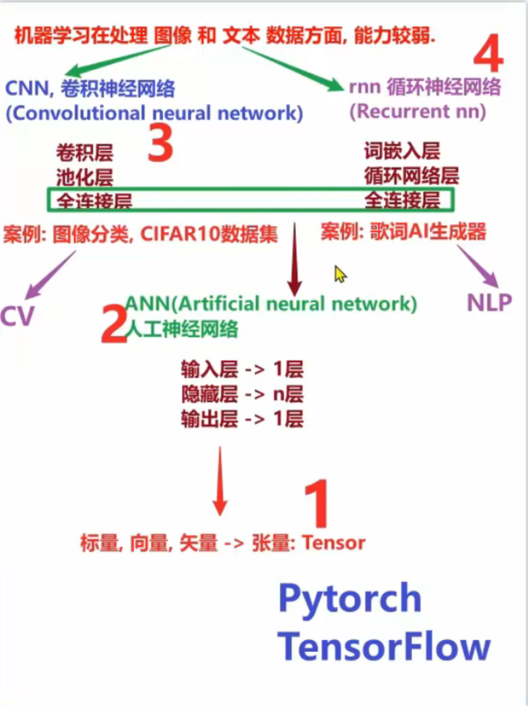

- **深度学习（deep learing, DL）**是机器学习（machine learing, ML）的一类算法, 以人工神经网络为结构, 可以实现**自动提取特征**。

    - **传统机器学习需要人工进行特征提取**。

- 深度学习尤其擅长处理**高维数据**，如**图像**、语音和**文本**。

    - 图像为三维数据，常用 CNN 处理。

    - 语音和文本常用 RNN 来做。

        - 语音数据可通过频谱图技术转为数值。

        - 文本常是二维数据。

    - 全连接 ANN 只能处理二维数据，处理高维数据需要降维。

        > 其实是全连接层只能处理二维数据的，所有进入全连接层的数据都要处理成二维的，且其中一维还被 betch\_size 占据，batch\_size 是由数据加载器决定的，所以需要将每一个样本的数据都展平成一维的。
        > 
        > 

        传统全连接网络（**全连接 **ANN）的输入通常被整理成二维矩阵：行 = **样本数**，列 = **特征数**，即 `(N, D)`。

        原因是全连接层的核心运算是矩阵乘法：

        $X(N,D)×W(D,H)=Y(N,H)$

        其中 `N` 是样本数，`D` 是每个样本的特征维度，`H` 是输出维度。

        因此框架通常要求输入形状是 `(batch_size, features)`，也就是二维。

        如果原始数据是三维、四维，比如：

        图像：`(H, W, C)`

        批量图像：`(N, H, W, C)`

        视频：`(T, H, W, C)`

        序列：`(N, T, D)`

        全连接网络通常需要先** Flatten/展平**。例如 MNIST 图像 `28×28` 会变成 `784` 维向量，批量后就是 `(64, 784)`，仍然是二维。所以它能处理图像，只是把图像的高维结构拍平了。

        - MNIST 是一个手写数字图像数据集。

        - 64 不是 MNIST 自带的，也不是固定的，它是训练时人为设置的 batch\_size 大小，即一批处理多少张图。

## 深度学习特点

- **多层非线性变换**：深度学习模型由多个层次组成，每一层都应用非线性激活函数对输入数据进行变换。较低的层级通常捕捉到简单的特征（如边缘、颜色等），而更高的层级则可以识别更复杂的模式（如物体或面部识别）。

- **自动特征提取**：与传统机器学习算法不同，深度学习能够自动从原始数据中学习到有用的特征，而不需要人工特征工程。这使得深度学习在许多领域中表现出色。

- **大数据和计算能力**：深度学习模型通常需要大量的标注数据和强大的计算资源（如GPU）来进行训练。大数据和高性能计算使得深度学习在图像识别、自然语言处理等领域取得了显著突破。

- **可解释性差**：深度学习模型内部的运作机制相对不透明，被称为“黑箱”，这意味着理解模型为什么做出特定决策可能会比较困难。这对某些应用场景来说是一个挑战。

## 常见的深度学习模型

- **卷积神经网络 \(Convolutional Neural Networks, CNN\)**

    - 主要用于图像处理任务，如图像分类、目标检测、图像分割等。

    - 特点是使用卷积层来自动提取图像中的局部特征，并通过池化层减少参数数量，提高计算效率。

- **循环神经网络 \(Recurrent Neural Networks, RNN\)**

    - 适用于处理序列数据，例如自然语言处理（NLP）、语音识别等。

    - RNN具有记忆功能，可以处理输入数据的时间依赖性，但标准RNN难以捕捉长期依赖关系。

- **自编码器 \(Autoencoders\)**

    - 一种**无监督**学习模型，通常用于**降维**、特征学习或者异常检测。

    - 自编码器由编码器和解码器两部分组成，前者将输入压缩成一个较低维度的表示，后者尝试从这个低维表示重建原始输入。

- **生成对抗网络 \(Generative Adversarial Networks, GAN\)**

    - 包含两个子网络：生成器和判别器。生成器负责创建看起来真实的假样本，而判别器则试图区分真假样本。

    - GAN广泛应用于图像生成、视频合成等领域。

- **Transformer**

    - 主要用于自然语言处理（NLP）任务，尤其是机器翻译、文本生成等。

    - Transformer摒弃了传统的递归结构，采用自注意力机制（self\-attention），使得它能够并行处理整个句子的信息，在机器翻译、文本摘要等任务中表现出色。

## 深度学习应用场景

- 计算机视觉（Computer Vision, CV）

- 自然语言处理（Natural Language Processing, NLP）

- 推荐系统（Recommendation Systems）

- 多模态大模型（Multimodal Large Language Model）

---

# PyTorch 

https://pytorch\.org/

## PyTorch 框架简介

### 什么是 PyTorch

> PyTorch 是一个基于Python的科学计算包。
> 
> PyTorch 安装：
> 
> ```Bash
> pip install torch -i https://pypi.tuna.tsinghua.edu.cn/simple
> ```
> 
> 

- PyTorch 一个基于 Python 语言的深度学习框架，它将数据封装成张量（Tensor）来进行处理。

- PyTorch 提供了灵活且高效的工具，用于构建、训练和部署机器学习和深度学习模型。

- PyTorch 广泛应用于学术研究和工业界，特别是在计算机视觉、自然语言处理、强化学习等领域。

### PyTorch 特点

> **PyTorch 与 TensorFlow 的比较**
> 
> - **PyTorch 与 TensorFlow 的区别**：PyTorch 是基于动态图（动态计算图）的，而 TensorFlow 1\.x 是基于静态计算图的（TensorFlow 2\.x 支持动态图）。这使得 PyTorch 在灵活性和调试方面优于 TensorFlow，尤其是在研究和原型设计中。**此外**，PyTorch 的 API 设计更加贴近 Python，易于学习和使用。
> 
> - **TensorFlow 2\.x**（引入了 Eager Execution）和 PyTorch 都支持动态图，但 PyTorch 因其更直观的编程模式和调试支持，在学术界和一些工业界应用中更为流行。
> 
> 

- **类似于 NumPy 的张量计算**

    - PyTorch 中的基本数据结构是张量（Tensor），它与 NumPy 中的数组类似，但 PyTorch 的张量具有 GPU 加速的能力（通过 CUDA），这使得深度学习模型能够高效地在 GPU 上运行。

- **自动微分系统**

    - PyTorch 提供了强大的**自动微分**功能（`autograd`模块），能够自动计算模型中每个参数的梯度。

    - 自动微分使得梯度计算过程变得简洁和高效，并且支持复杂的模型和动态计算图。

- **深度学习库**

    - PyTorch 提供了一个名为 **torch\.nn **的子模块，用于构建神经网络。它包括了大量的预构建的层（如全连接层、卷积层、循环神经网络层等），损失函数（如交叉熵、均方误差等），以及优化算法（如SGD、Adam等）。

    - `torch.nn.Module` 是 PyTorch 中构建神经网络的基础类，用户可以通过继承该类来定义自己的神经网络架构。

- **动态计算图**

    - PyTorch 使用动态计算图机制，允许在运行时构建和修改模型结构，具有更高的灵活性，适合于研究人员进行实验和模型调试。

- **GPU加速（CUDA支持）**

    - PyTorch 提供对 GPU 的良好支持，能够在 NVIDIA 的 CUDA 设备上高效地进行计算。用户只需要将数据和模型转移到 GPU 上，PyTorch 会自动优化计算过程。

    - 通过简单的 `tensor.to(device)` 方法，可以轻松地将模型和数据从 CPU 转移到 GPU 或从一个 GPU 转移到另一个 GPU。

- **跨平台支持**

    - PyTorch 支持在多种硬件平台（如 CPU、GPU、TPU 等）上运行，并且支持不同操作系统（如 Linux、Windows、macOS）以及分布式计算环境（如多 GPU、分布式训练）。


## 张量创建

### 什么是张量

> 张量是 PyTorch 中的核心数据抽象
> 
> 

- PyTorch 中的张量就是元素为同一种数据类型的多维矩阵，与 NumPy 数组类似。

- PyTorch 中，张量以"类"的形式封装起来，对张量的一些运算、处理的方法（数值计算、矩阵操作、自动求导）被封装在类中。

- **张量里面只能是数值，布尔值本质也是数值。不能是字符串、字典、Non等。**


### 基本创建方式

> chapter01\_pytorch/01\_张量的基本创建方式\.py
> 
> 

> - 张量的数据类型有
> 
> 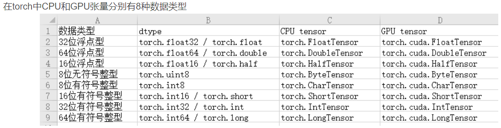
> 
> - **张量中默认的浮点数数据类型是 float32，默认的整数数据类型是 int64。**
> 
> - NumPy 里浮点数默认通常是 `float64`，也就是双精度浮点数。**所以从 NumPy 转到 PyTorch 时，如果不指定 dtype，就会变成 ****`float64`****。**
> 
> 

- `torch.tensor(data=, dtype=)` 根据指定数据创建张量（**掌握这个**）

    ```python
    import torch 
    import numpy as np
    
    
    ## 1. 创建张量标量
    data = torch.tensor(10)
    print(data)
    ## 2. numpy 数组, 由于data为float64, 张量元素类型也是float64
    data = np.random.randn(2, 3)    # randn表示随机数来自正态分布
    data = torch.tensor(data)
    print(data)
    ## 3. 列表, 浮点类型默认float32
    data = [[10., 20., 30.], [40., 50., 60.]]
    data = torch.tensor(data)
    print(data)
    ```

- torch\.Tensor\(size=\) **根据形状创建**张量, 其也可用来创建指定数据的张量

    ```python
    ## 1. 创建2行3列的张量, 默认 dtype 为 float32
    data = torch.Tensor(2, 3)
    print(data)
    ## 2. 注意: 如果传递列表, 则创建包含指定元素的张量
    data = torch.Tensor([10])
    print(data)
    data = torch.Tensor([10, 20])
    print(data)
    ```

- torch\.IntTensor\(\)/torch\.FloatTensor\(\)/\.\.\. 创建指定类型的张量

    ```python
    ## 1. 创建2行3列, dtype 为 int32 的张量
    data = torch.IntTensor(2, 3)
    print(data)
    ## 2. 注意: 如果传递的元素类型不正确, 则会进行类型转换
    data = torch.IntTensor([2.5, 3.3])
    print(data)
    ## 3. 其他的类型
    data = torch.ShortTensor()  # int16
    data = torch.LongTensor()   # int64
    data = torch.FloatTensor()  # float32
    data = torch.DoubleTensor() # float6
    ```

### 线性和随机张量

> chapter01\_pytorch/02\_创建线性和随机张量\.py
> 
> 

> 要掌握的函数: arange\(\), linspace\(\), manual\_seed\(\), randint\(\)
> 
> 

- `torch.arange(start=, end=, step=)`：固定**步长**线性张量

- `torch.linspace(start=, end=, steps=)`：固定**元素数**线性张量

    ```python
    ## 1. 在指定区间按照步长生成元素 [start, end, step) 左闭右开
    data = torch.arange(0, 10, 2)
    print(data)
    
    ## 2. 在指定区间按照元素个数生成 [start, end, steps] 左闭右闭
    ## step = (end-start) / (steps-1)
    ## value_i = start + step * i
    ## 即在闭区间内生成 step 个数，满足等差数列，浮点数
    data = torch.linspace(0, 9, 10)
    print(data)
    ```

- `torch.randn/rand(size=)` 创建随机**浮点类型**张量，标准正态分布/均匀分布\(0, 1\)

- `torch.randint(low=, high=, size=)` 创建随机**整数类型**张量 左闭右开

- torch\.initial\_seed\(\) 和 `torch.manual_seed(seed=)` 随机种子设置

- torch\.initial\_seed\(\) 还可以用于查看当前随机数种子

    ```python
    ## 创建随机张量，不推荐的随机数种子设置 
    *torch.initial_seed()    # 默认采用当前系统的时间戳作为随机种子.*
    ## *符合标准正态分布的随机张量.*
    data = torch.randn(2, 3)  # 创建2行3列张量
    print(data)
    ## 查看随机数种子
    print('随机数种子:', torch.initial_seed())    # 会返回时间戳
    
    ## 创建随机张量，推荐的随机数种子设置 
    torch.manual_seed(100)    *# 设置随机种子*
    *## 均匀分布的(0, 1) 随机张量*
    data = torch.rand(2, 3)
    print(data)
    print('随机数种子:', torch.initial_seed())    # 会返回100
    ```

### 指定值张量

> chapter01\_pytorch/03\_创建全0\_1\_指定值张量\.py
> 
> 

> 掌握`torch.zeros()`即可。
> 
> 

> **xxx\_like\(\)的输入需要为 Tensor 类，即只能在已有框架上改变数值。**
> 
> 

- `torch.zeros(size=)` 和 torch\.zeros\_like\(input=\) 创建全0张量

    ```python
    ## 1. 创建指定形状全0张量
    data = torch.zeros(2, 3)
    print(data)
    
    ## 2. 根据张量形状创建全0张量
    data = torch.zeros_like(data)
    print(data)
    ```

- torch\.ones\(size=\) 和 torch\.ones\_like\(input=\) 创建全1张量

    ```python
    ## 1. 创建指定形状全1张量
    data = torch.ones(2, 3)
    print(data)
    
    ## 2. 根据张量形状创建全1张量
    data = torch.ones_like(data)
    print(data)
    ```

- torch\.full\(size=, fill\_value=\) 和 torch\.full\_like\(input=, fill\_value=\) 创建全为指定值张量

    ```python
    ## 1. 创建指定形状指定值的张量
    data = torch.full([2, 3], 10)
    print(data)
    
    ## 2. 根据张量形状创建指定值的张量
    data = torch.full_like(data, 20)
    print(data)
    ```

### 指定元素类型张量

> chapter01\_pytorch/04\_创建指定类型的张量\.py
> 
> 

> 掌握 \.type\(\)
> 
> 

- `data.type(dtype=)`

    ```python
    data = torch.full([2, 3], 10)
    print(data.dtype)
    ## 将 data 元素类型**转换**为 float64 类型
    data = data.type(torch.DoubleTensor)
    print(data.dtype)
    ## 转换为其他类型
    ## data = data.type(torch.ShortTensor)
    ## data = data.type(torch.IntTensor)
    ## data = data.type(torch.LongTensor)
    ## data = data.type(torch.FloatTensor)
    ## data = data.type(dtype=torch.float16)
    ```

- data\.half/float/double/short/int/long\(\)

    ```python
    data = torch.full([2, 3], 10)
    print(data.dtype)
    ## 将 data 元素类型转换为 float64 类型
    data = data.double()
    print(data.dtype)
    ## 转换为其他类型
    ## data = data.short()
    ## data = data.int()
    ## data = data.long()
    ## data = data.float()
    ```


## 张量类型转换

> chapter01\_pytorch/05\_张量和numpy之间相互转换\.py
> 
> 

> 掌握:
>     张量 \-\> numpy:  `张量对象.numpy()`
>     numpy \-\> 张量:  `torch.tensor(nd数组)`
>     从标量张量中 提取其内容:  `标量张量.item()`
> 
> 

### 张量转换为 NumPy 数组

- 使用 `张量对象.numpy()` 函数可以将张量转换为 ndarray 数组，但是**共享内存**，可以使用 copy 函数避免共享。

    ```python
    ## 1. 将张量转换为 numpy 数组
    data_tensor = torch.tensor([2, 3, 4])
    ## 使用张量对象中的 numpy 函数进行转换
    data_numpy = data_tensor.numpy()
    print(type(data_tensor))
    print(type(data_numpy))
    ## 注意: data_tensor 和 data_numpy 共享内存
    ## 修改其中的一个，另外一个也会发生改变
    ## data_tensor[0] = 100
    data_numpy[0] = 100
    print(data_tensor)
    print(data_numpy)  
    
    ## 2. 对象拷贝避免共享内存
    data_tensor = torch.tensor([2, 3, 4])
    ## 使用张量对象中的 numpy 函数进行转换，通过copy方法拷贝对象
    data_numpy = data_tensor.numpy().copy()
    print(type(data_tensor))
    print(type(data_numpy))
    ## 注意: data_tensor 和 data_numpy 此时不共享内存
    ## 修改其中的一个，另外一个不会发生改变
    ## data_tensor[0] = 100
    data_numpy[0] = 100
    print(data_tensor)
    print(data_numpy)
    ```

### NumPy 数组转换为张量

- 使用 torch\.from\_numpy\(ndarray=\) 可以将 ndarray 数组转换为 tensor 张量，**默认共享内存**，使用 copy 函数避免共享。

- 使用 `torch.tensor(data=)` 可以将 ndarray 数组转换为 tensor 张量，**默认不共享内存**。

    ```python
    data_numpy = np.array([2, 3, 4])
    ## 将 numpy 数组转换为张量类型
    ## 1. torch.from_numpy(ndarray)
    data_tensor = torch.from_numpy(data_numpy)
    ## nunpy 和 tensor 共享内存
    ## data_numpy[0] = 100
    data_tensor[0] = 100
    print(data_tensor)
    print(data_numpy)
    
    ## 2. torch.tensor(ndarray)
    data_numpy = np.array([2, 3, 4])
    data_tensor = torch.tensor(data_numpy)
    ## nunpy 和 tensor 不共享内存
    ## data_numpy[0] = 100
    data_tensor[0] = 100
    print(data_tensor)
    print(data_numpy)
    ```

### 提取标量张量的数值

- 对于只有一个元素的张量，使用 `标量张量.item()` 函数将该值从张量中提取出来

    ```python
    ## 当张量只包含一个元素时, 可以通过 item() 函数提取出该值
    data = torch.tensor([30,])    # *加个逗号标记为真实的列表*
    print(data.item())
    data = torch.tensor(30)
    print(data.item())
    ```

    

## 张量数值计算

> 张量 和 数值运算, 则: 该数值会和张量中的每个值依次进行对应的运算，结果还是张量。
> 
> 

### 基本运算

> chapter01\_pytorch/06\_张量的基本运算\.py
> 
> 

加减乘除取负号：

- `+、-、*、/、-` ; 另`//` 表示整数除法

- add\(other=\)、sub\(\)、mul\(\)、div\(\)、neg\(\)

- add\_\(other=\)、sub\_\(\)、mul\_\(\)、div\_\(\)、neg\_\(\)（其中带下划线的版本会修改源数据，相当于`+=、-=、*=、/=`）

    > 原地运算要求结果能转回原 dtype，否则报错。
    > 
    > 

    ```python
    data = torch.randint(0, 10, [2, 3])
    print(data)
    ## 1. 不修改原数据
    new_data = data.add(10)  # 等价 new_data = data + 10
    print(new_data)
    ## 2. 直接修改原数据 注意: 带下划线的函数为修改原数据本身
    data.add_(10)  # 等价 data += 10
    print(data)
    ## 3. 其他函数
    print(data.sub(100))
    print(data.mul(100))
    print(data.div(100))
    print(data.neg())
    ```

### 矩阵点乘运算 \(Hadamard 积\)

> chapter01\_pytorch/07\_张量的点乘和矩阵乘法\.py
> 
> 

点乘（Hadamard）也称为元素级乘积，指的是**相同形状**的张量对应位置的元素相乘，使用 mul 和运算符 `*` 实现。

例如：


$A = \begin{bmatrix} 1 & 2 \\ 3 & 4 \end{bmatrix}, B = \begin{bmatrix} 5 & 6 \\ 7 & 8 \end{bmatrix}$


则 $A, B$ 的 Hadamard 积（**哈达玛积**）：


$A \odot B = \begin{bmatrix} 1 \times 5 & 2 \times 6 \\ 3 \times 7 & 4 \times 8 \end{bmatrix} = \begin{bmatrix} 5 & 12 \\ 21 & 32 \end{bmatrix}$

```python
data1 = torch.tensor([[1, 2], [3, 4]])
data2 = torch.tensor([[5, 6], [7, 8]])
## 第一种方式
data = torch.mul(data1, data2)
print(data)
## 第二种方式
data = data1 * data2
print(data)
```

### 矩阵 ** Frobenius 内积**

在矩阵空间中，最标准的 “内积” 叫做 **Frobenius 内积**（Frobenius Inner Product）。

- **定义**：两个**同型矩阵**（维度相同）对应位置的元素相乘，然后全部相加，最终得到一个**标量（数字）**。

- **公式**：假设 $A$ 和 $B$ 都是 $m \times n$ 的矩阵：

$\langle A, B \rangle_F = \sum_{i=1}^{m} \sum_{j=1}^{n} A_{ij} B_{ij}$

- **本质**：**逐元素乘积（Hadamard积）** $A \odot B$ 后的所有元素加起来。

- **等价操作**：如果你把矩阵 $A$ 和 $B$ 分别按行 “拉平（Flatten）” 成两个长向量 $\mathbf{a}$ 和 $\mathbf{b}$，那么它们的 Frobenius 内积就等于这两个长向量的 **点积**（$\mathbf{a} \cdot \mathbf{b}$）。

- **迹的表示法**：在数学上，它也可以用矩阵乘法表示：

$\langle A, B \rangle_F = \text{tr}(A^T B)$

```Python
# 方法 1：逐元素相乘 + 求和（最直观）
result = (A * B).sum()
# 方法 2：展平后用一维点积 torch.dot（一维内积即向量点积）
## .flatten() 把矩阵变成一维向量
result = torch.dot(A.flatten(), B.flatten())
# 方法 3：利用迹（Trace）的性质
result = (A.T @ B).trace()
# 方法 4：张量缩并 torch.tensordot
## 把 A 和 B 的第0维和第1维全部收缩（相乘相加）
result = torch.tensordot(A, B, dims=([0, 1], [0, 1]))
```

### 矩阵乘法运算

> chapter01\_pytorch/07\_张量的点乘和矩阵乘法\.py
> 
> 

矩阵乘法运算要求第一个矩阵 shape: \(n, m\)，第二个矩阵 shape: \(m, p\), 两个矩阵乘法运算 shape 为: \(n, p\)。

- 运算符 `@` 用于进行两个矩阵的乘积运算。

- torch\.matmul\(input=, other=\) 对进行乘积运算的两矩阵形状没有限定。对于输入 shape 不同的张量，对应的最后几个维度必须符合矩阵运算规则。

    ```python
    ## 矩阵乘法运算
    data1 = torch.tensor([[1, 2], [3, 4], [5, 6]])
    data2 = torch.tensor([[5, 6], [7, 8]])
    ## 方式一:
    data3 = data1 @ data2
    print("data3-->", data3)
    ## 方式二:
    data4 = torch.matmul(data1, data2)
    # data4 = torch.mm(data1, data2)    # 仅能适用于二维矩阵
    print("data4-->", data4)
    
    *## 演示 dot()函数.*
    *# data5 = data1.dot(data2)       # 报错, dot() 只针对于一维张量有效（**向量点积**）.*
    t1 = torch.tensor([1, 2, 3])
    t2 = torch.tensor([4, 5, 6])
    t3 = t1.dot(t2)
    t3 = torch.dot(t1, t2)    # 等价写法
    print(f't3: {t3}')
    ```

### 广播机制总结（逐元素乘法与矩阵乘法）

下面把 `*`（逐元素乘法）和 `@`（矩阵乘法 / `matmul`）的广播机制放在一起总结。

|操作|广播范围|核心规则|
|---|---|---|
|`*`|**所有维度**都可广播|从右往左对齐，维数为 1 或缺失则扩展|
|`@`|**只有 batch（前导）维**可广播|**最后两维必须满足矩阵乘法**，内维不能广播|

#### 1\. `*` 的广播规则（标准 broadcasting）

规则：

1. 两个张量从**最右维**开始向左逐维比较。

2. 每一对维度满足以下之一即可：

    - 相等

    - 其中一个是 `1`

    - 其中一个缺失（视为 `1`）

3. 结果为每维取最大值。

4. 所有维度都对齐后，逐元素相乘。

示例：

```Python
a = torch.randn(60, 1)
b = torch.randn(256)
c = a * b              # [60, 256]

# 对齐：
# a: [60,   1]
# b: [ 1, 256]   (b 前面缺失会补 1)
# -> [60, 256]
```

```Python
torch.randn(3, 1, 4) * torch.randn(5, 4)   # [3, 5, 4]
torch.randn(8, 1) * torch.randn(1, 6)      # [8, 6]
torch.randn(5, 1) * torch.randn(5, 3)      # [5, 3]
```

不兼容会报错：

```Python
torch.randn(3, 2) * torch.randn(4, 2)   # 报错：3 vs 4 不可广播
```

#### 2\. `@` 的广播规则（matmul）

规则：

1. 把两个张量分成两部分：**最后两维**是矩阵维，**前面所有维**是 batch 维。

2. **最后两维必须满足矩阵乘法**：`[..., M, K] @ [..., K, N] -> [..., M, N]`，内维 `K` 必须相等，**不能广播**。

3. **batch 维按 ****`*`**** 的广播规则对齐**（从右往左，1 可扩展）。

4. 对每个 batch 做矩阵乘法。

示例：

```Python
A = torch.randn(60, 1, 256)
B = torch.randn(   256, 128)
C = A @ B              # [60, 1, 128]

# 对齐：
# A: [60, 1, 256]
# B: [ 1,256, 128]     (B 前面补 1)
# 最后两维: [1,256] @ [256,128] -> [1,128]
# batch 维: [60,1] 和 [1] 广播 -> [60,1]
# 结果: [60, 1, 128]
```

```Python
A = torch.randn(8, 1, 3, 4)
B = torch.randn(   5, 4, 2)
C = A @ B              # [8, 5, 3, 2]
```

最后两维不能广播：

```Python
A = torch.randn(3, 1)
B = torch.randn(4, 2)
A @ B    # 报错：内维 1 vs 4 不匹配
```

对比同样的形状用 `*`：

```Python
A * B    # [3, 2]，广播成功
```

#### 3\. `@` 对一维张量的特殊处理

一维张量不参与普通广播，而是按位置临时补维：

|表达式|等价形状|结果|
|---|---|---|
|`[K] @ [K, N]`|`[1,K] @ [K,N]`|`[N]`|
|`[M, K] @ [K]`|`[M,K] @ [K,1]`|`[M]`|
|`[K] @ [K]`|`[1,K] @ [K,1]`|标量|
|`[B, K] @ [K]`|`[B,K] @ [K,1]`|`[B]`|

注意：这是“补维后算完再删维”，不是广播。

**`[M, K] @ [M]`****是直接报错的。**

#### 4\. 对齐方式示意

```Plain Text
* : 从右往左，每一维都可以是 1 或缺失
     [60, 1]
     [ 1,256]
     --------
     [60,256]

@ : 右两维 = 矩阵维，严格匹配；左边 = batch 维，按 * 规则广播
     [60, 1, 256]
     [ 1,256, 128]
     ------------
     batch: [60,1] vs [1]  -> [60,1]
     mat  : [1,256] @ [256,128] -> [1,128]
     结果 : [60, 1, 128]
```

#### 5\. 底层实现差异

||`*`|`@`|
|---|---|---|
|调度|TensorIterator|matmul 调度器|
|计算|逐元素乘|GEMM / batched GEMM|
|广播|真正按需扩展/stride=0 视图|只对 batch 维用 stride=0 视图|
|内维不匹配|可能广播|直接报错|

#### 6\. 常见坑

```Python
# 坑 1：以为 @ 能把内维 1 广播成任意值
torch.randn(3, 1) @ torch.randn(4, 2)   # 报错

# 坑 2：一维 @ 二维，结果少一维
torch.randn(256) @ torch.randn(60, 256) # [60]，不是 [1, 60] 或 [60, 1]

# 坑 3：* 和 @ 数值偶尔相同，但语义不同
a = torch.randn(60, 1)
b = torch.randn(256)
a * b                  # 广播逐元素乘 -> [60,256]
a @ b.unsqueeze(0)     # 矩阵乘 -> [60,256]，数值相同但走 GEMM

# 坑 4：bmm 不支持 batch 广播
torch.bmm(torch.randn(8,3,4), torch.randn(5,4,2))  # 报错，batch 必须相等
torch.matmul(torch.randn(8,3,4), torch.randn(5,4,2)) # [8,5,3,2]，可以
```

#### 7\. 记忆口诀

> **`*`**** 全维广播，从右对齐，1 可扩展。**
> 
> **`@`**** 只广播 batch 维，最后两维必须“内维相等”，不能广播。**
> 
> **`@`**** 的一维是补维不是广播；****`bmm`**** 连 batch 都不广播，只有 ****`matmul`****/****`@`**** 广播 batch。**
> 
> 

#### 8\. 速查表

|形状 A|形状 B|`A * B`|`A @ B`|
|---|---|---|---|
|`[60,1]`|`[256]`|`[60,256]`|报错（1 vs 256）|
|`[60,1]`|`[1,256]`|`[60,256]`（广播）|`[60,256]`（矩阵乘）|
|`[60,1,256]`|`[256,128]`|报错（256 vs 128）|`[60,1,128]`|
|`[8,1,3,4]`|`[5,4,2]`|报错|`[8,5,3,2]`|
|`[3,1]`|`[4,2]`|`[3,2]`|报错|
|`[256]`|`[60,256]`|`[60,256]`|`[60]`（特殊处理）|


## 张量运算函数

> chapter01\_pytorch/08\_张量的常用运算函数\.py
> 
> 

> **计算均值必须传入浮点数类型的张量。**
> 
> **dim=0 按列计算，dim=1 按行计算，省略 dim 表示整体计算。**
> 
> 

- 有 dim 参数

    - `tensor.mean(dim=)`:平均值

    - `tensor.sum(dim=)`:求和

    - `tensor.min/max(dim=)`:最小值/最大值

- 没有 dim 参数

    - `tensor.pow(exponent=)`:幂次方 $x^n$    `**`、`troch.pow(tensor, exponent)`

    - `tensor.sqrt()`:平方根     `** (1/2)`

    - `tensor.exp()`:指数 $e^x$    

    - `tensor.log()`:对数 以e为底

    - `tensor.log2()`:对数 以2为底

```python
import torch


data = torch.randint(0, 10, [2, 3], dtype=torch.float64)
print(data)
## 1. 计算均值
## 注意: tensor 必须为 Float 或者 Double 类型
print(data.mean())       # 整体计算出一个均值
print(data.mean(dim=0))  # 按列计算均值
print(data.mean(dim=1))  # 按行计算均值
## 2. 计算总和
print(data.sum())
print(data.sum(dim=0))
print(data.sum(dim=1))
## 3. 计算平方
print(data.pow(2))
print(torch.pow(data, 2))
print(data ** 2)
## 4. 计算平方根
print(data.sqrt())
print(data ** (1/2))
## 5. 指数计算, e^n 次方
print(data.exp())
## 6. 对数计算
print(data.log())  # 以 e 为底
print(data.log2())
print(data.log10())
```


## 张量索引操作

> chapter01\_pytorch/09\_张量的索引操作\.py
> 
> 

> 尤其注意列表索引，除列表索引外都是正常的操作。
> 
> 

我们在操作张量时，经常需要去获取某些元素就进行处理或者修改操作，在这里我们需要了解在 torch 中的索引操作。

分类：简单行列索引、列表索引、范围索引、布尔索引、多维索引

```python
*# 导包*
import torch

*# 1. 设置随机种子.*
torch.manual_seed(24)

*# 2. 创建随机张量.*
t1 = torch.randint(1, 10, (5, 5))
print(f't1: {t1}')

*# 3. 演示张量的索引操作.*
*# 场景1: 简单行列索引, 格式: 张量对象[行, 列]*
*# 需求1: 获取第2行的数据.*
print(t1[1])
print(t1[1, :])  *# 效果同上, 这里的:表示 所有列*
*# 需求2: 所有行的第3列数据*
print(t1[:, 2])
print('-' * 30)

*# 场景2: ****列表索引****, 前边的表示行, 后边的表示列.*
*# 需求1: 返回(1, 2), (3, 4)两个位置的元素.*
print(t1[[1, 3], [2, 4]])
*# 需求2: 返回(1, 2), (3, 4), (4, 1)三个位置的元素.*
print(t1[[1, 3, 4], [2, 4, 1]])
*# 需求3: 获取第0, 1行的 1, 2列共4个元素.*
print(t1[[[0], [1]], [1, 2]])
print('-' * 30)

*# 场景3: 范围索引*
*# 需求1: 前3行, 前2列.*
print(t1[:3, :2])
*# 需求2: 第2行到最后一行, 前2列的数据.*
print(t1[1:, :2])
*# 需求3: **所有奇数行, 偶数列**.*
print(t1[1::2, 0::2])    # 0 可省略
print('-' * 30)

*# 场景4: 布尔索引*
*# print(t1[torch.tensor([True, False, False, True, True]), :])    # 演示布尔写法, 看看就好.*
## 会选择所有为 True 的行
*# 需求1: 第3列 大于5的行数据.*
print(t1[t1[:, 2] > 5])
*# 需求2: 第2行大于5的 列数据.*
*## 理解1: 在第2行基础上 找到该行中大于5的列索引, 然后找 所有行 中对应列的元素.*
print(t1[:, t1[1, :] > 5])
print(t1[:, t1[1] > 5])     *# 效果同上.*
*## 理解2: 在第2行的基础上, 找该行所有列中大于5的元素*
print(t1[1, t1[1, :] > 5])
print('-' * 30)

*# 场景5: 多维索引*
*# 创建3维张量, 即: 2个3行4列的矩阵.*
t2 = torch.randint(1, 10, (2, 3, 4))
print(f't2: {t2}')
*# 需求1: 获取0轴上的第1个数据.*
print(t2[0, :, :])
*# 需求2: 获取1轴上的第1个数据.*
print(t2[:, 0, :])
*# 需求3: 获取2轴上的第1个数据.*
print(t2[:, :, 0])
```


## 张量形状操作

> chapter01\_pytorch/10\_张量的形状操作\.py
> 
> 

> 需要掌握的函数: \.reshape\(\), \.unsqueeze\(\), \.permute\(\), \.view\(\)
> 
> 

> transpose是转置的意思，所以 transpose\(\) 和 reshape\(\) 是有区别的，前者是多维广义转置，后者是拼接。
> permute 是排列的意思，permute 的实现效果也是多维广义转置，eg: \(i, j, k\) \-\> \(k, i, j\)。
> view\(\) 与 reshape\(\) 的操作结果是一样的，只是 view\(\) 多了一个判断张量是否连续的机制。
> **综上，reshape\(\) 和 view\(\) 得到的张量是连续的，transpose\(\) 和 permute\(\) 得到的张量是不连续的。**
> 
> 

张量形状操作是指对张量的维度进行变换的一系列操作。

张量的形状则描述了每个维度上的元素数量。

> shape 属性或者 size\(\) 方法都可以获得张量的形状。以下是使用操作对比:
>     \.shape   \.shape\[0\]  \.shape\[1\]   \.shape\[\-1\]
>     \.size\(\)    \.size\(0\)     \.size\(1\)      \.size\(\-1\)
> 
> 

### reshape

保证张量数据不变（**数据拉平成一维后要保持一致**）的前提下改变数据的维度，将其转为为指定的形状。

```python
import torch

data = torch.tensor([[10, 20, 30], [40, 50, 60]])
## 1. 使用 shape 属性或者 size() 方法都可以获得张量的形状
print(data.shape, data.shape[0], data.shape[1])
print(data.size(), data.size(0), data.size(1))

## 2. 使用 reshape 函数修改张量形状
new_data = data.reshape(1, 6)    # 要确保元素总数一致，否则报错
print(new_data.shape)
```

### squeeze 和 unsqueeze

squeeze：删除指定位置形状为 1 的维度（降维）

unsqueeze：在指定位置添加形状为 1 的维度（升维）

```python
mydata1 = torch.tensor([1, 2, 3, 4, 5])             
print('mydata1--->', mydata1.shape, mydata1) # 一个普通的数组 1维数据
mydata2 = mydata1.unsqueeze(dim=0)
print('在0维度上 拓展维度：', mydata2, mydata2.shape)  # 1*5
mydata3 = mydata1.unsqueeze(dim=1)
print('在1维度上 拓展维度：', mydata3, mydata3.shape)  # 5*1
mydata4 = mydata1.unsqueeze(dim=-1)    # 支持负数索引
print('在-1维度上 拓展维度：', mydata4, mydata4.shape) # 5*1
mydata5 = mydata4.squeeze()
print('压缩维度：', mydata5, mydata5.shape)  # 一维张量
```

### transpose 和 permute

transpose：实现交换张量形状的指定维度, 例如: 一个张量的形状为 \(2, 3, 4\) ，把 3 和 4 进行交换, 将张量的形状变为 \(2, 4, 3\)

permute：一次交换更多的维度

```python
data = torch.tensor(np.random.randint(0, 10, [3, 4, 5]))
print('data shape:', data.size())
## 1. 交换1和2维度
mydata2 = data.transpose(1, 2)
mydata2 = data.transpose(-1, -2)# 支持负数索引
mydata2 = torch.transpose(data, 1, 2)    # 效果同上
print('mydata2.shape--->', mydata2.shape)
## 2. 将data 的形状修改为 (4, 5, 3), 需要变换多次
mydata3 =  torch.transpose(data, 0, 1)
mydata4 = torch.transpose(mydata3, 1, 2)
# mydata4 = data.transpose(0, 1).transpose(1, 2)    # 效果同上
print('mydata4.shape--->', mydata4.shape)
## 3. 使用 permute 函数将形状修改为 (4, 5, 3)
## 3-1 方法1
mydata5 = torch.permute(data, [1, 2, 0])    
print('mydata5.shape--->', mydata5.shape)
## 3-2 方法2
mydata6 = data.permute([1, 2, 0])
mydata5 = data.permute(1, 2, 0)    # 效果同上
print('mydata6.shape--->', mydata6.shape)
```

### view 和 contiguous

view 函数也可以用于修改张量的形状，只能用于修改**连续的张量**。在 PyTorch 中，有些张量的底层数据在**内存中的存储顺序**与其**在张量中的逻辑顺序**不一致，view 函数无法对这样的张量进行变形处理，例如: 一个张量经过了 transpose 或者 permute 函数的处理之后，就无法使用 view 函数进行形状操作。

contiguous：将不连续张量转为连续张量

is\_contiguous：判断张量是否连续，返回 True 或 False

```python
## 1 一个张量经过了 transpose 或者 permute 函数的处理之后，就无法使用 view 函数进行形状操作
## 若要使用view函数, 需要使用 contiguous() 变成连续以后再使用 view() 函数
## 2 判断张量是否连续
data = torch.tensor([[10, 20, 30],[40, 50, 60]])
print('data--->', data, data.shape)
## 1 判断张量是否连续
print(data.is_contiguous())    # True
## 2 view
mydata2 = data.view(3, 2)
print('mydata2--->', mydata2, mydata2.shape)
## 3 判断张量是否连续
print('mydata2.is_contiguous()--->', mydata2.is_contiguous())    # True
## 4 使用 transpose 函数修改形状
mydata3 = torch.transpose(data, 0, 1)  
print('mydata3--->', mydata3, mydata3.shape)
print('mydata3.is_contiguous()--->', mydata3.is_contiguous())    # False
## 5 需要先使用 contiguous 函数转换为连续的张量，再使用 view 函数
print (mydata3.contiguous().is_contiguous())
mydata4 = mydata3.contiguous().view(2, 3)
print('mydata4--->', mydata4.shape, mydata4)
```


## 张量拼接操作

> chapter01\_pytorch/11\_张量的拼接\.py
> 
> 

张量拼接操作用于组合来自不同来源或经过不同处理的数据。

### cat/concat 函数

沿着**现有维度**连接一系列张量。所有输入张量**除了指定的拼接维度外，其他维度必须匹配**。

```python
import torch
data1 = torch.randint(0, 10, [1, 2, 3])
data2 = torch.randint(0, 10, [1, 2, 3])
print(data1)
print(data2)
## 1. 按0维度拼接
new_data = torch.cat([data1, data2], dim=0)   
print(new_data)
print(new_data.shape)    # (2, 2, 3)
## 2. 按1维度拼接
new_data = torch.cat([data1, data2], dim=1)
print(new_data)
print(new_data.shape)    # (1, 4, 3)
## 3. 按2维度拼接
new_data = torch.cat([data1, data2], dim=2)    # 可写成dim=-1
print(new_data)
print(new_data.shape)    # (1, 2, 6)
## 4. 按3维度拼接
## 报错，越界
```

> **随机种子逻辑：**
> 
> 若设置随机种子`torch.manual_seed(2026)`后，每次运行程序，得到的 data1 是固定的，data2 也是固定的。
> 
> 也就是说，第一次运行和第二次运行会得到完全相同的 data1 和 data2 。
> 
> 但 data1 和 data2 不是同一个结果，因为：
> 
> data1 消耗了随机序列的第一组数；
> 
> data2 接着消耗了随机序列的第二组数。
> 
> 

### stack 函数

在一个**新的维度**上连接一系列张量，这会增加一个新维度，并且**所有输入张量的形状必须完全相同**。

```python
import torch
data1 = torch.randint(0, 10, [2, 3])
data2 = torch.randint(0, 10, [2, 3])
print(data1)
print(data2)
## 1. 在0维度上拼接
new_data = torch.stack([data1, data2], dim=0)
print(new_data)          # 相当于再套一层括号
print(new_data.shape)    # (2, 2, 3)
## 2. 在1维度上拼接
new_data = torch.stack([data1, data2], dim=1)
print(new_data)          # 一维度对应拼接在一块
print(new_data.shape)    # (2, 2, 3)
## 3. 在2维度上拼接
new_data = torch.stack([data1, data2], dim=2)    
print(new_data)          # 二维度对应拼接在一块, 实现效果相当于情况2的"广义转置"
print(new_data.shape)    # *(2, 3, 2)*
## 4. 按3维度拼接
## 报错，越界               *(2, 3, ?, 2)*
```


## 自动微分模块

自动微分就是自动计算梯度值，也就是计算导数。

> 自动微分对损失函数求导，结合反向传播，更新权重与偏置参数w, b
> 
> 实际开发中，大多数情况下，可以不考虑偏置，会将偏置矩阵直接设置为全 0 矩阵。
> 
> 

- 什么是梯度

    - 对函数求导的值就是梯度

- 什么是梯度下降法

    - 是一种求最优梯度值的方法,使得损失函数的值最小

- 梯度经典语录

    - **对函数求导得到的值就是梯度** （在数值上的理解）

        - 在某一个点上，对函数求导得到的值就是该点的梯度

        - 没有点就无法求导,没有梯度

    - **梯度就是上山下山最快的方向** （在方向上理解\)

    - **在平面内，梯度就是某一点上的斜率**

        - y = 2x^2 某一点x=1的梯度，就是这一点上的斜率

    - **反向传播传播的是梯度**

        - 反向传播利用链式法则不断的从后向前求导，求出来的值就是梯度，所以大家都经常说反向传播传播的是梯度

    - **链式法则中，梯度相乘，就是传说中的梯度传播**

训练神经网络时，最常用的算法就是反向传播。在该算法中，参数（模型权重）会根据损失函数关于对应参数的梯度进行调整。为了计算这些梯度，PyTorch 内置了名为 `torch.autograd` 的微分模块。它支持任意计算图的自动梯度计算：

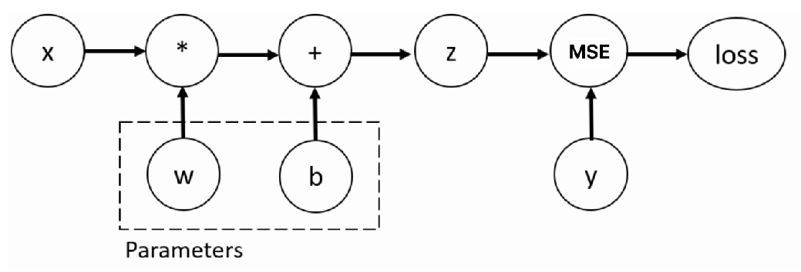

接下来我们使用这个结构进行自动微分模块的介绍，我们使用 backward 方法、grad 属性来实现梯度的计算和访问。


### 梯度基本计算

> chapter01\_pytorch/12\_自动微分模块入门示例\.py
> 
> 

- **pytorch 不支持向量张量对向量张量的求导，只支持标量张量对向量张量的求导**

    - w 如果是张量，loss 必须是标量（一个值）才可以进行求导

- 计算梯度: `loss.backward()`, loss 是一个标量

- 获取 w 点的梯度值: `w.grad`, 默认会累加上一次的梯度值，而不是覆盖

- 标量张量梯度计算

```python
## 定义一个标量张量(点)
## requires_grad=:默认为False,不会自动计算梯度;为True的话是将自动计算的梯度值保存到grad中
*## 只有标量张量才能求导, 且大多数底层操作的都是 浮点型, 记得转型为浮点型.*
x = torch.tensor(10, **requires_grad=True**, dtype=torch.float32)
print("x-->", x)

## 定义一个曲线
y = 2 * x ** 2
print("y-->", y)
## 查看梯度函数类型,即曲线函数类型
print(y.grad_fn)    *# <class 'MulBackward0'>*

## 计算x点的梯度
## 此时y是一个标量,可以不用使用y.sum()转换成标量
print("y.sum()-->", y.sum())
## y'|(x=10) = (2*x**2)'|(x=10) = 4x|(x=10) = 40
y.sum().backward()

## 打印x的梯度值
print("x的梯度值是:", x.grad)

*## 代入 权重更新公式: W新 = W旧 - 学习率 * 梯度*
x.data = x.data - 0.01 * x.grad

*## 打印最终结果.*
print(f'更新后的权重: {x}')       *# 9.6*
```

- 向量张量梯度计算

```python
## 定义一个向量张量
x = torch.tensor([10, 20], requires_grad=True, dtype=torch.float32)
print("x-->", x)

## 定义一个曲线
y = 2 * x ** 2
print("y-->", y)

## 计算梯度
## x和y都是向量张量,不能进行求导,需要将y转换成标量张量-->y.sum()
## y'|(x=10) = (2*x**2)'|(x=10) = 4x|(x=10) = 40
## y'|(x=20) = (2*x**2)'|(x=20) = 4x|(x=20) = 80
y.sum().backward()

## 打印x的梯度
print("x.grad-->", x.grad)
```

### 梯度下降法求最优解

> chapter01\_pytorch/13\_自动微分模块示例\.py
> 
> 

- 梯度下降法公式: `w = w - r * grad` \(r是学习率, grad是梯度值\)

- 清空上一次的梯度值: `x.grad.zero_()`，因为默认不是覆盖而是累加

```python
## 求 y = x**2 + 20 的极小值点 并打印y是最小值时 w的值(梯度)
## 1 定义点 x=10 requires_grad=True  dtype=torch.float32
## 2 定义函数 y = x**2 + 20
## 3 利用梯度下降法 循环迭代1000 求最优解
## 3-1 正向计算(前向传播)
## 3-2 梯度清零 x.grad.zero_()
## 3-3 反向传播
## 3-4 梯度更新 x.data = x.data - 0.01 * x.grad

import torch
## 1 定义点x=10 requires_grad=True  dtype=torch.float32
x = torch.tensor(10, requires_grad=True, dtype=torch.float32)

## 2 定义函数 y = x ** 2 + 20
y = x ** 2 + 20
# print('开始 权重x初始值:%.6f (0.01 * x.grad):无 y:%.6f' % (x, y))    
### % 是格式化操作符，左边是格式字符串，右边是用于替换的值
### %.6f 是占位符，表示“格式化为浮点数，保留 6 位小数”。
## f-string 现代写法：
print(f'开始 权重x初始值:{w:.6f} (0.01 * w.grad):无 y:{y:.6f}')

## 3 利用梯度下降法 循环迭代1000 求最优解
for i in range(1, 1001):

    # 3.1 正向计算(前向传播)
    y = x ** 2 + 20

    # 3.2 梯度清零 x.grad.zero_()
    # 默认张量的 grad 属性会累加历史梯度值 需手工清零上一次的提取
    # 一开始梯度不存在, 需要做判断
    if x.grad is not None:
        x.grad.zero_()

    # 3.3 反向传播
    y.sum().backward()

    # 3.4 梯度更新 x.data = x.data - 0.01 * x.grad
    # x.data是修改原始x内存中的数据,前后x的内存空间一样;如果使用x,此时修改前后x的内存空间不同
    x.data = x.data - 0.01 * x.grad  # 注：不能 x = x - 0.01 * x.grad 这样写

    # print('次数:%d 权重x: %.6f, (0.01 * x.grad):%.6f y:%.6f' % (i, x, 0.01 * x.grad, y))
    print(f'第 {i} 次, 权重初始值: {w}, (0.01 * x.grad): {0.01 * x.grad:.5f}, y: {y:.5f}')

# print('x：', x, x.grad, 'y最小值', y)
print(f'最终结果 权重: {x}, 梯度: {x.grad:.5f}, y: {y:.5f}')
```

### 梯度计算注意点

> chapter01\_pytorch/14\_自动微分\_detach\(\)函数介绍\.py
> 
> 

- 不能将自动微分的张量转换成 numpy 数组，会发生报错，可以通过 detach\(\) 方法实现。

```python
## 定义一个张量
x1 = torch.tensor([10, 20], requires_grad=True, dtype=torch.float64)

## 将x张量转换成numpy数组
## 发生报错,RuntimeError: Can't call numpy() on Tensor that requires grad. Use tensor.detach().numpy() instead.
## 不能将自动微分的张量转换成numpy数组
## print(x1.numpy())

## 通过detach()方法产生一个新的张量,作为叶子结点
x2 = x1.detach()
## x1和x2张量共享数据,但是x2不会自动微分
print(x1.requires_grad)
print(x2.requires_grad)
## x1和x2张量的值一样,共用一份内存空间的数据
print(x1.data)
print(x2.data)
print(id(x1.data))    # id() 是 Python 内置函数。它返回对象的唯一标识符，
print(id(x2.data))    # 在 CPython 中通常就是该对象的内存地址（一个整数）

## 将x2张量转换成numpy数组
print(x2.numpy())

## 一步到位版本
x2 = x1.detach().numpy()
```

### 自动微分模块应用

> chapter01\_pytorch/15\_自动微分模块应用模拟\.py
> 
> 

```python
import torch

## 输入张量 2*5
x = torch.ones(2, 5)
## 目标值是 2*3    
y = torch.zeros(2, 3)
## 设置要更新的权重和偏置的初始值
w = torch.randn(5, 3, requires_grad=True)
b = torch.randn(3, requires_grad=True)
## 设置网络的输出值
z = torch.matmul(x, w) + b  
'''
**矩阵乘法，XW 还是 WX 是自己规定的，要符合矩阵乘法规则。**
**这主要取决于一条样本是按行排列还是按列排列，但可以通过转置操作来相互转化，所以怎么写都是可以的;**
***这里的矩阵和向量的加法是通过广播机制来实现的***
'''
## 设置损失函数，并进行损失的计算
criterion = torch.nn.MSELoss()    *# neural network: 神经网络*
loss = criterion(z, y)
## 自动微分
loss.backward()
## 打印 w,b 变量的梯度
## backward 函数计算的梯度值会存储在张量的 grad 变量中
print("W的梯度:", w.grad)
print("b的梯度", b.grad)
```


## PyTorch 构建线性回归模型

> chapter01\_pytorch/16\_PyTorch框架\_模拟线性回归\.py
> 
> 

我们使用 PyTorch 的各个组件来构建线性回归模型。在 pytorch 中进行模型构建的整个流程一般分为四个步骤：

- 准备训练集数据

- 构建要使用的模型

- 设置损失函数和优化器

- 模型训练

要使用的 API：

- 使用 PyTorch 的 nn\.MSELoss\(\) 代替平方损失函数

- 使用 PyTorch 的 data\.DataLoader 代替数据加载器，便于分批获取数据

> 龟腚：numpy对象 \-\-\> 张量tensor \-\-\> 张量数据集对象TensorDataSet \-\-\> 数据加载器DataLoader
> 
> 

- 使用 PyTorch 的 optim\.SGD 代替优化器

- 使用 PyTorch 的 nn\.Linear 代替假设函数

```python
import torch
from torch.utils.data import TensorDataset        # 构造数据集对象
from torch.utils.data import DataLoader           # 数据加载器
from torch import nn                              # nn模块中有平方损失函数和假设函数
from torch import optim                           # optim模块中有优化器函数
from sklearn.datasets import make_regression      # 创建线性回归模型数据集
import matplotlib.pyplot as plt

plt.rcParams['font.sans-serif'] = ['SimHei']  # 用来正常显示中文标签
plt.rcParams['axes.unicode_minus'] = False  # 用来正常显示负号


## 构造数据集
def create_dataset():
    x, y, coef = make_regression(
        n_samples=100,
        n_features=1,      # 一元
        noise=10,
        coef=True,         # 是否返回系数
        bias=14.5,         # 偏置
        random_state=0     # 随机种子
    )    
    
    # print(type(x))          *# <class 'numpy.ndarray'>*

    # 将构建数据转换为张量类型
    x = torch.tensor(x)
    y = torch.tensor(y)

    return x, y, coef


## 训练模型
def train():
    # 构造数据集
    x, y, coef = create_dataset()

    # 构造数据集对象
    dataset = TensorDataset(x, y)

    # 构造数据加载器
    # dataset=:数据集对象
    # batch_size=:批量训练样本数据
    # shuffle=:样本数据是否进行乱序
    ## 选择标准: *训练集打乱, 保证每轮训练样本不同; 测试集不打乱, 测试集打乱没有意义*
    dataloader = DataLoader(dataset=dataset, batch_size=16, shuffle=True)

    # 构造模型
    # in_features指的是输入的二维张量的大小，即输入的[batch_size, size]中的size
    # out_features指的是输出的二维张量的大小，即输出的[batch_size，size]中的size
    model = nn.Linear(in_features=1, out_features=1)

    # 构造平方损失函数
    criterion = nn.MSELoss()

    # 构造优化函数
    # params=model.parameters():训练的参数,w和b
    # lr=1e-2:学习率, 1e-2为10的负二次方
    print("w和b-->", list(model.parameters()))
    print("w-->", model.weight)
    print("b-->", model.bias)
    optimizer = optim.SGD(params=model.parameters(), lr=1e-2)

    # 初始化训练次数
    epochs = 100
    # 损失的变化：记录*每轮的(平均)损失值列表 *
    epoch_loss = [] 
    for _ in range(epochs):
        total_loss, train_sample = 0.0, 0    # 每轮*训练总损失值, 每轮训练的总批次数.*
        for train_x, train_y in dataloader:    *# 7批(16, 16, 16, 16, 16, 16, 4)*
            # 将一个batch的训练数据送入模型
            y_pred = model(train_x.type(torch.float32))
            # 计算损失值,均方误差,当前批次所有样本的**平均误差** 
            loss = criterion(y_pred, train_y.reshape(-1, 1).type(torch.float32))    # *-1 自动计算, 能转多少行转多少行*
            # 总损失
            total_loss += loss.item() 
            # *样本(批次)数+1*
            train_sample += 1
            # 梯度清零，因为默认不是覆盖是累加
            optimizer.zero_grad()    # 底层有非零判断
            # 自动微分(反向传播)
            loss.backward()
            # 更新参数
            optimizer.step()
        # 计算所有batch的平均误差作为当前epoch的误差 (即将本轮的平均损失加入列表)
        epoch_loss.append(total_loss/train_sample)

    *# 打印(最终的)训练结果.*
    print(f'{epochs} 轮的平均损失分别为: {loss_list}')
    print(f'模型参数, 权重: {model.weight}, 偏置: {model.bias}')

    # 绘制损失变化曲线 
    plt.plot(range(epochs), epoch_loss) 
    plt.title('损失变化曲线') 
    plt.grid()     *# 绘制网格线*
    plt.show()

    # 绘制拟合直线
    plt.scatter(x, y)
    x = torch.linspace(x.min(), x.max(), 1000)
    # y1 = torch.tensor([v * model.weight + model.bias for v in x])
    *## 这个代码会有警告，因为将自动微分的张量强行转成张量会丢失梯度*
    # y2 = torch.tensor([v * coef + 14.5 for v in x])
    *# y2 = x * coef + 14.5      # 广播机制*
    *## 上面两个版本会引发 numpy 与 torch 版本不兼容的警告*
    y1 = model(x).detach()  *# 一定要 detach(), 因为画图时会自动转成 numpy*
    coef_tensor = torch.tensor(coef, dtype=torch.float32)    # 张量与张量计算更稳妥
    y2 = x * coef_tensor + 14.5      *# 广播机制*
        
    plt.plot(x, y1, label='训练')
    plt.plot(x, y2, label='真实')
    plt.grid()
    plt.legend()    # 图例
    plt.show()


if __name__ == '__main__':
    train()
```

---

# 神经网络基础

## 神经网络

深度学习神经网络就是大脑仿生，数据从输入到输出经过一层一层的神经元产生预测值的过程就是前向传播（也叫正向传播）。

前向传播涉及到人工神经元是如何工作的（也就是神经元的初始化、激活函数），神经网络如何搭建，权重参数计算、数据形如何状变化。千里之行始于足下，我们一起进入深度学习的知识海洋吧。

### 神经网络概念

#### 什么是神经网络

人工神经网络（Artificial Neural Network，简写为 **ANN**）也简称为神经网络（NN），是一种模仿生物神经网络结构和功能的**计算模型**。它由多个互相连接的人工神经元（也称为节点）构成，可以用于处理和学习复杂的数据模式，尤其适合解决非线性问题。人工神经网络是机器学习中的一个重要模型，尤其在深度学习领域中得到了广泛应用。

人脑可以看做是一个生物神经网络，由众多的**神经元**连接而成。各个神经元传递复杂的电信号，树突接收到**输入信号**，然后对信号进行处理，通过轴突**输出信号**。下图是生物神经元示意图：


当电信号通过树突进入到细胞核时，会逐渐聚集电荷。达到一定的电位后，细胞就会被激活，通过轴突发出电信号。

#### 神经网络优缺点

- 优点

    - 精度高，性能优于其他的机器学习方法，甚至在某些领域超过了人类。

    - 可以近似任意的非线性函数。

    - 近年来在学界和业界受到了热捧，有大量的框架和库可供调。

- 缺点

    - 黑箱，很难解释模型是怎么工作的。

    - 训练时间长，需要大量的计算力。

    - 网络结构复杂，需要调整超参数。

    - 小数据集上表现不佳，容易发生过拟合。

#### 如何构建神经网络

神经网络是由多个神经元组成，构建神经网络就是在构建神经元。以下是神经网络中神经元的构建说明：

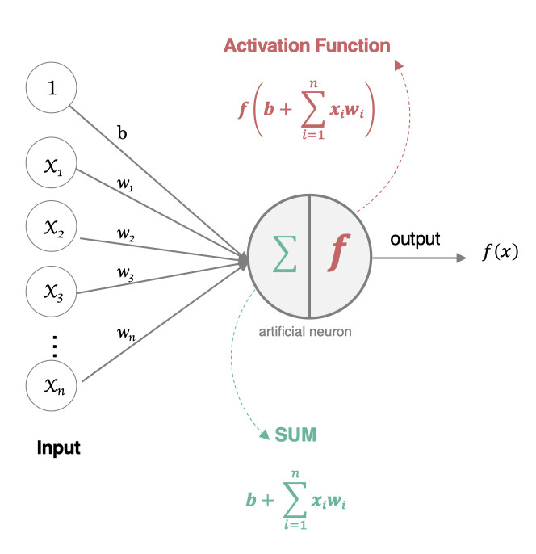

这个流程就像，来源不同树突\(树突都会有不同的权重\)的信息, 进行的加权计算, 输入到细胞中做加和，再通过激活函数输出细胞值。

同一层的多个神经元可以看作是通过并行计算来处理相同的输入数据，学习输入数据的不同特征。每个神经元可能会关注输入数据中的不同部分，从而捕捉到数据的不同属性。

接下来，我们使用多个神经元来构建神经网络，相邻层之间的神经元相互连接，并给每一个连接分配一个强度，如下图所示：


神经网络中信息只向一个方向移动，即从输入节点向前移动，通过隐藏节点，再向输出节点移动。其中的基本部分是:

1. **输入层（Input Layer）**: 即输入x的那一层（如图像、文本、声音等）。每个输入特征对应一个神经元。输入层将数据传递给下一层的神经元。

2. **输出层（Output Layer）**: 即输出y的那一层。输出层的神经元根据网络的任务（回归、分类等）生成最终的预测结果。

3. **隐藏层（Hidden Layers）**: 输入层和输出层之间都是隐藏层，神经网络的“深度”通常由隐藏层的数量决定。隐藏层的神经元通过加权和激活函数处理输入，并将结果传递到下一层。

特点是：

- 同一层的神经元之间没有连接。

- 第 N 层的每个神经元和第 N\-1 层的所有神经元相连（这就是 Fully Connected 的含义\)，这就是**全连接神经网络（FCNN）。**

- 全连接神经网络接收的样本数据是**二维的**，数据在每一层之间需要以二维的形式传递。

- 第N\-1层神经元的输出就是第N层神经元的输入。

- 每个连接都有一个权重值（w系数和b系数）。

#### 神经网络内部状态值和激活值

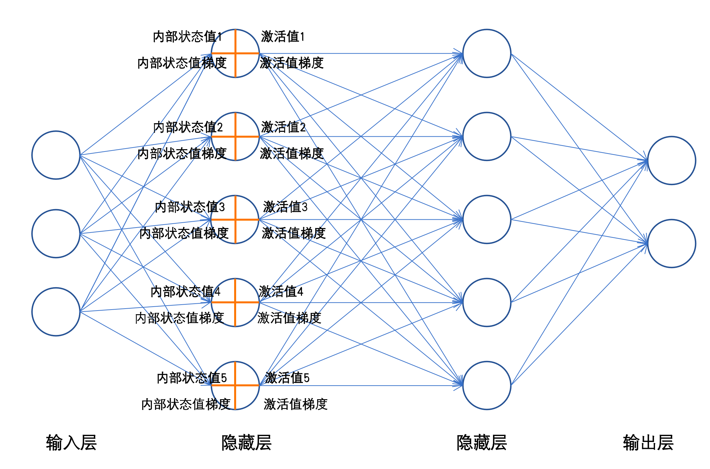

每一个神经元工作时，**前向传播会产生两个值，内部状态值（加权求和值）和激活值**；**反向传播**时会产生**激活值梯度**和**内部状态值梯度**。

- 内部状态值

    - 神经元或隐藏单元的内部存储值，它反映了当前神经元接收到的输入、历史信息以及网络内部的权重计算结果。

    - 每个输入$x_i$都有一个与之相乘的权重$w_i​$，表示每个输入信号的重要性。

    - $z = w \cdot x + b$

        - w：权重矩阵

        - x：输入值

        - b：偏置

    > ##### 一些关于神经网络的简单心得
    > 
    > 说明：用矩阵表示时，其实有很多种写法，比如
    > 
    > $Z = W \cdot X + b$
    > 
    > 再比如：
    > 
    > $Z = X \cdot W^T + b$
    > 
    > 这两种写法都表示一个意思，仅仅只是与形状有关罢了，简单来说，第一种写法 X 的一列表示一个样本，第二种写法 X 的一行表示一个样本。无非就是查看 W 的维度的时候会反过来，能看懂程序输出结果就可以。
    > 
    > 而且在初始化网络结构的时候根本就不用管，按 API 要求输入对应维度就可以，程序自会自动转换。
    > 
    > 另外：
    > 
    > 这里矩阵和向量的加法运算是通过广播机制来实现的，b 会按需补成需要的形状，例如 X 的行表示样本，即行数为批次数，列数为特征数，假设 X 为 100\*3。则隐藏层输入 3 维，再假设只有一个隐藏层，隐藏层有 5 个神经元，则 $W^T$的维度为 3 \* 5（这时如果查看 W 的形状，就会是 \(5, 3\) ，这就是和我们设计神经网络时的输入nn\.Linear\(3, 5\) 相反的原因），而 b 为一个列向量，维度为 5 \* 1，因为一个神经元需要一个偏置，那么 \(100, 5\) \+ \(5, 1\) 就会通过广播机制来相加，直接把 b 补充 \(100, 5\)，即先把偏置转成行向量再复制 100 次。依次类推，假设最后输出层有两个神经元，最后的输出就会是 100 \* 2。每个样本内部都会计算一次损失，然后批次内的样本默认会再计算平均损失，最后得到一个标量。
    > 
    > 再然后通过复合函数求导和链式法则即可进行反向传播，一般是使用一个批次的平均损失来更新一次参数，即一个批次更新一次参数。
    > 
    > 再说明一下损失函数算的是平均损失，所以在反向传播的时候就需要复合函数求导，即只有和这个神经元有关的部分才求导，其他无关的求导直接就是 0。另外一点就是除了最后一层只有一种路径可以到达，剩下的层的神经元都是有多条路径可以到达的，这些路径都要进行求导。详见反向传播详解。
    > 
    > 

- 激活值

    - 通过激活函数（如 ReLU、Sigmoid、Tanh、SoftMax）对内部状态值进行非线性变换后得到的结果。激活值决定了当前神经元的输出。

    - $a = f(z)$

        - f：激活函数

        - z：内部状态值

通过控制每个神经元的内部状态值、激活值的大小；每一层的内部状态值的方差、每一层的激活值的方差可让整个神经网络工作的更好。

所以下面两个小结，将要学习神经元的激活函数，神经元的权重初始化。


### 激活函数

> chapter02\_Artifical\_Neural\_Network/01\_激活函数\_Sigmoid图解\.py
> 
> chapter02\_Artifical\_Neural\_Network/02\_激活函数\_Tanh图解\.py
> 
> chapter02\_Artifical\_Neural\_Network/03\_激活函数\_ReLU图解\.py
> 
> chapter02\_Artifical\_Neural\_Network/04\_激活函数\_Softmax图解\.py
> 
> 

#### 神经网络非线性因素理解

- 没有引入非线性因素的网络等价于使用一个线性模型来拟合

- 通过给网络输出增加激活函数, 实现引入非线性因素, 使得网络模型可以逼近任意函数, 提升网络对复杂问题的拟合能力

**激活函数**用于对每层的**输出数据进行变换**, 进而为整个网络注入了**非线性因素**。此时, 神经网络就可以拟合各种曲线。如果不使用激活函数，整个网络虽然看起来复杂，其本质还相当于一种**线性模型**，如下公式所示:

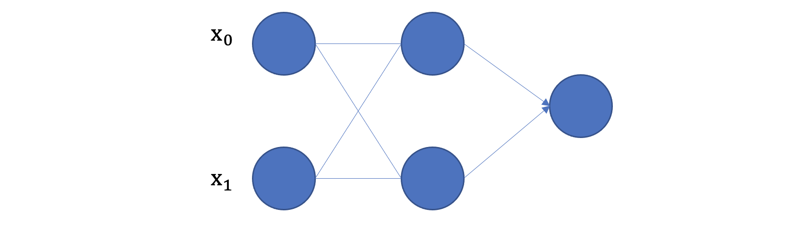


另外通过图像可视化的形式理解：

[神经网络可视化](http://playground.tensorflow.org/#activation=tanh&batchSize=10&dataset=circle&regDataset=reg-plane&learningRate=0.03&regularizationRate=0&noise=0&networkShape=4,2&seed=0.97420&showTestData=false&discretize=false&percTrainData=50&x=true&y=true&xTimesY=false&xSquared=false&ySquared=false&cosX=false&sinX=false&cosY=false&sinY=false&collectStats=false&problem=classification&initZero=false&hideText=false)

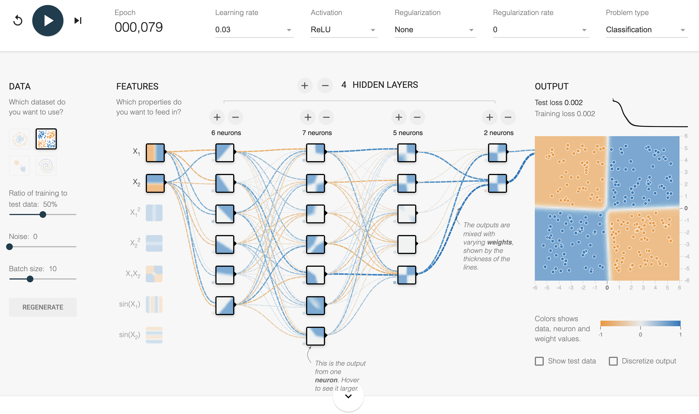

我们发现增加激活函数之后, 对于线性不可分的场景，神经网络的拟合能力更强。

#### 常见激活函数

> 细节:
>     绘制图像时出现以下提示，需要将 "E:\\\\conda\-envs\\\\deeplearning\-study\\\\Lib\\\\site\- packages\\\\torch\\\\lib\\\\libiomp5md\.dll" 目录下的 libiomp5md\.dll 文件删除
>     OMP: Error \#15: Initializing libiomp5md\.dll, but found libiomp5md\.dll already initialized\.
> 
> 

> 激活函数主要用来向神经网络中加入非线性因素，以解决线性模型表达能力不足的问题，它对神经网络有着极其重要的作用。我们的网络参数在更新时，使用的反向传播算法（BP），这就要求我们的激活函数必须可微。
> 
> 

##### Sigmoid 激活函数

激活函数公式：

$f(x) = \frac{1}{1 + e^{-x}}$

激活函数求导公式：

$f'(x) = \left( \frac{1}{1 + e^{-x}} \right)' = \frac{1}{1 + e^{-x}} \left( 1 - \frac{1}{1 + e^{-x}} \right) = f(x)(1 - f(x))$

sigmoid 激活函数的函数图像如下:


- 从 sigmoid 函数图像可以得到，sigmoid 函数可以将任意的输入映射到 \(0, 1\) 之间，当输入的值大致在 \< \- 6 或者 \> 6 时，意味着输入任何值得到的激活值都是差不多的，这样会丢失部分的信息。比如：输入 100 和输入10000 经过 sigmoid 的激活值几乎都是等于 1 的，但是输入的数据之间相差 100 倍的信息就丢失了。

- 对于 sigmoid 函数而言，输入值在 \[\- 6, 6\] 之间输出值才会有明显差异，输入值在 \[\- 3, 3\] 之间才会有比较好的效果。

- 通过上述导数图像，我们发现导数数值范围是 \(0, 0\.25\]，当输入的值 \< \- 6 或者 \> 6 时，sigmoid 激活函数图像的导数接近为 0，此时网络参数将更新极其缓慢，或者无法更新。

- 一般来说，sigmoid 网络在 **5 层之内**就会产生**梯度消失**现象**。**而且，该激活函数的激活值并不是以 0 为中心的，激活值总是偏向正数，导致梯度更新时，只会对某些特征产生相同方向的影响，所以在实践中这种激活函数使用的很少。**sigmoid 函数一般只用于****二分类的输出层****。**

在 PyTorch 中使用 sigmoid 函数的示例代码如下：

```python
import torch
import matplotlib.pyplot as plt

plt.rcParams['font.sans-serif'] = ['SimHei']  # 用来正常显示中文标签
plt.rcParams['axes.unicode_minus'] = False  # 用来正常显示负号

"""
绘制激活函数图像时出现以下提示，需要将anaconda3/Lib/site-packages/torch/lib目录下的
libiomp5md.dll文件删除OMP: Error #15: Initializing libiomp5md.dll, but found 
libiomp5md.dll already initialized.
"""

## 创建画布和坐标轴
_, axes = plt.subplots(1, 2, figsize=(10, 4))

## 函数图像
x = torch.linspace(-20, 20, 1000)
## 输入值x通过sigmoid函数转换成激活值y
y = torch.sigmoid(x)
axes[0].plot(x, y)
axes[0].grid()
axes[0].set_title('Sigmoid 函数图像')

## 导数图像
x = torch.linspace(-20, 20, 1000, requires_grad=True)
torch.sigmoid(x).sum().backward()

## x.detach():输入值x的ndarray数组
## x.grad:计算梯度，求导
axes[1].plot(x.detach(), x.grad)
axes[1].grid()
axes[1].set_title('Sigmoid 导数图像')

plt.show()
```

##### Tanh 激活函数

Tanh 叫做双曲正切函数，其公式如下：

$f(x) = \frac{1 - e^{-2x}}{1 + e^{-2x}}$

激活函数求导公式:

$f'(x) = \left( \frac{1 - e^{-2x}}{1 + e^{-2x}} \right)' = 1 - f^2(x)
$

Tanh 的函数图像、导数图像如下：

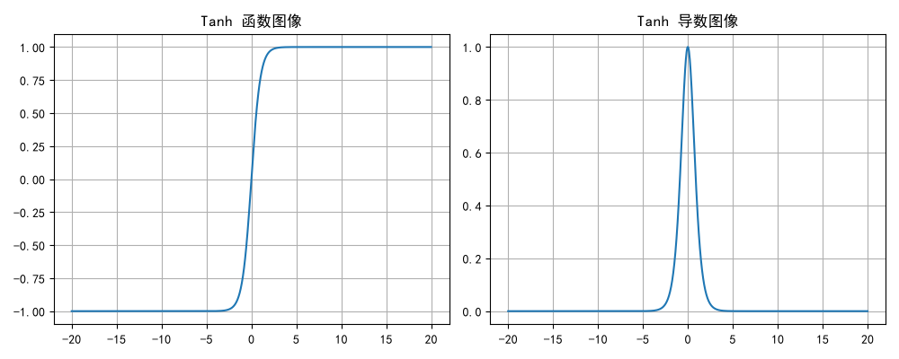

- 由上面的函数图像可以看到，Tanh 函数将输入映射到 \(\-1, 1\) 之间，图像以 0 为中心，激活值在 0 点对称，当输入的值大概 \< \- 3 或者 \> 3 时将被映射为 \-1 或者 1。其导数值范围 \(0, 1\)，当输入的值大概 \< \- 3 或者 \> 3 时，其导数近似 0。

- 与 Sigmoid 相比，它是以 0 为中心的，使得其**收敛速度要比 Sigmoid 快，减少迭代次数**。然而，从图中可以看出，Tanh 两侧的导数也为 0，**同样会造成梯度消失**。

- 若使用时可在**隐藏层使用 tanh 函数**，在**输出层使用 sigmoid 函数**。

在 PyTorch 中使用 tanh 函数的示例代码如下:

```python
import torch
import matplotlib.pyplot as plt

plt.rcParams['font.sans-serif'] = ['SimHei']  # 用来正常显示中文标签
plt.rcParams['axes.unicode_minus'] = False  # 用来正常显示负号

_, axes = plt.subplots(1, 2,* *figsize=(10, 4))

## 函数图像
x = torch.linspace(-20, 20, 1000)
y = torch.tanh(x)
axes[0].plot(x, y)
axes[0].grid()
axes[0].set_title('Tanh 函数图像')

## 导数图像
x = torch.linspace(-20, 20, 1000, requires_grad=True)
torch.tanh(x).sum().backward()

axes[1].plot(x.detach(), x.grad)
axes[1].grid()
axes[1].set_title('Tanh 导数图像')

plt.show()
```

##### ReLU 激活函数

ReLU 激活函数公式如下：

$f(x) = \max(0, x)$

激活函数求导公式:

$f'(x) = 0 \text{或} 1$

ReLU 的函数图像、导数图像如下：


- ReLU 激活函数将小于 0 的值映射为 0，而大于 0 的值则保持不变，它更加重视正信号，而忽略负信号，这种激活函数运算更为简单，能够提高模型的训练效率。

> 默认情况下，ReLU 只考虑正样本。
> 
> 

- 当 x \<  0时，ReLU 导数为 0，而当 x \> 0 时，则不存在饱和问题。所以，ReLU 能够在 x \> 0 时保持梯度不衰减，从而缓解梯度消失问题。然而，随着训练的推进，部分输入会落入小于 0 区域，导致对应权重无法更新。这种现象被称为 “神经元死亡” 。

- ReLU 是目前最常用的激活函数。与 sigmoid 相比，ReLU 的**优势**是：

    - 采用 sigmoid 函数，计算量大（指数运算），反向传播求误差梯度时，计算量相对大；而采用 ReLU 激活函数，整个过程的计算量节省很多。

    - sigmoid 函数反向传播时，很容易就会出现梯度消失的情况，从而无法完成深层网络的训练；而采用 ReLU 激活函数，当输入的值 \> 0 时，梯度为 1，不会出现梯度消失的情况。

    - ReLU 会使一部分神经元的输出为 0，这样就造成了网络的稀疏性，并且减少了参数的相互依存关系，缓解了过拟合问题的发生。

> - **总结**
> 
>     - 计算公式为: max\(0, x\)，计算量相对较小，训练成本低。多应用于 隐藏层，且适合 深层神经网络。
> 
>     - 求导后，值要么是0，要么是1，较之于Tanh，收敛速度更快。
> 
>     - 默认情况下 ReLU 只考虑 正样本，可以使用 **LeakyReLU, PReLU** 来考虑 正负样本。
> 
>         - LeakyReLU, PReLU 详见后文 “如何选择激活函数” 。
> 
> 

在 PyTorch 中使用 ReLU 函数的示例代码如下:

```python
import torch
import matplotlib.pyplot as plt

plt.rcParams['font.sans-serif'] = ['SimHei']  # 用来正常显示中文标签
plt.rcParams['axes.unicode_minus'] = False  # 用来正常显示负号

_, axes = plt.subplots(1, 2, figsize=(10, 4))

## 函数图像
x = torch.linspace(-20, 20, 1000)
y = torch.relu(x)
axes[0].plot(x, y)
axes[0].grid()
axes[0].set_title('Tanh 函数图像')

## 导数图像
x = torch.linspace(-20, 20, 1000, requires_grad=True)
torch.relu(x).sum().backward()

axes[1].plot(x.detach(), x.grad)
axes[1].grid()
axes[1].set_title('Tanh 导数图像')

plt.show()
```

##### SoftMax 激活函数

softmax 用于**多分类**过程中，它是二分类函数 sigmoid 在多分类上的推广，目的是**将多分类的结果以概率的形式展现出来**。

计算方法如下图所示：

$softmax(z_i) = \frac{e^{z_i}}{\sum_j e^{z_j}}$

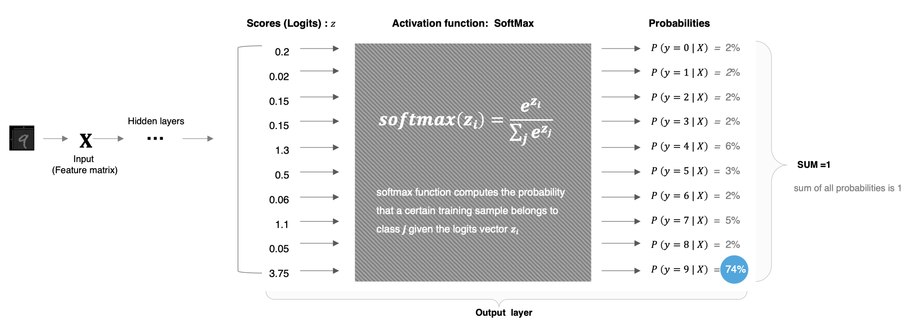

SoftMax 就是将网络输出的 logits 通过 softmax 函数，映射成为 \(0,1\) 的值，而这些值的累和为 1（满足概率的性质），那么我们将它理解成概率，选取概率最大（也就是值对应最大的）节点，作为我们的预测目标类别。

在 PyTorch 中使用 SoftMax 函数的示例代码如下:

```python
*# 导包*
import torch

*# 1. 定义张量, 记录: 分类数据.*
scores1 = torch.tensor([0.2, 0.02, 0.15, 0.15, 1.3, 0.5, 0.06, 1.1, 0.05, 3.75])

*# 2. dim = 0, 按行计算*
probabilities1 = torch.softmax(scores1, dim=0)
print(probabilities1)

*# 演示二维张量 dim 的计算方式*
scores2 = torch.tensor([[0.2, 0.35, 0.1, 0.46], [0.1, 0.13, 0.05, 2.79]])
*# dim=1 在列上计算，对于二维张量，也就是把每一行（横向）的数据分别做 Softmax。*
probabilities2 = torch.softmax(scores2, dim=1)  
print(probabilities2)

scores3 = torch.tensor([[0.2, 0.35, 0.1, 0.46], [0.1, 0.13, 0.05, 2.79]])
*# dim=0 在行上计算，对于二维张量，也就是把每一列（纵向）的数据分别做 Softmax。*
probabilities3 = torch.softmax(scores3, dim=0)  
print(probabilities3)

'''
如何理解 dim：

在 PyTorch（以及 NumPy）中，理解 dim 最好的方法是看它“消融/归一化”了哪个维度：
dim=0：**沿着**第 0 维（行）的方向操作，所以结果是竖着加起来等于 1。（常用于对比不同样本在同一特征上的分布）
dim=1：**沿着**第 1 维（列）的方向操作，所以结果是横着加起来等于 1。（常用于多分类任务，一张图片/一个样本对应多个类别，是标准用法）

如果是图像分类任务（比如 [batch_size, num_classes]），永远使用 dim=1，因为我们要让每个样本
在所有类别上的概率之和为 1。
'''
```

程序输出结果:

```python
tensor([0.0212, 0.0177, 0.0202, 0.0202, 0.0638, 0.0287, 0.0185, 0.0522, 0.0183,
        0.7392])
tensor([[0.2292, 0.2663, 0.2074, 0.2972],
        [0.0565, 0.0582, 0.0537, 0.8317]])
tensor([[0.5250, 0.5548, 0.5125, 0.0887],
        [0.4750, 0.4452, 0.4875, 0.9113]])
```

#### 如何选择激活函数

除了上述的激活函数，还存在很多其他的激活函数，如下图所示:

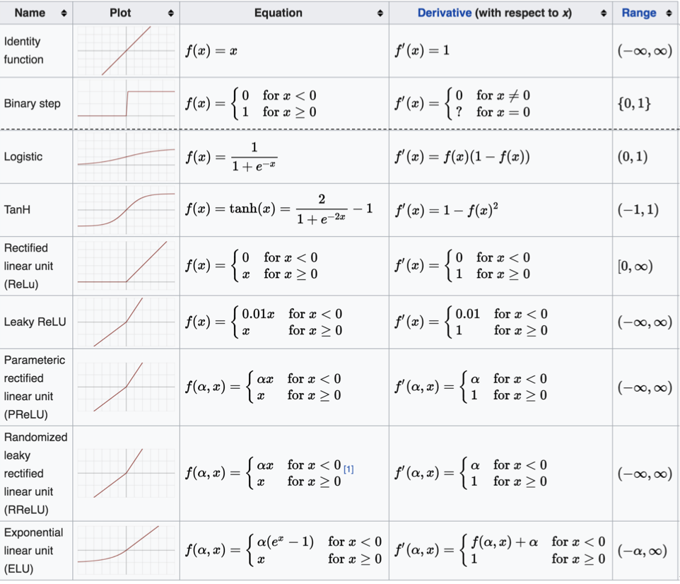

对于 **隐藏层**:

1. 优先选择 ReLU 激活函数。

2. 如果 ReLu 效果不好，那么尝试其他激活，如 Leaky ReLu 等。

3. 如果你使用了 ReLU， 需要注意一下 Dead ReLU 问题，避免出现 0 梯度从而导致过多的神经元死亡。

4. 少使用 sigmoid 激活函数，可以尝试使用 tanh 激活函数。

对于 **输出层**:

1. 二分类问题选择 sigmoid 激活函数。

2. 多分类问题选择 softmax 激活函数。

3. 回归问题选择 identity 激活函数。（神经网络很少处理回归问题，基本都是处理分类问题）


### 参数初始化

> chapter02\_Artifical\_Neural\_Network/05\_参数初始化介绍\.py
> 
> 

我们在构建网络之后，网络中的参数是需要初始化的。我们需要初始化的参数主要有**权重**和**偏置**，**偏置一般初始化为 0 即可**，而对权重的初始化则会更加重要。

参数初始化的作用：

- **防止梯度消失或爆炸**：初始权重值过大或过小会导致梯度在反向传播中指数级增大或缩小。

- **提高收敛速度**：合理的初始化使得网络的激活值分布适中，有助于梯度高效更新。

- **保持对称性破除**：权重的初始化需要打破对称性，否则网络的学习能力会受到限制。

> “对称性”（Symmetry）是指同一层中的不同神经元（或节点）拥有了完全相同的初始参数（权重和偏置）。相当于这一层即便有再多的神经元，也和只有一个神经元效果一样。
> 
> 

#### 常见参数初始化方法

1. **随机初始化 **

    - 均匀分布初始化 `nn.init.uniforn_()`：权重参数初始化从区间均匀随机取值，默认区间为（0，1）。可以设置为在$(-\frac{1}{\sqrt{d}},  \frac{1}{\sqrt{d}})$ 均匀分布中生成当前神经元的权重，其中 d 为当前层的上一层神经元的输入数量。

    - 正态分布初始化 `nn.init.normal_()`：随机初始化从均值为 0，标准差是 1 的高斯分布中取样，使用一些很小的值对参数 W 进行初始化。

        - 优点：能有效打破对称性。

        - 缺点：随机选择范围不当可能导致梯度问题。

        - 适用场景：浅层网络或低复杂度模型。隐藏层 1\-3 层，总层数不超过 5 层。

2. **全 0 初始化 **`nn.init.zeros_()`：将神经网络中的所有权重参数初始化为 0。

    - 优点：实现简单。

    - 缺点：无法打破对称性，所有神经元更新方向相同，无法有效训练。

    - 适用场景：几乎不使用，**仅用于偏置项的初始化**。

3. **全 1 初始化 **`nn.init.ones_()`：将神经网络中的所有权重参数初始化为 1。

    - 优点：实现简单。

    - 缺点

        - 无法打破对称性，所有神经元更新方向相同，无法有效训练。

        - 会导致激活值在网络中呈指数增长，容易出现梯度爆炸。

    - 适用场景

        - 测试或调试：比如验证神经网络是否能正常前向传播和反向传播。

        - 特殊模型结构：某些稀疏网络或特定的自定义网络中可能需要手动设置部分参数为 1。

        - 偏置初始化：偶尔可以将偏置初始化为小的正值（如 0\.1），但很少用 1 作为偏置的初始值。

4. **固定值初始化 **`nn.init.constant_()`：将神经网络中的所有权重参数初始化为某个固定值。

    - 优点：实现简单。

    - 缺点

        - 无法打破对称性，所有神经元更新方向相同，无法有效训练。

        - 初始权重过大或过小可能导致梯度爆炸或梯度消失。

    - 适用场景

        - 测试或调试。

5. **Kaiming 初始化**，也叫做 **He 初始化**：**专为 ReLU 和其变体设计**，考虑到 ReLU 激活函数的特性，对输入维度进行缩放。

    - HE 初始化分为正态分布的 HE 初始化、均匀分布的 HE 初始化。

        - 正态分布的 he 初始化  `nn.init.kaiming_normal_()`

            - w 权重值从均值为 0, 标准差为 std 中随机采样，std = sqrt \(2 / fan\_in\)

            - std 值越大，w 权重值离均值 0 分布相对较广，计算得到的内部状态值有较大的正值或负值

        - 均匀分布的 he 初始化 `nn.init.kaiming_uniform_()`

            - 它从\[\- limit，limit\] 中的均匀分布中抽取样本, limit 是 sqrt \(6 / fan\_in\)

        - `fan_in` 是输入神经元的个数，**当前层**接受的**来自上一层**的神经元的数量。简单来说，就是当前层接收多少个输入。

    - 优点：适合 ReLU，能保持梯度稳定。

    - 缺点：对非 ReLU 激活函数效果一般。

    - 适用场景：深度网络\(10 层及以上\)，使用 ReLU、Leaky ReLU 激活函数。

6. **Xavier 初始化**，也叫做 **Glorot 初始化**：根据网络输入和输出的维度自动选择权重范围，使输入和输出的方差相同

    - xavier 初始化分为正态分布的 xavier 初始化、均匀分布的 xavier 初始化

        - 正态化的 Xavier 初始化 `nn.init.xavier_normal_()`

            - w 权重值从均值为 0, 标准差为 std 中随机采样，std = sqrt \(2 / \(fan\_in \+ fan\_out\)\)

            - std 值越小，w 权重值离均值 0 分布相对集中，计算得到的内部状态值有较小的正值或负值。

        - 均匀分布的 Xavier 初始化 `nn.init.xavier_uniform_()`

            - \[\- limit，limit\] 中的均匀分布中抽取样本, limit 是 sqrt \(6 / \(fan\_in \+ fan\_out\)\)

        - `fan_in` 是输入神经元个数，**当前层**接受的**来自上一层**的神经元的数量。简单来说，就是当前层接收多少个输入。

        - `fan_out` 是输出神经元个数，**当前层**输出的神经元的数量，也就是当前层会传递给**下一层**的神经元的数量。简单来说，就是当前层会产生多少个输出。

    - 优点：适用于 Sigmoid、Tanh 等激活函数，解决梯度消失问题。

    - 缺点：对 ReLU 等激活函数表现欠佳。

    - 适用场景：深度网络\(10 层及以上\)，使用 Sigmoid 或 Tanh 激活函数。

```python
import torch.nn as nn

## 1. 均匀分布随机初始化
def test01():
    linear = nn.Linear(5, 3)
    # 从0-1均匀分布产生参数
    nn.init.uniform_(linear.weight)
    nn.init.uniform_(linear.bias)
    print(linear.weight.data)
    print(linear.bias.data)
    
## 2. 固定初始化
def test02():
    linear = nn.Linear(5, 3)
    nn.init.constant_(linear.weight, 5)    # 设置固定值为 5 
    print(linear.weight.data)

## 3. 全0初始化
def test03():
    linear = nn.Linear(5, 3)
    nn.init.zeros_(linear.weight)
    print(linear.weight.data)

## 4. 全1初始化
def test04():
    linear = nn.Linear(5, 3)
    nn.init.ones_(linear.weight)
    print(linear.weight.data)

## 5. 正态分布随机初始化
def test05():
    linear = nn.Linear(5, 3)
    nn.init.normal_(linear.weight, mean=0, std=1)
    print(linear.weight.data)

## 6. kaiming 初始化
def test06():
    # kaiming 正态分布初始化
    linear = nn.Linear(5, 3)
    nn.init.kaiming_normal_(linear.weight, nonlinearity='relu')
    print(linear.weight.data)
    # kaiming 均匀分布初始化
    linear = nn.Linear(5, 3)
    nn.init.kaiming_uniform_(linear.weight, nonlinearity='relu')
    print(linear.weight.data)

## 7. xavier 初始化
def test07():
    # xavier 正态分布初始化
    linear = nn.Linear(5, 3)
    nn.init.xavier_normal_(linear.weight)
    print(linear.weight.data)
    # xavier 均匀分布初始化
    linear = nn.Linear(5, 3)
    nn.init.xavier_uniform_(linear.weight)
    print(linear.weight.data)
```

#### 如何选择参数初始化

- 激活函数的选择：根据激活函数的类型选择对应的初始化方法

    - **Sigmoid/Tanh**：xavier 初始化

    - **ReLU/Leaky ReLU**：kaiming 初始化

- 神经网络模型的深度

    - 浅层网络：随机初始化即可。

    - 深层网络：需要考虑方差平衡，如 xavier 或 kaiming 初始化。


### 神经网络搭建和参数计算

> chapter02\_Artifical\_Neural\_Network/06\_神经网络搭建\.py
> 
> 

> 深度学习案例的 4 个步骤:
>     1\. 准备数据
>     2\. 搭建神经网络
>     3\. 模型训练
>     4\. 模型测试
> 
> 神经网络搭建流程:
>     1\. 定义一个类, 继承 nn\.Module\.
>     2\. 在 init\(\) 方法中, 搭建神经网络\.（首先要初始化父类成员`super().__init__()`）
>     3\. 在 forward\(\) 方法中, 完成 前向传播\.
> 
> 

#### 构建神经网络

在 pytorch 中定义深度神经网络其实就是层堆叠的过程，继承自`nn.Module`，实现两个方法：

- `__init__`方法中定义网络中的层结构，主要是全连接层，并进行初始化。

- `forward`方法，在调用神经网络模型对象的时候，**底层会自动调用该函数**。该函数中为初始化定义的 layer 传入数据，进行前向传播等。

接下来我们来构建如下图所示的神经网络模型（\+1 表示偏置，不算神经元）：

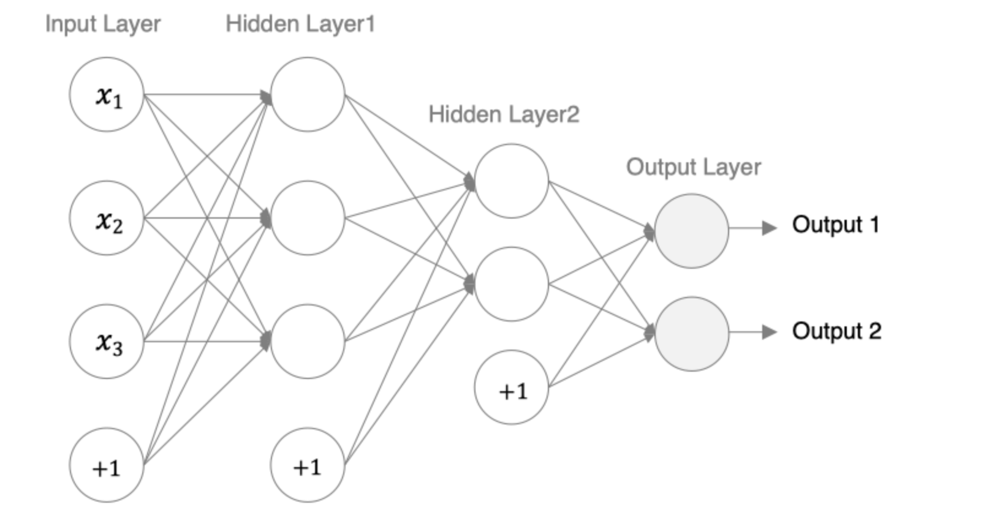

**编码设计如下：**

- 第 1 个隐藏层：权重初始化采用标准化（指正态分布）的 xavier 初始化 激活函数使用 sigmoid

- 第 2 个隐藏层：权重初始化采用标准化的 He 初始化 激活函数采用 relu

- out 输出层线性层：假若多分类，采用 softmax 做数据归一化

**构造神经网络模型代码：**

```python
import torch
import torch.nn as nn
from torchsummary import summary  # 计算模型参数,查看模型结构, 
# pip install torchsummary -i https://mirrors.aliyun.com/pypi/simple/


## 创建神经网络模型类, *即: 自定义继承 nn.Module*
class ModelDemo(nn.Module):
    # 初始化属性值
    def __init__(self):
        # 调用父类的初始化属性值，确保nn.Module的初始化代码能够正确执行
        # super(ModelDemo, self).__init__()
        super().__init__()    # 推荐写法
        # 创建第一个隐藏层模型, 3个输入特征,3个输出特征
        self.linear1 = nn.Linear(3, 3)
        # 初始化权重
        nn.init.xavier_normal_(self.linear1.weight)
        nn.init.zeros_(self.linear1.bias)
        # 创建第二个隐藏层模型, 3个输入特征(上一层的输出特征),2个输出特征
        self.linear2 = nn.Linear(3, 2)
        # 初始化权重
        nn.init.kaiming_normal_(self.linear2.weight, nonlinearity='relu')
        nn.init.zeros_(self.linear2.bias)
        # 创建输出层模型
        self.out = nn.Linear(2, 2)

    ## 创建前向传播方法, 调用神经网络模型对象时自动执行forward()方法
    def forward(self, x):
        ## 分解版写法
        # # 数据经过第一个线性层
        # x = self.linear1(x)    *# 加权求和*
        # # 使用sigmoid激活函数
        # x = torch.sigmoid(x)   # 激活函数
        
        *## 合并版写法*
        x = torch.sigmoid(self.linear1(x))

        # 数据经过第二个线性层
        x = self.linear2(x)
        # 使用relu激活函数
        x = torch.relu(x)

        # 数据经过输出层
        x = self.out(x)
        # 使用softmax激活函数
        # dim=-1:每一维度行数据相加为1
        x = torch.softmax(x, dim=-1)

        return x
```

**训练神经网络模型代码:**

```python
## 创建构造模型函数
def train():
    # 实例化model对象
    my_model = ModelDemo()

    # 随机产生数据
    my_data = torch.randn(5, 3)
    print("my_data-->", my_data)
    print("my_data shape", my_data.shape)

    # 数据经过神经网络模型训练
    output = my_model(my_data)    *# 底层自动调用了 forward() 方法, 进行 前向传播*
    print("output-->", output)
    print("output shape-->", output.shape)

    # 计算模型参数
    # 计算每层每个神经元的w和b个数总和
    print("======计算模型参数======")
    summary(my_model, input_size=(3,), batch_size=5)

    # 查看模型参数
    print("======查看模型参数w和b======")
    for name, parameter in my_model.named_parameters():
        print(name, parameter)


if __name__ == '__main__':
    train()
```

#### 观察数据形状变化

- 观察程序输入和输出的数据形状变化

    - 输入 5 行数据，输出也是 5 行数据

    - 输入 5 行数据 3 个特征，经过第一个隐藏层是 3 个特征，经过第二个隐藏层是 2 个特征，经过输出层是 2个特征

    - 模型最终预测结果是：5 行 2 列数据

    ```python
    mydata.shape---> torch.Size([5, 3])
    output.shape---> torch.Size([5, 2])
    mydata--->
      tensor([[-0.3714, -0.8578, -1.6988],
            [ 0.3149,  0.0142, -1.0432],
            [ 0.5374, -0.1479, -2.0006],
            [ 0.4327, -0.3214,  1.0928],
            [ 2.2156, -1.1640,  1.0289]])
    output--->
     tensor([[0.5095, 0.4905],
            [0.5218, 0.4782],
            [0.5419, 0.4581],
            [0.5163, 0.4837],
            [0.6030, 0.3970]], grad_fn=<SoftmaxBackward>)
    ```

#### 模型参数计算

- 以第一个隐层为例：该隐层有 3 个神经元，每个神经元的参数为：4个（w1,w2,w3,b1），所以一共用3x4=12个参数。

- 输入数据和网络权重是两个不同的事儿！对于初学者理解这一点十分重要，要分得清。

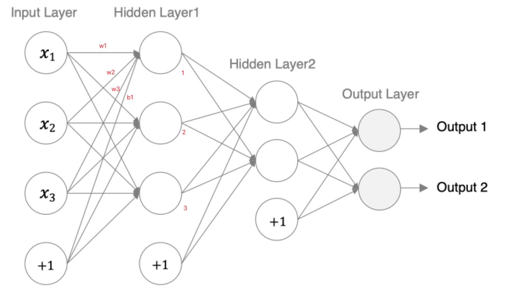

```python
----------------------------------------------------------------
        Layer (type)               Output Shape         Param #
================================================================
            Linear-1                     [5, 3]              12
            Linear-2                     [5, 2]               8
            Linear-3                     [5, 2]               6
================================================================
Total params: 26
Trainable params: 26
Non-trainable params: 0
----------------------------------------------------------------
Input size (MB): 0.00
Forward/backward pass size (MB): 0.00
Params size (MB): 0.00
Estimated Total Size (MB): 0.00
----------------------------------------------------------------
```

#### 查看模型参数

- 通常继承 nn\.Module，撰写自己的网络层。它强大的封装不需要我们定义可学习的参数（比如卷积核的权重和偏置参数）。

- 如何才能查看封装好的、可学习的网络参数？

    - `模块实例名.name_parameters()`，会分别返回 name 和 parameter。

```python
## 实例化model对象
my_model = ModelDemo()

## 查看网络参数
for name, parameter in my_model.named_parameters():
    # print('name--->', name)
    # print('parameter--->', parameter)
    print(name, parameter)
```

```python
linear1.weight Parameter containing:
tensor([[ 0.1715, -0.3711,  0.1692],
        [-0.2497, -0.6156, -0.4235],
        [-0.7090, -0.0380,  0.4790]], requires_grad=True)
linear1.bias Parameter containing:
tensor([-0.2320,  0.3431,  0.2771], requires_grad=True)
linear2.weight Parameter containing:
tensor([[-0.5044, -0.7435, -0.6736],
        [ 0.6908, -0.1466, -0.0019]], requires_grad=True)
linear2.bias Parameter containing:
tensor([0.2340, 0.4730], requires_grad=True)
out.weight Parameter containing:
tensor([[ 0.5185,  0.4019],
        [-0.4313, -0.3438]], requires_grad=True)
out.bias Parameter containing:
tensor([ 0.4521, -0.6339], requires_grad=True)
```


## 损失函数

### 损失函数概念

在深度学习中，损失函数是用来**衡量模型参数质量的函数，**衡量的方式**是比较网络输出（预测值）和真实输出（真实值）的差异。**

模型通过最小化损失函数的值来调整参数，使其输出更接近真实值。

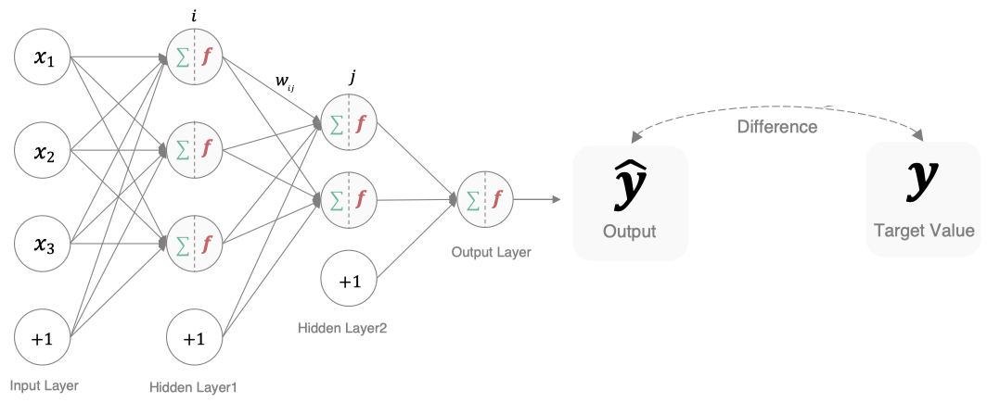

损失函数在不同的文献中名称是不一样的，主要有以下几种命名方式：

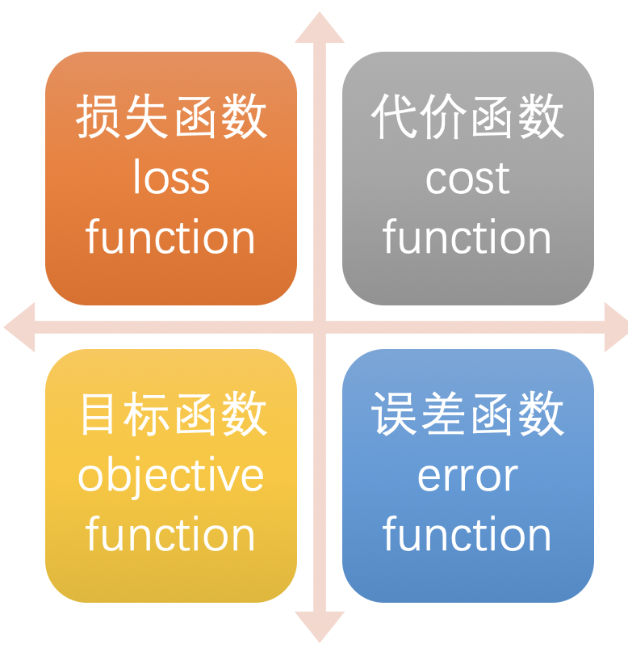

**损失函数作用：**

- **评估性能**：反映模型预测结果与目标值的匹配程度。

- **指导优化**：通过梯度下降等算法最小化损失函数，优化模型参数。


### 分类任务损失函数

在深度学习的**分类任务**中使用最多的是**交叉熵损失函数**，所以着重介绍这种损失函数。

#### 多分类任务交叉熵损失函数

> chapter02\_Artifical\_Neural\_Network/07\_多分类任务交叉熵损失函数\.py
> 
> 

在多分类任务通常使用 softmax 将 logits 转换为概率的形式，所以多分类的交叉熵损失也叫做 **softmax损失**，它的计算方法是：

$\mathcal{L} = -\sum_{i=1}^{n} \mathbf{y}_i \log(S(f_\theta(\mathbf{x}_i)))$

其中:

- $\mathbf{y}_i$是第$i$个样本的真实标签。通常是独热编码（One\-hot encoding）。

- $f(\mathbf{x}_i)$是样本$\mathbf{x}_i$属于某一类别的预测分数（加权求和的结果）。

- S 是 softmax 激活函数，将属于某一类别的预测分数转换成概率 。

- L 用来衡量真实值$y$和预测值$f(x)$之间差异性的损失结果 。

例子：

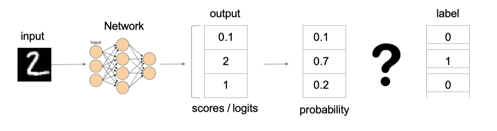

上图中的交叉熵损失为：

$- (0 \log(0.10) + 1 \log(0.7) + 0 \log(0.2)) = -\log 0.7$

从概率角度理解，我们的目的是最小化正确类别所对应的预测概率的对数的负值（损失值最小）。

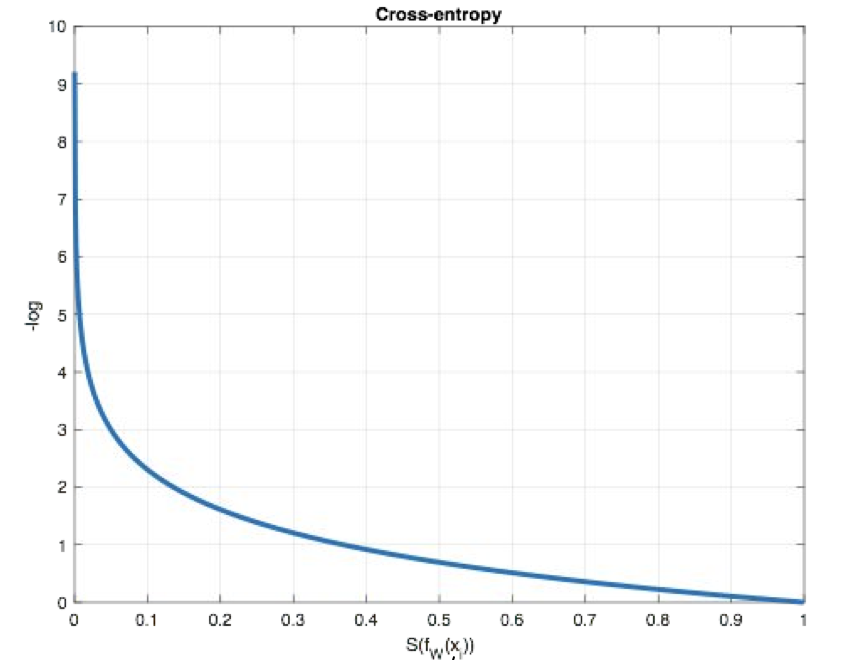

在 PyTorch 中使用`nn.CrossEntropyLoss()`实现，如下所示：

> CrossEntropyLoss = Softmax\(\) \+ 损失计算，后续如果用这个损失函数，则：输出层就不用额外调用 softmax\(\)激活函数了。
> 
> 

```python
import torch
from torch import nn


## 分类损失函数：交叉熵损失使用nn.CrossEntropyLoss()实现。nn.CrossEntropyLoss()=softmax+损失计算
def test01():
        ## 设置真实值: 可以是热编码后的结果也可以不进行热编码
        ## y_true = torch.tensor([[0, 1, 0], [0, 0, 1]], dtype=torch.float32)
        ## 注意：类型必须是64位整型数据，pytorch默认整数数据类型就为int64
        y_true = torch.tensor([1, 2], dtype=torch.int64)
        y_pred = torch.tensor([[0.2, 0.6, 0.2], [0.1, 0.8, 0.1]], requires_grad=True, dtype=torch.float32)
        ## 实例化交叉熵损失，默认reduction='mean'，求平均损失
        ## reduction='sum'：总损失
        loss = nn.CrossEntropyLoss()
        ## 计算损失结果
        my_loss = loss(y_pred, y_true).detach().numpy()
        print('loss:', my_loss)
```

#### 二分类任务交叉熵损失函数

> chapter02\_Artifical\_Neural\_Network/08\_二分类任务损失函数\.py
> 
> 

在处理二分类任务时，我们不再使用 softmax 激活函数，而是使用 sigmoid 激活函数，那损失函数也相应的进行调整，使用二分类的交叉熵损失函数：

$\mathcal{L} = -\frac{1}{n} \sum_{i=1}^{n} \left[ y_i \log(\hat{y}_i) + (1 - y_i) \log(1 - \hat{y}_i) \right]$

其中:

- $y_i$: 第 $i$个样本的真实标签。在二分类中，$y_i \in \{0, 1\}$（0 代表负类，1 代表正类）。

- $\hat{y}_i$: 模型预测第 $i$个样本为**正类**的概率。它通常是模型输出经过 Sigmoid 函数处理后的结果，取值范围在 $(0, 1)$ 之间。（所以二分类任务需要在输出层调用 sigmoid 激活函数）

- L 用来衡量真实值$y$与预测值$\hat{y}$之间差异性的损失结果。

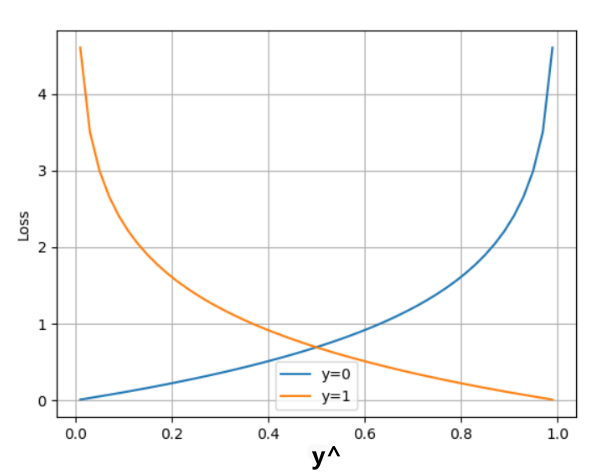

在 PyTorch 中实现时使用`nn.BCELoss()`实现，如下所示：

```python
import torch
from torch import nn


def test02():
    # 1 设置真实值和预测值
    y_true = torch.tensor([0, 1, 0], dtype=torch.float32)
    # 预测值是sigmoid输出的结果
    y_pred = torch.tensor([0.6901, 0.5459, 0.2469], requires_grad=True)
    # 2 实例化二分类交叉熵损失
    loss = nn.BCELoss()
    # 3 计算损失
    my_loss = loss(y_pred, y_true).detach().numpy()
    print('loss：', my_loss)
```


### 回归任务损失函数

> chapter02\_Artifical\_Neural\_Network/09\_回归任务\_损失函数介绍\.py
> 
> 

#### MAE 损失函数

**Mean Absolute Loss\(MAE\) **也被称为 L1 Loss，是以绝对误差作为距离。

损失函数公式:

$\mathcal{L} = \frac{1}{n} \sum_{i=1}^{n} \left| y_i - f_\theta(x_i) \right|$

曲线如下图所示：

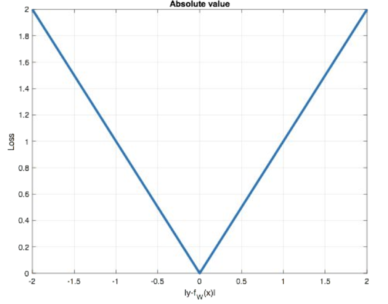

特点是：

- 由于 L1 loss 具有稀疏性，为了惩罚较大的值，因此常常将其作为正则项添加到其他 loss 中作为约束。\(0 点不可导，产生稀疏矩阵\)

- L1 loss 的最大问题是梯度在零点不平滑，导致可能会跳过极小值。

- 适用于回归问题中存在异常值或噪声数据时，可以减少对离群点的敏感性。

在 PyTorch 中使用`nn.L1Loss()`实现，如下所示：

```python
import torch
from torch import nn


## 计算inputs与target之差的绝对值
def test03():
    # 1 设置真实值和预测值
    y_pred = torch.tensor([1.0, 1.0, 1.9], requires_grad=True)
    y_true = torch.tensor([2.0, 2.0, 2.0], dtype=torch.float32)
    # 2 实例MAE损失对象
    loss = nn.L1Loss()
    # 3 计算损失
    my_loss = loss(y_pred, y_true).detach().numpy()
    print('loss:', my_loss)
```

#### MSE 损失函数

**Mean Squared Loss/ Quadratic Loss\(MSE loss\) **也被称为 L2 loss，或欧氏距离，它以误差的平方和的均值作为距离。

损失函数公式：

$\mathcal{L} = \frac{1}{n} \sum_{i=1}^{n} \left( y_i - f_\theta(x_i) \right)^2$

曲线如下图所示：

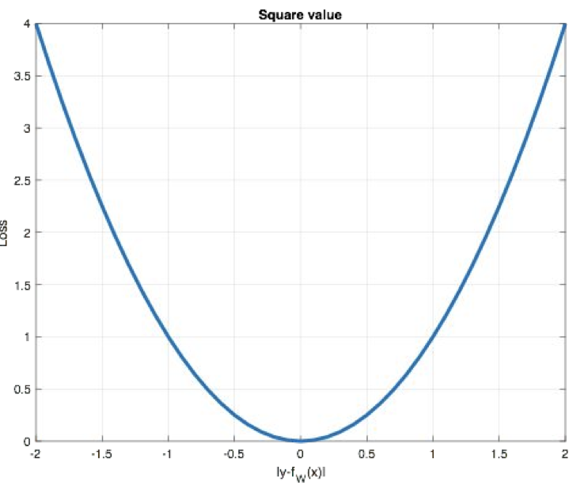

特点是：

- L2 loss 也常常作为正则项，对于离群点（outliers）敏感，因为平方项会放大大误差。

- 当预测值与目标值相差很大时，梯度容易爆炸。

    - 梯度爆炸：网络层之间的梯度（值大于1\.0）重复相乘导致的指数级增长会产生梯度爆炸。

- 适用于大多数标准回归问题，如房价预测、温度预测等。

在 PyTorch 中通过`nn.MSELoss()`实现：

```python
import torch
from torch import nn


def test04():
    # 1 设置真实值和预测值
    y_pred = torch.tensor([1.0, 1.0, 1.9], requires_grad=True)
    y_true = torch.tensor([2.0, 2.0, 2.0], dtype=torch.float32)
    # 2 实例MSE损失对象
    loss = nn.MSELoss()
    # 3 计算损失
    my_loss = loss(y_pred, y_true).detach().numpy()
    print('myloss:', my_loss)
```

#### Smooth L1 损失函数

smooth L1 说的是光滑之后的 L1，是一种结合了均方误差（MSE）和平均绝对误差（MAE）优点的损失函数。它在误差较小时表现得像 MSE，在误差较大时则更像 MAE。

Smooth L1 损失函数如下式所示：

$\text{smooth}_{L_1}(x) = 
\begin{cases} 
0.5x^2 & \text{if } |x| < 1 \\ 
|x| - 0.5 & \text{otherwise} 
\end{cases}$

其中：$x = y - f(x)$为真实值和预测值的差值。

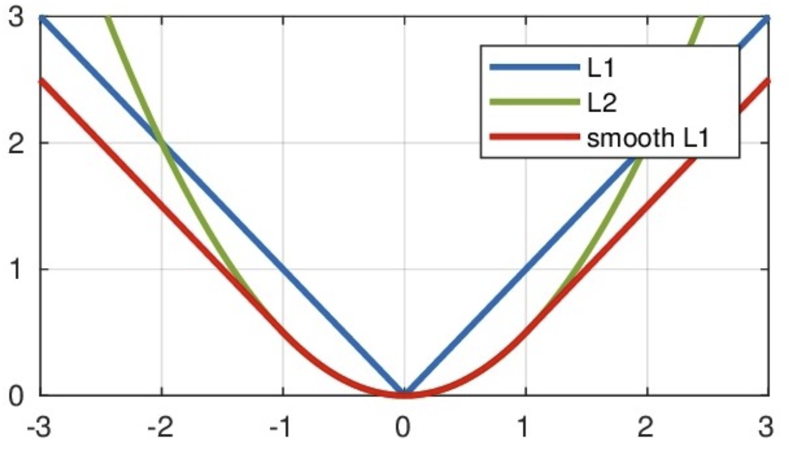

从上图中可以看出，该函数实际上就是一个分段函数：

- 在 \[\-1, 1\] 之间实际上就是 L2 损失，这样解决了 L1 的不光滑问题。

- 在 \[\-1, 1\] 区间外，实际上就是 L1 损失，这样就解决了离群点梯度爆炸的问题。

特点是：

- **对离群点更加鲁棒**：当误差较大时，损失函数会线性增加（而不是像 MSE 那样平方增加），因此它对离群点的惩罚更小，避免了 MSE 对离群点过度敏感的问题。

- **计算梯度时更加平滑**：与 MAE 相比，Smooth L1 在小误差时表现得像 MSE，避免了在训练过程中因使用绝对误差而导致的梯度不连续问题。

在 PyTorch 中使用`nn.SmoothL1Loss()`计算该损失，如下所示：

```python
import torch
from torch import nn


def test05():
    # 1 设置真实值和预测值
    y_true = torch.tensor([0, 3])
    y_pred = torch.tensor([0.6, 0.4], requires_grad=True)
    # 2 实例smmothL1损失对象
    loss = nn.SmoothL1Loss()
    # 3 计算损失
    my_loss = loss(y_pred, y_true).detach().numpy()
    print('loss:', my_loss)
```


## 神经网络优化方法

多层神经网络的学习能力比单层网络强得多。想要训练多层网络，需要更强大的学习算法。误差反向传播算法（Back Propagation）是其中最杰出的代表，它是目前最成功的神经网络学习算法。现实任务使用神经网络时，大多是在使用 BP 算法进行训练，值得指出的是 BP 算法不仅可用于多层前馈神经网络，还可以用于其他类型的神经网络。通常说 BP 网络时，一般是指用 BP 算法训练的多层前馈神经网络。

这就需要了解两个概念：

1. **正向传播**：指的是数据通过网络从输入层到输出层的传递过程。这个过程的目的是计算网络的输出值（预测值），从而与目标值（真实值）比较以计算误差。

2. **反向传播**：指的是计算损失函数相对于网络中各参数（权重和偏置）的梯度，指导优化器更新参数，从而使神经网络的预测更接近目标值。


### 基本梯度下降算法

**梯度下降法**简单来说就是一种**寻找使损失函数最小化的方法**。

从数学角度来看，**梯度的方向是函数增长速度最快的方向，那么梯度的反方向就是函数减少最快的方向**，所以有：

$w_{ij}^{new} = w_{ij}^{old} - \eta \frac{\partial E}{\partial w_{ij}}$

其中，η 是学习率，如果学习率**太小**，那么每次训练之后得到的效果都太小，**增大训练的时间成本**。如果，学习率**太大**，那就有可能**直接跳过最优解**，进入无限的训练中。解决的方法就是，学习率也需要随着训练的进行而变化。

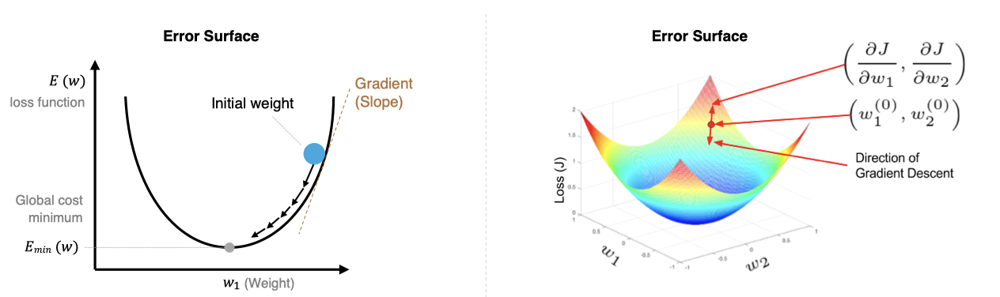

在上图中我们展示了一维和多维的损失函数，损失函数呈碗状。在训练过程中损失函数对权重的偏导数就是损失函数在该位置点的梯度。我们可以看到，沿着负梯度方向移动，就可以到达损失函数底部，从而使损失函数最小化。这种利用损失函数的梯度迭代地寻找最小值的过程就是梯度下降的过程。

**在进行模型训练时，有三个基础的概念：**

1. **Epoch：**使用全部数据对模型进行一次完整训练，训练轮次。

2. **Batch：**使用训练集中的小部分样本对模型权重进行一次反向传播的参数更新，每次训练每批次样本数量。

3. **Iteration：**使用一个 Batch 数据对模型进行一次参数更新的过程，每次训练批次数。

> 每个 batch 对应一个迭代器。
> 
> 

假设数据集有 50000 个训练样本，现在选择 Batch Size = 256 对模型进行训练。
每个 Epoch 要训练的图片数量：50000
训练集具有的 Batch 个数：50000//256\+1=196（是否 \+ 1 取决于是否刚好整除）
每个 Epoch 具有的 Iteration 个数：196
10个 Epoch 具有的 Iteration 个数：1960

在深度学习中，**梯度下降的几种方式的根本区别就在于 Batch Size 不同**，如下表所示：

|梯度下降方式|Training Set Size|Batch Size|Number of Batches|
|---|---|---|---|
|BGD|N|N|1|
|**SGD**|N|1|N|
|Mini\-Batch|N|B|N//B \+ 1|
|SAG|N|1|N|

注：上表中 Mini\-Batch 的 Batch 个数为 N // B \+ 1 是针对未整除的情况。整除情况下则直接是 N // B。两种情况可统一写为 \(N \+ B \- 1\) // B。

> **SGD详解**
> 
> 实际中 SGD 通常是 Mini\-betch SGD，其接受 loss\.backward\(\) 算出来、累积在 param\.grad 里的那个张量（使用默认平均损失，param\.grad 每批次在清零后只更新一次），然后通过 optimizer\.step\(\) 按规则更新。之所以算出来的是平均梯度，是因为 loss 默认计算的是批次平均损失，基于平均损失计算的梯度自然是批次样本的平均梯度。
> 
> PyTorch 中的 SGD 优化器默认执行的就是 Mini\-batch SGD，因为它的行为完全由传入的数据批次决定。torch\.optim\.SGD 本身只是一个“参数更新规则”，它只负责根据你计算好的梯度来更新参数，并不关心这个梯度是来自 1 个样本、64 个样本还是整个数据集。
> 
> DataLoader 的 batch\_size 才决定算法类型：
> 
> - batch\_size = 1 且 shuffle=True → 纯SGD（随机梯度下降）。
> 
> - 1 \< batch\_size \< 数据集大小 且 torch\.nn\.xxxLoss 保持默认的 reduction='mean' → Mini\-batch SGD（最常用）。
> 
> - batch\_size = 数据集大小 → 批量梯度下降（BGD） 。
> 
> 

> 标准训练中，\.zero\_grad\(\) 之后每个 batch 只 \.backward\(\) 一次、\.step\(\) 一次，param\.grad 就是该 batch 的平均梯度，每个批次更新只发生一次。
> 
> ```Python
> for x, y in dataloader:              # 每个 batch
>     optimizer.zero_grad()            # ① param.grad ← 0（清零）
>     loss = criterion(model(x), y)    # ② loss = (1/B)ΣL_i（平均标量）
>     loss.backward()                  # ③ param.grad ← 0 + (1/B)Σ∇L_i（只累加这一次）
>     optimizer.step()                 # ④ 用 param.grad 更新一次参数
> # dataloader、criterion、optimizer 均在前面构建
> # 详细完整流程见：神经网络基础/手机价格分类案列/网络性能优化 (完整标准流程)
> ```
> 
> 

> **针对 SAG 行的补充说明：**
> 
> 虽然从表格的维度（单次输入的样本量）来看，**SAG 的 Batch Size 也是 1**，批次数也是 N，但它和表中的 SGD 有本质的区别：
> 
> 1. **计算方向不同**：SGD 直接用这 1 个样本的梯度更新；而 SAG 是计算这 1 个样本的新梯度，并替换掉它之前存下的 “旧梯度记忆” ，然后用**所有 N 个样本记忆中的梯度的平均值**来更新参数。
> 
> 2. **内存开销不同**：表中的 BGD、SGD、Mini\-Batch 内存开销主要由模型参数决定；而 **SAG 需要额外维护一个大小为 N × 参数维度 的矩阵**来存储历史梯度，这是它最大的局限。
> 
> 


### 反向传播（BP算法）

利用**反向传播算法**对神经网络进行训练。该方法与**梯度下降算法**相结合，对网络中所有权重**计算损失函数的梯度**，并利用梯度值来**更新权值**以最小化损失函数。

#### 反向传播概念

**前向传播**：指的是数据输入到神经网络中，逐层向前传输，一直运算到输出层为止。

**反向传播（Back Propagation）**：利用损失函数 ERROR 值，从后往前，结合梯度下降算法，依次求各个参数的偏导，并进行参数更新。

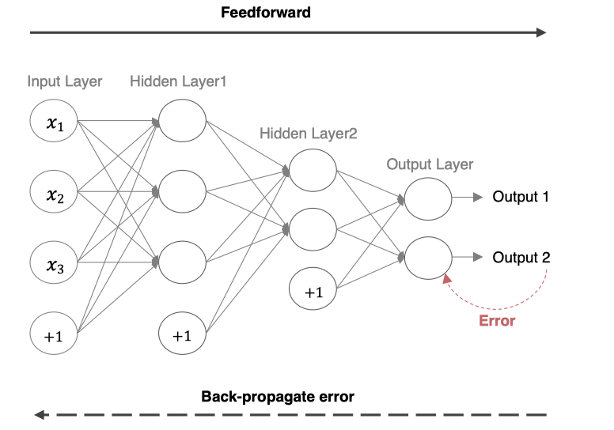

在网络的训练过程中经过前向传播后得到的最终结果跟训练样本的真实值总是存在一定误差，这个误差便是损失函数 ERROR。想要减小这个误差，**就用损失函数 ERROR，从后往前，依次求各个参数的偏导，这就是反向传播（Back Propagation）**。

#### 反向传播详解

**反向传播算法利用链式法则对神经网络中的各个节点的权重进行更新**。

【举个栗子🌰：】

如下图是一个简单的神经网络用来举例：**激活函数为 sigmoid**

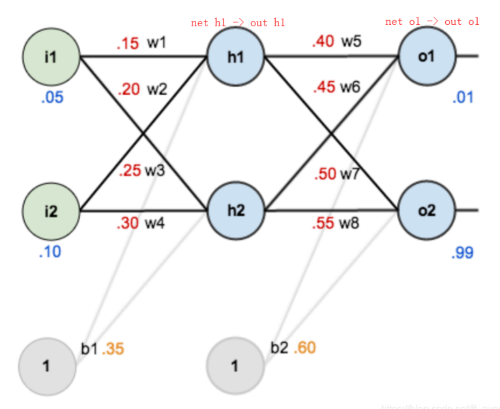

**前向传播运算**：

$\begin{aligned}
net_{h1} &= w_1 * i_1 + w_2 * i_2 + b_1 * 1 \\
 &= 0.15 * 0.05 + 0.2 * 0.1 + 0.35 * 1 = 0.3775 \\
out_{h1} &= \frac{1}{1+e^{-net_{h1}}} = \frac{1}{1+e^{-0.3775}} = 0.593269992 \\
out_{h2} &= 0.596884378 \\
\\[0.1pt]
net_{o1} &= w_5 * out_{h1} + w_6 * out_{h2} + b_2 * 1 \\
 &= 0.4 * 0.593269992 + 0.45 * 0.596884378 + 0.6 * 1 = 1.105905967 \\
out_{o1} &= \frac{1}{1+e^{-net_{o1}}} = \frac{1}{1+e^{-1.105905967}} = 0.75136507 \\
out_{o2} &= 0.772928465 \\
\\[0.5ex]
E_{total} &= \frac{1}{2}\sum (target - output)^2 =  \sum \frac{1}{2}(target - output)^2 \\
& = \frac{1}{2}(0.01 - out_{o_1})^2 + \frac{1}{2}(0.99 - out_{0_2})^2\\
 &= E_{o1} + E_{o2} = 0.274811083 + 0.023560026 = 0.298371109
\end{aligned}$

**注：这里的**$\color{red}\frac{1}{2}$**是为了方便与后面平分求导时得到的 2 相抵消。**

接下来是**反向传播**（求网络误差对各个权重参数的梯度）：

我们先来求最简单的，求误差 E 对$w_5$的导数。首先明确这是一个**链式法则**的求导过程，要求误差 E 对$w_5$的导数，需要先求误差 E 对$out_{o1}$的导数，再求$out_{o1}$对$net_{o1}$的导数，最后再求$net_{o1}$对$w_5$的导数，经过这个**链式法则**，我们就可以求出误差 E 对$w_5$的导数（偏导），如下图所示：

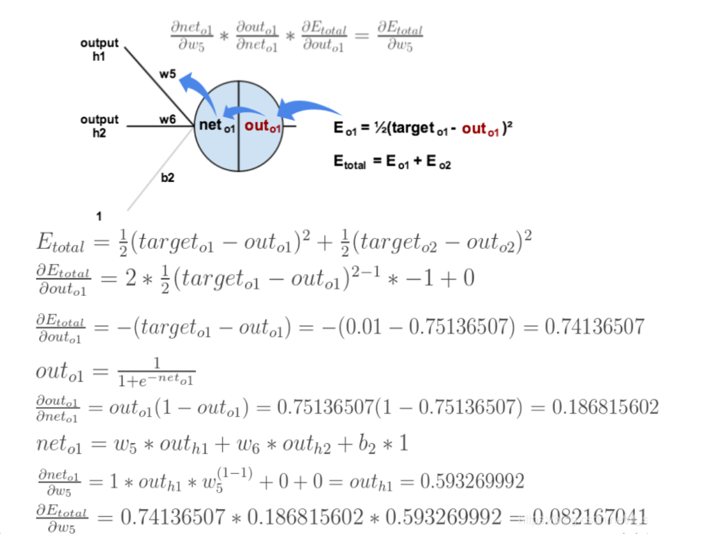

$\begin{aligned}
E_{total} &= \frac{1}{2}(target_{o1} - out_{o1})^2 + \frac{1}{2}(target_{o2} - out_{o2})^2 \\[1ex]
\frac{\partial E_{total}}{\partial out_{o1}} &= 2 * \frac{1}{2}(target_{o1} - out_{o1})^{2-1} * -1 + 0 \\[2ex]
\ &= -(target_{o1} - out_{o1}) = -(0.01 - 0.75136507) = 0.74136507 \\[1ex]

out_{o1} &= \frac{1}{1+e^{-net_{o1}}} \\[1ex]
\frac{\partial out_{o1}}{\partial net_{o1}} &= out_{o1}(1 - out_{o1}) \\
&= 0.75136507(1 - 0.75136507) = 0.186815602 \\[1ex]
net_{o1} &= w_5 * out_{h1} + w_6 * out_{h2} + b_2 * 1 \\[1ex]
\frac{\partial net_{o1}}{\partial w_5} &= out_{h1} + 0 + 0 = out_{h1} \\&= 0.593269992 \\[1ex]
\frac{\partial E_{total}}{\partial w_5} &= \frac{\partial E_{total}}{\partial out_{o1}}  * \frac{\partial out_{o1}}{\partial net_{o1}} * \frac{\partial net_{o1}}{\partial w_5} \\ 
&= 0.74136507 * 0.186815602 * 0.593269992 = 0.082167041
\end{aligned}$

导数（梯度）已经计算出来了，下面就是**反向传播与参数更新过程**：

$\begin{aligned}\frac{\partial E_{total}}{\partial w_5} &= -(target_{o1} - out_{o1}) * out_{o1}(1 - out_{o1}) * out_{h1} \\[2ex]w_5^+ &= w_5 - \eta * \frac{\partial E_{total}}{\partial w_5} = 0.4 - 0.5 * 0.082167041 = 0.35891648 \\[2ex]w_6^+ &= 0.408666186 \\[2ex]w_7^+ &= 0.511301270 \\[2ex]w_8^+ &= 0.561370121\end{aligned}$

如果要想求**误差 E 对 w1 的导数**，**误差 E 对 w1 的求导路径不止一条**，这会稍微复杂一点，但换汤不换药，计算过程如下所示：

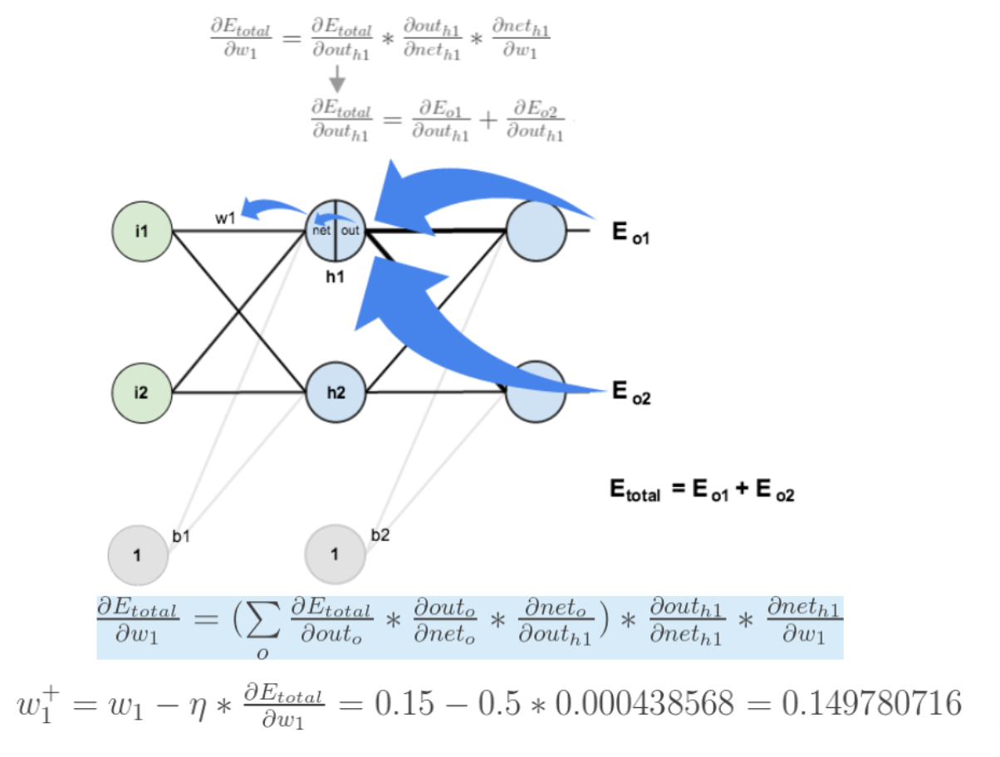

$\begin{aligned}\frac{\partial E_{total}}{\partial w_1} &= \left( \sum_o \frac{\partial E_{total}}{\partial out_o} * \frac{\partial out_o}{\partial net_o} * \frac{\partial net_o}{\partial out_{h1}} \right) * \frac{\partial out_{h1}}{\partial net_{h1}} * \frac{\partial net_{h1}}{\partial w_1} \\[2ex]w_1^+ &= w_1 - \eta * \frac{\partial E_{total}}{\partial w_1} = 0.15 - 0.5 * 0.000438568 = 0.149780716\end{aligned}$

详细地有：

$\begin{aligned}\frac{\partial E_{total}}{\partial w_1} &= \left( \sum_o \frac{\partial E_{total}}{\partial out_o} * \frac{\partial out_o}{\partial net_o} * \frac{\partial net_o}{\partial out_{h1}} \right) * \frac{\partial out_{h1}}{\partial net_{h1}} * \frac{\partial net_{h1}}{\partial w_1} \\

 &= \left[ \left( \frac{\partial (E_{o1}+E_{o2})}{\partial out_{o1}} \cdot \frac{\partial out_{o1}}{\partial net_{o1}} \cdot \frac{\partial net_{o1}}{\partial out_{h1}} \right) + \left( \frac{\partial (E_{o1}+E_{o2})}{\partial out_{o2}} \cdot \frac{\partial out_{o2}}{\partial net_{o2}} \cdot \frac{\partial net_{o2}}{\partial out_{h1}} \right) \right] \cdot \frac{\partial out_{h1}}{\partial net_{h1}} \cdot \frac{\partial net_{h1}}{\partial w_1} \\

&=\left[ \left( \frac{\partial E_{o1}}{\partial out_{o1}} \cdot \frac{\partial out_{o1}}{\partial net_{o1}} \cdot \frac{\partial net_{o1}}{\partial out_{h1}} \right) + \left( \frac{\partial E_{o2}}{\partial out_{o2}} \cdot \frac{\partial out_{o2}}{\partial net_{o2}} \cdot \frac{\partial net_{o2}}{\partial out_{h1}} \right) \right] \cdot \frac{\partial out_{h1}}{\partial net_{h1}} \cdot \frac{\partial net_{h1}}{\partial w_1} \\
&= \left[ \left( \frac{\partial E_{o1}}{\partial out_{o1}} \cdot \frac{\partial out_{o1}}{\partial net_{o1}} \cdot w_5 \right) + \left( \frac{\partial E_{o2}}{\partial out_{o2}} \cdot \frac{\partial out_{o2}}{\partial net_{o2}} \cdot w_7 \right) \right] \cdot \frac{\partial out_{h1}}{\partial net_{h1}} \cdot i_1

\end{aligned}$

结合上文：

1. 先算输出层的误差项 $\delta_{o}$

- 对于 $o1$ 节点

    - $\frac{\partial E_{o1}}{\partial out_{o1}} = out_{o1} - target_{o1} = 0.75136507 - 0.01 = 0.74136507$

    - $\frac{\partial out_{o1}}{\partial net_{o1}} = out_{o1}(1 - out_{o1}) = 0.75136507 \times (1 - 0.75136507) = 0.1868156$

    - 两者相乘：$\delta_{o1} = 0.74136507 \times 0.1868156 = \mathbf{0.1384985}$

- 对于 $o2$ 节点

    - $\frac{\partial E_{o2}}{\partial out_{o2}} = out_{o2} - target_{o2} = 0.772928465 - 0.99 = -0.2170715$

    - $\frac{\partial out_{o2}}{\partial net_{o2}} = out_{o2}(1 - out_{o2}) = 0.772928465 \times (1 - 0.772928465) = 0.1755100$

    - 两者相乘：$\delta_{o2} = -0.2170715 \times 0.1755100 = \mathbf{-0.0380982}$

2. 再算隐藏层神经元 $h1$ 接收到的总误差

从 $h1$ 出发有两条路，要把这两条路的误差加起来。

- 来自 $o1$ 的路径：$\delta_{o1} \times w_5 = 0.1384985 \times 0.40 = 0.0553994$

- 来自 $o2$ 的路径：$\delta_{o2} \times w_7 = -0.0380982 \times 0.50 = -0.0190491$

- 相加得到 $h1$ 的误差项：$\delta_{h1} = 0.0553994 + (-0.0190491) = \mathbf{0.0363503}$

3. 最后对 $w_1$ 求导

- $h1$ 的激活函数求导：$\frac{\partial out_{h1}}{\partial net_{h1}} = out_{h1}(1 - out_{h1}) = 0.593269992 \times (1 - 0.593269992) = \mathbf{0.2413007}$

- 乘以 $\delta_{h1}$：$0.0363503 \times 0.2413007 = \mathbf{0.0087713}$

- 最后乘以输入 $i_1$（即 $\frac{\partial net_{h1}}{\partial w_1} = i_1 = 0.05$）：$0.0087713 \times 0.05 = \mathbf{0.000438565}$

至此，**反向传播算法**的过程就讲完了啦！


### 梯度下降优化方法

> chapter02\_Artifical\_Neural\_Network/10\_演示指数移动加权平均\.py
> 
> 

> chapter02\_Artifical\_Neural\_Network/11\_梯度下降优化方法\.py
> 
> 

梯度下降优化算法中，可能会碰到以下情况：

- 碰到平缓区域，梯度值较小，参数优化变慢。

- 碰到 “鞍点” ，梯度为 0，参数无法优化。

- 碰到局部最小值，参数不是最优。

对于这些问题，出现了一些对梯度下降算法的优化方法，例如：**Momentum**、**AdaGrad**、**RMSProp**、**Adam** 等。

> 动量法 Momentum 只从梯度的角度入手；AdaGrad 和 RMSprop 只从学习率的角度入手；Adam 即从学习率角度入手，又从梯度角度入手。Adam 使用较多。
> 
> - RMSProp 相较于 AdaGrad 引入指数加权平均，即加入调和权重系数。
> 
> - Momentum 相较于 SGD 也是引入指数加权平均。
> 
> - Adam 结合了 RMSprop 与 Momentum。
> 
> 

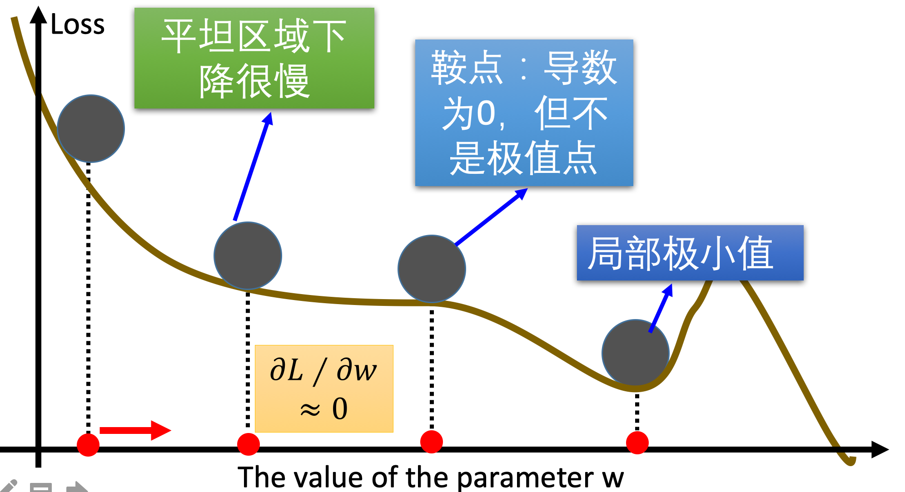

#### 前置：指数加权平均

> 指数加权平均不是梯度下降优化方式。而是动量法：Momentum；自适应学习率: AdaGrad, RMSProp；自适应矩估计：Adam，除 AdaGrad 外其他三种方式底层公式都要用到指数移动加权平均。
> 
> 

我们最常见的算数平均指的是将所有数加起来除以数的个数，每个数的权重是相同的。指数加权平均指的是给每个数赋予不同的权重求得平均数。移动平均数，指的是计算最近邻的 N 个数来获得平均数。

**指数移动加权平均**则是参考各数值，并且各数值的权重都不同，距离越远的数字对平均数计算的贡献就越小（权重较小），距离越近则对平均数的计算贡献就越大（权重越大）。

比如：明天气温怎么样，和昨天气温有很大关系，而和一个月前的气温关系就小一些。

计算公式可以用下面的式子来表示：

$S_t = 
\begin{cases} 
Y_1, & t = 0 \\ 
\beta * S_{t-1} + (1 - \beta) * Y_t, & t > 0 
\end{cases}$

- $S_t$ 表示指数加权平均值;

- $Y_t$ 表示* t* 时刻的值;

- *β *为调节权重系数，该值越大平均数越平缓。

    - **比如当用在后文的动量法 Momentum 中时：**

        - *β *一般设置为 0\.9，其值越大，当前梯度（$Y_t$）的影响越小，指数加权平均的影响越大。

        - 即使本次梯度为 0，也可以使用历史梯度信息继续更新权重，很有可能越过鞍点或局部极小值。

    - 具体来说，动量法 Momentum、自适应学习率 RMSProp、自适应动量法 Adam 都使用了指数加权平均，效果同上。

**第 100 天的指数加权平均值为：**

$\begin{aligned}
S_{100} &= \beta*S_{99} + (1-\beta)*Y_{100} \\
S_{99} &= \beta*S_{98} + (1-\beta)*Y_{99} \\
S_{98} &= \beta*S_{97} + (1-\beta)*Y_{98} \\
\beta &= 0.9 \\[2ex]
S_{100} &= \beta*(\beta*S_{98} + (1-\beta)*Y_{99}) + (1-\beta)*Y_{100} \\
        &= 0.9*(0.9*(\beta*S_{97} + (1-\beta)*Y_{98}) + 0.1*Y_{99}) + 0.1*Y_{100} \\
& \cdots
\\
&= 0.1Y_{100} + 0.1*0.9*Y_{99} + 0.1*0.9^2*Y_{98} + 0.1*0.9^3*Y_{97} + \dots
\end{aligned}$

第 100 天的指数加权平均值由$0.1Y_{100} + 0.1*0.9*Y_{99} + 0.1*0.9^2*Y_{98} + 0.1*0.9^3*Y_{97} + \dots$相加而成，离 100 天越近的系数越大，离 100 天越远的系数越小。

**下面通过代码来看结果，随机产生 30 天的气温数据：**

```python
import torch
import matplotlib.pyplot as plt

ELEMENT_NUMBER = 30

## 1. 实际平均温度
def test01():

    # 固定随机数种子
    torch.manual_seed(0)
    # 产生30天的随机温度
    temperature = torch.randn(size=[ELEMENT_NUMBER,]) * 10
    print(temperature)
    # 绘制平均温度
    days = torch.arange(1, ELEMENT_NUMBER + 1, 1)
    plt.plot(days, temperature, color='r')
    plt.scatter(days, temperature)
    plt.show()


## 2. 指数加权平均温度
def test02(beta=0.9):

    # 固定随机数种子
    torch.manual_seed(0)
    # 产生30天的随机温度
    temperature = torch.randn(size=[ELEMENT_NUMBER,]) * 10
    print(temperature)

    exp_weight_avg = []
    # idx从1开始
    for idx, temp in enumerate(temperature, 1):
        # 第一个元素的 EWA 值等于自身
        if idx == 1:
            exp_weight_avg.append(temp)
            continue
        # 第二个元素的 EWA 值等于上一个 EWA 乘以 β + 当前气温乘以 (1-β)
        # idx-2：2-2=0，exp_weight_avg列表中第一个值的下标值
        new_temp = exp_weight_avg[idx - 2] * beta + (1 - beta) * temp
        exp_weight_avg.append(new_temp)

    days = torch.arange(1, ELEMENT_NUMBER + 1, 1)
    plt.plot(days, exp_weight_avg, color='r')
    plt.scatter(days, temperature)
    plt.show()


if __name__ == '__main__':
    test01()
    test02(0.5)
    test02(0.9)
```


**从程序运行结果可以看到：**

- 指数加权平均绘制出的气温变化曲线更加平缓。

- *β* 的值越大，则绘制出的折线越加平缓，波动越小（1 \- *β* 越小，*t *时刻的$S_t$越不依赖$Y_t$的值）。

- *β* 值一般默认都是 0\.9。

#### 动量法 Momentum

当梯度下降碰到 “峡谷” 、”平缓”、”鞍点” 区域时, 参数更新速度变慢。 Momentum 通过**指数加权平均法**，累计历史梯度值，进行参数更新，越近的梯度值对当前参数更新的重要性越大。

**梯度计算公式**：

​                                $s_t=βs_{t−1}+(1−β)g_t$

**参数更新公式**：

​                                $w_t=w_{t−1}−ηs_t$

- $s_t$是当前时刻指数加权平均梯度值

- $s_{t-1}$是历史指数加权平均梯度值

- $g_t$是当前时刻的梯度值

- *β* 是调节权重系数，通常取 0\.9 或 0\.99

- *η* 是学习率

- $w_t$是当前时刻模型权重参数

Monmentum 优化方法是如何一定程度上克服 “平缓”、”鞍点”、”峡谷” 的问题呢？

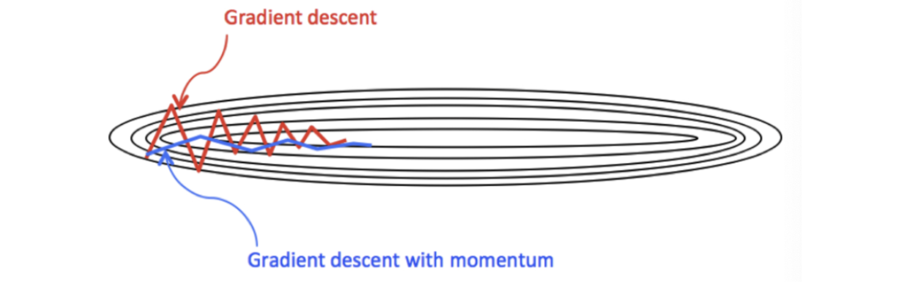

- 当处于鞍点位置时，由于当前的梯度为 0，参数无法更新。但是 Momentum 动量梯度下降算法已经在先前积累了一些梯度值，很有可能使得跨过鞍点。

- 由于 mini\-batch 普通的梯度下降算法，每次选取少数的样本梯度确定前进方向，可能会出现震荡，使得训练时间变长。Momentum 使用移动加权平均，平滑了梯度的变化，使得前进方向更加平缓，有利于加快训练过程。一定程度上有利于降低 “峡谷” 问题的影响。

在 pytorch 中动量梯度优化法编程实践如下：

```python
def test01():
    # 1. 初始化权重参数
    w = torch.tensor([1.0], requires_grad=True, dtype=torch.float32)
    loss = ((w ** 2) / 2.0).sum()
    # 2. 实例化优化方法：SGD*(随机梯度下降)* 指定参数*momentum*=0.9
    optimizer = torch.optim.SGD([w], lr=0.01, momentum=0.9)
    # 3. 第1次更新 计算梯度，并对参数进行更新
    optimizer.zero_grad()
    loss.backward()
    optimizer.step()
    print('第1次: 梯度w.grad: %f, 更新后的权重:%f' % (w.grad.numpy(), w.detach().numpy()))
    # 4. 第2次更新 计算梯度，并对参数进行更新
    # 使用更新后的参数机选输出结果
    loss = ((w ** 2) / 2.0).sum()
    optimizer.zero_grad()
    loss.backward()
    optimizer.step()
    print('第2次: 梯度w.grad: %f, 更新后的权重:%f' % (w.grad.numpy(), w.detach().numpy()))
```

**结果显示：**

```Plain Text
第1次: 梯度w.grad: 1.000000, 更新后的权重:0.990000
第2次: 梯度w.grad: 0.990000, 更新后的权重:0.971100
```

#### 自适应学习率

##### AdaGrad

AdaGrad 通过对不同的参数分量使用不同的学习率，**AdaGrad 的学习率总体会逐渐减小**，这是因为 AdaGrad 认为：在起初时，我们距离最优目标仍较远，可以使用较大的学习率，加快训练速度，随着迭代次数的增加，学习率逐渐下降。

其计算步骤如下：

1. 初始化学习率 *η*、初始化参数* w*、小常数 *σ* = 1e\-10（$\sigma$防止计算学习率时分母为 0）

2. 初始化梯度累计变量* s* = 0

3. 从训练集中采样 m 个样本的小批量，计算梯度$g_t​$

4. **累积平方梯度：**$\odot$表示各个分量相乘（点乘）

$s_t = s_{t-1} + g_t \odot g_t$

> 即使梯度为 0 也可继续更新。
> 
> 

5. 学习率* η *的计算公式如下：

$η = \frac{η}{\sqrt{s_t}+σ}$

6. 权重参数更新公式如下：

$w_t = w_{t-1} - \frac{\eta}{\sqrt{s_t} + \sigma} * g_t$

7. 重复 3\-7 步骤

**AdaGrad 缺点是可能会使得学习率过早、过量的降低，导致模型训练后期学习率太小，较难找到最优解。**

在 PyTorch 中 AdaGrad 优化法编程实践如下：

```python
def test02():
    # 1 初始化权重参数
    w = torch.tensor([1.0], requires_grad=True, dtype=torch.float32)
    loss = ((w ** 2) / 2.0).sum()
    # 2 实例化优化方法：adagrad优化方法
    optimizer = torch.optim.Adagrad([w], lr=0.01)
    # 3 第1次更新 计算梯度，并对参数进行更新
    optimizer.zero_grad()
    loss.backward()
    optimizer.step()
    print('第1次: 梯度w.grad: %f, 更新后的权重:%f' % (w.grad.numpy(), w.detach().numpy()))
    # 4 第2次更新 计算梯度，并对参数进行更新
    # 使用更新后的参数机选输出结果
    loss = ((w ** 2) / 2.0).sum()
    optimizer.zero_grad()
    loss.backward()
    optimizer.step()
    print('第2次: 梯度w.grad: %f, 更新后的权重:%f' % (w.grad.numpy(), w.detach().numpy()))
```

**结果显示：**

```Plain Text
第1次: 梯度w.grad: 1.000000, 更新后的权重:0.990000
第2次: 梯度w.grad: 0.990000, 更新后的权重:0.982965
```

##### RMSProp

**RMSProp 优化算法是对 AdaGrad 的优化**。最主要的不同是，其使用**指数加权平均梯度**替换历史梯度的平方和。

其计算过程如下：

1. 初始化学习率 *η*、初始化权重参数 *w*、小常数 *σ* = 1e\-10

2. 初始化梯度累计变量 *s* = 0

3. 从训练集中采样 m 个样本的小批量，计算梯度 $g_t$

4. **使用指数加权平均累计历史梯度**，$\odot$表示各个分量相乘，公式如下：​     

$s_t = \beta s_{t-1} + (1-\beta) g_t \odot g_t$

5. 学习率 *η* 的计算公式如下：​                  

$η = \frac{η}{\sqrt{s_t}+σ}$

6. 权重参数更新公式如下：

$w_t = w_{t-1} - \frac{\eta}{\sqrt{s_t} + \sigma} * g_t$

7. 重复 3\-7 步骤

RMSProp 与 AdaGrad 最大的区别是对梯度的累积方式不同，对于每个梯度分量仍然使用不同的学习率。

**RMSProp 通过引入衰减系数 *****β*****，控制历史梯度对历史梯度信息获取的多少。**被证明在神经网络非凸条件下的优化更好，学习率衰减更加合理一些。

需要注意的是：AdaGrad 和 RMSProp 都是**对于不同的参数分量使用不同的学习率**，如果某个参数分量的梯度值较大，则对应的学习率就会较小，如果某个参数分量的梯度较小，则对应的学习率就会较大一些。

在 PyTorch 中 RMSprop 梯度优化法，编程实践如下：

```python
def test03():
    # 1 初始化权重参数
    w = torch.tensor([1.0], requires_grad=True, dtype=torch.float32)
    loss = ((w ** 2) / 2.0).sum()
    # 2 实例化优化方法：RMSprop算法，其中alpha对应beta
    optimizer = torch.optim.RMSprop([w], lr=0.01, alpha=0.9)
    # 3 第1次更新 计算梯度，并对参数进行更新
    optimizer.zero_grad()
    loss.backward()
    optimizer.step()
    print('第1次: 梯度w.grad: %f, 更新后的权重:%f' % (w.grad.numpy(), w.detach().numpy()))
    # 4 第2次更新 计算梯度，并对参数进行更新
    # 使用更新后的参数机选输出结果
    loss = ((w ** 2) / 2.0).sum()
    optimizer.zero_grad()
    loss.backward()
    optimizer.step()
    print('第2次: 梯度w.grad: %f, 更新后的权重:%f' % (w.grad.numpy(), w.detach().numpy()))
```

**结果显示：**

```python
第1次: 梯度w.grad: 1.000000, 更新后的权重:0.968377
第2次: 梯度w.grad: 0.968377, 更新后的权重:0.945788
```

#### 自适应矩估计 Adam

- Momentum 使用指数加权平均计算当前的梯度值。

- AdaGrad、RMSProp 使用自适应的学习率。

- Adam优化算法（Adaptive Moment Estimation，自适应矩估计）将 Momentum 和 RMSProp 算法结合在一起。

    - 修正梯度: 使⽤梯度的指数加权平均

    - 修正学习率: 使⽤梯度平⽅的指数加权平均

- **原理**：Adam 是结合了 **Momentum** 和 **RMSProp** 优化算法的优点的自适应学习率算法。它计算了梯度的一阶矩（平均值）和二阶矩（梯度的方差）的自适应估计，从而动态调整学习率。

- **梯度计算公式：**

$\begin{align}
m_t &= \beta_1 m_{t-1} + (1 - \beta_1)g_t \\
s_t &= \beta_2 s_{t-1} + (1 - \beta_2)g_t^2 \\
\hat{m}_t &= \frac{m_t}{1 - \beta_1^t}, \quad \hat{s}_t = \frac{s_t}{1 - \beta_2^t}
\end{align}$

\(1\) 即为 Monentum 的梯度计算公式（用于计算梯度），\(2\) 即为 RMSProp 的累计历史梯度（用于自适应学习率），\(3\) 为偏差修正。

- $m_t$：当前步数* t *的一阶矩（梯度的滑动平均值），动量项

- $s_t$：当前步数* t *的二阶矩（梯度平方的滑动平均值），自适应学习率项

- 偏差修正：

    > - 为什么需要这一步？
    > 
    >     - 因为 $m_0$ 和 $s_0$ 通常被初始化为 **0**。
    > 
    >     - 在训练刚开始的几步（$t$很小的时候），比如 $t = 1$，$m_1 = (1 - \beta_1)g_1$。因为 $\beta_1 = 0.9$，所以 $m_1 = 0.1g_1$。你会发现，初始化初期的 $m_t$ 和 $s_t$ 都会严重偏向于 0（被缩小了）。
    > 
    > - 为了消除这种初始化带来的偏差，Adam 算法引入了偏差修正。除以 $1 - \beta_1^t$ 和 $1 - \beta_2^t$，把它们放大回真实的量级。
    > 
    >     - 随着步数 $t$ 的增加，$\beta^t$ 会趋近于 0，分母 $1 - \beta^t$ 会趋近于 1，这个修正效果就逐渐消失了。
    > 
    > 

- **权重参数更新公式：**

$w_t = w_{t-1} - \frac{\eta}{\sqrt{s_t} + \sigma}  \hat{m}_t$

其中，$m_t$ 是梯度的一阶矩估计，$s_t$ 是梯度的二阶矩估计，$ \hat{m_t}$和 $\hat{s_t}$ 是偏差校正后的估计。

在 PyTroch 中，Adam 梯度优化法编程实践如下：

```python
def test04():
    # 1 初始化权重参数
    w = torch.tensor([1.0], requires_grad=True)
    loss = ((w ** 2) / 2.0).sum()
    # 2 实例化优化方法：Adam算法，其中betas是指数加权的系数
    optimizer = torch.optim.Adam([w], lr=0.01, betas=[0.9, 0.99])
    # 3 第1次更新 计算梯度，并对参数进行更新
    optimizer.zero_grad()
    loss.backward()
    optimizer.step()
    print('第1次: 梯度w.grad: %f, 更新后的权重:%f' % (w.grad.numpy(), w.detach().numpy()))
    # 4 第2次更新 计算梯度，并对参数进行更新
    # 使用更新后的参数机选输出结果
    loss = ((w ** 2) / 2.0).sum()
    optimizer.zero_grad()
    loss.backward()
    optimizer.step()
    print('第2次: 梯度w.grad: %f, 更新后的权重:%f' % (w.grad.numpy(), w.detach().numpy()))
```

**结果显示：**

```python
第1次: 梯度w.grad: 1.000000, 更新后的权重:0.990000 
第2次: 梯度w.grad: 0.990000, 更新后的权重:0.980003
```

#### 小结

|**优化算法**|**优点**|**缺点**|**适用场景**|
|---|---|---|---|
|**SGD**|简单、容易实现。|收敛速度较慢，容易震荡，特别是在复杂问题中。|用于简单任务，或者当数据特征分布相对稳定时。|
|**Momentum**|可以加速收敛，减少震荡，特别是在高曲率区域。|需要手动调整动量超参数，可能会在小步长训练中过度更新。|用于非平稳优化问题，尤其是深度学习中的应用。|
|**AdaGrad**|自适应调整学习率，适用于稀疏数据。|学习率会在训练过程中逐渐衰减，可能导致早期停滞。|适合**稀疏数据**，如 NLP 或推荐系统中的特征。|
|**RMSProp**|解决了 AdaGrad 学习率过早衰减的问题，适应性强。|需要选择合适的超参数，更新可能会过于激进。|适用于动态问题、非平稳目标函数，如深度学习训练。|
|**Adam**|结合了 Momentum 和 RMSProp 的优点，适应性强且稳定。|需要调节更多的超参数，训练过程中可能会产生较大波动。|广泛适用于各种深度学习任务，特别是非平稳和复杂问题。|

- **简单任务和较小的模型**：SGD 或 Momentum

- **复杂任务或有大量数据**：Adam 是最常用的选择，因其在大部分任务上都表现优秀

- **需要处理稀疏数据或文本数据**：Adagrad 或 RMSProp


### 学习率衰减优化方法

> chapter02\_Artifical\_Neural\_Network/12\_演示学习率对梯度的影响\_了解\.py
> 
> 

> chapter02\_Artifical\_Neural\_Network/13\_演示学习率衰减策略\.py
> 
> 

#### 为什么要进行学习率优化

在训练神经网络时，一般情况下学习率都会随着训练而变化。这主要是由于，在神经网络训练的后期，如果**学习率过高，会造成 loss 的振荡**，但是如果**学习率减小的过慢，又会造成收敛变慢**的情况。

> 较之于 AdaGrad、RMSProp、Adam 方式，我们可以通过 等间隔、指定间隔、指数等方式 来**手动控制**学习率的调整。
> 
> 

运行下面代码，观察学习率设置不同对网络训练的影响：

```python
import torch
import matplotlib.pyplot as plt

## x看成是权重，y看成是loss，下面通过代码来理解学习率的作用
def func(x_t):
    return torch.pow(2*x_t, 2)  # y = 4 x ^2

## 采用较小的学习率，梯度下降的速度慢
## 采用较大的学习率，梯度下降太快越过了最小值点，导致不收敛，甚至震荡
def dm01():

    x = torch.tensor([2.], requires_grad=True)
    # 记录loss迭代次数，画曲线
    iter_rec, loss_rec, x_rec = list(), list(), list()

    # 实验学习率： 0.01 0.02 0.03 0.1 0.2 0.3 0.4
    # lr = 0.1    # 正常的梯度下降
    # lr = 0.125      # 当学习率设置0.125 一下子求出一个最优解
                    # x=0 y=0 在x=0处梯度等于0 x的值x=x-lr*x.grad就不用更新了
                    # 后续再多少次迭代 都固定在最优点

    lr = 0.2      # x从2.0一下子跨过0点，到了左侧负数区域
    # lr = 0.3      # 梯度越来越大 梯度爆炸
    max_iteration = 4
    for i in range(max_iteration):
        y = func(x)   # 得出loss值
        y.backward()  # 计算x的梯度
        print("Iter:{}, X:{:8}, X.grad:{:8}, loss:{:10}".format(
            i, x.detach().numpy()[0], x.grad.detach().numpy()[0], y.item()))
        x_rec.append(x.item())      # 梯度下降点 列表
        # 更新参数
        x.data.sub_(lr * x.grad)    # x = x - x.grad
        x.grad.zero_()
        iter_rec.append(i)          # 迭代次数 列表
        loss_rec.append(y.item())  # 损失值 列表，这里将y改为y.item()以获取标量值
    # 迭代次数-损失值 关系图
    plt.subplot(121).plot(iter_rec, loss_rec, '-ro')
    plt.grid()
    plt.xlabel("Iteration X")
    plt.ylabel("Loss value Y")
    # 函数曲线-下降轨迹 显示图
    x_t = torch.linspace(-3, 3, 100)
    y = func(x_t)
    plt.subplot(122).plot(x_t.detach().numpy(), y.detach().numpy(), label="y = 4*x^2")
    y_rec = [func(torch.tensor(i)).item() for i in x_rec]
    print('x_rec--->', x_rec)
    print('y_rec--->', y_rec)
    # 指定线的颜色和样式（-ro：红色圆圈，b-：蓝色实线等）
    plt.subplot(122).plot(x_rec, y_rec, '-ro')
    plt.grid()
    plt.legend()
    plt.show()

dm01()
```

**运行效果图如下：**


可以看出：采用较小的学习率，梯度下降的速度慢；采用较大的学习率，梯度下降太快越过了最小值点，导致震荡，甚至不收敛（梯度爆炸）。

#### 等间隔学习率衰减

等间隔学习率衰减方式如下所示：


在 PyTorch 中实现时使用：

```python
##   step_size：调整间隔轮数=50
##   gamma：调整系数=0.5
##   调整方式：lr = lr * gamma
optim.lr_scheduler.StepLR(optimizer, step_size=50, gamma=0.5)
```

具体使用方式如下：

```python
import torch
from torch import optim
import matplotlib.pyplot as plt


def test_StepLR():
    # 0.参数初始化
    LR = 0.1  # 设置学习率初始化值为0.1
    iteration = 10
    max_epoch = 200
    # 1 初始化参数
    y_true = torch.tensor([0])
    x = torch.tensor([1.0])
    w = torch.tensor([1.0], requires_grad=True)
    # 2.优化器
    optimizer = optim.SGD([w], lr=LR, momentum=0.9)
    # 3.设置学习率下降策略
    scheduler_lr = optim.lr_scheduler.StepLR(optimizer, step_size=50, gamma=0.5)
    # 4.获取学习率的值和当前的epoch
    lr_list, epoch_list = [], []
    for epoch in range(max_epoch):
        lr_list.append(scheduler_lr.get_last_lr()) # 获取当前lr
        epoch_list.append(epoch) # 获取当前的epoch
        for i in range(iteration):  # 遍历每一个batch数据
            loss = (w*x-y_true)**2  # 目标函数
            optimizer.zero_grad()
            # 反向传播
            loss.backward()
            optimizer.step()
        # 更新下一个epoch的学习率
        scheduler_lr.step()
    # 5.绘制学习率变化的曲线
    plt.plot(epoch_list, lr_list, label="Step LR Scheduler")
    plt.xlabel("Epoch")
    plt.ylabel("Learning rate")
    plt.legend()
    plt.show()        
```

#### 指定间隔学习率衰减

指定间隔学习率衰减的效果如下：


在 PyTorch 中实现时使用：

```python
## milestones：设定调整轮次:[50, 125, 160]
## gamma：调整系数
## 调整方式：lr = lr * gamma
optim.lr_scheduler.MultiStepLR(optimizer, milestones=[50, 125, 160], gamma=0.5, last_epoch=-1)    
```

具体使用方式如下所示：

```python
import torch
from torch import optim
import matplotlib.pyplot as plt


def test_MultiStepLR():
    torch.manual_seed(1)
    LR = 0.1
    iteration = 10
    max_epoch = 200
    y_true = torch.tensor([0])
    x = torch.tensor([1.0])
    w = torch.tensor([1.0], requires_grad=True)
    optimizer = optim.SGD([w], lr=LR, momentum=0.9)
    # 设定调整时刻数
    milestones = [50, 125, 160]
    # 设置学习率下降策略
    scheduler_lr = optim.lr_scheduler.MultiStepLR(optimizer, milestones=milestones, gamma=0.5)
    lr_list, epoch_list = list(), list()
    for epoch in range(max_epoch):
        lr_list.append(scheduler_lr.get_last_lr())
        epoch_list.append(epoch)
        for i in range(iteration):
            loss = (w*x-y_true)**2
            optimizer.zero_grad()
            # 反向传播
            loss.backward()
            # 参数更新
            optimizer.step()
        # 更新下一个epoch的学习率
        scheduler_lr.step()
    plt.plot(epoch_list, lr_list, label="Multi Step LR Scheduler\nmilestones:{}".format(milestones))
    plt.xlabel("Epoch")
    plt.ylabel("Learning rate")
    plt.legend()
    plt.show()
```

#### 按指数学习率衰减

按指数衰减调整学习率的效果如下：


在 PyTorch 中实现时使用：

```python
## gamma：指数的底
## 调整方式
## lr= lr∗gamma^epoch
optim.lr_scheduler.ExponentialLR(optimizer, gamma=0.95)
```

具体使用方式如下所示：

```python
import torch
from torch import optim
import matplotlib.pyplot as plt


def test_ExponentialLR():
    # 0.参数初始化
    LR = 0.1  # 设置学习率初始化值为0.1
    iteration = 10
    max_epoch = 200
    # 1 初始化参数
    y_true = torch.tensor([0])
    x = torch.tensor([1.0])
    w = torch.tensor([1.0], requires_grad=True)
    # 2.优化器
    optimizer = optim.SGD([w], lr=LR, momentum=0.9)
    # 3.设置学习率下降策略
    gamma = 0.95
    scheduler_lr = optim.lr_scheduler.ExponentialLR(optimizer, gamma=gamma)
    # 4.获取学习率的值和当前的epoch
    lr_list, epoch_list = list(), list()
    for epoch in range(max_epoch):
        lr_list.append(scheduler_lr.get_last_lr())
        epoch_list.append(epoch)
        for i in range(iteration):  # 遍历每一个batch数据
            loss = (w*x-y_true)**2
            optimizer.zero_grad()
            # 反向传播
            loss.backward()
            optimizer.step()
        # 更新下一个epoch的学习率
        scheduler_lr.step()
    # 5.绘制学习率变化的曲线
    plt.plot(epoch_list, lr_list, label="Exponential LR Scheduler\ngamma:0.95")
    plt.xlabel("Epoch")
    plt.ylabel("Learning rate")
    plt.legend()
    plt.show()
```

#### 小结

|方法|等间隔学习率衰减 \(Step Decay\)|指定间隔学习率衰减 \(Exponential Decay\)|指数学习率衰减 \(Exponential Moving Average Decay\)|
|---|---|---|---|
|**衰减方式**|固定步长衰减|指定步长衰减|平滑指数衰减，历史平均考虑|
|**实现难度**|简单易实现|相对简单，容易调整|需要额外历史计算，较复杂|
|**适用场景**|大型数据集、较为简单的任务|对训练平稳性要求较高的任务|高精度训练，避免过快收敛|
|**优点**|直观，易于调试，适用于大批量数据|易于调试，稳定训练过程|平滑且考虑历史更新，收敛稳定性较强|
|**缺点**|学习率变化较大，可能跳过最优点|在某些情况下可能衰减过快，导致优化提前停滞|超参数调节较为复杂，可能需要更多的计算资源|


## 正则化方法

### 什么是正则化

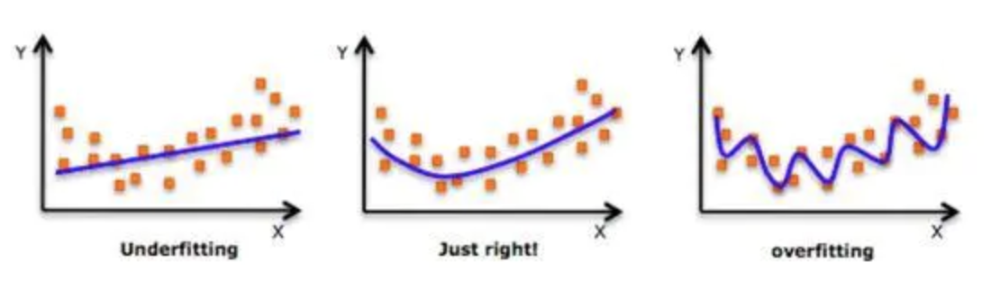

- 在设计机器学习算法时希望在新样本上的泛化能力强。许多机器学习算法都采用相关的策略来减小测试误差，这些策略被统称为正则化。

- 神经网络强大的表示能力经常遇到过拟合，所以需要使用不同形式的正则化策略。

- 目前在深度学习中使用较多的策略有**范数惩罚（L1 正则化，L2 正则化）**，**DropOut**，**特殊的网络层**等。

> L1 正则化权重可以变为 0，相当于降维；
> 
> L2 正则化权重可以无限接近于 0，但不会为 0\.
> 
> 


### Dropout 正则化

> chapter02\_Artifical\_Neural\_Network/14\_dropout随机失活正则化\.py
> 
> 

在训练深层神经网络时，由于模型参数较多，在数据量不足的情况下，很容易过拟合。Dropout（中文翻译成**随机失活**）是一个简单有效的正则化方法。

Dropout 的**核心**目的只有一个：**缓解模型过拟合（Overfitting），提高泛化能力。**

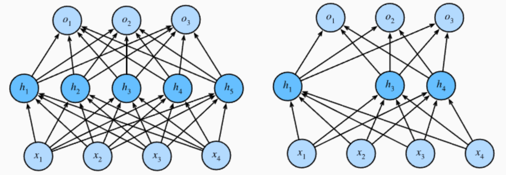

- 在训练过程中，Dropout 的实现是**让每个神经元以超参数 p（丢弃概率）的概率停止工作或者激活后被置为 0，未被置为 0 的进行缩放，缩放比例为 1/\(1\-p\)**。训练过程可以认为是对完整的神经网络的一些子集进行训练，每次基于输入数据只更新子网络的参数。

> 一批次一批次地进行训练，每个批次死亡的神经元不确定，**每个批次都重新随机失活**。
> 
> 每次 Dropout 相当于从完整的网络中采样出一个“子网络”。训练一个带有 Dropout 的网络，实际上相当于同时训练了指数级数量的共享权重的子网络。在测试时，相当于把这些子网络进行了**集成（Bagging）**，从而大大降低了方差。
> 
> 

> 缩放其实是放大，目的是保证输出层的期望值不变。
> 
> 

- 在实际应用中，Dropout 参数 p 的概率通常取值在 0\.2 到 0\.5 之间。

    - 对于较小的模型或较复杂的任务，丢弃率可以选择 0\.3 或更小。

    - 对于非常深的网络，较大的丢弃率（如 0\.5 或 0\.6）可能会有效防止过拟合。

    - 实际应用中，通常会在**全连接层****（激活函数后）之后**添加 Dropout 层（**生成 0\-1 ****掩码****，然后与激活后的输出相乘即可，就可以使部分输出变为 0**）。

- **在测试过程中，随机失活不起作用。**

    - 在测试阶段，使用所有的神经元进行预测，以获得更稳定的结果。

    - 直接使用训练好的模型进行测试，由于所有的神经元都参与计算，输出的期望值会比训练阶段高。测试阶段的期望输出是 $E[x_{test}] = x$（常量的期望是本身）。

    - 测试/推理模式：`model.eval()`

- **缩放的必要性**

    - 在训练阶段，将参与计算的神经元的输出除以 \(1 \- p\)。

    - 经过 Dropout 后的期望输出变为 $E[x_{dropout}] = \frac{(1-p) * x}{1-p} = x$，与测试阶段的期望输出一致。

    > 设生成的 0\-1 掩码为 m，则 $m \sim Bernoulli(1 - p)$，则随机失活 \+ 放大后的输出为 $x_{dropout} = m \odot x \cdot \frac{1}{1-p}$，其期望为 $E[x_{dropout}] = E(m) \cdot \frac{x}{1 -p} = \frac{(1-p) \cdot x}{1-p} = x$。
    > 
    > 

    - 训练模式：`model.train()`

我们通过一段代码观察下 dropout 的效果：

```python
import torch
import torch.nn as nn

def test():
    # 初始化随机失活层
    dropout = nn.Dropout(p=0.4)
    # 初始化输入数据:表示某一层的weight信息
    inputs = torch.randint(0, 10, size=[1, 4]).float()
    layer = nn.Linear(4,5)
    y = layer(inputs)    # 加权求和
    y = torch.relu(y)    # 激活函数
    print("未失活FC层的输出结果：\n", y)
    y =  dropout(y)
    print("失活后FC层的输出结果：\n", y)
```

**输出结果：**

```Plain Text
未失活FC层的输出结果：
 tensor([[0.0000, 1.8033, 1.4608, 4.5189, 6.9116]], grad_fn=<ReluBackward0>)
 # **这里面有一个输出为 0 并不是随机失活，是 relu 激活函数作用的结果。**
 
失活后FC层的输出结果：
 tensor([[0.0000,  3.0055,  2.4346,  7.5315, 11.5193]], grad_fn=<MulBackward0>)
 **# 没有被失活的都进行了缩放。**
```

上述代码将 Dropout 层的丢弃概率 p 设置为 0\.4，此时经过 Dropout 层计算的张量中就出现了很多 0，未变为 0 的按照（1/\(1\-0\.4\)）进行缩放处理。


### 批量归一化 \(Batch Normalization\)

> chapter02\_Artifical\_Neural\_Network/15\_批量归一化\.py
> 
> 

在神经网络的训练过程中，流经网络的数据都是一个 batch，每个 batch 之间的数据分布变化非常剧烈，这就使得网络参数频繁的进行大的调整以适应流经网络的不同分布的数据，给模型训练带来非常大的不稳定性，使得模型难以收敛。**如果我们对每一个batch的数据进行标准化之后，数据分布就变得稳定，参数的梯度变化也变得稳定，有助于加快模型的收敛。**

> 与 Dropout 侧重于 “防止过拟合” 不同，BN 的**核心**目的是 “加速训练、稳定网络、缓解梯度问题” 。
> 
> 

**通过标准化每一层的输入，使其均值接近 0，方差接近 1，从而加速训练并提高泛化能力。**

> 批量归一化其实是批量标准化，因为一开始提出来的时候是用归一化，但归一化容易受到极值的影响，后来优化为标准化。
> 
> 

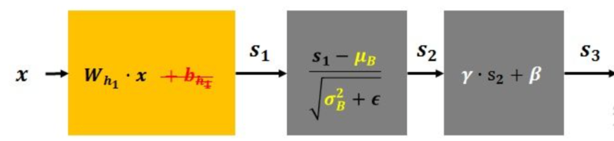

先对数据标准化，再对数据重构（缩放\+平移），写成公式如下所示：

$f(x) = \gamma \cdot \frac{x - \text{E}(x)}{\sqrt{\text{Var}(x) + \epsilon}} + \beta$

- 标准化会丢失一些信息，重构可以再找回来一些信息。

- $\gamma$* *和* β* 是**可学习的参数**，它相当于对标准化后的值做了一个**线性变换**，$\gamma$ **为系数（缩放因子），*****β *****为偏置（平移因子）；**

- eps 通常指为 1e\-5，避免分母为 0。

> 数据被拉回 0 均值 1 方差附近，避免了激活函数（如 Sigmoid、Tanh）进入饱和区而导致模型收敛较慢。
> 
> 

**批量归一化的步骤如下：**

1. **计算均值和方差**：对于每个神经元（即每一层的输入特征），计算该特征在一个小批量（batch）上的均值 $\mu_B$ 和方差 $\sigma_B^2$，它们的计算公式如下：

$\begin{aligned}
\mu_B &= \frac{1}{m} \sum_{i=1}^m x_i \\
\sigma_B^2 &= \frac{1}{m} \sum_{i=1}^m (x_i - \mu_B)^2
\end{aligned}$

其中 $x_i$ 表示小批量中的第 $i$个样本，$m$是小批量的样本数量。

2. **标准化**：然后，对每个样本的输入进行标准化，得到归一化的输出：

    $\hat{x}_i = \frac{x_i - \mu_B}{\sqrt{\sigma_B^2 + \epsilon}}$

    其中，$\epsilon$是一个小常数，用来避免除以零的情况。

3. **缩放和平移**：为了让网络能够恢复其学习能力，BN 层引入了两个可训练的参数 $\gamma$ 和 $\beta$，分别用于缩放和平移：

    $y_i = \gamma \hat{x}_i + \beta$

    其中，$\gamma$ 和 $\beta$ 是可学习的参数，通过 $\gamma$ 和 $\beta$，BN 层不再是简单的将每一层输入强行变为标准正态分布，而是允许网络学习更适合于该层的输入分布；**规范化操作会丢失原始输入的一些信息，而 **$\gamma$** 和 **$\beta$** 可以弥补这种信息损失。**

**批量归一化的作用：**

- **减少内部协方差偏移：**通过对每层的输入进行标准化，减少了输入数据分布的变化，从而加速了训练过程，并使得网络在训练过程中更加稳定。

- **加速训练：**

    - 在没有批量归一化的情况下，神经网络的训练通常会很慢，尤其是深度网络。因为在每层的训练过程中，输入数据的分布（特别是前几层）会不断变化，这会导致网络学习速度缓慢。

    - 批量归一化通过确保每层的输入数据在训练时分布稳定，有效减少了这种变化，从而加速了训练过程。

- **起到正则化作用：**批量归一化可以视作一种正则化方法，因为它引入了对训练样本的噪声（不同批次的统计信息不同，批次较小的均值和方差估计会更加不准确），使得模型不容易依赖特定的输入特征，从而起到一定的正则化效果，减少了对其他正则化技术（如Dropout）的需求。

- **提升泛化能力：**由于其正则化效果，批量归一化能帮助网络在测试集上取得更好的性能。

**应用场景：**

批量归一化层在计算机视觉领域使用较多。因为像素的范围是 0\-255，差别很大。

**Batch Normalization 的使用步骤：**

1. **在网络层后添加 BN 层：**

    - 通常，BN 层会添加在卷积层 \(Conv2d\) 或全连接层 \(Linear\) 之后，**激活函数之前**。

    - 例如：Conv2d \-\> BN \-\> ReLU 或者 Linear \-\> BN \-\> ReLU。

2. **训练时：**`model.train()`

    - BN 层会计算当前批次的均值 $μ$ 和方差 $σ²$。

    - 然后，利用这两个统计量对当前批次的数据进行规范化。

    - 规范化后的数据会被缩放 $γ$ 和平移 $β$。

    - 同时，BN 层还会维护一个**全局均值**和**全局方差**的移动平均值，用于推理阶段。

3. **推理时：**`model.eval()`

    - 推理时，不会再使用当前批次的均值和方差，而是使用训练阶段计算的**全局均值**和**全局方差**。

    - 同样，规范化后的数据会被缩放 $γ$ 和平移 $β$。

```python
import torch
import torch.nn as nn

"""
BatchNorm1d：主要应用于全连接层或处理一维数据的网络，例如文本处理。它接收形状为 (N, num_features) 的张量作为输入。
BatchNorm2d：主要应用于卷积神经网络，处理二维图像数据或特征图。它接收形状为 (N, C, H, W) 的张量作为输入。
BatchNorm3d：主要用于三维卷积神经网络 (3D CNN)，处理三维数据，例如视频或医学图像。它接收形状为 (N, C, D, H, W) 的张量作为输入。
"""

def tes01():
    # 创建测试样本, 假设是经过卷积层(Conv2d)处理后的特征图
    # (N, C, H, W): 一张图, 两个通道, 每个通道3行4列
    # 可以创建1个样本, 图像的BN是对每个通道的特征图(行列数据)进行标准化
    input_2d = torch.randn(size=(1, 2, 3, 4))
    print("input-->", input_2d)
    # num_features：输入特征数
    # eps：非常小的浮点数，防止除以0的错误
    # momentum：动量系数，用于计算移动平均值
    # affine：默认为True，γ和*β*使用，让BN层更加灵活
    bn2d = nn.BatchNorm2d(num_features=2, eps=1e-05, momentum=0.1, affine=True) 
    output = bn2d(input_2d)
    print("output-->", output)
    print(output.size())

    print(bn2d.weight)
    print(bn2d.bias)  

def tes02():
    # 创建测试样本
    # 2个样本, 2个特征
    # 不能创建1个样本, 无法统计均值和方差
    input_1d = torch.randn(size=(2, 2)) 
    # 创建线性层对象
    linear1 = nn.Linear(in_features=2, out_features=3)
    # 创建BN层对象
    # num_features：输入特征数
    bn1d = nn.BatchNorm1d(num_features=3)  # 3 output features
    output_1d = linear1(input_1d)
    # 进行批量归一化
    output = bn1d(output_1d) 
    print("output-->", output)
    print(output.size()) # (2，3)
```

**输出结果：**

```python
test01:
input_2d--> tensor([[[[-0.2751, -1.2183, -0.5106, -0.1540],
          [-0.4585, -0.5989, -0.6063,  0.5986],
          [-0.4745,  0.1496, -1.1266, -1.2377]],

         [[ 0.2580,  1.2065,  1.4598,  0.8387],
          [-0.4586,  0.8938, -0.3328,  0.1192],
          [-0.3265, -0.6263,  0.0419, -1.2231]]]])
output--> tensor([[[[ 0.4164, -1.3889, -0.0343,  0.6484],
          [ 0.0655, -0.2032, -0.2175,  2.0889],
          [ 0.0349,  1.2294, -1.2134, -1.4262]],

         [[ 0.1340,  1.3582,  1.6853,  0.8835],
          [-0.7910,  0.9546, -0.6287, -0.0452],
          [-0.6205, -1.0075, -0.1449, -1.7779]]]],
       grad_fn=<NativeBatchNormBackward0>)
torch.Size([1, 2, 3, 4])
Parameter containing:
tensor([1., 1.], requires_grad=True)
Parameter containing:
tensor([0., 0.], requires_grad=True)

test02:
output--> tensor([[-0.9998,  1.0000,  1.0000],
        [ 0.9998, -1.0000, -1.0000]], grad_fn=<NativeBatchNormBackward0>)
torch.Size([2, 3])
```


## 手机价格分类案例

> chapter02\_Artifical\_Neural\_Network/16\_ANN案例\_手机价格分类案例\.py
> 
> chapter02\_Artifical\_Neural\_Network/17\_ANN案例\_手机价格分类案例\_优化版\.py
> 
> 

### 案例需求分析

小明创办了一家手机公司，他不知道如何估算手机产品的价格。为了解决这个问题，他收集了多家公司的手机销售数据。该数据为二手手机的各个性能的数据，最后根据这些性能得到4个价格区间，作为这些二手手机售出的价格区间。主要包括：

```Plain Text
battery_power: 电池一次可储存的总能量，单位为毫安时
blue: 是否有蓝牙
clock_speed: 微处理器执行指令的速度
dual_sim: 是否支持双卡
fc: 前置摄像头百万像素
four_g: 是否有4G
int_memory: 内存（GB）
m_dep: 移动深度（cm）
mobile_wt: 手机重量
n_cores: 处理器内核数
pc: 主摄像头百万像素
px_height: 像素分辨率高度
px_width: 像素分辨率宽度
ram: 随机存取存储器（兆字节）
sc_h: 手机屏幕高度（cm）
sc_w: 手机屏幕宽度（cm）
talk_time: 一次电池充电持续时间最长的时间
three_g: 是否有3G
touch_screen: 是否有触控屏
wifi: 是否能连wifi
price_range: 价格区间 (0, 1, 2, 3)
```

我们需要帮助小明找出手机的功能（例如：RAM 等）与其售价之间的某种关系。我们可以使用机器学习的方法来解决这个问题，也可以构建一个全连接的网络。
需要注意的是: 在这个问题中，我们不需要预测实际价格，而是一个价格范围，它的范围使用 0、1、2、3 来表示，所以该问题也是一个分类问题。接下来我们还是按照四个步骤来完成这个任务：

- 准备训练集数据

- 构建要使用的模型

- 模型训练

- 模型预测评估


### 四大步骤

#### 构建数据集

数据共有 2000 条, 其中 1600 条数据作为训练集, 400 条数据用作测试集。 我们使用 sklearn 的数据集划分工作来完成。并使用 PyTorch 的 TensorDataset 来将数据集构建为 Dataset 对象，方便构造数据集加载对象。

```python
## 导入相关模块
import torch                                    *# PyTorch框架, 封装了张量的各种操作*
from torch.utils.data import TensorDataset      *# 数据集对象.   数据 -> Tensor -> 数据集 -> 数据加载器*
from torch.utils.data import DataLoader         *# 数据加载器.*
import torch.nn as nn                           *# neural network, 封装了神经网络的各种操作*
from torchsummary import summary                # 查看神经网络结构
import torch.optim as optim                     *# 优化器*
from sklearn.model_selection import train_test_split    *# 训练集和测试集的划分*
import numpy as np                              *# 数组(矩阵)操作*
import pandas as pd                             *# 数据处理*
import time                                     *# 时间模块*

## 构建数据集
def create_dataset():
    # 使用pandas读取数据
    data = pd.read_csv('data/手机价格预测.csv')
    # 特征值和目标值
    x, y = data.iloc[:, :-1], data.iloc[:, -1]
    # 类型转换：特征值
    x = x.astype(np.float32)
    # 数据集划分
    x_train, x_valid, y_train, y_valid = train_test_split(x, y, train_size=0.8, random_state=88, stratify=y)    # stratify=y表示*参考y的类别进行抽取数据*
    # 构建数据集,转换为pytorch的形式
    train_dataset = TensorDataset(torch.from_numpy(x_train.values), torch.tensor(y_train.values))
    valid_dataset = TensorDataset(torch.from_numpy(x_valid.values), torch.tensor(y_valid.values))
    # 返回结果
    # x_train.shape[1]: 特征数
    # len(np.unique(y)): 类别数（np.unique()表示去重）
    return train_dataset, valid_dataset, x_train.shape[1], len(np.unique(y))


if __name__ == '__main__':
    # 获取数据
    train_dataset, valid_dataset, input_dim, class_num = create_dataset()
    print("输入特征数：", input_dim)
    print("分类个数：", class_num)
```

输出结果为：

```Plain Text
输入特征数： 20 
分类个数： 4
```

> iloc：Pandas 库中结合切片用于提取数据  `df.iloc[行位置, 列位置]`  接收整数，Integer Location 的缩写。
> 
> astype： Pandas 和 NumPy 中常用的一个方法，强制转换数据类型。`变量.astype(目标数据类型)`
> 
> np\.unique\(\)：去重，返回的是 Numpy 数组。
> 
> 

#### 构建分类网络模型

构建全连接神经网络来进行手机价格分类，该网络主要由三个线性层来构建，使用 relu 激活函数。
网络共有 3 个全连接层，具体信息如下:
第一层: 输入为维度为 20，输出维度为: 128
第二层: 输入为维度为 128，输出维度为: 256
第三层: 输入为维度为 256，输出维度为: 4

```python
## 构建网络模型
class PhonePriceModel(nn.Module):
    def __init__(self, input_dim, output_dim):
        super(PhonePriceModel, self).__init__()    # super()括号里面的内容可省略
        ## 1. 第一层: 输入为维度为 20, 输出维度为: 128
        self.linear1 = nn.Linear(input_dim, 128)
        ## 2. 第二层: 输入为维度为 128, 输出维度为: 256
        self.linear2 = nn.Linear(128, 256)
        ## 3. 第三层: 输入为维度为 256, 输出维度为: 4
        self.linear3 = nn.Linear(256, output_dim)

    def forward(self, x):
        ## 前向传播过程
        x = torch.relu(self.linear1(x))
        x = torch.relu(self.linear2(x))
        # 后续CrossEntropyLoss损失函数中包含softmax过程, 所以当前步骤不进行softmax操作
        output = self.linear3(x)
        ## 获取数据结果
        return output


if __name__ == '__main__':
    train_dataset, valid_dataset, input_dim, class_num = create_dataset()
    # 模型实例化
    model = PhonePriceModel(input_dim, class_num)
    summary(model, input_size=(input_dim,), batch_size=16)
```

输出结果为：

```Plain Text
----------------------------------------------------------------
        Layer (type)               Output Shape         Param #
================================================================
            Linear-1                  [16, 128]           2,688
            Linear-2                  [16, 256]          33,024
            Linear-3                    [16, 4]           1,028
================================================================
Total params: 36,740
Trainable params: 36,740
Non-trainable params: 0
----------------------------------------------------------------
Input size (MB): 0.00
Forward/backward pass size (MB): 0.05
Params size (MB): 0.14
Estimated Total Size (MB): 0.19
----------------------------------------------------------------
```

其中各层参数量计算方式为：

\(20 \+ 1\) \* 128 = 2688

\(128 \+ 1\) \* 256 = 33024

\(256 \+ 1\) \* 4 = 1028

#### 模型训练

网络编写完成之后，我们需要编写训练函数。所谓的训练函数，指的是输入数据读取、送入网络、计算损失、更新参数的流程，该流程较为固定。我们使用的是多分类交叉生损失函数、使用 SGD 优化方法。最终，将训练好的模型持久化到磁盘中。

```python
## 模型训练过程
def train(train_dataset,input_dim,class_num):
    # 固定随机数种子
    torch.manual_seed(0)    # 最好放在程序入口最前面，统一控制
    # 初始化数据加载器
    dataloader = DataLoader(train_dataset, shuffle=True, batch_size=8)    # 参2：*是否打乱数据(训练集: True打乱, 测试集: False不打乱)*
    # 初始化模型
    model = PhonePriceModel(input_dim, class_num)
    # 损失函数  CrossEntropyLoss = softmax + 损失计算
    criterion = nn.CrossEntropyLoss()    # 默认计算每批次的平均损失
    # 优化方法
    optimizer = optim.SGD(model.parameters(), lr=1e-3)
    # 训练轮数
    num_epoch = 50
    # 遍历每个轮次的数据
    for epoch_idx in range(num_epoch):
        # 训练时间
        start = time.time()
        # 计算损失
        total_loss = 0.0
        total_num = 0
        # 遍历每个batch数据进行处理
        for x, y in dataloader:
            # 将数据送入网络中进行预测
            model.train() # 使用训练模式
            output = model(x)
            # 计算损失
            loss = criterion(output, y)
            # 梯度清零
            optimizer.zero_grad()
            # 反向传播
            loss.backward()
            # 参数更新
            optimizer.step()
            # 损失计算
            total_num += 1    # 批次数
            total_loss += loss.item()    # 每批次平均损失累加
        # 打印损失变换结果
        # print('epoch: %4s loss: %.2f, time: %.2fs' %(epoch_idx + 1, total_loss / total_num, time.time() - start))
        print(f'epoch: {epoch_idx + 1}, loss: {total_loss / total_num:.4f}, time: {time.time() - start:.2f}s')
    # 模型保存
    # state_dict(): 将模型的参数保存到字典中
    torch.save(model.state_dict(), 'model/phone-price-model.pth')


if __name__ == '__main__':    
    # 获取数据
    train_dataset, valid_dataset, input_dim, class_num = create_dataset()
    # 模型训练过程
    train(train_dataset,input_dim,class_num)
```

输出结果为：

```Plain Text
epoch: 1, loss: 30.0342, time: 0.11s
epoch: 2, loss: 1.1411, time: 0.10s
epoch: 3, loss: 1.0267, time: 0.10s
epoch: 4, loss: 0.9821, time: 0.10s
epoch: 5, loss: 0.9353, time: 0.08s
epoch: 6, loss: 0.9385, time: 0.08s
epoch: 7, loss: 0.9100, time: 0.09s
epoch: 8, loss: 0.8893, time: 0.08s
epoch: 9, loss: 0.8910, time: 0.10s
epoch: 10, loss: 0.8623, time: 0.10s
epoch: 11, loss: 0.8749, time: 0.09s
epoch: 12, loss: 0.8550, time: 0.09s
epoch: 13, loss: 0.8397, time: 0.09s
epoch: 14, loss: 0.8363, time: 0.09s
epoch: 15, loss: 0.8342, time: 0.09s
epoch: 16, loss: 0.8345, time: 0.09s
epoch: 17, loss: 0.8404, time: 0.08s
epoch: 18, loss: 0.8082, time: 0.08s
epoch: 19, loss: 0.8114, time: 0.10s
epoch: 20, loss: 0.8142, time: 0.08s
epoch: 21, loss: 0.8088, time: 0.09s
epoch: 22, loss: 0.8011, time: 0.09s
epoch: 23, loss: 0.8096, time: 0.09s
epoch: 24, loss: 0.8105, time: 0.12s
epoch: 25, loss: 0.7841, time: 0.10s
epoch: 26, loss: 0.7855, time: 0.10s
epoch: 27, loss: 0.7823, time: 0.11s
epoch: 28, loss: 0.7708, time: 0.10s
epoch: 29, loss: 0.7569, time: 0.09s
epoch: 30, loss: 0.7578, time: 0.09s
epoch: 31, loss: 0.7792, time: 0.09s
epoch: 32, loss: 0.7549, time: 0.09s
epoch: 33, loss: 0.7741, time: 0.08s
epoch: 34, loss: 0.7627, time: 0.09s
epoch: 35, loss: 0.7667, time: 0.09s
epoch: 36, loss: 0.7574, time: 0.10s
epoch: 37, loss: 0.7409, time: 0.14s
epoch: 38, loss: 0.7670, time: 0.11s
epoch: 39, loss: 0.7712, time: 0.10s
epoch: 40, loss: 0.7415, time: 0.11s
epoch: 41, loss: 0.7497, time: 0.09s
epoch: 42, loss: 0.7316, time: 0.09s
epoch: 43, loss: 0.7354, time: 0.09s
epoch: 44, loss: 0.7284, time: 0.10s
epoch: 45, loss: 0.7277, time: 0.08s
epoch: 46, loss: 0.7267, time: 0.09s
epoch: 47, loss: 0.7341, time: 0.11s
epoch: 48, loss: 0.7406, time: 0.10s
epoch: 49, loss: 0.7298, time: 0.08s
epoch: 50, loss: 0.7286, time: 0.11s
```

随机种子保证可复现每轮的平均损失，但每轮花费时间会有波动。

#### 模型评估

使用训练好的模型，对未知的样本的进行预测的过程。我们这里使用前面单独划分出来的验证集来进行评估。

```python
def test(valid_dataset, input_dim, class_num):
    # 加载模型和训练好的网络参数
    model = PhonePriceModel(input_dim, class_num)
    # load_state_dict:将加载的参数字典应用到模型上
    ## load:加载用来保存模型参数的文件
    model.load_state_dict(torch.load('model/phone-price-model.pth'))
    # 构建测试集加载器
    dataloader = DataLoader(valid_dataset, batch_size=8, shuffle=False)
    # 评估测试集，*记录预测正确的样本个数*
    correct = 0
    # 遍历测试集中的数据
    for x, y in dataloader:
        # 将其送入网络中
        model.eval() # 使用推理模式 
        output = model(x)
        # 获取类别结果
        ## 在搭建神经网络的时候，输出层并没有添加softmax激活函数，所以output的结果只是加权求和的值
        # argmax: 最大值对应的下标, 即类别编码
        y_pred = torch.argmax(output, dim=1)    *# dim=1 表示逐行处理*
        # 获取预测正确的个数
        correct += (y_pred == y).sum()
    # 求预测精度
    # print('Acc: %.5f' % (correct.item() / len(valid_dataset)))
    print(f'准确率(Accuracy): {correct / len(test_dataset):.4f}')


if __name__ == '__main__':
    # 获取数据
    train_dataset, valid_dataset, input_dim, class_num = create_dataset()
    # 模型预测结果
    test(valid_dataset, input_dim, class_num)
```

**输出结果：**

```Plain Text
准确率(Accuracy): 0.6025
```

### 网络性能优化 \(完整标准流程\)

我们前面的网络模型在测试集的准确率为: 0\.6025，我们可以通过以下方面进行调优：

1. 对输入数据进行标准化

2. 增加批量归一化层（数据标准化之后就不需要了）

3. 调整优化方法

4. 调整学习率

5. 增加网络层数、神经元个数

6. 增加训练轮数

7. 等等\.\.\.

进行下如下调整:

1. 优化方法由 SGD 调整为 Adam

2. 学习率由 1e\-3 调整为 1e\-4

3. 对数据进行标准化

4. 增加网络深度，即：增加网络参数量

```python
import torch
import torch.nn as nn
import pandas as pd
from sklearn.model_selection import train_test_split
from torch.utils.data import TensorDataset
from torch.utils.data import DataLoader
import torch.optim as optim
import numpy as np
import time
from sklearn.preprocessing import StandardScaler


## 构建数据集
def create_dataset():
    ## 使用pandas读取数据
    data = pd.read_csv('./data/手机价格预测.csv')
    ## 特征值和目标值
    x, y = data.iloc[:, :-1], data.iloc[:, -1]
    ## 类型转换：特征值，目标值
    x = x.astype(np.float32)
    y = y.astype(np.int64)
    ## 数据集划分
    x_train, x_valid, y_train, y_valid = train_test_split(x, y, train_size=0.8, random_state=88, stratify=y)
    ## 优化①:数据标准化
    transfer = StandardScaler()
    x_train = transfer.fit_transform(x_train)
    x_valid = transfer.transform(x_valid)
    ## 构建数据集,转换为pytorch的形式
    train_dataset = TensorDataset(torch.from_numpy(x_train), torch.tensor(y_train.values))
    valid_dataset = TensorDataset(torch.from_numpy(x_valid), torch.tensor(y_valid.values))
    ## 返回结果
    return train_dataset, valid_dataset, x_train.shape[1], len(np.unique(y))


## 构建网络模型
class PhonePriceModel(nn.Module):

    def __init__(self, input_dim, output_dim):
        super(PhonePriceModel, self).__init__()    # super()括号里面的内容可省略
        ## 优化②:增加网络深度
        ## 1. 第一层: 输入为维度为 20, 输出维度为: 128
        self.linear1 = nn.Linear(input_dim, 128)
        ## 2. 第二层: 输入为维度为 128, 输出维度为: 256
        self.linear2 = nn.Linear(128, 256)
        ## 3. 第三层: 输入为维度为 256, 输出维度为: 512
        self.linear3 = nn.Linear(256, 512)
        ## 4. 第四层: 输入为维度为 512, 输出维度为: 128
        self.linear4 = nn.Linear(512, 128)
        ## 5. 输出层: 输入为维度为 128, 输出维度为: 4
        self.linear5 = nn.Linear(128, output_dim)

    def forward(self, x):
        ## 前向传播过程
        x = torch.relu(self.linear1(x))
        x = torch.relu(self.linear2(x))
        x = torch.relu(self.linear3(x))
        x = torch.relu(self.linear4(x))
        ## 后续CrossEntropyLoss损失函数中包含softmax过程, 所以当前步骤不进行softmax操作
        output = self.linear5(x)
        ## 获取数据结果
        return output


## 编写训练函数
def train(train_dataset, input_dim, class_num):
    ## 固定随机数种子
    torch.manual_seed(0)    # 最好放在程序入口最前面，统一控制
    ## 初始化数据加载器
    dataloader = DataLoader(train_dataset, shuffle=True, batch_size=8)
    ## 初始化模型
    model = PhonePriceModel(input_dim, class_num)
    ## 损失函数 CrossEntropyLoss = softmax + 损失计算
    criterion = nn.CrossEntropyLoss()
    ## 优化③:使用Adam优化方法, 优化④:学习率变为1e-4
    optimizer = optim.Adam(model.parameters(), lr=1e-4)
    ## 遍历每个轮次的数据
    num_epoch = 50
    for epoch_idx in range(num_epoch):
        ## 训练时间
        start = time.time()
        ## 计算损失
        total_loss = 0.0
        total_num = 0
        ## 遍历每个batch数据进行处理
        for x, y in dataloader:
            model.train()
            output = model(x)
            ## 计算损失
            loss = criterion(output, y)
            ## 梯度清零
            optimizer.zero_grad()
            ## 反向传播
            loss.backward()
            ## 参数更新
            optimizer.step()
            ## 损失计算
            total_num += len(y)
            total_loss += loss.item() * len(y)
        ## 打印损失变换结果
        print('epoch: %4s loss: %.2f, time: %.2fs' %
                  (epoch_idx + 1, total_loss / total_num, time.time() - start))
    ## 模型保存
    torch.save(model.state_dict(), './model/phone-price-model2.pth')

## 模型测试
def test(valid_dataset, input_dim, class_num):
    ## 加载模型和训练好的网络参数
    model = PhonePriceModel(input_dim, class_num)
    ## load_state_dict:将加载的参数字典应用到模型上
    ## load:加载用来保存模型参数的文件
    model.load_state_dict(torch.load('./model/phone-price-model2.pth'))
    ## 构建加载器
    dataloader = DataLoader(valid_dataset, batch_size=8, shuffle=False)
    ## 评估测试集
    correct = 0
    ## 遍历测试集中的数据
    for x, y in dataloader:
        ## 将其送入网络中
        ## model.eval()
        output = model(x)
        ## 获取预测类别结果
        y_pred = torch.argmax(output, dim=1)
        ## 获取预测正确的个数
        correct += (y_pred == y).sum()
    ## 求预测精度
    print('Acc: %.5f' % (correct / len(valid_dataset)))


if __name__ == '__main__':
        train_dataset, valid_dataset, input_dim, class_num = create_dataset()
        train(train_dataset, input_dim, class_num)
        test(valid_dataset, input_dim, class_num)
```

运行结果：

```Plain Text
Acc: 0.90750
```

#### 模型训练标准流程

1. 固定随机种子 torch\.manual\_seed\(0\)

2. 初始化数据加载器 dataloder \-\-\> 分批次获取数据

3. 初始化模型对象 model \-\-\> 切换模型 model\.traion、模型预测 model\(x\)

4. 定义损失函数 criterion \-\-\> 计算具体损失 loss = criterion\(model\(x\), y\) \-\-\> 反向传播 loss\.backward\(\)

5. 优化器 optimzer \-\-\> 梯度清零 optimizer\.zero\_grad\(\)、参数更新 optimizer\.step\(\)

6. 定义训练轮数开始训练

7. 定义变量，准备记录每轮的训练信息：每轮每批的平均损失、批次数、时间

8. 开始具体的每轮每批训练过程：切换模型、\[模型预测\]、计算具体损失、更新参数（梯度清零、反向传播、更新参数）、记录信息

9. 一轮训练完毕后打印本轮信息

10. 所有训练结束，保存模型（参数）

#### 关于模型训练时统计损失的说明

在统计损失时（loss 计算均采用默认的平均损失），通常有两种方式：

```Python
# 方式1
total_num += 1   
total_loss += loss.item()    

# 方式2
total_num += len(y)
total_loss += loss.item() * len(y)
```

**先说结论：当每批次样本数量均一致时，两种方式得到的结果没有任何区别；仅在最后一批不足批次数时结果才会略有差别。**

以训练一轮为例，每轮训练时都会初始化为 0 ，在一轮训练结束后会打印该轮训练信息。

先看第一种方式：一轮训练结束后，total\_num 得到的是一轮可以分为几批，total\_loss 得到的是每批平均损失的和，那么一轮训练结束后 total\_loss / total\_num 计算的就是所有样本的平均损失（相当于先批次内算平均，再批次间算平均）。

再看第二种方式：一轮训练结束后，total\_num 得到的是总样本数，total\_loss 得到的是每批总损失的和，那么一轮训练结束后 total\_loss / total\_num 计算的就是所有样本的平均损失（相当于先计算每批次的总损失，再求所有批次总损失的和，最后用总样本数平均）。

当总样本数量刚好能整除 betch\_size，显然两种计算方式是完全等价的。但当最后一批的实际样本数量小于 betch\_size 时，两种计算方式会有略微差别。举例如下：

依旧只算一轮训练，假设一共 20 个样本，betch\_size 为 7，则可分为 7 7 6 三批，再假设每批次训练的平均损失为 2 3 2，则按第一种方式计算：\(2 \+ 3 \+ 2\)/ 3 = 2\.33\.\.\.；按第二种方式计算：\(2\*7 \+ 3\*7 \+ 2\*6\) / \(7 \+ 7 \+ 6\) = 47/20 = 2\.35。略有差别。

当假设有 21 个样本时，betch\_size还为 7，则可分为 7 7 7 三批，再假设每批次训练的平均损失为 2 3 2，则按第一种方式计算：\(2 \+ 3 \+ 2\)/ 3 = 2\.33\.\.\.；按第二种方式计算：\(2\*7 \+ 3\*7 \+ 2\*7\) / \(7 \+ 7 \+ 7\) = 49/21 = 2\.33\.\.\.。完全一样。

---

# 卷积神经网络 CNN

## 图像基础知识

### 图像基本概念

图像是人类视觉的基础，是自然景物的客观反映，是人类认识世界和人类本身的重要源泉。“图”是物体反射或透射光的分布，“像“是人的视觉系统所接受的图在人脑中所形成的印象或认识，照片、绘画、剪贴画、地图、书法作品、手写汉字、传真、卫星云图、影视画面、X光片、脑电图、心电图等都是图像。

在计算机中，按照颜色和灰度的多少可以将图像分为四种基本类型。

- **二值图像**

一幅二值图像的二维矩阵仅由 0、1 两个值构成，**“0” 代表黑色，“1” 代表白色**。由于每一像素（矩阵中每一元素）取值仅有 0、1 两种可能，所以计算机中二值图像的数据类型通常为 1 个二进制位。二值图像通常用于文字、线条图的扫描识别（OCR）和掩膜图像的存储。

- **灰度图像**

**灰度图像矩阵元素的取值范围通常为 \[0，255\]**，因此其数据类型一般是 **8 位无符号整数的（int8）**，这就是人们经常提到的 256 灰度图像。**“0” 表示纯黑色，“255” 表示纯白色**，中间的数字从小到大表示由黑到白的过渡色。二值图像可以看成是灰度图像的一个特例。

- **索引图像**

**索引图像**的文件结构比较复杂，除了**存放图像的二维矩阵**外，还包括一个称之为**颜色索引矩阵 MAP 的二维数组**。MAP 的大小由存放图像的矩阵元素值域决定，如矩阵元素值域为 \[0，255\]，则 MAP 矩阵的大小为 256 Ⅹ 3，**用 MAP=\[RGB\] 表示**。**MAP 中每一行的三个元素分别指定该行对应颜色的红、绿、蓝单色值，MAP 中每一行对应图像矩阵像素的一个灰度值**，如某一像素的灰度值为 64，则该像素就与 MAP 中的第 64 行建立了映射关系，该像素在屏幕上的实际颜色由第 64 行的 \[RGB\] 组合决定。也就是说，图像在屏幕上显示时，每一像素的颜色由存放在矩阵中该像素的灰度值作为索引通过检索颜色索引矩阵 MAP 得到。

- **真彩色 RGB 图像**

RGB 图像与索引图像一样都可以用来表示彩色图像。与索引图像一样，它分别用红（R）、绿（G）、蓝（B）三原色的组合来表示每个像素的颜色。但与索引图像不同的是，**RGB 图像每一个像素的颜色值（由 RGB 三原色表示）直接存放在图像矩阵中**，由于每一像素的颜色需由 R、G、B 三个分量来表示，**M、N 分别表示图像的行列数，三个 M x N 的二维矩阵分别表示各个像素的 R、G、B 三个颜色分量。**RGB 图像的数据类型一般为 8 位无符号整形。**注意：通道的顺序是 BGR 而不是 RGB。**

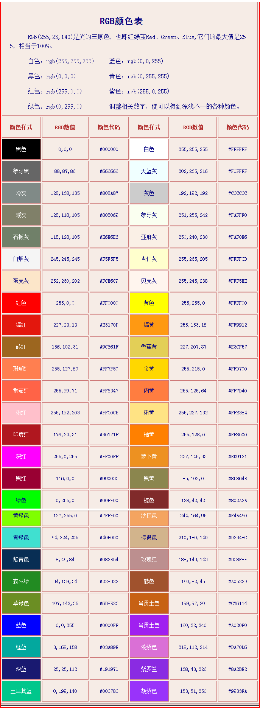

|图像类型|通道数|像素值范围|主要特点|常见用途|
|---|---|---|---|---|
|二值图像|1 通道|0 或 1|每个像素只有黑与白两种值|形态学操作、二值化、轮廓检测|
|灰度图像|1 通道|0 到 255|每个像素表示灰度（亮度）|图像预处理、物体检测、人脸识别|
|索引图像|1 通道|0 到 255（索引）|像素值为颜色表的索引，颜色表决定实际颜色|存储压缩、较少颜色的图像表示|
|**RGB 图像**|3 通道 \(R、G、B\)|0 到 255|每个像素由红、绿、蓝三个通道组成|普通彩色图像显示、图像处理与分析|

简单的讲：**图像是由像素点组成的，每个像素点的取值范围为: \[0, 255\] 。像素值越接近于 0，颜色越暗，接近于黑色；像素值越接近于 255，颜色越亮，接近于白色。**

在深度学习中，我们使用的图像大多是彩色图，彩色图由 RGB 3个通道组成，如下图所示：

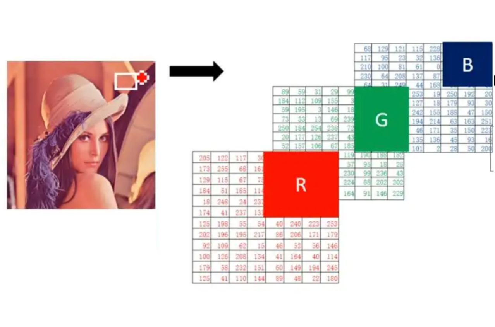


### 图像绘制与加载

> chapter03\_Convolutional\_Neural\_Network/01\_图像绘制与加载\.py
> 
> 

使用 matplotlib 库来实际理解下上面讲解的图像知识。

> `plt.imshow()`：基于HWC，展示图像
> `plt.imread()`：读取图像，获取HWC
> `plt.imsave()`：基于HWC，保存图片
> 
> 

```python
import numpy as np
import matplotlib.pyplot as plt


## 像素值的理解
def test01():
    # 全0数组是黑色的图像
    # H, W, C -> 高, 宽, 通道
    img1 = np.zeros(shape=[200, 200, 3])
    # 展示图像
    plt.imshow(img1)
    # 对坐标轴进行设置
    # off:关闭坐标轴
    # plt.axis("off")
    plt.show()

    # 全255数组是白色的图像
    img2 = np.full(shape=[200, 200, 3], fill_value=255)
    # 展示图像
    plt.imshow(img2)
    plt.show()


## 图像的加载
def test02():
    # 读取图像
    img = plt.imread("data/img.jpg")
    # 保存图像
    plt.imsave("data/img_copy.png", img)
    # 打印图像形状 高,宽,通道
    print("图像的形状(H, W, C):\n", img.shape)
    # 展示图像
    plt.imshow(img)
    plt.axis("off")
    plt.show()


if __name__ == '__main__':
    test01()
    test02()
```

**输出结果:**

全黑和全白图像：


图像的形状为：

```Plain Text
图像的形状（H，W，C）:
 (640, 640, 3)
```


## 卷积神经网络（CNN）概述

### 什么是卷积神经网络

**卷积神经网络**（Convolutional Neural Network, **CNN**）是深度学习在**计算机视觉领域**的突破性成果，专门用于处理**图像、视频、语音等数据**的神经网络。

在计算机视觉领域，往往我们输入的图像都很大，使用全连接网络的话，计算的代价较高。另外图像也很难保留原有的特征，导致图像处理的准确率不高。

卷积神经网络是含有**卷积层**的神经网络。卷积层的**作用**就是用来自动学习、提取图像的特征。

CNN 网络主要由三部分构成：**卷积层、池化层和全连接层。**

- **卷积层**负责**提取**图像中的局部**特征**。

- **池化层**用来大幅降低参数量级 \(**降维**\)。

- **全连接层**类似人工神经网络的部分，用来**输出**想要的**结果**。

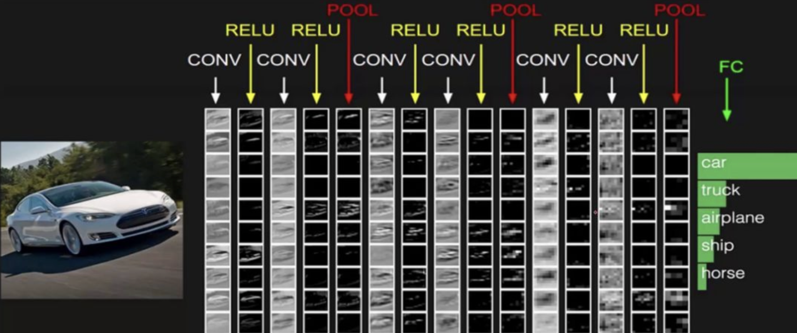

上图中 CNN 要做的事情是：给定一张图片，是车还是马未知，是什么车也未知，现在需要模型判断这张图片里具体是一个什么东西，总之输出一个结果：如果是车，那是什么车。

- 最左边是

    - 数据输入层：对数据做一些处理，比如去均值（各维度都减对应维度的均值，使得输入数据各个维度都中心化为 0，避免数据过多偏差，影响训练效果）、归一化（把所有的数据都归一到同样的范围）、PCA 等等。CNN 只对训练集做 “去均值” 这一步。

- 中间是

    - 卷积层 \(CONV\) ：线性乘积求和，提取图像中的局部特征。

    - 激励层 \(RELU\) ：ReLU 激活函数，输入数据转换成输出数据。

    - 池化层 \(POOL\) ：取区域平均值或最大值，大幅降低参数量级 \(降维\)。

- 最右边是

    - 全连接层 \(FC\) ：接收二维数据集，输出 CNN 模型预测结果。


### 卷积神经网络应用

**图像分类**：最常见的应用，例如识别图片中的物体类别。

**目标检测**：检测图像中物体的位置和类别。

**图像分割**：将图像分成多个区域，用于语义分割。

**人脸识别**：识别图像中的人脸。

**医学图像分析**：用于检测医学图像中的异常（如癌症检测、骨折检测等）。

**自动驾驶**：用于识别交通标志、车辆、行人。


### **CNN中的经典算法/网络架构**

- **LeNet\-5：**作为最早的 CNN 架构之一，证明了 CNN 在图像识别任务上的有效性，为后续的 CNN 发展奠定了基础。

    - 卷积层：提取图像的边缘、角点等基本特征。

    - 池化层 \(子采样层\)：降低特征图的维度，减少计算量，并提高模型对输入图像微小变化的鲁棒性。

    - 全连接层：将卷积层和池化层提取的特征进行组合，用于最终的分类。

- **AlexNet：**显著提升了 ImageNet 图像分类的准确率，证明了深度学习在计算机视觉领域的潜力，并推动了深度学习的快速发展。

    - 卷积层：使用更大的卷积核和更多的卷积核，提取更丰富的图像特征。

    - ReLU 激活函数：加速训练过程，并提高模型的性能。

    - 最大池化层：降低特征图的维度。

    - Dropout 层：防止过拟合。

    - 全连接层：用于最终的分类。

- **VGGNet：**探索了网络深度对性能的影响，证明了更深的网络可以提取更抽象和更具表达力的特征。

    - 卷积层：使用更小的卷积核 \(3x3\)，并堆叠多个卷积层，增加了网络的深度，提取更复杂的特征。

    - 最大池化层：降低特征图的维度。

    - 全连接层：用于最终的分类。

- **GoogLeNet \(Inception\)：**提出了 Inception 模块，在提高性能的同时减少了计算量，为后续的网络架构设计提供了新的思路。

    - **Inception 模块：**并行使用不同大小的卷积核和池化操作，然后将它们的输出连接起来，增加了网络的宽度，提高了网络的效率。

- **ResNet：**解决了深度网络训练困难的问题，使得可以训练更深的网络，从而显著提高了模型的性能。

    - **残差块 \(Residual Block\)：**引入跳跃连接 \(Shortcut Connection\)，允许梯度直接反向传播到浅层，解决了深度网络的梯度消失问题，使得训练非常深的网络成为可能。

- **DenseNet：**通过密集连接 \(Dense Connectivity\) 在网络中各层之间建立了直接的连接，即每一层都接收前面所有层的输出作为输入。这种设计增强了特征传递和梯度流动，避免了梯度消失问题，并提高了信息的利用率。

    - **密集块 \(Dense Block\)：**将每一层都与之前的所有层连接，特征重用更加充分，进一步提高了网络的性能和参数效率。


## 卷积层

卷积层（Convolutional Layer）通过卷积操作提取输入数据中的特征（例如图像中的边缘、纹理、形状等）。

卷积层利用卷积核（滤波器）对输入进行处理，从而生成特征图（feature map），并且每个卷积层能够提取不同层次的特征，从低级特征（如边缘）到高级特征（如物体的形状）。

**卷积层的主要作用如下：**

- **特征提取**：卷积层的主要作用是从输入图像中提取低级特征（如边缘、角点、纹理等）。通过多个卷积层的堆叠，网络能够逐渐从低级特征到高级特征（如物体的形状、区域等）进行学习。

- **权重共享**：在卷积层中，同一个卷积核在整个输入图像上共享权重，这使得卷积层的参数数量大大减少，减少了计算量并提高了训练效率。

- **局部连接**：卷积层中的每个神经元仅与输入图像的一个小局部区域相连，这称为**局部感受野**，这种局部连接方式更符合图像的空间结构，有助于捕捉图像中的局部特征。

- **空间不变性**：由于卷积操作是局部的并且采用权重共享，卷积层在处理图像时具有**平移不变性**。也就是说，不论物体出现在图像的哪个位置，卷积层都能有效地检测到这些物体的特征。


### 卷积计算

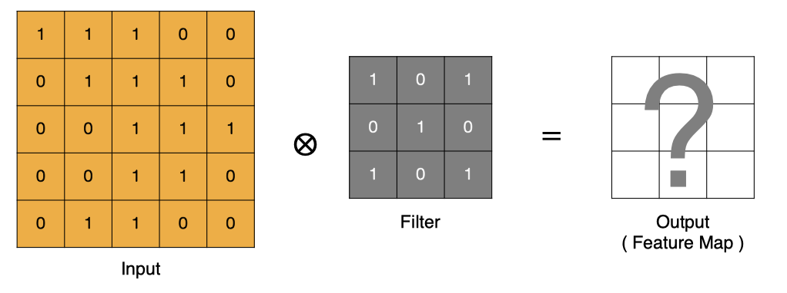

1. input 表示输入的图像。

2. filter 表示卷积核，也叫做**滤波器 \(滤波矩阵\)**。

    - 一组固定的权重，因为每个神经元的多个权重固定，所以又可以看做一个恒定的滤波器 filter。

    - 非严格意义上来讲，下图中红框框起来的部分便可以理解为一个滤波器，即带着**一组固定权重的神经元**。多个滤波器叠加便成了卷积层。

    - **一个卷积核就是一个神经元。**


3. input 经过 filter 得到输出为最右侧的图像，该图叫做**特征图**。

那么，它是如何进行计算的呢？**卷积运算本质上就是在滤波器和输入数据的局部区域间做 ****Frobenius 内积****。**

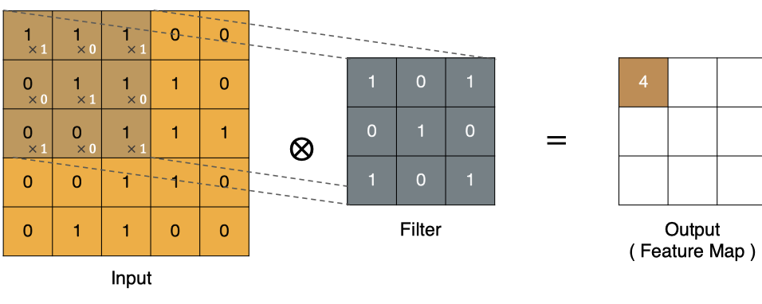

左上角的点计算方法（** Frobenius 内积**）：

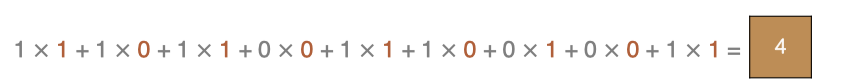

按照上面的计算方法可以得到最终的特征图为:

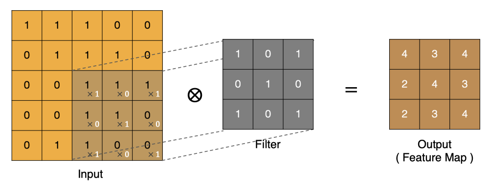

图像上的卷积:

在下图对应的计算过程中，输出是一定区域大小 \($\text{width} \times \text{height}$\) 的数据，和滤波器 filter（带着一组固定权重的神经元）做内积后得到新的二维数据。


具体来说，左边是图像输入，中间部分就是滤波器 filter（带着一组固定权重的神经元），不同的滤波器 filter 会得到不同的输出数据，比如颜色、深浅、轮廓等。


### Padding \(填充\)

通过上面的卷积计算过程，最终的特征图比原始图像小很多，如果想要保持经过卷积后的图像大小不变, 可以在**原图周围**添加 Padding 来实现。

Padding（填充）操作是一种用于在输入特征图的边界周围添加额外像素（**通常是零**）。

**Padding 的主要作用：**

- **保留边缘信息：**图像边缘的像素在卷积过程中参与的计算次数较少，这意味着边缘信息在特征提取过程中容易丢失。Padding 通过在边缘添加额外的像素，增加了边缘像素的参与度，从而更好地保留了边缘信息。

- **保持空间维度：**如果不使用 padding，每次卷积操作后，特征图的尺寸都会缩小。多次卷积后，特征图会变得非常小，可能会丢失重要的边缘信息。Padding 可以帮助维持输出特征图的尺寸与输入相同或接近相同。

- **提高性能：**Padding 有助于避免由于特征图尺寸快速缩小而导致的信息丢失，从而提高模型的性能，尤其是在处理较小的图像或需要进行多层卷积时。

**Padding 的类型：**

- **Valid Padding \(No Padding\):** 不进行任何填充。卷积核只在输入图像的有效区域内滑动。输出尺寸会缩小。

- **Same Padding:** 添加足够的填充，使得输出特征图的尺寸与输入相同。

- **Full Padding:** 尽可能多地添加填充，使得卷积核的每个元素都至少在输入图像上滑动一次。输出尺寸会增大。

**Padding 的选择：**取决于具体的应用场景和网络架构

- **Valid Padding:** 适用于不需要保持输出尺寸的场景，或者输入图像足够大，边缘信息丢失不重要的情况。

- **Same Padding:** 广泛应用于各种CNN架构中，因为它可以保持特征图的尺寸，方便网络设计和计算。

- **Full Padding:** 较少使用，因为它会增加计算量，并且可能会在边缘引入一些伪影。


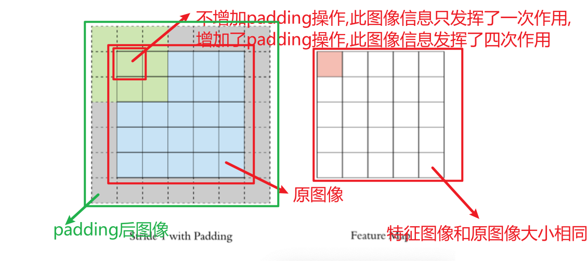


### Stride \(步长\)

Stride（步长）指的是**卷积核在图像上滑动时的步伐大小**，即每次卷积时卷积核在图像中向右（或向下）移动的像素数。步长直接影响卷积操作后输出特征图的尺寸，以及计算量和模型的特征提取能力。

**Stride 的作用:**

- **降低计算复杂度：**更大的步长意味着卷积核移动的次数更少，从而减少了计算量，并加快了训练和推理速度。

- **控制输出尺寸：**步长越大，生成的特征图尺寸越小。这类似于池化的降维效果。

- **增大感受野：**虽然更大的步长会减小特征图的尺寸，但它同时也会增大每个神经元在输入数据上的感受野。这意味着每个神经元能够捕捉到更大范围的输入信息。

> Stride\>1 会让后续神经元的感受野增长更快。因为卷积核在输入上跳跃采样，同样的层数可以覆盖更大范围。
> 
> 例如**两层** 3×3 卷积：
> 
> - stride=1：感受野 5×5
> 
> - stride=2：感受野约 7×7
> 
> 感受野递推公式中，前面层的步长会作为乘积因子影响后面层。
> 
> 

**Stride 的选择：**取决于具体的应用场景和网络架构。

- **Stride = 1：**这是最常见的设置，尤其是在网络的早期层。它允许保留更多的空间细节。

- **Stride \> 1：**通常用于减小特征图的尺寸和增大感受野，例如在网络的后期层或需要进行快速降维时。 常见的设置包括 stride=2 或 stride=4。

按照步长为 1 来移动卷积核，计算特征图如下所示：

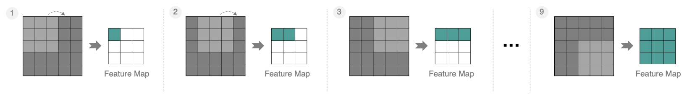

如果把 Stride 增大为 2，也是可以提取特征图的，如下图所示：

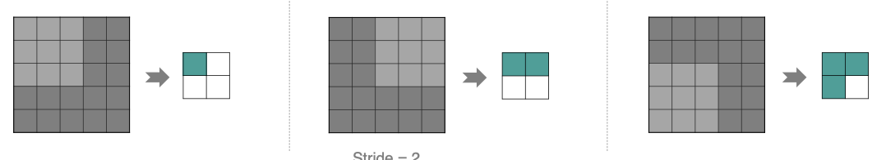

> 如果输入是六行的，这时不满足往右边移动两次，会直接换行重新开始移动，相当于不足卷积核大小的会被直接忽略。
> 
> 

#### 理论感受野计算公式

卷积神经网络中计算理论感受野（Theoretical Receptive Field）的标准逐层递推公式为：

$RF_l = RF_{l-1} + (k_l - 1) \times \prod_{i=1}^{l-1} s_i$

其中：

- $RF_l$：第 $l$层输出的感受野

- $k_l$：第 $l$层卷积核大小

- $s_i$：第 $i$层步长

- 初始 $RF_0 = 1$

**公式深度解析**

这个公式的物理意义可以拆解为：**当前层的感受野 = 上一层的感受野 \+ 当前层卷积核带来的 “额外覆盖范围”**。

1. $RF_{l-1}$：上一层每个神经元能看到的原图区域。

2. $(k_l - 1)$：当前层卷积核除了中心点之外，向外扩展的格数。

3. $\prod_{i=1}^{l-1} s_i$：**前面所有层步长的连乘（即总步长）**。因为前面层的下采样（Stride\>1）会使得特征图上的 1 个像素，代表原图上更大的区域。因此，当前层的卷积核在原图上实际覆盖的跨度，需要乘上前面所有层的步长积。

**计算实例演示**

假设我们有一个 3 层的卷积网络，输入为原图：

- **第 1 层**：卷积核 $k_1 = 3$，步长 $s_1 = 1$

    - $RF_1 = RF_0 + (k_1 - 1) \times 1 = 1 + (3-1) \times 1 = 3$

    - *\(第1层每个像素看到原图 3×3 的区域\)*

- **第 2 层**：卷积核 $k_2 = 3$，步长 $s_2 = 2$

    - $RF_2 = RF_1 + (k_2 - 1) \times s_1 = 3 + (3-1) \times 1 = 5$

    - *\(第2层每个像素看到原图 5×5 的区域\)*

- **第 3 层**：卷积核 $k_3 = 3$，步长 $s_3 = 1$

    - $RF_3 = RF_2 + (k_3 - 1) \times (s_1 \times s_2) = 5 + (3-1) \times (1 \times 2) = 9$

    - *\(第3层每个像素看到原图 9×9 的区域\)*

**非常重要的补充（进阶）**

1. **如果包含空洞卷积（Dilated Convolution）**

公式需要稍作修改。需要将当前的卷积核大小 $k_l$ 替换为**有效卷积核大小 **$K_{eff}$：

$K_{eff} = d \times (k_l - 1) + 1$

其中 $d$ 为 dilation rate。然后再代入原公式计算。

2. **池化层（Pooling）同样适用**

如果网络中夹着池化层，池化层也可以套用这个公式，把 $k_l$ 当作池化核大小，$s_i$ 当作池化的步长即可。池化层同样会扩大感受野。

3. **理论 vs 有效**

这个公式计算的是**理论感受野**（最大边界），但在实际网络中，靠近边缘的像素对中心神经元的影响非常小（甚至为 0），真正起作用的区域叫**有效感受野（Effective Receptive Field）**，通常呈高斯分布，比理论感受野小得多。


### 多通道卷积计算

实际中的图像都是多个通道组成的，我们怎么计算卷积呢？


计算方法如下：

1. 当输入有多个通道 \(Channel\)，例如 RGB 三个通道，此时要求卷积核需要拥有相同的通道数（图像有多少通道，每个卷积核就有多少通道）。

2. 每个卷积核通道与对应的输入图像的各个通道进行卷积。

3. **将每个通道的卷积结果按位相加得到最终的特征图。**

如下图所示：

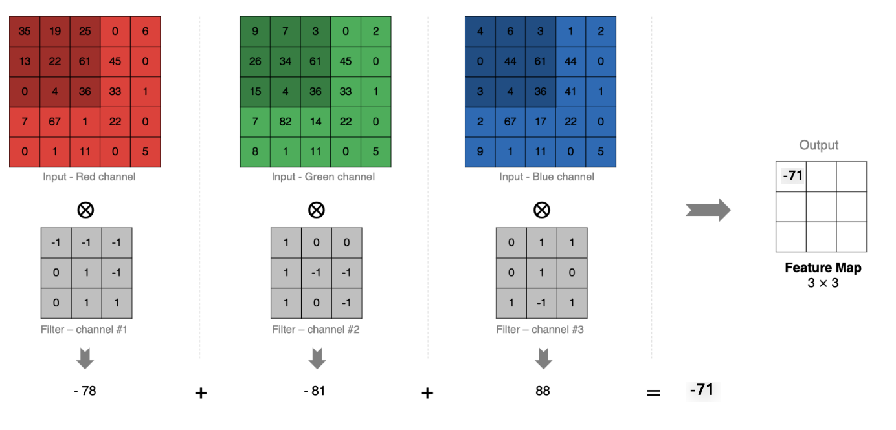


### 多卷积核卷积计算

上面的例子里我们只使用一个卷积核进行特征提取，实际对图像进行特征提取时，我们需要使用多个卷积核进行特征提取。这里多个卷积核可以理解为从不同的视角、不同的角度对图像特征进行提取。

那么，当使用多个卷积核时，应该怎么进行特征提取呢？

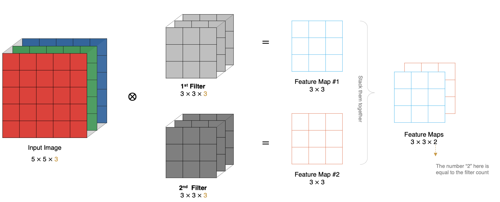

通过以下例子查看多卷积核卷积计算流程:


可以看到：

- 两个神经元，意味着有两个滤波器。

- 数据窗口每次移动两个步长取 3\*3 的局部数据，即 stride=2。

- zero\-padding=1，输入数据由 5\*5\*3 变为 7\*7\*3 。

- 左边是输入，7\*7\*3 中，7\*7 代表图像的像素/长宽，3 代表 R、G、B 三个颜色通道。

- 中间部分是两个不同的滤波器 Filter w0、Filter w1（每个滤波器也对应有三个通道）。

- 最右边则是两个不同的输出，**注意别忘记偏置**。


### 特征图大小

输出特征图的大小与以下参数息息相关：

1. size: 卷积核/过滤器大小，一般会选择为奇数，比如有 `1*1`，`3*3`，`5*5`

2. Padding: 零填充的方式

3. Stride: 步长

那计算方法如下所示：

1. 输入图像大小: W x W

2. 卷积核大小: F x F

3. Stride: S

4. Padding: P

5. 输出图像大小: N x N

$N = \frac{W - F + 2P}{S} + 1$

> **一、公式推导过程**
> 
> 用 “一维（1D）” 的思想来理解，二维（2D）只是把宽和高分别套用一次而已。
> 
> **第一步：无 Padding，步长为 1（**$P=0, S=1$**）**
> 
> 想象一条长度为 $W$ 的线段，你拿一个长度为 $F$ 的窗口在上面滑动，每次滑 1 格。
> 
> 第一次放上去，覆盖了 $F$ 个格子。还剩下 $W - F$ 个格子可以滑动。每次滑 1 格，所以能滑 $W - F$ 次。加上最开始放的那一次，总共能放次数：$N = W - F + 1$
> 
> **第二步：加入 Padding（**$P > 0, S=1$**）**
> 
> 为了防止图像边缘信息丢失，或者在卷积后保持尺寸不变，我们会在图像四周填充像素。
> 
> 上下左右各填充 $P$ 个像素，那么图像的输入宽度就变大了。新的输入宽度变成了：$W + 2P$。把第一步公式里的 $W$ 替换成 $W + 2P$：$N = (W + 2P) - F + 1= W - F + 2P + 1$
> 
> **第三步：加入步长 Stride（**$S > 1$**）**
> 
> 现在的步长不再是每次滑 1 格，而是每次滑 $S$ 格。
> 
> 在 $W + 2P$ 的总长度下，卷积核总共有 $W + 2P - F$ 的移动空间。因为每次跨 $S$ 步，所以能滑动的次数变成了 $\frac{W + 2P - F}{S}$。最后加上最开始落脚的第一次（即 \+1），就得到了图上的最终公式：
> 
> $N = \frac{W - F + 2P}{S} + 1$
> 
> **二、一个隐藏的细节：****向下取整**
> 
> 你图上的公式是理想情况。如果 $\frac{W - F + 2P}{S}$ 算出来不是整数怎么办？
> 
> 在真实的计算机计算中，如果剩下的空间不够卷积核再走一步（步长为 $S$），它是走不过去的。
> 
> 因此，严谨的数学表达中，通常要在除法外面加一个向下取整符号 $\lfloor \dots \rfloor$：
> 
> $N = \left\lfloor \frac{W - F + 2P}{S} \right\rfloor + 1$
> 
> 

以下图为例：

1. 图像大小: 5 x 5

2. 卷积核大小: 3 x 3

3. Stride: 1

4. Padding: 1

5. \(5 \- 3 \+ 2\) / 1 \+ 1 = 5（**如果除不尽向下取整**），即得到的特征图大小为: 5 x 5

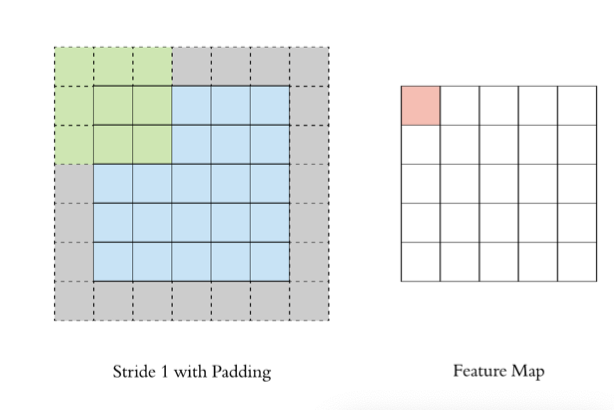

**问：**如果输出图像大小不少正方形的怎么办？

**答：**输入图像行数代入公式计算得到输出特征图的行数，输入图像列数代入公式计算得到输出特征图的列数。比如还以上图为例，输入图像大小改为 5 x 7，\(5 \- 3 \+ 2\) / 1 \+ 1 = 5，\(7 \- 3 \+ 2\)/1 \+ 1 = 7，即得到的特征图大小为 5 x 7。

**问：**如果卷积核大小不是正方形的呢？

**答：**没有那么多如果，别难为自己，一般选择奇数，通常是 1 x 1，3 x 3，5 x 5。


### PyTorch 卷积层 API

> chapter03\_Convolutional\_Neural\_Network/02\_卷积层API介绍\.py
> 
> 

在 PyTorch 中进行卷积的 API 是：

```python
conv = nn.Conv2d(in_channels, out_channels, kernel_size, stride, padding)

"""
参数说明：
in_channels: 输入通道数，RGB图片一般是3（可以看pycharm打开后显示是的多少位颜色，除以8即为通道数）
out_channels: 输出通道，也可以理解为卷积核kernel（神经元）的数量
kernel_size：卷积核的高和宽设置，一般为3,5,7...
stride：卷积核移动的步长
        整数stride：表示在所有维度上使用相同的步长 stride=2 表示在水平和垂直方向上每次移动2个像素
        元组stride: 允许在不同维度上设置不同的步长 stride=(2, 1) 表示在水平方向上步长为2，在垂直方向上步长为1
padding：在四周加入padding的数量，默认补0
        padding=0：不进行填充。
        padding=1：在每个维度上填充 1 个像素（常用于保持输出尺寸与输入相同 padding=输入形状大小-输出形状大小）。
        padding='same'（从 PyTorch 1.9+ 开始支持）：让输出特征图的尺寸与输入保持一致。PyTorch会自动计算需要的填充量。stride必须等于1，不支持跨行，因为计算padding时可能出现小数
        padding=kernel_size-1：Full Padding 完全填充
"""
```

我们接下来对下面的图片进行特征提取:


下面演示 多通道 多卷积核 卷积:

```python
import torch
import torch.nn as nn
import matplotlib.pyplot as plt

## 对图像进行卷积
## 1 读取图像 显示图像
## 2 定义卷积层
## 3 变换数据形状 1-转成tensor 2-通道要求[C H W] 3-批次数要求 [batch, C, H, W]
## 4 给卷积层喂数据 [1, 3, 640, 640] ---> [1, 4, 319, 319])
## (H-F+2p)/s +1 = (640-3+0)/2 + 1 = 319.5向下取整319
def test01():
    
    torch.manual_seed(123)

    # 1 读取图像
    img = plt.imread('./data/img.jpg')
    print('img.shape', img.shape)

    # plt.imshow(img)
    # plt.show()

    # 2 定义卷积层
    myconv2d = nn.Conv2d(in_channels=3, out_channels=4, kernel_size=3, stride=2, padding=0)
    print('myconv2d--->', myconv2d)

    # 3 变换数据形状 
    ## ①转换成tensor
    ## ②通道要求[C, H, W], 默认[H, W, C]
    ## ③批次数要求[batch, C, H, W],多少个图像(一个图像是三维数组,四维有多少个三维就是多少个图像)
    # [0, 1, 2] --> [2, 0, 1]
    img2 = torch.tensor(img).permute(2, 0, 1)
    print('img2.shape--->', img2.shape)
    ## 图像数为1,变为4维张量
    img3 = img2.unsqueeze(0)
    print('img3.shape--->', img3.shape)

    # 4 给卷积层喂数据 [1, 3, 640, 640] ---> [1, 4, 319, 319])
    # (H-F+2p)/s + 1 = (640-3+0)/2 + 1 = 319.5向下取整319
    img4 = myconv2d(img3.type(torch.float32))
    print('img4-->', img4.shape)


if __name__ == '__main__':
    test01()
```

**输出结果:**

```python
img.shape---> (640, 640, 3)
myconv2d---> Conv2d(3, 4, kernel_size=(3, 3), stride=(2, 2))
img2.shape---> torch.Size([3, 640, 640])
img3.shape---> torch.Size([1, 3, 640, 640])
img4--> torch.Size([1, 4, 319, 319])
```

对生成的特征图进行显示:

```python
## 对图像卷积 并显示卷积以后的特征图
## 思路：去掉批次数 -> 转成[HWC] -->按照通道拿数据[:,:,0123]
def test02():

    test01()

    # 5 查看特征图思路：去掉批次数 -> 转成[HWC] -->按照通道拿数据[:,:,0123]
    img5 = img4[0] # 去掉批次数
    print('去掉批次数img5.shape-->', img5.shape)    # *(4, 319, 319)*
    img6 = img5.permute(1, 2, 0)
    print('去掉批次数以后，再进行HWC img6.shape-->', img6.shape)    # *(319, 319, 4)*

    feature1 = img6[:, :, 0].detach().numpy()
    feature2 = img6[:, :, 1].detach().numpy()
    feature3 = img6[:, :, 2].detach().numpy()
    feature4 = img6[:, :, 3].detach().numpy()

    plt.imshow(feature1)
    plt.show()

    plt.imshow(feature2)
    plt.show()

    plt.imshow(feature3)
    plt.show()

    plt.imshow(feature4)
    plt.show()


if __name__ == '__main__':
    test02()
```

**生成特征图显示:**


## 池化层

池化层（Pooling Layer）是用于降低输入数据的空间维度（例如图像的高度和宽度），从而减少计算量、减少内存消耗，并提高模型的鲁棒性。

池化层通常位于卷积层之后，它通过对卷积层输出的特征图进行下采样，保留最重要的特征信息，同时丢弃一些不重要的细节。

**池化层的主要作用如下：**

- **降维和减少计算量**：池化层通过减少特征图的尺寸，从而降低了计算量，特别是在多层网络中，随着层数的增加，池化能够显著减少计算资源的消耗。

- **提高鲁棒性**：池化操作可以使得特征对小的变换、平移和旋转变得更加不敏感。这样，模型在面对噪声或图像的轻微变化时，依然能够稳定工作。

- **防止过拟合**：通过池化减少了特征图的大小，减少了模型的复杂度，从而有助于防止过拟合，尤其是在较小的数据集上。

- **抽象特征**：通过池化层的操作，可以提取更为抽象和高层次的特征，使得网络能够学习到更具泛化能力的表示。


### 池化层计算

- 最大池化 \(Max Pooling\) ：通过池化窗口进行最大池化，**取窗口中的最大值作为输出。**

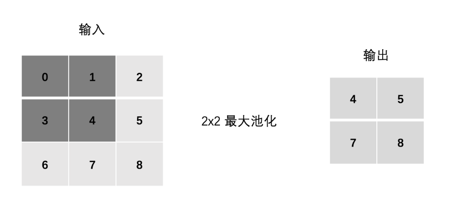

- 平均池化 \(Avg Pooling\) ：**取窗口内的所有值的均值作为输出，小数保留。**

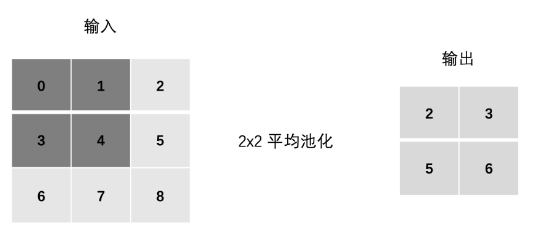


### Padding（填充）

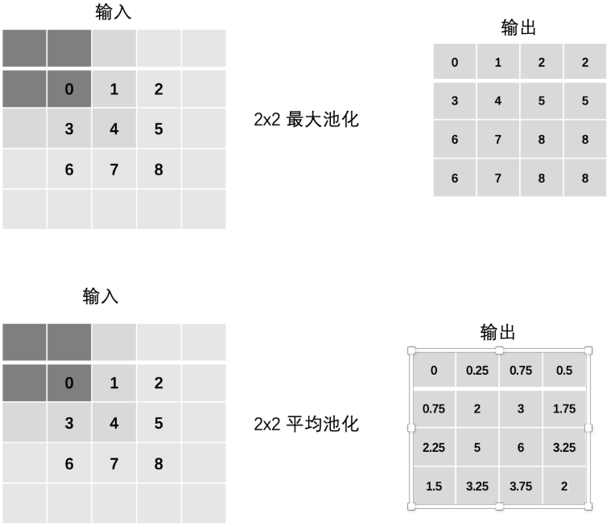


### Stride（步长）

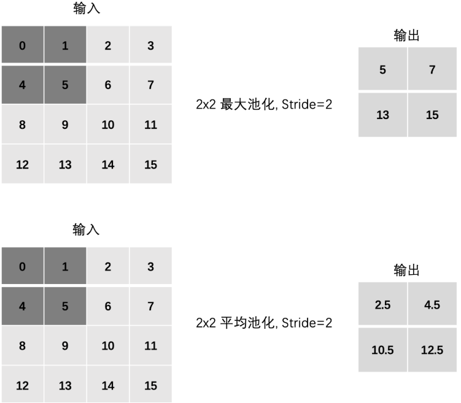


### 多通道池化计算

在处理多通道输入数据时，池化层对每个输入通道分别池化，而不是像卷积层那样将各个通道的输入相加。这意味着**池化层的输出和输入的通道数是相等**。

> 卷积可以改变通道数，池化不会改变通道数。
> 
> 

**池化只在宽高维度上池化**，**在通道上是不发生池化。**（池化前后，多少个通道还是多少个通道）

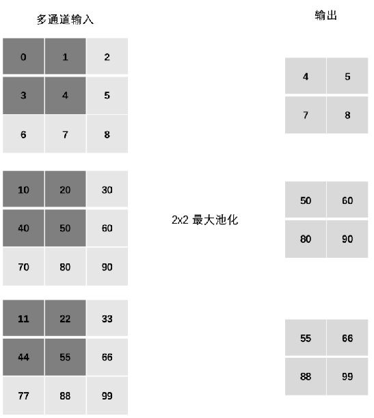


### PyTorch 池化层 API

> chapter03\_Convolutional\_Neural\_Network/03\_池化层API介绍\.py
> 
> 

在 PyTorch 中进行池化的 API 是：

```python
## 最大池化
nn.MaxPool2d(kernel_size=2, stride=2, padding=1)
## 平均池化
nn.AvgPool2d(kernel_size=2, stride=1, padding=0)
"""
参数说明：
kernel_size：池化核的高和宽设置，一般为3,5,7...
stride：核移动的步长
padding：在四周加入padding的数量，默认补0
"""
```

- 单通道池化

```python
import torch
import torch.nn as nn


## 1. 单通道池化
## 定义输入数据 [1,3,3]
inputs = torch.tensor([[[0, 1, 2], [3, 4, 5], [6, 7, 8]]], dtype=torch.float)
## 修改stride，padding观察效果
## 1. 最大池化
pooling = nn.MaxPool2d(kernel_size=2, stride=1, padding=0)
output = pooling(inputs)
print("最大池化：\n", output)
## 2. 平均池化
pooling = nn.AvgPool2d(kernel_size=2, stride=1, padding=0)
output = pooling(inputs)
print("平均池化：\n", output)
```

```python
最大池化：
 tensor([[[4., 5.],
         [7., 8.]]])
平均池化：
 tensor([[[2., 3.],
         [5., 6.]]])
```

- 多通道池化

    ```python
    ## 2. 多通道池化
    ## 定义输入数据 [3,3,3]
    inputs = torch.tensor([[[0, 1, 2], [3, 4, 5], [6, 7, 8]],
                           [[10, 20, 30], [40, 50, 60], [70, 80, 90]],
                           [[11, 22, 33], [44, 55, 66], [77, 88, 99]]], dtype=torch.float)
    ## 最大池化
    pooling = nn.MaxPool2d(kernel_size=2, stride=1, padding=0)
    output = pooling(inputs)
    print("多通道最大池化：\n", output)
    ```

    ```python
    多通道最大池化：
     tensor([[[ 4.,  5.],
             [ 7.,  8.]],
    
            [[50., 60.],
             [80., 90.]],
    
            [[55., 66.],
             [88., 99.]]])
    ```


## 图像分类案例

使用前面学习到的知识来构建一个卷积神经网络，并训练该网络实现图像分类。要完成这个案例，需要学习的内容如下：

- 了解 CIFAR10 数据集

- 搭建卷积神经网络

- 编写训练函数

- 编写预测函数


### 初始版本

> chapter03\_Convolutional\_Neural\_Network/04\_CNN案例\_图像分类\.py
> 
> 

导入工具包

```python
import torch
import torch.nn as nn
from torchvision.datasets import CIFAR10
from torchvision.transforms import ToTensor  # pip install torchvision -i https://mirrors.aliyun.com/pypi/simple/
import torch.optim as optim
from torch.utils.data import DataLoader
import time
import matplotlib.pyplot as plt
from torchsummary import summary

## 每批次样本数
BATCH_SIZE = 8
```

#### CIFAR10 数据集

CIFAR\-10 数据集 5 万张训练图像、1 万张测试图像、10 个类别、每个类别有 6k 个图像，图像大小 32×32×3。下图列举了 10 个类，每一类随机展示了 10 张图片： 


PyTorch 中的 torchvision\.datasets 计算机视觉模块封装了 CIFAR10 数据集, 使用方法如下:

```python
## 1. 数据集基本信息
def create_dataset():
    # 加载数据集:训练集数据和测试数据
    # ToTensor: 将image（一个PIL.Image对象）转换为一个Tensor
    train = CIFAR10(root='data', train=True, transform=ToTensor())
    valid = CIFAR10(root='data', train=False, transform=ToTensor())
    # 返回数据集结果
    return train, valid


if __name__ == '__main__':
    # 数据集加载
    train_dataset, valid_dataset = create_dataset()
    # 数据集类别
    print("数据集类别:", train_dataset.class_to_idx)
    # 数据集中的图像数据
    print("训练集数据集:", train_dataset.data.shape)
    print("测试集数据集:", valid_dataset.data.shape)
    # 图像展示
    plt.figure(figsize=(2, 2))
    plt.imshow(train_dataset.data[1111])      *# 索引为1111的图像*
    plt.title(train_dataset.targets[1111])    *# 图标题为图片所属的分类标签*
    plt.show()
```

**输出结果：**

```python
数据集类别: {'airplane': 0, 'automobile': 1, 'bird': 2, 'cat': 3, 'deer': 4, 'dog': 5, 'frog': 6, 'horse': 7, 'ship': 8, 'truck': 9} 
训练集数据集: (50000, 32, 32, 3) 
测试集数据集: (10000, 32, 32, 3)
```


#### 搭建图像分类网络

搭建的 CNN 网络结构如下（以一张图片的一个通道为例）：


我们要搭建的网络结构如下（我写的注释并不关心特征图的尺寸，因为只需代入公式即可）:

1. 输入形状: 32x32

> 正常的应该是 B x 3 x 32 x 32，这里先假设 B = betch\_size = 1。
> 
> 

2. 第一个卷积层输入 3 个 Channel（输入图像通道数），输出 6 个 Channel，Kernel Size 为 3x3，输出特征图尺寸 N = \(32 \- 3 \+ 0\) // 1 \+ 1 = 30

> 输入的是 3 通道，每个卷积核（神经元）也是 3 通道的，**每个通道分别做 Frobenius 内积后再相加**，此时得到的特征图是 30x30 的，且每个特征图都是一个二维矩阵（相当于 3 通道经过一个卷积核后都会变为 1 通道，所以卷积层有多少个卷积核就会组成多少个通道）。卷积层有 6 个卷积核，所以输出的为 6x30x30，**相当于一张 3 通道的图像经过第一个卷积层后变为一张 6 通道的图像。**
> 
> 所以**卷积层的参数**为：\(3 \* 3 \* 3 \* 6\) \+ 6 = 168。表示一个卷积核有 3 个通道，每个通道参数为 3x3，一共有 6 个卷积核，且**每个卷积核都有一个偏置**。
> 
> 

3. 第一个池化层输入 30x30，输出 15x15，Kernel Size 为: 2x2，Stride 为 2

> 上述 6 通道的图像加入池化层后，每个通道对应分别池化，最后输出的依然是 6 通道的图像，池化层不会改变通道数。
> 
> 池化层没有可学习的权重和偏置，只是固定规则运算，反向传播时池化层也只传递梯度，不更新参数，综上，**统计模型参数量时池化层不算参数**。
> 
> 

4. 第二个卷积层输入 6 个 Channel，输出 16 个 Channel，Kernel Size 为 3x3，输出特征图尺寸 N = \(15 \- 3 \+ 0\) // 1 \+ 1 = 13

> 输入的是 6 通道的，每个卷积核（神经元）也是 6 通道的，**每个通道分别做 Frobenius 内积后再相加**，此时得到的特征图是 13x13 的，且每个特征图都是一个二维矩阵（**无论输入的是几通道的，经过一个卷积核后都是 1 通道的，卷积层有多少个卷积核最后就会组成多少个通道**）。卷积层有 16 个卷积核，所以输出的为 16x13x13，**相当于一张 3 通道的图像经过二个卷积层后现在变为一张 16 通道的图像。**
> 
> **卷积层参数**：\(6 \* 3 \* 3 \* 16\) \+ 16 = 880
> 
> 

5. 第二个池化层输入 13x13，输出 6x6，Kernel Size 为: 2x2，Stride 为 2

> 上述 16 通道的图像加入池化层后，每个通道对应分别池化，最后输出的依然是 16 通道的图像，池化层不会改变通道数。
> 
> 

6. 全连接层只能接收二维数据，所以需要先**展平** 16 x 6 x 6 = 576，然后再送入全连接层。

> 一张 3 通道图像经过卷积层和池化层得到的是一张 16 通道的图像数据，相当于是四维的 B x 16 x 6 x 6。而全连接只能接收二维的，即 `(batch_size, features)`，**batch\_size 是由数据加载器决定的，所以需要将每一个样本的数据都展平成一维的**，这里 B = betch\_size = 1，相当于只有一个样本。
> 
> 在这里处理过的数据后面进入全连接层训练，就相当于是 ANN 了。
> 
> 

7. 第一个全连接层输入 576 维，输出 120 维

8. 第二个全连接层输入 120 维，输出 84 维

9. 最后的输出层输入 84 维，输出 10 维

我们在每个卷积计算之后应用 relu 激活函数来给网络增加非线性因素。

**构建网络代码实现如下:**

```python
## 模型构建
class ImageClassification(nn.Module):
    # 定义网络结构
    def __init__(self):
        super(ImageClassification, self).__init__()    # super()括号里面的内容可省略
        # 定义网络层：卷积层+池化层
        # 第一个卷积层, 输入图像为3通道,输出特征图为6通道,卷积核3*3
        self.conv1 = nn.Conv2d(3, 6, stride=1, kernel_size=3)
        # 第一个池化层, 核宽高2*2
        self.pool1 = nn.MaxPool2d(kernel_size=2, stride=2)
        
        # 第二个卷积层, 输入图像为6通道,输出特征图为16通道,卷积核3*3
        self.conv2 = nn.Conv2d(6, 16, stride=1, kernel_size=3)
        # 第二个池化层, 核宽高2*2
        self.pool2 = nn.MaxPool2d(kernel_size=2, stride=2)
        
        # 全连接层
        # 第一个隐藏层 输入特征576个(一张图像为16*6*6), 输出特征120个
        self.linear1 = nn.Linear(576, 120)
        # 第二个隐藏层
        self.linear2 = nn.Linear(120, 84)
        # 输出层
        self.out = nn.Linear(84, 10)

    ## 定义前向传播
    def forward(self, x):
        # 卷积+relu+池化
        *# x = self.conv1(x)   # 卷积层*
        *# x = torch.relu(x)   # 激励层*
        *# x = self.pool1(x)   # 池化层*
        x = self.pool1(torch.relu(self.conv1(x)))
        # 卷积+relu+池化
        x = self.pool2(torch.relu(self.conv2(x)))
        # 将特征图做成以为向量的形式：相当于特征向量 全连接层只能接收二维数据集
        # 由于最后一个批次可能不够8，所以需要根据批次数量 x.size(0) 来改变形状
        # x[8, 16, 6, 6] --> [8, 576] -->8个样本,576个特征
        # x.size(0): 第1个值是样本数 行数
        # -1：第2个值由原始x剩余3个维度值相乘计算得到 列数(特征个数)
        x = x.reshape(x.size(0), -1)    # 8行576列（不考虑最后一批可能不够8的情况）
        # 全连接层
        x = torch.relu(self.linear1(x))
        x = torch.relu(self.linear2(x))
        # 返回输出结果，softmax由后面CrossEntropyLoss()负责
        return self.out(x)


if __name__ == '__main__':
    # 模型实例化
    model = ImageClassification()
    summary(model, input_size=(3,32,32), batch_size=1)    # batch_size=1仅演示用，没啥影响
```

**输出结果：**

```Plain Text
----------------------------------------------------------------
        Layer (type)               Output Shape         Param #
================================================================
            Conv2d-1             [1, 6, 30, 30]             168    (3*3*3*6)+6=168
         MaxPool2d-2             [1, 6, 15, 15]               0    池化层没有可学习的权重和偏置，仅是固定规则运算，所以统计模型参数量时不算参数。
            Conv2d-3            [1, 16, 13, 13]             880    (6*3*3*16)+16 = 880
         MaxPool2d-4              [1, 16, 6, 6]               0    
            Linear-5                   [1, 120]          69,240    (576+1)*120=69420
            Linear-6                    [1, 84]          10,164    (120+1)*84=10164
            Linear-7                    [1, 10]             850    (84+1)*10=850
================================================================
Total params: 81,302
Trainable params: 81,302
Non-trainable params: 0
----------------------------------------------------------------
Input size (MB): 0.01
Forward/backward pass size (MB): 0.08
Params size (MB): 0.31
Estimated Total Size (MB): 0.40
----------------------------------------------------------------
```

#### 编写训练函数

在训练时，使用多分类交叉熵损失函数，Adam 优化器。具体实现代码如下:

```python
def train(model, train_dataset):
    torch.manual_seed(123)    # 最好放在程序入口最前面，统一控制
    # 构建数据加载器
    dataloader = DataLoader(train_dataset, batch_size=BATCH_SIZE, shuffle=True)
    criterion = nn.CrossEntropyLoss() # 构建损失函数
    optimizer = optim.Adam(model.parameters(), lr=1e-3) # 构建优化方法
    # epoch = 100  # 训练轮数
    epoch = 20  # 训练时间太长了，20轮意思一下
    for epoch_idx in range(epoch):
        sum_num = 0   # 样本数量
        total_loss = 0.0  # 损失总和
        correct = 0  # 预测正确样本数
        start = time.time()  # 开始时间
        # 遍历数据进行网络训练
        for x, y in dataloader:
            model.train()
            output = model(x)
            loss = criterion(output, y)  # 计算损失
            optimizer.zero_grad()  # 梯度清零
            loss.backward()  # 反向传播
            optimizer.step()  # 参数更新
            correct += (torch.argmax(output, dim=-1) == y).sum()  # 计算预测正确样本数
            # 计算每次训练模型的总损失值，loss是每批样本平均损失值
            total_loss += loss.item()*len(y)  # 统计损失和
            sum_num += len(y)    # 两个地方写len(y)或者1都可以，这里用len(y)是为了算acc时使用
        print('epoch:%2s loss:%.5f acc:%.2f time:%.2fs' %(epoch_idx + 1,total_loss / sum_num,correct / sum_num,time.time() - start))
    # 模型保存
    torch.save(model.state_dict(), 'model/image_classification.pth')


if __name__ == '__main__':
    # 数据集加载
    train_dataset, valid_dataset = create_dataset()
    # 模型实例化
    model = ImageClassification()
    # 模型训练
    train(model,train_dataset)
```

**输出结果：**

```Plain Text
epoch: 1, loss: 1.61168, acc:0.40, time:42.93s
epoch: 2, loss: 1.32327, acc:0.52, time:51.77s
epoch: 3, loss: 1.21371, acc:0.56, time:38.55s
epoch: 4, loss: 1.14541, acc:0.59, time:57.99s
epoch: 5, loss: 1.08713, acc:0.61, time:62.72s
epoch: 6, loss: 1.04034, acc:0.63, time:48.39s
epoch: 7, loss: 1.00194, acc:0.65, time:64.07s
epoch: 8, loss: 0.96569, acc:0.65, time:48.23s
epoch: 9, loss: 0.93401, acc:0.67, time:58.81s
epoch: 10, loss: 0.90370, acc:0.68, time:48.95s
epoch: 11, loss: 0.88018, acc:0.69, time:64.90s
epoch: 12, loss: 0.85746, acc:0.70, time:50.89s
epoch: 13, loss: 0.83466, acc:0.70, time:41.41s
epoch: 14, loss: 0.81563, acc:0.71, time:52.41s
epoch: 15, loss: 0.79869, acc:0.71, time:39.59s
epoch: 16, loss: 0.77787, acc:0.72, time:54.75s
epoch: 17, loss: 0.76593, acc:0.73, time:39.38s
epoch: 18, loss: 0.74640, acc:0.73, time:61.74s
epoch: 19, loss: 0.73407, acc:0.74, time:67.28s
epoch: 20, loss: 0.71639, acc:0.74, time:67.56s
```

#### 编写预测函数

加载训练好的模型，对测试集中的1万条样本进行预测，查看模型在测试集上的准确率。

```python
def test(valid_dataset):
    # 构建数据加载器
    dataloader = DataLoader(valid_dataset, batch_size=BATCH_SIZE, shuffle=False)
    # 加载模型并加载训练好的权重
    model = ImageClassification()
    model.load_state_dict(torch.load('model/image_classification.pth'))
    # 模型切换评估模式, 如果网络模型中有dropout/BN等层, 评估阶段不进行相应操作
    model.eval()
    # 计算精度
    total_correct = 0
    total_samples = 0
    # 遍历每个batch的数据，获取预测结果，计算精度
    for x, y in dataloader:
        output = model(x)
        total_correct += (torch.argmax(output, dim=-1) == y).sum()
        total_samples += len(y)
    # 打印精度
    print('Acc: %.2f' % (total_correct / total_samples))


if __name__ == '__main__':
    test(valid_dataset)
```

**输出结果：**

```python
Acc: 0.62
```


### GPU 版 torch

> chapter03\_Convolutional\_Neural\_Network/05\_CNN案列\_图像分类\_GPU版\.py
> 
> 

GPU 版的 torch 是兼容 CPU 版的 torch 的，若仅使用 CPU，只需注意 summary 函数加一个参数声明使用 CPU 即可。而使用 GPU 也仅需要核心改三个地方，具体见下文代码块注释。

若仅将上述代码改为在 GPU 上运行：

```Python
*"""*
*案例:*
*    演示CNN的综合案例, 图像分类.*
*    仅将CPU训练改为GPU训练，没有做任何其他的优化*

*GPU 训练说明(本文件已同时兼容 CPU 和 GPU):*
*    1. 代码自动选择设备: 有 GPU 用 GPU, 没有就退回 CPU, 所以同一份代码两边都能跑.*
*    2. 核心就 3 件事: 模型 .to(DEVICE) / 每批数据 .to(DEVICE) / 统计量 .item() 取回 Python 数字.*
*    3. GPU 想快, 必须把 BATCH_SIZE 放大(8 -> 256), 并给 DataLoader 开 pin_memory + num_workers + persistent_workers,*
*       否则小批次下 GPU 大部分时间在等数据, 反而快不起来.*
       *训练模式时配套使用 non_blocking=True，异步拷贝*
*    4. 训练完在控制台看到 "使用设备: cuda" 就说明真的用上 GPU 了.*
*"""*
import torch
import torch.nn as nn
from torchvision.datasets import CIFAR10
from torchvision.transforms import ToTensor
import torch.optim as optim
from torch.utils.data import DataLoader
import time
from torchsummary import summary


*# [新增] 定义设备对象，如果检测到CUDA则使用GPU，否则退回CPU*
DEVICE = torch.device('cuda' if torch.cuda.is_available() else 'cpu')

BATCH_SIZE = 8
*# 注意: CPU 上用 8 也能跑, 但 GPU 上必须放大, 否则每批的"启动 kernel + 数据拷贝"开销占主导, 提速会被吃掉.*
*# 但 batch_size 大了之后，每轮更新次数也会变小很多，模型训练效果依旧不理想。*
*# 这里仅为了用GPU将CPU版本的代码跑出来，所以没有进行任何优化*


def create_dataset():
    train_dataset = CIFAR10(root='./data', train=True, transform=ToTensor(), download=True)
    test_dataset = CIFAR10(root='./data', train=False, transform=ToTensor(), download=True)
    return train_dataset, test_dataset


class ImageModel(nn.Module):
    def __init__(self):
        super().__init__()
        self.conv1 = nn.Conv2d(3, 6, 3, 1, 0)
        self.pool1 = nn.MaxPool2d(2, 2, 0)
        self.conv2 = nn.Conv2d(6, 16, 3, 1, 0)
        self.pool2 = nn.MaxPool2d(2, 2, 0)
        self.linear1 = nn.Linear(576, 120)
        self.linear2 = nn.Linear(120, 84)
        self.output = nn.Linear(84, 10)

    def forward(self, x):
        x = self.pool1(torch.relu(self.conv1(x)))
        x = self.pool2(torch.relu(self.conv2(x)))
        x = x.reshape(x.size(0), -1)
        x = torch.relu(self.linear1(x))
        x = torch.relu(self.linear2(x))
        return self.output(x)


def train(train_dataset):
    *# [修改]*
*    #    pin_memory=True : 把数据放进"锁页内存", 配合 non_blocking=True 让 数据->GPU 的拷贝和计算重叠.*
*    #    num_workers=4   : 多进程并行读数据/做 ToTensor, 避免 GPU 空等 CPU. (Windows 下必须放在 __main__ 保护里, 本文件已满足)*
*    #    persistent_workers : worker 只创建一次, 后面每个 epoch 复用(默认 False = 每轮重建).*
*    #                   ⚠️ 不开它时, 每个 epoch 结束都会销毁 worker, 下个 epoch 再重新创建:*
*    #                      每个 worker 都要重新 import torch, 还要把整个数据集(CIFAR10 约 150MB)pickle 一份传过去;*
*    #                      实测本案例光"重建 worker"就要 20~30 秒/轮, 比真正的训练计算(约 2 秒)还久.*
*    #                   打开后只支付一次启动成本: 100 个 epoch 从约 50 分钟降到约 5~8 分钟.*
*    #                   注意: 只有 num_workers > 0 时才生效.*
*    *dataloader = DataLoader(train_dataset, batch_size=BATCH_SIZE, shuffle=True,
                            pin_memory=True, num_workers=4,
                            persistent_workers=True)
    *# [修改] 将模型移动到指定的GPU设备上*
*    *model = ImageModel().to(DEVICE)
    criterion = nn.CrossEntropyLoss()
    optimizer = optim.Adam(model.parameters(), lr=1e-3)
    *# GPU 训练可以改回100*
*    *epochs = 100
    for epoch_idx in range(epochs):
        total_loss, total_samples, total_correct, start = 0.0, 0, 0, time.time()
        for x, y in dataloader:
            model.train()
            *# [新增] 将每批次的输入数据和标签移动到GPU设备上*
*            *x = x.to(DEVICE, non_blocking=True)  *# non_blocking=True，异步拷贝*
*            *y = y.to(DEVICE, non_blocking=True)

            y_pred = model(x)
            loss = criterion(y_pred, y)
            optimizer.zero_grad()
            loss.backward()
            optimizer.step()

            *# [修改] 在sum()后面加上.item()，将GPU上的张量转换为Python数字*
*            *total_correct += (torch.argmax(y_pred, dim=-1) == y).sum().item()
            total_loss += loss.item() * len(y)
            total_samples += len(y)

        print(
            f'epoch: {epoch_idx + 1}, loss: {total_loss / total_samples:.5f}, acc:{total_correct / total_samples:.2f}, time:{time.time() - start:.2f}s')

    torch.save(model.state_dict(), './model/image_classification_just_GPU.pth')


def evaluate(test_dataset):
    *# [修改] pin_memory=True 可保留(配合 .to(DEVICE) 能省一点拷贝时间);*
*    #       测试阶段不设 num_workers 也行(默认 0, 单进程足够, 也方便调试).*
*    *dataloader = DataLoader(test_dataset, batch_size=BATCH_SIZE, shuffle=False, pin_memory=True)
    *# [修改] 将实例化的模型移动到GPU设备上*
*    *model = ImageModel().to(DEVICE)
    *# [修改] 在torch.load中加入map_location=DEVICE，确保权重加载到GPU上*
*    *model.load_state_dict(torch.load('./model/image_classification_just_GPU.pth', map_location=DEVICE))
    total_correct, total_samples = 0, 0
    for x, y in dataloader:
        model.eval()
        *# [新增] 将测试集的批次数据移动到GPU设备上*
*        *x = x.to(DEVICE)
        y = y.to(DEVICE)

        y_pred = model(x)
        y_pred = torch.argmax(y_pred, dim=-1)
        *# [修改] 同样加上.item()将结果取回CPU转为普通数字*
*        *total_correct += (y_pred == y).sum().item()
        total_samples += len(y)

    print(f'Acc: {total_correct / total_samples:.2f}')


if __name__ == '__main__':
    *# [声明] GPU训练默认模式即使设定随机种子，也无法完全复现，有很多方面的原因，但GPU有确定性模式，这里不再弄了*
*    *torch.manual_seed(123)
    *# [新增] 固定GPU的随机种子，以保证结果可复现*
*    *torch.cuda.manual_seed_all(123)
    *# print(f'使用设备: {DEVICE}')              # 看到 cuda 就说明 GPU 生效了*

    train_dataset, test_dataset = create_dataset()
    *# print(f'训练集: {train_dataset.data.shape}')*
*    # print(f'测试集: {test_dataset.data.shape}')*
*    # print(f'数据集类别: {train_dataset.class_to_idx}')*

*    # [修改] 实例化模型并移动到GPU设备上*
*    # 注意: 先.to(DEVICE)再 summary.*
*    #    torchsummary 1.5.1 的 device 参数默认是 "cuda", 它会在 GPU 上造随机输入做前向,*
*    #    如果模型还在 CPU 上, 会报 "Expected all tensors to be on the same device".*
*    *model = ImageModel().to(DEVICE)
    *# summary(model, (3, 32, 32), batch_size=8)*

*    # train(train_dataset)      # 训练一次之后就不必再训练了*
*    *evaluate(test_dataset)
```

**运行结果为：**

```Plain Text
epoch: 1, loss: 1.62754, acc:0.40, time:41.73s
epoch: 2, loss: 1.36220, acc:0.51, time:26.03s
epoch: 3, loss: 1.26226, acc:0.54, time:21.66s
epoch: 4, loss: 1.19391, acc:0.57, time:15.92s
epoch: 5, loss: 1.14176, acc:0.59, time:14.63s
epoch: 6, loss: 1.10382, acc:0.61, time:13.71s
epoch: 7, loss: 1.07337, acc:0.62, time:13.36s
epoch: 8, loss: 1.04331, acc:0.63, time:12.80s
epoch: 9, loss: 1.01703, acc:0.64, time:13.60s
epoch: 10, loss: 0.99689, acc:0.65, time:13.26s
epoch: 11, loss: 0.97398, acc:0.65, time:12.85s
epoch: 12, loss: 0.95616, acc:0.66, time:21.14s
epoch: 13, loss: 0.93754, acc:0.67, time:23.80s
epoch: 14, loss: 0.92436, acc:0.67, time:21.36s
epoch: 15, loss: 0.90823, acc:0.68, time:22.05s
epoch: 16, loss: 0.89717, acc:0.68, time:24.39s
epoch: 17, loss: 0.88375, acc:0.69, time:30.25s
epoch: 18, loss: 0.87228, acc:0.69, time:18.09s
epoch: 19, loss: 0.86118, acc:0.69, time:14.20s
epoch: 20, loss: 0.85235, acc:0.70, time:13.36s
...
epoch: 95, loss: 0.54563, acc:0.80, time:18.47s
epoch: 96, loss: 0.54246, acc:0.80, time:16.92s
epoch: 97, loss: 0.53898, acc:0.80, time:15.94s
epoch: 98, loss: 0.54099, acc:0.80, time:18.20s
epoch: 99, loss: 0.53827, acc:0.80, time:18.17s
epoch: 100, loss: 0.53432, acc:0.81, time:14.28s
Acc: 0.56
```

发现运行速度有所提升，但并没有得到显著提升，这主要是因为 *每批的"启动 kernel \+ 数据拷贝"开销占主导，提速会被吃掉。即小批次下 GPU 大部分时间在等数据, 反而快不起来\.*

若要显著提升速度，需要增大批次数，但增大批次数会导致每轮参数的更新次数变少很多，模拟训练效果也不会很好。

下面是一些比较重要的注释：

```Python
'''
*GPU 训练说明(本文件已同时兼容 CPU 和 GPU):*
*    1. 代码自动选择设备: 有 GPU 用 GPU, 没有就退回 CPU, 所以同一份代码两边都能跑.*
*    2. 核心就 3 件事: 模型 .to(DEVICE) / 每批数据 .to(DEVICE) / 统计量 .item() 取回 Python 数字.*
*    3. GPU 想快, 必须把 BATCH_SIZE 放大(8 -> 256), 并给 DataLoader 开 pin_memory + num_workers + persistent_workers,*
*       否则小批次下 GPU 大部分时间在等数据, 反而快不起来.*
       *训练模式时配套使用 non_blocking=True，异步拷贝*
*    4. 训练完在控制台看到 "使用设备: cuda" 就说明真的用上 GPU 了.*
'''

*# [修改]*
*#    pin_memory=True : 把数据放进"锁页内存", 配合 non_blocking=True 让 数据->GPU 的拷贝和计算重叠.*
*#    num_workers=4   : 多进程并行读数据/做 ToTensor, 避免 GPU 空等 CPU. (Windows 下必须放在 __main__ 保护里, 本文件已满足)*
*#    persistent_workers : worker 只创建一次, 后面每个 epoch 复用(默认 False = 每轮重建).*
*#                   ⚠️ 不开它时, 每个 epoch 结束都会销毁 worker, 下个 epoch 再重新创建:*
*#                      每个 worker 都要重新 import torch, 还要把整个数据集(CIFAR10 约 150MB)pickle 一份传过去;*
*#                      实测本案例光"重建 worker"就要 20~30 秒/轮, 比真正的训练计算(约 2 秒)还久.*
*#                   打开后只支付一次启动成本: 100 个 epoch 从约 50 分钟降到约 5~8 分钟.*
*#                   注意: 只有 num_workers > 0 时才生效.*

*# [声明] GPU训练默认模式即使设定随机种子，也无法完全复现，有很多方面的原因，但GPU有确定性模式，这里不再弄了*
```


### 模型优化

> chapter03\_Convolutional\_Neural\_Network/06\_CNN案列\_图像分类\_优化版\.py
> 
> 

1. 模型的预测准确率仅有 0\.56，还有很大提升空间。

2. CNN 网络模型在训练集样本上的准确率远远高于测试集，说明模型产生了过拟合问题。

```Python
*"""*
*案例:*
*    演示CNN的综合案例, 图像分类.*
*    优化且使用GPU大幅加速训练, 并重点解决过拟合问题.*

*GPU 训练说明(本文件已同时兼容 CPU 和 GPU):*
*    1. 代码自动选择设备: 有 GPU 用 GPU, 没有就退回 CPU, 所以同一份代码两边都能跑.*
*    2. 核心就 3 件事: 模型 .to(DEVICE) / 每批数据 .to(DEVICE) / 统计量 .item() 取回 Python 数字.*
*    3. **GPU 想快, 必须把 BATCH_SIZE 放大(8 -> 128/256)**, 并给 DataLoader 开 pin_memory + num_workers + persistent_workers,*
*       否则小批次下 GPU 大部分时间在等数据, 反而快不起来.*
*       训练模式时配套使用 non_blocking=True，异步拷贝*
*    4. 训练完在控制台看到 "使用设备: cuda" 就说明真的用上 GPU 了.*

*优化方向:*
*    1. 数据增强: RandomCrop + RandomHorizontalFlip, 相当于"免费扩容"训练集.*
*    2. 归一化: Normalize 用 CIFAR10 统计量, 让输入分布更规整, 训练更稳更快.*
*    3. 增大参数量且分配合适的结构，避免"卷积弱 + FC 胖" ，这样容易天然容易死记硬背，造成过拟合*
*        卷积加强(3->64→128→256 + BatchNorm), FC 4096->512->256->10.*
*    4. 在两个全连接层后使用 dropout 正则化.*
*    4. 优化器: Adam -> AdamW + weight_decay(解耦的 L2 正则).*
*    5. 学习率调度: CosineAnnealingLR, 后期自动降 lr, 避免在最优解附近震荡记噪声.*
*    6. 早停: 验证集连续多轮不提升就停, 防止练过头.*
*    7. 增加训练轮数，之前受限于 CPU 训练速度，训练轮数太少.*
*    7. 划分验证集: 从训练集里划 10%, 调参/早停用 val, 测试集只在最后评一次.*
*"""*

*# 导包*
import torch
import torch.nn as nn
import torch.optim as optim
import time
from torchvision.datasets import CIFAR10
from torchvision.transforms import Compose, ToTensor, Normalize, RandomCrop, RandomHorizontalFlip
from torch.utils.data import DataLoader, random_split
from torchsummary import summary

*# 设备选择: 有 GPU 用 GPU, 没有则自动退回 CPU(同一份代码两边都能跑)*
DEVICE = torch.device('cuda' if torch.cuda.is_available() else 'cpu')

*# GPU 上必须放大 batch, 否则每批的 kernel 启动 + 数据拷贝开销占主导, 提速会被吃掉*
BATCH_SIZE = 128


*# 1. 准备数据集.*
def create_dataset():
    *# todo 归一化统计量用 CIFAR10 官方给的 RGB 均值/标准差, 训练集和测试集必须用同一组.*
*    #      不能拿测试集自己算, 否则等于泄漏了测试集信息.*
*    *norm = Normalize((0.4914, 0.4822, 0.4465), (0.2470, 0.2435, 0.2616))

    *# todo 训练集做随机增强: 每次取图都略有不同, 等价于扩充了数据量, 是最有效的抗过拟合手段.*
*    #      RandomCrop(32, padding=4): 四周补 4 像素再随机裁回 32, 让模型不依赖物体绝对位置.*
*    #      RandomHorizontalFlip: 随机水平翻转, CIFAR10 里猫/车翻转后语义不变, 可以放心用.*
*    *train_tf = Compose([
        RandomCrop(32, padding=4),
        RandomHorizontalFlip(p=0.5),
        ToTensor(),
        norm,
    ])
    *# todo 测试集绝不能用随机变换, 否则每次评估结果都在抖, 无法比较.*
*    *test_tf = Compose([ToTensor(), norm])

    train_full = CIFAR10(root='./data', train=True, transform=train_tf, download=True)
    test_set = CIFAR10(root='./data', train=False, transform=test_tf, download=True)

    *# todo 从训练集划 10% 做验证集: 早停/调参看 val, 测试集只在最后用一次, 评估更客观.*
*    *n_val = 5000
    train_set, val_set = random_split(train_full, [len(train_full) - n_val, n_val])
    return train_set, val_set, test_set


*# 2. 搭建(卷积)神经网络: 加强卷积、收敛 FC 容量.*
class ImageModel(nn.Module):
    def __init__(self):
        super().__init__()
        *# todo padding=1 保证卷积后尺寸不变(HW 不变), 尺寸只由 pool 决定, 便于推算 FC 输入.*
*        #      原模型不加 padding, 每层卷积都会缩尺寸, 特征图越来越小.*
*        *self.conv1 = nn.Conv2d(3, 64, 3, 1, padding=1)
        self.bn1 = nn.BatchNorm2d(64)
        self.pool1 = nn.MaxPool2d(2, 2)

        self.conv2 = nn.Conv2d(64, 128, 3, 1, padding=1)
        self.bn2 = nn.BatchNorm2d(128)
        self.pool2 = nn.MaxPool2d(2, 2)

        *# todo 多一层卷积: 更深的卷积能提取更抽象的特征, 把"记忆"的活从 FC 层挪回卷积层.*
*        *self.conv3 = nn.Conv2d(128, 256, 3, 1, padding=1)
        self.bn3 = nn.BatchNorm2d(256)
        self.pool3 = nn.MaxPool2d(2, 2)  *# 尺寸: 32 -> 16 -> 8 -> 4*

*        # todo FC 4096->512->256->10.*
*        #      输入维度 = 通道 256 * 4 * 4 = 4096, 由上面三次 pool 精确推得.*
*        *self.linear1 = nn.Linear(256 * 4 * 4, 512)
        self.linear2 = nn.Linear(512, 256)
        self.output = nn.Linear(256, 10)

        *# Dropout 只加在全连接层, 卷积层后不加(卷积参数少, 加了容易欠拟合)*
*        *self.dropout = nn.Dropout(p=0.5)

    def forward(self, x):
        *# todo 顺序惯例: Conv -> BN -> ReLU -> Pool.*
*        #      BN 放在 ReLU 前, 让每层输入分布稳定, 训练更快也更稳, 附带一点正则效果.*
*        *x = self.pool1(torch.relu(self.bn1(self.conv1(x))))   *# (B, 64, 16, 16)*
*        *x = self.pool2(torch.relu(self.bn2(self.conv2(x))))   *# (B, 128, 8, 8)*
*        *x = self.pool3(torch.relu(self.bn3(self.conv3(x))))   *# (B, 256, 4, 4)*

*        # 全连接层只能处理二维数据, 拉平成 (B, 4096)*
*        *x = x.reshape(x.size(0), -1)

        *# Dropout 只在 model.train() 时生效, model.eval() 时自动关闭*
*        *x = self.dropout(torch.relu(self.linear1(x)))
        x = self.dropout(torch.relu(self.linear2(x)))
        *# 输出层前不加 dropout, 交给 CrossEntropyLoss 里的 softmax 处理*
*        *return self.output(x)


*# 3. 通用评估函数(训练中评估验证集 / 最后评估测试集都用它).*
@torch.no_grad()   *# todo 评估不需要梯度, 关掉能省显存、提速, 也避免误改参数*
def evaluate(model, loader):
    model.eval()   *# 切评估模式: 关闭 Dropout, BN 用 running 统计量*
*    *correct, total = 0, 0
    for x, y in loader:
        x = x.to(DEVICE, non_blocking=True)
        y = y.to(DEVICE, non_blocking=True)
        correct += (model(x).argmax(dim=-1) == y).sum().item()
        total += len(y)
    return correct / total


*# 4. 模型训练.*
def train(train_set, val_set):
    *# todo pin_memory: 把数据放进锁页内存, 配合 non_blocking=True 让拷贝和计算重叠.*
*    #      num_workers=4: 多进程预取数据, 避免 GPU 空等 CPU.*
*    #      persistent_workers: worker 只建一次, 每轮复用. 不开的话每轮重建要 20~30 秒, 比训练本身还久.*
*    *train_loader = DataLoader(train_set, batch_size=BATCH_SIZE, shuffle=True,
                              pin_memory=True, num_workers=4, persistent_workers=True)
    *# 验证集不用 shuffle, 评估结果才稳定*
*    *val_loader = DataLoader(val_set, batch_size=BATCH_SIZE, shuffle=False,
                            pin_memory=True, num_workers=4, persistent_workers=True)

    model = ImageModel().to(DEVICE)
    criterion = nn.CrossEntropyLoss()  *# 多分类交叉熵 = softmax + 损失计算*

*    # todo Adam -> AdamW: Adam 的 weight_decay 和自适应学习率耦合得不好, AdamW 是解耦版本, 正则更有效.*
*    #      weight_decay=5e-4: 惩罚过大的权重, 抑制模型去拟合噪声.*
*    #      lr不变: 加了 BN 后对学习率不敏感, 太小的 lr 配 100 轮会练得太慢.*
*    *optimizer = optim.AdamW(model.parameters(), lr=1e-3, weight_decay=5e-4)

    epochs = 100
    *# todo 余弦退火: lr 从 1e-3 平滑降到接近 0, 后期步长变小, 不会在最优点附近震荡记噪声.*
*    *scheduler = optim.lr_scheduler.CosineAnnealingLR(optimizer, T_max=epochs)

    *# todo 早停: val 连续 patience 轮不提升就停, 并保存最佳权重, 防止练过头.*
*    *best_acc, patience, wait = 0.0, 10, 0

    for epoch in range(epochs):
        model.train()   *# 切训练模式: 开启 Dropout, BN 用当前批次统计量*
*        *total_loss, total_samples, total_correct, start = 0.0, 0, 0, time.time()

        for x, y in train_loader:
            *# 每批数据和模型必须在同一设备, 否则报 "Expected all tensors to be on the same device"*
*            *x = x.to(DEVICE, non_blocking=True)
            y = y.to(DEVICE, non_blocking=True)

            y_pred = model(x)
            loss = criterion(y_pred, y)
            optimizer.zero_grad()
            loss.backward()
            optimizer.step()

            *# .item() 把 GPU 上的 0 维张量取回成 Python 数字, 避免累加器一直是 GPU 张量*
*            *total_correct += (y_pred.argmax(dim=-1) == y).sum().item()
            total_loss += loss.item() * len(y)
            total_samples += len(y)

        train_acc = total_correct / total_samples
        *# todo 每轮评估验证集: 只有同时看 train_acc 和 val_acc 的 gap, 才知道过拟合从第几轮开始*
*        *val_acc = evaluate(model, val_loader)
        scheduler.step()   *# 每个 epoch 结束后更新学习率*

*        *print(f'epoch {epoch + 1:3d} | loss {total_loss / total_samples:.4f} | '
              f'train_acc {train_acc:.3f} | val_acc {val_acc:.3f} | '
              f'gap_acc {train_acc - val_acc:.3f} | {time.time() - start:.1f}s')

        *# 保存验证集上表现最好的一轮, 最后测试用这个权重*
*        *if val_acc > best_acc:
            best_acc, wait = val_acc, 0
            torch.save(model.state_dict(), './model/image_classification_best.pth')
        else:
            wait += 1
            if wait >= patience:
                print(f'早停 @ epoch {epoch + 1}, best val_acc = {best_acc:.3f}')
                break


*# 5. 测试*
if __name__ == '__main__':
    *# GPU 训练默认模式即使固定种子也无法完全复现(并行归约顺序不确定), 这里只固定种子不追求严格复现*
*    *torch.manual_seed(123)
    torch.cuda.manual_seed_all(123)
    print(f'使用设备: {DEVICE}')   *# 看到 cuda 就说明 GPU 生效了*

*    # 1. 获取数据集: 训练集(带增强) / 验证集 / 测试集*
*    *train_set, val_set, test_set = create_dataset()

    *# 2. 查看模型结构. 先 .to(DEVICE) 再 summary, 否则 torchsummary 在 GPU 上造输入会因设备不一致报错*
*    *model = ImageModel().to(DEVICE)
    summary(model, (3, 32, 32), batch_size=BATCH_SIZE)

    *# 3. 模型训练(内部带早停, 自动保存最佳权重)*
*    *train(train_set, val_set)

    *# 4. 模型测试: 用验证集上最好的那轮权重, 在测试集上评一次*
*    *test_loader = DataLoader(test_set, batch_size=BATCH_SIZE, shuffle=False, pin_memory=True)
    best_model = ImageModel().to(DEVICE)
    *# map_location=DEVICE: 明确权重加载到哪个设备, 避免 GPU/CPU 权重跨设备加载报错*
*    *best_model.load_state_dict(torch.load('./model/image_classification_best.pth', map_location=DEVICE))
    print(f'最终 test_acc = {evaluate(best_model, test_loader):.4f}')
```

**运行结果为：**

```Plain Text
使用设备: cuda
----------------------------------------------------------------
        Layer (type)               Output Shape         Param #
================================================================
            Conv2d-1          [128, 64, 32, 32]           1,792
       BatchNorm2d-2          [128, 64, 32, 32]             128
         MaxPool2d-3          [128, 64, 16, 16]               0
            Conv2d-4         [128, 128, 16, 16]          73,856
       BatchNorm2d-5         [128, 128, 16, 16]             256
         MaxPool2d-6           [128, 128, 8, 8]               0
            Conv2d-7           [128, 256, 8, 8]         295,168
       BatchNorm2d-8           [128, 256, 8, 8]             512
         MaxPool2d-9           [128, 256, 4, 4]               0
           Linear-10                 [128, 512]       2,097,664
          Dropout-11                 [128, 512]               0
           Linear-12                 [128, 256]         131,328
          Dropout-13                 [128, 256]               0
           Linear-14                  [128, 10]           2,570
================================================================
Total params: 2,603,274
Trainable params: 2,603,274
Non-trainable params: 0
----------------------------------------------------------------
Input size (MB): 1.50
Forward/backward pass size (MB): 253.51
Params size (MB): 9.93
Estimated Total Size (MB): 264.94
----------------------------------------------------------------
epoch   1 | loss 1.6867 | train_acc 0.365 | val_acc 0.479 | gap_acc -0.114 | 50.9s
epoch   2 | loss 1.3463 | train_acc 0.510 | val_acc 0.571 | gap_acc -0.060 | 4.6s
epoch   3 | loss 1.1971 | train_acc 0.577 | val_acc 0.615 | gap_acc -0.038 | 4.7s
epoch   4 | loss 1.0904 | train_acc 0.615 | val_acc 0.653 | gap_acc -0.038 | 6.8s
epoch   5 | loss 1.0228 | train_acc 0.644 | val_acc 0.672 | gap_acc -0.028 | 4.8s
epoch   6 | loss 0.9586 | train_acc 0.666 | val_acc 0.685 | gap_acc -0.019 | 4.9s
epoch   7 | loss 0.9088 | train_acc 0.687 | val_acc 0.659 | gap_acc 0.028 | 5.1s
epoch   8 | loss 0.8656 | train_acc 0.704 | val_acc 0.714 | gap_acc -0.010 | 5.2s
epoch   9 | loss 0.8272 | train_acc 0.717 | val_acc 0.726 | gap_acc -0.009 | 5.2s
epoch  10 | loss 0.7979 | train_acc 0.730 | val_acc 0.715 | gap_acc 0.014 | 4.8s
epoch  11 | loss 0.7666 | train_acc 0.739 | val_acc 0.752 | gap_acc -0.014 | 4.1s
epoch  12 | loss 0.7291 | train_acc 0.752 | val_acc 0.768 | gap_acc -0.016 | 4.1s
epoch  13 | loss 0.7033 | train_acc 0.762 | val_acc 0.753 | gap_acc 0.009 | 4.1s
epoch  14 | loss 0.6848 | train_acc 0.769 | val_acc 0.769 | gap_acc 0.001 | 4.2s
epoch  15 | loss 0.6592 | train_acc 0.779 | val_acc 0.781 | gap_acc -0.002 | 4.1s
epoch  16 | loss 0.6379 | train_acc 0.786 | val_acc 0.786 | gap_acc -0.000 | 4.1s
epoch  17 | loss 0.6116 | train_acc 0.796 | val_acc 0.777 | gap_acc 0.019 | 4.7s
epoch  18 | loss 0.6025 | train_acc 0.797 | val_acc 0.771 | gap_acc 0.026 | 4.4s
epoch  19 | loss 0.5691 | train_acc 0.812 | val_acc 0.798 | gap_acc 0.013 | 4.5s
epoch  20 | loss 0.5646 | train_acc 0.812 | val_acc 0.798 | gap_acc 0.014 | 4.3s
...
epoch  85 | loss 0.1652 | train_acc 0.946 | val_acc 0.867 | gap_acc 0.079 | 6.2s
epoch  86 | loss 0.1606 | train_acc 0.946 | val_acc 0.873 | gap_acc 0.074 | 6.0s
epoch  87 | loss 0.1596 | train_acc 0.947 | val_acc 0.871 | gap_acc 0.076 | 5.9s
epoch  88 | loss 0.1601 | train_acc 0.947 | val_acc 0.869 | gap_acc 0.077 | 5.6s
epoch  89 | loss 0.1586 | train_acc 0.947 | val_acc 0.866 | gap_acc 0.081 | 5.7s
epoch  90 | loss 0.1601 | train_acc 0.947 | val_acc 0.871 | gap_acc 0.077 | 5.6s
早停 @ epoch 90, best val_acc = 0.874
最终 test_acc = 0.8800

进程已结束，退出代码为 0

```

经过训练，模型在测试集的准确率由 0\.56，提升到了 0\.88；且过拟合现象得到很好改善；同时可以看出 GPU 训练速度有很大的提高。

---

# 循环神经网络 RNN

## RNN 介绍

### RNN 概念

循环神经网络（Recurrent Neural Network, RNN）是一种专门处理序列数据的神经网络。与传统的前馈神经网络不同，RNN 具有 “**循环**” 结构，能够处理和记住前面时间步的信息，使其特别适用于时间序列数据或有时序依赖的任务。

我们要明确什么是**序列数据**，时间序列数据是指在不同时间点上收集到的数据，这类数据反映了某一事物、现象等随时间的变化状态或程度。这是时间序列数据的定义，当然这里也可以不是时间，比如文字序列，但总归序列数据有一个特点——**后面的数据跟前面的数据有关系**。

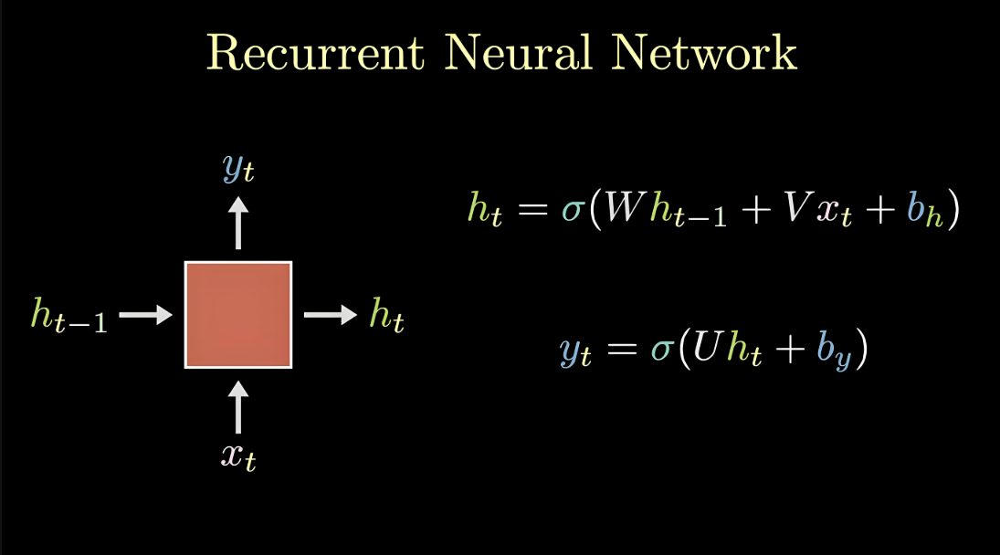

> 图中的红色方块代表一个 **RNN单元（RNN Cell）**。它在时间步 $t$（当前时刻）接收三个方向的信号并产生输出：
> 
> - $x_t$：当前时刻 $t$ 的**输入数据**（例如：句子中的第 $t$ 个单词的词向量）。
> 
> - $h_{t-1}$：上一时刻 $t-1$ 的**隐藏状态（Hidden State）**。你可以把它理解为网络在之前时刻积累的“记忆”或“上下文信息”。
> 
> - $h_t$：当前时刻 $t$ 计算出的**隐藏状态**。它将被传递给下一个时刻（$t+1$）的 RNN 单元。
> 
> - $y_t$：当前时刻 $t$ 的**输出结果**（例如：预测下一个词的概率分布）。
> 
> **核心特点**：$h_t$ 既作为当前时刻的输出传给 $y_t$，又作为记忆向右传递给下一个时间步。这种**“自环”结构**让 RNN 具有了**处理序列数据（如时间序列、文本、语音）的能力**。
> 
> ——————————————————————————————————————————————————————
> 
> 1. **隐藏状态的计算公式：**
> 
> $h_t = \sigma(W h_{t-1} + V x_t + b_h)$
> 
> - $W$：隐藏状态到隐藏状态的**权重矩阵**（决定了之前的“记忆”保留多少）。
> 
> - $V$：输入到隐藏状态的**权重矩阵**（决定了当前输入有多重要）。
> 
> - $b_h$：隐藏层的**偏置项**。
> 
> - $\sigma$：**激活函数**（通常是 tanh 或 ReLU，**默认是 tanh**），用于引入非线性。
> 
> - *解读*：当前时刻的记忆 $h_t$，是由 “过去的记忆 $h_{t-1}$” 和 “当前的输入 $x_t$” 经过线性组合后，再通过激活函数转换得到的。
> 
> 2. **输出的计算公式：**
> 
> $y_t = \sigma(U h_t + b_y)$
> 
> - $U$：隐藏状态到输出的**权重矩阵**。
> 
> - $b_y$：输出层的**偏置项**。
> 
> - $\sigma$：输出层的激活函数（根据任务不同，可能是 Sigmoid、Softmax 或恒等函数）。
> 
> - *解读*：当前时刻的输出 $y_t$，完全基于当前时刻的隐藏状态 $h_t$ 计算得出。
> 
> ——————————————————————————————————————————————————————
> 
> **补充：RNN 的重要特性**
> 
> 虽然图上没有直接写出来，但理解这个图时需要注意一个关键点：**参数共享**。
> 
> 在**不同的时间步**（即随着时间推移），$W、V、U、b_h、b_y$** ****这几个矩阵和偏置都是同一套，是共享的**。这大大减少了模型的参数量，并使得网络可以处理任意长度的序列。
> 
> **局限性（引申）**：这种简单的 RNN 结构在处理长序列时，容易出现**梯度消失（Gradient Vanishing）或梯度爆炸**的问题，导致网络无法记住很久以前的信息。这也是后来出现 LSTM（长短期记忆网络）和 GRU（门控循环单元）的原因。
> 
> 


### RNN 应用场景

- **自然语言处理（NLP）**：文本生成、语言建模、机器翻译、情感分析等。

- **时间序列预测**：股市预测、气象预测、传感器数据分析等。

- **语音识别**：将语音信号转换为文字。

- **音乐生成**：通过学习音乐的时序模式来生成新乐曲。


### 自然语言处理概述

自然语言处理（Nature language Processing, NLP）研究的主要是通过计算机算法来理解自然语言。

对于自然语言来说，处理的数据主要就是人类的语言，例如：汉语、英语、法语等，该类型的数据不像我们前面接触过的结构化数据、或者图像数据可以很方便的进行数值化。

NLP 的目标是让机器能够 “听懂” 和 “读懂” 自然语言，并进行有效的交流和分析。

NLP 涵盖了从文本到语音、从语音到文本的各个方面，它涉及多种技术，包括语法分析、语义理解、情感分析、机器翻译等。

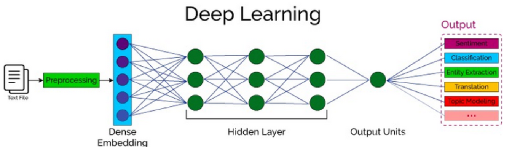


## 词嵌入层

在 **RNN（Recurrent Neural Network）** 中，**词嵌入层（Word Embedding Layer）** 是处理自然语言数据的关键组成部分。它将输入的离散单词（通常是词汇表中的索引）转换为连续的、低维的向量表示，从而使得神经网络能够理解和处理这些词汇的语义信息。

### 词嵌入层作用

词嵌入层的主要目的是**将每个词映射为一个固定长度的向量（将文本转换为向量）**，这些向量能够捕捉词与词之间的语义关系。

传统的文本表示方法（如 one\-hot 编码）无法反映单词之间的相似性，因为在 one\-hot 编码中，每个单词都被表示为一个**高维稀疏向量**，而词嵌入通过**低维稠密向量**表示单词，能够更好地捕捉词汇之间的语义相似性。

词嵌入层首先会根据输入的词的数量构建一个**词向量矩阵**，例如: 我们有 100 个词，每个词希望转换成 128 维度的向量，那么构建的矩阵形状即为: 100\*128，输入的每个词都对应了一个该矩阵中的一个向量。


**词嵌入层在 RNN 中的作用**：

- **输入表示**：RNN 通常用于处理序列数据。在处理文本时，RNN 的输入是由单词构成的序列。由于神经网络不能直接处理离散的单词标识符（如整数索引或字符），因此需要通过词嵌入层将每个单词转换为一个固定长度的稠密向量。这些向量作为 RNN 的输入，帮助 RNN 理解词语的语义。

- **降低维度**：词嵌入层将原本高维的稀疏表示（如 one\-hot 编码）转化为低维的稠密向量，减少了计算量，同时保持了词汇之间的语义关系。

- **捕捉语义相似性**：通过训练，词嵌入能够学习到词语之间的关系。例如，语义相似的词（如“猫”和“狗”）在向量空间中会比较接近，而语义不相关的词（如“猫”和“汽车”）则会较为遥远。


### 词嵌入层工作流程

- **初始化词向量**：词嵌入层的初始词向量通常会使用随机初始化或者通过加载预训练的词向量（如** Word2Vec** 或GloVe）进行初始化。

- **输入索引**：每个单词在词汇表（**字典**）中都有一个唯一的**索引**。输入文本（例如一个句子）会先被分词，然后每个单词会被转换为相应的索引。

- **查找词向量**：词嵌入层将这些单词索引映射为对应的词向量。这些词向量是一个低维稠密向量，表示该词的语义。

- **输入到 RNN**：这些词向量作为 RNN 的输入，RNN 处理它们并根据上下文生成一个序列的输出。


### 词嵌入层使用

> chapter04\_Recurrent\_Neural\_Network/01\_词嵌入层演示\.py
> 
> 

在 PyTorch 中，我们可以使用 **nn\.Embedding** 词嵌入层来实现输入词的向量化。

nn\.Embedding 对象构建时，最主要有两个参数:

- num\_embeddings：表示**词的数量**

- embedding\_dim：表示**用多少维的向量来表示每个词**

```python
nn.Embedding(num_embeddings=10, embedding_dim=4)
```

接下来，我们将会学习如何将词转换为词向量，其步骤如下:

1. 先将语料进行**分词**，构建词与索引的映射，我们可以把这个映射叫做**词表**，词表中每个词都对应了一个唯一的索引；

2. 然后使用 nn\.Embedding 构建**词嵌入矩阵**，词索引对应的向量即为该词对应的数值化后的向量表示。

例如，我们的文本数据为: "北京冬奥的进度条已经过半，不少外国运动员在完成自己的比赛后踏上归途。"，接下来，我们看下如何使用词嵌入层将其进行转换为向量表示，步骤如下：

```python
import torch
import torch.nn as nn
import jieba # pip install jieba -i https://pypi.mirrors.ustc.edu.cn/simple/


if __name__ == '__main__':
    # 0.文本数据
    text = '北京冬奥的进度条已经过半，不少外国运动员在完成自己的比赛后踏上归途。'
    # 1. 文本分词
    words = jieba.lcut(text)
    print('文本分词:', words)
    # 2.分词去重并保留原来的顺序获取所有的词语
    unique_words = list(set(words))
    print("去重后词的个数:\n",len(unique_words))
    # 3. 构建词嵌入层
    # num_embeddings: 表示词的总数量
    # embedding_dim: 表示词嵌入的维度
    embed = nn.Embedding(num_embeddings=len(unique_words), embedding_dim=4)
    print("词嵌入的结果：\n",embed)
    # 4. 词语的词向量表示
    for i, word in enumerate(unique_words):
        # 获得词嵌入向量
        word_vec = embed(torch.tensor(i))
        print('%s\t' % word, word_vec)
        # print(f"{word}\t{word_vec}")    # \t 是制表符 Tab
```

**输出结果：**

```python
文本分词: ['北京', '冬奥', '的', '进度条', '已经', '过半', '，', '不少', '外国', '运动员', '在', '完成', '自己', '的', '比赛', '后', '踏上', '归途', '。']
去重后词的个数:
 18
词嵌入的结果：
 Embedding(18, 4)
 北京         tensor([-1.8043,  1.7860, -0.7821, -0.3167], grad_fn=<EmbeddingBackward0>)
  的         tensor([-1.4856, -0.5639,  0.2745,  0.1087], grad_fn=<EmbeddingBackward0>)
 冬奥         tensor([ 0.6969, -0.5615,  1.6524, -0.2651], grad_fn=<EmbeddingBackward0>)
 自己         tensor([1.7163, 0.9710, 0.0193, 1.4562], grad_fn=<EmbeddingBackward0>)
 不少         tensor([ 0.8770, -1.0347,  0.4939,  1.6718], grad_fn=<EmbeddingBackward0>)
 归途         tensor([ 0.0619,  0.0355, -1.6510,  0.8121], grad_fn=<EmbeddingBackward0>)
 比赛         tensor([-1.7128,  0.0681,  2.4199,  0.2714], grad_fn=<EmbeddingBackward0>)
进度条         tensor([-0.6706,  0.4089, -0.5371,  0.1093], grad_fn=<EmbeddingBackward0>)
 外国         tensor([ 0.5665, -0.3168, -0.2065,  0.7682], grad_fn=<EmbeddingBackward0>)
 完成         tensor([ 1.4640, -0.2800, -0.2242, -0.3790], grad_fn=<EmbeddingBackward0>)
 过半         tensor([ 1.8026,  0.9831, -0.7177,  0.6779], grad_fn=<EmbeddingBackward0>)
 踏上         tensor([-1.0745, -0.2610, -1.5350, -0.1767], grad_fn=<EmbeddingBackward0>)
运动员         tensor([1.8748, 0.2093, 1.9471, 0.3893], grad_fn=<EmbeddingBackward0>)
  ，         tensor([-1.2841, -0.0675, -0.1263, -0.6892], grad_fn=<EmbeddingBackward0>)
  在         tensor([ 0.6202, -0.0106,  1.0504,  0.0299], grad_fn=<EmbeddingBackward0>)
 已经         tensor([2.4461, 0.2113, 0.9387, 0.1680], grad_fn=<EmbeddingBackward0>)
  后         tensor([-1.1989,  0.8727, -0.9484,  0.0578], grad_fn=<EmbeddingBackward0>)
  。         tensor([0.4020, 0.7357, 0.3571, 1.2355], grad_fn=<EmbeddingBackward0>)
```

每次生成的词向量都不是固定的。但词向量间的关系是不变的。


## 循环网络层

文本数据是具有序列特性的，例如: "我爱你", 这串文本就是具有序列关系的，"爱" 需要在 "我" 之后，"你" 需要在 "爱" 之后, 如果颠倒了顺序，那么可能就会表达不同的意思。

为了表示出数据的序列关系，我们需要使用循环神经网络 \(Recurrent Nearal Networks, RNN\) 来对数据进行建模，RNN 是一个具有记忆功能的网络，它作用于处理带有序列特点的样本数据。

### RNN 网络层原理

当我们希望使用循环网络来对 "我爱你" 进行语义提取时，RNN 计算过程是什么样的呢？


上图表示的是**同一个神经元**的不同时间步（循环）。

上图中 h 表示隐藏状态，隐藏状态保存了**序列数据中的历史信息**，并将这些信息传递给下一个**时间步**，从而允许RNN 处理和预测序列数据中的元素。

每一次的输入都会包含两个值：**上一个时间步的隐藏状态、当前状态的输入值 x**

每一次的输出都会包含两个值：**输出当前时间步的隐藏状态、当前时间步的预测结果 y**

**隐藏状态作用：**

- **记忆功能**：隐藏状态就像 RNN 的记忆，它能够在不同的时间步之间传递信息。当一个新的输入进入网络时，当前的隐藏状态会结合这个新输入来生成新的隐藏状态。

- **上下文理解**：由于隐藏状态携带了过去的信息，它可以用于理解和生成与上下文相关的输出。这对于语言模型、机器翻译等任务尤其重要。

- **连接不同时间步**：隐藏状态通过网络内部的循环连接将各个时间步连接起来，使得网络可以处理变长的序列数据。

上图中，为了更加容易理解，虽然画了 3 个神经元，但是**实际上只有一个神经元**，"我爱你" 三个字是重复输入到同一个神经元中。


我们举个例子来理解上图的工作过程，假设我们要实现文本生成，也就是输入 "我爱" 这两个字，来预测出 "你"，其如下图所示:


将上图展开成不同**时间步**的形式，如下图所示:


首先初始化出第一个隐藏状态，一般都是全 0 的一个向量，然后将 "我" 进行词嵌入，转换为向量的表示形式，送入到第一个时间步，然后输出隐藏状态 h1，然后将 h1 和 "爱" 输入到第二个时间步，得到隐藏状态 h2, 将 h2 送入到全连接网络，得到 "你" 的预测概率。

#### **RNN 神经元内部计算方式**

1. **计算隐藏状态：**每个时间步的隐藏状态$h_t$是根据当前输入$x_t$和前一时刻的隐藏状态$h_{t-1}$计算的。

$h_t = \tanh (W_{ih}x_t + b_{ih} + W_{hh}h_{(t-1)} + b_{hh})$


上述公式中:

- $W_{ih}$ 表示输入数据的权重

- $b_{ih}​$ 表示输入数据的偏置

- $W_{hh}​$ 表示输入隐藏状态的权重

- $b_{hh}$ 表示输入隐藏状态的偏置

- $h_{t-1}$ 表示输入隐藏状态

- $h_t​$ 表示输出隐藏状态

最后对输出的结果使用 tanh 激活函数进行计算，得到该神经元你的输出隐藏状态。

2. **计算当前时刻的输出：**网络的输出$y_t$是当前时刻的隐藏状态经过一个线性变换得到的。

$y_t=W_{hy}h_t+b_y​$

- $y_t​$ 是当前时刻的输出（通常是一个向量，表示当前时刻的预测值，RNN层的预测值）

- $h_t​$ 是当前时刻的隐藏状态

- $W_{hy}$ 是从隐藏状态到输出的权重矩阵

- $b_y$ 是输出层的偏置项

3. **词汇表映射**：输出$y_t$是一个**向量**，该向量经过**全连接层**后输出得到最终预测结果$y_{pred}$，$y_{pred}$中每个元素代表当前时刻生成词汇表中某个词的得分（或概率，通过激活函数：如 **softmax**）。词汇表有多少个词，$y_{pred}$就有多少个元素值，最大元素值对应的词就是当前时刻预测生成的词。

#### **神经元工作机制总结**

- **接收输入**：每个 RNN 神经元接收来自输入数据$x_t$和前一时刻的隐藏状态$h_{t-1}$。

- **更新隐藏状态**：神经元通过一个加权和（由权重矩阵和偏置项组成）更新当前时刻的隐藏状态$h_t​$，该隐藏状态包含了来自过去的记忆以及当前输入的信息。

- **输出计算**：基于当前隐藏状态$h_t​$，神经元生成当前时刻的输出$y_t​$，该输出可以用于任务的最终预测。


#### **示例：基于字符级 RNN 的语言模型**

> 属于 N vs N RNN\.
> 
> 声明：这种滑动窗口且步长为 1 取样本的方式并不是标准流程之内。这样在文档大的时候取出来的样本会很多。
> 
> 


**【训练阶段 \(Teacher Forcing\) 】**

假设我们有语料 `"machine"`。我们将其错位切分为输入序列 `X = m, a, c, h, i, n` 和标签序列 `Y = a, c, h, i, n, e`。

1. 将输入序列和标签序列转换为**字符向量**。

2. 初始化隐藏状态 $h_0$，一般初始值为 0。

3. **第 1 步**：输入 `m`，计算得到 $H_1$，输出层 $O_1$ 预测字符，与**真实标签 ****`a`** 计算损失。

4. **第 2 步**：输入**真实标签 ****`a`**（注意，训练时是真实标签，而不是 $O_1$ 的预测结果），结合 $H_1$ 计算得到 $H_2$，输出预测，与**真实标签 ****`c`** 计算损失。

5. 以此类推，反向传播更新参数。

> **💡 进阶理解：为什么训练时要这么做？**
> 
> 这种机制叫 **Teacher Forcing（教师强制）**。如果在第1步模型瞎猜预测成了 `b`，如果我们第2步把 `b` 喂进去，模型就会“一步错步步错”，误差不断累积，很难收敛。强制喂入真实标签，能让模型快速学会“给定绝对正确的前文，下一个词应该是什么”。
> 
> 

**【生成阶段 \(Inference\) 】**

训练好模型后，我们只输入初始字符 `m`。

1. 模型输出概率分布，我们取概率最高的 `a`（或者按概率采样）。

2. 将刚才生成的 `a` 作为下一个时间步的输入，结合隐藏状态继续预测，得到 `c`。

3. 循环往复，直到生成结束符（如 `<EOS>`），得到完整的 `"machine"`。

> **💡 进阶理解：生成时的细节**
> 
> - **为什么没有标签了？** 因为生成阶段面对的是未知数据，没有“标准答案”可以抄，只能把自己刚刚生成的预测结果作为下一步的输入，这就叫**自回归（Autoregressive）**。
> 
> - **按概率采样（Sampling）**：文字里提到的 “或者按概率采样” 非常关键。如果我们每次只选概率最高的（贪心搜索 Greedy Search），生成的文本往往很死板。实际应用中常常引入 **Temperature（温度参数）** 或 **Top\-k / Top\-p 采样**，让模型偶尔选一些概率稍低但合理的词，增加生成的多样性。
> 
> - **`<EOS>`**** 是什么？** 是 End of Sequence 的缩写（结束符）。我们在构建训练集时，会在每个句子的末尾加上 `<EOS>`，这样模型在生成时，一旦吐出 `<EOS>`，程序就知道“这个词说完了”，从而停止循环。
> 
> 

**总结一下：**

- **训练** = 看完整答案，错位配对（$X$ 比 $Y$ 多一个起始符，$Y$ 比 $X$ 多一个结束符），强制喂入真实标签算 Loss。

- **生成** = 瞎子摸象，走一步看一步，把刚吐出来的东西嚼一嚼再咽下去继续吐。


### PyTorch RNN 层的使用

> chapter04\_Recurrent\_Neural\_Network/02\_RNN层简介\.py
> 
> 

- API 介绍

    ```python
    RNN = nn.RNN(input_size, hidden_size，num_layers, nonlinearity,* *batch_first)
    ```

    - input\_size：输入数据的维度，一般设为词向量的维度。

    - hidden\_size：隐藏层 h 的维度，也是当前层神经元的输出维度。

    - num\_layers：隐藏层 h 的层数，默认为 1。

    - nonlinearity：激活函数，默认 tanh，可改为 relu。

    - batch\_first：控制 RNN 输入和输出的形状，默认 False。


> 注：这里面的 batch 是 batch\_size 的意思。
> 
> 

- 输入数据和输出结果

将 RNN 实例化就可以将数据送入其中进行处理，处理的方式如下所示：

```Python
output, hn = RNN(x, h0)
```


> 注：上面写的输出向量的维度是指 output 的第三个维度，即 hidden\_size；而不是经过全连接层（输出层）之后的输出维度，即全连接层神经元个数。
> 
> 

- **输入数据：主要包括词嵌入的 x 、初始的隐藏层 h0**

    - x 的表示形式为 \[seq\_len, batch\_size, input\_size\]，即 \[句子的长度，batch 的大小，词向量的维度\]

    - h0 的表示形式为 \[num\_layers, batch\_size, hidden\_size\]，即  \[隐藏层的层数，batch的大小，隐藏层 h 的维度\]

- **输出结果：主要包括输出结果output,最后一层的hn**

    - output 的表示形式与输入 x 类似，为 \[seq\_len, batch\_size, hidden\_size\]，即 \[句子的长度，batch 的大小，隐藏层 h 的维度\]

    - hn 的表示形式与输入 h0 一样，为 \[num\_layers, batch\_size, hidden\_size\]，即 \[隐藏层的层数，batch 的大小，隐藏层 h 的维度\]

> x 和 output 的表示形式与 nn\.RNN 的参数 batch\_first 有关，默认为 False，表示形式就是上面的样子。
> 
> 如果改为 batch\_first=True，则 x 和 output 的表示形式就变为 \[batch\_size, seq\_len, input\_size\] 与 \[batch\_size, seq\_len, hidden\_size\]。
> 
> **h0 和 hn 的形状不受这个参数的影响，永远都是上面的形式。**
> 
> 

- API 使用

    ```python
    import torch
    import torch.nn as nn
    
    
    ##  RNN层送入批量数据
    def test():
        # 词向量维度 128, 隐藏向量维度 256，隐藏层数量，默认就为1
        rnn = nn.RNN(input_size=128, hidden_size=256, num_layers=1)
        
        # 第一个数字: 表示句子长度,也就是词语个数
        # 第二个数字: 批量个数，也就是句子的个数
        # 第三个数字: 词向量维度
        inputs = torch.randn(5, 32, 128)
        # 第一个数字: 隐藏层层数
        # 第二个数字: batch_size
        # 第三个数字: 隐藏向量维度  
        h0 = torch.zeros(1, 32, 256)
        # 获取输出结果
        output, hn = rnn(inputs, h0)
        print("输出向量的维度：\n",output.shape)
        print("隐藏层输出的维度：\n",hn.shape)
    
    
    if __name__ == '__main__':
        test()
    ```

    ```python
    输出向量的维度：
     torch.Size([5, 32, 256])
    隐藏层输出的维度：
     torch.Size([1, 32, 256])
    ```


## 文本生成案例

> chapter04\_Recurrent\_Neural\_Network/03\_RNN案例\_AI歌词生成器\.py
> 
> 

文本生成任务是一种常见的自然语言处理任务，输入一个开始词能够预测出后面的词序列。本案例将会使用循环神经网络来实现周杰伦歌词生成任务。

**导入工具包：**

```python
import torch
import jieba
from torch.utils.data import DataLoader
import torch.nn as nn
import torch.optim as optim
import time
```

### 获取数据集并构建词表

#### **数据集**

收集周杰伦从第一张专辑《Jay》到第十张专辑《跨时代》中的歌词，来训练神经网络模型，当模型训练好后，我们就可以用这个模型来创作歌词。数据集如下：

```python
想要有直升机
想要和你飞到宇宙去
想要和你融化在一起
融化在宇宙里
我每天每天每天在想想想想著你
这样的甜蜜
让我开始相信命运
感谢地心引力
让我碰到你
漂亮的让我面红的可爱女人
...
```

该数据集共有 5819 行文本。

#### 构建词表

在进行自然语言处理任务之前，首要做的就是构建词表。

所谓的词表就是将语料进行分词，然后给每一个词分配一个唯一的编号，便于我们送入词嵌入层。

接下来，对周杰伦歌词的数据进行处理构建词表，具体流程如下：

- 获取文本数据

- 分词，并进行去重

- 构建词表

```python
## 获取数据，并进行分词，构建词表
def build_vocab():
    # 数据集位置
    file_name = 'data/jaychou_lyrics.txt'
    # 分词结果存储位置
    # 唯一词列表
    unique_words = []
    # 每行文本分词列表
    all_words = []
    # 遍历数据集中的每一行文本
    for line in open(file_name, 'r', encoding='utf-8'):
        # 使用jieba分词,分割结果是一个列表
        words = jieba.lcut(line)
        # print(words)
        # 所有的分词结果存储到all_words，其中包含重复的词组
        all_words.append(words)
        # 遍历分词结果，去重后存储到unique_words
        for word in words:
            if word not in unique_words:
                unique_words.append(word)
    *# [修改]：确保分隔符 ' ' 一定在词表中，避免后续 word_to_index[' '] 报 KeyError*
    if ' ' not in unique_words:
        unique_words.append(' ')
    # 语料中词的数量
    unique_word_count= len(unique_words)
    # 词到索引映射
    word_to_index = {word: idx for idx, word in enumerate(unique_words)}
    # 歌词文本用词表索引表示
    corpus_idx = []
    # 遍历每一行的分词结果
    for words in all_words:
        temp = []
        # 获取每一行的词，并获取相应的索引
        for word in words:
            temp.append(word_to_index[word])
        # 在每行词之间添加空格隔开（是空格在词表字典中对应的索引）
        temp.append(word_to_index[' '])
        # 获取当前文档中每个词对应的索引
        corpus_idx.extend(temp)
    return unique_words, word_to_index, unique_word_count, corpus_idx


if __name__ == "__main__":
    # 获取数据
    unique_words, word_to_index, unique_word_count, corpus_idx = build_vocab()
    print("词的数量：\n",unique_word_count)
    print("去重后的词：\n",unique_words)
    print("每个词的索引：\n",word_to_index)
    print("文档中每个词对应的索引：\n",corpus_idx)
```

我们的词典主要包含了:

- unique\_words: 存储了每个词

- word\_to\_index: 存储了词到编号的映射

```Plain Text
词的数量: 
 5703
去重后的词: 
 ['想要', '有', '直升机', '\n', '和', '你', '飞到', '宇宙', '去', '融化', '在', '一起', '里', 
每个词的索引: 
 {'想要': 0, '有': 1, '直升机': 2, '\n': 3, '和': 4, '你': 5, '飞到': 6, '宇宙': 7, '去': 8, 
文档中每个词对应的索引: 
 [0, 1, 2, 3, 40, 0, 4, 5, 6, 7, 8, 3, 40, 0, 4, 5, 9, 10, 11, 3, 40, 9, 10, 7, 12, 3, 40, 
```

### 构建数据集对象

我们在训练的时候，为了便于读取语料，并送入网络，所以我们会构建一个 Dataset 对象。

```python
class LyricsDataset(torch.utils.data.Dataset):
    def __init__(self, corpus_idx, num_chars):
        ## 文档数据中词的索引
        self.corpus_idx = corpus_idx
        ## 每个句子中词的个数（人为规定）
        self.num_chars = num_chars
        ## 文档数据中词的数量，不去重，包含插入的空格
        self.word_count = len(self.corpus_idx)
        ## 句子数量
        *# [修改]：原来用 word_count // num_chars，但 __getitem__ 里把 idx 当起始位置用，*
        *# 导致只用到文档开头很少的数据；这里改成可用起始位置的数量*
        *# 滑动窗口取句子*
        self.number = max(0, self.word_count - self.num_chars)
        '''
        例如这代表文档所有词（不去重，包含插入的空格）：1 2 3 4 5 6，规定句子长度 num_chars=3，则可取出以下几个句子
        输入：1 2 3    标签：2 3 4
        输入：2 3 4    标签：3 4 5
        输入：3 4 5    标签：4 5 6
        即句子数量为 6 -3 = 3
        '''

    ## len(obj)时自动调用此方法
    def __len__(self):
        ## 返回句子数量
        return self.number

    ## obj[idx]时自动调用此方法
    def __getitem__(self, idx):
        ## idx指词的索引，并将其修正索引值到文档的范围里面
        """
        还是上面的例子：
        start只能从开头的取到3
        要确保start后面至少还有num_chars，start表示索引，所以start最大取word_count-1-num_chars
        并且start最小不能取负数，起码在本例中不能取-1，-2，-3 以及 -7，-8，...，
        为了一劳永逸，直接不让start使用负索引。
        """
        start = min(max(idx, 0), self.word_count - self.num_chars - 1)
        end = start + self.num_chars
        ## 输入值
        x = self.corpus_idx[start: end]    # 切片，左闭右开
        ## 网络理想预测结果（目标值，标签）
        y = self.corpus_idx[start + 1: end + 1]
        ## 返回结果
        return torch.tensor(x), torch.tensor(y)


if __name__ == "__main__":
    ## 获取数据
    unique_words, word_to_index, unique_word_count, corpus_idx = build_vocab()
    ## 数据获取实例化
    dataset = LyricsDataset(corpus_idx, 5)    # 以 num_chars=5举例，实际训练可以调整
    ## 查看句子数量
    print('句子数量：', len(dataset))
    ## x, y = dataset.__getitem__(0)
    x, y = dataset[0]
    print("网络输入值：", x)
    print("目标值：", y)
```

**输出结果：**

```python
句子数量： 49130
网络输入值： tensor([ 0,  1,  2,  3, 40])
目标值： tensor([ 1,  2,  3, 40,  0])
```

### 构建网络模型

我们用于实现《歌词生成》的网络模型，主要包含了三个层:

- 词嵌入层：用于将语料转换为词向量

- 循环网络层：提取句子语义

- 全连接层：输出对词典中每个词的预测概率

```python
## 模型构建
class TextGenerator(nn.Module):
    def __init__(self, unique_word_count):
        super(TextGenerator, self).__init__()
        # 初始化词嵌入层: 语料中词的数量, 词向量的维度为128
        self.ebd = nn.Embedding(unique_word_count, 128)
        # 循环网络层: 词向量维度128, 隐藏向量维度256, 网络层数1
        self.rnn = nn.RNN(128, 256, 1)
        # 输出层: 特征向量维度256与隐藏向量维度相同, 词表中词的个数
        self.out = nn.Linear(256, unique_word_count)

    def forward(self, inputs, hidden):
        # 输出维度: (batch_size, seq_len, 词向量维度128)
        # batch_size：句子数量
        # seq_len： 句子长度， 每个句子由多少个词 词数量
        embed = self.ebd(inputs)
        # rnn层x的表示形式为(seq_len, batch_size, 词向量维度128)
        # output的表示形式与输入x类似，为(seq_len, batch_size, 词向量维度256)
        # 前后的hidden形状要一样, 所以DataLoader加载器的batch数要能被整数
        output, hidden = self.rnn(embed.transpose(0, 1), hidden)
        #*# 这里也可以改上面self.rnn的代码为：self.rnn = nn.RNN(128, 256, 1, batch_first=True),那么这里的代码就不需要对embd做transpose(0, 1)*
        # 全连接层输入二维数据， 词数量*词维度
        # 输入维度: (seq_len*batch_size, 词向量维度256) 
        # 输出维度: (seq_len*batch_size, 语料中词的数量)
        # output: 每个词的分值分布，后续结合softmax输出概率分布
        output = self.out(output.reshape(shape=(-1, output.shape[-1])))
        # 网络输出结果
        return output, hidden

    def init_hidden(self, bs):
        # 隐藏层的初始化:[网络层数, batch, 隐藏层向量维度]
        return torch.zeros(1, bs, 256)


if __name__ == "__main__":
    ## 获取数据
    unique_words, word_to_index, unique_word_count, corpus_idx = build_vocab()
    model = TextGenerator(unique_word_count)
    for named, parameter in model.named_parameters():
        print(named)
        print(parameter)
```

### 构建训练函数

前面的准备工作完成之后，就可以编写训练函数。训练函数主要负责编写数据迭代、送入网络、计算损失、反向传播、更新参数，其流程基本较为固定。

由于要实现文本生成，文本生成本质上是输入一串文本、预测下一个文本，也属于多分类问题，所以使用多分类交叉熵损失函数。优化方法可以使用学习过 SGB、AdaGrad、Adam 等，在这里选择学习率、梯度自适应的 Adam 算法作为优化方法。

训练完成之后，使用 torch\.save 方法将模型（参数）持久化存储。

```python
def train():
    torch.manual_seed(123)
    ## 构建词典
    unique_words, word_to_index, unique_word_count, corpus_idx = build_vocab()
    ## 数据集 LyricsDataset对象，并实现了 __getitem__ 方法
    lyrics = LyricsDataset(corpus_idx=corpus_idx, num_chars=32)
    ## 查看句子数量
    ## print(lyrics.number)
    ## 初始化模型
    model = TextGenerator(unique_word_count)
    ## 数据加载器 DataLoader对象，并将lyrics dataset对象传递给它
    lyrics_dataloader = DataLoader(lyrics, shuffle=True, batch_size=5)
    ## 损失函数
    criterion = nn.CrossEntropyLoss()
    ## 优化方法
    optimizer = optim.Adam(model.parameters(), lr=1e-3)
    ## 训练轮数
    epoch = 50
    for epoch_idx in range(epoch):
        ## 训练时间
        start = time.time()
        iter_num = 0  # 迭代次数
        ## 训练损失
        total_loss = 0.0
        ## 遍历数据集 DataLoader 会在后台调用 dataset.__getitem__(index) 来获取每个样本的数据和标签，并将它们组合成一个 batch
        for x, y in lyrics_dataloader:
            ## 隐藏状态的初始化
            # hidden = model.init_hidden(bs=5)
            *# [修改]：按当前batch_size大小动态初始化hidden，避免最后一个batch_size不满 5 时报维度不匹配*
            hidden = model.init_hidden(x.size(0))
            ## 模型计算
            output, hidden = model(x, hidden)
            ## 计算损失
            ## y形状为(batch_size, seq_len), 需要转换成一维向量->5*32=160个词的下标索引
            # output形状为(seq_len, batch_size, 词向量维度)
            # 需要先将y进行维度交换(和output保持一致)再改变形状
            y = torch.transpose(y, 0, 1).reshape(shape=(-1,))    # 保证展平后的索引与output能对上，不然计算的损失是错的    
            loss = criterion(output, y)    
            *# output经过激活函数后会输出所有词（5703个词）的概率，相当于是160*5703，而y展平后是160 * 1的，*
            # *y的索引范围是0-5702，这正是多元交叉熵损失的原理，*
            # *但这里实际上很少用 one-hot 编码，因为浪费算力，通常是通过索引直接去对应查找.*
            optimizer.zero_grad()
            loss.backward()
            optimizer.step()
            iter_num += 1  # 迭代次数加1
            total_loss += loss.item()
        ## 打印训练信息
        print('epoch %3s loss: %.5f time %.2f' % (epoch_idx + 1, total_loss / iter_num, time.time() - start))
    ## 模型存储
    *# [修改]：保存前确保 ./model 目录存在，否则 torch.save 会报错*
    os.makedirs('./model', exist_ok=True)    
    torch.save(model.state_dict(), 'model/lyrics_generator_model.pth')


if __name__ == "__main__":
    train()
```

**输出结果：**

**按上诉滑动窗口且步长为 1 的方式切割训练样本太多了，训练速度太慢了（一轮需要三分钟左右），所以实际运行修改了 \_\_len\_\_ 和 \_\_getitem\_\_ 的实现方式，并没有按上述方式，改为直接按块划分（相当于步长就是句子长度）**。以下是修改后的运行结果：

```python
epoch: 1, time: 4.64s, loss: 5.6328
epoch: 2, time: 5.25s, loss: 4.6464
epoch: 3, time: 5.17s, loss: 3.8689
epoch: 4, time: 5.27s, loss: 3.1583
epoch: 5, time: 4.91s, loss: 2.5613
epoch: 6, time: 4.93s, loss: 2.0604
epoch: 7, time: 4.98s, loss: 1.6555
epoch: 8, time: 4.71s, loss: 1.3243
epoch: 9, time: 4.94s, loss: 1.0626
epoch: 10, time: 5.65s, loss: 0.8541
...
epoch: 46, time: 7.75s, loss: 0.1444
epoch: 47, time: 9.84s, loss: 0.1444
epoch: 48, time: 7.79s, loss: 0.1413
epoch: 49, time: 7.15s, loss: 0.1369
epoch: 50, time: 7.12s, loss: 0.1368
```

### 构建预测函数

从磁盘加载训练好的模型，进行预测。预测函数，输入第一个指定的词，我们将该词输入网路，预测出下一个词，再将预测的出的词再次送入网络，预测出下一个词，以此类推，知道预测出我们指定长度的内容。

```python
def predict(start_word, sentence_length):
    # 构建词典
    unique_words, word_to_index, unique_word_count, _ = build_vocab()
    # 构建模型
    model = TextGenerator(unique_word_count)
    # 加载参数
    model.load_state_dict(torch.load('model/lyrics_generator_model.pth'))
    *# [修改]：切换到推理模式，规范做法*    
    model.eval()
    # 隐藏状态
    hidden = model.init_hidden(bs=1)
    # 将起始词转换为索引
    word_idx = word_to_index[start_word]
    # 产生的词的索引存放位置
    generate_sentence = [word_idx]
    # 遍历到句子长度，获取每一个词
    for _ in range(sentence_length):
        # 模型预测
        output, hidden = model(torch.tensor([[word_idx]]), hidden)
        # 获取预测结果
        word_idx = int(torch.argmax(output))
        generate_sentence.append(word_idx)
        # 根据产生的索引获取对应的词，并进行打印
    for idx in generate_sentence:
        print(unique_words[idx], end='')
    print()  *# 补一个换行，防止预测多次时和后面的内容粘连*


if __name__ == '__main__':
    # 调用预测函数
    predict('星星', 50)
    print('-' * 30)
    predict('分手', 50)
    *# start_word 必须在词表中，否则无法预测，直接报错*
```

**输出结果：**

```python
星星
 你的完美主义 太彻底
 让我连恨都难以下笔
 将真心抽离写成日记 像是一场默剧
 你的完美主义 太彻底
 分手的话像语言暴力
 我已无能为力再提起
------------------------------
分手当作你的请求
 我知道坚持要走是你受伤的借口
 请你回头 我会陪你一直走到最后
 能不能别想太多
 会不会手牵着一起有点勉强
 该不该现在休了我
```


2026\.10\.25

北师珠图书馆

